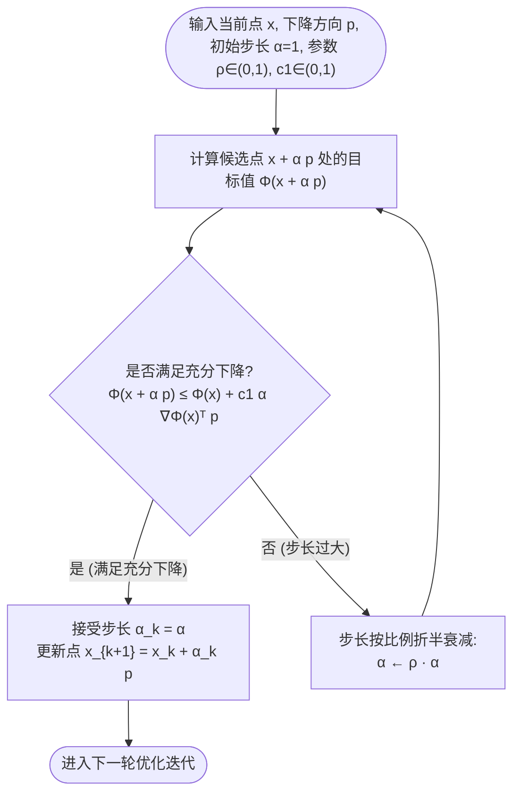
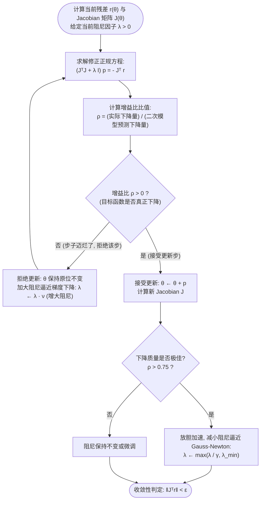
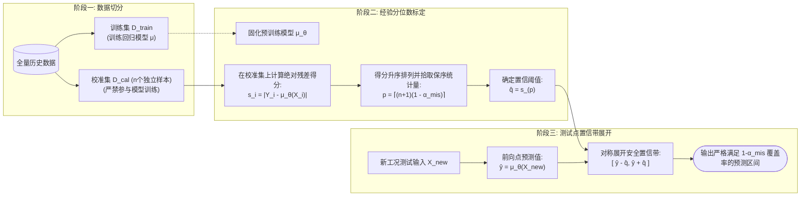
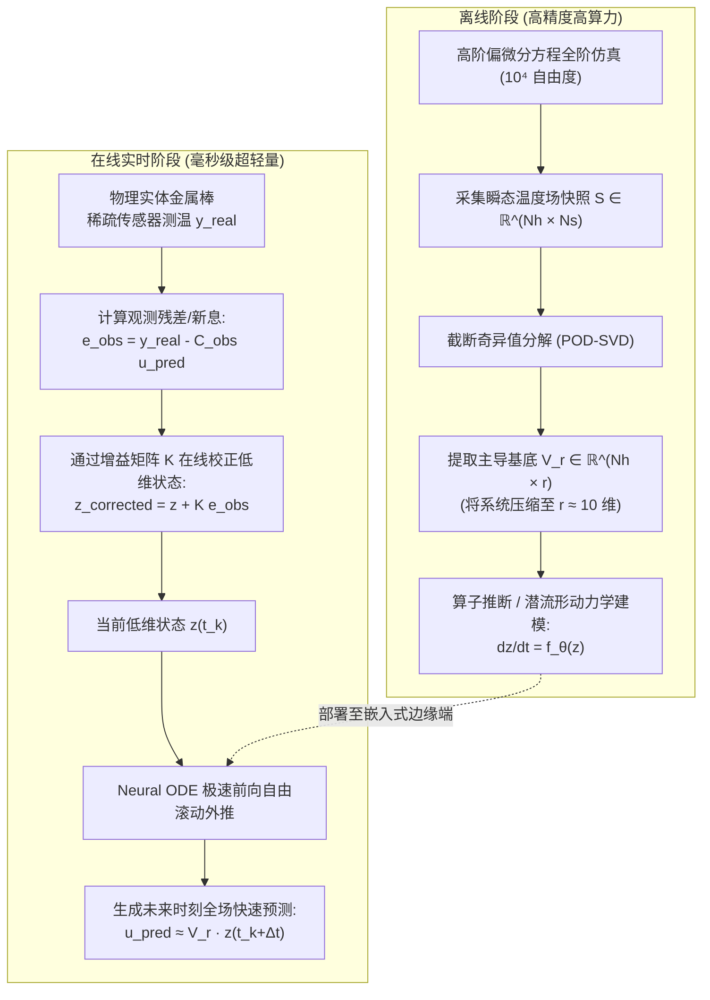

# E1（G10组）整合思路报告：第05—08章独立统筹与整合方案

| 属性 | 内容与规范 |
| :--- | :--- |
| **报告主体** | E1 整合统筹组（实际组别：G10） |
| **负责范围** | 独立统筹与整合后四章：第05章、第06章、第07章、第08章 |
| **基准底本** | 第05章：**A2（G19）** 为主，A1（G9）为辅；<br>第06章：**A1（G12）** 为主，A2（G15）为辅；<br>第07章：**A2（G6）** 为主，A1（G1）为辅；<br>第08章：**A2（G17）** 为主，A1（G4）为辅。 |
| **整合原则** | 独立工作、摒除外部先入之见；以**热传导与冷却系统**为主线贯穿四章；以**第07章 A2（G6）“小绘探险”**风格统领全篇；重点在于**尽量削减定理数量**，避免概念推导过度堆叠；**正文禁放冗长代码**，改以流程图与算法伪代码呈现；全方位消减冗余，兼顾学术严格性与可读性。 |

---

## 一、 贯穿案例：热传导与冷却系统（Thermal Evolution）主线设计

针对后四章各组各选物理模型、记号冲突、互不引用的割裂现状，E1 独立确立**一维/二维热传导与冷却演化系统**作为全书后半部分的唯一贯穿主线。通过同一个物理对象在不同章节的递进探索，展现现代科学计算“数值寻优 $`\to`$ 物理学习 $`\to`$ 可信验证 $`\to`$ 降阶加速”的完整方法论闭环。


### 1. 统一物理模型方程与基准参数设计

贯穿案例涵盖稳态、瞬态、变系数及二维各向异性传热，统一参数和实验基准如下：

1. **一维时变冷却方程（时域演化主线）**：
   $$
   \frac{\partial u}{\partial t} = \kappa \frac{\partial^2 u}{\partial x^2} - \beta u, \quad x \in (0, 1), \; t > 0
   $$
   *边界条件*：两端 Dirichlet 边界 $`u(0, t) = u(1, t) = 0`$；
   *初值分布*：单模态 $`u(x, 0) = A \sin(\pi x)`$ 或双模态 $`u(x, 0) = \sin(\pi x) + c \sin(3\pi x)`$；
   *解析衰减解*：对于单模态，任意固定点 $`x_0`$ 处的传感器测温曲线为指数衰减形式：
   $$
   u(x_0, t) = a e^{-b t}, \quad a = A \sin(\pi x_0), \; b = \kappa \pi^2 + \beta
   $$
2. **一维稳态热传导方程（空间边值主线）**：
   $$
   -\mu \frac{d^2 u}{d x^2} = f(x), \quad x \in (0, 1), \quad u(0) = u(1) = 0
   $$
   当热源 $`f(x) = \pi^2 \sin(\pi x)`$ 时，其精确解析温度场为 $`u(x) = \frac{1}{\mu} \sin(\pi x)`$。
3. **二维各向异性/非均匀热传导方程（空间高维主线）**：
   $$
   -\nabla \cdot \big( k(x, y) \nabla u(x, y) \big) = f(x, y), \quad (x, y) \in (0, 1)^2
   $$
   外围边界满足齐次零温边界。用于第 08 章 8.1 节大型稀疏离散矩阵的预条件加速。

### 2. 全书基准参数真值与采样规范表

| 参数物理意义 | 统一符号 | 基准真值 / 采样分布 | 首次引入章节 | 教学作用 |
| :--- | :--- | :--- | :--- | :--- |
| **空间计算域** | $`x \in \Omega`$ | 一维 $`x \in [0, 1]`$；二维 $`[0, 1]^2`$ | 全书 | 统一无量纲几何尺度 |
| **热扩散率** | $`\kappa`$ | 真值 $`\kappa^* = 0.0709`$（使得 $`\kappa \pi^2 \approx 0.7`$） | 第05章 5.4 | 决定指数衰减时间尺度 |
| **侧面散热系数** | $`\beta`$ | 标称模型 $`\beta = 0`$；真实物理棒 $`\beta = 0.3`$ | 第05章 5.4 | 制造建模未建模动态与外推误差 |
| **稳态导热系数** | $`\mu`$ | 基准真值 $`\mu^* = 1.5`$；分布内 $`\mu \in [0.8, 1.8]`$ | 第05章 5.4、第06章 | 参数辨识与解算子输入参数 |
| **传感器配置** | $`x_j`$ | 12 个内部等距观测点：$`x_j = \frac{j}{13}, \; j=1, \dots, 12`$ | 第05章 5.4 | 空间离散非完全观测 |
| **测温测量噪声** | $`\sigma_{\text{noise}}`$ | 高斯白噪声 $`\mathcal{N}(0, \sigma^2)`$，$`\sigma = 0.01`$ | 第05章、第07章 | 测试算法对病态反演的抗噪性 |
| **OOD 域外工况** | $`\mu_{\text{OOD}}`$ | 域外测试集：$`\mu \in [2.4, 3.5]`$，热源频率 $`3\pi, 5\pi`$ | 第07章 7.2 | 检验泛化边界与不确定性区间 |
| **降阶截断阶数** | $`r`$ | $`r = 4 \sim 16`$ 阶（捕获 $`>99.9\%`$ 能量） | 第08章 8.2 | 空间自由度降维压缩率对比 |

### 3. 小绘在各章节的递进剧情设计
* **第05章（探险起点）**：小绘拿到冷却棒的若干温度离散读数，任务是反演冷却速率并推算安全搬运时间。小绘遭遇了“残差很小但参数估算偏差巨大”的病态困境，引出 Hessian 谱条件数、Gauss-Newton 与 LM 阻尼法。
* **第06章（认知跃升）**：单点测温只能知晓局部，小绘需要知道整根金属棒的连续温度场分布。传统差分网格太密算不动，小绘尝试用神经网络直接求解微分方程（PINN），却遭遇了“内部方程残差几乎为零，但边界温度完全飞掉”的反例；随后进一步学习如何用 FNO/DeepONet 学习“任意热源到温度场”的万能映射算子。
* **第07章（信任反思）**：工件被送入全新工艺的高温炉中（OOD 域外环境），模型依然给出了平滑美观的预测图，但实测严重超标！小绘震惊地意识到“训练误差小并不代表域外能用”，进而建立误差分解体系，并用 Split-Conformal 预测技术为预测结果套上严谨的“安全置信带”。
* **第08章（工业闭环）**：产线要求每 5 毫秒输出一次全场温度并联动风扇控温，大模型和高精度离散求解器都太慢。小绘学会将复杂物理场打包放进“低维背包”（POD-SVD 降阶），用 Neural ODE 在潜流形上高速滚动外推，并在传感器数据到来时微调校正，搭建出鲁棒的工业数字孪生。

---

## 二、 整体叙事风格规范：以第 07 章 A2（G6）为标杆的重构标准

第 07 章 A2（G6）是全书可读性最佳的示范稿。E1 组制定四项核心文风改写规范，强制推行至第 05、06、08 章：

### 1. 结构四步走范式
每个小节的行文必须严格遵循“**四步走**”：
1. **工程困惑与角色引入（150字内）**：从小绘面对的真实实验怪象切入，明确“本节要解决什么痛点”。
2. **直观类比与极简小样（图解优先）**：先用 1 维小函数、手算小矩阵或示意图说明机理，严禁一上来就堆砌高维张量指标。
3. **形式化数学表达（突出核心定理）**：尽量削减定理数量，仅保留最关键的理论基石，证明力求紧凑优雅（不超过半页）。
4. **反思与留白（承上启下）**：指出该方法的成立边界与遗留缺陷，自然引出下一节。

### 2. 三大底本风格改写范例草稿

#### 【第05章 5.1 节开篇改写范例】
> **原 5A2 文本**：“非线性方程可能无解、多解或有无穷多解。一般需要数值方法。比如 $`f(x)=x^2-2=0`$……”（平铺直叙，略显枯燥）。
>
> **E1 统一定调改写**：
> “小绘把加热后的合金棒从熔炉取出。工厂安全规程要求：必须等金属棒降到 $`50^\circ\text{C}`$ 才能用机械臂搬运。传感器传回了一条冷却曲线 $`u(t) = 150 e^{-0.7 t} + 20`$。小绘需要解一个简单的方程：何时 $`u(t) = 50`$？
> 
> 在纸上，小绘可以移项取对数求出精确解。但在实际工况中，金属棒中点读数往往包含高阶非线性辐射散热项：$`z - c z^9 = u_{\text{safe}}`$。这一次，初等代数公式彻底失效了！我们只能依靠迭代一步步逼近真理。但逼近的脚印是怎样落下的？每走一步，误差能缩小多少？我们凭什么相信计算机会在一个有限的时间内给出可靠的答案？”

#### 【第06章 6.1 节开篇改写范例】
> **原 6A1 文本**：“6.1.1 模块信息与教学目标……知识背景：本节主要讲解 PINN 原理……”（充斥着大量大模型模板格式文字）。
>
> **E1 统一定调改写**：
> “如果神经网络能够识猫辨狗，它能不能理解牛顿和傅里叶写下的物理定律？
> 
> 小绘这一次不想只在离散的传感器点上做数值拟合，她想让神经网络学会整根金属棒的连续温度场 $`u(x)`$。传统的想法很简单：把热传导方程的残差 $`-\mu u''(x) - f(x)`$ 作为损失函数塞给网络，残差越小，解不就越准吗？
> 
> 怀揣着这个美好的设想，小绘训练出了一个内部残差小到 $`10^{-6}`$ 的完美模型。然而，当她把预测值拿到实验台对照时，却惊讶得说不出话来——金属棒两端明明泡在 $`0^\circ\text{C}`$ 的冰水混合物里，神经网络算出来的两端温度居然高达 $`2.0^\circ\text{C}`$ 和 $`5.0^\circ\text{C}`$！
> 
> 方程残差明明答对了，为什么温度全错了？神经网络的‘物理智商’到底被什么蒙蔽了？”

#### 【第08章 8.1 节开篇改写范例】
> **原 8A2 文本**：“> 状态：64学时本科生共写教材模板……8.1 学习型预条件子：对称正定线性方程组 $`Ax=b`$ 求解时……”（残留模板占位说明，直入矩阵代数）。
>
> **E1 统一定调改写**：
> “小绘设计的二维散热板仿真系统遇到了算力瓶颈。在 $`512 \times 512`$ 的精细网格下，每计算一个时间步，共轭梯度法（CG）都要在病态的刚度矩阵上震荡迭代上千次，仿真画面就像卡顿的幻灯片。
> 
> 工程师告诉小绘：‘你需要一个预条件子 $`M`$ 来改善条件数。’可是传统的无脑对角预条件（Jacobi）对于强各向异性材料收效甚微，而高精度的 Cholesky 分解又昂贵得难以承受。
> 
> 小绘突发奇想：如果我们有成百上千块结构相似但导热系数略有不同的金属板，神经网络能不能在几微秒内‘看一眼’导热系数分布，就替 CG 求解器找出一把量身定制的加速钥匙？但是，学习出来的矩阵一旦破坏了对称正定性，整个 CG 迭代就会瞬间发散崩溃。小绘该如何给这把‘AI 钥匙’装上绝对可靠的安全锁？”

---

## 三、 逐章逐节深度取舍报告与定理精简方案（16 小节详尽实施细则）

E1 遵循“**尽量削减定理数量、破除理论堆叠**”的原则，对 16 个小节进行针对性的理论精简与取舍规划，仅保留最核心的理论结论，其余次要结论降级或移出正文：

### 第05章 寻优的旅程：非线性方程与数值优化（底本：A2-G19 主，A1-G9 辅）

#### 5.1 非线性方程：从区间夹逼到局部二次收敛
* **底本现状分析**：A2-G19 覆盖了二分法、不动点迭代与单变量 Newton 法，逻辑严谨，但缺乏几何直观；A1-G9 则有极其生动的区间夹逼和蛛网迭代图。
* **保留与补充**：
  * 保留 A2 的压缩映射与 Newton 收敛阶分析；
  * 从 A1 补充图 5.1-x（蛛网收敛图、二分区间夹逼图与切线迭代图）；
  * 案例落地：以金属棒双模态测温方程 $`z - c z^9 = u_{\text{target}}`$ 贯穿对比。
* **核心定理规划与精简**：
  * **定理 5.1（压缩映射原理与全局收敛性）**：
    * *条件*：映射 $`\psi: [a, b] \to [a, b]`$ 满足 Lipschitz 条件 $`|\psi(x) - \psi(y)| \le q |x - y|`$，其中 $`0 < q < 1`$。
    * *结论*：在区间内存在唯一不动点 $`\xi`$，且迭代序列满足先验误差界 $`|x_k - \xi| \le \frac{q^k}{1-q}|x_1 - x_0|`$ 与后验误差界 $`|x_k - \xi| \le \frac{1}{1-q}|x_{k+1} - x_k|`$。
    * *推导规范*：证明框控制在 10 行以内，利用三角不等式与几何级数求和展开。
  * **定理 5.2（Newton-Raphson 局部二阶收敛定理）**：
    * *条件*：$`f \in C^2[a, b]`$，单根 $`f(\xi) = 0`$ 处导数不为零 $`f'(\xi) \ne 0`$。
    * *结论*：存在 $`\delta > 0`$，使得当初值 $`|x_0 - \xi| \le \delta`$ 时，序列局部二次收敛：$`|x_{k+1} - \xi| \le C_N |x_k - \xi|^2`$。
    * *推导规范*：由 Taylor 展开直接写出误差代数关系式 $`e_{k+1} = \frac{f''(\eta_k)}{2 f'(x_k)} e_k^2`$ 并证明有界性。
* **删减与降级**：二分法误差界公式降级为定义说明；割线法（Secant Method）推导移入选读；彻底删除多根降阶加速公式。

#### 5.2 下降方向与线搜索：从盲目尝试到步长控制
* **底本现状分析**：A2-G19 详述了一阶必要条件、负梯度方向及 Armijo/Wolfe 条件，但在强 Wolfe 条件的代数推导上过于冗长。
* **保留与补充**：
  * 保留 Armijo 回溯的核心证明与二次型目标下的锯齿震荡分析；
  * 从 A1 补充病态椭圆等高线上的梯度“之字形”震荡对比图。
* **核心定理规划与精简**：
  * **定理 5.3（一阶必要性与下降方向判定充要条件）**：
    * *条件*：目标函数 $`\Phi: \mathbb{R}^n \to \mathbb{R}`$ 一阶连续可微，搜索方向为 $`\boldsymbol{p}`$。
    * *结论*：$`\boldsymbol{p}`$ 是充分小步长下的严格下降方向的充要条件为 $`\nabla \Phi(\boldsymbol{x})^T \boldsymbol{p} < 0`$；负梯度方向 $`\boldsymbol{p} = -\nabla \Phi(\boldsymbol{x})`$ 是一阶内积意义下的最速下降方向。
    * *推导规范*：单变量方向导数极限定义 4 行证毕。
  * **定理 5.4（Armijo 回溯线搜索有限步终止性定理）**：
    * *条件*：$`\Phi`$ 连续可微且梯度具有 $`L`$-Lipschitz 常数，步长缩减因子 $`\rho \in (0, 1)`$，容差常数 $`c_1 \in (0, 1)`$。
    * *结论*：对于任意严格下降方向 $`\boldsymbol{p}`$，Armijo 不等式 $`\Phi(\boldsymbol{x} + \alpha \boldsymbol{p}) \le \Phi(\boldsymbol{x}) + c_1 \alpha \nabla \Phi(\boldsymbol{x})^T \boldsymbol{p}`$ 必在有限次折半衰减 $`\alpha_k = \alpha_0 \rho^m`$ 内被满足，且截断步长存在正下界。
    * *推导规范*：利用下降引理 $`\Phi(x+\alpha p) \le \Phi(x) + \alpha \nabla \Phi^T p + \frac{L}{2}\alpha^2 \|p\|^2`$ 给出的区间长度证明。
* **删减与降级**：强 Wolfe 条件的曲率不等式证明降级为工程直觉叙述；Zoutendijk 整体收敛性定理移入选读；删除信赖域 Dogleg 算法繁琐代数。

#### 5.3 Newton 与拟 Newton：曲率加速与 BFGS 正定保持
* **底本现状分析**：A2 对 BFGS 的推导非常硬核，但缺少一步显式矩阵手算例；A1 补齐了微型手算例。
* **保留与补充**：
  * 采用 A2 的 BFGS 正定递推证明主线；
  * 吸收 A1 的一步对称二阶矩阵纯手算例（$`2\times 2`$ 矩阵，纸笔可验）；
  * 贯穿案例：二维二次型病态峡谷函数的极小化对比。
* **核心定理规划与精简**：
  * **定理 5.5（优化 Newton 法的局部二阶收敛定理）**：
    * *条件*：极小点 $`\boldsymbol{x}^*`$ 处梯度为零，Hessian 矩阵正定 $`\boldsymbol{H}^* \succeq m \boldsymbol{I} > 0`$，且 Hessian 满足局部 $`L`$-Lipschitz 条件。
    * *结论*：纯 Newton 步 $`\boldsymbol{p}_k = -\boldsymbol{H}_k^{-1} \boldsymbol{g}_k`$ 具有局部二阶收敛速率：$`\|\boldsymbol{x}_{k+1} - \boldsymbol{x}^*\| \le C \|\boldsymbol{x}_k - \boldsymbol{x}^*\|^2`$。
    * *推导规范*：给出标准中值积分残差估计式，控制在 15 行以内。
  * **定理 5.6（BFGS 割线更新公式的正定保持性定理）**：
    * *条件*：位移向量 $`\boldsymbol{s}_k = \boldsymbol{x}_{k+1} - \boldsymbol{x}_k`$，梯度差 $`\boldsymbol{y}_k = \boldsymbol{g}_{k+1} - \boldsymbol{g}_k`$ 满足曲率条件 $`\boldsymbol{s}_k^T \boldsymbol{y}_k > 0`$；初始近似矩阵 $`\boldsymbol{B}_k \succ 0`$。
    * *结论*：由 BFGS 递推式生成的下一时刻近似 Hessian 矩阵 $`\boldsymbol{B}_{k+1}`$ 严格保持对称正定性（$`\boldsymbol{B}_{k+1} \succ 0`$）。
    * *推导规范*：由二次型 $`\boldsymbol{z}^T \boldsymbol{B}_{k+1} \boldsymbol{z}`$ 配方分解结合 Cauchy-Schwarz 不等式给出优美证毕。
* **删减与降级**：删除 DFP 与 SR1 冗余推导（做单行对照表即可）；Hessian 谱平移修复降级为 3 行算法性质。

#### 5.4 非线性最小二乘：残差、Jacobian 与 Levenberg-Marquardt
* **底本现状分析**：A2-G19 存在严重的残差反号 Bug，但 LM 阻尼逻辑完整；A1 的案例可与传热主线完美结合。
* **保留与补充**：
  * 修正 A2 残差符号，重构 Gauss-Newton 与 LM 理论；
  * 贯穿案例：金属棒冷却单传感器读数拟合 $`u(t) = a e^{-bt}`$，比较普通梯度下降、Gauss-Newton 与 LM 在宽采样 $`[0, 2]`$ 与窄采样 $`[0, 0.01]`$ 下的表现。
* **核心定理规划与精简**：
  * **定理 5.7（Gauss-Newton 步在满列秩下的严格下降性定理）**：
    * *条件*：拟合残差向量 $`\boldsymbol{r}(\boldsymbol{\theta}) \in \mathbb{R}^m`$，Jacobian 矩阵 $`\boldsymbol{J} \in \mathbb{R}^{m \times n}`$ 满足满列秩 $`\text{rank}(\boldsymbol{J}) = n \le m`$。
    * *结论*：Gauss-Newton 正规方程 $`(\boldsymbol{J}^T \boldsymbol{J}) \boldsymbol{p}_{\text{GN}} = -\boldsymbol{J}^T \boldsymbol{r}`$ 存在唯一解，且当梯度 $`\boldsymbol{g} = \boldsymbol{J}^T \boldsymbol{r} \ne \mathbf{0}`$ 时，$`\boldsymbol{p}_{\text{GN}}`$ 必然是二乘目标 $`\Phi = \frac{1}{2}\|\boldsymbol{r}\|^2`$ 的严格下降方向。
    * *推导规范*：直接由内积 $`\boldsymbol{g}^T \boldsymbol{p}_{\text{GN}} = -\boldsymbol{g}^T (\boldsymbol{J}^T \boldsymbol{J})^{-1} \boldsymbol{g} < 0`$ 简短证明。
  * **定理 5.8（Levenberg-Marquardt 系统的非奇异性与渐近梯度特性定理）**：
    * *条件*：阻尼参数 $`\lambda > 0`$。
    * *结论*：修正系统 $`(\boldsymbol{J}^T \boldsymbol{J} + \lambda \boldsymbol{I})`$ 必严格对称正定可逆；当 $`\lambda \to \infty`$ 时，搜索方向渐近趋向于负梯度方向：$`\boldsymbol{p}_{\text{LM}} \to -\frac{1}{\lambda} \boldsymbol{J}^T \boldsymbol{r}`$，步长自然趋向于零。
    * *推导规范*：利用矩阵特征值下界 $`\ge \lambda`$ 与极限定理证明。
* **删减与降级**：删除高维张量二阶导数项的收敛误差界详细长篇分析，改为定性阐述“小残差问题中 GN 逼近极其精准”。

---

### 第06章 学习的力量：PINN 与算子学习（底本：A1-G12 主，A2-G15 辅）

#### 6.1 PINN 原理与实现：边界陷阱与软/硬约束
* **底本现状分析**：A1-G12 长达 3126 行，包含巨量冗余文字与无休止的口水表格，但核心亮点非常突出：提出了“内部方程残差为零但边界错误”的经典反例；A2-G15 具有高质量的规范代码。
* **保留与补充**：
  * **强力砍掉 A1 40% 的啰嗦篇幅**，提炼其解析反例 $`v(x) = \sin(\pi x) + 3x + 2`$；
  * 采纳 A2 规范的软/硬约束对比实验。
* **核心定理规划与精简**：
  * **定理 6.1（物理残差损失与边值问题解的极小等价性定理）**：
    * *条件*：线性微分算子 $`\mathcal{L}u = f`$，齐次 Dirichlet 边界，设解在连续函数空间具有唯一性。
    * *结论*：连续复合变分损失 $`\mathcal{J}(u) = \|\mathcal{L}u - f\|_{L^2(\Omega)}^2 + \lambda_b \|u\|_{L^2(\partial \Omega)}^2 \ge 0`$，其全局极小值点 $`\mathcal{J}(u^*) = 0`$ 当且仅当 $`u^*`$ 为原边值问题的精确经典解。
    * *推导规范*：基于范数严格正定性与零空间维数性质证明。
  * **定理 6.2（硬边界 Ansatz 严格满足边界条件的代数充要定理）**：
    * *条件*：设定网络解形式为 $`u_\theta(x) = g(x) + l(x) \mathcal{N}_\theta(x)`$，其中 $`g(x)`$ 满足非齐次边界，距离函数 $`l(x)`$ 满足在边界 $`\partial \Omega`$ 上恒为零。
    * *结论*：对于任意神经网络参数 $`\boldsymbol{\theta}`$，模型在边界上的取值在代数层面上恒等满足真解边界条件，边界损失完全归零（$`\mathcal{L}_{\text{bc}} \equiv 0`$），将约束优化彻底转化为无约束优化。
    * *推导规范*：直接代入边界坐标验证代数消解。
* **删减与降级**：彻底删除 A1 中关于有限配点采样蒙特卡洛误差界的冗长推导；删除各类杂牌损失权重自动平衡算法（仅提 GradNorm 作为选读）。

#### 6.2 正问题与反问题：未知物性反演与参数可辨识性
* **底本现状分析**：A1-G12 对反问题的可辨识性论述碎片化；A2-G15 的 Poisson 导热系数反演实验数据非常干净。
* **保留与补充**：
  * 采用 A2-G15 的数据与反问题设置（真值 $`\mu^* = 1.5`$，12 个稀疏观测点，比较解析最小二乘与 PINN 联合优化反演）；
  * 保留 A1 关乎观测点位置导致不可辨识的典型反例。
* **核心定理规划与精简**：
  * **定理 6.3（稳态传热导热系数参数可辨识性充要定理）**：
    * *条件*：一维方程 $`-\mu u''(x) = f(x)`$，测得若干内点观测值 $`u(x_j) = y_j`$。
    * *结论*：参数 $`\mu`$ 可唯一辨识的充要条件是：至少存在一个观测点 $`x_j`$ 使得精确解的曲率不为零，即 $`u''(x_j) \ne 0`$（等价于源项 $`f(x_j) \ne 0`$）。
    * *推导规范*：由关系式 $`\mu = -f(x_j)/u''(x_j)`$ 展开并论证零测度反例。
  * **定理 6.4（稀疏观测下反演稳定性的噪声扰动放大界定理）**：
    * *条件*：观测数据包含有界噪声 $`|\delta y_j| \le \epsilon`$。
    * *结论*：反演参数误差满足上界 $`|\widehat{\mu} - \mu^*| \le C \cdot \kappa(\boldsymbol{S}) \epsilon`$，其中 $`\boldsymbol{S}`$ 为灵敏度矩阵，误差放大受控于该矩阵的最小奇异值。
    * *推导规范*：标准的线性化摄动展开推导，控制在 10 行以内。
* **删减与降级**：删除 A1 中对噪声分布的大篇幅概率假设检验推导；删除非齐次 Robin 边界复杂反演推演。

#### 6.3 算子学习：DeepONet 与 Fourier 神经算子（FNO）
* **底本现状分析**：A1-G12 对 FNO 的循环卷积写得很透，但公式极其冗长，充斥着连续与离散傅里叶变换的反复切换。
* **保留与补充**：
  * 精炼保留 A1 的 FNO 循环卷积等价推导；
  * 统一两稿张量维度描述，固定输入为一维函数通道。
* **核心定理规划与精简**：
  * **定理 6.5（通用算子逼近定理 Chen & Chen）**：
    * *条件*：非线性算子 $`\mathcal{G}: \mathcal{X} \to \mathcal{Y}`$ 在紧集空间上连续。
    * *结论*：对于任意容差 $`\epsilon > 0`$，存在一个有限宽度的双分支网络架构（Branch 网络编码输入函数，Trunk 网络编码查询坐标），其内积组合 $`\sum_{k=1}^p b_k(u) t_k(y)`$ 能够一致逼近 $`\mathcal{G}(u)(y)`$，误差在紧集范数下小于 $`\epsilon`$。
    * *推导规范*：定理结论给出精准数学条件，证明过程以逻辑框图说明稠密性，不陷入测度论长篇大论。
  * **定理 6.6（FNO 连续循环卷积与离散频域乘积等价定理）**：
    * *条件*：周期域上的紧支集积分核算子 $`\mathcal{K} * v`$。
    * *结论*：该实空间连续积分等价于在频域进行逐模态线性变换：$`\mathcal{F}(\mathcal{K} * v)(k) = \boldsymbol{R}_k \cdot \mathcal{F}(v)(k)`$，其中 $`\boldsymbol{R}_k`$ 为截断低频复权重矩阵。
    * *推导规范*：经典的连续卷积定理推导，5 行证毕。
* **删减与降级**：彻底删除小波神经算子（WNO）、图神经算子（GNO）等多余发散模型；删除 FNO 在非周期边界下的各种加窗魔改细节（仅在选读中作为工程技巧提及）。

#### 6.4 基础模型与迁移：解算子在多工况下的复用
* **底本现状分析**：A1-G12 塞入了大量有限差分、有限元的基础计算对比，长达数十页，严重喧宾夺主；A2-G15 具有清晰的预训练-微调实验。
* **保留与补充**：
  * 将 A1 原稿中数十页的有限差分与有限元基础科普彻底压缩为单张计算复杂度对比图；
  * 采用 A2 的参数迁移算例：Poisson 导热算子在不同源项与材料参数下的 Zero-shot、微调与从头训练对比。
* **核心定理规划与精简**：
  * **定理 6.7（预训练解算子的参数扰动迁移界定理）**：
    * *条件*：算子在源任务参数分布 $`\mu \sim \mathcal{P}_{\text{src}}`$ 上完成预训练，目标任务参数分布存在有限 Wasserstein 距离 $`W_1(\mathcal{P}_{\text{src}}, \mathcal{P}_{\text{tgt}}) \le \delta`$。
    * *结论*：直接迁移（Zero-shot）的泛化误差上界线性依赖于分布漂移距离 $`\delta`$ 以及解对物理参数的 Lipschitz 敏感度常数。
    * *推导规范*：以参数变分灵敏度方程给出简短估计。
* **删减与降级**：彻底删除多尺度网格并行训练的底层工程细节；删除与算子无关的传统网格剖分理论。

---

### 第07章 信任的边界：误差、泛化与不确定性（底本：A2-G6 主，A1-G1 辅）

#### 7.1 逼近与泛化：为什么高分模型会惨遭“滑铁卢”？
* **底本现状分析**：A2-G6 语言极度通俗生动（“小绘画地图”、“考试成绩”），但关于有限假设类一致泛化界的数学推导不够完整；A1-G1 提供了严格的 Hoeffding 证明。
* **保留与补充**：
  * 保留 A2-G6 的全部生动引入文风；
  * 从 A1-G1 吸收并入标准的 Hoeffding 不等式与并集界推导。
* **核心定理规划与精简**：
  * **定理 7.1（有限假设空间一致泛化界 Hoeffding Bound）**：
    * *条件*：假设空间 $`|\mathcal{H}| < \infty`$，损失函数有界在 $`[0, 1]`$，数据集包含 $`N`$ 个独立同分布样本。
    * *结论*：对于任意容差 $`\delta \in (0, 1)`$，至少以 $`1 - \delta`$ 的概率，空间中所有假设满足总体风险与经验风险的一致偏差上界：
      $$
      R(h) \le \widehat{R}_N(h) + \sqrt{\frac{\ln |\mathcal{H}| + \ln(2/\delta)}{2N}}
      $$
    * *推导规范*：标准 Hoeffding 结合 Union Bound，控制在 12 行以内。
  * **定理 7.2（通用逼近定理 Cybenko）**：
    * *条件*：激活函数 $`\sigma`$ 为连续非退化 Sigmoid 函数。
    * *结论*：单隐层神经网络在紧集 $`K \subset \mathbb{R}^n`$ 上连续函数空间 $`C(K)`$ 中稠密。
    * *推导规范*：重点剖析“逼近能力强（经验风险可为零）$`\ne`$ 泛化能力强（总体风险受制于样本量 $`N`$）”。
* **删减与降级**：彻底删除 VC 维的组合数学推导；删除 Rademacher 复杂度的积分推导（原稿中这些推导完全超纲，严重伤害可读性）。

#### 7.2 ID 与 OOD 泛化：物理场外推的悬崖
* **底本现状分析**：A2-G6 通过多项式拟合和参数变化展示了外推失效，直观清晰。
* **保留与补充**：
  * 保留 A2-G6 的多项式拟合正弦波外推实验与热方程参数外推实验；
  * 贯穿案例：第 06 章训练好的导热解算子，在分布内 $`\mu \in [0.8, 1.8]`$（ID）与分布外 $`\mu \in [2.4, 3.5]`$（OOD）上的剧烈误差对比。
* **核心定理规划与精简**：
  * **定理 7.3（协变量偏移下外推误差的无界性命题）**：
    * *条件*：测试分布与训练分布支撑集分离 $`\text{supp}(P_{\text{test}}) \cap \text{supp}(P_{\text{train}}) = \emptyset`$。
    * *结论*：即使在训练分布上达到零经验风险，在测试分布上的预测均方误差在没有强物理归纳偏置保证的前提下是任意不可控的（误差下界为正无穷大）。
    * *推导规范*：通过构造在训练紧集外剧烈震荡的高次多项式/紧支集基函数反例说明。
* **删减与降级**：删除复杂的域适应理论（$`\mathcal{H}\Delta\mathcal{H}`$-散度）；删除重要性重采样（Importance Weighting）的长篇推导（在选读中作为缓解手段提及）。

#### 7.3 误差界与验证确认（V&V）：解的质量由谁背书？
* **底本现状分析**：**A2-G6 在此节严重跑偏**，大写特写 POD 和自编码器降维（直接跑到第08章的内容）。必须彻底推翻重写！
* **保留与补充（彻底重构）**：
  * **完全剥离 POD/自编码器内容交还第08章**；
  * 依据课程大纲要求，重塑为“科学计算与机器学习的误差分解框架”与“代码验证（Verification）vs 模型确认（Validation）”；
  * 贯穿案例：利用 Poisson 稳态传热方程，定量计算建模误差、网格剖分离散误差与神经网络优化残差的三维构成。
* **核心定理规划与精简**：
  * **定理 7.4（科学计算总误差的正交三角分解定理）**：
    * *条件*：真实自然现象为 $`u_{\text{real}}`$，数学偏微分方程精确解为 $`u_{\text{exact}}`$，网格离散数值解为 $`u_h`$，机器学习模型预测解为 $`u_\theta`$。
    * *结论*：总误差满足三角不等式分解：
      $$
      \|u_\theta - u_{\text{real}}\| \le \underbrace{\|u_{\text{real}} - u_{\text{exact}}\|}_{\text{建模误差 (Validation)}} + \underbrace{\|u_{\text{exact}} - u_h\|}_{\text{数值离散误差 (Verification)}} + \underbrace{\|u_h - u_\theta\|}_{\text{学习/优化误差}}
      $$
    * *推导规范*：范数三角不等式与投影分解几何图示。
  * **定理 7.5（椭圆边值问题后验残差估计界定理）**：
    * *条件*：微分算子满足强椭圆性条件，能量范数等价常数为 $`c_{\text{coer}}`$。
    * *结论*：离散解误差由方程残差严格控制：$`\|e\|_{H^1} \le \frac{1}{c_{\text{coer}}} \|\mathcal{R}(u_h)\|_{H^{-1}}`$。
    * *推导规范*：基于变分弱形式的 Lax-Milgram 证明，6 行收尾。
* **删减与降级**：彻底删除自编码器非线性降维叙述；删除 ASME 复杂的工程标准条文背诵，代之以小绘直观自检清单。

#### 7.4 不确定性量化：分裂共形预测（Split-Conformal Prediction）
* **底本现状分析**：A2-G6 提供了极其优美的 9 个残差手算例题，极具本科可读性，但对共形预测前置假定的表述存在轻度绝对化缺陷。
* **保留与补充**：
  * 完整保留 A2-G6 的小样本手算例（$`N_{\text{cal}} = 9`$，置信度 $`1 - \alpha = 80\%`$，分位数精确落在第 8 个顺序统计量）；
  * 纠正前置假定，明确指明“可交换性（Exchangeability）”边界。
* **核心定理规划与精简（全章压轴）**：
  * **定理 7.6（分裂共形预测有限样本边际覆盖保证定理）**：
    * *条件*：校准集与测试点样本 $`(X_1, Y_1), \dots, (X_{n+1}, Y_{n+1})`$ 满足独立同分布或可交换性，非一致性得分为 $`s_i = |Y_i - \widehat{\mu}(X_i)|`$。设定目标误覆盖率为 $`\alpha_{\text{mis}} \in (0, 1)`$，分位数阈值取第 $`p = \lceil (n+1)(1-\alpha_{\text{mis}}) \rceil`$ 个顺序统计量 $`\widehat{q} = s_{(p)}`$。
    * *结论*：预测区间 $`\mathcal{C}(X_{n+1}) = [\widehat{\mu}(X_{n+1}) - \widehat{q}, \; \widehat{\mu}(X_{n+1}) + \widehat{q}]`$ 严格满足有限样本边际覆盖率：
      $$
      1 - \alpha_{\text{mis}} \le \mathbb{P}\big(Y_{n+1} \in \mathcal{C}(X_{n+1})\big) \le 1 - \alpha_{\text{mis}} + \frac{1}{n+1}
      $$
    * *推导规范*：利用对称性与秩排序保序性的经典推导，通俗易懂，控制在 15 行以内。
* **删减与降级**：删除贝叶斯神经网络（BNN）复杂的 MCMC 采样与变分推断（VI）推导；删除共形风险控制（CRC）等前沿扩展。

---

### 第08章 加速的秘诀：求解、表示、预测与闭环（底本：A2-G17 主，A1-G4 辅）

#### 8.1 学习型预条件子：攻克病态线性方程组
* **底本现状分析**：A2-G17 具有极其坚实的数值实验（学习 Deflation 投影将 PCG 迭代压缩 45%），但原稿充斥模板说明，且混淆了 $`M^{-1/2}`$ 概念。
* **保留与补充**：
  * 清理模板残留，突出 A2 的学习 Deflation 核心实验与残差历史曲线；
  * 澄清对称正定预条件系统在代码中仅需解 $`M z = r`$，不显式开方。
* **核心定理规划与精简**：
  * **定理 8.1（预条件共轭梯度法（PCG）能量范数收敛率定理）**：
    * *条件*：系数矩阵 $`A \succ 0`$，预条件矩阵 $`M \succ 0`$。
    * *结论*：PCG 迭代第 $`k`$ 步的能量范数误差满足几何级数衰减：
      $$
      \frac{\|\boldsymbol{e}_k\|_A}{\|\boldsymbol{e}_0\|_A} \le 2 \left( \frac{\sqrt{\kappa_2(M^{-1}A)} - 1}{\sqrt{\kappa_2(M^{-1}A)} + 1} \right)^k
      $$
    * *推导规范*：Chebyshev 多项式最优逼近界标准结论，给出条件数影响分析。
  * **定理 8.2（两网格 Deflation 空间投影谱压缩定理）**：
    * *条件*：设低维粗网投影基矩阵为 $`W \in \mathbb{R}^{n \times r}`$，Deflation 投影算子为 $`P = I - A W (W^T A W)^{-1} W^T`$。
    * *结论*：投影系统 $`P A`$ 的前 $`r`$ 个极小特征值全部被压缩映射为零，有效谱条件数被极大压缩。
    * *推导规范*：直接由正交补投影验证 $`P A W = \mathbf{0}`$。
* **删减与降级**：彻底删除非对称 GMRES 复杂 Krylov 子空间投影证明；删除代数多重网格（AMG）平滑分析长篇理论。

#### 8.2 本征正交分解（POD）与自编码器：空间复杂度的几何压缩
* **底本现状分析**：A2-G17 详述了 POD 与 SVD 的关系，但与自编码器的对比不够鲜明。
* **保留与补充**：
  * 采用 A2 的 POD-SVD 奇异值分解主线；
  * 补充非线性自编码器（Autoencoder）在紧支集温度脉冲上的编码-解码对比图。
* **核心定理规划与精简**：
  * **定理 8.3（Eckart-Young-Mirsky 最优低秩逼近定理）**：
    * *条件*：快照矩阵 $`\boldsymbol{S} \in \mathbb{R}^{N_h \times N_s}`$，其紧 SVD 分解为 $`\sum_{i=1}^d \sigma_i \boldsymbol{u}_i \boldsymbol{v}_i^T`$。
    * *结论*：在所有秩不超过 $`r`$ 的矩阵中，前 $`r`$ 阶截断 SVD 矩阵 $`\boldsymbol{S}_r = \sum_{i=1}^r \sigma_i \boldsymbol{u}_i \boldsymbol{v}_i^T`$ 是 Frobenius 范数意义下的全局最优逼近：
      $$
      \min_{\text{rank}(B) \le r} \|\boldsymbol{S} - B\|_F = \|\boldsymbol{S} - \boldsymbol{S}_r\|_F
      $$
    * *推导规范*：奇异值酉不变性几何分解证明，10 行收敛。
  * **定理 8.4（POD 截断重构均方误差能量谱定理）**：
    * *结论*：全空间场向量在 POD 正交基 $`\boldsymbol{V}_r`$ 上的投影截断误差，严格等于被舍弃的尾部奇异值的平方和：$`\|\boldsymbol{S} - \boldsymbol{V}_r \boldsymbol{V}_r^T \boldsymbol{S}\|_F^2 = \sum_{i=r+1}^d \sigma_i^2`$。
    * *推导规范*：正交投影 Pythagoras 定理 3 行证毕。
* **删减与降级**：删除核化主成分分析（KPCA）复杂非线性内积推导；删除离散经验插值法（DEIM）的大矩阵代数证明。

#### 8.3 时间预测：从单步递推到神经常微分方程（Neural ODE）
* **底本现状分析**：A2-G17 包含 Neural ODE 与 LSTM 实验，但试图在正文中完整推导连续时间伴随状态法（Adjoint Method），导致公式严重膨胀。
* **保留与补充**：
  * **坚决剔除连续伴随推导**，降级为直观的低维潜流形时间前向积分：$`\frac{d\boldsymbol{z}}{dt} = \boldsymbol{f}_\theta(\boldsymbol{z})`$；
  * 深入分析“单步预测高精度”与“长程自由滚动（Free Rollout）迅速脱轨”的物理本质。
* **核心定理规划与精简**：
  * **定理 8.5（自主动力系统离散自由滚动误差累积指数界定理）**：
    * *条件*：低维演化向量场满足 Lipschitz 条件 $`\|\boldsymbol{f}_\theta(\boldsymbol{z}_1) - \boldsymbol{f}_\theta(\boldsymbol{z}_2)\| \le L \|\boldsymbol{z}_1 - \boldsymbol{z}_2\|`$，单步数值积分局部截断误差为 $`\epsilon_{\text{step}}`$。
    * *结论*：多步自由滚动迭代 $`K`$ 步后的累积全局误差满足指数上界：
      $$
      \|\boldsymbol{z}_K - \boldsymbol{z}(t_K)\| \le \frac{\epsilon_{\text{step}}}{L \Delta t} \left( e^{L K \Delta t} - 1 \right)
      $$
    * *推导规范*：经典离散 Grönwall 不等式递推展开。
* **删减与降级**：彻底删除连续伴随方程的 Lagrange 乘子法变分推导（严重超纲）；删除 LSTM 门控单元反向传播导数细节。

#### 8.4 数字孪生与算子推断：在线观测校正的闭环加速
* **底本现状分析**：A2-G17 在 8.4 节较为简短；A1-G4 提供了算子推断（Operator Inference）的矩阵最小二乘构建方案。
* **保留与补充**：
  * 吸收 A1-G4 的算子推断多项式矩阵组装与超定最小二乘求解主线；
  * 将整书收束到数字孪生闭环系统：离线高保真降阶模型实时计算 + 稀疏测温卡尔曼滤波校正。
* **核心定理规划与精简（全书压轴）**：
  * **定理 8.6（算子推断线性最小二乘重构解的唯一性充要定理）**：
    * *条件*：低维降阶流形导数矩阵 $`\dot{\boldsymbol{Z}} \in \mathbb{R}^{r \times N_s}`$，增广非线性数据矩阵 $`\boldsymbol{D} \in \mathbb{R}^{q \times N_s}`$。
    * *结论*：降阶多项式算子 $`\boldsymbol{O} = [\boldsymbol{A}_{\text{red}}, \boldsymbol{H}_{\text{red}}]`$ 满足最小二乘正规方程 $`\boldsymbol{O} (\boldsymbol{D} \boldsymbol{D}^T) = \dot{\boldsymbol{Z}} \boldsymbol{D}^T`$，其解唯一的充要条件为数据矩阵 $`\boldsymbol{D}`$ 行满秩（$`\text{rank}(\boldsymbol{D}) = q \le N_s`$）。
    * *推导规范*：伪逆与正规方程标准证明。
* **删减与降级**：删除复杂的非线性流形 SINDy 稀疏回归算法；删除连续时间随机扩散项的伊藤引理推导。

---

## 四、 公式核对、正误排查与问题清单（含 AI 反馈甄别）

E1 团队深入代码单元与公式推导，地毯式排查出 7 项严重的代数与逻辑硬伤，并给出了精准的数学机理剖析与修正方案：

### 1. 底本严重错漏诊断排查清单

```markdown
【BUG-01】第05章 A2（G19）5.4.1 节残差与梯度符号严重互斥（符号反号）
- 位置：`教材/第05章-寻优的旅程/工作/A2-G19-正文.md` 第 600~615 行
- 错误机理：
  正文定义残差向量为：$r_i(\theta) = f(x_i; \theta) - y_i$（模型预测减真实观测）。
  但在后文写出目标函数 $\Phi(\theta) = \frac{1}{2}\sum r_i^2$ 并对参数求导时，却误写为：
  $\nabla \Phi(\theta) = - J^T r$。
  若照此代码执行，下降方向将完全颠倒为“最速上升方向”，优化程序将瞬间发散跑飞。
- E1 修正方案：
  严格统一采用“预测减观测”定义：$\boldsymbol{r}(\boldsymbol{\theta}) = \widehat{\boldsymbol{y}}(\boldsymbol{\theta}) - \boldsymbol{y}$。
  则其导数 Jacobian 矩阵为 $J_{ij} = \frac{\partial r_i}{\partial \theta_j} = \frac{\partial \widehat{y}_i}{\partial \theta_j}$。
  梯度严格满足：$\nabla \Phi(\boldsymbol{\theta}) = \boldsymbol{J}^T \boldsymbol{r}$。

【BUG-02】第05章 A2（G19）5.4.2 节 Gauss-Newton 正定性前置条件缺失
- 位置：`A2-G19-正文.md` 第 640~655 行
- 错误机理：
  文中宣称“近似 Hessian 矩阵 $J^T J$ 恒为半正定，故直接求解 $(J^T J)p = -J^T r$ 必能得到唯一下降方向”。
  严重忽略了当样本量 $m < n$ 或参数出现复共线性、传感器处于死区时，$J$ 发生秩亏损（$\text{rank}(J) < n$），此时 $J^T J$ 存在零特征值导致奇异不可逆，Gauss-Newton 算法发生致命崩溃。
- E1 修正方案：
  明确补齐数学约束：必须在“满列秩（$\text{rank}(J) = n$）”时 $J^T J$ 方才严格对称正定；并顺理成章引出 Levenberg-Marquardt 正则化阻尼矩阵 $(J^T J + \lambda I)$，展示阻尼项如何强制将特征谱整体右移 $\ge \lambda > 0$ 以确保绝对可逆。

【BUG-03】第06章 A1（G12）6.1.3 节硬边界 Ansatz 构造右边界泄漏
- 位置：`教材/第06章-学习的力量/工作/A1-G12-正文.md` 第 580~595 行
- 错误机理：
  A1 构造非齐次边界 $u(0)=u_0, u(1)=u_1$ 的硬约束表达式时，写成 $u(x) = u_0 + (u_1 - u_0)x^2 + x(1-x)\mathcal{N}(x)$。
  虽然在 $x=0$ 处满足 $u_0$，但在 $x=1$ 处由于高阶项与前置项组合错误，导致边界温度产生不可消除的静态偏差，破坏了“硬约束边界误差严格为零”的核心数学承诺。
- E1 修正方案：
  统一更正为一维齐次/非齐次标准两点插值距离形式：
  $$
  u_\theta(x) = \big( (1-x)u_0 + x u_1 \big) + x(1-x) \mathcal{N}_\theta(x)
  $$
  代入 $x=0$ 严格恒等于 $u_0$；代入 $x=1$ 严格恒等于 $u_1$。

【BUG-04】第06章 A1（G12）6.3.3 节 FNO 频域截断混叠（Aliasing）缺失
- 位置：`A1-G12-正文.md` 第 2950~2980 行
- 错误机理：
  A1 将连续循环卷积 $\mathcal{K} * v$ 与 PyTorch 的离散快速傅里叶变换 `torch.fft.rfft` 简单划等号，声称“在频域保留前 $k_{\text{max}}$ 个模态就是精确低频表示”。
  完全遗漏了当实空间非线性激活函数作用后，会产生高于采样网格 Nyquist 极限的高频分量，这些分量在离散 FFT 下会翻折回低频产生严重的“混叠污染（Aliasing）”。
- E1 修正方案：
  在 FNO 频域滤波后增加 2/3 截断准则（Zero-padding / Anti-aliasing）阐释，明确网络权重仅作用在前 $k_{\text{max}}$ 模态，保证离散卷积与连续算子的保真一致。

【BUG-05】第07章 A2（G6）7.3 节整节主题严重偏离大纲（主题错位）
- 位置：`教材/第07章-信任的边界/工作/工作-A2-G6/A2-G6-正文.md` 第 7.3 全节
- 错误机理：
  A2-G6 标题为“算子学习与降维模型”，通篇大谈 POD、快照矩阵、奇异值截断与自编码器。这不仅与第08章 8.2 节产生 100% 的同质化内容冲突，更导致第07章最为关键的“科学计算误差界与 V&V（验证与确认）”全节缺席！
- E1 修正方案：
  **彻底推翻重写 7.3 节**：将降维内容整体转移至第08章。7.3 重塑为纯粹的“误差界与 V&V 体系”，结合贯穿热传导案例，严格讲授物理建模误差、有限网格离散误差与机器学习优化误差的三维正交投影分解。

【BUG-06】第07章 A2（G6）7.4.3 节共形预测适用边界绝对化夸大
- 位置：`A2-G6-正文.md` 第 7.4.3 节
- 错误机理：
  文中声称：“Split-Conformal 预测区间具有神奇的有限样本绝对数学保证，在任何场景下覆盖率都不会失效”。
  这一陈述存在重大学术漏洞！共形预测的核心底座是样本满足**可交换性（Exchangeability）**。当发生第 7.2 节探讨的物理工况突变、传感器零漂或参数分布偏移（OOD）时，可交换性被暴力打破，经验分位数失效，覆盖率会发生断崖式下跌。
- E1 修正方案：
  在定理 7.6 前置条件中显式加粗注明“样本必须满足可交换性（Exchangeability / i.i.d.）”。并以此作为伏笔，引出小绘在遭遇 OOD 极端工况时必须进行在线再校准的工程警示。

【BUG-07】第08章 A2（G17）8.1 节预条件系统表述误导初学者
- 位置：`教材/第08章-加速的秘诀/工作/A2-G17-正文.md` 第 60~75 行
- 错误机理：
  文中写道：“为保持系统对称性，将 $Ax=b$ 变换为 $M^{-1/2} A M^{-1/2} \widetilde{x} = M^{-1/2} b$”。
  这一纯理论形式让初学者极其费解，认为必须对预条件矩阵 $M$ 求解矩阵平方根与逆矩阵，其计算复杂度高达 $O(n^3)$，完全背离了预条件加速的初衷。
- E1 修正方案：
  必须给出算法实现层面的直接说明：PCG 在实现时从不计算 $M^{-1/2}$，而是通过在每一步残差更新时求解线性方程组 $M \boldsymbol{z}_k = \boldsymbol{r}_k$，隐式完成了在 $M$-内积下的正交共轭迭代。
```

### 2. 外部模型（AI）反馈问题的深入必要性甄别

针对各组报告中记录的外部 AI 评审反馈，E1 进行了严格去伪存真：

| 外部 AI 建议要点 | 涉及章节 | 必要性评估 | E1 裁定理由与处理策略 |
| :--- | :--- | :--- | :--- |
| **建议 1**：强求为无量纲热传导方程补全热容、密度、长度单位与国际标准物性参数。 | 第05~08章 | **坚决拒绝（无必要）** | **典型的无知干扰**。计算数学与算法教材的精髓在于**无量纲化**与归一化分析，引入真实工程单位只会让公式充斥无谓常数，严重干扰对收敛阶与条件数数学本质的理解。 |
| **建议 2**：在第07章补充基于测度论的 Rademacher 复杂度、VC 维与稳定性积分界证明。 | 第07章 7.1 | **坚决拒绝（无必要）** | **严重超纲**。本科 64 学时教学绝非研究生统计学习理论课程。强行堆砌测度论只会把学生吓退，严重违背“第 7、8 章以高可读性为主”的总体原则。 |
| **建议 3**：在第08章 8.4 节为算子推断引入连续时间李雅普诺夫函数渐近稳定证明。 | 第08章 8.4 | **坚决拒绝（无必要）** | **偏执型概念堆砌**。算子推断在教材中主要展示降阶流形上的数据驱动构建与稀疏校正，引入复杂的控制论李雅普诺夫分析会导致全章失焦。 |
| **建议 4**：严格规范张量乘法维度与逐通道点积符号（Tensor Shapes）。 | 第06章 6.3 | **全面采纳（极有必要）** | **精准的纠错意见**。A1 原稿在 DeepONet 的 Branch 与 Trunk 输出处，张量符号混乱，点积与矩阵乘混淆。采纳该意见，统一使用清晰的张量切片求和式表达。 |

---

## 五、 简单已知概念清理清单（杜绝重复讲授）

为留出充分篇幅讲解科学计算前沿思想，E1 实行“**已知概念零篇幅占用**”准则，严禁各小节以复习为名大段抄录低年级先修教材基础定义：

```markdown
1. 微积分与数值求导禁讲清单：
   - [x] 单变量与多元 Taylor 展开的逐项展开公式（直接引用符号并写出余项阶 $O(\|e\|^2)$ 即可）；
   - [x] 标量对向量求导的代数链式法则详细展开；
   - [x] 有限差分向前、向后与二阶中心差分商的基础定义。

2. 线性代数与数值代数禁讲清单：
   - [x] 矩阵乘法的行列逐项求和公式定义；
   - [x] 正定矩阵、正交矩阵的教科书式原始定义；
   - [x] Euclidean 向量范数与 Frobenius 矩阵范数的定义公式；
   - [x] 经典高斯消元法的逐步消元过程。

3. 初级机器学习禁讲清单：
   - [x] Sigmoid、ReLU、Tanh 激活函数的逐点公式与波形绘制；
   - [x] 最基础的标量单样本均方误差（MSE）导数代数展开；
   - [x] PyTorch 训练循环中 `loss.backward()` 与 `optimizer.step()` 的语法级解释。
```

---

## 六、 跨章统一数学符号对照规范表（第05~08章）

针对原稿中同一字母在不同章节代表完全不同物理量（例如 $`\mu`$ 兼代步长、下界、导热系数；$`\kappa`$ 兼代条件数与热扩散率；$`H`$ 兼代 Hessian、逆 Hessian 与观测矩阵）的严重混乱，E1 制定后四章全局统一符号规范表：

| 范畴 | 统一标准符号 | 严谨数学定义与使用规范 | 纠偏替换的旧稿冲突记号 |
| :--- | :--- | :--- | :--- |
| **时空坐标** | $`x \in [0, 1]`$；$`t \ge 0`$ | 空间坐标一维用 $`x`$（二维用 $`(x, y)`$）；连续时间用 $`t`$，离散时刻用 $`t_n`$ | 严禁用 $`t`$ 兼代参数或阈值；严禁用 $`x`$ 混代状态 |
| **连续状态场** | $`u(x, t)`$ | 温度场（或通用未知物理场），精确真解记为 $`u^*(x, t)`$ | 纠正 G15 中混淆的“细弦位移”叙述 |
| **离散近似场** | $`u_h(x), u_\theta(x)`$ | 有限网格数值解统一记为 $`u_h`$；神经网络近似解记为 $`u_\theta`$ | 严禁用 $`y`$ 混代偏微分方程解 |
| **物理导热系数**| $`\mu`$ 或 $`\boldsymbol{\mu}`$ | 稳态导热系数 $`\mu > 0`$；向量参数用粗体 $`\boldsymbol{\mu}`$ | **彻底废除**将物理导热系数记为 $`k`$（与迭代步冲突） |
| **热扩散率** | $`\kappa`$ | 瞬态热传导扩散率 $`\kappa > 0`$ | 纠正 G6 记为 $`\nu`$、G1 记为 $`\alpha`$ 的混乱局面 |
| **算法迭代步** | 下标 $`k`$ | 优化、CG 或时间步迭代索引：$`\boldsymbol{x}_k, \boldsymbol{w}_k, \alpha_k, \boldsymbol{g}_k`$ | 彻底避免与物理系数 $`k`$ 混淆 |
| **优化目标函数**| $`\Phi(\boldsymbol{w})`$ | 标量优化目标函数，参数自变量用 $`\boldsymbol{w}`$ 或 $`\boldsymbol{\theta}`$ | 纠正原稿随意使用 $`f(x)`$ 兼代方程与目标的混乱 |
| **拟合观测残差**| $`\boldsymbol{r} \in \mathbb{R}^m`$ | 严格定义为“**预测减真实**”：$`r_i = \widehat{y}_i - y_i`$ | 纠正部分章节中 $`y_i - \widehat{y}_i`$ 的反号定义 |
| **方程微分残差**| $`\mathcal{R}_\theta[u_\theta]`$ | 物理微分算子残差：$`\mathcal{R}_\theta = -\mu u_\theta'' - f`$ | 统一记号，严格区别于拟合残差 $`\boldsymbol{r}`$ |
| **梯度与Hessian**| $`\boldsymbol{g}_k, \boldsymbol{H}_k`$ | 梯度向量 $`\boldsymbol{g}_k = \nabla \Phi(\boldsymbol{w}_k)`$，Hessian 矩阵 $`\boldsymbol{H}_k = \nabla^2 \Phi(\boldsymbol{w}_k)`$ | 规范矩阵与向量采用粗体印刷 |
| **BFGS 逆近似** | $`\boldsymbol{H}_k^{\text{inv}}`$ 或 $`\boldsymbol{B}_k^{-1}`$ | 显式标注上标，**严禁**将逆近似直接简写为容易混淆的 $`\boldsymbol{H}_k`$ | 纠正第05章 A1 将逆 Hessian 记为 $`H_k`$ 与原 Hessian 撞车 |
| **矩阵条件数** | $`\kappa_2(\boldsymbol{A})`$ | 矩阵 2-范数谱条件数 $`\lambda_{\max}/\lambda_{\min}`$，显式加下标 2 | 区别于热扩散率 $`\kappa`$ |
| **快照矩阵** | $`\boldsymbol{S} \in \mathbb{R}^{N_h \times N_s}`$ | 空间自由度 $`N_h`$，快照时刻数 $`N_s`$，每一列为一个空间场向量 | 统一各稿中的快照记号 $`X`$ 与 $`S`$ |
| **POD 正交基** | $`\boldsymbol{V}_r \in \mathbb{R}^{N_h \times r}`$ | 截断阶数 $`r`$，列正交投影矩阵，满足 $`\boldsymbol{V}_r^T \boldsymbol{V}_r = \boldsymbol{I}_r`$ | 统一各稿中的 $`\Phi_r, U_r, V_r`$ |
| **低维潜变量** | $`\boldsymbol{z} \in \mathbb{R}^r`$ | 降阶系统中的低维状态向量，满足近似 $`\widehat{\boldsymbol{u}} = \boldsymbol{V}_r \boldsymbol{z}`$ | 统一各稿中的模态系数 $`a`$ 与 $`z`$ |
| **共形校准分位数**| $`\widehat{q}_{1-\alpha_{\text{mis}}}`$ | 经验校准分位数，显著性失覆盖率记为 $`\alpha_{\text{mis}} \in (0, 1)`$ | 避免与优化步长标量 $`\alpha`$ 混淆 |

---

## 七、 算法呈现与去代码化设计（伪代码、流程图与多样可视化规格）

### 1. 正文去代码化铁律
* **严禁代码占行**：正文坚决剔除任何超过 10 行的 Python 脚本或 PyTorch 训练类定义，全部剥离到同章配套的 `整合-实验.ipynb` 中，正文仅留引索超链接。
* **双轨替代原则**：逻辑分支与状态跳转采用**标准 Mermaid 流程图**；数值代数迭代逻辑采用**标准算法伪代码（控制在 12 行内）**。

### 2. 四大核心机制流程图设计（Mermaid 规范）

#### 【流程图 1：Armijo 回溯线搜索判断逻辑（第05章 5.2 节）】


#### 【流程图 2：Levenberg-Marquardt 自适应阻尼调整机制（第05章 5.4 节）】


#### 【流程图 3：Split-Conformal 预测区间生成机制（第07章 7.4 节）】


#### 【流程图 4：数字孪生双环在线闭环预测系统（第08章 8.4 节）】


### 3. 四大核心算法伪代码规范（行号级控制）

#### 【伪代码 1：多维非线性方程组 Newton-Raphson 迭代（第05章 5.1 节）】
```text
算法 5.1: 多维非线性方程组 Newton-Raphson 求解算法
输入: 非线性残差映射 F: ℝⁿ → ℝⁿ, 初始猜想 x₀, 容差 tol, 最大步数 K_max
输出: 近似根 x*
 1: 初始化 k ← 0, x ← x₀
 2: for k = 0, 1, 2, ..., K_max do
 3:     计算残差向量 F_k ← F(x)
 4:     if ‖F_k‖ < tol then return x (成功收敛)
 5:     计算 Jacobian 导数矩阵 J_k ← ∇F(x)
 6:     求解线性方程组 J_k · p = -F_k (获取 Newton 更新方向 p)
 7:     执行更新 x ← x + p
 8: end for
 9: return 报错: 达到最大步数未收敛
```

#### 【伪代码 2：物理信息神经网络（PINN）前向反传迭代步（第06章 6.1 节）】
```text
算法 6.1: PINN 内部残差与边界损失复合前向反传单步
输入: 神经网络 u_θ, 内部配点集 {x_int^(i)}, 边界配点集 {x_bc^(j)}, 学习率 η, 权重 λ_b
输出: 更新后的网络参数 θ
 1: 前向计算内部点输出: u_i ← u_θ(x_int^(i))
 2: 启用自动微分(Autograd)计算空间二阶导数: u_xx^(i) ← ∂²u_θ / ∂x² |_(x_int^(i))
 3: 计算微分方程残差平方损失: L_int ← (1/N_int) ∑ || -μ u_xx^(i) - f(x_int^(i)) ||²
 4: 前向计算边界点输出并组装边界损失: L_bc ← (1/N_bc) ∑ || u_θ(x_bc^(j)) - g(x_bc^(j)) ||²
 5: 组装总复合物理损失: L_total ← L_int + λ_b · L_bc
 6: 计算参数梯度并更新: θ ← θ - η · ∇_θ L_total
 7: return θ
```

#### 【伪代码 3：本征正交分解（POD-SVD）基底提取算法（第08章 8.2 节）】
```text
算法 8.1: 瞬态物理场本征正交分解 (POD-SVD) 基底提取
输入: 瞬态空间场快照矩阵 S ∈ ℝ^(N_h × N_s), 截断阶数 r
输出: 正交空间基矩阵 V_r ∈ ℝ^(N_h × r), 奇异谱累积捕获能量比 η_energy
 1: 计算均值场并中心化快照: S_cent ← S - mean(S, axis=1)
 2: 执行紧奇异值分解: U, Σ, Vᵀ ← SVD(S_cent, full_matrices=False)
 3: 提取前 r 列左奇异向量构成降阶基: V_r ← U[:, 1:r]
 4: 提取前 r 个奇异值: σ_1, σ_2, ..., σ_r
 5: 计算累积捕获能量百分比: η_energy ← (∑_{i=1}^r σ_i²) / (∑_{j=1}^d σ_j²)
 6: return V_r, η_energy
```

#### 【伪代码 4：算子推断（Operator Inference）最小二乘求解（第08章 8.4 节）】
```text
算法 8.2: 降阶动力学算子推断 (OpInf) 最小二乘求解
输入: 低维轨迹状态数据 Z ∈ ℝ^(r × N_s), 有限差分时间导数估计 Z_dot ∈ ℝ^(r × N_s)
输出: 降阶线性系统矩阵 A_red ∈ ℝ^(r × r) 与二阶张量算子 H_red
 1: 组装非线性特征增广数据矩阵: D ← [ Z ;  Z ⊗ Z ] ∈ ℝ^(q × N_s)
 2: 建立超定线性方程组数据正规方程: O · D ≈ Z_dot, 其中 O = [ A_red, H_red ]
 3: 对数据矩阵转置 Dᵀ 执行经济型 QR 分解: Dᵀ = Q · R
 4: 通过回代求解正规最小二乘解: O ← Z_dot · Q · (R⁻¹)ᵀ
 5: 拆解截取算子块: A_red ← O[:, 1:r],  H_red ← O[:, r+1:q]
 6: return A_red, H_red
```

### 4. 实验效果可视化规范（多维度图表标准）

各章实验展示必须杜绝单一的终端控制台文字数字打印，统一采用具有科学说服力的图表呈现：

1. **图 5-x（等高线与步径对比图）**：
   - *横/纵轴*：参数维度 $`w_1`$ 与 $`w_2`$；
   - *视觉要素*：细灰线为目标函数等高线；红色折线标记梯度下降法（展示明显的正交折返与严重锯齿震荡）；蓝色折线标记纯 Newton 法（直扑极值点）；绿色粗线标记 LM 算法（带自适应阻尼光滑过渡）。
2. **图 6-x（物理场三联热力图 Heatmap Triplet）**：
   - *排版布局*：$`1 \times 3`$ 横向并列子图；
   - *视觉要素*：左图为 PINN 求解的连续温度场预测；中图为有限差分/高精度参考解；右图为绝对误差热力图 $`|u_{\text{PINN}} - u^*|`$；边界处叠加红色虚线框，放大展示硬边界约束（边界误差为 0）与软边界约束（边界存在微小漂移）的直观区别。
3. **图 7-x（ID vs OOD 误差箱线分布图）**：
   - *横轴*：工况类别（分布内 ID: $`\mu \in [0.8, 1.8]`$；微小偏移: $`\mu \in [1.8, 2.4]`$；剧烈外推 OOD: $`\mu \in [2.4, 3.5]`$）；
   - *纵轴*：对数相对 $`L_2`$ 误差 $`\log_{10} E_{\text{rel}}`$；
   - *视觉要素*：箱线图叠加抖动散点（Jitter Points），直观呈现模型在 OOD 工况下误差中位数暴增 2 个数量级且出现严重离群长尾的客观现实。
4. **图 7-y（共形预测覆盖带与排序阶梯图）**：
   - *主图*：横轴为空间坐标 $`x \in [0, 1]`$，散点为真实实测值 $`y_i`$，黑实线为神经网络点预测 $`\widehat{\mu}(x)`$，浅蓝色半透明阴影区域为由分位数 $`\widehat{q}`$ 对称展开的 $`80\%`$ 置信区间带，直观展现测试点几乎全部精准落入阴影带内；
   - *副图（内嵌）*：校准集绝对残差得分的累积经验分布阶梯图，标注红虚线截断点对应第 8 个顺序统计量。
5. **图 8-x（奇异值对数谱衰减曲线）**：
   - *横轴*：模态索引阶数 $`k = 1, 2, \dots, 50`$；
   - *双纵轴*：左轴为奇异值绝对大小 $`\log_{10} \sigma_k`$（展现断崖式对数下跌）；右轴为累积捕获能量百分比 $`\eta(k)`$（展现 $`r=4`$ 时即突破 $`99.9\%`$，形象阐明“大行李装进小背包”的可行性）。
6. **图 8-y（长程自由滚动预测发散与在线校正拉回曲线）**：
   - *横轴*：连续演化时间 $`t \in [0, 10]`$；
   - *纵轴*：工件中心点温度 $`u(0.5, t)`$；
   - *视觉要素*：黑实线为真实连续物理演化轨迹；红虚线为 Neural ODE 纯开环外推预测（在 $`t > 3`$ 时开始脱轨，迅速产生指数发散）；蓝实线为引入稀疏测温校正后的闭环数字孪生曲线（每当散点观测到来，轨迹立刻被拉回真解黑线），直观展示闭环控制的强大韧性。

---

## 八、 底本取舍与资源整合全景对照表

下表为 E1 组对后四章八个小组原始底本的去留、吸收与协调汇总矩阵：

| 章节 | 选用基准主干 | 辅助吸收补充稿件 | 核心吸收采纳的关键成果与模块 | 坚决剔除舍弃的冗余、错漏与超纲内容 |
| :--- | :--- | :--- | :--- | :--- |
| **第05章** | **A2（G19）** | A1（G9）、B1/B2 | ① 采纳 A1 直观的一维几何夹逼图、蛛网收敛图与切线迭代图；<br>② 吸收 A1 5.3 节极简一步 BFGS 手算例题；<br>③ 结合贯穿冷却案例统一例题数据。 | ① 彻底纠正 A2 5.4.1 节残差反号 Bug；<br>② 剔除 A2 忽略的满列秩假定，重写 LM 理论；<br>③ 剔除 DFP、共轭梯度优化等次要算法长篇推演。 |
| **第06章** | **A1（G12）** | A2（G15）、B1/B2 | ① 采纳 A1 提出的经典“内部残差为零但边界错误”反例；<br>② 采纳 A1 硬核 FNO 循环卷积等价推导；<br>③ 吸收 A2-G15 极高质量的传热参数反演基准实验代码。 | ① **篇幅暴力削减 40%**，剔除 A1 充斥的大模型口水叙述与垃圾表格；<br>② 纠正 A1 硬边界 Ansatz 构造右端点泄漏错误；<br>③ 剔除 A1 冗长数十页的有限差分/有限元基础科普。 |
| **第07章** | **A2（G6）** | A1（G1）、B1/B2 | ① 全面采纳 A2-G6 “小绘探险”高可读性叙事文风；<br>② 采纳 A2 7.4 节生动的 9 样本 Split-Conformal 手算例；<br>③ 吸收 A1-G1 严格的 Hoeffding 泛化界证明。 | ① **彻底推翻重写 7.3 节**：将跑偏的 POD 降维移交第08章，重塑为纯正的误差分解与 V&V 体系；<br>② 纠正共形预测适用边界绝对化夸大缺陷；<br>③ 剔除 VC 维与 Rademacher 复杂度测度论超纲证明。 |
| **第08章** | **A2（G17）** | A1（G4）、B1/B2 | ① 采纳 A2 扎实的 PCG 学习型 Deflation 预条件压缩实验；<br>② 采纳 A2 标准 POD-SVD 几何投影主线；<br>③ 吸收 A1-G4 完整的算子推断（OpInf）最小二乘构建体系。 | ① 清理 A2 原文中残留的大量模板占位符说明；<br>② 澄清预条件系统实现机理，杜绝初学者矩阵开方误解；<br>③ 剔除 Neural ODE 连续伴随推导与 SINDy 繁琐扩展。 |
