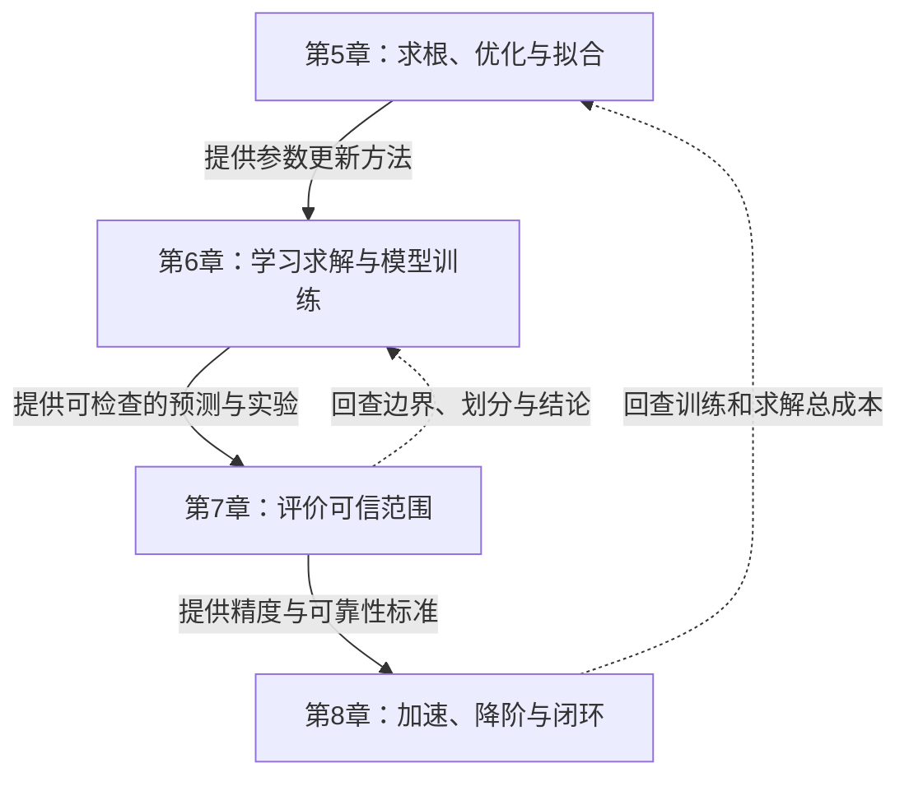
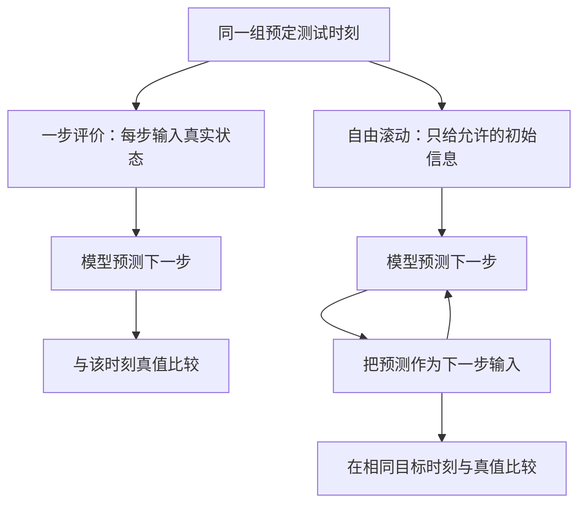
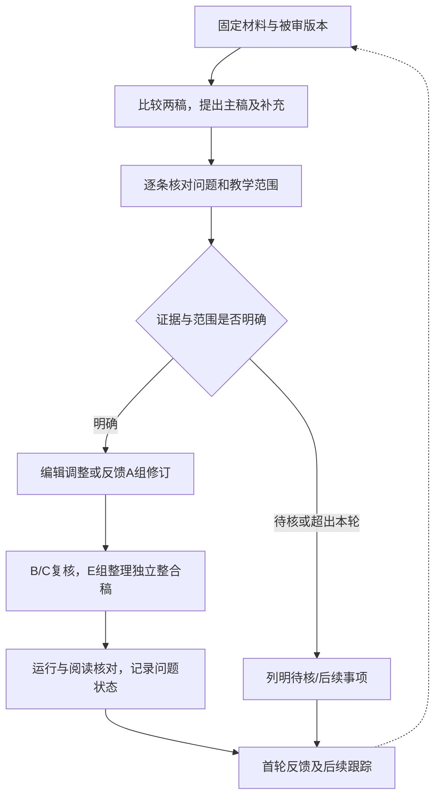

# 第5至8章整合与整改反馈

**提交小组：G11（E2）　日期：2026年11月10日　轮次：首轮反馈**

本报告提出第5至8章的主稿选用、补充内容、跨章衔接及重点整改建议。本轮优先处理正文与实验说明，习题和扩展实验后续安排。

## 1. 四章主线与候选版本

### 1.1 从优化工具走向可信加速

**图1｜章节联系示意。** 正向联系说明工具怎样被后章使用；回访说明后章评价怎样促使前章补条件、缩小结论或完善成本说明。

| 章 | 候选主稿 | 主要理由 | 另一稿的补充重点 | 采用前的关键事项 |
| --- | --- | --- | --- | --- |
| 5 | A2-G19 | 结构紧凑，符号、算法框与阅读分层较清楚 | A1-G9的图解、手算与直观说明 | 修正方向、GN速率及阻尼相关表述 |
| 6 | A2-G15 | 正反问题叙述较连贯，6.4保留科学基础模型定位 | A1-G12的边界反例、关键推导与独立方法比较 | 明确6.4编排；区分实验现象、成因和适用范围 |
| 7 | A2-G6第二版 | 有限规则、ID/OOD与共形手算便于入门 | A1-G1的必要定义、短推导和条件 | 第二版7.4仍需重点整改；7.3范围待定 |
| 8 | A2-G17 | 两模态案例可串起8.2-8.4，篇幅较集中 | A1-G4的原理、条件、误差递推与成本解释 | 修正预条件公式与时间预测评价；更新证据状态 |

四章均拟选A2，是叙述结构和编辑工作量的选择，不表示A2的科学正确性优于A1。所有选入内容均须保留来源与复核状态。

### 1.2 每节建议采用的阅读顺序

**要解决的问题 → 核心概念与算法步骤 → 必要推导或条件 → 案例与实际结果 → 适用范围与小结。**

这是组织参考，不要求把每节都排成相同数量的栏目。读者已具备的基础概念可简要回指；具体算法和新定义仍应清楚交代。

## 2. 跨章案例：复用已有材料，明确任务差别

### 2.1 本轮建议的连接安排

本轮优先复用已有案例，跨章安排见下表。将Poisson反演提前引入第5章，列为后续可选安排。

| 案例或案例族 | 第5章 | 第6章 | 第7章 | 第8章 |
| --- | --- | --- | --- | --- |
| 指数拟合 h(t)=a exp(−bt) | 残差、参数拟合、GN/LM | 书面对照显式函数与网络表示；新增训练可选 | 必要时回指观测与参数可靠性 | 不强制改造为时间预测主例 |
| Poisson案例族 | 可选新增解析最小二乘参照 | 正问题、系数反演、变化源项与迁移 | 核查边界、独立参考、数据划分与结论范围 | 仅在相同任务下回访精度和总成本 |
| 两模态及平移脉冲 | 不新增 | 不新增 | 提供评价要求 | 表示、重构、时间预测和观测更新 |

### 2.2 指数拟合如何桥接第6章

保持第5章已有采样时刻、观测和噪声，指出 h(t)=a exp(−bt) 同时满足 h′+bh=0、h(0)=a。先用对照解释：显式模型直接拟合a、b；网络模型用可调函数表示h，再通过方程、条件和观测训练。未新增运行时，只作任务说明，不填写性能数值。

### 2.3 Poisson案例族的任务表

| 任务 | 已知量 | 未知量或输出 | 评价重点 |
| --- | --- | --- | --- |
| 固定问题求解 | 系数、源项、边界 | 解函数 | 解误差、边界及方程满足情况 |
| 系数反演 | 源项、边界、内部观测 | 物理系数及解 | 参数误差、状态误差、可辨识性 |
| 解算子学习 | 多组输入函数与训练解 | 新输入函数对应的解 | 按完整函数留出的测试表现 |
| 参数范围迁移 | 已训练模型与目标任务信息 | 适配后的解预测 | 目标范围收益与更远范围可靠性 |
| 求解加速 | 离散矩阵、右端及容差 | 数值解与计算成本 | 同精度总成本、使用次数和适用矩阵族 |

拟议的系数反演扩展示例可沿用G15已有设置：−μu″=π²sin(πx)，零边界，u(x;μ)=sin(πx)/μ；μ*=1.5，观测位置xⱼ=j/13，共12点，噪声标准差取0或0.01。若正式加入第5章，再确定例号、来源与复核。

**比较成本的前提：** 明确相同任务、已知信息、精度、设备、计时内容和调用次数。固定问题求解、参数反演和算子学习不能直接混成一个加速倍数。缺少同口径结果时列比较式与待测项。

## 3. 逐章整合与整改

状态标记：**辅助核查已定位**表示已有原文定位、数学反例或静态代码依据，仍需原编写组修订及正式复核；**待核**表示需要进一步证据；**部分修复**表示当前版本已处理部分内容；**编排建议**表示教学组织选择。

### 3.1 第5章：寻优的旅程

**整合安排。** 以G19为候选框架，择用G9区间夹逼、蛛网和Newton切线图，下降轨迹图以及一步BFGS矩阵手算。避免重复移入相同概念、导航和章末总结。

| 小节 | 正文重点 | 推导与展示建议 |
| --- | --- | --- |
| 5.1 非线性方程 | 根、残差、不动点、二分与Newton | 二分误差界、Newton局部机制；夹逼与切线图，短伪代码 |
| 5.2 方向与步长 | 驻点、下降方向、Armijo回溯 | 必要最优性条件与有限终止；接受/缩步流程，二次型轨迹 |
| 5.3 Newton与拟Newton | 曲率、Hessian修正、BFGS | 正定曲率产生下降方向、割线与更新结构；一次矩阵手算 |
| 5.4 非线性最小二乘 | 残差、Jacobian、GN/LM、辨识 | 梯度与GN方程、阻尼作用；指数拟合及采样范围对照 |

压缩映射、一般收敛长证明及方法变体按教学需要列选读。正文保留必要条件、手算和结果解释，完整程序放配套Notebook。

| 编号 | 位置与问题 | 统一整改意见 | 当前状态 |
| --- | --- | --- | --- |
| 05-01 | G9导入：混淆Hessian不定、负梯度和Newton方向 | 非零梯度处负梯度仍为下降方向；分别说明Newton方向、步长与收敛条件 | 辅助核查已定位 |
| 05-02 | G9 5.4.2：非零残差推出二阶项非零及仅线性收敛 | 撤回无条件推论，保留条件化速率结论；同步修正小结和相关辨析 | 辅助核查已定位 |
| 05-03 | G9章末：“正则化就是阻尼” | 分清模型/参数约束与当前更新控制；特定公式中的联系另作说明 | 辅助核查已定位 |
| 05-04 | 重复小结、缺图、旧编号及来源 | 只保留一套总结；对选用图片、引用和链接逐项核对；来源以真实查阅记录补齐 | 编辑检查，按选用范围落实 |

**交接到第6章。** 用指数模型书面对照承接训练目标与参数更新。Poisson反演扩充保留在可选项，不与原指数主例同时列为新增必做实验。

### 3.2 第6章：学习的力量

**整合安排。** 以G15的叙述和6.4科学基础模型主线为候选，吸收G12边界遗漏、软/硬约束、信息不足与独立方法比较。G12原6.4的传统方法比较按任务分别放入6.1-6.3附近，长篇FDM/FEM铺垫核对前章后简化或回指。

| 小节 | 正文重点 | 展示与理论安排 |
| --- | --- | --- |
| 6.1 PINN | 网络解、自动微分、方程与边界损失 | 网络-求导-残差/边界-损失-更新图；保留一个边界反例 |
| 6.2 正反问题 | 已知量、未知量、观测与辨识 | 任务表、独立最小二乘参照、参数和状态误差并列 |
| 6.3 DeepONet/FNO | 解算子、输入输出和函数级测试 | 分别给branch/trunk与FNO结构图、张量尺寸、训练伪代码 |
| 6.4 基础模型与迁移 | 预训练、冻结、微调、从头训练 | 解释四类教学对照及适用范围；有限基演示不冒充大型模型复现 |

| 编号 | 问题或安排 | 统一意见 | 当前状态 |
| --- | --- | --- | --- |
| 06-01 | 两稿6.4任务不同 | 先按科学基础模型主线组织，另一稿方法比较按任务移动，避免整节叠加 | 编排建议，选用范围待讨论 |
| 06-02 | 幅值偏低被直接归因为容量p=32不足 | 写清观察到的现象，未隔离成因时不下单一因果结论 | 原文表述待A修订；不要求大范围调参 |
| 06-03 | 把同一解拆点一概称为泄漏 | 若目标是未见输入函数，拆点不足以证明函数级泛化；同一解新坐标评价另行说明 | 限定评价任务 |
| 06-04 | 把架构性质直接写成任意网格有效 | 区分新坐标查询、参数共享和实际分辨率迁移测试；未测试则说明 | 适用范围须补齐 |

**第7章回访入口。** 在6.3/6.4结尾注明训练函数、独立测试函数、分布变化方式、指标和文件入口。第7章据此解释评价，不重复训练网络，不预填未经核实的成绩。

**最低可用性。** 对被选入的实验，先核对正文数字、保存输出、依赖与数据文件；若缺失导致无法运行，列为待补材料，不能仅搬运截图。

### 3.3 第7章：信任的边界

**整合安排。** 以G6第二版为候选叙述框架，吸收G1必要定义、条件与短推导。7.3本轮拟保留简短核查桥梁；完整误差界、V&V证明及新增实验列为范围待定。复杂VC、Rademacher、稳定性和域适应理论列选读。

| 小节 | 读者应能完成的动作 | 正文优先展示 |
| --- | --- | --- |
| 7.1 逼近与泛化 | 区分能表示、训练好、测试好，读懂有条件的界 | 表示/训练/总体风险对照，简单学习曲线 |
| 7.2 ID/OOD | 为第6章任务设计符合目标的测试 | 按点与按完整函数划分图，生成规则与测试用途 |
| 7.3 待定桥梁 | 区分实现检查、现实适用性和泛化评价 | 前章案例核查表；完整扩充等待确认 |
| 7.4 不确定性 | 手算校准阈值，解释覆盖率、宽度和保证条件 | 训练-校准-测试流程，残差排序与预测区间 |

| 编号 | 第二版核对情况 | 统一整改意见 | 当前状态 |
| --- | --- | --- | --- |
| 07-01 | 附录C与旧稿的核心代码相同，仍宣称域外覆盖塌陷 | 残差为ε−0.1，与输入区间无关；改正解释。α=0.2对应80%标称覆盖，追溯87%-94%及200次重复的脚本与统计口径 | 新版仍在，代数辅助核查已定位 |
| 07-02 | 主例已改为配送时间，仍有医疗漫画、AUC及外部医疗验证残留 | 保留连续预测对象的修正，统一指标与图文；外部研究不作为当前区间覆盖塌陷的直接证据 | 部分修复 |
| 07-03 | k仍截为n，秩证明未补并列值条件 | 统一通用算法边界及排序条件；当前n=1000、α=0.2未触发越界，不因此判当前数值错误 | 条件与边界待修 |
| 07-04 | 仍有“共形是唯一有限样本保底方法”的表述 | 改成“本节采用的一种在明确条件下具有有限样本覆盖保证的方法” | 新版仍在 |
| 07-05 | 针对A1-G1的ID/OOD判据 | 区分独立抽样与相同生成分布；选入A1内容前复核该处，不能列成A2新版问题 | 原A1意见单列 |

**7.4示例的处理路线。** 本轮优先保留现有模型，将其解释为“输入区间变化，但设定的残差分布未变”的辨析例；若另加外推偏差或噪声变化对照，预先说明设置，运行后报告，不预设必然下降或挑种子制造结果。旧稿单次复算记录不冒充第二版整章复现。

**7.3桥梁页拟保留的核查表：**

| 回看第6章的问题 | 应查证据 | 可作何种判断 |
| --- | --- | --- |
| 内部方程与边界是否完整 | 损失定义、边界误差和独立网格 | 小内部残差是否遗漏其他要求 |
| 实现和数值求解是否正确 | 解析解、独立算法或加密对照 | 支持Verification的相应检查 |
| 新情况是否仍可靠 | 完整函数划分、分布定义与测试 | 明确泛化结论覆盖的任务范围 |
| 能否用于现实目标 | 与合适现实观测的比较及用途 | 涉及Validation；合成演示范围需说明 |

POD、自编码器详细算法归8.2；第二版7.3仍有的低维类比可择取一图回指，避免重复展开。第二版末尾未闭合代码围栏等编辑问题另行修正。

### 3.4 第8章：加速的秘诀

**整合安排。** 以G17为候选框架，沿用两模态案例连接8.2-8.4；从G4补充预条件原理、表示与动力学区别、误差递推及算子推断。加入平移脉冲族时复用既有数据与实验，避免重复保留秩二案例。

| 小节 | 读者应能完成的动作 | 正文优先展示 |
| --- | --- | --- |
| 8.1 学习型预条件 | 说明变换、结构条件和摊销 | 离线/在线流程、精度与总成本对照 |
| 8.2 POD/自编码器 | 重构快照，区分表示与预测 | 原场-模态-重构-误差对照，训练/测试分开 |
| 8.3 时间预测 | 区分一步评价与自由滚动 | 两条输入路径，轨迹与随时间误差 |
| 8.4 闭环与算子推断 | 分清测得量、估计量与预测量 | 观测-更新-预测-评价闭环，更新频率与成本 |

| 编号 | 问题 | 统一整改意见 | 当前状态 |
| --- | --- | --- | --- |
| 08-01 | G4预条件变换次序与变量不相容 | 按附录成套修改系数、变量、右端和证明 | 辅助核查已定位；B1/B2亦有对应意见 |
| 08-02 | 条件数直接等同真实步数与速度 | 讲清对称系统条件数及上界含义；实际谱、右端、构造与求解时间另报 | 数学限定须补 |
| 08-03 | 误差上界被解释为长期必然发散 | 改为可能积累、可靠性需检验；保留AR基线在现例中的优势 | 原文无条件表述须修 |
| 08-04 | 介绍方法与实际实现混同 | 列方法-实现-输出表；伴随法作为途径之一；合法一步评价与泄漏分开 | 待A按代码修订 |
| 08-05 | 用“同一状态两个相位”解释当前单条轨迹 | 明确轨迹、轨迹族与自治模型目标，避免把个例当一般非马尔可夫证明 | 解释待修 |
| 08-06 | 模板状态与完成声明冲突 | 实验链接及结果图已部分更新，关闭已处理项；保留准确运行、人工审阅和复核记录 | 部分修复 |
| 08-07 | 完整轨迹求导后才切分训练与测试 | 训练末端、滚动初值及测试导数特征含未来信息；先切分，预测时仅用可得历史作因果/单边导数估计，或使用独立可观测速度；不得读取下一目标真值。修初值并统一39/40目标时刻后重训重测 | 当前代码静态辅助核查已定位；未重训 |
| 08-08 | deflation矩阵乘计数与目标名称 | 构造A@W的开销应纳入相应统计；实际优化目标与正文名称一致 | 静态核查已定位，数值收益待重测 |
| 08-09 | MLP更新标为Adam却缺二阶矩偏差校正 | 修正实现或准确命名，随后重训；旧成绩不能直接当修订后成绩 | 静态核查已定位，待修订复测 |

08-07-09根据新增B1线索及工具辅助静态代码核查补入，不能写成已完成正式B/C复测。

**展示示例：两种预测评价。** 下图是评价协议示意，不是实验输出。

**图2｜一步评价与自由滚动。** 一步评价本身合法；若声称多步预测能力，应报告自由滚动，并明确初始化、导数和预处理是否使用未来信息。两种评价对齐测试目标和指标后再比较。

**当前A2导数依赖示例。** 代码先对完整Z求中心差分，再取前81列训练，因而 dZ[:,80]=(Z[:,81]−Z[:,79])/(2Δt) 包含首个测试快照。一步测试输入中的中心导数还读取下一时刻预测目标，不能只修训练切分。预测特征须由当时可得历史、因果/单边估计或独立可观测速度构造，不得读取下一目标真值；随后修正初始化并重训重测。仅修改正文中的“泄漏”措辞不足以关闭此项。

**成本与结果解释。** 保留小规模学习方法不划算、传统基线胜出的真实结果。区分表示重构与动力学预测；中心化POD还原均值，均值与基仅由训练数据建立。算子推断与SINDy分别说明，完整实现不列本轮新增硬任务。

## 4. 共同符号、算法与图表规范

### 4.1 符号以共同对象为单位协调

| 对象 | 建议约定 | 联动核对 |
| --- | --- | --- |
| 坐标与索引 | x为空间，t为时间，k为迭代，ℓ为频率 | 物理系数尽量用μ，避免同式与迭代k冲突 |
| 网络与物理参数 | θ为网络参数，μ为物理参数，一般优化变量w | 首次出现定义；局部通用记号不机械替换 |
| 优化 | Φ为目标，g为梯度，H为Hessian，B为BFGS近似，Q为逆近似 | 公式、手算、代码与图例同时核对 |
| 残差与损失 | 拟合残差r=预测−观测，PDE残差R，训练损失L | 残差反号时Jacobian同步反号；求和/均值与权重一致 |
| 线性求解 | Au=b，M为预条件矩阵 | PCG上界使用对应对称系统的条件数 |
| 降阶 | S列为快照，Vᵣ为基，z为低维坐标 | û=均值+Vᵣz；明确是否中心化，缩放只用训练数据 |
| 解算子与观测 | G为解算子，C_obs为观测矩阵，K_upd为更新增益 | 避免与Hessian、二次算子混淆 |
| DFT | 正变换不除N，逆变换除N | 频谱例值、逆变换、卷积系数与实现联动 |
| 统计数据 | D_tr、D_val、D_cal、D_te | 训练/选模/校准/最终测试用途分开 |
| 显著性及步长 | α_mis为共形失覆盖水平，α_k为优化步长 | 跨章同表出现时显式区分 |
| 误差与成本 | 明确范数、网格、分母；T_total=T_off+N_call(T_setup+T_solve) | 零分母报绝对误差；防止遗漏或重复计成本 |

### 4.2 算法框的最少信息

写清输入与输出、初始化、核心更新、接受/拒绝或异常分支、停止条件与适用范围。正文保留流程图、伪代码及必要片段，完整可运行实现链接到Notebook。

FNO的一维“函数值+坐标为两通道”仅用于对应输入示例；若增加物理参数，另计输入。DeepONet的branch函数采样与trunk查询坐标分别说明，不套用统一两通道图。

### 4.3 图表清单

| 章 | 优先复用或补绘 | 图题须说明 |
| --- | --- | --- |
| 5 | 夹逼、切线、下降轨迹、Armijo/LM分支、拟合曲线 | 初值、参数、停止准则与方法 |
| 6 | 网络结构、损失组成、边界误差、迁移方案对照 | 输入输出、维度、数据与测试任务 |
| 7 | 数据划分、分布变化、残差排序、覆盖率与宽度 | 校准规模、目标覆盖、实际评价分布 |
| 8 | 模态与重构、一步/滚动、闭环、总成本 | 潜维数、初始化、时长、设备和计时内容 |

图示、引用他人结果与本组实测分别标注；结果图可追溯到具体数据和代码。已有图优先复用，缺图先判断是否影响讲解。漫画可选，不为统一外观强制新增。

## 5. 后续修订与交付安排

### 5.1 推进流程与职责

**图3｜本轮推进流程。** 可确定的编辑调整与事实核对并行推进。

各章实质性修订由对应A组处理、B/C复核，E组据修订结果整合并跟踪。各E组先独立形成意见，再交流协调，后续与D组统一全书风格。

### 5.2 交付与完成判据

| 顺序 | 交付或动作 | 完成判据 |
| --- | --- | --- |
| 1 | 统一反馈稿与版本表 | 主稿候选、补充来源、范围和状态清楚 |
| 2 | 优先问题反馈 | 关键错误有位置与依据，待核项不冒充定论 |
| 3 | 选一章形成整合样稿 | 结构连贯、来源可追溯、待修处可辨认 |
| 4 | 查看A组修订与B/C复核 | 对照新版本记录回应及复核结果 |
| 5 | 推进其余章节及跨章核对 | 重复、缺漏、符号与案例衔接得到处理 |
| 6 | 实验及阅读检查 | 采用的Notebook可运行，输出支持正文，图片与引用可用 |
| 后续 | 习题答案、扩展实验及最终入口 | 范围明确后实施，与最终内容一致 |

## 附录A：重点技术依据

以下列出工具辅助核查取得的重点数学反例及静态依赖，供各组逐项复核。证据成立不等于修订完成，亦不替代整章验收。

**A1｜下降方向。** 可微且g≠0时，gᵀ(−g)=−‖g‖²<0。Hessian不定不能否定负梯度的局部下降性；任意步长是否下降另需检查。对应G9导入第三格。

**A2｜GN反例。** 取r(x)=(x,1)ᵀ，J=(1,0)ᵀ，二阶残差项S=0，GN步d=−x，一步到最优点0，最优残差仍非零。因此“残差非零→S非零→仅线性收敛”不成立。对应G9 5.4.2。

**A3｜预条件变换。** 若M=LLᵀ、x̃=Lᵀx，则Ã=L⁻¹AL⁻ᵀ、b̃=L⁻¹b。若采用对称正定平方根，则同时改为x̃=M^(1/2)x、Ã=M^(-1/2)AM^(-1/2)、b̃=M^(-1/2)b。两套约定不混用。G4 8.1.2原式在A=[[3,1],[1,2]]、L=[[2,0],[1,1]]、x=(1,2)ᵀ时，变换残差为(2,−3)ᵀ，正确式残差为零。

**A4｜算子推断维度。** 样本按列时，Y≈ΘΞ，其中Y为r×N_s、Θ为r×q、Ξ为q×N_s。最小范数最小二乘可写Θ=YΞ†，数值求解采用QR/SVD等；含逆矩阵的闭式式子另需满秩条件。对应G4 8.4.4。

**A5｜归一化与符号联动。** r′=−r时J′也须反号。G12和G15的DFT归一化相反；转用G15约定时，G12八点频谱(1,1,i/4,0,0,0,−i/4,1)变为(8,8,2i,0,0,0,−2i,8)，卷积关系同步换算，频率响应与核的DFT系数分别说明。

**A6｜共形示例。** 真值sin(2πX)+ε与预测sin(2πX)+0.1之差为ε−0.1。两域噪声同分布，仅换输入区间不改变设定的残差分布。一般覆盖保证须说明校准与新样本条件、有限样本序号和并列处理；实测覆盖不要求每次恰等于目标。当前示例α=0.2表示80%标称覆盖。

**A7｜时间评价。** 第8章A2实验第18、19个Notebook单元先对完整轨迹估导数、后切训练段，训练末端存在跨边界真值依赖，测试输入的中心导数还包含下一目标；导数特征须按预测时可用信息重新构造。一步与滚动目标个数也不同。本轮确认静态依赖，尚未重训或取得修订后数值，不沿用旧成绩作为修复证据。

## 附录B：版本与核查说明

本报告依据下列固定仓库版本，采用正文对照、数学反例及静态代码核查，部分证据由AI工具辅助检查取得。这些记录不代表G11成员已完成全部人工推导、独立运行或正式B/C验收；实验重训、修订后复测和各章验收状态分别记录。候选选稿、内容移动及新增任务按讨论和复核结果落实，报告中的流程图均为结构示意。

| 材料 | 本轮定位 | 使用边界 |
| --- | --- | --- |
| 组内整改建议及整合方案 | 首轮意见与拟整合结构 | 按本报告统一范围，未实施内容保持建议状态 |
| 第5、6章两份A正文及G4正文 | 当前文件与前次抽查版本一致 | 可保留既有定位，实质修订仍需复核 |
| G6第二版正文 | 新增版本，7.4主例已改配送时间 | 标记部分修复，其他问题按新版位置反馈 |
| 第7章B2报告 | 针对前版正文，执行范围有限 | 不当作第二版或独立Notebook复测 |
| 第8章G17正文及实验 | 链接和结果图更新；代码仍需修订 | 按问题记录状态，不整条沿用旧缺陷 |
| 第8章B1/B2材料 | 提供具体线索及部分独立核验记录 | 核对受审SHA、代码和复测；不能自动全盘采纳 |

第8章B1报告所引V01-V09与其当前链接Notebook尚未对应，Notebook内部还保留B2标题，需补齐证据入口；本报告仅对已核查的静态代码依赖作相应定位。RK4实际步长与稳定性等未完成的项目继续列待核。

### 固定来源

- 仓库审阅版本：[71a697576590a7e8f3fe1aa4d1c0cb062eef483e](https://github.com/prince19992516/-2026/tree/71a697576590a7e8f3fe1aa4d1c0cb062eef483e)。
- [第7章范围说明](https://github.com/prince19992516/-2026/blob/71a697576590a7e8f3fe1aa4d1c0cb062eef483e/教材/第07章-信任的边界/README.md)。
- [G6第二版正文](https://github.com/prince19992516/-2026/blob/71a697576590a7e8f3fe1aa4d1c0cb062eef483e/教材/第07章-信任的边界/工作/工作-A2-G6/A2-G6-正文-第二版.md)。
- [第7章B2报告](https://github.com/prince19992516/-2026/blob/71a697576590a7e8f3fe1aa4d1c0cb062eef483e/教材/第07章-信任的边界/工作/B2组-验证报告.md)。
- [第8章G17正文](https://github.com/prince19992516/-2026/blob/71a697576590a7e8f3fe1aa4d1c0cb062eef483e/教材/第08章-加速的秘诀/工作/A2-G17-正文.md)。
- [第8章G17实验](https://github.com/prince19992516/-2026/blob/71a697576590a7e8f3fe1aa4d1c0cb062eef483e/教材/第08章-加速的秘诀/工作/A2-G17-实验.ipynb)。
- [第8章B1修正清单](https://github.com/prince19992516/-2026/blob/71a697576590a7e8f3fe1aa4d1c0cb062eef483e/教材/第08章-加速的秘诀/工作/B1组-修正清单.md)。
- [第8章B2修正清单](https://github.com/prince19992516/-2026/blob/71a697576590a7e8f3fe1aa4d1c0cb062eef483e/教材/第08章-加速的秘诀/工作/B2组-修正清单.md)。
