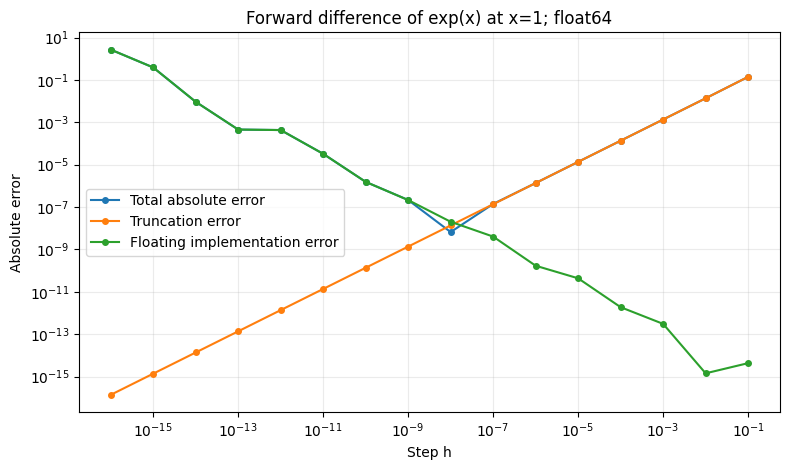

# 第01章 误差的代价：习题参考解答模板

> 使用方法：保留本模板，先复制到本章 `工作/` 目录，再将文件名前缀 `模板-A组-` / `模板-B组-` / `模板-C组-` 改为本章对应的 `A1组-` / `B2组-` / `C1组-` 等。按章节分工表确认编号，正文内的同组文件链接也改到副本；公开只填组别。复用导入图时，将本章 `模板/图片/` 中的图复制到 `工作/图片/`，图片链接使用 `图片/文件名`。

> A组任务：A1、A2各自独立完成本章四节的正文、实验、习题与解答及本组报告；不预先分小节。两份完整初稿经B/C验证后，由本章六个ABC小组讨论选用或综合改写，再交D/E整合。

状态：待填写。题号与A2组-习题.md一一对应，未推导、未运行、未核验的项目如实注明。公开仓库中的答案同样公开，本文件不纳入学生版教材目录。

## 题1：对应1.1 浮点数与舍入误差

- **条件与符号：** 本题25分。研究0.15625与0.1的二进制表示，并比较float32、float64的精度和求和顺序。采用最近舍入，中点取偶数；4位教学格式含隐含首位、指数范围足够。 误差统一记为绝对误差 $E_{\rm a}$ 与非零参考下的相对误差 $E_{\rm r}$。
- **手动推导或概念解释：** 由 $0.15625=5/32$，得到

  $$
  0.15625=0.00101_2=1.01_2\times2^{-3}.
  $$

  它只需3位有效二进制位，指数也在两种格式的范围内，因此可由 `float32` 和 `float64` 精确表示。

  对 $0.1$，有

  $$
  0.1=0.0001100110011\cdots_2
  =1.100110011\cdots_2\times2^{-4}.
  $$

  最简分数 $1/10$ 的分母含有因子5，二进制展开无限循环，因此两种类型都只能近似表示。

  4位教学格式中，$0.1$ 的相邻候选数为

  $$
  a=1.100_2\times2^{-4}=\frac{12}{128}=0.09375,
  \qquad
  b=1.101_2\times2^{-4}=\frac{13}{128}=0.1015625.
  $$

  到准确值 $1/10$ 的距离分别为

  $$
  \frac1{10}-a=\frac1{160},\qquad b-\frac1{10}=\frac1{640}.
  $$

  因此最近舍入取 $b$，绝对误差与相对误差分别为

  $$
  E_{\mathrm a}=\frac1{640}=0.0015625,\qquad
  E_{\mathrm r}=\frac{1/640}{1/10}=\frac1{64}=0.015625.
  $$

  **评分建议：** 两个二进制展开及可表示性4分；候选数与最近舍入判断2分；两种误差2分。

  有效位数为 $p$ 时，$\varepsilon=2^{1-p}$、$u=2^{-p}$。float32对应 $2^{-23}$、$2^{-24}$，float64对应 $2^{-52}$、$2^{-53}$。float64在 $10^{16}$ 处的间隔为2，加1落在中点并舍入回原数；float32间隔更大。先使两个相反的机器数相消，再加1，则保留结果1。
- **实现位置与独立参考：** Notebook第1.1节，代码单元索引3—5。参考为Fraction的准确分数3/10和整数1；二进制舍入由手算验证。
- **实际输出、误差和容差理由：** 

  | 类型 | 存储结果 | 绝对误差 | 相对误差 |
  | --- | --- | --- | --- |
  | float32 | 0.30000001192092896 | 1.1920928955e-08 | 3.9736429850e-08 |
  | float64 | 0.30000000000000004 | 4.4408920985e-17 | 1.4802973662e-16 |

  | 类型 | 顺序 | 结果 | 绝对误差 | 相对误差 |
  | --- | --- | --- | --- | --- |
  | float32 | [10000000000000000, 1, -10000000000000000] | 0.0 | 1.0 | 1.0 |
  | float32 | [10000000000000000, -10000000000000000, 1] | 1.0 | 0.0 | 0.0 |
  | float64 | [10000000000000000, 1, -10000000000000000] | 0.0 | 1.0 | 1.0 |
  | float64 | [10000000000000000, -10000000000000000, 1] | 1.0 | 0.0 | 0.0 |

  间隔由理论值精确检查；求和比较使用准确目标1。
- **陷阱的正确解释及适用范围：** 显示位数只改变已存数字的呈现，不能增加有效精度。浮点间隔随指数变化：float64在1处向上的间隔约为 $2.22\times10^{-16}$，在 $10^{16}$ 处却为2。两种顺序求和分别得到0和1，说明单次舍入界不能直接作为整个程序的误差界。 设 $a=0.15625$。先手算其规格化二进制表示，再判断它在float32和float64中是否精确。常见回答是“十进制小数都不精确”；正确解释是 $a=1.01_2\times2^{-3}$，展开有限且位数、指数均在范围内，两种格式均精确。 准确值为零时，相对误差公式分母为零，不能把相对误差设为零；应报告绝对误差或明确选用的非零外部尺度。
- **B核验、C复核及版本：** 待核验。

## 题2：对应1.2 截断误差与灾难性抵消

- **条件与符号：** 本题25分。研究 $g(x)=\sqrt{x+1}-\sqrt x$ 在 $x\ge0$ 时的计算，以及 $e^x$ 在 $x=1$ 处的前向差分。平方根差测试输入为 $10^{16}$，差分步长为 $10^{-k}$，$k=1,\ldots,16$。 误差统一记为绝对误差 $E_{\rm a}$ 与非零参考下的相对误差 $E_{\rm r}$。
- **手动推导或概念解释：** 对 $x\ge0$，$\sqrt{x+1}+\sqrt x>0$，乘共轭式得 $g(x)=1/(\sqrt{x+1}+\sqrt x)$。程序直接保留准确分子1。直接式首先在 $x+1$ 处丢失增量，再得到两个相同平方根。

  Taylor 公式给出某个 $\xi\in(1,1+h)$，使

  $$
  e^{1+h}=e+he+\frac{h^2}{2}e^\xi.
  $$

  因此

  $$
  D_h-e=\frac h2e^\xi>0,\qquad
  |D_h-e|\le\frac h2e^{1+h}.
  $$

  当 $0<h\le0.1$ 时，有统一上界

  $$
  |D_h-e|\le\frac{e^{1.1}}2h.
  $$

  这是准确算术下的截断误差。令误差估计式为 $F(h)=Ah+Bu/h$，则

  $$
  F'(h)=A-\frac{Bu}{h^2},\qquad F''(h)=\frac{2Bu}{h^3}>0.
  $$

  唯一的正驻点为

  $$
  h_{\mathrm{bal}}=\sqrt{\frac{Bu}{A}},\qquad
  F(h_{\mathrm{bal}})=2\sqrt{ABu}.
  $$

  它给出截断误差与舍入误差平衡的尺度，可用于确定扫描区间。实际舍入随步长波动，函数计算、取样点表示和常数 $A,B$ 都影响具体最小点。

  **评分建议：** Taylor 公式与余项3分；上界1分；平衡步长2分；估计式与实际计算的关系1分。

  误差分解为 $\widehat D_h-e=(D_h-e)+(\widehat D_h-D_h)$。各项保留符号时严格相加，取绝对值后可以部分抵消。
- **实现位置与独立参考：** Notebook第1.2节，索引10保留模板原起步代码；索引11—13补充高精度误差与完整步长扫描。原起步代码把参考转为float，只用于粗检查；最终误差在Decimal中比较。
- **实际输出、误差和容差理由：** 

  | 步长 | 近似导数 | 总绝对误差 | 实际取样增量 |
  | --- | --- | --- | --- |
  | 1e-01 | 2.85884195487388 | 1.40560126e-01 | 1.00000000e-01 |
  | 1e-02 | 2.73191865578712 | 1.36368273e-02 | 1.00000000e-02 |
  | 1e-03 | 2.71964142253323 | 1.35959407e-03 | 1.00000000e-03 |
  | 1e-04 | 2.71841774708292 | 1.35918624e-04 | 1.00000000e-04 |
  | 1e-05 | 2.71829541995672 | 1.35914977e-05 | 1.00000000e-05 |
  | 1e-06 | 2.71828318743061 | 1.35897157e-06 | 1.00000000e-06 |
  | 1e-07 | 2.71828196840573 | 1.39946688e-07 | 1.00000000e-07 |
  | 1e-08 | 2.71828182185629 | 6.60275094e-09 | 9.99999994e-09 |
  | 1e-09 | 2.7182820439009 | 2.15441854e-07 | 1.00000008e-09 |
  | 1e-10 | 2.71828337616853 | 1.54770948e-06 | 1.00000008e-10 |
  | 1e-11 | 2.71831446241322 | 3.26339542e-05 | 1.00000008e-11 |
  | 1e-12 | 2.71871414270208 | 4.32314243e-04 | 1.00008890e-12 |
  | 1e-13 | 2.71782596428238 | 4.55864177e-04 | 9.99200722e-14 |
  | 1e-14 | 2.70894418008538 | 9.33764837e-03 | 9.99200722e-15 |
  | 1e-15 | 3.10862446895044 | 3.90342640e-01 | 1.11022302e-15 |
  | 1e-16 | 0 | 2.71828183e+00 | 0.00000000e+00 |

  平方根差直接式为0，有理化式为 $5\times10^{-9}$，相对误差约 $4.59226\times10^{-17}$，小于 $10^{-14}$；16个步长完整保留，最佳点约为 $10^{-8}$。

  
- **陷阱的正确解释及适用范围：** 本次扫描在 $h=10^{-8}$ 附近取得较小误差，而 $h=10^{-16}$ 时取样点重合。因此，步长需要平衡截断与舍入。有理化式显式保留分子1；若仍把分子写成浮点 `(x+1)-x`，就会再次丢失增量。 在float64中分别计算 $g(10^{16})$ 的直接式、有理化式，以及 $e^x$ 在1处步长 $10^{-8}$、$10^{-16}$ 的前向差分。若认为“步长更小就更准”，应解释为何后一个差分变为0。关键在于 $1+h$ 已舍入为1，而有理化保留了准确分子1。
- **B核验、C复核及版本：** 待核验。

## 题3：对应1.3 条件数与稳定性

- **条件与符号：** 本题25分。以 $q(x)=1/(1-x)$、$x=0.9999$ 及正扰动 $d=10^{-6},10^{-8},10^{-10}$ 研究输入敏感性；以平方根差的直接式与有理化式研究同一输入下的算法表现。 误差统一记为绝对误差 $E_{\rm a}$ 与非零参考下的相对误差 $E_{\rm r}$。
- **手动推导或概念解释：** 由可微性，

  $$
  f(x+d)-f(x)=f'(x)d+o(|d|).
  $$

  当 $x\ne0$ 且 $f(x)\ne0$ 时，

  $$
  \lim_{d\to0,\ d\ne0}
  \frac{|f(x+d)-f(x)|/|f(x)|}{|d|/|x|}
  =\left|\frac{xf'(x)}{f(x)}\right|.
  $$

  对 $q(x)=1/(1-x)$，定义域排除1，有

  $$
  q'(x)=\frac1{(1-x)^2},\qquad
  \kappa_q(x)=\left|\frac{x}{1-x}\right|.
  $$

  所以 $\kappa_q(0.9999)=9999$。

  **评分建议：** 一阶展开2分；非零条件与极限2分；求导、条件数及数值3分。

  有限扰动满足 $[q(x+d)-q(x)]/q(x)=d/(1-x-d)$，故 $R(d)=|x/(1-x-d)|$。当 $d\to0$，放大率趋近9999；$d=10^{-4}$ 到达奇点。

  当 $x>0$ 时，

  $$
  g'(x)=\frac1{2\sqrt{x+1}}-\frac1{2\sqrt x}
  =-\frac{g(x)}{2\sqrt x\sqrt{x+1}}.
  $$

  于是

  $$
  \kappa_g(x)=\frac12\sqrt{\frac{x}{x+1}}<\frac12,\qquad
  \lim_{x\to\infty}\kappa_g(x)=\frac12.
  $$

  对于唯一输入 $x$ 的相对扰动，这个问题在大 $x$ 处是良态的。直接式输出0表明计算表达式丢失了信息。实际上，对任何有限 $x\ge0$，都有 $g(x)>0$，所以0也不能解释为某个邻近有限输入的准确函数值。

  若把两个根的值作为独立输入 $a,b$，问题就变为计算 $a-b$。在分量相对扰动约束 $|\Delta a|\le\eta|a|$、$|\Delta b|\le\eta|b|$ 下，最坏的输出相对变化放大率为

  $$
  \frac{|a|+|b|}{|a-b|}.
  $$

  当 $a,b$ 接近时，它可以很大。这与由同一个 $x$ 决定两个根的输入模型不同。

  **评分建议：** 求导与条件数3分；极限1分；问题、算法与输入模型的区分2分。

  $x=0$ 时，输入相对变化 $|d|/|x|$ 无定义；$f(x)=0$ 时，输出相对变化无定义。若 $f$ 在该点可微且导数有限，可用绝对条件数 $|f'(x)|$ 研究小的绝对扰动，或指定非零的输入、输出参考尺度。

  对于 $g$ 在0处，还应注意它没有有限的右导数：

  $$
  \frac{g(h)-g(0)}h
  =\frac1{\sqrt{1+h}+1}-\frac1{\sqrt h}\longrightarrow-\infty.
  $$

  此时绝对线性条件数也不能提供有限的局部界，应根据函数增量本身分析敏感性。

  **评分建议：** 两种相对尺度失效的原因2分；替代尺度及其可微性条件2分。对 $g(0)$ 的说明可作为加深理解的补充。
- **实现位置与独立参考：** Notebook第1.3节，索引17—19。独立参考为q的有限扰动闭式关系，以及g的120位Decimal原始差式。
- **实际输出、误差和容差理由：** 

  | 扰动 | 输入相对变化 | 输出相对变化 | 放大率 |
  | --- | --- | --- | --- |
  | 1e-6 | 1.0001000100E-6 | 1.0101010101E-2 | 10100.0000000000 |
  | 1e-8 | 1.0001000100E-8 | 1.0001000100E-4 | 10000.0000000000 |
  | 1e-10 | 1.0001000100E-10 | 1.0000010000E-6 | 9999.0099990100 |

  | 输入 | 表达式 | 结果 | 绝对误差 | 相对误差 |
  | --- | --- | --- | --- | --- |
  | 0 | direct | 1 | 0.000000e+00 | 0.000000e+00 |
  | 0 | rationalized | 1 | 0.000000e+00 | 0.000000e+00 |
  | 1 | direct | 0.414213562373095 | 9.667293e-17 | 2.333891e-16 |
  | 1 | rationalized | 0.414213562373095 | 4.116178e-17 | 9.937333e-17 |
  | 1e8 | direct | 5.00000005558832e-05 | 6.808832e-13 | 1.361766e-08 |
  | 1e8 | rationalized | 4.9999999875e-05 | 4.505701e-21 | 9.011403e-17 |
  | 1e16 | direct | 0 | 5.000000e-09 | 1.000000e+00 |
  | 1e16 | rationalized | 5e-09 | 2.296128e-25 | 4.592256e-17 |

  有限扰动结果按80位Decimal检查闭式关系；g的有理化相对误差在测试输入上小于 $10^{-14}$。
- **陷阱的正确解释及适用范围：** 条件数通过改变输入、比较对应的准确输出来研究；算法误差通过固定输入、比较计算结果与独立参考来研究。$g$ 在大输入处的相对条件数接近 $1/2$，直接式却输出0，表明良态问题也需要合适算法。 甲将 $q(0.9999)$ 的输入增加 $10^{-8}$，观察到约一万倍的相对变化放大；乙固定 $g(10^{16})$，将表达式有理化后从0得到约 $5\times10^{-9}$。甲对应问题敏感性，乙对应算法表现。应分别说明比较中改变的对象。
- **B核验、C复核及版本：** 待核验。

## 题4：对应1.4 AI关联：训练中的数值问题

- **条件与符号：** 本题25分。对[1000,1001,1002]、[-1000,-1001,-1002]、[1000,0,-1000]三组logits，比较float32和float64的直接/移位softmax、第三类损失及单次参数更新。类别索引从0计；梯度核验取 $z=[0.2,-0.4,0.7]$、$y=1$。 误差统一记为绝对误差 $E_{\rm a}$ 与非零参考下的相对误差 $E_{\rm r}$。
- **手动推导或概念解释：** 令 $m=\max_jz_j$，实数运算中分子、分母同除以 $e^m$，得到

  $$
  p_i=\frac{e^{z_i-m}}{\sum_j e^{z_j-m}},\qquad
  \ell=(m-z_y)+\log\sum_j e^{z_j-m}.
  $$

  各指数输入不大于0，至少有一项等于0，因此指数值不超过1、分母介于1与 $n$ 之间。移位避免了正指数上溢和所有指数同时下溢为零；极小的个别概率仍可能舍入为0。

  从准确的光滑表达式 $\ell=\log\sum_j e^{z_j}-z_y$ 求导，得到

  $$
  \frac{\partial\ell}{\partial z_i}
  =\frac{e^{z_i}}{\sum_j e^{z_j}}-\mathbf1_{\{i=y\}}
  =p_i-\mathbf1_{\{i=y\}}.
  $$

  采用这一求导方式，也避免了在最大值并列时单独讨论 $\max$ 的导数。

  **评分建议：** 两个移位公式3分；范围及下溢说明2分；梯度推导2分。

  第三组准确概率为 $[1,e^{-1000},e^{-2000}]/(1+e^{-1000}+e^{-2000})$，后两项虽为正却会下溢为0，其分量相对误差均为100%。准确第三类损失为 $2000+\log(1+e^{-1000}+e^{-2000})$，机器结果2000是合理近似。

  float32在1下方的间隔为 $2^{-24}$，更新量 $10^{-8}$ 小于其一半，结果舍入回1。梯度以 $[\ell(z+he_i)-\ell(z-he_i)]/(2h)$ 核对；解析梯度分量和为 $\sum_i p_i-1=0$，对应共同平移方向的导数为0。
- **实现位置与独立参考：** Notebook第1.4节，索引23—25。前两组80→120位参考，极端组500→600位参考；梯度由解析式与中心差分交叉核对。
- **实际输出、误差和容差理由：** 

  | logits | 类型 | 直接指数含inf | 直接概率含NaN | 移位概率 | 概率和 | 最大绝对误差 |
  | --- | --- | --- | --- | --- | --- | --- |
  | [1000, 1001, 1002] | float32 | 是 | 是 | [0.09003057331, 0.2447284609, 0.6652409434] | 1 | 1.234297E-8 |
  | [1000, 1001, 1002] | float64 | 是 | 是 | [0.09003057317, 0.2447284711, 0.6652409558] | 0.99999999999999989 | 1.045442E-16 |
  | [-1000, -1001, -1002] | float32 | 否 | 是 | [0.6652409434, 0.2447284609, 0.09003057331] | 0.99999994039535522 | 1.234297E-8 |
  | [-1000, -1001, -1002] | float64 | 否 | 是 | [0.6652409558, 0.2447284711, 0.09003057317] | 0.99999999999999989 | 1.045442E-16 |
  | [1000, 0, -1000] | float32 | 是 | 是 | [1, 0, 0] | 1 | 5.075959E-435 |
  | [1000, 0, -1000] | float64 | 是 | 是 | [1, 0, 0] | 1 | 5.075959E-435 |

  | 分量 | 解析梯度 | 中心差分 | 绝对差 |
  | --- | --- | --- | --- |
  | 0 | 0.312741112960930 | 0.312741112962200 | 1.27087230e-12 |
  | 1 | -0.828364038122046 | -0.828364038119034 | 3.01181302e-12 |
  | 2 | 0.515622925161116 | 0.515622925167936 | 6.81954493e-12 |

  两种概率绝对误差与归一化误差满足题设容差；梯度最大绝对差约 $6.82\times10^{-12}$。容差针对指定教学输入。

  | 类型 | 先概率再取负对数 | 从logits计算损失 | 损失绝对误差 |
  | --- | --- | --- | --- |
  | float32 | inf | 2000.0 | 5.075958897549E-435 |
  | float64 | inf | 2000.0 | 5.075958897549E-435 |

  | 类型 | 更新后保存值 | 1下方间隔 |
  | --- | --- | --- |
  | float32 | 1.0 | 5.9604644775e-08 |
  | float64 | 0.99999999 | 1.1102230246e-16 |
- **陷阱的正确解释及适用范围：** 第三组移位softmax返回有限的 $[1,0,0]$，但两个微小概率的相对误差均为100%。无NaN和概率和接近1仍不足以判断每个分量的准确度；损失下降还受任务与优化过程影响。应结合目标量的误差和独立参考进行判断。 教学构造的建议是：“概率不超过1，直接计算指数不会溢出。”取 $z=[1000,1001,1002]$，先判断，再运行两种实现。建议混淆了最终比值与中间指数的范围；减最大值后指数输入不大于0，可以避免本例的上溢。
- **B核验、C复核及版本：** 待核验。
