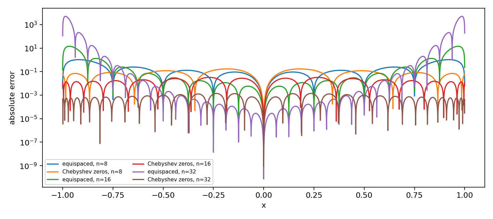
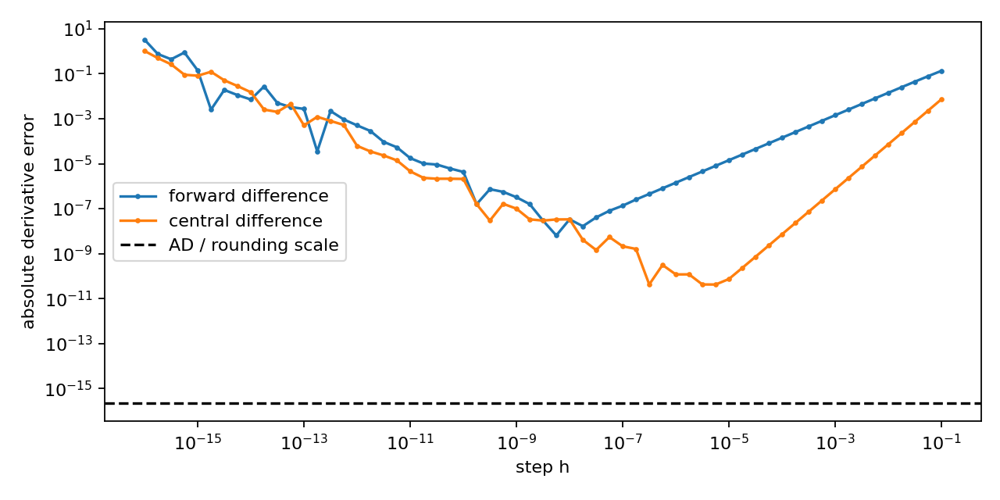
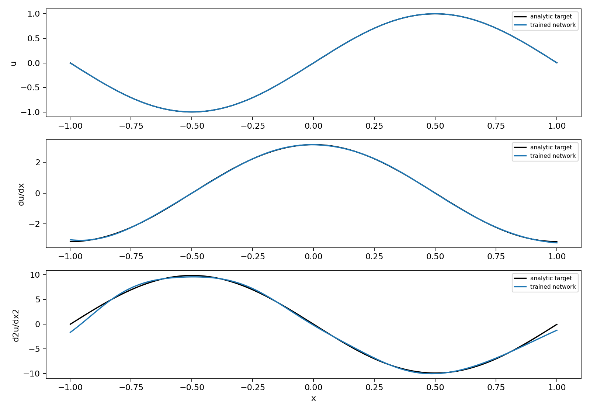

# 第02章 逼近的智慧

*用有限的信息，换取可信的答案*

*图02-1 · 给弯曲的河岸铺梯形。概念示意，非实测结果。*

## 章节引入

丈量河岸边一块弯曲的地，尺子拉不直，面积也算不出来。常用的办法是"铺梯形"：把河岸切成若干段，每段用一根直尺代替弯曲线，算出各块梯形面积，再相加。段切得越细，答案越接近真值。

这个做法包含三个问题。

1. 用直线代替曲线，依据是什么？换一条更合适的曲线，结果会不会更好？
2. 代替之后误差有多大？能否在计算之前估计误差？
3. 如果曲线不是由公式给出，而是一组测量数据，还能不能代替？

这三个问题分别对应插值、误差估计与离散数据拟合。它们的历史线索并不相同，却指向同一套工具。

*图02-2 · 逼近论的五位奠基者。标注年份为该工作的公开年份。*

1795 年，拉格朗日在巴黎高等师范学校的讲稿中给出一个公式：给定 $`n+1`$ 个点，存在唯一的次数不超过 $`n`$ 的多项式穿过它们。这就是 2.1 节的 Lagrange 公式。

1805 年，勒让德计算彗星轨道时遇到另一类问题：观测数据多于待定参数，且每个观测都带误差。让曲线穿过所有点，等于把误差当作数据。他改为要求偏差的平方和最小。1809 年，高斯在《天体运动论》中称自己从 1795 年起就这样计算。方法沿用至今，称为最小二乘。

1854 年，切比雪夫研究把圆周运动变为直线运动的连杆机构。机构只能近似走直线，问题于是变成：什么是最优近似？他的答案是让误差在若干点上正负交替、幅度相等，即"最坏处也尽量不坏"。由此得到一族以他命名的多项式，也得到 2.1 节末节点位置的答案。

1885 年，魏尔斯特拉斯证明：闭区间上的连续函数都可用多项式一致逼近到任意精度。存在性问题由此解决。

1901 年，龙格给出反例：一个任意阶光滑的函数，用等距节点插值，次数越高，两端振荡越剧烈。这说明"存在一个好多项式"与"给定的节点能算出它"是两件事。

本章讨论的逼近，是在信息有限的条件下，说明简单函数能替代到什么程度、代价是多少。

*图02-3 · 本章五节的结构。*

### 一条主线：一个公式，三种用法

全章围绕插值余项展开：

**式（0.1）**

$$
\begin{gathered}
f(x)-p_n(x)=\frac{f^{(n+1)}(\xi_x)}{(n+1)!}\,\omega_{n+1}(x), \\[6pt]
\omega_{n+1}(x)=\prod_{k=0}^{n}(x-x_k).
\end{gathered}
$$

右端是两个因子的乘积：一个只与函数有关，即高阶导数；一个只与节点有关，即节点多项式。这一分解是后面各节结论的来源。

| 对式 (0.1) 所作的运算 | 得到的结论    | 所在节 |
| -------------- | -------- | --- |
| 取绝对值、取最大       | 插值误差上界   | 2.1 |
| 改求残差平方和最小      | 最小二乘与基函数 | 2.2 |
| 两边对 $`x`$ 积分     | 求积公式的误差  | 2.3 |
| 两边对 $`x`$ 求导     | 差分公式的误差  | 2.4 |
| 把节点值换成带参数的基函数  | 网络逼近与求导  | 2.5 |

各节内容如下：

- 2.1 插值：给定节点与函数值，构造穿过它们的多项式；
- 2.2 逼近：数据多于待定系数且含噪声时，放弃逐点通过；
- 2.3 插值积分：对插值多项式积分，得到求积公式；
- 2.4 插值微分：对插值多项式求导，得到差分公式；
- 2.5 网络逼近：让基函数本身含参数。

每一节都回答同一个问题：近似在何处出错、误差多大、在什么条件下会失效。

### 记号与约定

- 全章各量无量纲，误差均指绝对误差；"最大误差"指在指定网格或区间上取的最大值。
- $`n`$ 表示多项式的次数，节点数为 $`n+1`$。
- $`\mathcal P_n`$ 表示次数不超过 $`n`$ 的实多项式全体；$`C^r[a,b]`$ 表示在 $`[a,b]`$ 上有直到 $`r`$ 阶连续导数的函数全体。
- 范数、内积、正交与条件数的定义见附录 A、附录 B。
- 先修内容为微积分（Rolle 定理、Taylor 公式、定积分）、线性代数（矩阵、秩、内积），以及浮点数与实数的区别。

本章开头的问题可以先记下：区间数由 4 增至 8，梯形公式的误差变为原来的几分之一？2.3 节将给出精确到分数的答案。2.4 节将说明，同样加密步长，求导的误差为什么不一定随之减小。

## 2.1 插值：从点到线（2学时）

本节目标：写出插值多项式并证明其唯一性；把插值误差分解为函数因子与几何因子；说明节点分布对误差的影响。

### 概念讲解：把问题说明白

沿管道布置若干温度传感器，已知各传感器的位置与读数，要求估计两个传感器之间以及管道端点的温度。传感器位置称为**节点**，读数称为**数据**。用有限个点重建一条曲线，就是插值。

这里有两个不同的问题：

- 节点上的值是否正确，是线性代数问题，涉及存在性与唯一性；
- 节点之间的值是否准确，是分析问题，涉及误差估计。

前者只要节点互异即可保证。后者不然。即使每个读数精确到小数点后四位，节点之间的误差仍可能很大。极端情形是所有传感器都集中在管道左端，此时左端拟合得再准，右端的推测也只是外推。

本节按三步展开：2.1.1 建立插值问题，给出 Lagrange 公式及其便于计算的等价形式；2.1.2 导出余项，把误差分解为两个因子；2.1.3 固定函数、只改变节点，讨论第二个因子能压到多小，并给出一个反例。

本节只讨论一元多项式插值，不涉及样条、有理逼近与多元插值。先讲多项式，是因为它的误差可以分解，这一性质在后面几节反复使用。

### 关键推导：让结论有依据

#### 2.1.1 插值问题与 Lagrange 公式

**定义 2.1.1（多项式插值）** 设 $`x_0,\ldots,x_n`$ 是 $`[a,b]`$ 中 $`n+1`$ 个互异实数，对应数据为 $`y_0,\ldots,y_n`$。若 $`p_n\in\mathcal P_n`$ 满足

$$
\begin{gathered}
p_n(x_j)=y_j, \\[6pt]
j=0,1,\ldots,n,
\end{gathered}
$$

则称 $`p_n`$ 为这组数据的插值多项式，$`x_j`$ 称为节点。若 $`y_j=f(x_j)`$，也称 $`p_n`$ 为 $`f`$ 的插值多项式。

定义中"次数不超过 $`n`$"不能省去。若允许任意次数，在任一解上加 $`c\prod_{k=0}^n(x-x_k)`$ 仍满足同样的数据，解不唯一。

**定理 2.1.1（存在唯一性与 Lagrange 公式）** 对定义 2.1.1 中的数据，插值多项式存在且唯一，并可写成

**式（2.1.1）**

$$
\begin{gathered}
p_n(x)=\sum_{j=0}^{n}y_j\ell_j(x), \\[6pt]
\ell_j(x)=\prod_{\substack{k=0\\k\ne j}}^{n}\frac{x-x_k}{x_j-x_k}.
\end{gathered}
$$

**证明** 节点互异，故各分母不为零。每个 $`\ell_j`$ 的次数不超过 $`n`$，且 $`\ell_j(x_i)=1`$（$`i=j`$）、$`\ell_j(x_i)=0`$（$`i\ne j`$）。于是式 (2.1.1) 属于 $`\mathcal P_n`$，且在每个节点取到 $`y_i`$，存在性得证。

设 $`p_n,q_n`$ 都插值同一组数据，则 $`p_n-q_n\in\mathcal P_n`$ 有 $`n+1`$ 个互异零点。次数不超过 $`n`$ 的非零多项式至多有 $`n`$ 个互异零点，故 $`p_n\equiv q_n`$。$`\square`$

证明只用到两点：分母不为零，以及零点个数受限。2.2 节证明最小二乘解的唯一性时，用的是同一论证。

**例 2.1.1** 取节点 $`-1,0,1`$，数据 $`1,0,1`$。三个基函数为

$$
\begin{gathered}
\ell_0=\frac{x(x-1)}{2}, \\[6pt]
\ell_1=1-x^2, \\[6pt]
\ell_2=\frac{x(x+1)}{2},
\end{gathered}
$$

故 $`p_2=\ell_0+\ell_2=x^2`$。一般地，若数据来自某个 $`q\in\mathcal P_n`$，由唯一性得 $`p_n=q`$。这一性质称为**多项式再现性**，可作为检验程序的第一步：用低次多项式造数据，程序应在舍入误差内原样还原。

Lagrange 公式便于证明，不便于反复求值，因为每算一个点都要重算全部乘积。为此引入**节点多项式**与**重心权重**

**式（2.1.2）**

$$
\begin{gathered}
\omega_{n+1}(x)=\prod_{k=0}^{n}(x-x_k), \\[6pt]
w_j=\frac{1}{\prod_{k\ne j}(x_j-x_k)},
\end{gathered}
$$

得到下面的等价写法。

**命题 2.1.2（重心求值公式）** 对所有非节点 $`x`$，

**式（2.1.3）**

$$
p_n(x)=\frac{\displaystyle\sum_{j=0}^{n}\frac{w_jy_j}{x-x_j}}
{\displaystyle\sum_{j=0}^{n}\frac{w_j}{x-x_j}}.
$$

**证明** 由 $`\ell_j(x)=\omega_{n+1}(x)w_j/(x-x_j)`$。对常数函数 $`1`$ 应用定理 2.1.1，得 $`\sum_j\ell_j(x)\equiv1`$，即 $`\sum_j w_j/(x-x_j)=1/\omega_{n+1}(x)\ne0`$。两式相除即得 (2.1.3)，公共因子 $`\omega_{n+1}(x)`$ 约去。$`\square`$

权重只与节点有关，可预先算好。此后每求一个值只需两个长度为 $`n+1`$ 的和，数值上也比连乘稳定。代价是求值点落在节点上时须单独处理，否则除零。重心公式只是同一个多项式的另一种算法，不改变节点选择带来的误差。

#### 2.1.2 余项

插值条件保证节点上误差为零。节点之间的误差由下述定理给出。

**定理 2.1.3（插值余项）** 设 $`f\in C^{n+1}[a,b]`$，节点互异且都在 $`[a,b]`$ 内。对每个非节点 $`x\in[a,b]`$，存在 $`\xi_x`$ 位于 $`x,x_0,\ldots,x_n`$ 的最小闭包区间内部，使

**式（2.1.4）**

$$
f(x)-p_n(x)=\frac{f^{(n+1)}(\xi_x)}{(n+1)!}\,\omega_{n+1}(x).
$$

**证明** 固定非节点 $`x`$，令

$$
\begin{gathered}
K=\frac{f(x)-p_n(x)}{\omega_{n+1}(x)}, \\[6pt]
G(t)=f(t)-p_n(t)-K\omega_{n+1}(t).
\end{gathered}
$$

$`G`$ 在 $`x_0,\ldots,x_n,x`$ 这 $`n+2`$ 个互异点为零。相邻零点之间用一次 Rolle 定理，得 $`G'`$ 的至少 $`n+1`$ 个零点；重复 $`n+1`$ 次，得 $`G^{(n+1)}(\xi_x)=0`$。因 $`p_n^{(n+1)}=0`$、$`\omega_{n+1}^{(n+1)}=(n+1)!`$，解出 $`K`$ 即得 (2.1.4)。当 $`x`$ 为节点时，插值条件直接给出误差为零。$`\square`$

对 (2.1.4) 取绝对值再取上确界：

**式（2.1.5）**

$$
\Vert f-p_n\Vert _{\infty,[a,b]}
\le\underbrace{\frac{\Vert f^{(n+1)}\Vert _{\infty,[a,b]}}{(n+1)!}}_{\text{函数因子}}
\cdot\underbrace{\Vert \omega_{n+1}\Vert _{\infty,[a,b]}}_{\text{几何因子}}.
$$

右端两个因子互相独立：第一个取决于函数的高阶导数，第二个取决于节点的位置。提高精度于是分成两项可以分别处理的任务。2.2 节放松逐点通过的条件，2.3 节对 (2.1.4) 积分，2.4 节对它求导，2.5 节把节点换成可训练的参数。

对 (2.1.5) 有三点说明。

- 它是上界，不是等式。上界大不意味着实际误差一定大。
- $`n`$ 增大时导数阶数也随之增大，$`\Vert f^{(n+1)}\Vert _\infty`$ 不能视为与 $`n`$ 无关的常数。
- 它要求 $`f\in C^{n+1}`$。光滑性不足时公式失效，收敛阶可能下降，2.3 节将给出 $`h^{\frac{3}{2}}`$ 的例子。

#### 2.1.3 节点的选择

函数不能改变，可以改变的只有几何因子。问题化为：在所有首一的 $`n+1`$ 次多项式中，哪一个在 $`[-1,1]`$ 上的最大模最小？

**定理 2.1.4（首一多项式的最小最大模）** 对任意首一的 $`n+1`$ 次实多项式 $`q`$，

**式（2.1.6）**

$$
\Vert q\Vert _{\infty,[-1,1]}\ge 2^{-n}.
$$

等号由 $`\omega_{n+1}=2^{-n}T_{n+1}`$ 达到，其中 $`T_k`$ 由 $`T_k(\cos\theta)=\cos k\theta`$ 定义。因此取 $`T_{n+1}`$ 的零点作节点时几何因子最小：

**式（2.1.7）**

$$
\begin{gathered}
x_j=\cos\frac{(2j+1)\pi}{2n+2}, \\[6pt]
j=0,1,\ldots,n.
\end{gathered}
$$

**证明** 记 $`r=n+1`$、$`C=2^{-n}`$，则 $`Q=CT_r`$ 首一且 $`\Vert Q\Vert _\infty=C`$。反设存在首一多项式 $`q`$ 使 $`\Vert q\Vert _\infty<C`$。在 $`r+1`$ 个点 $`t_k=\cos(k\pi/r)`$ 上，$`Q(t_k)=C(-1)^k`$，故 $`q(t_k)-Q(t_k)`$ 的符号严格交替。由介值定理，相邻两点之间各有一个零点，共 $`r`$ 个互异零点。但 $`q-Q`$ 的首项相消，次数不超过 $`r-1`$，不可能有 $`r`$ 个零点。矛盾。

又 $`Q`$ 与 $`\omega_{n+1}`$ 都是首一 $`r`$ 次多项式且零点相同，故相等。$`\square`$

证明中"正负交替、幅度相等"的构造，正是切比雪夫研究连杆机构时所用的思想：最坏的几处一样坏，就没有更坏的地方。

把 (2.1.6) 代入 (2.1.5)，得本章最常用的误差界：

**式（2.1.8）**

$$
\Vert f-p_n\Vert _{\infty,[-1,1]}
\le\frac{\Vert f^{(n+1)}\Vert _{\infty,[-1,1]}}{2^{n}(n+1)!}.
$$

区间为 $`[a,b]`$ 时，先作代换 $`t=(2x-a-b)/(b-a)`$ 把区间化为 $`[-1,1]`$，右端再乘尺度因子 $`\bigl((b-a)/2\bigr)^{n+1}`$。$`T_{n+1}`$ 的零点靠近两端更密，且不含端点；另一族常用节点 $`\cos(j\pi/n)`$（$`n\ge1`$，$`j=0,\ldots,n`$）含端点，是极值点而非零点，两者不可混用，重心权重也不同（零点节点可取 $`w_j=(-1)^j\sin\theta_j`$，等距节点可取 $`w_j=(-1)^j\binom{n}{j}`$）。

**扩展 · 龙格现象（1901）**

定理 2.1.4 只说明几何因子可以很小，并不说明任意节点都适用。取

$$
\begin{gathered}
f(x)=\frac{1}{1+25x^2}, \\[6pt]
x\in[-1,1],
\end{gathered}
$$

它在实轴上任意阶光滑。用等距节点插值，在 6001 点独立网格上实测（同一函数、同一公式、同一精度，只换节点族）：$`n=8`$ 时等距 $`1.0452`$、Chebyshev $`1.7084\times10^{-1}`$；$`n=16`$ 时 $`14.394`$ 与 $`3.2614\times10^{-2}`$；$`n=32`$ 时 $`5059.0`$ 与 $`1.4017\times10^{-3}`$。完整对照表见本节"结果解释"。

到 $`n=32`$，两列相差约 $`3.6\times10^{6}`$ 倍。等距列的误差每步放大约 $`13.8`$ 倍与 $`351`$ 倍，倍数本身在增大，这是加速恶化，不是随机波动。$`5059`$ 这个数曾用 90 位十进制精度在峰值点独立复算，与 float64 结果相对差 $`5.91\times10^{-9}`$，量级可信。

原因是等距节点下插值算子对数据扰动的放大倍数（Lebesgue 常数）随 $`n`$ 指数增长，Chebyshev 零点把它压到只随 $`\log n`$ 增长。本节不展开证明。结论是：节点分布与次数同等重要，二者不能互相替代。反过来，这也不构成放弃插值的理由，该换的是节点。

**扩展 · 勒让德与正交多项式**

切比雪夫多项式不是孤例。勒让德多项式 $`P_k`$ 由 $`(1-x^2)P_k''-2xP_k'+k(k+1)P_k=0`$ 定义，在 $`[-1,1]`$ 上关于权 $`1`$ 正交；$`T_k`$ 关于权 $`1/\sqrt{1-x^2}`$ 正交。正交性使"求最佳平方逼近的系数"化为逐个独立的内积，不必解线性方程组，这是 2.2 节换基思想的连续版本。定义与正交关系见附录 B。

条件核查表：

| 结论                   | 用到的假设                                      | 假设失效时的后果                                |
| -------------------- | ------------------------------------------ | --------------------------------------- |
| 插值多项式存在且唯一（定理 2.1.1） | 节点互异；次数上限为 $`n`$                             | 节点重合则分母为零，问题无定义；去掉次数上限则解不唯一             |
| 余项公式（定理 2.1.3）       | $`f\in C^{n+1}[a,b]`$；节点在 $`[a,b]`$ 内；$`x`$ 不是节点 | $`f`$ 只有 $`n`$ 阶光滑时公式不成立；$`x`$ 为节点时误差为零，需单独处理 |
| 一致范数上界（2.1.5）        | 同上                                         | 上界是充分条件，不是等式；上界大不证明实际误差大                |
| Chebyshev 界（2.1.8）   | 区间 $`[-1,1]`$；节点取 $`T_{n+1}`$ 的零点              | 一般区间需乘 $`((b-a)/2)^{n+1}`$；改用极值点则常数改变     |

**结论与限制：** 式 (2.1.5) 右端随 $`n`$ 趋于零时，收敛性得证；不趋于零时，该估计本身给不出结论。龙格函数的渐近发散需要复分析，本节不证。文献定位：[1] §2.2.2–§2.2.3（印刷页 25–27），[2] 第 13 章（印刷页 95–97）。

### 实验设计：先预测，再运行

实验任务：对龙格函数，在相同节点数下比较等距节点与 Chebyshev 零点，并在与节点不重合的独立稠密网格上评估误差。

| 要填写的项目        | 本组内容                                                                                                                                            |
| ------------- | ----------------------------------------------------------------------------------------------------------------------------------------------- |
| 要回答的问题与运行前预测  | 问：同次数下换节点族，能否改变区间误差的量级？预测：两种节点在节点处误差均为零；等距节点误差随 $`n`$ 增大而增大且集中在端点；Chebyshev 零点误差单调下降。若实测与预测不符，先检查求值点是否意外落在节点上                                     |
| 输入、参数、单位与数据来源 | $`f=1/(1+25x^2)`$，$`x\in[-1,1]`$；$`n\in\{8,16,32\}`$；评价网格 $`z_k=-1+2(k+0.371)/6001`$（$`k=0,\ldots,6000`$），偏移 $`0.371`$ 使网格点不落在任何节点上；数据由解析式生成，全部无量纲，无训练/测试划分 |
| 独立参考解与基线      | 参考解直接取解析 $`f(z_k)`$，不经过插值程序；另设基线 $`2x^2-x+3\in\mathcal P_2`$，在 3 个非节点处应被精确还原（再现性检查）；重复节点、点越界、$`n<0`$ 三类非法输入应被显式拒绝                                     |
| 误差指标与容差       | 指标为网格最大绝对误差，是连续一致范数的离散代理。节点误差断言 $`\le10^{-12}`$：该处应精确返回数据值，容差按 $`\lvert y\rvert\le1`$ 取机器精度量级。网格误差只记录不断言——插值误差不受程序控制，事后断言等于挑选结论                     |
| 环境与运行预算       | Python 3.12 + NumPy，CPU，float64；本节无随机数，种子不适用；单节不到 1 秒，完整实验脚本约 9 秒（本机实测 8.6 秒，其中网络训练约 2.7 秒）                                                     |

本节代码在同号 Notebook 2.1 小节，重跑请用 `tools/execute_notebook.py` 空内核执行。

### 结果解释与本节结论

实测数据如下（同一函数、同一公式，仅换节点族）：

| $`n`$ | 等距节点网格最大误差 | Chebyshev 零点网格最大误差    |
| --- | ---------- | --------------------- |
| 8   | $`1.0452`$   | $`1.7084\times10^{-1}`$ |
| 16  | $`14.394`$   | $`3.2614\times10^{-2}`$ |
| 32  | $`5059.0`$   | $`1.4017\times10^{-3}`$ |

两列的变化方向相反。等距列从 $`8`$ 到 $`16`$ 放大约 $`13.8`$ 倍，从 $`16`$ 到 $`32`$ 放大约 $`351`$ 倍；Chebyshev 列每步缩小约 $`5.2`$ 倍与 $`23`$ 倍。到 $`n=32`$，两列相差约 $`3.6\times10^{6}`$ 倍。函数与公式都没有变，改变的只是节点的位置。

*图02-4 · Runge 函数插值的绝对误差随次数的变化；纵轴为对数，横轴为插值次数，两条曲线分别是等距节点与 Chebyshev 零点。参数、评价网格与解析真值见 Notebook 2.1。图中是有限网格上的观测值，不是渐近证明。*

`node_max_error` 三档全为 $`0.0`$。这只说明插值条件被满足，任何正确实现都必然如此，不能作为精度证据。

$`2^{-n}`$ 不能用来预测 Chebyshev 那一列。它只控制几何因子，误差上界还含 $`\Vert f^{(n+1)}\Vert _\infty/(n+1)!`$，而龙格函数的高阶导数增长很快，抵消了相当一部分 $`2^{-n}`$。因此实测的下降速度（每步 5 至 23 倍）并不等于 $`2^n`$ 的节奏。

**本节结论：** 插值误差由函数因子与几何因子相乘决定。函数不能改，节点可以选择。节点选得好，几何因子按 $`2^{-n}`$ 缩小；选得不好，它可能指数放大。报告插值精度时，必须同时给出节点族、次数与评价网格。

**边界：** 本例只测了一个函数、三个次数。结论不能推广为"等距节点一律差"。对低次数或解析性很强的函数，等距插值足够使用。判断该用哪种节点，要看 $`f`$ 的高阶导数行为。

### 易错点与讨论

**一、把节点误差为零当作精度证据。** 它只是插值条件的直接后果。有信息量的是与节点不重合的网格误差，这也是评价网格偏移 $`0.371`$ 的原因。

**二、把网格最大值当作连续范数。** 6001 点上的最大值是 $`\Vert f-p\Vert _\infty`$ 的一个近似。网格加密时这个数通常变大。跨实验比较误差，必须同时交代网格密度与取点方式。

**三、用 $`2^{-n}`$ 直接外推收敛速度。** 它只约束几何因子。对龙格函数，函数因子在高阶增长，实测下降慢于 $`2^{-n}`$，把上界的一部分当作整体速率会高估精度。

**四、混淆次数提高与节点加密。** 等距节点下增加 $`n`$ 使误差从 $`1.04`$ 涨到 $`5059`$，正确的结论是这族节点在高次数下失效，而不是多项式插值不可用。换节点族后同一套公式立即恢复收敛。

**讨论题：** 若把评价网格从 6001 点加密到 60001 点，$`n=32`$ 那一格的数值会变大还是变小？这个变化能否用来估计真实的 $`\Vert f-p\Vert _\infty`$？

**思考：**

1. 若把 $`n`$ 从 $`32`$ 增到 $`64`$，等距节点的网格误差预计是多少量级？这个外推可信吗？还需要什么信息？
2. Chebyshev 零点不含端点，为什么反而比含端点的等距节点更准？端点附近的误差是如何被摊平的？
3. 若函数改为 $`f(x)=e^x`$，等距插值还会出现龙格现象吗？请从 $`\Vert f^{(n+1)}\Vert _\infty`$ 出发论证。

## 2.2 逼近：当数据不再听话（2学时）

本节目标：写出最小二乘目标与正规方程，说明唯一性的来源；解释换基为什么不改变解、只改变数值敏感性；区分训练残差、网格误差与条件数三个指标。

### 概念讲解：把问题说明白

2.1 节要求曲线穿过每一个点。实际数据往往做不到：仪器有读数误差，样本数远多于待定系数，强行穿过等于把噪声当作信号。

看一个最小的例子。真实函数为零，在 $`-1,0,1`$ 三处测得 $`0,\varepsilon,0`$，其中 $`\varepsilon\ne0`$ 是测量误差。二次插值必须穿过这三点，结果是 $`\varepsilon(1-x^2)`$：一条在中间鼓起、两端贴地的抛物线。误差被原样保留，还配上了一条款式完整的曲线。

换一个判据：不要求残差为零，只要求残差平方和最小。用常数 $`c`$ 拟合这三点，

$$
J(c)=c^2+(c-\varepsilon)^2+c^2=3\Bigl(c-\frac{\varepsilon}{3}\Bigr)^2+\frac{2\varepsilon^2}{3},
$$

最优解为 $`c=\varepsilon/3`$。它不穿过任何一个点，却把单个扰动的影响压到三分之一。这就是最小二乘的基本思想：用整体偏差最小代替逐点通过。代价是必须接受"没有一条曲线真的经过全部数据"。

以下三个量回答三个不同的问题，不能互相替代：

| 指标     | 记号                             | 回答的问题         |
| ------ | ------------------------------ | ------------- |
| 训练残差   | $`\Vert Ac-y\Vert _2`$                   | 曲线在已知样本上贴得多紧  |
| 独立网格误差 | $`\max_z\lvert p(z)-f(z)\rvert`$ | 曲线在未知位置上准不准   |
| 条件数    | $`\kappa_2(A)`$                  | 换一台机器算，答案会不会变 |

本节按三步展开：2.2.1 建立目标函数并说明为什么用平方；2.2.2 导出最优条件，给出正规方程与唯一性；2.2.3 固定数据与次数、只换基函数，用条件数与网格误差量化坐标选择的影响。

本节只讨论线性最小二乘，即模型对系数是线性的。多项式与 Chebyshev 多项式的线性组合都属于此类。网络参数是非线性的，不适用本节结论，2.5 节另行处理。一致最优逼近的完整理论不在此展开，只在扩展框中说明它与平方最优的区别。

### 关键推导：让结论有依据

#### 2.2.1 目标函数

设样本为 $`(x_i,y_i)`$，$`i=1,\ldots,m`$，且

$$
y_i=f(x_i)+\eta_i,
$$

其中 $`f`$ 未知，$`\eta_i`$ 是观测误差。本节不对 $`\eta_i`$ 作随机分布假设。选定次数 $`d`$（通常 $`d+1<m`$）与一组基 $`\phi_0,\ldots,\phi_d`$，令

$$
p_c(x)=\sum_{j=0}^{d}c_j\phi_j(x).
$$

**定义 2.2.1（离散最小二乘）** 记设计矩阵 $`A_{ij}=\phi_j(x_i)`$（$`i=1,\ldots,m`$；$`j=0,\ldots,d`$），残差 $`r(c)=Ac-y`$。离散最小二乘问题是求

**式（2.2.1）**

$$
\begin{gathered}
\min_{c\in\mathbb R^{d+1}}J(c), \\[6pt]
J(c)=\Vert Ac-y\Vert _2^2=\sum_{i=1}^{m}\bigl(p_c(x_i)-y_i\bigr)^2.
\end{gathered}
$$

采用平方而非绝对值或最大值，有三条理由。

1. 不抵消：正负残差都变为正数，不会互相抵消。
2. 大偏差受重罚：平方使偏离大的点付出更高代价，符合"宁可处处小错，不可一处大错"的要求。
3. 可微：平方和对系数是二次函数，求导得到线性方程组，解有闭式结构。

第三条使优化问题化为解线性方程组，这是最小二乘得以长期使用的技术原因。代价是平方对离群点敏感，一个离群点就能把整条曲线拽偏。若数据中确有离群点，应改用绝对值或稳健损失，那属于另一类问题。

还需注意：增加次数不会使最小训练残差变大，因为旧的候选多项式仍在新空间中。但这只说明训练集内更贴合，不保证样本之外更准确。噪声会随次数一起被拟合进去，2.2.3 节将用数据展示这一现象。

#### 2.2.2 正规方程

先从几何角度看。$`A`$ 的列空间

$$
S=\{Ac:c\in\mathbb R^{d+1}\}\subseteq\mathbb R^m
$$

是所有可实现拟合值组成的子空间。最小二乘就是在这个子空间中找离 $`y`$ 最近的向量。

**定理 2.2.1（存在性、最优条件与唯一性）** 对任意 $`A\in\mathbb R^{m\times(d+1)}`$ 与 $`y\in\mathbb R^m`$，问题 (2.2.1) 至少有一个解。$`c_*`$ 为解的充要条件是

**式（2.2.2）**

$$
A^{\mathsf T}(Ac_*-y)=0,
\quad\text{即}\quad
A^{\mathsf T}Ac_*=A^{\mathsf T}y.
$$

所有解给出相同的拟合值 $`Ac_*`$；系数解唯一当且仅当 $`A`$ 的列线性无关。

**证明** 取 $`S`$ 的一组标准正交基 $`q_1,\ldots,q_r`$（对 $`A`$ 的列作 Gram–Schmidt 即得），令 $`z_*=\sum_{k=1}^{r}(q_k^{\mathsf T}y)q_k`$。直接计算可知 $`y-z_*`$ 与每个 $`q_k`$ 正交，从而与整个 $`S`$ 正交。对任意 $`z\in S`$，交叉项为零，故

**式（2.2.3）**

$$
\Vert y-z\Vert _2^2=\Vert y-z_*\Vert _2^2+\Vert z_*-z\Vert _2^2\ge\Vert y-z_*\Vert _2^2,
$$

即 $`z_*`$ 是 $`S`$ 中唯一的最近向量；因 $`z_*\in S`$，存在 $`c_*`$ 使 $`Ac_*=z_*`$。

再看最优条件。对任意 $`h`$ 与实数 $`t`$，

$$
J(c_*+th)-J(c_*)=2t\,h^{\mathsf T}A^{\mathsf T}(Ac_*-y)+t^2\Vert Ah\Vert _2^2.
$$

若一次项系数不为零，取足够小、符号相反的 $`t`$ 会使右端为负，与最优性矛盾，故 (2.2.2) 成立。反之若 (2.2.2) 成立，取 $`t=1`$ 得 $`J(c_*+h)-J(c_*)=\Vert Ah\Vert _2^2\ge0`$。

最后，若 $`c_1,c_2`$ 都最优，则 $`A(c_1-c_2)=0`$。列满秩时零空间只有零向量，故 $`c_1=c_2`$；列不满秩时存在非零 $`h`$ 使 $`Ah=0`$，$`c_*`$ 与 $`c_*+h`$ 都是解。$`\square`$

式 (2.2.2) 称为**正规方程**（法方程）。其几何含义是：最优残差与设计矩阵的每一列都正交。最小二乘不要求 $`A`$ 是方阵，只要列空间是有限维子空间，投影就存在。

**例 2.2.1** 在 $`-1,0,1`$ 处观测 $`1,0,2`$，用 $`p=c_0+c_1x`$ 拟合：

$$
A=\begin{pmatrix}1&-1\\1&0\\1&1\end{pmatrix},\quad
A^{\mathsf T}A=\begin{pmatrix}3&0\\0&2\end{pmatrix},\quad
A^{\mathsf T}y=\begin{pmatrix}3\\1\end{pmatrix}.
$$

解得 $`p_*(x)=1+x/2`$，残差 $`(-\frac{1}{2},\,1,\,-\frac{1}{2})^{\mathsf T}`$。残差之和为零（与常数列正交），加权和 $`\sum_i x_ir_i=0`$（与一次项列正交）。平方残差和为 $`\frac{3}{2}`$，均方根残差为 $`1/\sqrt2`$，报告误差时须说明用的是哪一个。本例没有真实函数，这个残差不是对真实目标的逼近误差。

**命题 2.2.2（多项式拟合的唯一性）** 若样本位置中至少有 $`d+1`$ 个互异点，且 $`\phi_0,\ldots,\phi_d`$ 是 $`\mathcal P_d`$ 的基，则设计矩阵列满秩，最小二乘多项式唯一。

**证明** 若 $`Ac=0`$，则 $`p_c`$ 在至少 $`d+1`$ 个互异点取零。次数不超过 $`d`$ 的非零多项式至多有 $`d`$ 个互异实根，故 $`p_c\equiv0`$；再由基的线性无关性得 $`c=0`$。$`\square`$

这与定理 2.1.1 的唯一性证明用的是同一论证：零点个数不够用。插值与最小二乘形式不同，唯一性的依据相同。

秩亏时要区分"拟合值唯一"与"函数唯一"。例如用一次多项式拟合两个都位于 $`x=0`$ 的观测 $`y_1=1,y_2=3`$，则 $`J(c)=2(c_0-2)^2+2`$，所有 $`p(x)=2+c_1x`$ 都最优：在观测点给出相同的值 $`2`$，斜率无法确定。

#### 2.2.3 换基

幂基 $`1,x,\ldots,x^d`$ 直观，但次数较高时各列接近，系数对扰动敏感。先作区间归一化

$$
t=\frac{2x-a-b}{b-a}\in[-1,1],
$$

再改用 Chebyshev 基 $`T_0,\ldots,T_d`$。所有基函数在 $`[-1,1]`$ 上都被 $`1`$ 控制，列与列的区别更明显。

**定理 2.2.3（换基不改变精确解）** 设 $`\phi_0,\ldots,\phi_d`$ 与 $`\psi_0,\ldots,\psi_d`$ 是同一多项式空间的两组基。对同一组数据与同一未加权平方残差目标，两组基给出的最优多项式集合相同；若设计矩阵列满秩，则最优多项式相同且唯一。

**证明** 存在可逆矩阵 $`B`$ 使 $`A_\psi=A_\phi B`$。每个系数 $`\gamma`$ 对应 $`c=B\gamma`$，且表示同一个函数；$`B`$ 可逆保证这一对应遍历整个候选空间，而 $`\Vert A_\psi\gamma-y\Vert _2=\Vert A_\phi c-y\Vert _2`$，故两个最小化问题等价。唯一性由定理 2.2.1 得到。$`\square`$

换基没有改变候选函数空间与目标，只改变了坐标与算法。因此若两种基算出的曲线明显不同，原因必在舍入、数值秩判定或目标不一致，而不在"Chebyshev 基更聪明"。

描述求解过程稳定性的量是条件数（定义见附录 A）：

**式（2.2.4）**

$$
\kappa_2(A)=\frac{\max_{\Vert v\Vert _2=1}\Vert Av\Vert _2}{\min_{\Vert v\Vert _2=1}\Vert Av\Vert _2}.
$$

分母越小，说明某些系数组合在样本上几乎不可见，反推系数越容易被扰动带偏。又因 $`\Vert Av\Vert _2^2=v^{\mathsf T}A^{\mathsf T}Av`$，所以

**式（2.2.5）**

$$
\kappa_2(A^{\mathsf T}A)=\kappa_2(A)^2.
$$

这就是"推导用正规方程、计算不用正规方程"的原因。显式构造 $`A^{\mathsf T}A`$ 会使条件数平方：$`\kappa_2=10^4`$ 时变为 $`10^8`$，float64 下损失 8 位有效数字。实现上应使用薄 QR 或专用最小二乘求解器，它们数学上等价，数值上不平方条件数。

**数值观察。** 取 41 个等距样本，目标 $`e^x`$，叠加标准差 $`0.015`$、种子 2026 的噪声，固定 $`d=12`$：

| 基 | $`\kappa_2(A)`$ | 训练残差 $`\Vert Ac-y\Vert _2`$ | 独立网格最大误差 |
| --- | ---: | ---: | ---: |
| 幂基 | $`1.6675\times10^{4}`$ | $`6.9326\times10^{-2}`$ | $`1.8921\times10^{-2}`$ |
| Chebyshev 基 | $`2.4589`$ | $`6.9326\times10^{-2}`$ | $`1.8921\times10^{-2}`$ |

两种基给出的预测曲线最大差约 $`1.70\times10^{-14}`$。条件数降了约 $`6782`$ 倍，解却在十余位小数内一致。这与定理 2.2.3 相符。

**扩展 · 三种"最优"不是一回事**

同一个函数、同一个候选空间，换一种误差尺度，答案就变：

- 离散最小二乘：$`\sum_i(p(x_i)-y_i)^2`$ 最小；
- 连续最小二乘：$`\int_a^b(p-f)^2\,dx`$ 最小；
- 一致最优（最小最大）：$`\max_{[a,b]}\lvert p-f\rvert`$ 最小。

在 $`[-1,1]`$ 上用常数逼近 $`x^2`$，三者分别给出 $`\frac{2}{3}`$（三点离散）、$`\frac{1}{3}`$（连续平方）、$`\frac{1}{2}`$（一致最优）。切比雪夫交错定理刻画了第三种：最优多项式的误差在 $`d+2`$ 个点上正负交替、幅度相等。它与最小二乘的解一般不同——用了 Chebyshev 基，不等于做了一致逼近。详见 [2] 第 10 章（印刷页 73–75）。

条件核查表：

| 结论                   | 用到的假设                      | 假设失效时的后果                                  |
| -------------------- | -------------------------- | ----------------------------------------- |
| 正规方程给出最优解（定理 2.2.1）  | $`J`$ 可微（恒成立）                | 无                                         |
| 解唯一且为全局最小            | $`A`$ 列满秩                    | 秩亏时解不唯一，需最小范数解或正则化                        |
| 两种基给出同一多项式（定理 2.2.3） | 精确算术；两基张成同一 $`\mathcal P_d`$ | 浮点下只在条件数允许的精度内相等（实测 $`1.70\times10^{-14}`$） |
| 条件数可作敏感性指标           | 列满秩；比较时区间、次数、列缩放一致         | 缩放某列会改变条件数而不改变函数空间                        |

**结论与限制：** 本节只保证在给定样本、给定次数下平方残差最小，不保证该多项式接近真实函数。后者取决于样本代表性、噪声水平与次数选择，属于统计建模问题，线性代数无法回答。文献定位：[1] §3.4.1 式 (4.1)–(4.7)（印刷页 73–74），[3] §3.2–§3.3（印刷页 103、109–110）。

### 实验设计：先预测，再运行

实验任务：固定样本与次数，只更换基函数，比较条件数、残差与独立网格误差；再用同一样本比较三个次数，观察残差与网格误差是否同向。

| 要填写的项目        | 本组内容                                                                                                                                                    |
| ------------- | ------------------------------------------------------------------------------------------------------------------------------------------------------- |
| 要回答的问题与运行前预测  | 问一：同数据同次数换基，解与条件数各变多少？预测解在舍入范围内相同（差 $`\lesssim10^{-13}`$），条件数下降数个量级。问二：次数增大是否总是更好？预测训练残差单调下降，网格误差先降后升                                                     |
| 输入、参数、单位与数据来源 | $`m=41`$ 个等距样本，$`x\in[-1,1]`$，目标为已知解析曲线，叠加标准差 $`0.015`$ 的伪随机噪声，种子固定；$`d\in\{3,12,30\}`$，主实验取 $`d=12`$；另设缩放区间 $`[100,102]`$ 作对照；全部无量纲                                |
| 独立参考解与基线      | 参考解为无噪目标在独立网格上的值，与拟合程序完全独立；基线为 `numpy.linalg.lstsq` 的薄 QR 解，用于核对自编途径（本组只用正规方程作代数核对，不用它求数值解）；秩亏输入应被拒绝                                                    |
| 误差指标与容差       | 三个指标分开报告：训练残差、独立网格最大误差、$`\kappa_2(A)`$。解的一致性容差取 $`10^{-12}`$，依据是 $`\kappa_2\approx1.7\times10^4`$ 时 float64 的相对精度约 $`10^{-16}\kappa_2\approx10^{-12}`$；网格误差不作断言 |
| 环境与运行预算       | Python 3.12 + NumPy，CPU，float64；随机种子固定，噪声可复现；本节约 1 秒                                                                                                    |

本节代码在同号 Notebook 2.2 小节。记录中 `normal_equations_solved = False` 是设计选择，不是遗漏。

### 结果解释与本节结论

主实验（$`m=41`$，$`d=12`$，噪声标准差 $`0.015`$，种子固定）：

| 基函数                    | $`\kappa_2(A)`$        | 训练残差                  | 独立网格最大误差              | 与 `lstsq` 解的最大差      |
| ---------------------- | -------------------- | --------------------- | --------------------- | -------------------- |
| 幂基 $`1,x,\ldots,x^{12}`$ | $`1.6675\times10^{4}`$ | $`6.9326\times10^{-2}`$ | $`1.8921\times10^{-2}`$ | $`1.10\times10^{-14}`$ |
| Chebyshev 基            | $`2.4589`$             | $`6.9326\times10^{-2}`$ | $`1.8921\times10^{-2}`$ | $`3.11\times10^{-15}`$ |

残差与网格误差在小数点后十余位内一致，条件数却降了约 $`6782`$ 倍。解读如下。

- 两种基张成同一个 $`\mathcal P_{12}`$，精确算术下解必然相同，所以"解相同"是可预期的。
- 换基改变的是求解过程的舍入敏感性，不是模型本身。
- 本例中两种途径都停在 $`10^{-14}`$ 与 $`10^{-15}`$，说明 float64 下二者都够用。条件数的巨大差异没有转化为可观测的精度差异。

这个结论不戏剧，但数据就是如此。

条件数的差异何时才会兑现？若显式构造并求解正规方程，矩阵变为 $`A^{\mathsf T}A`$，条件数为 $`\kappa_2(A)^2\approx2.8\times10^{8}`$，此时相对误差约 $`10^{-16}\times2.8\times10^{8}\approx3\times10^{-8}`$ 会进入解，网格误差可能被污染。这是本组不显式解正规方程的理由。

次数对比（同一样本）：

| 次数 $`d`$ | 训练残差                  | 独立网格最大误差              |
| ------ | --------------------- | --------------------- |
| 3      | $`7.7736\times10^{-2}`$ | $`1.1541\times10^{-2}`$ |
| 12     | $`6.9326\times10^{-2}`$ | $`1.8921\times10^{-2}`$ |
| 30     | $`4.5376\times10^{-2}`$ | $`28.217`$              |

训练残差随次数单调下降，$`d=30`$ 时最小；网格误差在 $`d=30`$ 时增至 $`28.2`$，比 $`d=3`$ 差约 $`2400`$ 倍。两者方向相反。残差是训练集内的量，它只会因模型更灵活而下降，无法察觉过拟合。样本只有 41 个，$`d=30`$ 有 31 个基函数，自由度几乎用尽，解在样本之间剧烈振荡。

**本节结论：** 最小二乘的解由子空间决定，换基不改变解，只改变求解的数值稳定性；评价模型必须使用与训练样本独立的网格，训练残差不能替代；次数应由独立误差决定，而不是由残差最小决定。

**边界：** 本例的噪声水平（$`0.015`$）与样本量（$`41`$）共同决定了最优次数落在 $`3`$ 至 $`12`$ 之间。换一组数据，最优点会移动。因此不能把"$`d=12`$ 最好"当作结论，只能说在本例的样本量与噪声下，$`d=30`$ 已经过拟合。

### 易错点与讨论

**一、把 Chebyshev 基的最小二乘解当成最佳一致逼近。** 两者目标不同：前者最小化离散 $`\ell_2`$ 残差，后者最小化 $`\Vert p-f\Vert _\infty`$，解一般不同。本节实验用的是前者，只是换了基。

**二、只看条件数就断言精度更好。** $`\kappa_2`$ 从 $`1.6675\times10^{4}`$ 降到 $`2.4589`$，降了 $`6782`$ 倍，但网格误差在小数点后十余位内没有变化。条件数刻画的是最坏情况下的误差放大上界，不是实际误差。

**三、把 $`d=30`$ 的最小残差当成最优模型。** 残差 $`4.54\times10^{-2}`$ 确实最小，但网格误差 $`28.2`$ 是 $`d=3`$ 的 $`2400`$ 倍。用训练残差选模型，会系统性地偏向过拟合的一端。

**四、忽略同子空间这一前提。** 幂基与 Chebyshev 基张成同一个 $`\mathcal P_{12}`$，解相同是必然的。若两次实验同时改了次数、样本或正则项，就不能把差异归因于换基。对照实验一次只改一个因素。

**讨论题：** 若把样本区间从 $`[-1,1]`$ 平移到 $`[100,102]`$ 而不作变量替换，幂基的条件数会变成多少量级？此时 Chebyshev 基还有优势吗？实验里设了 `scaling_interval` 这一组对照，请先预测再看结果。

**思考：**

1. 换基后解相同、条件数降了 $`6782`$ 倍，为什么网格误差没变？什么条件下这个差异才会真正显现？
2. 若样本数从 $`41`$ 增到 $`410`$ 而次数固定为 $`12`$，条件数与网格误差各会怎么变？哪个更可能先改善？
3. $`d=30`$ 的训练残差最小、网格误差最大。若只能用训练集内的信息选模型，有没有办法察觉这种过拟合？

## 2.3 插值积分：把面积交给多项式（2学时）

本节目标：说明求积公式就是对插值多项式积分；写出梯形误差并解释它为什么是二阶；用 $`\int\omega_{n+1}`$ 这一几何量统一解释误差的大小与符号。

### 概念讲解：把问题说明白

计算 $`\int_a^b f`$ 时，计算机只能取有限个函数值。最自然的做法是先用一个容易积分的函数 $`p`$ 代替 $`f`$，再对 $`p`$ 精确积分。多项式满足这一要求：它的原函数仍是多项式。

于是 2.1 节的方法可以直接使用。设 $`p_n`$ 是 $`f`$ 在节点 $`x_0,\ldots,x_n`$ 上的插值多项式，则

**式（2.3.1）**

$$
\int_a^b f(x)\,dx\approx\int_a^b p_n(x)\,dx
=\sum_{k=0}^{n}f(x_k)\underbrace{\int_a^b\ell_k(x)\,dx}_{=:A_k}.
$$

右端是**求积公式**：把积分近似为函数值的加权和，权重 $`A_k`$ 只与节点有关，与 $`f`$ 无关。凡能写成这种形式的公式，称为**插值型求积公式**。数值积分由此纳入插值的框架。

本节只讨论一个例子：$`n=1`$、节点取区间两端。此时 $`p_1`$ 是连接两端点的直线，积分为梯形面积；把区间等分为 $`N`$ 段、每段照此处理，得到**复合梯形公式**。选它作主要对象，原因有三：几何意义清楚；误差可写成闭式，能对分数核验；误差阶为二阶，可以看清"加密一倍、误差四分之一"的来源。

全节围绕三个问题：误差是几阶？误差为正还是为负？结论依赖什么光滑性？

### 关键推导：让结论有依据

#### 2.3.1 复合梯形公式

把 $`[a,b]`$ 等分为 $`N`$ 段，$`h=(b-a)/N`$，$`x_k=a+kh`$。在 $`[x_k,x_{k+1}]`$ 上，两点插值多项式为连接端点的直线

$$
\ell_k(x)=\frac{x_{k+1}-x}{h}f(x_k)+\frac{x-x_k}{h}f(x_{k+1}).
$$

积分得该段梯形面积 $`h[f(x_k)+f(x_{k+1})]/2`$。各段相加，内部节点被左右两段各算一次，合并后得

**式（2.3.2）**

$$
T_N=h\left[\frac{f(a)+f(b)}{2}+\sum_{k=1}^{N-1}f(x_k)\right].
$$

这就是**复合梯形公式**。$`T_N`$ 在此表示求积值，与 2.1 节的 Chebyshev 多项式 $`T_k(x)`$ 不是同一记号。

**定理 2.3.1（梯形公式是分段线性插值的精确积分）** 设 $`p_h`$ 是 $`f`$ 在节点 $`a,x_1,\ldots,x_{N-1},b`$ 上的分段线性插值函数（每段一次，整体连续），则

**式（2.3.3）**

$$
T_N=\int_a^b p_h(x)\,dx,
$$

且当 $`f\in C[a,b]`$ 时，$`T_N\to\int_a^b f`$。

**证明** 第一式由逐段计算直接得到。第二式：在每段上 $`p_h`$ 是端点值的凸组合，故 $`\lvert f(x)-p_h(x)\rvert\le\omega_f(h)`$，其中 $`\omega_f`$ 是 $`f`$ 的连续模。积分得

$$
\left\vert \int_a^b f-T_N\right\vert \le(b-a)\,\omega_f(h).
$$

闭区间上的连续函数一致连续，故 $`\omega_f(h)\to0`$。$`\square`$

定理说明：梯形公式的收敛性只需要连续性，不需要光滑性。光滑性影响收敛速度，不影响是否收敛。

#### 2.3.2 误差

下面把 2.1 节的余项 (2.1.4) 在每段上积分。

**定理 2.3.2（梯形误差）** 设 $`f\in C^2[a,b]`$，则存在 $`\xi\in(a,b)`$，使

**式（2.3.4）**

$$
I-T_N=-\frac{(b-a)h^2}{12}f''(\xi),
$$

从而

**式（2.3.5）**

$$
\lvert I-T_N\rvert\le\frac{(b-a)h^2}{12}\Vert f''\Vert _{\infty,[a,b]}.
$$

**证明** 在 $`[u,v]=[x_k,x_{k+1}]`$ 上，两点插值的余项为

$$
f(t)-\ell_k(t)=\frac{f''(\eta_t)}{2}(t-u)(t-v).
$$

$`(t-u)(t-v)\le0`$ 在整段上不变号，且

$$
\int_u^v(t-u)(t-v)\,dt=-\frac{h^3}{6}.
$$

对 $`f''`$ 用加权中值定理（权 $`(t-u)(t-v)`$ 非正、$`f''`$ 连续），存在 $`\eta_k\in(u,v)`$ 使

$$
\int_u^v\bigl(f-\ell_k\bigr)\,dt
=\frac{f''(\eta_k)}{2}\left(-\frac{h^3}{6}\right)
=-\frac{h^3}{12}f''(\eta_k).
$$

对 $`k=0,\ldots,N-1`$ 求和，得 $`I-T_N=-\dfrac{h^2}{12}\displaystyle\sum_{k=0}^{N-1}h\,f''(\eta_k)`$。右端的和是 $`f''`$ 在 $`[a,b]`$ 上的加权平均（权重都是 $`h`$），由 $`f''`$ 的连续性，它等于某个 $`f''(\xi)`$，$`\xi\in(a,b)`$。代回即得 (2.3.4)，取绝对值即得 (2.3.5)。$`\square`$

证明结构与 2.1 节相同：

| 2.1 插值                             | 2.3 积分                                                    |
| ---------------------------------- | --------------------------------------------------------- |
| 误差 $`=\dfrac{f''(\xi)}{2}\omega(x)`$ | 误差 $`=\displaystyle\int\frac{f''(\eta_t)}{2}\omega(t)\,dt`$ |
| 几何因子 $`\Vert \omega\Vert _\infty`$           | 几何因子 $`\left\lvert\int\omega\right\rvert=\dfrac{h^3}{6}`$   |
| 取最大，得误差上界                          | 取积分，得误差公式                                                 |

同一个余项，取范数得插值误差，积分得求积误差。几何因子变为 $`\int\omega`$ 之后，误差的大小与符号同时由它决定。

- $`\int_u^v\omega=-h^\frac{3}{6}<0`$，所以 $`f''>0`$（凸函数）时 $`I-T_N<0`$，梯形公式高估积分。几何上，凸函数的弦在曲线上方，梯形面积大于曲边面积。
- 若 $`f`$ 为直线（$`f''=0`$），误差恒为零。梯形公式对一次多项式精确，即**代数精度至少为 1**。

由 (2.3.5) 得收敛阶：$`h\to0`$ 时 $`\lvert I-T_N\rvert=O(h^2)`$。区间数加倍，$`h`$ 减半，误差上界变为四分之一。

**例 2.3.1** 对 $`f(x)=x^2`$、$`[0,1]`$，有 $`f''=2`$，于是

**式（2.3.6）**

$$
\begin{gathered}
I=\frac13, \\[6pt]
T_N=\frac13+\frac{1}{6N^2}.
\end{gathered}
$$

特别地 $`T_4=\frac{11}{32}`$、$`T_8=\frac{43}{128}`$，绝对误差分别为 $`\frac{1}{96}`$ 与 $`\frac{1}{384}`$，恰为四分之一。开篇问题的答案是四分之一，这是精确的代数事实。

（式 (2.3.6) 可用 $`\sum_{k=1}^{N-1}k^2=(N-1)N(2N-1)/6`$ 直接验证。）

**光滑性不能省。** 若 $`f`$ 只有连续性，定理 2.3.2 失效，收敛阶可能低于二阶。以 $`f(x)=\sqrt{x}`$ 在 $`[0,1]`$ 上为例：它连续、凹，每段梯形都不超过积分值。仅第一段就产生

$$
\int_0^h\sqrt{x}\,dx-\frac{h}{2}\sqrt{h}=\frac{h^{3/2}}{6},
$$

故 $`I-T_N\ge h^{\frac{3}{2}}/6`$。若存在与 $`N`$ 无关的常数 $`C`$ 使 $`\lvert I-T_N\rvert\le Ch^2`$，则要求 $`C\ge1/(6\sqrt h)`$，令 $`h\to0`$ 得矛盾。因此实际阶为 $`h^{\frac{3}{2}}`$，不是 $`h^2`$。

**扩展 · 从梯形到 Simpson 与 Gauss**

梯形是"一次插值后积分"。若每段改用二次插值（端点与中点三个节点）再积分，得到 Simpson 公式

$$
\int_u^v f(x)\,dx\approx\frac{h}{3}\bigl[f(u)+4f(u+h)+f(v)\bigr],
$$

其代数精度为 $`3`$（对三次多项式精确），误差阶为 $`O(h^4)`$。继续提高插值次数，得到 Newton–Cotes 公式；若节点位置也可自由选取，则得到 Gauss 求积，$`n+1`$ 个节点可达到 $`2n+1`$ 阶代数精度。

这条路线有一个共同瓶颈：高次等距插值会遇到龙格现象，所以 Newton–Cotes 一般只用低阶；Gauss 求积依靠正交多项式选节点，避开了这一问题。本章只要求理解"求积等于插值后积分"这一原理。选读边界见章末。

条件核查表：

| 结论                       | 用到的假设                | 假设失效时的后果                             |
| ------------------------ | -------------------- | ------------------------------------ |
| $`T_N=\int p_h`$（定理 2.3.1） | 分段线性插值；节点含端点         | 节点不含端点时公式形状改变                        |
| $`T_N\to I`$               | $`f`$ 在 $`[a,b]`$ 连续     | 有界但间断时需另作分析                          |
| 误差公式 (2.3.4)             | $`f\in C^2[a,b]`$；等距分划 | $`f''`$ 无界或不存在时公式失效，阶可降到 $`h^{\frac{3}{2}}`$ 或更低 |
| 误差阶 $`O(h^2)`$             | 同上                   | 只有 $`C^1`$ 时不能断言二阶                     |

**结论与限制：** 求积误差只依赖 $`h`$ 与 $`f''`$，与浮点精度无关；其符号由 $`f''`$ 的符号决定。式 (2.3.5) 是上界，不是等式；一次函数的误差为零，说明上界取等需要额外条件。文献定位：[1] §4.3.1 式 (3.1)–(3.3)（印刷页 106–107）。

### 实验设计：先预测，再运行

实验任务：对 $`f(x)=x^2`$、$`[0,1]`$，用 $`N=4,8,16,32,64`$ 计算复合梯形值，报告绝对误差与相邻误差比。

| 要填写的项目        | 本组内容                                                                     |
| ------------- | ------------------------------------------------------------------------ |
| 要回答的问题与运行前预测  | 问：$`N`$ 加倍时误差是否严格变为 $`\frac{1}{4}`$？预测是，比值稳定在 $`0.2500`$，因为闭式 (2.3.6) 给出的正是 $`1/(6N^2)`$ |
| 输入、参数、单位与数据来源 | $`f=x^2`$，$`[0,1]`$，$`N\in\{4,8,16,32,64\}`$；真值 $`\frac{1}{3}`$ 由解析式计算；全部无量纲，无随机数        |
| 独立参考解与基线      | 参考解为解析积分值，不经过任何求积程序；基线为 $`T_N`$ 的闭式 $`\frac{1}{3}+1/(6N^2)`$，用于核对实现；矩形公式作为一阶方法的对照    |
| 误差指标与容差       | 绝对误差 $`\lvert I-T_N\rvert`$ 与相邻比值。断言与闭式的差 $`\le10^{-14}`$                    |
| 环境与运行预算       | Python 3.12 + NumPy，CPU，float64；无随机数；本节约 0.5 秒                           |

**附加手算（不运行程序）：** 若把 $`f`$ 换成 $`\sqrt x`$，比值还是 $`\frac{1}{4}`$ 吗？由 $`I-T_N\ge h^{\frac{3}{2}}/6`$，阶只能到 $`h^{\frac{3}{2}}`$，预测比值约 $`2^{-1.5}\approx0.354`$。这一问考的是定理的条件是否满足。

本节代码在同号 Notebook 2.3 小节。

### 结果解释与本节结论

积分结果（$`f=x^2`$，$`[0,1]`$，真值 $`\frac{1}{3}`$）：

| $`N`$ | $`T_N`$             | 绝对误差                  | 相邻误差比    |
| --- | ----------------- | --------------------- | -------- |
| 4   | $`0.34375`$         | $`1.0417\times10^{-2}`$ | —        |
| 8   | $`0.3359375`$       | $`2.6042\times10^{-3}`$ | $`0.2500`$ |
| 16  | $`0.333984375`$     | $`6.5104\times10^{-4}`$ | $`0.2500`$ |
| 32  | $`0.33349609375`$   | $`1.6276\times10^{-4}`$ | $`0.2500`$ |
| 64  | $`0.3333740234375`$ | $`4.0690\times10^{-5}`$ | $`0.2500`$ |

比值四步全部为 $`0.2500`$，逐位相同。这与式 (2.3.6) 吻合：$`T_4=\frac{1}{3}+\frac{1}{96}=0.34375`$。所以这里的 $`0.25`$ 不是统计趋势，而是可由闭式验证的代数事实。

再看符号：$`x^2`$ 是凸函数，$`T_N>I`$，$`I-T_N<0`$，与定理 2.3.2 的判断一致。若换成凹函数 $`\sqrt x`$，梯形低估积分，符号翻转，但"$`\int\omega<0`$ 决定符号"这一逻辑不变。

**本节结论：** 复合梯形公式是分段线性插值的精确积分，其误差等于余项的积分。误差由几何因子 $`\int\omega=-h^\frac{3}{6}`$ 与函数因子 $`f''`$ 相乘决定，因此是二阶的，符号由 $`f''`$ 决定，且对一次函数精确。光滑性不足时阶会下降（$`\sqrt x`$ 为 $`h^{\frac{3}{2}}`$），但连续性已足以保证收敛。

**边界：** "区间加倍、误差四分之一"只对 $`C^2`$ 函数成立，且指上界的阶；具体常数依赖 $`f''`$。区间长度也进入公式：把 $`[0,1]`$ 换成 $`[0,10]`$ 而 $`N`$ 不变，$`h`$ 变为 10 倍，误差约变为 100 倍，但比值仍是 $`0.25`$，因为比值只与 $`h`$ 的缩放有关。

### 易错点与讨论

**一、把误差比 $`0.25`$ 当成普适结论。** 它来自 $`f=x^2`$ 的精确展开。若 $`f`$ 只有 $`C^1`$ 光滑性，实际阶低于二阶，比值不再是 $`0.25`$。收敛阶的验证必须绑定光滑性假设。

**二、只看误差大小，不看误差符号。** 梯形对凸函数高估、对凹函数低估，这不是实现错误，而是 $`\int\omega<0`$ 的必然结果。若程序对 $`x^2`$ 给出低估，通常说明求和或端点系数写错。

**三、把加密等同于提高精度。** 加密降低的是离散化误差；浮点求和还会引入舍入误差，$`N`$ 极大时后者可能占主导。二者来源不同，不能合并为一个"总误差"。

**四、以为梯形公式太粗糙而不值得使用。** 它的二阶收敛可以证明，且对周期光滑函数，实际精度常常很高（谱精度）。方法的好坏取决于问题结构，不取决于公式形式是否复杂。

**讨论题：** 若把区间改为 $`[0,10]`$、$`N`$ 固定为 $`8`$，误差绝对值大约是原来的多少倍？误差比还是 $`0.25`$ 吗？请先用尺度变换论证，再运行代码核对。

**思考：**

1. 积分误差比四步都等于 $`0.2500`$。这是数值巧合还是必然？请写出 $`T_N`$ 对 $`x^2`$ 的闭式来回答。
2. 若 $`f`$ 是三次多项式，梯形公式的误差还是零吗？为什么？由此能推出它的代数精度是几？
3. 把 $`f`$ 换成 $`\lvert x-0.5\rvert`$，相邻误差比还会稳定在 $`0.2500`$ 吗？请分"尖点恰好落在节点上"与"尖点落在某段内部"两种情形回答。

## 2.4 插值微分：把斜率交给多项式（2学时）

本节目标：说明差分公式就是插值多项式的导数；写出差分的截断误差与舍入误差，解释最优步长的来源；区分差分、符号微分与自动微分三种途径的误差结构。

### 概念讲解：把问题说明白

2.3 节对插值多项式作了积分。本节对它求导。

设 $`p_1`$ 是 $`f`$ 在 $`x_0,x_1`$ 上的线性插值，则 $`p_1'(x)\equiv(f(x_1)-f(x_0))/h`$ 是常数。在 $`x_0`$ 处取值，得**前向差分**

$$
D_h^+f(x_0)=\frac{f(x_0+h)-f(x_0)}{h}.
$$

设 $`p_2`$ 是 $`f`$ 在 $`x_{-1},x_0,x_1`$（等距）上的二次插值，则 $`p_2'(x_0)=(f(x_1)-f(x_{-1}))/(2h)`$，即**中心差分**

$$
D_h^0f(x_0)=\frac{f(x_0+h)-f(x_0-h)}{2h}.
$$

差分公式就是插值多项式的导数。由此可以直接从 2.1 节的余项推出误差公式，也可以解释为什么求导比积分困难：积分把误差平均掉，求导把误差除以步长，因而放大。

本节回答三个问题：差分公式的误差是几阶？为什么 $`h`$ 不是越小越好，最优步长约为多少？若不选 $`h`$，还有没有别的途径，自动微分与差分、符号微分差在何处？

第三个问题与现代计算直接相关。训练神经网络时，反向传播用的就是自动微分，其依据仍是链式法则。

### 关键推导：让结论有依据

#### 2.4.1 截断误差

为避免与积分步长混淆，用 $`\delta>0`$ 表示差分步长。

**定理 2.4.1（差分的截断误差）** 设 $`f\in C^2`$ 于 $`x_0`$ 的邻域，则存在 $`\xi`$ 介于 $`x_0`$ 与 $`x_0+\delta`$ 之间，使

**式（2.4.1）**

$$
f'(x_0)-D_\delta^+f(x_0)=-\frac{\delta}{2}f''(\xi).
$$

若 $`f\in C^3`$，则存在 $`\eta`$ 介于 $`x_0-\delta`$ 与 $`x_0+\delta`$ 之间，使

**式（2.4.2）**

$$
f'(x_0)-D_\delta^0f(x_0)=-\frac{\delta^2}{6}f'''(\eta).
$$

**证明** 先证前向。由 Taylor 公式，$`f(x_0+\delta)=f(x_0)+\delta f'(x_0)+\dfrac{\delta^2}{2}f''(\xi_1)`$，移项除以 $`\delta`$ 即得 (2.4.1)。

再证中心。把 $`f(x_0\pm\delta)`$ 在 $`x_0`$ 展开到三阶：

$$
f(x_0\pm\delta)=f(x_0)\pm\delta f'(x_0)+\frac{\delta^2}{2}f''(x_0)\pm\frac{\delta^3}{6}f'''(\xi_\pm).
$$

两式相减，偶次项抵消，除以 $`2\delta`$ 得

$$
D_\delta^0f(x_0)=f'(x_0)+\frac{\delta^2}{12}\bigl[f'''(\xi_+)+f'''(\xi_-)\bigr].
$$

方括号内是 $`f'''`$ 在两点的平均值。由导数的介值性（Darboux 定理），它等于某个 $`\eta`$ 处的 $`f'''(\eta)`$。故误差为 $`-\delta^2 f'''(\eta)/6`$。$`\square`$

| 公式   | 截断误差                             | 阶             |
| ---- | -------------------------------- | ------------- |
| 前向差分 | $`-\dfrac{\delta}{2}f''(\xi)`$     | $`O(\delta)`$   |
| 中心差分 | $`-\dfrac{\delta^2}{6}f'''(\eta)`$ | $`O(\delta^2)`$ |

中心差分的阶更高，代价是多算一个函数值，且要求 $`f`$ 多一阶光滑。这与 2.3 节的梯形公式形成对照：积分用一次插值即达二阶，求导用一次插值只有一阶。原因仍是误差在积分中被平均、在求导中被除以步长放大。

#### 2.4.2 舍入误差与最优步长

定理 2.4.1 只给出截断误差。实际计算还有另一项：函数值本身只有有限位有效数字。

设每次求值的绝对误差至多为 $`\varepsilon\lvert f\rvert`$，其中 $`\varepsilon\approx2.2\times10^{-16}`$ 为 float64 的相对精度。前向差分的分子是两个相近数相减，误差最多 $`2\varepsilon\lvert f\rvert`$，除以 $`\delta`$ 后放大为 $`2\varepsilon\lvert f\rvert/\delta`$；中心差分的分子误差约 $`2\varepsilon\lvert f\rvert`$，除以 $`2\delta`$ 后为 $`\varepsilon\lvert f\rvert/\delta`$。

**定理 2.4.2（总误差与最优步长）** 在定理 2.4.1 的条件下，前向差分的总误差满足

**式（2.4.3）**

$$
\begin{gathered}
\lvert E^+\rvert\le\frac{M_2\delta}{2}+\frac{2\varepsilon\lvert f\rvert}{\delta}, \\[6pt]
M_2=\max\lvert f''\rvert,
\end{gathered}
$$

中心差分的总误差满足

**式（2.4.4）**

$$
\begin{gathered}
\lvert E^0\rvert\le\frac{M_3\delta^2}{6}+\frac{\varepsilon\lvert f\rvert}{\delta}, \\[6pt]
M_3=\max\lvert f'''\rvert.
\end{gathered}
$$

两式的极小点分别在 $`\delta\sim\sqrt{\varepsilon}`$ 与 $`\delta\sim\varepsilon^{\frac{1}{3}}`$ 量级，对应的最小误差分别为 $`O(\sqrt\varepsilon)`$ 与 $`O(\varepsilon^{\frac{2}{3}})`$。

**证明** 把截断界与舍入界相加即得 (2.4.3)、(2.4.4)。对 (2.4.3) 关于 $`\delta`$ 求导并令其为零：$`M_2/2-2\varepsilon\lvert f\rvert/\delta^2=0`$，得 $`\delta_*=\sqrt{4\varepsilon\lvert f\rvert/M_2}`$，代回得最小误差 $`2\sqrt{\varepsilon\lvert f\rvert M_2}`$。对 (2.4.4) 同理：$`M_3\delta/3-\varepsilon\lvert f\rvert/\delta^2=0`$，得 $`\delta_*=(3\varepsilon\lvert f\rvert/M_3)^{\frac{1}{3}}`$，代回得最小误差 $`\sim\varepsilon^{\frac{2}{3}}`$。$`\square`$

两式说明：步长越小，误差不一定越小。截断项随 $`\delta`$ 减小而下降，舍入项随 $`\delta`$ 减小而上升，两者在一处相等，该点即最优步长。继续减小步长只会放大舍入误差。

以本节实验的函数为例：$`f(x)=\sin(x^2)+e^x`$，$`x=0.7`$，$`\lvert f\rvert\approx3.25`$，$`M_2\approx2.86`$。代入得前向最优步长约 $`\sqrt{4\times2.2\times10^{-16}\times3.25/2.86}\approx3.2\times10^{-8}`$，实测 $`5.62\times10^{-9}`$；中心最优步长约 $`(3\times2.2\times10^{-16}\times3.25/M_3)^{\frac{1}{3}}`$，实测 $`5.62\times10^{-6}`$。量级相符。理论给出的是量级，不是逐位预言，因为 $`M_2,M_3`$ 只是上界。

#### 2.4.3 自动微分

差分需要选 $`\delta`$，符号微分需要展开表达式。第三条途径是**自动微分**（AD）：把程序拆成基本运算，沿计算图传播导数。

以前向模式为例。把 $`x`$ 写成 $`x+1\cdot\varepsilon`$，其中 $`\varepsilon^2=0`$、$`\varepsilon\ne0`$。这是一个代数记号，不是"很小的实数"。每个数存成一对 $`(v,\dot v)`$，运算规则为

$$
\begin{gathered}
(u+\dot u\varepsilon)+(v+\dot v\varepsilon)=u+v+(\dot u+\dot v)\varepsilon, \\[6pt]
(u+\dot u\varepsilon)(v+\dot v\varepsilon)=uv+(\dot u v+u\dot v)\varepsilon.
\end{gathered}
$$

对可微基本函数 $`\phi`$，规定 $`\phi(v+\dot v\varepsilon)=\phi(v)+\phi'(v)\dot v\varepsilon`$。连续复合两次，$`\varepsilon`$ 的系数正好是 $`\phi'(\psi(v))\psi'(v)\dot v`$，即链式法则。这里没有忽略高阶项的近似，$`\varepsilon^2=0`$ 是定义。

以 $`F(x)=\sin(x^2)+e^x`$ 为例，程序写成

$$
v_0=x,\quad v_1=v_0v_0,\quad v_2=\sin v_1,\quad v_3=e^{v_0},\quad v_4=v_2+v_3.
$$

前向模式从 $`\dot v_0=1`$ 出发，一次遍历得 $`\dot v_4=2x\cos(x^2)+e^x`$。反向模式先正向求值并保存中间量，再从 $`\bar v_4=1`$ 逆序累加：

**式（2.4.5）**

$$
\bar v_j\mathrel{+}=\bar v_i\frac{\partial v_i}{\partial v_j}.
$$

符号 $`\mathrel{+}=`$ 表示累加，不能写成覆盖。平方节点 $`v_1=v_0v_0`$ 有两条边指向 $`v_0`$，两条都要加。

**命题 2.4.3（AD 的合法性）** 考虑由有限个基本运算构成的无环计算图。若各基本运算在所用点附近连续可微，程序在该邻域内执行同一条运算路径，且使用精确算术与正确的局部导数，则：前向模式以 $`\dot x`$ 为种子得到输出的方向导数；标量输出的反向模式以 $`1`$ 为种子得到全部输入的偏导数。

**证明** 把节点按依赖关系排序，设 $`v_i=\phi_i(v_{j_1},\ldots,v_{j_r})`$，父节点都排在前面。若父节点的切向量正确，链式法则给出 $`\dot v_i=\sum_k(\partial\phi_i/\partial v_{j_k})\dot v_{j_k}`$，由输入开始归纳即得前向结论。反向模式从输出逆序处理：某个节点的微小变化沿每条出边影响输出，多元链式法则要求把各路径贡献相加；逆序时所有后继已处理完，式 (2.4.5) 正好完成累加。归纳至输入即得偏导数。$`\square`$

条件的边界如下。

- 浮点运算仍有舍入误差。AD 消除的是截断误差，不是全部误差。本例实测与解析值差 $`10^{-15}`$ 量级，这是 float64 的舍入水平。
- 分支与不可微点须注意。程序"若 $`x=0`$ 返回 $`0`$，否则返回 $`x`$"在实数意义下就是 $`F(x)=x`$，但在零点只跟踪常数分支会给出导数 $`0`$。AD 求的是所走路径的导数，不是抽象函数的导数。
- 代价在存储与遍历次数。多参数、单输出时反向模式一次遍历得到全部梯度；前向模式一次只给一个方向。

三种途径的对比：

| 方法   | 输入与核心操作       | 输出      | 主要误差                |
| ---- | ------------- | ------- | ------------------- |
| 有限差分 | 在邻近点调用函数，作差商  | 导数的近似值  | 截断 + 舍入，依赖 $`\delta`$ |
| 符号微分 | 对表达式应用求导规则    | 导数表达式   | 表达式膨胀；求值仍有浮点误差      |
| 自动微分 | 执行基本运算时传播局部导数 | 指定点的导数值 | 仅浮点舍入；需可微路径         |

**扩展 · 复步长差分**

若函数能接受复变量，取 $`\delta`$ 为纯虚数 $`ih`$，由 Taylor 展开

$$
\mathrm{Im}f(x+ih)=h f'(x)+O(h^3),
$$

于是 $`f'(x)\approx\mathrm{Im}f(x+ih)/h`$。没有相减，也就没有灾难性抵消，误差可到 $`O(h^2)`$ 且不受 $`\varepsilon/h`$ 限制。代价是函数须支持复数运算。这说明差分的精度瓶颈不是数学，而是"两个相近数相减"这一操作。

条件核查表：

| 结论                  | 用到的假设                                              | 假设失效时的后果                    |
| ------------------- | -------------------------------------------------- | --------------------------- |
| 差分误差 (2.4.1)(2.4.2) | $`f\in C^2`$ 或 $`C^3`$；等距节点                            | 光滑性不足时阶下降；非等距需重算系数          |
| 最优步长 (2.4.3)(2.4.4) | 舍入误差模型 $`\le\varepsilon\lvert f\rvert`$；$`M_2,M_3`$ 有界 | 实际常数依赖实现；只保证量级              |
| AD 给出正确导数（命题 2.4.3） | 基本运算可微；执行路径固定；精确算术                                 | 分支跳变处返回单侧或约定导数；ReLU 折点无经典导数 |

**结论与限制：** 求导误差同时含截断与舍入，不能合成一个数报告；AD 没有截断误差，但有舍入误差与路径依赖。文献定位：[4] §2.1、§3.1–§3.2（印刷页 4–13）。

### 实验设计：先预测，再运行

实验任务：对 $`F(x)=\sin(x^2)+e^x`$ 在 $`x=0.7`$ 处比较解析导数、前向与中心差分（61 点对数步长扫描）以及自编 AD（Dual、Graph、Jet2）。

| 要填写的项目        | 本组内容                                                                                                                         |
| ------------- | ---------------------------------------------------------------------------------------------------------------------------- |
| 要回答的问题与运行前预测  | 问一：差分误差随 $`\delta`$ 减小是否单调下降？预测不，先降后升，存在最优 $`\delta`$。问二：三种求导途径是否一致？预测两种 AD 与解析差在 $`10^{-15}`$ 量级，差分在 $`\delta=0.1`$ 时差 $`10^{-1}`$ 量级 |
| 输入、参数、单位与数据来源 | $`F=\sin(x^2)+e^x`$，$`x=0.7`$；$`\delta`$ 取 61 点对数网格，从 $`10^{-1}`$ 到 $`10^{-16}`$；全部无量纲，数据由解析式生成，无划分                                    |
| 独立参考解与基线      | 解析式 $`F'=2x\cos(x^2)+e^x`$、$`F''=2\cos(x^2)-4x^2\sin(x^2)+e^x`$。选解析值而非高精度数值，是为了同时提供真值与闭式表达，避免同一族算法互相验证；AD 为自编教学代码，不是外部库          |
| 误差指标与容差       | 绝对误差 $`\lvert d_{\text{方法}}-d_{\text{解析}}\rvert`$。AD 容差 $`10^{-13}`$（约 60 倍机器 epsilon，为复合运算累积留余量）；差分按最优 $`\delta`$ 单独给出，不设统一阈值     |
| 环境与运行预算       | Python 3.12 + NumPy，CPU，float64；无随机数；本节约 1 秒，含 61 点扫描                                                                        |

本节代码在同号 Notebook 2.4 小节。61 点扫描区间固定，报告最优点时必须同时给出该区间。

### 结果解释与本节结论

（$`x=0.7`$，解析值 $`F'=3.2490187095246466`$，$`F''=2.85599168387525`$）

| 方法                    | 一阶导                  | 绝对误差                  |
| --------------------- | -------------------- | --------------------- |
| 解析式                   | $`3.2490187095246466`$ | —                     |
| 前向 Dual               | $`3.2490187095246466`$ | $`<10^{-16}`$           |
| 反向 Graph              | $`3.249018709524647`$  | $`1.1\times10^{-15}`$   |
| 二阶 Jet2（对 $`F''`$）      | $`2.85599168387525`$   | $`<10^{-15}`$           |
| 前向差分，$`\delta=10^{-1}`$ | $`3.3836`$             | $`1.346\times10^{-1}`$  |
| 中心差分，$`\delta=10^{-1}`$ | $`3.2563`$             | $`7.302\times10^{-3}`$  |
| 中心差分，最优 $`\delta`$      | —                    | $`4.225\times10^{-11}`$ |

三种 AD 途径与解析值的差都在 $`10^{-15}`$ 量级，即 float64 的舍入水平。同一批运算用不同模式得到一致结果，说明实现之间互相独立地吻合。这比"与解析式对上"更有说服力，因为它排除了同一个错误被重复三次的可能。

差分侧的情况不同。

- $`\delta=10^{-1}`$ 时，前向误差 $`1.35\times10^{-1}`$，中心 $`7.3\times10^{-3}`$。中心二阶、前向一阶，在 $`\delta=0.1`$ 处正好相差一个数量级，与理论一致。
- 沿 61 点网格从 $`10^{-1}`$ 扫到 $`10^{-16}`$，误差先降后升。中心差分最低点在 $`\delta=5.6234\times10^{-6}`$，误差 $`4.225\times10^{-11}`$；理论量级 $`\varepsilon^{\frac{1}{3}}\approx6.1\times10^{-6}`$，相符。
- 前向差分最低点在 $`\delta=5.6234\times10^{-9}`$，误差 $`6.4\times10^{-9}`$；理论量级 $`\sqrt\varepsilon\approx1.5\times10^{-8}`$，也相符。
- 到 $`\delta=10^{-16}`$，$`x+\delta`$ 在 float64 下已等于 $`x`$，前向差分为 $`0`$，中心差分退化为噪声。这一端的具体数值随平台变化，本节只报告量级。

*图02-5 · 对 $`F(x)=\sin(x^2)+e^x`$ 在 $`x=0.7`$ 处的求导误差。两坐标轴均为对数；虚线为 AD 误差或浮点尺度。最优步长是本次有限扫描的结果。*

**本节结论：** 差分公式是插值多项式的导数，截断误差可从插值余项读出：前向一阶、中心二阶。差分还有舍入误差，它随步长减小而增大。两项交汇给出最优步长，前向约 $`\sqrt\varepsilon`$，中心约 $`\varepsilon^{\frac{1}{3}}`$。自动微分不作除法、不选步长，沿计算图执行链式法则，误差只剩浮点舍入；代价是需要可微路径，且只对所写的程序负责。

**边界：** AD 的精确是相对差分而言的，不是零误差。若程序含分支、$`\lvert x\rvert`$、$`\max`$ 等不可微结构，AD 返回所走分支上的导数，在跳变点不唯一。2.5 节的 ReLU 反例将具体展示这一点。

### 易错点与讨论

**一、把有限差分与自动微分混为一谈。** 两者都给出导数值，但误差结构不同：差分有 $`O(\delta)`$ 或 $`O(\delta^2)`$ 的截断误差，且随 $`\delta`$ 变化；AD 没有截断误差，只有舍入累积。

**二、报告差分结果却不给 $`\delta`$。** 同一函数在 $`\delta=10^{-1}`$ 与 $`5.6\times10^{-6}`$ 下，中心差分误差相差七个数量级（$`7.3\times10^{-3}`$ 对 $`4.2\times10^{-11}`$）。脱离 $`\delta`$ 的误差数字无法复现，也无法比较。

**三、以为 $`\delta`$ 越小越准。** 误差是截断项与舍入项之和。前向差分的最优步长约 $`\sqrt\varepsilon\approx10^{-8}`$，中心约 $`\varepsilon^{\frac{1}{3}}\approx10^{-5}`$，再小就进入舍入主导区。

**四、把"AD 与解析值一致"当成"积分也对"。** 求导与积分是两个独立问题：前者验证链式法则的实现，后者验证求积公式与离散化。一个成立不能推出另一个成立。

**讨论题：** 若把 $`F`$ 换成一个函数值只能通过黑箱获得、无法修改程序的场景，三种方法还剩几种可用？若只能选一种，选哪个，为什么？

**思考：**

1. 中心差分在 $`\delta=0.1`$ 时误差 $`7.3\times10^{-3}`$，在 $`5.6\times10^{-6}`$ 时降到 $`4.2\times10^{-11}`$，再减小又变差。请分别指出两个方向上起主导作用的误差项。
2. 若只能报告一个"导数精度"数字，你选最优 $`\delta`$ 下的差分还是 AD？各自的代价是什么？为什么 AD 的 $`10^{-15}`$ 不能简单理解为比差分好 $`10^{4}`$ 倍？
3. 前向差分的最优步长为什么比中心差分大约三个数量级？请从两条误差界中 $`\delta`$ 的幂次解释。

## 2.5 网络逼近与求导：当基函数也会学习（2学时）

本节目标：把网络看作基函数带参数的逼近；区分对输入求导与对参数求导；说明激活函数的光滑性如何决定高阶导数能否使用，以及为什么函数值准不代表导数准。

### 概念讲解：把问题说明白

前四节有一个共同前提：基函数事先选定。多项式是 $`1,x,\ldots,x^n`$，Chebyshev 多项式是 $`T_0,\ldots,T_n`$，数据只决定系数。神经网络改变了这一点：基函数的形状也由参数决定。

本节使用单隐层标量网络：

**式（2.5.1）**

$$
u_\theta(x)=c+\sum_{j=1}^{q}a_j\tanh(w_jx+b_j),
$$

其中 $`\theta=(a_1,\ldots,a_q,w_1,\ldots,w_q,b_1,\ldots,b_q,c)\in\mathbb R^{3q+1}`$ 是待定参数，按 $`a,w,b,c`$ 分块排列，与 Notebook 里的参数打包顺序一致。

把 $`\tanh(w_jx+b_j)`$ 看作一排可移动、可伸缩的基函数：$`b_j`$ 控制位置，$`w_j`$ 控制陡峭程度，$`a_j`$ 控制它对总和的贡献。$`q=12`$ 时有 $`37`$ 个参数，比 2.2 节的 $`13`$ 个系数多，但仍是有限维的。网络没有跳出"用有限个参数表示函数"的框架，只是让这些参数用得更灵活。

以下三件事必须分开，否则讨论会混乱。

| 问题                                       | 数学性质     | 本节的讨论           |
| ---------------------------------------- | -------- | --------------- |
| 表达能力：是否存在 $`\theta`$ 使 $`u_\theta\approx f`$ | 存在性（逼近论） | 定理 2.5.1 给出一个构造 |
| 可训练性：优化能否找到这组 $`\theta`$                   | 优化       | 只作小规模演示         |
| 泛化：未参与训练的点上是否仍准                          | 统计       | 不展开             |

三者没有逻辑蕴含关系。存在一个好网络，不等于梯度下降能找到它；训练损失小，不等于未见过的位置上仍准。2.2 节已用 $`d=30`$ 的过拟合演示过这一点，这里只是换了一个更灵活的函数族。

两个导数也必须分开。

- **对输入求导** $`\partial u_\theta/\partial x`$：网络作为函数的斜率。PINN 的方程残差使用它。
- **对参数求导** $`\partial u_\theta/\partial\theta`$：损失对参数的敏感度。训练使用它。

两者共用计算图，传播方向可以不同，但数学对象完全不同。

本节只讨论一维输入、一维输出、单隐层、$`\tanh`$ 激活的网络，不涉及完整的 PINN 训练（第 6 章）。选 $`\tanh`$ 而非 ReLU，是因为 $`\tanh`$ 任意阶光滑，二阶导数存在且有界；2.5.3 节将用 ReLU 说明这一选择并非可有可无。

### 关键推导：让结论有依据

#### 2.5.1 表达能力

先看一个不需要优化、可以直接写出权重的构造。记 $`\rho(z)=\max(0,z)`$，称为 ReLU 激活。

**定理 2.5.1（折线表示与一致逼近）** 对任意 $`f\in C[-1,1]`$ 与 $`\varepsilon>0`$，存在有限个 ReLU 单元组成的单隐层网络 $`p`$，使 $`\Vert p-f\Vert _\infty<\varepsilon`$。

**证明** 取等距节点 $`t_j=-1+2j/n`$（$`j=0,\ldots,n`$），记斜率 $`s_j=[f(t_{j+1})-f(t_j)]/(t_{j+1}-t_j)`$。连接相邻数据点的折线可写成

**式（2.5.2）**

$$
p(x)=f(t_0)+s_0(x-t_0)+\sum_{j=1}^{n-1}(s_j-s_{j-1})\rho(x-t_j).
$$

在 $`(t_k,t_{k+1})`$ 上，斜率为 $`s_0+\sum_{j=1}^{k}(s_j-s_{j-1})=s_k`$，且 $`p(t_0)=f(t_0)`$，故它正是所述折线。又因 $`x=\rho(x)-\rho(-x)`$，线性项也能用两个 ReLU 单元表示。

若 $`x=(1-\lambda)t_j+\lambda t_{j+1}`$（$`0\le\lambda\le1`$），则

$$
\lvert p(x)-f(x)\rvert\le(1-\lambda)\lvert f(t_j)-f(x)\rvert+\lambda\lvert f(t_{j+1})-f(x)\rvert.
$$

$`f`$ 在闭区间上一致连续，故当网格宽度 $`2/n`$ 足够小时，右端小于 $`\varepsilon`$，且该选择对所有 $`x`$ 同时有效。$`\square`$

证明给出的不是抽象的存在性，而是一组可以写出的权重。第 $`j`$ 个 ReLU 的系数是斜率的改变量 $`s_j-s_{j-1}`$：折线每转一次弯，就增加一个 ReLU。这也是 ReLU 网络天然表示分段线性函数的原因。

但定理只保证函数值的一致逼近，不保证导数。折线的二阶导数在段内为零、在折点不存在，与光滑目标无关。这一缺口是 2.5.3 节的主题。

#### 2.5.2 两个导数

**输入导数。** 记 $`z_j=w_jx+b_j`$、$`t_j=\tanh z_j`$、$`s_j=1-t_j^2`$。由 $`dt_j/dz_j=s_j`$ 与 $`ds_j/dz_j=-2t_js_j`$，逐项用链式法则：

**式（2.5.3）**

$$
\begin{gathered}
u_\theta'(x)=\sum_{j=1}^{q}a_jw_js_j, \\[6pt]
u_\theta''(x)=-2\sum_{j=1}^{q}a_jw_j^2t_js_j.
\end{gathered}
$$

两式只用到 $`\tanh`$ 的一、二阶导数，且对 $`x`$ 连续。这是 $`\tanh`$ 网络能直接用于二阶 PDE 强形式残差的原因：$`u_{xx}`$ 有经典意义。

**参数导数。** 对参数求偏导时，$`x`$ 与其余参数固定：

**式（2.5.4）**

$$
\frac{\partial u_\theta}{\partial c}=1,\quad
\frac{\partial u_\theta}{\partial a_j}=t_j,\quad
\frac{\partial u_\theta}{\partial w_j}=a_js_jx,\quad
\frac{\partial u_\theta}{\partial b_j}=a_js_j.
$$

式 (2.5.4) 给出 $`3q+1`$ 维向量 $`\nabla_\theta u_\theta(x)`$，式 (2.5.3) 给出标量 $`u_\theta'(x)`$。维数不同，含义不同，不能互相代替。

**手算一例。** 取 $`q=1`$、$`(a,w,b,c)=(2,3,0,1)`$、$`x=0`$，则 $`z=0`$、$`t=0`$、$`s=1`$，于是

$$
\begin{gathered}
u=1, \\[6pt]
u'=aw\cdot1=6, \\[6pt]
u''=-2aw^2ts=0.
\end{gathered}
$$

单点损失 $`L=(u-y)^2`$（取 $`y=0`$）为 $`1`$。按 $`(a,w,b,c)`$ 顺序，

$$
\nabla_\theta L=2(u-y)\bigl(t,\;asx,\;as,\;1\bigr)=(0,\;0,\;4,\;2).
$$

注意 $`\partial_wu=0`$ 与 $`u'=6`$ 可以同时成立：前者是"改变参数 $`w`$ 时输出如何变化"，后者是"改变输入 $`x`$ 时输出如何变化"。两者求导对象不同，不能混用。

**损失梯度。** 对均方损失 $`L_{\rm data}=\frac1m\sum_i(u_\theta(x_i)-y_i)^2`$，

**式（2.5.5）**

$$
\nabla_\theta L_{\rm data}=\frac{2}{m}\sum_{i=1}^{m}\bigl[u_\theta(x_i)-y_i\bigr]\nabla_\theta u_\theta(x_i).
$$

反向模式一次前向加一次反向即可得到全部 $`3q+1`$ 个分量，代价与前向一次同阶；若用前向模式逐参数扰动，需要 $`3q+1`$ 次遍历。这是多参数、少输出时反向传播更省的原因。

若损失中还含输入导数（如 PINN 的残差），则要对 $`u_\theta'`$、$`u_\theta''`$ 再求参数偏导，会用到 $`\tanh`$ 的三阶导数。自动微分可以沿图完成，前提仍是这些导数存在：

| 参数分量  | $`\partial_\alpha u_\theta`$ | $`\partial_\alpha u_\theta'`$ | $`\partial_\alpha u_\theta''`$   |
| ----- | -------------------------- | --------------------------- | ------------------------------ |
| $`c`$   | $`1`$                        | $`0`$                         | $`0`$                            |
| $`a_j`$ | $`t_j`$                      | $`w_js_j`$                    | $`w_j^2h_j`$                     |
| $`w_j`$ | $`a_js_jx`$                  | $`a_js_j+a_jw_jh_jx`$         | $`2a_jw_jh_j+a_jw_j^2\dot h_jx`$ |
| $`b_j`$ | $`a_js_j`$                   | $`a_jw_jh_j`$                 | $`a_jw_j^2\dot h_j`$             |

其中 $`h_j=-2t_js_j`$、$`\dot h_j=2s_j(3t_j^2-1)`$。这张表可作为小规模程序的独立基准：手算与 AD 相符，才说明求导实现无误。

#### 2.5.3 光滑性、反例与残差界

**定理 2.5.2（光滑性传递与 ReLU 的限制）** 设 $`r`$ 为非负整数。若有限层网络的每层由仿射映射与逐分量的 $`C^r`$ 激活组成，则输出关于输入是 $`C^r`$ 的。若标量输入的有限网络只使用 ReLU 激活与仿射映射，则其输出是有限分段仿射函数。

**证明** 第一句：输入坐标函数光滑；若某层各分量是 $`C^r`$，其有限线性组合及与 $`C^r`$ 激活的复合仍是 $`C^r`$；按层数归纳即得。$`\tanh`$ 的分母在实轴上恒正，故为 $`C^\infty`$，式 (2.5.1) 可作任意有限阶经典求导。第二句：第一层仿射函数在一段区间内至多有一个非恒零根，取正部后仍分段仿射；设某层已有有限个分段点，下一层仿射组合在每段仍仿射，再取正部每段至多新增一个根；有限层、有限单元保证分段数有限。$`\square`$

于是 ReLU 网络在每个开分段上的二阶导数为零；在斜率跳变的折点，一阶经典导数不存在。用这样的二阶导数构造强形式残差，无法表示一般的非零右端项。这不是实现缺陷，而是表示能力的边界。框架在折点返回约定值，不会使经典导数存在。

**光滑还不够：函数值准不代表导数准。** 由式 (2.5.3)，一个单元对一阶、二阶导数的贡献分别含 $`w_j`$ 与 $`w_j^2`$；不同单元的函数值可以互相抵消，导数中的这些因子却不同。更根本地，有下述反例。

**例 2.5.1（一致逼近仍有大的导数误差）** 在 $`[-1,1]`$ 上令

$$
\begin{gathered}
g_k(x)=\frac{\sin(kx)}{k^2}, \\[6pt]
k=2,3,\ldots
\end{gathered}
$$

则

$$
\begin{gathered}
\Vert g_k\Vert _\infty\le\frac{1}{k^2}, \\[6pt]
\Vert g_k'\Vert _\infty\le\frac{1}{k}, \\[6pt]
\Vert g_k''\Vert _\infty\le1.
\end{gathered}
$$

取 $`x=\pi/(2k)`$ 使 $`\sin(kx)=1`$，取 $`x=0`$ 使 $`\cos(kx)=1`$，故三个上界都能达到：$`\Vert g_k\Vert _\infty=1/k^2`$、$`\Vert g_k'\Vert _\infty=1/k`$、$`\Vert g_k''\Vert _\infty=1`$。$`k=100`$ 时依次为 $`10^{-4}`$、$`10^{-2}`$、$`1`$。

函数值乃至一阶导数都趋于零，二阶导数却不趋于零。这说明"函数拟合好了，导数自然就好"缺少额外条件。它否定的是这一般性推断，并不声称每个训练网络都必然有大导数误差。

方程残差小能否保证解误差小？在一个具体模型问题上，可以给出完整的初等结论。

**定理 2.5.3（连续残差给出的误差界）** 考虑边值问题

**式（2.5.6）**

$$
\begin{gathered}
-u''(x)=\pi^2\sin(\pi x),\quad -1<x<1;, \\[6pt]
u(-1)=u(1)=0,
\end{gathered}
$$

其解为 $`u_*(x)=\sin(\pi x)`$。设 $`v\in C^2[-1,1]`$，记残差 $`r(x)=-v''(x)-\pi^2\sin(\pi x)`$，

$$
\begin{gathered}
M=\Vert r\Vert _\infty, \\[6pt]
\eta=\max\{\lvert v(-1)\rvert,\lvert v(1)\rvert\}.
\end{gathered}
$$

则

**式（2.5.7）**

$$
\begin{gathered}
\lvert v(x)-u_*(x)\rvert\le\eta+\frac{M}{2}(1-x^2), \\[6pt]
\Vert v-u_*\Vert _\infty\le\eta+\frac{M}{2}.
\end{gathered}
$$

**证明** 令 $`e=v-u_*`$，则 $`e''=-r`$。取 $`\phi(x)=\eta+\frac{M}{2}(1-x^2)`$，则

$$
\begin{gathered}
(e-\phi)''=M-r\ge0, \\[6pt]
(-e-\phi)''=M+r\ge0.
\end{gathered}
$$

二阶导数非负的函数是凸函数，图像不高于两端点连成的弦。$`e-\phi`$ 与 $`-e-\phi`$ 在 $`x=\pm1`$ 处的值都不大于零，故在整个区间不大于零，即 $`-\phi\le e\le\phi`$。再用 $`0\le1-x^2\le1`$ 即得 (2.5.7)。$`\square`$

定理把解的准确性归结为两个可检查的连续量：边界误差 $`\eta`$ 与残差上确界 $`M`$。若两者都为零，则 $`v=u_*`$，顺带证明了唯一性。但它要求 $`M`$ 是整个区间的最大残差。

有限个配点上的残差为零，推不出 $`M`$ 小。对任意有限个互异配点 $`\xi_i`$，多项式

$$
B(x)=(1-x^2)\prod_{i=1}^{N_r}(x-\xi_i)^3
$$

非恒零，且 $`B(\pm1)=0`$、$`B''(\xi_i)=0`$。于是 $`u_*+AB`$ 在所有配点上的残差与边界损失都为零，函数误差却是 $`\lvert A\rvert\Vert B\Vert _\infty`$，可以任意大。这是 PINN 用有限配点训练时难以从理论上保证精度的根源。

**数值例 2.5.2（只训练函数值的光滑网络）** 取 $`q=12`$，在 81 个等距点上最小化 $`L_{\rm data}`$，同时训练 37 个参数；种子 2026，float64，Adam 迭代 14000 步。在与训练点不重合的 2001 点偏移网格上：

| 指标           |                  实测值 |
| ------------ | -------------------: |
| 最终训练均方损失     | 约 $`1.1\times10^{-6}`$ |
| 训练网格函数值最大误差  |  $`2.91\times10^{-3}`$ |
| 独立网格函数值最大误差  |  $`2.86\times10^{-3}`$ |
| 独立网格一阶导数最大误差 | $`1.171\times10^{-1}`$ |
| 独立网格二阶导数最大误差 |              $`1.647`$ |

为区分"导数算错"与"导数逼近不好"，实验把自编 AD 的输入导数与式 (2.5.3) 的闭式比较，最大差不超过 $`4.0\times10^{-15}`$。求导实现正确，误差来自网络本身。

*图02-6 · 同一已训练网络与解析目标的函数值、一阶、二阶导数。训练只用 81 点函数值，评价用 2001 个不重合内点；配置与保存参数见 Notebook 2.5。*

条件核查表：

| 结论                        | 用到的假设                  | 假设失效时的后果                       |
| ------------------------- | ---------------------- | ------------------------------ |
| 输入一、二阶导数有闭式 (2.5.3)       | 激活二阶可微（$`\tanh`$）        | ReLU 在折点二阶导数不存在，差商约 $`1/\delta`$ |
| 一次反向得到全部参数梯度              | 计算图可微；控制流不依赖参数的跳变      | 含 `if`/`max` 的分支在跳变处梯度不唯一      |
| ReLU 网络一致逼近连续函数（定理 2.5.1） | $`f`$ 连续；宽度可随精度增大        | 只保证函数值，不保证导数；不保证训练找得到          |
| 残差界 (2.5.7)               | $`v\in C^2`$；$`M`$ 为连续最大残差 | 只控配点时 $`M`$ 未知，界不可用              |

**结论与限制：** 表达能力是存在性结论，训练是优化结论，泛化是统计结论。本节只演示第二个，不能反推第一个，也不能当作 PDE 求解的验证。文献定位：[5] 第 6 章（印刷页 157–160），[6] §3.1（印刷页 688），[7] 定义 3.2、推论 3.5（印刷页 556）。

### 实验设计：先预测，再运行

实验任务：用 $`\tanh`$ 小网络拟合 $`f(x)=\sin(\pi x)`$，只在函数值上训练，再在独立网格上比较函数值与一、二阶导数。

| 要填写的项目        | 本组内容                                                                                                                                                           |
| ------------- | -------------------------------------------------------------------------------------------------------------------------------------------------------------- |
| 要回答的问题与运行前预测  | 问：只用函数值训练，能否同时得到准确的一、二阶导数？预测函数值误差约 $`10^{-3}`$，一阶约 $`10^{-1}`$，二阶约 $`10^{0}`$，逐阶放大约一个到两个数量级。若二阶误差与函数值误差同量级，先怀疑评价代码把导数算错                                              |
| 输入、参数、单位与数据来源 | 目标 $`\sin(\pi x)`$，$`x\in[-1,1]`$，解析导数 $`\pi\cos(\pi x)`$、$`-\pi^2\sin(\pi x)`$；训练点 81 个等距点，测试点 2001 个偏移网格点（偏移 $`0.371`$）；宽度 $`q=12`$，参数 $`37`$ 个；全部无量纲；训练与测试严格分离            |
| 独立参考解与基线      | 参考解为解析 $`f`$ 及其导数，独立于网络；基线取零函数（误差上界约 $`1`$）与最佳常数（约 $`0.64`$），用于判断网络是否学到结构；导数基线用解析式而非差分，避免把差分误差混入评价                                                                   |
| 误差指标与容差       | 最终训练均方损失、训练网格最大误差、独立网格函数值与一、二阶导数的最大绝对误差。函数值容差 $`5\times10^{-3}`$（约振幅的 $`0.5\%`$）；导数不设统一容差，只报量级，因为训练目标不含导数，任何阈值都是事后选择                                               |
| 环境与运行预算       | Python 3.12 + NumPy，CPU，float64；种子 2026；Adam（$`\beta_1=0.9,\beta_2=0.999,\varepsilon=10^{-8}`$），学习率 $`0.01`$ 走 8000 步后降为 $`0.002`$，共 14000 步；单机约 1–3 秒，随 BLAS 与线程数变化 |

本节代码在同号 Notebook 2.5 小节。种子固定只保证同一环境下可复现，不保证跨平台逐位相同。

### 结果解释与本节结论

先看一个容易忽略的对照：训练网格与独立网格的函数值误差分别为 $`2.91\times10^{-3}`$ 与 $`2.86\times10^{-3}`$，几乎相同。这说明本例没有过拟合：37 个参数对 81 个点，容量并不富余，泛化间隙很小。因此后面导数误差大，原因不在过拟合，而在训练目标中不含导数信息。

再看逐阶放大：一阶误差 $`1.17\times10^{-1}`$ 是函数值误差的 $`41`$ 倍，二阶误差 $`1.65`$ 又是一阶的 $`14`$ 倍。这一放大不是程序缺陷，自编 AD 与闭式相差不超过 $`4.0\times10^{-15}`$。也就是说，$`0.117`$ 与 $`1.647`$ 是网络本身对真实导数的逼近误差，评价环节没有引入可察觉的额外误差。先用 AD 验证评价器，再讨论网络的精度，这是本节的方法论要点。

逐阶放大的原因是：若 $`u-f`$ 含频率 $`\omega`$ 的分量，求导一次放大 $`\omega`$ 倍，两次放大 $`\omega^2`$ 倍。网络为贴合函数值会在小尺度上作细微调整，这些调整在函数值上微不足道，在曲率上却很明显。这与优化器好坏无关。

**本节结论：** 只用函数值训练，函数值可以拟合到 $`10^{-3}`$，但导数精度逐阶退化到 $`10^{-1}`$ 与 $`10^{0}`$。若下游任务需要导数（PDE 残差、灵敏度、最优控制），必须把导数信息显式放入损失，或改用导数性质更好的表示。同时，残差界 (2.5.7) 要求连续最大残差，有限配点上的小残差不构成精度保证。

**边界：** 本例是 $`q=12`$、一维、光滑目标、14000 步 Adam。结论不能外推为"神经网络不能求导"：加大宽度、加入导数损失、改用光滑基都可以显著改善。本节只主张：在当前设置下，函数值精度不能作为导数精度的代理指标。

### 易错点与讨论

**一、把光滑激活当成定理。** [7] 推论 3.5 给出的是充分条件：在开集、经典导数存在、激活为 $`\ell`$-finite 等前提下，存在网络同时逼近函数与导数。充分条件不等于必要条件。工程上说"用 $`\tanh`$ 更稳"是对的，说"必须用光滑激活，否则定理不成立"则把建议讲成了定理。

**二、以为函数值拟合好，导数就一定好。** 实测 $`2.86\times10^{-3}\to1.171\times10^{-1}\to1.647`$，逐阶放大。机制是求导放大高频成分，与优化好坏无关。

**三、用差分评价网络的导数。** 差分自身在 $`\delta`$ 不当时误差可达 $`10^{-1}`$，与待测的一阶导数误差同量级，两者混在一起无法分离。本组改用自编 AD 交叉核对（差 $`\le4.0\times10^{-15}`$），才使"$`0.117`$ 是网络的误差"这一判断成立。

**四、把固定种子当成跨平台可复现。** 种子只固定初值与样本顺序；Adam 的更新依赖梯度求和，而 BLAS 与多线程的归约顺序在不同机器上不同，末位会分叉并被混沌放大。本组重跑时 `final_loss` 在 $`1.06\times10^{-6}`$ 与 $`1.10\times10^{-6}`$ 之间变动，二阶导数误差在 $`1.64688`$ 与 $`1.64694`$ 之间变动。凡训练末态量，只报有效数字与量级。

**讨论题：** 若在损失中加入 $`\lambda\sum_i\lvert u_\theta'(x_i)-f'(x_i)\rvert^2`$，二阶导数误差会改善吗？改善的机制是"学到了正确的曲率"，还是仅仅"把评价指标写进了目标"？设计一个能区分这两种解释的实验。

**思考：**

1. 训练网格与独立网格的函数值误差几乎相同（$`2.91\times10^{-3}`$ 与 $`2.86\times10^{-3}`$），这说明什么？如果二者差很多，又说明什么？
2. 一阶导数误差是函数值误差的 $`41`$ 倍，二阶又是它的 $`14`$ 倍。这个放大能通过增加训练点消除吗？能通过增大网络宽度消除吗？
3. ReLU 反例中差商约 $`10^{4}`$，真实导数 $`O(1)`$。若把 $`\delta`$ 从 $`10^{-4}`$ 改成 $`10^{-2}`$，差商会变成多少？这个变化说明问题出在步长，还是出在表示本身？

## 回到开场

以章节开场中 $`f(x)=x^2`$ 在 $`[0,1]`$ 上的积分为例，2.3 节已证明：将区间等分为 $`N`$ 个子区间时，复合梯形公式满足

$$
T_N-\int_0^1 x^2\,dx=\frac{1}{6N^2}.
$$

因此，子区间数从 $`4`$ 增加到 $`8`$ 时，绝对误差由 $`\frac{1}{96}`$ 减小到 $`\frac{1}{384}`$，后者为前者的四分之一。实验记录中的 $`T_4=0.34375`$、$`T_8=0.3359375`$ 与上述精确公式一致。

开场图示中的梯形面积之和，实质上是分段线性插值函数的积分。对一般函数，若 $`f\in C^2[a,b]`$，则等距复合梯形公式具有 $`O(h^2)`$ 的误差上界；仅凭几何示意或函数连续性，不能断言具有二阶收敛性。即使满足二阶误差上界，每次步长减半后的误差比也不一定恰为 $`\frac14`$；该比值的渐近结论还需误差具有非零的二阶主项。

结合本章讨论，可以从以下三个方面回应章节引入的问题。

1. **近似表示的依据。** 对 $`n+1`$ 个互异节点及其函数值，次数不超过 $`n`$ 的插值多项式存在且唯一。分段线性插值在每个子区间内用直线连接端点数据；在相应光滑性条件下，可通过插值余项估计其与原函数的偏差。节点处吻合仅是插值条件，并不保证整个区间内的误差足够小。
2. **不同运算下的误差。** 函数值、积分和导数对应不同的评价目标。2.1 节利用插值余项建立函数值误差界；2.3 节对局部插值误差积分，得到求积误差；2.4 节利用插值多项式的导数构造差分公式，并借助 Taylor 展开等方法分析截断误差。含有未知中间点的余项表达式不能未经论证直接求导，浮点差分计算还须考虑舍入误差。因此，各种误差结论均须在明确的光滑性、节点及步长条件下讨论。
3. **含噪数据与可调表示。** 对含噪或较多的观测数据，最小二乘方法以给定样本上的残差平方和最小为目标，不再要求逐点插值（2.2）。神经网络进一步采用可训练的参数化函数表示（2.5）。离散拟合误差较小，并不自动保证独立数据上的误差或导数误差较小，仍须针对实际目标分别检验。

全章结论可汇总为下表。

| 对误差公式所作的运算 | 得到的结论                                                               | 误差阶           | 关键条件           |
| ---------- | ------------------------------------------------------------------- | ------------- | -------------- |
| 取绝对值、取最大   | 插值误差界 $`\dfrac{\Vert f^{(n+1)}\Vert _\infty}{(n+1)!}\Vert \omega_{n+1}\Vert _\infty`$ | 由节点与 $`f`$ 共同决定 | $`f\in C^{n+1}`$ |
| 两边积分       | 梯形误差 $`-\dfrac{(b-a)h^2}{12}f''(\xi)`$                                | $`O(h^2)`$      | $`f\in C^2`$     |
| 两边求导（一次插值） | 前向差分误差 $`-\dfrac{h}{2}f''(\xi)`$                                      | $`O(h)`$        | $`f\in C^2`$     |
| 两边求导（二次插值） | 中心差分误差 $`-\dfrac{h^2}{6}f'''(\eta)`$                                  | $`O(h^2)`$      | $`f\in C^3`$     |
| 换成最小二乘     | 正规方程与投影                                                             | 由独立网格评估       | $`A`$ 列满秩        |
| 换成参数化基     | 网络逼近与求导                                                             | 逐阶退化          | 激活足够光滑         |

下一章从微分方程的离散化研究"用有限个数求解函数"的另一途径。逼近与误差仍以同样的方式出现，只是未知函数不再由公式给出，而由方程本身定义。

课后可完成[五道配套习题](A1组-习题.md)。本章传统方法的依据为李庆扬等《数值分析》第五版第 2、3、4 章；Chebyshev 与 Runge 的进一步解释、AD 及网络相关材料见[参考文献与定位](G8-附件/参考文献与定位.md)。

## 本章小结与课后习题

**插值。** 已知有限个点的值，求其他位置的值。适用条件明确：节点互异、候选空间给定，解才唯一；区间误差还依赖节点分布与函数的高阶变化。两处易混：节点处误差为零不代表区间内准确；次数提高不代表精度提高（等距节点下 $`n`$ 从 $`8`$ 到 $`32`$，误差从 $`1.04`$ 涨到 $`5059`$）。

**最小二乘。** 数据多于未知量时的压缩方法：把 41 个观测压成 13 个系数。适用条件是设计矩阵列满秩，秩亏时必须显式拒绝，而不是给出一个看似合理的解。三处易混：训练残差、独立网格误差与一致范数误差是三个不同目标，$`d=30`$ 一例中残差最小（$`4.54\times10^{-2}`$）而网格误差最大（$`28.2`$）；换基不改变解，条件数下降 $`6782`$ 倍改变的是舍入敏感性。

**插值积分。** 求积公式就是对插值多项式积分，权重 $`A_k=\int\ell_k`$ 只与节点有关。梯形误差的几何因子为 $`\int\omega=-h^\frac{3}{6}`$，因此是二阶的，符号由 $`f''`$ 决定，对一次函数精确。光滑性不足时阶会下降，连续性已足以保证收敛。

**插值微分。** 差分是插值多项式的导数：一次插值给前向差分，二次插值给中心差分。误差含两项：截断随 $`h`$ 减小而下降，舍入随 $`h`$ 减小而上升，两者交汇出最优步长（前向 $`\sqrt\varepsilon`$，中心 $`\varepsilon^{\frac{1}{3}}`$）。自动微分不作除法，只沿计算图传播链式法则，误差只剩浮点舍入。

**网络逼近与求导。** 基函数也由数据塑形。须分开三件事（表达、训练、泛化）与两个导数（对输入、对参数）。ReLU 能一致逼近连续函数，但分段仿射的结构使它不适合表示有非零连续二阶导数的目标；$`\tanh`$ 光滑，但函数值准不代表导数准，实测逐阶退化为 $`10^{-3}\to10^{-1}\to10^{0}`$。残差界要求连续最大残差，有限配点的小残差不构成精度保证。

五节由一条链相连：插值给出用有限信息重建函数的框架；最小二乘把条件过强的问题放宽为残差最小；积分与微分是对同一插值式的两种运算，误差因而呈现不同的阶；网络把固定的基换成可学的基，链式法则始终是求导的工具。

课后题按五节对应填写，见[A1组-习题.md](A1组-习题.md)；参考解答单独放在[A1组-习题参考解答.md](A1组-习题参考解答.md)。

## 附录 A　范数、条件数与误差的度量

正文中省略的若干定义集中于此，需要时查阅。

**A.1 向量范数。** 对 $`x\in\mathbb R^m`$ 与 $`p\ge1`$，

$$
\begin{gathered}
\Vert x\Vert _p=\Bigl(\sum_{i=1}^{m}\lvert x_i\rvert^p\Bigr)^{1/p}, \\[6pt]
\Vert x\Vert _\infty=\max_{1\le i\le m}\lvert x_i\rvert.
\end{gathered}
$$

最常用的是 $`p=2`$（欧氏范数）与 $`p=\infty`$（最大范数）。三者等价：$`\Vert x\Vert _\infty\le\Vert x\Vert _2\le\sqrt m\,\Vert x\Vert _\infty`$。范数把误差大小化为一个数；不同范数给出的数不同，报告时须说明所用范数。

**A.2 函数范数。** 对有界函数 $`g`$ 在区间 $`[a,b]`$ 上，

$$
\Vert g\Vert _{\infty,[a,b]}=\max_{x\in[a,b]}\lvert g(x)\rvert
$$

称为**一致范数**（最大范数）。若 $`g`$ 连续、区间闭，最大值一定取到。连续平方范数为

$$
\Vert g\Vert _{2,[a,b]}=\Bigl(\int_a^b\lvert g(x)\rvert^2\,dx\Bigr)^{1/2}.
$$

两者区别重要：$`\Vert \cdot\Vert _2`$ 允许函数在零测集上很大，一个尖峰可以不影响积分；$`\Vert \cdot\Vert _\infty`$ 抓住最坏的一点。2.2 节强调的三个误差目标不同，根源在此。

**A.3 离散网格最大误差。** 若只在网格 $`z_0,\ldots,z_M`$ 上评价，记

$$
E_{\rm grid}=\max_{0\le k\le M}\lvert p(z_k)-f(z_k)\rvert.
$$

它是 $`\Vert p-f\Vert _{\infty}`$ 的一个近似：网格越密通常越大，但不会超过连续范数（除非漏掉峰值）。因此"网格最大误差"不能直接称为"最大误差"，跨实验比较必须固定网格。

**A.4 绝对误差、相对误差与机器 epsilon。** 绝对误差为 $`\lvert\tilde x-x\rvert`$；相对误差为 $`\lvert\tilde x-x\rvert/\lvert x\rvert`$（$`x\ne0`$）。float64 的相对精度 $`\varepsilon\approx2.2\times10^{-16}`$，即约 16 位十进制有效数字。本章所说"$`10^{-15}`$ 量级"即指这一尺度：误差已小到浮点表示的下限。

**A.5 矩阵条件数。** 对可逆矩阵 $`A`$，

$$
\begin{gathered}
\kappa_p(A)=\Vert A\Vert _p\Vert A^{-1}\Vert _p, \\[6pt]
\kappa_2(A)=\frac{\sigma_{\max}(A)}{\sigma_{\min}(A)},
\end{gathered}
$$

其中 $`\sigma_{\max},\sigma_{\min}`$ 为最大、最小奇异值。对列满秩的长矩阵，式 (2.2.4) 用 $`\max/\min`$ 的比值定义 $`\kappa_2`$，与奇异值定义一致。基本性质：

- $`\kappa_p(A)\ge1`$，等号当且仅当 $`A`$ 是标量乘正交矩阵；
- $`\kappa_2(A^{\mathsf T}A)=\kappa_2(A)^2`$，正规方程把病态平方；
- $`\kappa_2(AB)\le\kappa_2(A)\kappa_2(B)`$。

条件数不是误差，而是误差放大倍数的上界。它大，说明问题本身敏感；它小，不保证这次算得准。

## 附录 B　内积、正交与正交函数系

**B.1 内积与正交。** 实向量空间上的内积 $`\langle u,v\rangle`$ 满足对称性、对第一变元线性、正定性。$`\mathbb R^m`$ 的标准内积为 $`\langle u,v\rangle=u^{\mathsf T}v`$。若 $`\langle u,v\rangle=0`$，称 $`u,v`$ **正交**；一组两两正交且范数为 $`1`$ 的向量称为**标准正交系**。

**B.2 函数的内积与正交函数系。** 在 $`[a,b]`$ 上取权函数 $`w(x)>0`$，定义

$$
\langle g,h\rangle_w=\int_a^b g(x)h(x)w(x)\,dx.
$$

若 $`\langle\phi_j,\phi_k\rangle_w=0`$（$`j\ne k`$），称 $`\{\phi_k\}`$ 为关于权 $`w`$ 的**正交函数系**；若再有 $`\Vert \phi_k\Vert _w=1`$，称为**标准正交系**。若每个多项式都可由 $`\{\phi_k\}`$ 的有限线性组合表示，则称其为**正交多项式系**。

**B.3 正交带来的简化。** 在连续最小二乘（最佳平方逼近）中，若用正交系展开 $`p=\sum_k c_k\phi_k`$，则

$$
c_k=\frac{\langle f,\phi_k\rangle_w}{\langle\phi_k,\phi_k\rangle_w},
$$

每个系数独立计算，不必解线性方程组。这是 2.2 节换基思想的连续版本：正交基使正规方程的矩阵成为对角阵。

**B.4 两个常用的正交多项式系。**

| 名称              | 权函数                       | 区间       | 三项递推                               | 主要用途              |
| --------------- | ------------------------- | -------- | ---------------------------------- | ----------------- |
| Legendre $`P_k`$  | $`1`$                       | $`[-1,1]`$ | $`(k+1)P_{k+1}=(2k+1)xP_k-kP_{k-1}`$ | Gauss–Legendre 求积 |
| Chebyshev $`T_k`$ | $`\dfrac{1}{\sqrt{1-x^2}}`$ | $`[-1,1]`$ | $`T_{k+1}=2xT_k-T_{k-1}`$            | 插值节点、最小最大逼近       |

Chebyshev 的正交关系可显式写出：

$$
\int_{-1}^{1}\frac{T_j(x)T_k(x)}{\sqrt{1-x^2}}\,dx=
\begin{cases}
0, & j\ne k,\\
\pi, & j=k=0,\\
\pi/2, & j=k\ge1.
\end{cases}
$$

作代换 $`x=\cos\theta`$，左端化为 $`\int_0^\pi\cos(j\theta)\cos(k\theta)\,d\theta`$，即可验证。

**B.5 连续正交不等于离散正交。** 上述积分关系是对连续区间而言的。任意采样点上的离散和 $`\sum_i T_j(t_i)T_k(t_i)`$ 一般不为零；只有在特定节点（如 Chebyshev 零点或极值点）上才有离散正交性。连续最佳平方逼近与离散最小二乘是两个不同的问题，换基不会把前者变为后者。

## 选读边界

Monte Carlo 与高维积分移出必修主线，仅作选读；数值积分主线只用一维复合梯形，目的是把逼近与误差连接起来，而不是穷举求积公式。Simpson、Gauss 求积、Romberg 外推与自适应积分均不在必修范围内（2.3 节扩展框只作提及）。正交多项式的一般理论、Lebesgue 常数的估计、龙格现象的复分析证明，也不作要求。

选读内容不计入本章 10 学时（五节各 2 学时），也不计入最低完成要求。当前可直接引用的已有材料：

- 逐项复核记录：[审校/来源核查.md](G8-附件/审校/来源核查.md)
- 独立高精度补核（90 位 Decimal 复算 $`n=32`$ 峰值）：[审校/独立数值补核.json](G8-附件/审校/独立数值补核.json)
- 可复现实验脚本：[ch2_numerics.py](G8-附件/ch2_numerics.py)。从本工作目录打开 [实验 Notebook](A1组-实验.ipynb)，或使用附件中的 [运行工具](G8-附件/G8-运行Notebook.py)。
- 离线阅读：[正文阅读版](G8-附件/G8-正文-离线阅读.html)、[习题阅读版](G8-附件/G8-习题-离线阅读.html)、[解答阅读版](G8-附件/G8-习题参考解答-离线阅读.html)。下载后使用浏览器打开，公式及图片已内嵌。

## 参考资料、图片来源与AI使用

下表把正文中的主张、公式与图片逐一对应到文献位置。页码只对用户提供的本地 PDF 负责：PDF 页从 $`1`$ 起计，印刷页按页面显示的数字计；两者偏移已在[参考文献与定位.md](G8-附件/参考文献与定位.md)中逐条说明（[1] 相差 $`+13`$、[3] 相差 $`+31`$、[5] 仅第 6 章读段相差 $`+12`$、[6] 的 PDF 1 为印刷 686、[7] 的 PDF 1 为印刷 551）。[2] 的偏移随位置变化，不能整本套用一个常数。

| 支撑的主张/公式/图片             | 作者、标题、版本/年份                                                                                                                     | 页码/章节/链接                                         | 本组人工核对 |
| ----------------------- | ------------------------------------------------------------------------------------------------------------------------------- | ------------------------------------------------ | ------ |
| 拉格朗日插值唯一性与余项            | [1] 李庆扬、王能超、易大义《数值分析》第五版，清华大学出版社（出版年未从版权页核实）                                                                                    | §2.2.2–§2.2.3，式 (2.8)–(2.12)，印刷页 25–27           | 未核对    |
| Chebyshev 递推、零点与插值误差界   | [1] 同上                                                                                                                          | §3.2.3–§3.2.4，印刷页 61、63–64                       | 未核对    |
| 重心插值求值公式                | [2] Trefethen, *Approximation Theory and Approximation Practice*, Extended Edition, SIAM, 2019                                  | 第 5 章，式 (5.6)–(5.11)，印刷页 35–36                   | 未核对    |
| Runge 现象与等距节点失效         | [2] 同上                                                                                                                          | 第 13 章，印刷页 95–97                                 | 未核对    |
| Lebesgue 常数与节点稳定性       | [2] 同上                                                                                                                          | 第 2 章极值点定义、第 15 章 Lebesgue 函数，印刷页 7–8、107–109    | 未核对    |
| 离散最小二乘、法方程与唯一性条件        | [1] 同上                                                                                                                          | §3.4.1，式 (4.1)–(4.7)，定义 7，印刷页 73–74              | 未核对    |
| 正规方程条件数平方、薄 QR 求解       | [3] Driscoll、Braun, *Fundamentals of Numerical Computation*, SIAM, 2017                                                         | §3.2–§3.3，定理 3.2.1、式 (3.3.3)，印刷页 103、109–110     | 未核对    |
| 一致最优逼近不等同平方最优           | [2] 同上                                                                                                                          | 第 10 章交错刻画，印刷页 73–75                             | 未核对    |
| 复合梯形公式及误差展开             | [1] 同上                                                                                                                          | §4.3.1，式 (3.1)–(3.3)，印刷页 106–107                 | 未核对    |
| 差分、符号微分与 AD 的区别；前向/反向模式 | [4] Baydin、Pearlmutter、Radul、Siskind, “Automatic Differentiation in Machine Learning: a Survey”, JMLR 18(153), 2018             | §2.1、§3.1–§3.2，表 2–3，印刷页 4–13                    | 未核对    |
| 网络作为参数化函数；表达能力与可训练性之别   | [5] Goodfellow、Bengio、Courville, *Deep Learning*, MIT Press, 2016（本地为含编辑提示的稿件）                                                  | 本地稿件第 6 章 §6.1、§6.4、§6.5，印刷页 157–160、174、188–189 | 未核对    |
| PINN 的方程残差与数据/物理损失构造    | [6] Raissi、Perdikaris、Karniadakis, *J. Comput. Phys.* 378: 686–707, 2019                                                        | §3.1，式 (3)–(4)，印刷页 688                           | 未核对    |
| 函数与导数同时逼近的充分条件          | [7] Hornik、Stinchcombe、White, *Neural Networks* 3(5): 551–560, 1990                                                             | 定义 2.2、定义 3.2、推论 3.5，印刷页 553、556                 | 未核对    |
| 历史背景：最小二乘的提出            | Legendre, *Nouvelles méthodes pour la détermination des orbites des comètes*, 1805                                              | 附录（最小二乘）                                         | 未核对    |
| 历史背景：最小二乘的早期使用与优先权声明    | Gauss, *Theoria motus corporum coelestium*, 1809                                                                                | 第 2 卷相关章节                                        | 未核对    |
| 历史背景：连杆机构与最小最大逼近        | Chebyshev, “Théorie des mécanismes connus sous le nom de parallélogrammes”, 1854                                                | 全文                                               | 未核对    |
| 历史背景：多项式一致逼近定理          | Weierstrass, “Über die analytische Darstellbarkeit…”, 1885                                                                      | 全文                                               | 未核对    |
| 历史背景：等距插值的反例            | Runge, “Über empirische Funktionen und die Interpolation zwischen äquidistanten Ordinaten”, *Z. Math. Phys.* 46 (1901), 224–243 | 全文                                               | 未核对    |
| 章节导入示意图                 | 仓库初始化助手绘制的概念示意，非文献插图                                                                                                            | 本地仓库 `ABC共用-图片/A-章节导入.svg`                       | 未核对    |
| 数学家时间线示意图               | 同上，年份取公开文献年份                                                                                                                    | 本地仓库 `ABC共用-图片/A-人物时间线.svg`                      | 未核对    |
| 本章主线示意图                 | 同上，五站结构与正文一致                                                                                                                    | 本地仓库 `ABC共用-图片/A-本章主线.svg`                       | 未核对    |

**图片来源与使用边界。** 本章无文献插图复制件。图02-1 至图02-3 为概念示意与人物时间线，由仓库初始化助手绘制，不承担定量主张；图02-4 至图02-6 为 Notebook 实跑输出（图02-6 见 2.5 节）。比喻的局限已在"回到开场"一段写明：分段线性插值只能说明梯形法的几何来源，不能保证任意河岸都有二阶收敛率。人物年份取自公开出版信息，正文已注明标注年份为该工作的公开年份，不作为史学结论。

**AI 使用说明。** AI 参与三类工作：按五节结构重整章节、起草栏目文字、核对数值与文献页码。所有数值均来自本机实跑 `ch2_numerics.py` 与 Notebook 的输出记录（见[实验结果.json](G8-附件/实验结果.json)），不是生成式估计；本次改写未新增、未修改任何实验数值，只改变了叙述与呈现顺序。文献页码取自[参考文献与定位.md](G8-附件/参考文献与定位.md)并标注了偏移关系。AI 起草与人工结论须分开看待：本表"本组人工核对"一列全部标为"未核对"，表示尚无学生逐条比对原书页面；AI 内部审查不等于正式 B/C 验证，也不等于学生人工核验。
