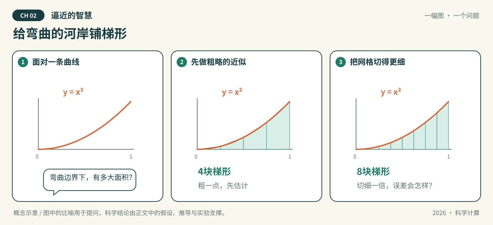
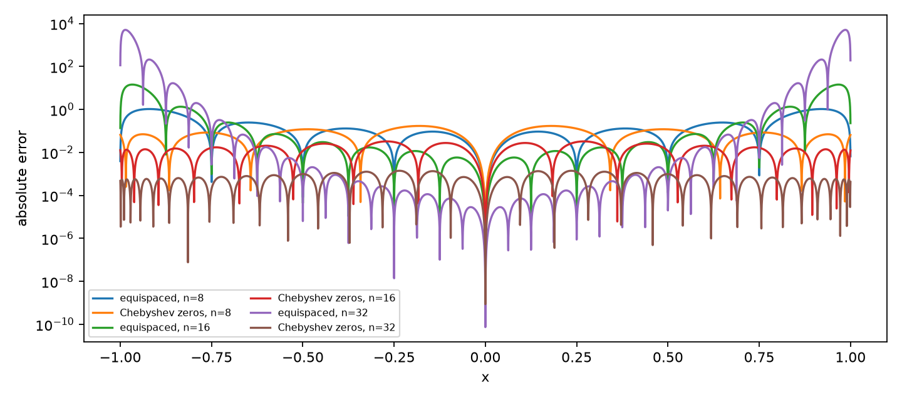
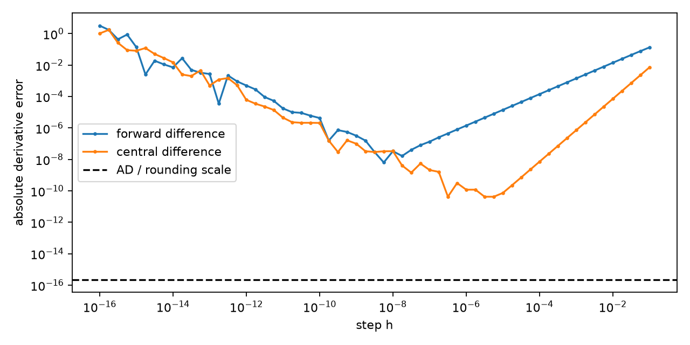
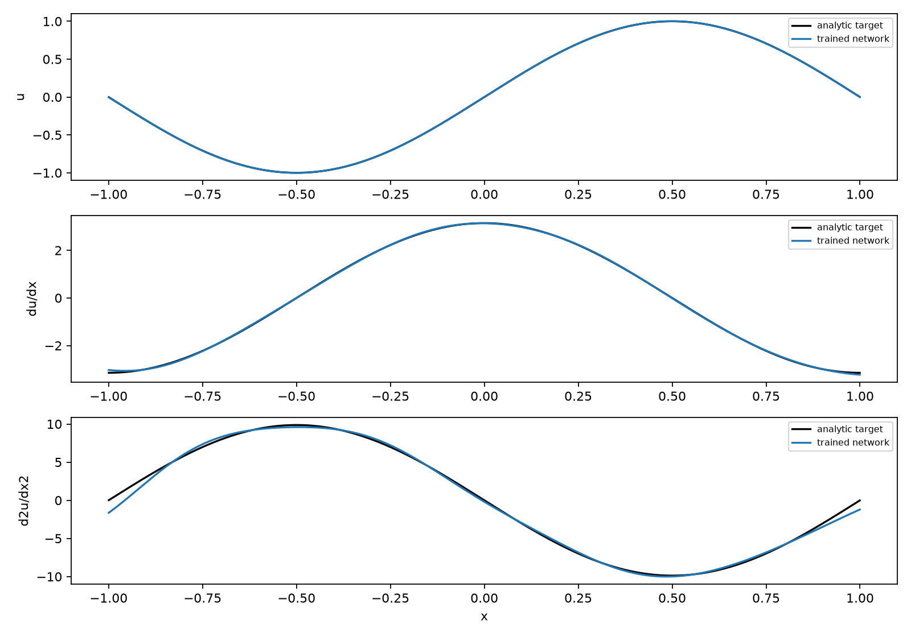

# 第02章 逼近的智慧

*函数逼近、数值积分与自动微分*

*图02-1 · 给弯曲的河岸铺梯形。原课程初始化概念示意，非实测结果。*

## 先看一幕：给弯曲的河岸铺梯形

弯曲河岸旁的一块地，不方便直接丈量。机器人决定先用小梯形铺一遍，再把每块梯形切细一点：多花一倍功夫，能换来多少精度？

**先猜，再验证：** 对 $\int_0^1 x^2\,dx$，复合梯形公式把区间数从4增加到8，绝对误差会变成原来的几分之一？可以先画出自己的猜想，再与2.3节的推导和计算对照。

河岸只是面积问题的情境，数学对象是明确给定的函数。这个例子的误差恰为 $1/(6N^2)$，因此区间数加倍时误差为原来的四分之一；一般函数的收敛阶还要核对光滑性等假设。要理解这个结论，先要知道如何用简单函数代替曲线，以及代替之后哪些性质能够保留。

本章围绕“如何用有限的信息逼近一个函数”展开。已知精确函数值时，插值要求逐点匹配；观测含噪时，最小二乘允许各点有残差；把分段直线积分产生梯形公式，沿基本运算传播链式法则则产生自动微分。最后将逼近函数换成神经网络，区分函数值、输入导数和参数梯度。

读者需要多项式、向量与矩阵、内积、Taylor公式、定积分和链式法则。第1章目录中的浮点数、截断误差及条件数有助于解释实验。本章只据此前目录确定先修，不假定已经学过后续章节的微分方程算法、QR/SVD算法或神经网络理论；必要概念在使用时建立。$C^r[a,b]$ 表示在闭区间具有至 $r$ 阶连续导数的实函数，$C[a,b]$ 表示连续函数；向量的 $\|\cdot\|_2$ 为欧氏范数。本文所有量均无量纲，网格最大误差与连续一致范数始终区分。

阅读时可并用[实验Notebook](编写稿-实验.ipynb)、[课后习题](编写稿-习题.md)和[符号表](符号表.md)。参考书目[1]—[7]及确实核读的页码见[参考文献与定位](参考文献与定位.md)。

## 2.1 插值与 Runge 现象

若只知道一个函数在有限个位置的值，能否据此恢复其他位置的值？例如，计算一条曲线下面积之前，可以先用一条容易积分的曲线替代它。多项式是自然的选择：它由有限个系数确定，求值、求导和积分都有明确规则。但“通过全部已知点”只是对有限信息的匹配，尚不是对整个区间的误差保证。本节依次回答三个问题：插值多项式是否存在且唯一，节点之间的误差由什么控制，以及节点位置为什么会改变逼近效果。

### 2.1.1 插值问题与 Lagrange 插值

**定义 2.1.1（多项式插值）** 设 $x_0,\ldots,x_n$ 是 $[a,b]$ 中 $n+1$ 个互异实数，$a<b$，$n\geq0$，对应数据为 $y_0,\ldots,y_n$。记

$$
\mathcal P_n=\{p:p\text{ 是次数不超过 }n\text{ 的实多项式}\}.
$$

寻找 $p_n\in\mathcal P_n$ 使 $p_n(x_j)=y_j$，称为多项式插值问题。$x_j$ 称为节点。节点可以按任意顺序编号；在讨论间距时再按大小排列。若 $y_j=f(x_j)$，则称 $p_n$ 为 $f$ 在这些节点上的插值多项式。

这里的次数上限不可省略。若不限制次数，在一个解上加上任意倍的 $\prod_{j=0}^n(x-x_j)$，仍满足相同数据。

**定理 2.1.2（Lagrange 插值的存在唯一性）** 对定义 2.1.1 中的数据，插值多项式存在且唯一，并且

$$
p_n(x)=\sum_{j=0}^n y_j\ell_j(x),\qquad
\ell_j(x)=\prod_{\substack{k=0\\k\ne j}}^n\frac{x-x_k}{x_j-x_k}.
$$

当 $n=0$ 时，空乘积规定为 $1$。

**证明** 节点互异保证分母非零。每个 $\ell_j$ 的次数不超过 $n$，且在节点上满足 $\ell_j(x_i)=1$（$i=j$）或 $0$（$i\ne j$）。故上述和式属于 $\mathcal P_n$，代入 $x_i$ 就得到 $y_i$，证明了存在性。若 $p_n,q_n\in\mathcal P_n$ 都插值相同数据，则 $p_n-q_n$ 有 $n+1$ 个互异零点。非零的次数不超过 $n$ 的多项式至多有 $n$ 个互异零点，因此 $p_n-q_n\equiv0$，唯一性得证。$\square$

**例 2.1.3（从三个数据得到二次多项式）** 在节点 $-1,0,1$ 上给出数据 $1,0,1$。三项基函数为

$$
\ell_0(x)=\frac{x(x-1)}2,\qquad
\ell_1(x)=1-x^2,\qquad
\ell_2(x)=\frac{x(x+1)}2.
$$

因而 $p_2=\ell_0+\ell_2=x^2$。逐点代入可验证三个插值条件；定理 2.1.2 进一步保证没有另一个次数不超过 $2$ 的解。更一般地，若数据来自某个 $q\in\mathcal P_n$，则 $q$ 本身已满足插值条件，由唯一性必有 $p_n=q$。这个“再现多项式”的性质也给实现提供了小规模核验：用已知低次多项式生成数据，程序应在舍入误差范围内恢复它。

Lagrange 乘积式适合证明，直接反复计算全部乘积却有冗余。记节点多项式和重心权重为

$$
\omega_{n+1}(x)=\prod_{k=0}^n(x-x_k),\qquad
w_j=\frac1{\prod_{k\ne j}(x_j-x_k)}.
$$

**命题 2.1.4（重心求值公式）** 对所有非节点 $x$，

$$
p_n(x)=
\frac{\displaystyle\sum_{j=0}^n\frac{w_jy_j}{x-x_j}}
{\displaystyle\sum_{j=0}^n\frac{w_j}{x-x_j}}.
$$

在节点 $x_j$ 上直接取 $p_n(x_j)=y_j$。所有权重乘同一个非零常数，公式不变。

**证明** 对非节点 $x$，有 $\ell_j(x)=\omega_{n+1}(x)w_j/(x-x_j)$。对常数函数 $1$ 应用定理 2.1.2，得 $\sum_j\ell_j(x)=1$，故分母等于 $1/\omega_{n+1}(x)$，不为零。把 Lagrange 公式除以这个常数函数的表示，即得所述比值。公共因子在分子、分母中相消，得到最后一条结论。$\square$

权重只与节点有关，可以预先计算；之后每个非节点的求值只需长度为 $n+1$ 的两个和。浮点程序必须单独处理求值点与节点重合的情况，否则出现除零。这个代数改写不改变插值多项式，也不自动消除节点选择造成的敏感性。通用公式可参见参考文献 [2] 第5章、定理5.1；该书主要采用的含端点 Chebyshev 节点与本节稍后采用的零点节点不同，权重不能直接混用。

### 2.1.2 插值误差与 Runge 现象

精确满足 $p_n(x_j)=f(x_j)$，并不意味着节点之间也接近。误差需要同时考虑目标函数和节点几何位置。

**定理 2.1.5（插值余项）** 设 $f\in C^{n+1}[a,b]$，即 $f$ 到 $n+1$ 阶导数在闭区间上连续，节点互异且均在 $[a,b]$。对每个非节点 $x\in[a,b]$，存在位于 $x,x_0,\ldots,x_n$ 的最小闭包区间内部的 $\xi_x$，使

$$
f(x)-p_n(x)=\frac{f^{(n+1)}(\xi_x)}{(n+1)!}\omega_{n+1}(x).
$$

当 $x$ 为节点时，误差等于零。

**证明** 固定一个非节点 $x$，令

$$
K=\frac{f(x)-p_n(x)}{\omega_{n+1}(x)},\qquad
G(t)=f(t)-p_n(t)-K\omega_{n+1}(t).
$$

分母非零，故 $K$ 定义良好。$G$ 在 $x_0,\ldots,x_n,x$ 这 $n+2$ 个互异位置均为零。将这些位置递增排列，相邻零点之间各由 Rolle 定理产生一个 $G'$ 的零点，共至少 $n+1$ 个。再对 $G'$ 的相邻零点应用 Rolle 定理，依次重复 $n+1$ 次，在上述最小区间内部得到 $G^{(n+1)}(\xi_x)=0$。连续可微条件保证每次应用均合法。这就是此处所需的广义 Rolle 论证。由于 $p_n^{(n+1)}=0$，而首一多项式 $\omega_{n+1}$ 的 $n+1$ 阶导数为 $(n+1)!$，得到 $K=f^{(n+1)}(\xi_x)/(n+1)!$，代回即得公式。若 $x$ 等于节点，则不能定义上述 $K$，但插值条件直接给出误差为零，应单独处理。$\square$

记连续函数的一致范数为 $\|g\|_{\infty,[a,b]}=\max_{x\in[a,b]}|g(x)|$。逐点余项立刻给出

$$
\|f-p_n\|_{\infty,[a,b]}
\leq\frac{\|f^{(n+1)}\|_{\infty,[a,b]}}{(n+1)!}
\|\omega_{n+1}\|_{\infty,[a,b]}.
$$

这两个因子分别描述函数高阶变化与节点布局。它是上界；上界很大不证明实际误差很大。随着 $n$ 变化，导数阶数也在变化，不能把 $\|f^{(n+1)}\|_\infty$ 当作与 $n$ 无关的常数。

**例 2.1.6（光滑函数也会出现端点振荡）** 考察 Runge 函数

$$
f(x)=\frac1{1+25x^2},\qquad -1\leq x\leq1,
$$

以及等距节点 $x_j=-1+2j/n$（$n\geq1$）。该函数在实区间上任意阶连续可微，但这条性质并不单独保证等距插值随次数增加而一致收敛。参考文献 [2] 第13章以此例展示等距插值在端点附近误差增大的 Runge 现象，并给出进一步分析；本节不借助复分析证明其渐近发散。

配套 Notebook 的2.1节用同一个重心求值程序，对照等距节点与下节的 Chebyshev 零点，画出若干次数的插值曲线及绝对误差，并报告独立稠密网格上的最大误差。运行前可预测：节点处误差接近零，而等距高次插值在端点邻域可能明显振荡；换成端点附近更密的节点，误差分布会改善。判断时要看端点局部图，不能只看曲线中部，也不能因某一步次数增加后误差下降就推出单调收敛。

这些输出是指定次数、网格和浮点精度下的数值证据。有限网格最大误差通常低于或等于真实连续一致范数；漏掉窄峰时两者可能相差明显。有限个次数的实验不能证明 $n\to\infty$ 的收敛或发散。在高次数下，舍入误差还可能叠加到插值本身的逼近误差上，应借助节点再现检查及低次基准辨别问题。

**数值观察（Runge函数）。** 对同一6001点偏移内部网格，得到下表。节点命中时直接返回数据值；这一约束检查不能代替区间误差检查。

| 次数 $n$ | 等距节点网格最大误差 | Chebyshev零点网格最大误差 |
| --- | ---: | ---: |
| 8 | 1.04518 | 0.170836 |
| 16 | 14.3938 | 0.0326136 |
| 32 | 5059.01 | 0.00140174 |

*图02-2 · Runge函数插值绝对误差；次数为8、16、32，纵轴为对数。参数与解析真值见Notebook 2.1。表中是有限网格观测，不是渐近证明。*

### 2.1.3 等距节点与 Chebyshev 节点

余项提示：若函数固定，能否让节点多项式在全区间尽量小？先在 $[-1,1]$ 上构造具有等幅交错性质的多项式。

**命题 2.1.7（Chebyshev 多项式与零点）** 由

$$
T_k(\cos\theta)=\cos(k\theta),\qquad 0\leq\theta\leq\pi,
$$

定义的函数满足 $T_0(x)=1$、$T_1(x)=x$ 和递推式

$$
T_{k+1}(x)=2xT_k(x)-T_{k-1}(x),\qquad k\geq1.
$$

对 $k\geq1$，$T_k$ 是恰为 $k$ 次的多项式，首项系数为 $2^{k-1}$，且 $\|T_k\|_{\infty,[-1,1]}=1$。$T_{n+1}$ 的全部零点是

$$
x_j=\cos\theta_j,\qquad
\theta_j=\frac{(2j+1)\pi}{2n+2},\quad j=0,\ldots,n.
$$

**证明** 三角恒等式 $\cos((k+1)\theta)+\cos((k-1)\theta)=2\cos\theta\cos(k\theta)$ 给出递推式。$T_1=x$，$T_2=2x^2-1$；此后由归纳法，递推式的最高次项仅来自 $2xT_k$，所以次数逐次增加，首项系数逐次乘 $2$，得到所述系数。余弦的绝对值不超过 $1$，而在 $x=1$ 处等于 $1$，故范数为 $1$。给出的角度均在 $(0,\pi)$ 中，余弦严格递减，得到 $n+1$ 个互异零点；由于次数恰为 $n+1$，不存在其他零点。$\square$

这些零点靠近两端更密，但不包含 $\pm1$。例如 $n=2$ 时为 $\sqrt3/2,0,-\sqrt3/2$。另一常用节点族为 $\cos(j\pi/n)$（$n\ge1$，$j=0,\ldots,n$），包含端点，是 $T_n$ 的极值点；它与本节采用的零点族须区分。参考文献 [2] 第2章主体采用极值点，第一类零点见该章习题2.4；递推式与首项系数见第3章。

**定理 2.1.8（首一多项式的最小最大模）** 对任意首一的 $n+1$ 次实多项式 $q$，

$$
\|q\|_{\infty,[-1,1]}\geq2^{-n}.
$$

Chebyshev 零点的节点多项式 $\omega_{n+1}=2^{-n}T_{n+1}$ 达到此下界，因此在所有 $n+1$ 个互异区间节点所产生的节点多项式中，其一致范数最小。

**证明** 令 $r=n+1$，$C=2^{1-r}=2^{-n}$，$Q=CT_r$，由命题 2.1.7 可知 $Q$ 首一且范数为 $C$。反设存在首一 $q$ 满足 $\|q\|_\infty<C$。在 $r+1$ 个点 $t_k=\cos(k\pi/r)$（$k=0,\ldots,r$）上，$Q(t_k)=C(-1)^k$。于是 $q(t_k)-Q(t_k)$ 严格交替为负、正、负、正，介值定理在每个相邻点之间给出一个零点，共 $r$ 个互异零点。但 $q-Q$ 的最高次项抵消，次数不超过 $r-1$，不可能有这么多零点。这一矛盾证明下界。$Q$ 和零点乘积都是首一的 $r$ 次多项式且有相同的 $r$ 个根，故两者相等；下界确能达到。$\square$

这里最小化的是余项中的节点因子，不能据此宣称这组节点对每个特定函数都使实际插值误差最小。例如某函数已属 $\mathcal P_n$ 时，所有互异节点都给零误差。对 $f\in C^{n+1}[-1,1]$，上述证明与余项相接，只得到有条件的估计

$$
\|f-p_n\|_{\infty,[-1,1]}
\leq\frac{\|f^{(n+1)}\|_{\infty,[-1,1]}}{2^n(n+1)!}.
$$

若右端随 $n$ 趋于零，就证明了收敛；若右端不趋于零，这个估计本身没有结论。它不能被解释为任意连续函数的收敛定理。对一般区间 $[a,b]$，令 $t=(2x-a-b)/(b-a)$，将这些节点映回去，节点多项式的范数为 $2^{-n}((b-a)/2)^{n+1}$，故只需在误差界中相应乘上区间尺度因子。

零点节点也带来简单的重心权重。对 $x_j=\cos\theta_j$，由 $\omega_{n+1}=2^{-n}T_{n+1}$ 及 $w_j=1/\omega'_{n+1}(x_j)$，并对 $T_{n+1}(\cos\theta)=\cos((n+1)\theta)$ 求导，得到

$$
T'_{n+1}(x_j)=\frac{(n+1)\sin((n+1)\theta_j)}{\sin\theta_j}
=\frac{(n+1)(-1)^j}{\sin\theta_j}.
$$

因此可以消去公共因子，采用 $w_j=(-1)^j\sin\theta_j$。这里 $\sin\theta_j>0$，无需端点特殊权重。等距节点若按 $x_j=a+jh$ 递增编号，则直接分开 $k<j$ 与 $k>j$ 的因子，有 $\omega'_{n+1}(x_j)=h^n j!(-1)^{n-j}(n-j)!$，同理可取 $w_j=(-1)^j\binom nj$。两套权重都可由节点几何预先得到，但等距权重的简便并不会改变 Runge 现象。

最后区分两种常被混淆的操作。改变节点，就改变了需要匹配的位置及函数值，因而通常得到另一个插值多项式；固定节点和数据，仅将同一个多项式由幂基 $1,x,\ldots,x^n$ 改写为 Chebyshev 基 $T_0,\ldots,T_n$，在精确算术中不会改变它，因为后者次数依次为 $0,\ldots,n$ 且首项系数非零，逐次消去最高次项即可表示全部 $\mathcal P_n$，唯一性仍适用。基的选择会影响系数计算的数值表现，却不能把固定等距数据的插值问题变成另一个节点问题。下一节在此区分上进一步放松“逐点精确通过”的要求，用最小二乘处理带噪与冗余数据。

## 2.2 最小二乘与切比雪夫逼近

### 2.2.1 带噪数据拟合与最小二乘

插值把每一个观测值都当作必须满足的条件。若观测含有误差，这一要求可能过强。例如，真实函数为零，而在三个位置 $-1,0,1$ 测得的数据是 $0,\varepsilon,0$，其中 $\varepsilon\ne0$ 是测量误差。二次插值多项式为 $\varepsilon(1-x^2)$，它也把中间位置的误差完整地保留下来。仅凭这三个数无法知道哪一个误差来自仪器，但若我们已有“目标变化缓慢”的建模依据，就可以限制近似函数的复杂程度，让多个观测共同确定较少的系数。

设在 $[a,b]$ 上取得 $m$ 个样本 $(x_i,y_i)$，$i=1,\ldots,m$，其中

$$
y_i=f(x_i)+\eta_i.
$$

这里 $f$ 是未知目标，$\eta_i$ 是观测误差；本节不对误差作随机分布假设。选定非负整数 $d$，通常使 $d+1<m$，在 $\mathcal P_d$ 中寻找近似函数。给定该空间的一组基 $\phi_0,\ldots,\phi_d$，写成

$$
p_c(x)=\sum_{j=0}^{d}c_j\phi_j(x),\qquad
c=(c_0,\ldots,c_d)^{\mathsf T}.
$$

**定义 2.2.1（离散最小二乘）。** 取 $y=(y_1,\ldots,y_m)^{\mathsf T}$，定义设计矩阵和残差向量

$$
A_{ij}=\phi_j(x_i)\quad
(i=1,\ldots,m;\ j=0,\ldots,d),\qquad r(c)=Ac-y.
$$

矩阵的第 $j+1$ 列是在全部样本位置计算 $\phi_j$ 得到的向量。离散最小二乘问题是寻找 $c_*$，使

$$
J(c_*)=\min_{c\in\mathbb R^{d+1}}J(c),\qquad
J(c)=\|Ac-y\|_2^2
=\sum_{i=1}^m\bigl(p_c(x_i)-y_i\bigr)^2.
\tag{2.2.1}
$$

平方使正、负残差不会彼此抵消，也使大残差付出较高代价。在上述三点例中，若只用常数 $c$ 拟合，则

$$
J(c)=c^2+(c-\varepsilon)^2+c^2
=3(c-\varepsilon/3)^2+2\varepsilon^2/3,
$$

故最优常数为 $\varepsilon/3$。它没有穿过三个数据点，却减弱了单个扰动的影响。这个例子依赖真实目标确实平缓；若目标本来具有尖锐变化，过低次数也会遗漏结构。

训练残差 $p_c(x_i)-y_i$ 与目标误差 $p_c(x)-f(x)$ 是不同对象。前者可由观测直接计算，后者只有知道目标函数或另有可靠参考时才能评估。增加次数扩大了候选空间，所以最小训练残差不会增加：旧的候选多项式仍在新空间中。然而，在有限样本以外如何变化并不由这条结论控制，噪声也可能随更高次数被一起拟合。实验应同时报告训练残差与独立网格上的目标误差。

选择次数还包含建模判断。数据稀少时，高次数允许的变化可能远超观测提供的约束；次数过低时，又可能漏掉目标的重要弯曲。最小二乘保证选定空间内的最优性，并不同时保证这个空间选择得恰当。

### 2.2.2 设计矩阵与最优条件

先把问题看作欧氏空间中的几何问题。$A$ 的列空间

$$
S=\{Ac:c\in\mathbb R^{d+1}\}\subseteq\mathbb R^m
$$

是所有可实现的样本拟合值组成的线性空间。寻找最小二乘解，就是在 $S$ 中寻找离 $y$ 最近的向量。这里的正交指欧氏内积 $u^{\mathsf T}v$ 等于零。

**定理 2.2.2（存在性、最优条件与唯一性）。** 对任意实矩阵 $A\in\mathbb R^{m\times(d+1)}$ 及 $y\in\mathbb R^m$，问题 (2.2.1) 至少有一个解。向量 $c_*$ 为解的充分必要条件是

$$
A^{\mathsf T}(Ac_*-y)=0,
\quad\text{即}\quad
A^{\mathsf T}Ac_*=A^{\mathsf T}y.
\tag{2.2.2}
$$

所有解产生相同的拟合值 $Ac_*$；系数解唯一当且仅当 $A$ 的列线性无关。

**证明。** 若 $S=\{0\}$，所有拟合值都是零，任取系数即可达到相同最小值。若 $\dim S=r>0$，从 $A$ 的列中取出一组基，逐次减去它在此前向量上的分量并归一化，即 Gram–Schmidt 正交化，可得 $S$ 的标准正交基 $q_1,\ldots,q_r$。令

$$
z_*=\sum_{k=1}^r(q_k^{\mathsf T}y)q_k.
$$

直接计算得 $y-z_*$ 与每个 $q_k$ 正交，因而与 $S$ 正交。对任意 $z\in S$，交叉项为零，故

$$
\|y-z\|_2^2
=\|y-z_*\|_2^2+\|z_*-z\|_2^2.
\tag{2.2.3}
$$

这证明 $z_*$ 是唯一的最近向量。因 $z_*\in S$，存在 $c_*$ 满足 $Ac_*=z_*$，于是系数解存在。

若 $c_*$ 最优，对任意 $h\in\mathbb R^{d+1}$ 和实数 $t$，展开得到

$$
J(c_*+th)-J(c_*)
=2t\,h^{\mathsf T}A^{\mathsf T}(Ac_*-y)
+t^2\|Ah\|_2^2.
$$

若一次项系数不为零，取足够小且符号相反的 $t$ 就会使右端为负，与最优性矛盾。因此对所有 $h$，一次项均为零，得到 (2.2.2)。反之，若 (2.2.2) 成立，取 $t=1$ 即有 $J(c_*+h)-J(c_*)=\|Ah\|_2^2\ge0$，故它充分。

若 $c_1,c_2$ 都最优，拟合值的唯一性给出 $A(c_1-c_2)=0$。当 $A$ 列满秩时，零空间只有零向量，故 $c_1=c_2$。若列不满秩，则存在非零 $h$ 使 $Ah=0$，任一解 $c_*$ 与 $c_*+h$ 都是解，系数不唯一。证毕。

式 (2.2.2) 称为正规方程。它表达的是最优残差与设计矩阵的每一列正交。也可对二次函数直接求导得到 $\nabla J(c)=2A^{\mathsf T}(Ac-y)$，但仅写梯度为零并未独自说明解存在以及何时唯一；上面的证明补足了这些问题。

例如，在位置 $-1,0,1$ 给定观测 $1,0,2$，用直线 $p(x)=c_0+c_1x$ 拟合，则

$$
A=\begin{pmatrix}1&-1\\1&0\\1&1\end{pmatrix},\quad
A^{\mathsf T}A=\begin{pmatrix}3&0\\0&2\end{pmatrix},\quad
A^{\mathsf T}y=\begin{pmatrix}3\\1\end{pmatrix}.
$$

因此 $p_*(x)=1+x/2$，残差为 $(-1/2,1,-1/2)^{\mathsf T}$。其各分量之和为零，加权和 $\sum_i x_ir_i$ 也为零，分别对应残差与常数列、一次项列正交。平方残差和是 $3/2$，均方根残差是 $\sqrt{(3/2)/3}=1/\sqrt2$；报告误差时必须区分这两个数。此处只有三条观测，没有提供真实函数，因而不能把算得的残差称为对真实函数的逼近误差。

**推论 2.2.3（多项式拟合的唯一性）。** 若样本位置中至少有 $d+1$ 个互异点，且 $\phi_0,\ldots,\phi_d$ 是 $\mathcal P_d$ 的一组基，则设计矩阵列满秩，最小二乘多项式唯一。

**证明。** 若 $Ac=0$，则 $p_c$ 在这些位置取零。次数不超过 $d$ 的非零多项式至多有 $d$ 个互异实根，故 $p_c$ 恒为零。由基的线性无关性得 $c=0$，所以 $A$ 列满秩。证毕。

秩亏时要区分“样本拟合值唯一”和“函数唯一”。例如，用一次多项式拟合两个都位于 $x=0$ 的观测 $y_1=1,y_2=3$，则

$$
A=\begin{pmatrix}1&0\\1&0\end{pmatrix},\qquad
J(c)=2(c_0-2)^2+2.
$$

全部 $p(x)=2+c_1x$ 都最优，在观测位置给出相同的值 $2$，斜率却完全无法从这些数据中确定。

正规方程适合推导，但实际计算无需先形成 $A^{\mathsf T}A$，更不应显式求其逆。列满秩时，对全部列作正交化可写成薄 QR 分解

$$
A=QR,\qquad Q^{\mathsf T}Q=I_{d+1},
$$

其中 $Q\in\mathbb R^{m\times(d+1)}$ 的列标准正交，$R$ 是可逆上三角矩阵。$R$ 的第 $j$ 列记录原第 $j$ 列在正交基中的坐标；正交化过程保证其下三角元素为零。由正交分解，

$$
\|Ac-y\|_2^2
=\|Rc-Q^{\mathsf T}y\|_2^2
+\|(I-QQ^{\mathsf T})y\|_2^2.
$$

因此通过上三角回代求解 $Rc=Q^{\mathsf T}y$ 即得最优系数。这里给出正交化解释算法的依据；浮点程序通常使用更稳健的正交变换或专用最小二乘求解器。本章实验使用 `lstsq` 求解原问题，其含义是最小化 (2.2.1)，不要求先掌握求解器的全部内部算法。

### 2.2.3 幂基与 Chebyshev 基的比较

幂基 $1,x,\ldots,x^d$ 形式直观。但当次数较高或区间尺度不合适时，各列的大小差异或相似性会使系数对扰动敏感。先令

$$
t=\frac{2x-a-b}{b-a}\in[-1,1],
$$

再考虑 $1,t,\ldots,t^d$，就能消除部分由区间位置和长度造成的尺度问题。另一种表示使用 Chebyshev 多项式

$$
T_k(\cos\theta)=\cos(k\theta),\qquad 0\le\theta\le\pi.
$$

由余弦加法公式得到

$$
T_0(t)=1,\quad T_1(t)=t,\quad
T_{k+1}(t)=2tT_k(t)-T_{k-1}(t).
\tag{2.2.4}
$$

递推表明 $T_k$ 是 $k$ 次多项式，$k\ge1$ 时最高次项系数为 $2^{k-1}$。所以 $T_0,\ldots,T_d$ 线性无关，构成 $\mathcal P_d$ 的另一组基。在 $[-1,1]$ 上又有 $|T_k(t)|\le1$，所有基函数都具有受控的幅值。

Chebyshev 基还有特定的正交性。作代换 $t=\cos\theta$，可得

$$
\int_{-1}^{1}\frac{T_j(t)T_k(t)}{\sqrt{1-t^2}}\,dt
=\int_0^\pi\cos(j\theta)\cos(k\theta)\,d\theta.
$$

右端在 $j\ne k$ 时为零：当两指标都非零时，用积化和差及整数倍余弦的积分即可；当一个指标为零时直接积分。对角项在 $j=k=0$ 时为 $\pi$，在 $j=k\ge1$ 时为 $\pi/2$。左端理解为端点处的反常积分。这是连续的、带权的正交关系；任意采样位置上的离散列内积 $\sum_iT_j(t_i)T_k(t_i)$ 不一定为零。更换基函数与更换采样节点也属于不同操作。

**命题 2.2.4（基变换不改变精确拟合问题）。** 设 $\phi_0,\ldots,\phi_d$ 与 $\psi_0,\ldots,\psi_d$ 是同一多项式空间的两组基。对同一组数据和同一未加权平方残差目标，两组基得到的最优多项式集合相同；若采样使设计矩阵列满秩，则最优多项式相同且唯一。

**证明。** 存在可逆矩阵 $B$ 使两设计矩阵满足 $A_\psi=A_\phi B$。每个系数 $\gamma$ 对应 $c=B\gamma$，并表示同一函数。因 $B$ 可逆，这一对应遍历整个候选空间，而且 $\|A_\psi\gamma-y\|_2=\|A_\phi c-y\|_2$，所以最小化问题等价。唯一性由定理 2.2.2 得到。证毕。

因此，在精确算术下固定次数、样本及目标，Chebyshev 基不会凭空改善最优函数本身；它改变的是表示和计算。实验中若两种基得到不同曲线，应进一步检查舍入误差、数值秩判定或所用目标是否一致。

为定量描述矩阵列的敏感性，对列满秩的矩阵定义

$$
\kappa_2(A)=
\frac{\max_{\|v\|_2=1}\|Av\|_2}
{\min_{\|v\|_2=1}\|Av\|_2}.
\tag{2.2.5}
$$

分母为正；若某些单位系数组合产生极小的样本值，反向辨认系数就容易受扰动影响。记 $G=A^{\mathsf T}A$。由 $\|Av\|_2^2=v^{\mathsf T}Gv$ 及实对称矩阵的正交对角化，最大、最小平方分别是 $G$ 的最大、最小特征值。于是对正定矩阵 $G$，有

$$
\kappa_2(G)=\frac{\lambda_{\max}(G)}{\lambda_{\min}(G)}
=\kappa_2(A)^2.
$$

这说明形成正规方程可能放大矩阵的病态程度。条件数同时依赖基的尺度：把某一列乘以很大或很小的常数，候选函数空间没有改变，矩阵条件数却可能明显变化。因此比较必须说明区间归一化、次数、样本和列缩放；不能把某次较小的条件数解释成“该基对任何数据都更准确”。

最后，Chebyshev 多项式的名称并不把最小二乘目标变成最小最大误差目标。连续最小二乘以 $\int_a^b|f-p|^2\,dx$ 衡量误差，一致逼近则以

$$
\|f-p\|_\infty=\max_{x\in[a,b]}|f(x)-p(x)|
$$

衡量误差；离散最小二乘又只在给定样本上求和。三种目标应分别说明。

**例 2.2.5（平方平均最优与一致最优不同）。** 在 $[-1,1]$ 上用常数 $c$ 逼近 $f(x)=x^2$。连续平方误差为

$$
\int_{-1}^1(x^2-c)^2\,dx
=\frac25-\frac43c+2c^2
=2(c-\tfrac13)^2+\frac{8}{45},
$$

故唯一最优常数为 $1/3$。由于 $x^2$ 的值域为 $[0,1]$，任意常数的最大误差恰为

$$
\max\{|c|,|1-c|\}\ge\frac12.
$$

取 $c=1/2$ 可达到等号；若最大误差不超过 $1/2$，则同时有 $|c|\le1/2$ 与 $|1-c|\le1/2$，迫使 $c=1/2$，所以一致最优常数唯一为 $1/2$。而在三个位置 $-1,0,1$ 作离散常数最小二乘，则最优常数为样本值的平均数 $2/3$。常数基本身就是 $T_0=1$；即使使用 Chebyshev 基，目标函数不同仍会给出三个不同的答案。

**数值观察（同数据、同次数、换基）。** 取41个等距样本，目标为 $e^x$，加上标准差0.015、种子2026生成的一次共用噪声。固定 $d=12$，对原设计矩阵调用最小二乘求解器，在同一2001点偏移内部网格上相对于无噪目标评价：

| 基 | $\kappa_2(A)$ | 训练残差 $\|Ac-y\|_2$ | 网格最大目标误差 |
| --- | ---: | ---: | ---: |
| 幂基 | 16674.7 | 0.0693263 | 0.01892133 |
| Chebyshev基 | 2.45887 | 0.0693263 | 0.01892133 |

两种预测曲线的最大差约 $2.04\times10^{-14}$。更换表示显著改善了本例矩阵的条件数，但精确最优多项式没有改变。同数据下将次数从3、12提高到30，残差依次约为0.07774、0.06933、0.04538，网格目标误差却约为0.01154、0.01892、28.2171；拟合噪声更充分未必恢复目标更好。Notebook 2.2另用解析直线及QR方法核查实现。

对函数作逼近之后，还需要考虑怎样使用它。把近似函数积分，可以将有限的函数值转换为面积近似；直接对近似表达式求导，则会提出新的误差问题。下一节先从分段一次插值的积分出发，说明梯形公式的来源，再区分几种计算导数的途径。

## 2.3 数值积分与自动微分

前两节用容易计算的函数代替原函数。这样的表示还可以继续接受运算：对插值函数积分，得到求积公式；对计算程序中的每一步求导，得到自动微分。本节研究这两种构造，并追问同一个问题：计算结果对应哪个数学对象，误差又来自哪里？

### 2.3.1 复合梯形公式与收敛性

设要计算

$$
I=\int_a^b f(x)\,\mathrm dx,\qquad a<b.
$$

将区间等分为 $N$ 个小区间，记 $h=(b-a)/N$、$x_k=a+kh$。在 $[x_k,x_{k+1}]$ 上，以通过两个端点的直线

$$
\ell_k(x)=\frac{x_{k+1}-x}{h}f(x_k)
+\frac{x-x_k}{h}f(x_{k+1})
$$

代替 $f$。直接积分可得 $\int_{x_k}^{x_{k+1}}\ell_k(x)\,\mathrm dx=h[f(x_k)+f(x_{k+1})]/2$。各段相加，内部节点各出现两次，得到

$$
T_N=h\left[\frac{f(a)+f(b)}2+\sum_{k=1}^{N-1}f(x_k)\right].
\tag{2.3.1}
$$

因此复合梯形公式就是对分段线性插值函数作精确积分。这里的 $T_N$ 表示求积值，区别于前两节的 Chebyshev 多项式 $T_k(x)$。

**定理 2.3.1（梯形误差及二阶界）** 设 $f\in C^2[a,b]$，即 $f$ 在闭区间上具有连续的二阶导数。定义

$$
K_N(t)=\frac{(t-x_k)(x_{k+1}-t)}2,
\qquad t\in[x_k,x_{k+1}].
$$

则

$$
I-T_N=-\int_a^b K_N(t)f''(t)\,\mathrm dt,
\qquad
|I-T_N|\le \frac{b-a}{12}h^2\max_{[a,b]}|f''|.
\tag{2.3.2}
$$

并且存在 $\xi\in(a,b)$，使

$$
I-T_N=-\frac{b-a}{12}h^2 f''(\xi).
\tag{2.3.3}
$$

**证明。** 在任意一段 $[u,v]=[x_k,x_{k+1}]$ 上，令 $q(t)=(t-u)(v-t)/2$，则 $q(u)=q(v)=0$、$q'(u)=h/2$、$q'(v)=-h/2$、$q''=-1$。连续两次分部积分给出

$$
\begin{aligned}
\int_u^v q(t)f''(t)\,\mathrm dt
&=[qf']_u^v-[q'f]_u^v+\int_u^v q''(t)f(t)\,\mathrm dt\\
&=\frac h2[f(u)+f(v)]-\int_u^v f(t)\,\mathrm dt.
\end{aligned}
$$

相加即得核积分恒等式。由于 $q\ge0$，且置 $s=t-u$ 后

$$
\int_u^v q(t)\,\mathrm dt
=\frac12\int_0^h s(h-s)\,\mathrm ds=\frac{h^3}{12},
$$

故 $\int_a^b K_N(t)\,\mathrm dt=Nh^3/12=(b-a)h^2/12$，取绝对值即得误差界。最后，$f''$ 连续，非负权函数 $K_N$ 在每段内部严格为正，故其加权平均值由区间内部某点的 $f''$ 取到。这可由介值定理说明：若 $f''$ 不恒等于该平均值，则它不可能在所有内部点均严格偏向平均值的同一侧；若恒等则任取内部点。将该加权平均写成 $f''(\xi)$，得到式（2.3.3）。$\square$

由公式立刻看出误差的符号：若 $f''\ge0$，则 $I-T_N\le0$，梯形值偏大。对于固定的 $f\in C^2[a,b]$，式（2.3.2）保证 $|I-T_N|=O(N^{-2})$。这是上界，并未断言每个函数的误差都恰好按此阶衰减；例如一次函数的误差恒为零。

**例 2.3.2（开场问题中的四段与八段）** 对 $f(x)=x^2$、$[a,b]=[0,1]$，有 $f''=2$，于是

$$
I=\frac13,\qquad T_N=\frac13+\frac{1}{6N^2}.
$$

特别地，$T_4=11/32$、$T_8=43/128$，二者绝对误差分别为 $1/96$ 与 $1/384$。区间数加倍时误差恰好变为原来的四分之一；这些是精确分数，由误差恒等式即可核验。

没有二阶光滑性时，应另行分析。连续函数仍有梯形收敛性：定义连续模

$$
\omega_f(\delta)=\sup\{|f(s)-f(t)|:s,t\in[a,b],\ |s-t|\le\delta\}.
$$

在每一段上，$\ell_k$ 是端点值的非负加权平均，故 $|f(x)-\ell_k(x)|\le\omega_f(h)$。积分并相加可得 $|I-T_N|\le(b-a)\omega_f(h)$。由闭区间连续函数的一致连续性，右边趋于零，但这不提供统一的二阶速率。

例如 $f(x)=\sqrt{x}$ 在 $[0,1]$ 连续且为凹函数，每段梯形值均不超过积分值。第一段就产生

$$
\int_0^h\sqrt{x}\,\mathrm dx-\frac h2\sqrt h
=\frac16h^{3/2}.
$$

故全区间的 $I-T_N\ge h^{3/2}/6$。若它有与 $N$ 无关的二阶上界 $Ch^2$，就要求 $C\ge1/(6\sqrt h)$，与 $h\to0$ 矛盾。把光滑函数实验中的“四分之一”无条件移用于端点不光滑函数，会得到错误预测。上述分析还只涉及精确算术中的求积误差；浮点求和也会带来舍入误差。

### 2.3.2 有限差分、符号微分与自动微分

求导与积分对扰动的反应不同：差商会用小量作除数。为避免与积分网格步长混淆，以下用 $\delta>0$ 表示差分步长。前向差分与中心差分为

$$
D_\delta^+F(x)=\frac{F(x+\delta)-F(x)}\delta,
\qquad
D_\delta^0F(x)=\frac{F(x+\delta)-F(x-\delta)}{2\delta}.
$$

在涉及的邻域上，若 $F\in C^2$ 且 $|F''|\le M_2$，Taylor 公式给出 $|D_\delta^+F-F'|\le M_2\delta/2$；若 $F\in C^3$ 且 $|F'''|\le M_3$，将两侧的三阶余项分别估计可得 $|D_\delta^0F-F'|\le M_3\delta^2/6$。这些是截断误差界。

同时，若每次函数求值的绝对误差至多为 $\eta$，即使后续差商在精确算术中组装，前向差分还可能引入至多 $2\eta/\delta$ 的附加误差，中心差分则为 $\eta/\delta$；实际浮点运算还需考虑输入、减法和除法的舍入。因此减小步长并非总能改善结果。

三种方法所操作的对象不同：

| 方法 | 输入及核心操作 | 输出与主要限制 |
| --- | --- | --- |
| 有限差分 | 在邻近点调用函数，组成差商 | 导数近似值；需要平衡截断与舍入误差 |
| 符号微分 | 对表达式应用求导规则并化简 | 导数表达式；表达式可能膨胀，求值仍受浮点误差影响 |
| 自动微分（AD） | 执行基本运算时传播局部导数 | 指定输入处的导数值；要求受支持的运算及适当的可微性 |

选择方法要看现有信息。若只能把输入交给一个求值黑箱并取回函数值，有限差分仍是自然选择；AD 需要获得程序内部运算，或由黑箱提供可调用的导数规则。若需要研究驻点或化简公式，符号导数表达式可能比一个导数数值更有帮助。三种方法的区别在于如何利用函数的表示，不能仅凭“自动给出结果”判断所用的是哪一种。

贯穿本节的例子是

$$
F(x)=\sin(x^2)+\exp(x),\qquad
F'(x)=2x\cos(x^2)+\exp(x).
\tag{2.3.4}
$$

右式是解析基准。自动微分无需先构造整个导数表达式，也不在 $x\pm\delta$ 处取样，而是沿计算式的组成步骤使用链式法则。

前向模式可用**双数**说明。写 $v+\dot v\varepsilon$，其中 $\varepsilon^2=0$、$\varepsilon\ne0$；它由一对数 $(v,\dot v)$ 存储，$\varepsilon$ 是代数记号，不是取极小的实数步长。定义

$$
\begin{aligned}
(u+\dot u\varepsilon)+(v+\dot v\varepsilon)
&=u+v+(\dot u+\dot v)\varepsilon,\\
(u+\dot u\varepsilon)(v+\dot v\varepsilon)
&=uv+(\dot u v+u\dot v)\varepsilon.
\end{aligned}
$$

对可微基本函数 $\phi$，规定其提升为 $\phi(v+\dot v\varepsilon)=\phi(v)+\phi'(v)\dot v\varepsilon$。连续提升两次，得到

$$
\phi\bigl(\psi(v+\dot v\varepsilon)\bigr)
=\phi(\psi(v))+\phi'(\psi(v))\psi'(v)\dot v\varepsilon.
$$

所以 $\varepsilon$ 的系数正是复合函数的一阶链式法则；这里没有把 Taylor 余项“估计为很小”，而是在双数代数中定义一阶信息的传播。

### 2.3.3 计算图与链式法则

把式（2.3.4）写成有限步程序：

$$
v_0=x,\quad v_1=v_0v_0,\quad
v_2=\sin v_1,\quad v_3=\exp v_0,\quad v_4=v_2+v_3=F(x).
$$

下面的小图展示依赖关系；平方节点内部包含乘法的两个输入。

$$
\begin{array}{ccccc}
v_0=x&\longrightarrow&v_1=x\times x&\longrightarrow&v_2=\sin v_1\\
\big\downarrow&&&&\big\downarrow\\
v_3=\exp v_0&\longrightarrow&&\longrightarrow&v_4=v_2+v_3
\end{array}
$$

**前向手算。** 令 $\dot v_i=\mathrm dv_i/\mathrm dx$，以种子 $\dot v_0=1$ 开始，函数值与切向量同步传播。在 $x=0.7$ 处，各量可以保留为精确表达式：

| 节点 | 函数值 $v_i$ | 切向量 $\dot v_i$ |
| --- | --- | --- |
| $v_0$ | $0.7$ | $1$ |
| $v_1$ | $0.49$ | $\dot v_0v_0+v_0\dot v_0=1.4$ |
| $v_2$ | $\sin(0.49)$ | $1.4\cos(0.49)$ |
| $v_3$ | $\exp(0.7)$ | $\exp(0.7)$ |
| $v_4$ | $\sin(0.49)+\exp(0.7)$ | $1.4\cos(0.49)+\exp(0.7)$ |

**反向手算。** 先正向计算并保存必要的中间值，再令伴随量 $\bar v_i$ 表示输出对节点值的敏感性。以 $\bar v_4=1$ 开始，其余伴随量初始化为零。沿依赖关系逆序，把每一条边的贡献加回父节点：

$$
\bar v_j\mathrel{+}=\bar v_i\frac{\partial v_i}{\partial v_j}.
\tag{2.3.5}
$$

符号 $\mathrel{+}=$ 表示累加，不能写成覆盖赋值，因为一个量可能通过多条路径影响输出。

| 处理节点 | 传播操作 | 累积结果 |
| --- | --- | --- |
| $v_4=v_2+v_3$ | $\bar v_2\mathrel{+}=\bar v_4$，$\bar v_3\mathrel{+}=\bar v_4$ | $\bar v_2=\bar v_3=1$ |
| $v_3=\exp v_0$ | $\bar v_0\mathrel{+}=\bar v_3\exp v_0$ | $\bar v_0=\exp(0.7)$ |
| $v_2=\sin v_1$ | $\bar v_1\mathrel{+}=\bar v_2\cos v_1$ | $\bar v_1=\cos(0.49)$ |
| $v_1=v_0v_0$ | 两个乘法输入各向 $\bar v_0$ 加 $\bar v_1v_0$ | $\bar v_0=\exp(0.7)+1.4\cos(0.49)$ |

两种模式得到同一个解析导数，但保存与传播的信息不同。前向跟踪输入变化怎样影响后续节点；反向把输出敏感性分配给前面的节点。

这个例子也说明了局部规则检查的必要性：平方节点的两个输入虽然来自同一个变量，仍是乘法规则中的两个位置。若只沿其中一条边传播，最后会漏掉一项 $x\cos(x^2)$；即使其他节点全部正确，也无法通过解析基准的核验。计算图中的重复使用对应导数贡献的累加。

**命题 2.3.3（光滑基本程序的导数传播）** 考虑一个由有限个基本运算构成的无环计算图。假设各基本运算在所涉及的点附近连续可微，程序在该邻域内执行同一条运算路径，且使用精确实数算术和正确的局部导数。则前向模式以输入切向量 $\dot x$ 为种子得到输出的方向导数；标量输出的反向模式以输出伴随量 $1$ 为种子得到所有输入的偏导数。

**证明。** 将节点依赖排序，记第 $i$ 个节点为 $v_i=\phi_i(v_{j_1},\ldots,v_{j_r})$，其父节点均排在前面。若父节点的切向量正确，链式法则给出

$$
\dot v_i=\sum_{k=1}^r\frac{\partial\phi_i}{\partial v_{j_k}}\dot v_{j_k}.
$$

由输入开始归纳，输出切向量正确。对于反向模式，从输出往回，把某个节点的微小变化对输出的贡献沿它的每条出边展开；多元链式法则要求将各条路径的贡献相加。逆序处理时，其所有后继节点均已处理，式（2.3.5）正好累积这些项。继续逆序归纳，到达每个输入便得到相应的输出偏导数。$\square$

若函数有许多输入而只有一个标量输出，反向模式一次反向遍历即可获得全梯度；单方向前向模式一次遍历得到一个方向导数。反向模式通常需要保存或重算中间值，带来存储与计算之间的权衡。本节的单输入例子主要用于看清规则，不体现大规模问题的成本差别。

命题的条件也划出了 AD 的边界。实际计算用浮点数，故基本函数、乘法以及导数累加均有舍入误差；AD 消除了差分步长带来的截断误差，却不保证无舍入误差，也不保证不稳定表达式给出高相对精度。它通常求的是把所执行基本运算解释为实数运算后所得程序的导数，而不是含逐步舍入的离散映射的字面导数。

分支与非光滑点尤其需要核验。例如程序“若 $x=0$ 则返回 $0$，否则返回 $x$”在实数意义下定义的函数就是 $F(x)=x$，但在零点只跟踪常数分支会给出导数 $0$，而实际导数为 $1$；其执行路径在任何零点邻域内都不固定。对于 $|x|$ 在零点这样的不可微点，软件返回的某个约定值更不能称为经典导数。因而，AD 的结论针对可微基本运算及合适的执行路径，并非对任意抽象实数函数、任意输入的正确性承诺。

配套实验采用自编的教学双数与反向节点实现，按同一程序比较解析导数、AD 和不同步长的差分。这样可以直接检查每个局部规则，而不把大型框架接口当作原理。下一节将把标量程序扩展为参数化神经网络：对输入求导描述函数的变化，对参数求导则用于调整逼近器；两者都沿计算图使用链式法则，但它们对应不同的数学问题。

**数值观察（导数的三种计算）。** 在 $x=0.7$，解析导数约为3.2490187095246466；本章前向与反向AD的绝对误差均小于 $10^{-12}$。同一函数的中心差分，在所扫步长中最小误差约为 $4.23\times10^{-11}$，对应步长约 $5.62\times10^{-6}$。更小的步长并没有持续改进精度。这里采用的AD工具是随章提供的教学 `Dual`、`Graph` 与二阶 `Jet2`，局部求导规则全部可查看。

*图02-3 · 对 $F(x)=\sin(x^2)+e^x$ 在 $x=0.7$ 处的求导误差。两坐标轴均为对数；虚线表示AD误差或浮点尺度。最优步长是本次有限扫描结果。*

本节关于三类求导方法、双数、前向与反向传播及存储权衡的来源为 Baydin 等《Automatic Differentiation in Machine Learning: a Survey》§2.1–2.2、§3.1–3.2，原文印刷页 4–13（所给 PDF 第 4–13 页）。本节的小图、统一例子及推导按上述规则重新组织。

## 2.4 AI关联：神经网络逼近与PINN求导

多项式拟合先选定一组基函数，再求线性组合的系数。如果连基函数的形状也允许随参数改变，就得到更灵活的非线性拟合问题。神经网络可以从这个角度理解：它仍然表示一个具体函数，训练是在有限维参数空间中选择这个函数。上一节的链式法则既用于调整参数，也用于计算函数对自变量的导数；二者承担的任务不同。

### 2.4.1 神经网络作为函数逼近器

**定义2.4.1（单隐层标量网络）** 设输入为实数 $x$，取正整数 $q$，定义

$$
u_\theta(x)=c+\sum_{j=1}^{q}a_j\tanh(w_jx+b_j),\qquad
\theta=(a_1,\ldots,a_q,w_1,\ldots,w_q,b_1,\ldots,b_q,c)
\in\mathbb R^{3q+1}. \tag{2.4.1}
$$

这里 $w_jx+b_j$ 是仿射函数，$\tanh z=(e^z-e^{-z})/(e^z+e^{-z})$ 称为激活函数；$q$ 个激活值组成隐层，输出层把它们作线性组合并加上常数 $c$。$w_j,a_j$ 称为权重，$b_j,c$ 称为偏置。网络的层是计算步骤的分组，不是对未知函数的额外假设。若把激活函数换成恒等函数，那么无论隐层有多少单元，输出都只是仿射函数；非线性激活使不同单元能够表现不同位置与尺度的变化。例如，$w_j$ 改变过渡的快慢，$b_j$ 改变过渡的位置，$a_j$ 改变它对输出的贡献。固定 $w_j,b_j$ 时，对 $a_j,c$ 的拟合是线性最小二乘；一起调整所有参数时，则成为非线性最小二乘。

同一函数还可能有不同参数表示。例如交换两个隐层单元的全部参数不会改变求和结果；$\tanh(-z)=-\tanh z$ 也带来等价表示。因此“找到好的逼近函数”与“唯一确定一组参数”是不同要求。参数的数量是 $3q+1$，不能据此断言存在同样多彼此独立的函数变化方向。

例如，在 $[-1,1]$ 上用样本 $(x_i,y_i)$，$i=1,\ldots,m$ 拟合函数，可最小化

$$
L_{\rm data}(\theta)=\frac1m\sum_{i=1}^{m}
\bigl(u_\theta(x_i)-y_i\bigr)^2. \tag{2.4.2}
$$

训练指用计算方法寻找较小的损失值。即使找到了全局最小值，它也只直接约束这些样本；样本间的函数误差仍要独立考察。在多项式插值中，选择次数和节点后，系数由线性条件确定；这里损失作为全部参数的函数通常不是二次函数，训练过程也不再是一次线性方程组求解。这解释了为什么逼近能力和训练效果必须分别研究。增加 $q$ 扩大了可选函数族，却没有自动给出训练结果的误差界。

先用一种可直接证明的构造，说明网络的逼近能力。记 $\rho(z)=\max(0,z)$，称为 ReLU 激活。

**命题2.4.2（折线的网络表示与函数逼近）** 对任意 $f\in C[-1,1]$ 和 $\varepsilon>0$，存在有限个 ReLU 单元组成的单隐层网络 $p$，使 $\|p-f\|_\infty<\varepsilon$。

**证明** 取等距节点 $t_j=-1+2j/n$，$j=0,\ldots,n$，令 $s_j=[f(t_{j+1})-f(t_j)]/(t_{j+1}-t_j)$。连接相邻数据点的折线为

$$
p(x)=f(t_0)+s_0(x-t_0)
 +\sum_{j=1}^{n-1}(s_j-s_{j-1})\rho(x-t_j). \tag{2.4.3}
$$

在 $(t_k,t_{k+1})$ 上，其斜率为 $s_0+\sum_{j=1}^{k}(s_j-s_{j-1})=s_k$，且 $p(t_0)=f(t_0)$，故它正是所述折线。又因 $x=\rho(x)-\rho(-x)$，式中的线性项也能由两个 ReLU 单元表示。

若 $x=(1-\lambda)t_j+\lambda t_{j+1}$，$0\leq\lambda\leq1$，则

$$
|p(x)-f(x)|\leq(1-\lambda)|f(t_j)-f(x)|
 +\lambda|f(t_{j+1})-f(x)|.
$$

连续函数在闭区间上一致连续，所以当网格宽度 $2/n$ 足够小时，右端小于 $\varepsilon/2$，且这一选择对所有 $x$ 有效。因此 $\|p-f\|_\infty\leq\varepsilon/2<\varepsilon$。证毕。

这个构造证明的是函数值的一致逼近，也给出了具体权重；它没有保证折线的二阶导数准确，更没有证明某个训练算法会找到这些权重。对光滑激活的相关存在性结果，应同样分清条件与结论。Hornik、Stinchcombe 与 White（1990，定义3.2、推论3.5，印刷页556，PDF第6页）要求激活 $G\in C^\ell(\mathbb R)$，且

$$
0<\int_{\mathbb R}|G^{(\ell)}(z)|\,dz<\infty.
$$

其结论涉及函数与至多 $m\leq\ell$ 阶导数在定义域内部紧集上的同时一致逼近，并要求目标及其相应连续导数满足文中的可积条件。就本节的一维情形，若目标在较大闭区间 $[-2,2]$ 上有连续的二阶导数，这些导数有界，因而满足相应条件；可在内部区间 $[-1,1]$ 上讨论同时逼近。对 $G=\tanh$，$G''=-2\tanh z(1-\tanh^2z)$，代换 $t=\tanh z$ 得

$$
\int_{\mathbb R}|G''(z)|\,dz=\int_{-1}^{1}2|t|\,dt=2,
$$

故它满足二阶所需的激活条件。这里仅介绍该文的有条件存在性结论，证明见原文；所需宽度可随精度改变，结论并未保证固定宽度、有限样本或指定训练算法的效果。

### 2.4.2 参数导数与输入导数

输入导数描述曲线随 $x$ 的变化，求导时保持参数不变；参数导数描述改变网络时输出怎样变化，求导时保持输入不变。即使数值输入恰好与某个参数相等，也不能混同二者：偏导数的定义规定了哪些量允许变化。例如，对 $a\tanh(wx+b)$ 求 $x$ 导数时，外层权重 $a$ 保持不变；对 $a$ 求偏导数时，整个激活值保持不变。令

$$
z_j=w_jx+b_j,\quad t_j=\tanh z_j,\quad s_j=1-t_j^2.
$$

由 $dt_j/dz_j=s_j$ 及 $ds_j/dz_j=-2t_js_j$，逐项应用链式法则，得到

$$
u_\theta'(x)=\sum_{j=1}^{q}a_jw_js_j,\qquad
u_\theta''(x)=-2\sum_{j=1}^{q}a_jw_j^2t_js_j. \tag{2.4.4}
$$

另一方面，参数偏导数为

$$
\frac{\partial u_\theta}{\partial c}=1,\quad
\frac{\partial u_\theta}{\partial a_j}=t_j,\quad
\frac{\partial u_\theta}{\partial w_j}=a_js_jx,\quad
\frac{\partial u_\theta}{\partial b_j}=a_js_j. \tag{2.4.5}
$$

因此 $\nabla_\theta u_\theta(x)$ 是 $3q+1$ 维向量，$u_\theta'(x)$ 是标量；前者不能代替后者。由式(2.4.2)，损失的参数梯度为

$$
\nabla_\theta L_{\rm data}
 =\frac2m\sum_{i=1}^{m}[u_\theta(x_i)-y_i]
 \nabla_\theta u_\theta(x_i). \tag{2.4.6}
$$

例如更新规则 $\theta^{(k+1)}=\theta^{(k)}-\eta_k\nabla_\theta L_{\rm data}$ 使用的是这个向量，其中 $\eta_k>0$ 为步长。该规则说明参数怎样被调整；不在这里假定它必收敛到全局最优解。

当损失含有输入导数时，还需对这些导数再求参数偏导。记

$$
h_j=-2t_js_j,\qquad \dot h_j=2s_j(3t_j^2-1).
$$

其中 $\dot h_j$ 表示 $h_j$ 对 $z_j$ 的导数。乘积法则给出完整的对应关系：

| 参数分量 $\alpha$ | $\partial_\alpha u_\theta$ | $\partial_\alpha u_\theta'$ | $\partial_\alpha u_\theta''$ |
| --- | --- | --- | --- |
| $c$ | $1$ | $0$ | $0$ |
| $a_j$ | $t_j$ | $w_js_j$ | $w_j^2h_j$ |
| $w_j$ | $a_js_jx$ | $a_js_j+a_jw_jh_jx$ | $2a_jw_jh_j+a_jw_j^2\dot h_jx$ |
| $b_j$ | $a_js_j$ | $a_jw_jh_j$ | $a_jw_j^2\dot h_j$ |

这张表也揭示了一个细节：计算二阶输入导数的参数梯度，可能使用激活函数的三阶导数。自动微分可以沿计算图完成这些运算，仍须以相关导数存在为前提。对于光滑的式(2.4.1)，输入与参数的混合偏导可交换次序；在程序中仍应明确计算图保留了哪一次求导的依赖。若将第一次得到的导数当成与参数无关的常数，就不能得到表中的混合导数。手算表可作为小规模程序核验的独立基准。

考虑一个只需数学分析即可写清的问题：

$$
-u''(x)=\pi^2\sin(\pi x),\quad -1<x<1,\qquad
u(-1)=u(1)=0. \tag{2.4.7}
$$

直接求导可验证 $u_*(x)=\sin(\pi x)$ 是解。设 $\xi_i\in(-1,1)$，$i=1,\ldots,N_r$ 为检查方程的配点，定义残差和损失

$$
r_\theta(x)=-u_\theta''(x)-\pi^2\sin(\pi x),
$$

$$
L_{\rm PINN}(\theta)=\frac{\lambda_r}{N_r}
\sum_{i=1}^{N_r}r_\theta(\xi_i)^2
+\frac{\lambda_b}{2}[u_\theta(-1)^2+u_\theta(1)^2],
\qquad\lambda_r,\lambda_b>0. \tag{2.4.8}
$$

用微分方程残差和边界条件约束网络的方式，称为物理信息神经网络（PINN）方法的一种基本构造。Raissi、Perdikaris 与 Karniadakis（2019，3.1节，印刷页688，PDF第3页，式(3)–(4)）给出了用自动微分构造残差并组合数据与方程损失的典型形式。先对输入求导建立残差，再对参数求导以调整网络：

$$
\begin{aligned}
\nabla_\theta L_{\rm PINN}
={}&-\frac{2\lambda_r}{N_r}\sum_{i=1}^{N_r}
 r_\theta(\xi_i)\nabla_\theta u_\theta''(\xi_i)\\
&+\lambda_b\sum_{x\in\{-1,1\}}
 u_\theta(x)\nabla_\theta u_\theta(x).
\end{aligned} \tag{2.4.9}
$$

这里 $N_r$ 计数的是方程配点，与拟合数据的样本数 $m$ 不同；本例所有量均无量纲。正权重 $\lambda_r,\lambda_b$ 决定两类误差在训练目标中的相对比重，改变它们就改变了优化问题。某一项损失很小不能抵消另一项未受控制的事实，应分别查看两项。

边界项不可任意省略：$u_*+Ax+B$ 的内部残差也恒为零，却通常不满足边界条件。式(2.4.8)只说明训练目标的构造，本节的实际训练实验仍是一维函数拟合。

### 2.4.3 激活函数光滑性与高阶导数误差

**命题2.4.3（网络光滑性与ReLU的限制）** 设 $r$ 为非负整数。若有限层网络的每层由仿射映射和逐分量的 $C^r$ 激活函数组成，则输出关于输入是 $C^r$ 的。若标量输入的有限网络只使用 ReLU 激活和仿射映射，则其输出是有限分段仿射函数。

**证明** 对第一项，输入坐标函数光滑；若一层的各分量为 $C^r$，其有限线性组合及与 $C^r$ 激活函数的复合仍为 $C^r$。按层数归纳即得结论。由于 $\tanh$ 的分母在实轴上恒正，它是 $C^\infty$ 的，因此式(2.4.1)可作任意有限阶经典求导。

对第二项，第一层的仿射函数在一段区间内至多有一个非恒零根，取正部后仍是有限分段仿射函数。假设某层各分量已有有限个分段点，取所有分段点的并集；下一层的仿射组合在每段仍为仿射函数，再取正部时每段至多新增一个非恒零根。有限层、每层有限单元保证最终分段数有限。证毕。

因此 ReLU 网络在每个开分段上的二阶导数为零；输出斜率实际发生跳变的转折处，一阶经典导数不存在。用这样的二阶导数逐点构造式(2.4.7)的强形式残差，就不能表达一般非零右端项。这里“强形式”指按方程原式使用经典导数。命题2.4.2的函数值逼近能力与这一限制并不矛盾；若改用其他形式处理方程，须另建相应理论，不能把转折处的软件求导约定当成经典导数。

光滑性还不能排除导数尺度过大。从式(2.4.4)可见，一个单元对一阶和二阶导数的贡献分别含有 $w_j$ 和 $w_j^2$。不同单元的函数值可能相互抵消，导数中的这些因子却不同。因此，观察输出曲线接近目标仍不足以判断它的曲率是否准确。即使激活光滑，函数值准确也不推出导数准确。

**例2.4.4（一致逼近仍可能有大的导数误差）** 在 $[-1,1]$ 上，令

$$
e_n(x)=\frac{\sin(n\pi x)}{n\pi},\qquad n=1,2,\ldots.
$$

直接计算得

$$
\|e_n\|_\infty=\frac1{n\pi}\longrightarrow0,\quad
\|e_n'\|_\infty=1,\quad \|e_n''\|_\infty=n\pi.
$$

所以它们一致逼近零函数，一阶导数误差却不趋零，二阶导数误差反而增大。进一步，$v_n(x)=\sin(n\pi x)/(n\pi)^2$ 满足

$$
\|v_n\|_\infty=\frac1{(n\pi)^2},\qquad
\|v_n'\|_\infty=\frac1{n\pi},\qquad
\|v_n''\|_\infty=1.
$$

前两者同时趋零，仍控制不了二阶导数。上述最大值都能在区间内取到，且两组函数均满足零边界条件。反例说明一般逻辑关系，不声称这些函数是某次训练的输出。若将它们加到任意光滑目标上，同样得到小函数误差与大导数误差并存的现象。

反过来，方程残差在什么条件下能约束解误差？对式(2.4.7)，可给出一个完整的初等结论。

**命题2.4.5（连续残差给出的误差界）** 设 $v\in C^2[-1,1]$，令

$$
r(x)=-v''(x)-\pi^2\sin(\pi x),\quad
M=\|r\|_\infty,\quad
\eta=\max\{|v(-1)|,|v(1)|\}.
$$

则

$$
|v(x)-u_*(x)|\leq\eta+\frac M2(1-x^2),\qquad
\|v-u_*\|_\infty\leq\eta+\frac M2. \tag{2.4.10}
$$

**证明** 令 $e=v-u_*$，则 $e''=-r$。取 $\phi(x)=\eta+M(1-x^2)/2$，有

$$
(e-\phi)''=M-r\geq0,\qquad
(-e-\phi)''=M+r\geq0.
$$

二阶导数非负的函数为凸函数，图像不高于两端点连成的弦。$e-\phi$ 与 $-e-\phi$ 的两个端点值均不大于零，故它们在整个区间均不大于零，即 $-\phi\leq e\leq\phi$。再用 $0\leq1-x^2\leq1$ 得一致误差界。证毕。

特别地，若边界严格满足，则只剩下 $M/2$；若连续残差也为零，则 $v=u_*$。这同时说明式(2.4.7)的经典解是唯一的。误差界把解的准确性与两项可检查的连续条件联系起来，因而比单独展示一条接近目标的曲线提供了更明确的依据。

这里的 $M$ 是整个区间的连续最大残差，不能用有限配点上的最大值直接替代。事实上，对任意有限个互异配点 $\xi_i$，多项式

$$
B(x)=(1-x^2)\prod_{i=1}^{N_r}(x-\xi_i)^3
$$

非恒零，且 $B(\pm1)=0$、$B''(\xi_i)=0$。于是候选函数 $u_*+AB$ 在所有配点上的残差和边界损失都为零，而函数误差为 $|A|\|B\|_\infty$，可任意大。这个构造表明，对一般光滑候选函数，有限采样损失不足以推出连续误差界。具体网络若要给出这样的保证，还须控制配点间残差的变化。

本章Notebook的2.4节以 $f(x)=\sin(\pi x)$ 为目标，实际训练式(2.4.1)的光滑小网络，并分别在独立网格上比较 $u_\theta,f$、$u_\theta',\pi\cos(\pi x)$ 及 $u_\theta'',-\pi^2\sin(\pi x)$。训练点残差、网格函数误差和一、二阶导数误差是不同指标，应分别报告；网格最大值也只是连续一致范数的采样估计。比较时应固定训练配置，记录宽度、初始化种子、训练点及停止条件，并将解析导数作为独立参考。不能因为二阶导数误差较大就未经说明地改换训练轮数或测试区间，否则两次结果已不对应同一问题。若希望直接训练导数质量，可另设计包含导数信息的损失，但这属于新的实验设计，也不能由函数值损失的下降代替。光滑性保证导数可以计算，导数逼近质量仍须另有证据。

**数值例2.4.6（只训练函数值的光滑网络）** Notebook取 $q=12$，在81个等距训练点上最小化式(2.4.2)，同时训练37个参数。初始化种子为2026，使用CPU与双精度浮点数，按Notebook给定的Adam更新规则迭代14000步。在与训练点不重合的2001个偏移均匀内点上得到：

| 指标 | 实测值 |
| --- | ---: |
| 最终训练均方损失 $L_{\rm data}$ | $1.09588\times10^{-6}$ |
| 独立网格函数值最大误差 | $3.01144\times10^{-3}$ |
| 独立网格一阶导数最大误差 | $1.17060\times10^{-1}$ |
| 独立网格二阶导数最大误差 | $1.64688$ |

为区分“导数算错”与“导数逼近不好”，实验又把自编自动微分程序的输入导数与式(2.4.4)比较，最大差异不超过 $3.56\times10^{-15}$。两种求导结果相符，而它们与目标的二阶导数仍有明显差异。这次观测与前述反例揭示的风险一致：训练函数值没有直接约束曲率。它只是给定配置下的一次函数拟合结果，不构成式(2.4.8)的PINN训练或微分方程求解验证。

*图02-4 · 同一已训练网络与解析目标的函数值、一阶和二阶导数。训练只使用81点函数值，评价使用2001个不重合内点，配置与保存参数见Notebook 2.4。*

## 回到开场：用证据回答

对开场的 $x^2$，2.3节证明了 $T_N-1/3=1/(6N^2)$，因此从4块变为8块梯形，误差从 $1/96$ 变为 $1/384$。Notebook从空内核运行后保存的 $T_4=0.34375$、$T_8=0.3359375$ 与这两个精确分数一致。图中“铺梯形”对应对分段线性插值函数积分；它不能说明每一条不光滑河岸都有二阶收敛率。

有限数据与整个函数之间的距离，需要假设来约束。插值的唯一性依赖候选空间和互异节点，区间误差还依赖节点分布及函数的高阶变化。最小二乘将有限数据压缩为较少系数；它的残差、目标误差和所用坐标的条件数承担不同任务。自动微分沿可微计算图传播链式法则，它解决的是导数计算问题，仍要区分程序导数的数值误差与逼近目标导数的误差。

神经网络延续了这种区分：选用相应阶数的光滑激活，可以保证网络具有所需的经典输入导数；存在能同时逼近函数及导数的网络，不等于一次训练就会找到它。将这些导数用于方程残差之前，还应检查边界条件、配点之间的行为与连续误差的关系。下一章将从微分方程的离散化研究“用有限个数求解函数”的另一种途径。

课后可完成[四道配套习题](编写稿-习题.md)。本章的主要传统方法依据李庆扬等《数值分析》第五版第2、3、4章；Chebyshev与Runge的进一步解释、AD及网络相关材料的来源分别列于[参考文献与定位](参考文献与定位.md)。
