# 第三章　离散的世界：微分方程的数值解法

*从一条折线、一张网格、一顶帽子，到一个向量场*

## 目录

<table style="width:100%;border-collapse:collapse;border:none;line-height:2;font-size:0.95em">
<tr><td style="border:none;padding:2px 0;font-weight:700;color:#000">第一节（3.1）　ODE 初值问题：Euler 与 RK4</td><td style="border:none;text-align:right;padding:2px 0;white-space:nowrap;font-weight:700">1</td></tr>
<tr><td style="border:none;padding:2px 0 2px 1.6em;font-weight:400;color:#333">3.1.0　引子：一条折线与四段斜率</td><td style="border:none;text-align:right;padding:2px 0;white-space:nowrap;font-weight:400">1</td></tr>
<tr><td style="border:none;padding:2px 0 2px 1.6em;font-weight:400;color:#333">3.1.1　初值问题与适定性</td><td style="border:none;text-align:right;padding:2px 0;white-space:nowrap;font-weight:400">2</td></tr>
<tr><td style="border:none;padding:2px 0 2px 3.2em;font-weight:400;color:#333">3.1.1.1　微分方程与积分曲线</td><td style="border:none;text-align:right;padding:2px 0;white-space:nowrap;font-weight:400">2</td></tr>
<tr><td style="border:none;padding:2px 0 2px 3.2em;font-weight:400;color:#333">3.1.1.2　Lipschitz 条件</td><td style="border:none;text-align:right;padding:2px 0;white-space:nowrap;font-weight:400">2</td></tr>
<tr><td style="border:none;padding:2px 0 2px 3.2em;font-weight:400;color:#333">3.1.1.3　存在唯一性与连续依赖</td><td style="border:none;text-align:right;padding:2px 0;white-space:nowrap;font-weight:400">3</td></tr>
<tr><td style="border:none;padding:2px 0 2px 3.2em;font-weight:400;color:#333">3.1.1.4　单步法框架与相容性</td><td style="border:none;text-align:right;padding:2px 0;white-space:nowrap;font-weight:400">4</td></tr>
<tr><td style="border:none;padding:2px 0 2px 1.6em;font-weight:400;color:#333">3.1.2　显式与隐式 Euler 格式</td><td style="border:none;text-align:right;padding:2px 0;white-space:nowrap;font-weight:400">4</td></tr>
<tr><td style="border:none;padding:2px 0 2px 3.2em;font-weight:400;color:#333">3.1.2.1　显式 Euler 格式</td><td style="border:none;text-align:right;padding:2px 0;white-space:nowrap;font-weight:400">4</td></tr>
<tr><td style="border:none;padding:2px 0 2px 3.2em;font-weight:400;color:#333">3.1.2.2　隐式 Euler 格式</td><td style="border:none;text-align:right;padding:2px 0;white-space:nowrap;font-weight:400">5</td></tr>
<tr><td style="border:none;padding:2px 0 2px 3.2em;font-weight:400;color:#333">3.1.2.3　几何意义与局部误差</td><td style="border:none;text-align:right;padding:2px 0;white-space:nowrap;font-weight:400">5</td></tr>
<tr><td style="border:none;padding:2px 0 2px 1.6em;font-weight:400;color:#333">3.1.3　经典 Runge–Kutta 方法</td><td style="border:none;text-align:right;padding:2px 0;white-space:nowrap;font-weight:400">6</td></tr>
<tr><td style="border:none;padding:2px 0 2px 3.2em;font-weight:400;color:#333">3.1.3.1　基本思想与一般形式</td><td style="border:none;text-align:right;padding:2px 0;white-space:nowrap;font-weight:400">6</td></tr>
<tr><td style="border:none;padding:2px 0 2px 3.2em;font-weight:400;color:#333">3.1.3.2　经典 RK4：格式与推导</td><td style="border:none;text-align:right;padding:2px 0;white-space:nowrap;font-weight:400">7</td></tr>
<tr><td style="border:none;padding:2px 0 2px 3.2em;font-weight:400;color:#333">3.1.3.3　几何意义与权重来源</td><td style="border:none;text-align:right;padding:2px 0;white-space:nowrap;font-weight:400">8</td></tr>
<tr><td style="border:none;padding:2px 0 2px 1.6em;font-weight:400;color:#333">3.1.4　数值实验</td><td style="border:none;text-align:right;padding:2px 0;white-space:nowrap;font-weight:400">9</td></tr>
<tr><td style="border:none;padding:2px 0 2px 3.2em;font-weight:400;color:#333">3.1.4.1　误差与收敛阶</td><td style="border:none;text-align:right;padding:2px 0;white-space:nowrap;font-weight:400">9</td></tr>
<tr><td style="border:none;padding:2px 0 2px 3.2em;font-weight:400;color:#333">3.1.4.2　稳定性</td><td style="border:none;text-align:right;padding:2px 0;white-space:nowrap;font-weight:400">10</td></tr>
<tr><td style="border:none;padding:2px 0 2px 3.2em;font-weight:400;color:#333">3.1.4.3　计算成本</td><td style="border:none;text-align:right;padding:2px 0;white-space:nowrap;font-weight:400">12</td></tr>
<tr><td style="border:none;padding:2px 0 2px 1.6em;font-weight:400;color:#333">3.1.5　趣味编程——基于单步法的导弹轨迹仿真</td><td style="border:none;text-align:right;padding:2px 0;white-space:nowrap;font-weight:400">13</td></tr>
<tr><td style="border:none;padding:2px 0 2px 1.6em;font-weight:400;color:#333">3.1.6　RK4 在今天</td><td style="border:none;text-align:right;padding:2px 0;white-space:nowrap;font-weight:400">15</td></tr>
<tr><td style="border:none;padding:2px 0;font-weight:700;color:#000">第二节（3.2）　PDE 有限差分：热传导与 CFL 条件</td><td style="border:none;text-align:right;padding:2px 0;white-space:nowrap;font-weight:700">15</td></tr>
<tr><td style="border:none;padding:2px 0 2px 1.6em;font-weight:400;color:#333">3.2.0　引子：一本书与一台机器</td><td style="border:none;text-align:right;padding:2px 0;white-space:nowrap;font-weight:400">15</td></tr>
<tr><td style="border:none;padding:2px 0 2px 1.6em;font-weight:400;color:#333">3.2.1　热传导方程：从守恒律到适定性</td><td style="border:none;text-align:right;padding:2px 0;white-space:nowrap;font-weight:400">18</td></tr>
<tr><td style="border:none;padding:2px 0 2px 3.2em;font-weight:400;color:#333">3.2.1.1　热传导方程的导出</td><td style="border:none;text-align:right;padding:2px 0;white-space:nowrap;font-weight:400">18</td></tr>
<tr><td style="border:none;padding:2px 0 2px 3.2em;font-weight:400;color:#333">3.2.1.2　定解问题与三类边界条件</td><td style="border:none;text-align:right;padding:2px 0;white-space:nowrap;font-weight:400">18</td></tr>
<tr><td style="border:none;padding:2px 0 2px 3.2em;font-weight:400;color:#333">3.2.1.3　最大值原理与适定性</td><td style="border:none;text-align:right;padding:2px 0;white-space:nowrap;font-weight:400">19</td></tr>
<tr><td style="border:none;padding:2px 0 2px 1.6em;font-weight:400;color:#333">3.2.2　空间差分与显式时间推进</td><td style="border:none;text-align:right;padding:2px 0;white-space:nowrap;font-weight:400">21</td></tr>
<tr><td style="border:none;padding:2px 0 2px 3.2em;font-weight:400;color:#333">3.2.2.1　一维热传导方程的离散与求解</td><td style="border:none;text-align:right;padding:2px 0;white-space:nowrap;font-weight:400">21</td></tr>
<tr><td style="border:none;padding:2px 0 2px 3.2em;font-weight:400;color:#333">3.2.2.2　二维热传导方程的离散与求解</td><td style="border:none;text-align:right;padding:2px 0;white-space:nowrap;font-weight:400">23</td></tr>
<tr><td style="border:none;padding:2px 0 2px 3.2em;font-weight:400;color:#333">3.2.2.3　数值解与收敛阶</td><td style="border:none;text-align:right;padding:2px 0;white-space:nowrap;font-weight:400">25</td></tr>
<tr><td style="border:none;padding:2px 0 2px 4.8em;font-weight:400;color:#333">3.2.2.3.1　一维：数值解与收敛阶</td><td style="border:none;text-align:right;padding:2px 0;white-space:nowrap;font-weight:400">25</td></tr>
<tr><td style="border:none;padding:2px 0 2px 4.8em;font-weight:400;color:#333">3.2.2.3.2　二维：数值解与收敛阶</td><td style="border:none;text-align:right;padding:2px 0;white-space:nowrap;font-weight:400">26</td></tr>
<tr><td style="border:none;padding:2px 0 2px 1.6em;font-weight:400;color:#333">3.2.3　稳定性的限制与网格实验</td><td style="border:none;text-align:right;padding:2px 0;white-space:nowrap;font-weight:400">29</td></tr>
<tr><td style="border:none;padding:2px 0 2px 3.2em;font-weight:400;color:#333">3.2.3.1　稳定性的限制：负权重与离散最大值原理</td><td style="border:none;text-align:right;padding:2px 0;white-space:nowrap;font-weight:400">30</td></tr>
<tr><td style="border:none;padding:2px 0 2px 3.2em;font-weight:400;color:#333">3.2.3.2　放大因子：逐波长看</td><td style="border:none;text-align:right;padding:2px 0;white-space:nowrap;font-weight:400">30</td></tr>
<tr><td style="border:none;padding:2px 0 2px 3.2em;font-weight:400;color:#333">3.2.3.3　谱半径：整体看</td><td style="border:none;text-align:right;padding:2px 0;white-space:nowrap;font-weight:400">31</td></tr>
<tr><td style="border:none;padding:2px 0 2px 3.2em;font-weight:400;color:#333">3.2.3.4　网格实验：越过限制会怎样</td><td style="border:none;text-align:right;padding:2px 0;white-space:nowrap;font-weight:400">32</td></tr>
<tr><td style="border:none;padding:2px 0 2px 1.6em;font-weight:400;color:#333">3.2.4　趣味编程——“热传导方程”修复破损二值图像</td><td style="border:none;text-align:right;padding:2px 0;white-space:nowrap;font-weight:400">34</td></tr>
<tr><td style="border:none;padding:2px 0 2px 1.6em;font-weight:400;color:#333">3.2.5　热方程的今天</td><td style="border:none;text-align:right;padding:2px 0;white-space:nowrap;font-weight:400">36</td></tr>
<tr><td style="border:none;padding:2px 0;font-weight:700;color:#000">第三节（3.3）　有限元：弱形式与 Galerkin 方法</td><td style="border:none;text-align:right;padding:2px 0;white-space:nowrap;font-weight:700">37</td></tr>
<tr><td style="border:none;padding:2px 0 2px 1.6em;font-weight:400;color:#333">3.3.0　引子：一部手机的半毫秒</td><td style="border:none;text-align:right;padding:2px 0;white-space:nowrap;font-weight:400">37</td></tr>
<tr><td style="border:none;padding:2px 0 2px 1.6em;font-weight:400;color:#333">3.3.1　三条血脉</td><td style="border:none;text-align:right;padding:2px 0;white-space:nowrap;font-weight:400">38</td></tr>
<tr><td style="border:none;padding:2px 0 2px 3.2em;font-weight:400;color:#333">3.3.1.1　三个人的三条路</td><td style="border:none;text-align:right;padding:2px 0;white-space:nowrap;font-weight:400">38</td></tr>
<tr><td style="border:none;padding:2px 0 2px 3.2em;font-weight:400;color:#333">3.3.1.2　汇合：从机翼到名字</td><td style="border:none;text-align:right;padding:2px 0;white-space:nowrap;font-weight:400">39</td></tr>
<tr><td style="border:none;padding:2px 0 2px 1.6em;font-weight:400;color:#333">3.3.2　从强形式到弱形式</td><td style="border:none;text-align:right;padding:2px 0;white-space:nowrap;font-weight:400">40</td></tr>
<tr><td style="border:none;padding:2px 0 2px 3.2em;font-weight:400;color:#333">3.3.2.1　强形式与它的软肋</td><td style="border:none;text-align:right;padding:2px 0;white-space:nowrap;font-weight:400">40</td></tr>
<tr><td style="border:none;padding:2px 0 2px 3.2em;font-weight:400;color:#333">3.3.2.2　分部积分与边界项：谁进空间，谁进右端</td><td style="border:none;text-align:right;padding:2px 0;white-space:nowrap;font-weight:400">41</td></tr>
<tr><td style="border:none;padding:2px 0 2px 3.2em;font-weight:400;color:#333">3.3.2.3　能量泛函与 Galerkin 投影</td><td style="border:none;text-align:right;padding:2px 0;white-space:nowrap;font-weight:400">43</td></tr>
<tr><td style="border:none;padding:2px 0 2px 1.6em;font-weight:400;color:#333">3.3.3　线性单元与刚度矩阵</td><td style="border:none;text-align:right;padding:2px 0;white-space:nowrap;font-weight:400">45</td></tr>
<tr><td style="border:none;padding:2px 0 2px 3.2em;font-weight:400;color:#333">3.3.3.1　帽函数与 2×2 刚度矩阵</td><td style="border:none;text-align:right;padding:2px 0;white-space:nowrap;font-weight:400">45</td></tr>
<tr><td style="border:none;padding:2px 0 2px 3.2em;font-weight:400;color:#333">3.3.3.2　载荷向量与求积</td><td style="border:none;text-align:right;padding:2px 0;white-space:nowrap;font-weight:400">46</td></tr>
<tr><td style="border:none;padding:2px 0 2px 3.2em;font-weight:400;color:#333">3.3.3.3　二维三角形与条件数（选讲）</td><td style="border:none;text-align:right;padding:2px 0;white-space:nowrap;font-weight:400">47</td></tr>
<tr><td style="border:none;padding:2px 0 2px 1.6em;font-weight:400;color:#333">3.3.4　装配与边界</td><td style="border:none;text-align:right;padding:2px 0;white-space:nowrap;font-weight:400">49</td></tr>
<tr><td style="border:none;padding:2px 0 2px 3.2em;font-weight:400;color:#333">3.3.4.1　两套编号与按编号累加</td><td style="border:none;text-align:right;padding:2px 0;white-space:nowrap;font-weight:400">49</td></tr>
<tr><td style="border:none;padding:2px 0 2px 3.2em;font-weight:400;color:#333">3.3.4.2　稀疏结构、存储与角上为什么是 1/h</td><td style="border:none;text-align:right;padding:2px 0;white-space:nowrap;font-weight:400">52</td></tr>
<tr><td style="border:none;padding:2px 0 2px 3.2em;font-weight:400;color:#333">3.3.4.3　十秒自检与差分的亲戚关系</td><td style="border:none;text-align:right;padding:2px 0;white-space:nowrap;font-weight:400">53</td></tr>
<tr><td style="border:none;padding:2px 0 2px 3.2em;font-weight:400;color:#333">3.3.4.4　矩阵的奇异性与三种上锁方式</td><td style="border:none;text-align:right;padding:2px 0;white-space:nowrap;font-weight:400">54</td></tr>
<tr><td style="border:none;padding:2px 0 2px 1.6em;font-weight:400;color:#333">3.3.5　误差与实验</td><td style="border:none;text-align:right;padding:2px 0;white-space:nowrap;font-weight:400">55</td></tr>
<tr><td style="border:none;padding:2px 0 2px 3.2em;font-weight:400;color:#333">3.3.5.1　Céa 引理与插值估计</td><td style="border:none;text-align:right;padding:2px 0;white-space:nowrap;font-weight:400">55</td></tr>
<tr><td style="border:none;padding:2px 0 2px 3.2em;font-weight:400;color:#333">3.3.5.2　节点超收敛与三条失效条件</td><td style="border:none;text-align:right;padding:2px 0;white-space:nowrap;font-weight:400">57</td></tr>
<tr><td style="border:none;padding:2px 0 2px 3.2em;font-weight:400;color:#333">3.3.5.3　数值实验：变系数与混合边界</td><td style="border:none;text-align:right;padding:2px 0;white-space:nowrap;font-weight:400">58</td></tr>
<tr><td style="border:none;padding:2px 0 2px 3.2em;font-weight:400;color:#333">3.3.5.4　实验复现与本节结论</td><td style="border:none;text-align:right;padding:2px 0;white-space:nowrap;font-weight:400">61</td></tr>
<tr><td style="border:none;padding:2px 0 2px 1.6em;font-weight:400;color:#333">3.3.6　趣味编程：给鱼竿量“腰力”</td><td style="border:none;text-align:right;padding:2px 0;white-space:nowrap;font-weight:400">62</td></tr>
<tr><td style="border:none;padding:2px 0 2px 1.6em;font-weight:400;color:#333">3.3.7　有限元的今天</td><td style="border:none;text-align:right;padding:2px 0;white-space:nowrap;font-weight:400">64</td></tr>
<tr><td style="border:none;padding:2px 0;font-weight:700;color:#000">第四节（3.4）　AI 关联：Neural ODE 与 PINN</td><td style="border:none;text-align:right;padding:2px 0;white-space:nowrap;font-weight:700">66</td></tr>
<tr><td style="border:none;padding:2px 0 2px 1.6em;font-weight:400;color:#333">3.4.0　引子：一条曲线，两台机器</td><td style="border:none;text-align:right;padding:2px 0;white-space:nowrap;font-weight:400">66</td></tr>
<tr><td style="border:none;padding:2px 0 2px 1.6em;font-weight:400;color:#333">3.4.1　学习右端函数</td><td style="border:none;text-align:right;padding:2px 0;white-space:nowrap;font-weight:400">69</td></tr>
<tr><td style="border:none;padding:2px 0 2px 3.2em;font-weight:400;color:#333">3.4.1.1　从拟合曲线到拟合斜率</td><td style="border:none;text-align:right;padding:2px 0;white-space:nowrap;font-weight:400">70</td></tr>
<tr><td style="border:none;padding:2px 0 2px 3.2em;font-weight:400;color:#333">3.4.1.2　存在唯一性与连续依赖</td><td style="border:none;text-align:right;padding:2px 0;white-space:nowrap;font-weight:400">72</td></tr>
<tr><td style="border:none;padding:2px 0 2px 3.2em;font-weight:400;color:#333">3.4.1.3　伴随法：怎样穿过积分器求梯度</td><td style="border:none;text-align:right;padding:2px 0;white-space:nowrap;font-weight:400">74</td></tr>
<tr><td style="border:none;padding:2px 0 2px 3.2em;font-weight:400;color:#333">3.4.1.4　数值实验：一步反解出 θ</td><td style="border:none;text-align:right;padding:2px 0;white-space:nowrap;font-weight:400">77</td></tr>
<tr><td style="border:none;padding:2px 0 2px 1.6em;font-weight:400;color:#333">3.4.2　轨迹拟合与方程残差</td><td style="border:none;text-align:right;padding:2px 0;white-space:nowrap;font-weight:400">79</td></tr>
<tr><td style="border:none;padding:2px 0 2px 3.2em;font-weight:400;color:#333">3.4.2.1　残差算子与两种损失</td><td style="border:none;text-align:right;padding:2px 0;white-space:nowrap;font-weight:400">79</td></tr>
<tr><td style="border:none;padding:2px 0 2px 3.2em;font-weight:400;color:#333">3.4.2.2　残差为零意味着什么</td><td style="border:none;text-align:right;padding:2px 0;white-space:nowrap;font-weight:400">80</td></tr>
<tr><td style="border:none;padding:2px 0 2px 3.2em;font-weight:400;color:#333">3.4.2.3　权重的代价：PINN 为什么难训</td><td style="border:none;text-align:right;padding:2px 0;white-space:nowrap;font-weight:400">82</td></tr>
<tr><td style="border:none;padding:2px 0 2px 3.2em;font-weight:400;color:#333">3.4.2.4　从 PINN 到数字孪生</td><td style="border:none;text-align:right;padding:2px 0;white-space:nowrap;font-weight:400">85</td></tr>
<tr><td style="border:none;padding:2px 0 2px 1.6em;font-weight:400;color:#333">3.4.3　求解器误差与独立轨迹验证</td><td style="border:none;text-align:right;padding:2px 0;white-space:nowrap;font-weight:400">85</td></tr>
<tr><td style="border:none;padding:2px 0 2px 3.2em;font-weight:400;color:#333">3.4.3.1　误差的三个来源</td><td style="border:none;text-align:right;padding:2px 0;white-space:nowrap;font-weight:400">86</td></tr>
<tr><td style="border:none;padding:2px 0 2px 3.2em;font-weight:400;color:#333">3.4.3.2　三换：独立轨迹验证协议</td><td style="border:none;text-align:right;padding:2px 0;white-space:nowrap;font-weight:400">87</td></tr>
<tr><td style="border:none;padding:2px 0 2px 3.2em;font-weight:400;color:#333">3.4.3.3　数值实验：换步长之后偏了多少</td><td style="border:none;text-align:right;padding:2px 0;white-space:nowrap;font-weight:400">88</td></tr>
<tr><td style="border:none;padding:2px 0 2px 3.2em;font-weight:400;color:#333">3.4.3.4　学习率也是步长：优化器就是积分器</td><td style="border:none;text-align:right;padding:2px 0;white-space:nowrap;font-weight:400">89</td></tr>
<tr><td style="border:none;padding:2px 0 2px 3.2em;font-weight:400;color:#333">3.4.3.5　误差、成本与可信：工程上的三道难关</td><td style="border:none;text-align:right;padding:2px 0;white-space:nowrap;font-weight:400">90</td></tr>
<tr><td style="border:none;padding:2px 0 2px 1.6em;font-weight:400;color:#333">3.4.4　趣味编程：给一条生长曲线配一个向量场</td><td style="border:none;text-align:right;padding:2px 0;white-space:nowrap;font-weight:400">90</td></tr>
<tr><td style="border:none;padding:2px 0 2px 1.6em;font-weight:400;color:#333">3.4.5　Neural ODE 和 PINN 的今天</td><td style="border:none;text-align:right;padding:2px 0;white-space:nowrap;font-weight:400">92</td></tr>
<tr><td style="border:none;padding:2px 0 2px 3.2em;font-weight:400;color:#333">3.4.5.1　用 AI 学方程：从 Neural ODE 到生成模型</td><td style="border:none;text-align:right;padding:2px 0;white-space:nowrap;font-weight:400">93</td></tr>
<tr><td style="border:none;padding:2px 0 2px 3.2em;font-weight:400;color:#333">3.4.5.2　用 AI 加速求解器，与用方程约束 AI</td><td style="border:none;text-align:right;padding:2px 0;white-space:nowrap;font-weight:400">96</td></tr>
<tr><td style="border:none;padding:2px 0 2px 3.2em;font-weight:400;color:#333">3.4.5.3　展望与结语</td><td style="border:none;text-align:right;padding:2px 0;white-space:nowrap;font-weight:400">96</td></tr>
<tr><td style="border:none;padding:2px 0;font-weight:700;color:#000">参考文献</td><td style="border:none;text-align:right;padding:2px 0;white-space:nowrap;font-weight:700">97</td></tr>
</table>

## 第一节（3.1）　ODE 初值问题：Euler 与 RK4

*从 Euler 的折线到 Runge–Kutta 的四段斜率*

### 3.1.0　引子：一条折线与四段斜率

　　1768 年，Euler 在圣彼得堡出版《积分学原理》第一卷[[1]](#ref1)。此时他的视力已经很差，书稿多由他口述、助手笔录。书中有一个今天看来极为朴素的构造：要求一条积分曲线，不必先解出它，只要从已知点出发，沿该点的切线方向走一小步；到了新位置，重新看切线方向，再走一小步。如此反复，得到的是一条折线。没有计算机的年代，折线是少数能真正算出来的东西。

<div align="center">
  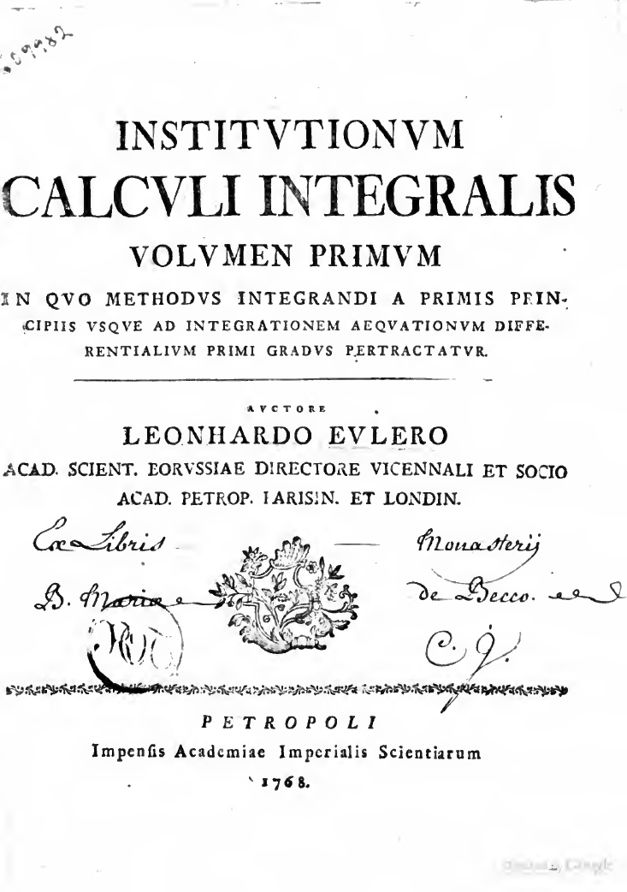
  <br>
  <i>图 1　《积分学原理》第一卷（1768）扉页，Euler 口述、助手笔录。图片来源：Internet Archive<a id="fig-euler-front"></a></i>
</div>

　　这条折线留下了一个直到二十世纪才被认真回答的问题：步长越来越小，折线是否真的收敛到真解？收敛得多快？要回答它，先得说清楚“解”是什么、在什么条件下解存在且唯一、初值的微小扰动会不会被放大。这些问题构成了 3.1.1 节的内容，也是所有数值方法的共同前提。

　　一百多年后，Göttingen 的 Runge 在 1895 年的《数学年刊》上换了一个问法[[2]](#ref2)：与其把步长缩到无穷小，能否在一步之内多取几个斜率，用它们的加权平均代替切线，从而用更少的步数换到更高的精度？他给出了二阶格式。1900 年，Heun 把“预测—校正”的想法写成一类平均斜率格式[[4]](#ref4)。1901 年，Kutta 在《物理学与数学杂志》上给出了四个斜率、四阶精度的格式[[3]](#ref3)，也就是今天教科书里的经典 RK4。此后一百多年，RK4 一直是科学计算中最常用的通用积分器之一；Hairer、Nørsett 与 Wanner 的《Solving Ordinary Differential Equations I》系统整理了这一族方法的阶条件与稳定性理论[[5]](#ref5)。

<div align="center">
  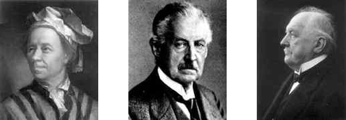
  <br>
  <i>图 2　左：Euler（1707–1783）；中：Runge（1856–1927）；右：Kutta（1867–1944）。图片来源：MacTutor History of Mathematics Archive<a id="fig1"></a></i>
</div>

　　三个人的问题其实是同一个：怎样用有限个函数值，把一个连续演化过程“压缩”成可以递推的公式。Euler 用一段切线，Runge 用两段斜率的平均，Kutta 用四段斜率的加权平均。本节沿着这条线索展开：3.1.1 节把初值问题与适定性说清楚，3.1.2 节给出显式与隐式 Euler 格式，3.1.3 节构造经典 RK4，3.1.4.1 至 3.1.4.3 节分别讨论误差、稳定性与计算成本，3.1.5 节用一枚拦截弹把前面的公式串起来，3.1.6 节再看这族方法今天在工程上的位置。

　　在进入公式之前，先请一位向导带我们走两夜雾隐岭。这座山只有一条下山的老路：山顶海拔 1.000 km，山脚 0 km；路面越往下越缓，坡度恰好等于“当前海拔的相反数”，即 $y'=-y$（ $y$ 以 km 计， $t$ 以小时计）。山里常年起雾，向导走到哪里，只能摸到脚下那一处的坡度；他每半小时走一步，也就是 $h=0.5$。

　　3.1.2.1 节跟向导走第一夜，3.1.3.3 节走第二夜。同一座山、同一场雾、同样的脚力，唯一的差别只有一句话：一步之内，问几次坡度。

### 3.1.1　初值问题与适定性

#### 3.1.1.1　微分方程与积分曲线

　　设 $D\subset\mathbb{R}^2$ 是开区域， $f:D\to\mathbb{R}$ 是给定的函数。一阶常微分方程的初值问题是

$$
y'(t)=f\bigl(t,y(t)\bigr),\qquad y(t_0)=y_0,\qquad t\in I,\qquad(1)
$$

<a id="eq1"></a>

其中 $I$ 是含 $t_0$ 的区间， $(t_0,y_0)\in D$。

　　**定义 1（经典解）**　若 $y\in C^1(I)$，对一切 $t\in I$ 有 $\bigl(t,y(t)\bigr)\in D$，且逐点满足 [(1)](#eq1)，则称 $y$ 是初值问题 [(1)](#eq1) 在 $I$ 上的经典解，简称解。

　　例 1　 $f(t,y)=y$， $(t_0,y_0)=(0,1)$：解为 $y=e^{t}$，在 $\mathbb{R}$ 上处处有定义且唯一。

　　例 2　 $f(t,y)=\sqrt{|y|}$， $(t_0,y_0)=(0,0)$：右端连续，但 $y\equiv0$ 与 $y=t^{2}/4$（ $t\ge0$）都是解，两条积分曲线都从原点出发。

　　几何上，[(1)](#eq1) 在 $D$ 上给出一个方向场：每一点 $(t,y)$ 画一条斜率为 $f(t,y)$ 的短线段；解是一条处处与方向场相切的曲线，称为积分曲线。初值条件指定这条曲线经过 $(t_0,y_0)$。数值方法要做的，是不去找这条曲线，而用一串短直线段把它“折”出来。

#### 3.1.1.2　Lipschitz 条件

　　例 2 说明：仅要求 $f$ 连续，不足以保证解唯一。症结在于 $f$ 在 $y=0$ 附近变化得太陡；把“陡”量化，就得到下面的条件。

　　**定义 2（Lipschitz 条件）**　若存在常数 $L\gt 0$，使得

$$
\bigl|f(t,u)-f(t,v)\bigr|\le L\thinspace|u-v|,\qquad (t,u),(t,v)\in D,\qquad(2)
$$

<a id="eq2"></a>

则称 $f$ 在 $D$ 上关于 $y$ 满足 Lipschitz 条件， $L$ 称为 Lipschitz 常数。

　　**命题 1**　设 $D$ 是凸区域， $f$ 在 $D$ 上连续可微，且存在常数 $M$ 使 $|\partial f/\partial y|\le M$。则 $f$ 在 $D$ 上关于 $y$ 满足 Lipschitz 条件，常数可取 $L=M$。

　　**证明**　固定 $(t,u),(t,v)\in D$。由 $D$ 的凸性，线段 $(t,v+s(u-v))$， $0\le s\le1$ 含于 $D$。令 $g(s)=f(t,v+s(u-v))$，则 $g$ 在 $[0,1]$ 上可微，且 $g'(s)=\partial_y f(t,v+s(u-v))(u-v)$。由微分中值定理，存在 $\xi\in(0,1)$ 使

$$
\bigl|f(t,u)-f(t,v)\bigr|\le M\thinspace|u-v|,
$$

取绝对值并用 $|\partial_y f|\le M$，即得 [(2)](#eq2)。证毕。

　　三个常见例子。

　　（a） $f(t,y)=-y$： $|f(t,u)-f(t,v)|=|u-v|$，故 $L=1$，且是全局 Lipschitz。

　　（b） $f(t,y)=t^{2}+y^{2}$：在带形 $|y|\le R$ 上 $|\partial f/\partial y|=2|y|\le2R$，故在该带形上 $L=2R$。这是局部 Lipschitz： $R$ 越大 $L$ 越大，不存在对全平面成立的有限 $L$。

　　（c） $f(t,y)=\sqrt{|y|}$：取 $v=0$、 $u\gt 0$，差商 $\sqrt{u}/u=1/\sqrt{u}\to+\infty$，故在含 $y=0$ 的任何区域上都不满足 Lipschitz 条件。这与例 2 中解不唯一是同一件事的两面。

#### 3.1.1.3　存在唯一性与连续依赖

　　把微分方程换成积分方程，是处理存在性的标准做法。在连续函数类中，

$$
y(t)=y_0+\int_{t_0}^{t}f\bigl(s,y(s)\bigr)\thinspace\mathrm{d}s
$$

与 [(1)](#eq1) 等价。于是求 [(1)](#eq1) 的解，等于求这个积分方程的不动点。

　　**定理 1（Picard–Lindelöf）**　设 $R=\lbrace(t,y):|t-t_0|\le a,\ |y-y_0|\le b\rbrace\subset D$， $f$ 在 $R$ 上连续， $|f|\le M$，且关于 $y$ 满足 Lipschitz 条件，常数为 $L$。令 $\delta=\min\lbrace a,\thinspace b/M\rbrace$，则初值问题 [(1)](#eq1) 在 $I=[t_0-\delta,\thinspace t_0+\delta]$ 上存在唯一解。

　　**证明**　取 $y^{(0)}\equiv y_0$，递推定义 Picard 迭代

$$
y^{(m+1)}(t)=y_0+\int_{t_0}^{t}f\bigl(s,y^{(m)}(s)\bigr)\thinspace\mathrm{d}s,\qquad m=0,1,2,\dots
$$

由归纳法可证每个 $y^{(m)}$ 连续且不越出 $R$，并有估计

$$
\bigl\Vert y^{(m+1)}-y^{(m)}\bigr\Vert_\infty\le\frac{M L^{m}}{(m+1)!}\thinspace\delta^{m+1}.
$$

右端是收敛级数的通项，故 $\lbrace y^{(m)}\rbrace$ 在 $C(I)$ 的上确界范数下是 Cauchy 列；由 $C(I)$ 的完备性，它一致收敛到某个连续函数 $y$。在迭代式中令 $m\to\infty$，即知 $y$ 满足积分方程，从而是 [(1)](#eq1) 的解。

　　唯一性：设 $y,z$ 都是解，令 $u=|y-z|$。两式相减并用 Lipschitz 条件，得 $u(t)\le L|\int_{t_0}^{t}u(s)\thinspace\mathrm{d}s|$；由引理 1（Gronwall 不等式）的 $\alpha=0$ 情形（或直接对 $e^{-Lt}v$ 求导）得 $u\equiv0$，故 $y\equiv z$。证毕。完整证明见 [[6]](#ref6)[[7]](#ref7)。

　　存在唯一性回答“解有没有”；适定性还要回答“解稳不稳”：初值差一点，解会不会差很多。下面的不等式是估计误差的基本工具。

　　**引理 1（Gronwall 不等式）**　设 $u,\beta\ge0$ 在 $[t_0,t_1]$ 上连续， $\alpha\ge0$，且

$$
u(t)\le\alpha+\int_{t_0}^{t}\beta(s)\thinspace u(s)\thinspace\mathrm{d}s,\qquad t\in[t_0,t_1].\qquad(3)
$$

<a id="eq3"></a>

则

$$
u(t)\le\alpha\exp\Bigl(\int_{t_0}^{t}\beta(s)\thinspace\mathrm{d}s\Bigr),\qquad t\in[t_0,t_1].\qquad(4)
$$

<a id="eq4"></a>

　　**证明**　令 $U=\alpha+\int\beta u$，则 $u\le U$， $U'=\beta u\le\beta U$，故 $(e^{-\int\beta}U)'\le0$，在 $t_0$ 处取 $U(t_0)=\alpha$ 即得。 $\alpha=0$ 时对 $\alpha=\varepsilon\downarrow0$ 取极限。

　　**定理 2（对初值的连续依赖）**　设 $y,z$ 分别是初值 $y_0,z_0$ 的解，都在 $I$ 上定义， $f$ 的 Lipschitz 常数为 $L$。则

$$
\bigl|y(t)-z(t)\bigr|\le|y_0-z_0|\thinspace e^{L|t-t_0|},\qquad t\in I.\qquad(5)
$$

<a id="eq5"></a>

　　**证明**　两解相减，取绝对值，用 Lipschitz 条件得 $u(t)\le|y_0-z_0|+L\int_{t_0}^{t}u(s)\mathrm{d}s$，其中 $u=|y-z|$；再由 [(3)](#eq3)[(4)](#eq4) 即得 [(5)](#eq5)。

#### 3.1.1.4　单步法框架与相容性

　　Euler、Heun 与 RK4 都是同一个框架的特例，先把框架抽象出来。

　　**定义 3（单步法）**　若格式可以写成

$$
y_{n+1}=y_n+h\thinspace\Phi(t_n,y_n,h),\qquad(6)
$$

<a id="eq6"></a>

其中 $\Phi$ 是给定函数，称为增量函数，则称该格式为单步法。若 $\Phi$ 不含 $y_{n+1}$，格式是显式的；若含 $y_{n+1}$，格式是隐式的，每一步需要解一个方程。

　　显式 Euler 的增量函数是 $\Phi(t,y,h)=f(t,y)$。后向 Euler 格式为 $y_{n+1}=y_n+h f(t_{n+1},y_{n+1})$，其 $\Phi$ 通过 $y_{n+1}$ 隐式定义，属于隐式单步法。Heun 格式（改进 Euler）先试走一步，再取两端斜率的平均：

$$
\Phi(t,y,h)=\frac12\Bigl[f(t,y)+f\bigl(t+h,\ y+h f(t,y)\bigr)\Bigr].
$$

　　**定义 4（相容性）**　称单步法 [(6)](#eq6) 与方程 [(1)](#eq1) 相容，若

$$
\Phi(t,y,0)=f(t,y),\qquad (t,y)\in D.\qquad(7)
$$

<a id="eq7"></a>

　　步长趋于零时，格式的一步增量应与方程的一阶增量一致；显式 Euler 与 Heun 都满足 [(7)](#eq7)。

### 3.1.2　显式与隐式 Euler 格式

#### 3.1.2.1　显式 Euler 格式

　　[(1)](#eq1) 说的是每一点的导数由 $f$ 给出。最直接的离散方式，是把导数换成前向差商。把区间 $[t_0,T]$ 等分为 $M$ 份，步长 $h=(T-t_0)/M$，节点 $t_n=t_0+nh$。在 $t_n$ 处

$$
y'(t_n)\approx\frac{y(t_{n+1})-y(t_n)}{h}.
$$

把它代入 $y'=f(t,y)$，并把精确值换成数值近似，得

$$
y_{n+1}=y_n+h\thinspace f(t_n,y_n),\qquad n=0,1,\dots,M-1.\qquad(8)
$$

<a id="eq8"></a>

同一个格式也可以从积分方程得到：在 $[t_n,t_{n+1}]$ 上 $y(t_{n+1})=y(t_n)+\int_{t_n}^{t_{n+1}}f(s,y(s))\mathrm{d}s$，用左端点的值乘区间长近似积分，同样得到 [(8)](#eq8)。差商推导强调“用切线代替曲线”，矩形公式强调“用左端点值代替整段积分”，舍去的是同一个高阶项。

　　**故事｜雾隐岭的第一夜。**　向导凌晨出发，站在海拔 $y_0=1.000$ km 的起点，摸到的坡度是 $-1.000$。按 Euler 的办法，他只问这一次：半小时后海拔下降 $0.5\times1=0.500$ km，于是他在本子上写下“从海拔 0.500 km 继续走”。

　　可这条路的真实位置是 $e^{-0.5}=0.607$ km。他一步多下了 $0.107$ km——106 米，差不多是三十层楼。更糟的是，从这一刻起，他手里的“当前海拔”已经偏低，下一次摸到的坡度也跟着偏缓（ $-0.500$ 而不是 $-0.607$），误差就这样一步一步累积下去。

　　错在哪里？不在脚力，也不在算术：他只是把全程最陡的那一处坡度，当成了接下来半小时的平均坡度。而这条路越往下越缓，起点的坡度恰恰是最陡的。“只问一次”在起点附近没问题，走得越远越离谱。第二夜换一种问法，见 3.1.3.3 节。

　　**科普｜Euler 格式在今天。**　它仍然是最常用的方法之一，只是用在“便宜”比“精确”更要紧的地方。手机游戏里，物体每画一帧（约 $1/60$ 秒）更新一次位置与速度，用的就是这种一路向前的显式推进：每步只问一次右端函数，算得快、写得短。工程师通常还会加一个小修正（半隐式 Euler——先用旧斜率更新速度，再用新速度更新位置），以免能量越算越多。

　　历史上最有名的一次 Euler 式尝试发生在 1922 年。英国气象学家 Richardson 把大气方程离散[[12]](#ref12)，用手摇计算器整整算了六个星期，才得到一份六小时的天气预报；结果地面气压的变化大得不合物理，同行把这份结果当成笑话。事后的分析指出两个原因：初值观测太稀、噪声太大；时间步长相对网格又取得太大，误差被迅速放大。今天看，这两条都指向同一件事——显式推进的步长必须受限制。数值天气预报后来靠计算机和更稳的格式才走通，但那六个星期的手算，是这门学科真正的起点。

<div align="center">
  <div style="display:flex;gap:16px;align-items:flex-end;justify-content:center">
  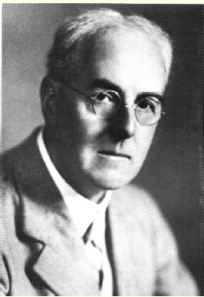
  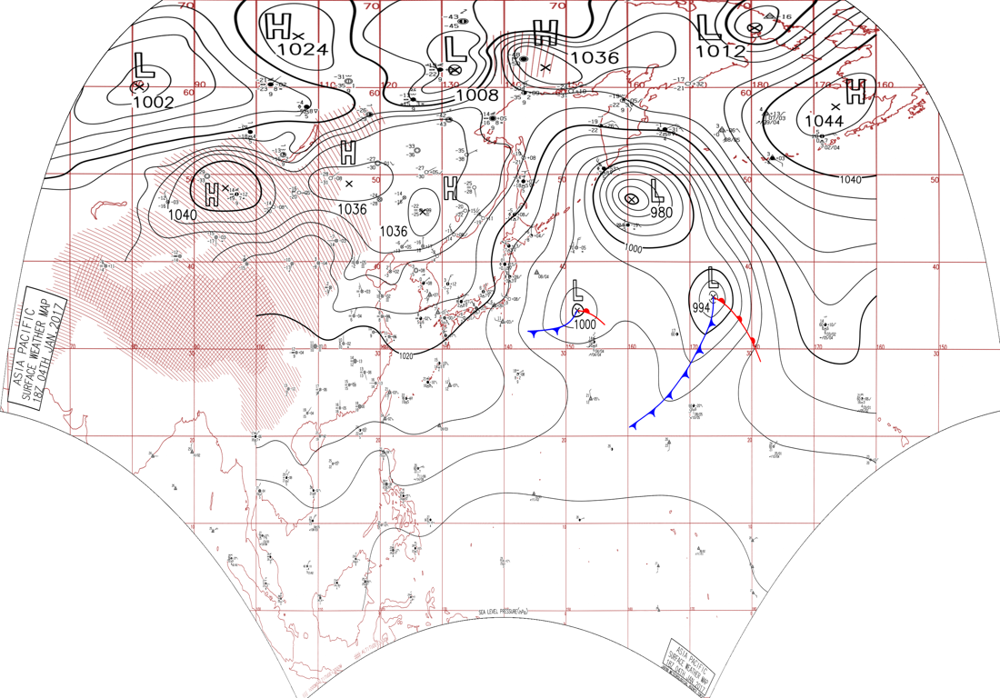
  </div>
  <br>
  <i>图 3　左：Richardson（1881–1953），1922 年用手摇计算器做出第一次数值天气预报；右：今天的一张地面天气分析图（日本气象厅，CC BY 4.0，via Wikimedia Commons）<a id="fig2"></a></i>
</div>

#### 3.1.2.2　隐式 Euler 格式

　　显式 Euler 用左端点的斜率；若改用右端点，就得到隐式 Euler 格式（后向 Euler）——相当于先猜终点、再回头对账，猜得不对就迭代。格式为

$$
y_{n+1}=y_n+h\thinspace f(t_{n+1},y_{n+1}).
$$

右端含 $y_{n+1}$，每一步都要解一个方程：线性问题解线性方程组，非线性问题用 Newton 迭代。它的局部截断误差同样是 $O(h^2)$（定义见 3.1.2.3 节），一阶精度并不比显式格式高，但稳定性好得多。对测试方程 $y'=\lambda y$，放大因子为

$$
R(z)=\frac{1}{1-z},\quad z=h\lambda.
$$

当 $\mathrm{Re}\lambda\lt 0$ 时对任意 $h\gt 0$ 都有 $|R(z)|\lt 1$，即无条件稳定；代价是每步的隐式求解。

　　梯形格式：

$$
y_{n+1}=y_n+\frac{h}{2}\left[f(t_n,y_n)+f(t_{n+1},y_{n+1})\right].
$$

把两端斜率平均，是二阶隐式格式。显式与隐式的取舍，本质上是每步成本与稳定性之间的取舍。

#### 3.1.2.3　几何意义与局部误差

　　把 [(8)](#eq8) 改写成积分形式： $y(t_{n+1})=y(t_n)+\int_{t_n}^{t_{n+1}}f(t,y(t))\thinspace\mathrm{d}t$。Euler 格式相当于用一块矩形代替这段积分——矩形的宽是 $h$，高取哪一端的函数值，就决定了是显式还是隐式。[图 4](#fig3) 把两种取法并排画出。

　　左图是显式 Euler：每块矩形的高取左端点的 $f(t_i,x(t_i))$，所以曲线上升时矩形面积偏小，算出的下一步偏低；右图是隐式 Euler：高取右端点的 $f(t_{i+1},x(t_{i+1}))$，矩形面积偏大，算出的下一步偏高。两者都是一阶格式，区别只在“用哪一端的高度”。

<div align="center">
  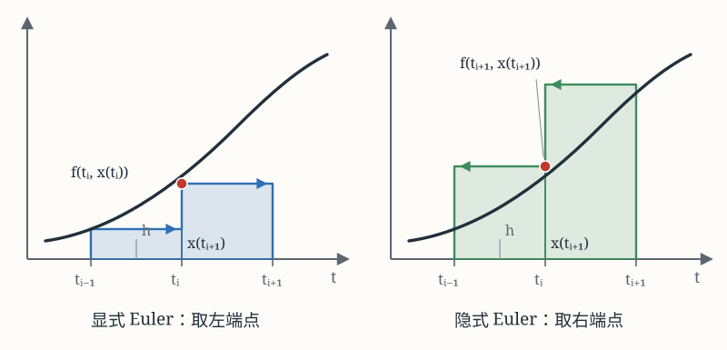
  <br>
  <i>图 4　两种 Euler 的几何差别：左图矩形取左端点的高度（显式），右图取右端点的高度（隐式）；同一段曲线，一块偏矮、一块偏高<a id="fig3"></a></i>
</div>

　　矩形面积与真实积分之差，就是局部截断误差的来源：每块矩形都少算或多算了一个小曲边三角形，其高约为 $\tfrac{h}{2}|y''|$，底为 $h$，面积是 $O(h^2)$。步长减半，这块三角形缩到四分之一；但步数翻倍，所以走到终点时，误差只按 $h$ 缩小——这就是“局部二阶、全局一阶”的几何来源。

　　把精确解在 $t_n$ 处 Taylor 展开，

$$
y(t_{n+1})=y(t_n)+h f(t_n,y(t_n))+\frac{h^2}{2}y''(\xi_n),
$$

与 [(8)](#eq8) 相减，得 Euler 的局部截断误差

$$
\tau_{n+1}=\frac{h^2}{2}y''(\xi_n)=O(h^2).\qquad(9)
$$

<a id="eq9"></a>

### 3.1.3　经典 Runge–Kutta 方法

#### 3.1.3.1　基本思想与一般形式

　　一步推进可以写成积分形式

$$
y(t_n+h)=y(t_n)+\int_{t_n}^{t_n+h}f\bigl(t,y(t)\bigr)\thinspace\mathrm{d}t .
$$

Euler 格式相当于用左端点值乘区间长度近似这个积分；若在区间内部若干点取样、再按权重组合，就能在不计算高阶导数的前提下提高精度。这是 Runge–Kutta 方法的基本思想：用若干个斜率 $k_i$ 的加权平均代替单点斜率。

　　最简单的两步取样是 Heun 格式：先用 Euler 试走一步得到预测值 $\tilde y_{n+1}=y_n+h f(t_n,y_n)$，再用两端斜率的平均校正：

$$
y_{n+1}=y_n+\frac{h}{2}\Bigl[f(t_n,y_n)+f\bigl(t_n+h,\tilde y_{n+1}\bigr)\Bigr].\qquad(10)
$$

<a id="eq10"></a>

把 [(10)](#eq10) 在 $h=0$ 处展开并与精确解比较，局部误差从 $O(h^2)$ 降到 $O(h^3)$，即格式是二阶的。

　　一般的显式 $s$ 级 Runge–Kutta 格式写成

$$
\begin{aligned}
k_i&=f\Bigl(t_n+c_ih,\ y_n+h\sum_{j=1}^{i-1}a_{ij}k_j\Bigr),\qquad i=1,\dots,s,\newline
y_{n+1}&=y_n+h\sum_{i=1}^{s}b_ik_i.
\end{aligned}\qquad(11)
$$

<a id="eq11"></a>

式 [(11)](#eq11) 中的 $c_i$ 为节点系数， $a_{ij}$ 为级间耦合系数， $b_i$ 为组合权重。系数一旦取定，方法就完全确定，可以用 Butcher 表紧凑地写出。

#### 3.1.3.2　经典 RK4：格式与推导

　　经典四阶 Runge–Kutta 取 $s=4$，在步内四个位置各取一次斜率：

$$
\begin{aligned}
k_1&=f(t_n,y_n),\newline
k_2&=f\bigl(t_n+h/2,\ y_n+hk_1/2\bigr),\newline
k_3&=f\bigl(t_n+h/2,\ y_n+hk_2/2\bigr),\newline
k_4&=f\bigl(t_n+h,\ y_n+hk_3\bigr),
\end{aligned}\qquad(12)
$$

<a id="eq12"></a>

再以权重 $1,2,2,1$ 加权平均：

$$
y_{n+1}=y_n+\frac{h}{6}\bigl(k_1+2k_2+2k_3+k_4\bigr).\qquad(13)
$$

<a id="eq13"></a>

对应的 Butcher 表为

$$
\begin{array}{c|cccc}
0 & & & & \newline
\tfrac12 & \tfrac12 & & & \newline
\tfrac12 & 0 & \tfrac12 & & \newline
1 & 0 & 0 & 1 & \newline \hline
 & \tfrac16 & \tfrac13 & \tfrac13 & \tfrac16
\end{array}
$$

每一步需要四次右端函数求值，记 $n_f=4M$。四个斜率的取法不是唯一的：只要系数满足下面列出的阶条件，就能得到四阶格式。

　　把 [(13)](#eq13) 与精确解在 $t_n$ 处的 Taylor 展开逐项比较。记 $F=f(t_n,y_n)$，沿解曲线取全导数，则

$$
y(t_n+h)=y_n+hF+\frac{h^2}{2}\bigl(f_t+f_yF\bigr)+O(h^3).
$$

把 [(12)](#eq12) 的各级斜率在 $(t_n,y_n)$ 处展开，代入 [(13)](#eq13)，按 $h$ 的幂次合并，得

$$
\begin{aligned}
y_{n+1}={}&y_n+hF\Bigl(\sum_i b_i\Bigr)
+\frac{h^2}{2}\Bigl(\sum_i b_ic_i\Bigr)\bigl(f_t+f_yF\bigr)\newline
&+\frac{h^3}{6}\Bigl(\sum_i b_ic_i^2\Bigr)\bigl(f_{tt}+2f_{ty}F+f_{yy}F^2\bigr)
+\frac{h^3}{6}\Bigl(\sum_{i\gt j}b_ia_{ij}c_j\Bigr)f_y\bigl(f_t+f_yF\bigr)+O(h^4).
\end{aligned}
$$

令同次幂的系数逐个相等，得 8 条阶条件：

$$
\begin{aligned}
&\sum_i b_i=1,\qquad \sum_i b_ic_i=\frac12,\qquad \sum_i b_ic_i^2=\frac13,\newline
&\sum_{i\gt j}b_ia_{ij}c_j=\frac16,\qquad \sum_i b_ic_i^3=\frac14,\qquad \sum_{i\gt j}b_ic_ia_{ij}c_j=\frac18,\newline
&\sum_{i\gt j}b_ia_{ij}c_j^2=\frac1{12},\qquad \sum_{i\gt j\gt k}b_ia_{ij}a_{jk}c_k=\frac1{24}.
\end{aligned}
$$

这 8 个方程不足以唯一确定 10 个未知系数，故四阶显式方法不唯一[[5]](#ref5)[[10]](#ref10)。把 [(12)](#eq12) 与 [(13)](#eq13) 的节点、权重代入，前两条为 $\sum_i b_i=1$、 $\sum_i b_ic_i=\frac12$，其余各条同样成立，于是 $y_{n+1}$ 与真解的展开在 $h^4$ 项以内完全一致。经典 RK4 的局部截断误差为

$$
\tau_{n+1}=O(h^5).\qquad(14)
$$

<a id="eq14"></a>

四个阶段是达到四阶精度的最低要求： $s$ 级显式 Runge–Kutta 的最高阶为 $s$（ $s\le4$），再高的阶需要更多级。这也是 RK4 在精度与每步成本之间取得平衡的原因。

#### 3.1.3.3　几何意义与权重来源

<div align="center">
  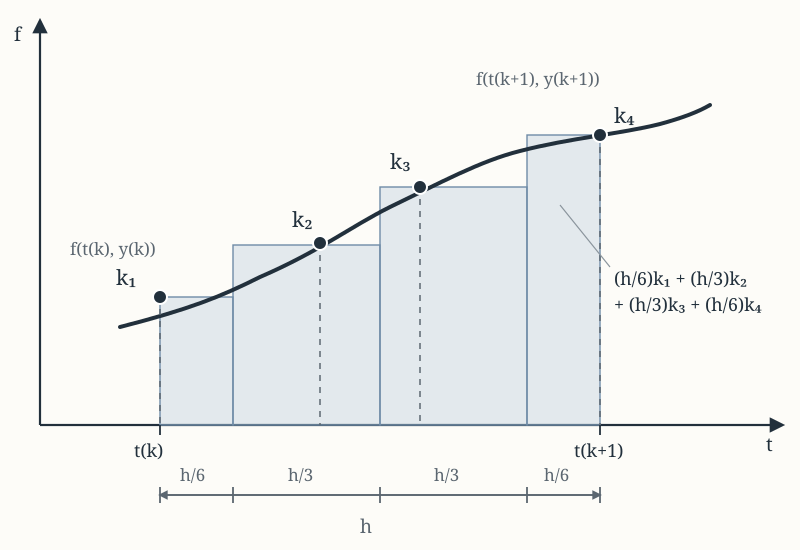
  <br>
  <i>图 5　RK4 的积分账本：一步的积分被切成四块，宽依次是 h/6、h/3、h/3、h/6，高分别是四个斜率 k<sub>1</sub>–k<sub>4</sub>；四块面积相加，就是这一步的增量<a id="fig4"></a></i>
</div>

　　把 [(13)](#eq13) 按积分写开：

$$
y_{n+1}=y_n+\frac{h}{6}k_1+\frac{h}{3}k_2+\frac{h}{3}k_3+\frac{h}{6}k_4 .
$$

[图 5](#fig4) 把右边的和画成四块矩形：宽依次是 $h/6$、 $h/3$、 $h/3$、 $h/6$，高分别是四个斜率。四块面积之和，就是用四个采样值对 $\int_{t_n}^{t_{n+1}}f(t,y(t))\thinspace\mathrm{d}t$ 的近似——RK4 的“四阶”，说的是这四块面积把积分算得足够准。

　　为什么是这四个宽度？把一步的积分用 Simpson 公式近似，需要在左端点、中点、右端点取值，权重比为 $1:4:1$；中点被第 2、3 级各取一次， $4$ 便拆成 $2+2$，这就是 $1:2:2:1$ 的由来；再统一乘以 $h/6$，就得到 $h/6,\thinspace h/3,\thinspace h/3,\thinspace h/6$ 这四个宽度。节点 $0,\frac12,\frac12,1$ 也由这三处取样位置决定[[11]](#ref11)。

　　拿 $y'=-y$、 $y(0)=1$、 $h=0.5$ 验算一遍：四个斜率依次是 $k_1=-1$、 $k_2=-0.75$、 $k_3=-0.8125$、 $k_4=-0.5938$，加权平均

$$
\bar k=\frac16\bigl(-1+2(-0.75)+2(-0.8125)-0.59375\bigr)=-0.78646,
$$

于是 $y_1=1+0.5\times(-0.78646)=0.6067708$，与真值 $e^{-0.5}=0.6065307$ 相差 $2.4\times10^{-4}$。加权平均落在最陡的 $k_1$ 与最平的 $k_4$ 之间，相当于用一条斜率居中的直线代替整段曲线，其截断误差比单点切线小一个量级以上。

　　把[图 4](#fig3) 与[图 5](#fig4) 并排看，区别一目了然：Euler 只用一块矩形、一个高度；RK4 用四块矩形、四个高度，且中间两块各占 $h/3$——多出的三次求值，买的就是这四个宽度上的“分摊”。

　　四阶之所以常用，是因为在这一阶数上阶条件仍可手工核验；继续提高阶数需要增加级数，阶条件迅速增多，精度收益与公式复杂度不再同步改善。

　　**故事｜雾隐岭的第二夜。**　第二天夜里，还是那座山、那场雾，向导带了三个侦察兵。规矩定得很死：每走一步，四条坡度按 $1:2:2:1$ 加权平均，只走一步。

　　出发前，他自己先摸脚下的坡度： $k_1=-1.0000$。然后派第一个侦察兵“按起点坡度往下试跑半小时”，到中点 $(0.25,\thinspace0.75)$ 再摸一次： $k_2=-0.7500$。他嫌这个位置是“猜”出来的，又派第二个侦察兵从中点出发，改用 $k_2$ 重新推算中点 $(0.25,\thinspace0.8125)$，摸到 $k_3=-0.8125$。最后派第三个侦察兵沿 $k_3$ 一路试跑到终点 $(0.50,\thinspace0.59375)$，摸到 $k_4=-0.5938$。

　　四条坡度加权： $[-1.0000+2\times(-0.7500)+2\times(-0.8125)+(-0.5938)]/6=-0.78646$。一步之后他报出的海拔是 $1+0.5\times(-0.78646)=0.6068$ km；真实位置 $0.6065$ km，差 $2.4\times10^{-4}$ km，也就是 24 厘米。

　　同一座山、同一段路：第一夜错 106 米，第二夜错 24 厘米。代价只有一个——这一步里多问了三处坡度。三个侦察兵的花销，换来的是四百多倍的精度。

### 3.1.4　数值实验

#### 3.1.4.1　误差与收敛阶

　　局部截断误差衡量单步离散本身带来的误差：假设第 $n$ 步以精确解 $y(t_n)$ 为输入，一步之后与精确解的偏差。Euler 的局部误差由 [(9)](#eq9) 给出，RK4 的局部误差由 [(14)](#eq14) 给出。全局误差描述多步迭代后的整体偏差：

$$
E_n=y(t_n)-y_n.\qquad(15)
$$

<a id="eq15"></a>

单步误差会随时间传播并被放大，因此全局误差一般大于局部误差的简单累加。由 [(15)](#eq15)，把 Euler 格式与精确解相减，用 Lipschitz 条件估计，再由 Gronwall 不等式 [(3)](#eq3)[(4)](#eq4)，得

$$
|E_n|\le\frac{M_2}{2L}\bigl(e^{L(T-t_0)}-1\bigr)h,\qquad M_2=\max|y''|.\qquad(16)
$$

<a id="eq16"></a>

放大因子仍是 $e^{L(T-t_0)}$：区间越长、 $L$ 越大，误差界越松。

　　这张不等式值得用一张图记住：误差不是攒出来的，是滚出来的。每一步注入一小块局部误差，它随后按 $e^{Lt}$ 复利放大。同一个局部误差 $\varepsilon=10^{-3}$，到 $t=5$ 时， $L=2$ 的累计量是 $L=0$ 的两千多倍（[图 7](#fig6)）。

　　[(16)](#eq16) 说明 Euler 的全局误差与 $h$ 的一次方成正比。对 RK4，同样的推导给出

$$
\max_{0\le n\le M}|y(t_n)-y_n|=O(h^4).\qquad(17)
$$

<a id="eq17"></a>

式 [(17)](#eq17) 是四阶收敛的定量表述。总步数 $M=O(h^{-1})$ 的累积效应使全局阶比局部阶低一阶：Euler 的局部误差是 $O(h^2)$、全局是 $O(h)$；RK4 的局部误差是 $O(h^5)$、全局是 $O(h^4)$。这一“降一阶”的规律，是单步法误差分析的基本结论[[8]](#ref8)。

　　若误差近似满足 $E(h)\approx Ch^p$，则步长减半后 $E(h/2)\approx C(h/2)^p$，两式相除取对数，得观测收敛阶

$$
p_{\mathrm{obs}}=\log_2\frac{E(h)}{E(h/2)}.\qquad(18)
$$

<a id="eq18"></a>

式 [(18)](#eq18) 就是由相邻两次误差估计收敛阶的公式。对模型问题 $y'=-y$、 $y(0)=1$、 $t\in[0,1]$，精确解为 $e^{-t}$。取一系列减半的步长，结果列于[表 1](#tab1)，误差随步长的变化画在[图 6](#fig5)。

<p align="center"><b>表 1　终点误差与观测收敛阶（<i>y</i>'=−<i>y</i>，<i>y</i>(0)=1，<i>T</i>=1）<a id="tab1"></a></b></p>

| 步长 <i>h</i> | Euler 求值次数 | Euler 误差 | Euler 观测阶 | RK4 求值次数 | RK4 误差 | RK4 观测阶 |
| :---: | :---: | :---: | :---: | :---: | :---: | :---: |
| 1/2 | 2 | 1.18×10⁻¹ | — | 8 | 2.91×10⁻⁴ | — |
| 1/4 | 4 | 5.15×10⁻² | 1.20 | 16 | 1.48×10⁻⁵ | 4.30 |
| 1/8 | 8 | 2.43×10⁻² | 1.08 | 32 | 8.31×10⁻⁷ | 4.15 |
| 1/16 | 16 | 1.18×10⁻² | 1.04 | 64 | 4.93×10⁻⁸ | 4.08 |
| 1/32 | 32 | 5.82×10⁻³ | 1.02 | 128 | 3.00×10⁻⁹ | 4.04 |
| 1/64 | 64 | 2.89×10⁻³ | 1.01 | 256 | 1.85×10⁻¹⁰ | 4.02 |

<div align="center">
  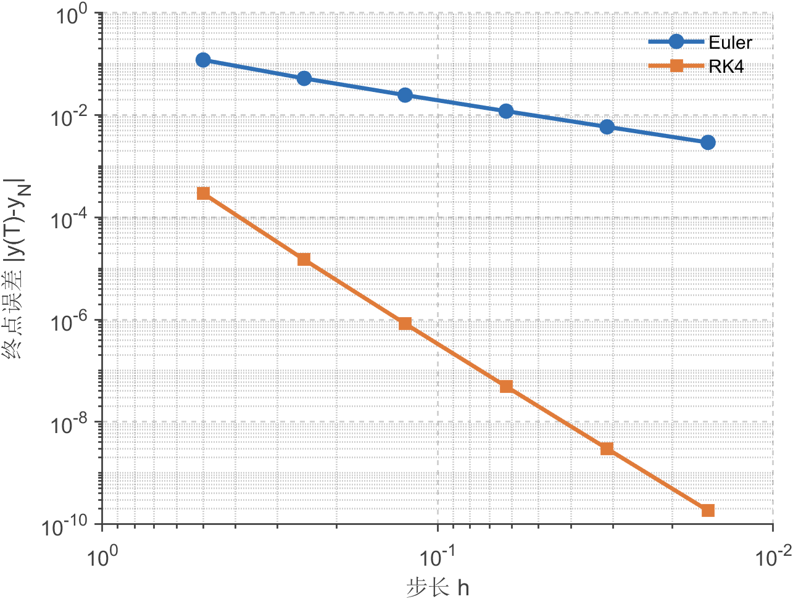
  <br>
  <i>图 6　终点误差随步长的变化（双对数坐标）。斜率约为 1 的是 Euler，约为 4 的是 RK4<a id="fig5"></a></i>
</div>

　　[表 1](#tab1) 与理论一致：Euler 的观测阶由 1.20 逐步趋近 1，RK4 的观测阶由 4.30 趋近 4。步长较大时观测阶偏高，是因为高阶截断项尚未充分衰减；步长很小时观测阶偏离理论值，是因为舍入误差开始占主导。

<div align="center">
  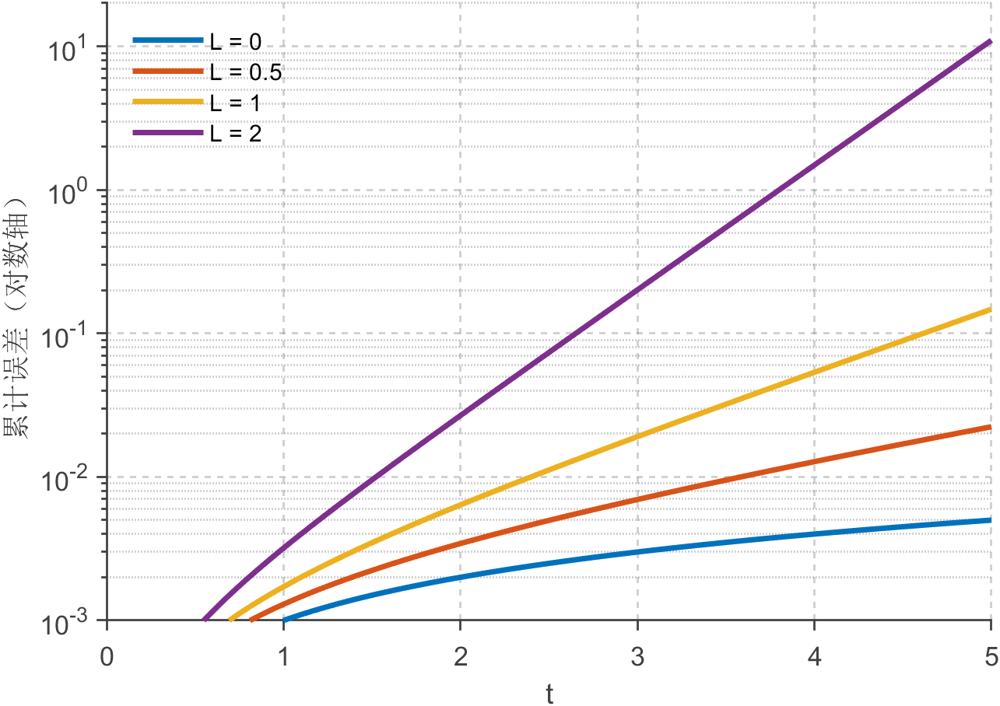
  <br>
  <i>图 7　同一个局部误差在不同 L 下的累计量<a id="fig6"></a></i>
</div>

#### 3.1.4.2　稳定性

　　精度问的是“走得准不准”，稳定性问的是“会不会走飞”。步长一旦越过某条线，数值解就不再是解的近似，而是一个自己长出来的东西。收敛阶描述 $h\to0$ 时的渐近精度，无法回答固定步长下误差是否会被放大。为分析稳定性，考虑线性测试方程

$$
y'=\lambda y,\qquad \lambda\in\mathbb{C}.\qquad(19)
$$

<a id="eq19"></a>

把数值格式作用于 [(19)](#eq19)，一步迭代可以写成

$$
y_{n+1}=R(z)\thinspace y_n,\qquad z=h\lambda,
$$

　　 $R(z)$ 称为该格式的稳定函数；要数值解不增长，需要

$$
|R(z)|\le1.\qquad(20)
$$

<a id="eq20"></a>

满足 [(20)](#eq20) 的复数 $z$ 的集合称为绝对稳定区域。精度与稳定性是相互独立的性质：高阶格式在步长过大时同样可能失去稳定性[[9]](#ref9)。

　　对显式 Euler， $y_{n+1}=y_n+h\lambda y_n=(1+z)y_n$，故 $R(z)=1+z$。条件 $|1+z|\le1$ 在复平面上是以 $-1$ 为圆心、半径为 1 的圆盘。对模型问题 $\lambda=-1$， $z=-h$，由 $|1-h|\le1$ 得

$$
0\le h\le2.
$$

　　若额外要求解保持非负且单调衰减，则需 $1-h\ge0$，即 $h\le1$。

　　对经典 RK4，把测试方程代入 [(12)](#eq12)[(13)](#eq13)，得

$$
R(z)=1+z+\frac{z^2}{2}+\frac{z^3}{6}+\frac{z^4}{24}.\qquad(21)
$$

<a id="eq21"></a>

式 [(21)](#eq21) 中的多项式是指数函数 $e^{z}$ 的 Taylor 展开截断到四次，故在测试方程上单步放大因子与 $e^{z}$ 的差异起始于 $z^5$ 量级。在实负轴上， $|R(z)|\le1$ 的区间约为

$$
-2.785\le z\le0,
$$

　　对 $\lambda=-1$ 即 $h\lesssim2.785$。[图 8](#fig7) 给出两种方法的放大因子随步长的变化。

<div align="center">
  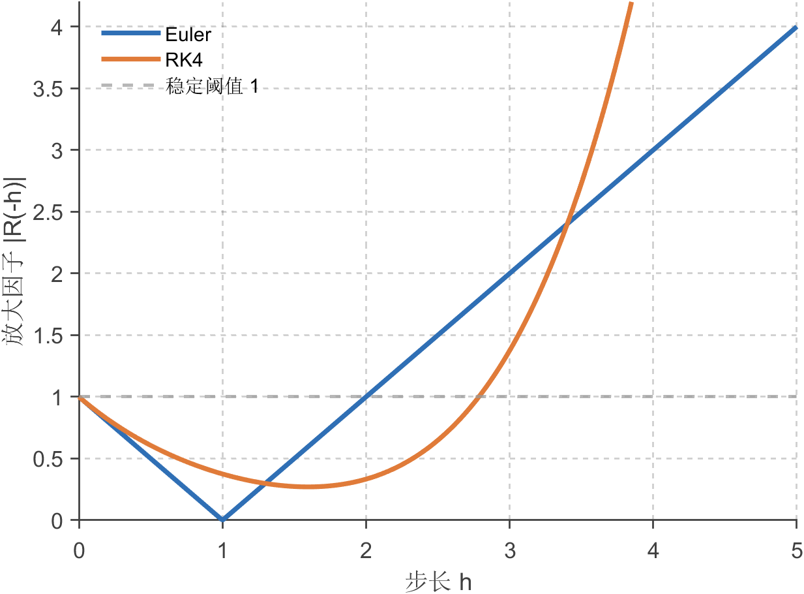
  <br>
  <i>图 8　放大因子 |R(−h)| 随步长的变化，虚线为稳定阈值 1。Euler 在 h=2 处越过阈值，RK4 在 h≈2.785 处越过阈值<a id="fig7"></a></i>
</div>

　　步长越过稳定区间后，数值解会以交替符号振荡并迅速增长。[图 9](#fig8) 是 $h=3$、 $T=9$ 时两种方法的数值解与精确解的对比：Euler 的放大因子为 $2$，几步之后幅值已达 $10^{0}$ 量级；RK4 的放大因子为 $1.375$，同样增长，只是速度稍慢。稳定性是格式的性质，不是初值的性质。

<div align="center">
  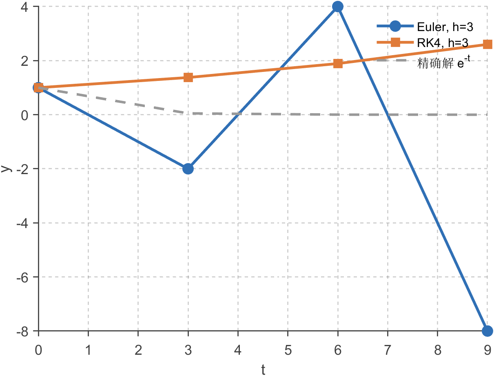
  <br>
  <i>图 9　h=3 时两种方法的数值解与精确解（T=9）<a id="fig8"></a></i>
</div>

#### 3.1.4.3　计算成本

　　计算成本可用两类指标衡量：右端函数求值次数 $n_f$，与编程语言、硬件无关，适合理论比较；CPU 运行时间，反映实际开销，受实现与硬件影响。Euler 每步求值一次，RK4 每步求值四次，故相同步数下 $n_f^{\mathrm{RK4}}=4n_f^{\mathrm{Euler}}$。

　　但单步成本不决定总成本。若要求两种方法达到相同精度，设 $E_{\mathrm{Euler}}\approx ah$、 $E_{\mathrm{RK4}}\approx bh^4$，令 $ah_{\mathrm{Euler}}=bh_{\mathrm{RK4}}^4$，得

$$
h_{\mathrm{Euler}}\approx\frac{b}{a}\thinspace h_{\mathrm{RK4}}^4 .
$$

相应的求值次数之比为

$$
\frac{n_f^{\mathrm{Euler}}}{n_f^{\mathrm{RK4}}}
=\frac{T/h_{\mathrm{Euler}}}{4T/h_{\mathrm{RK4}}}
=\frac{a}{4b\thinspace h_{\mathrm{RK4}}^3}.
$$

步长越小，这个比值增长得越快：RK4 每步四次求值的代价，很快被它允许的大步长抵消。一句话：Euler 每步便宜，却要多走几个数量级的步数；RK4 每步贵四倍，买回来的正是这些步数。

　　取 $T=1$、 $h=1/128$，实测结果列于[表 2](#tab2)：Euler 与 RK4 的求值次数分别为 128 与 512，误差分别为 $1.44\times10^{-3}$ 与 $1.15\times10^{-11}$；求值次数之比为 4，而实际耗时之比为 5.9（不同步长的中位数）。耗时比高于 4，是因为 RK4 每步除四次求值外还要组合四个阶段。只有在同一编程语言、同一实现与同一硬件下，耗时比较才有意义。

<p align="center"><b>表 2　计算成本对比（<i>T</i>=1，<i>h</i>=1/128）<a id="tab2"></a></b></p>

| 方法 | 求值次数 | 终点误差 | 相对耗时 |
| :---: | :---: | :---: | :---: |
| Euler | 128 | 1.44×10⁻³ | 1.0 |
| RK4 | 512 | 1.15×10⁻¹¹ | 5.9 |

### 3.1.5　趣味编程——基于单步法的导弹轨迹仿真

<div align="center">
  
  <br>
  <i>图 10　拦截场景：从发射点打出一枚拦截弹，目标是 45 km 外、6 km 高的阵地<a id="fig9"></a></i>
</div>

　　考虑一枚拦截弹：由原点以初速 $v_0=800$ m/s 发射，目标位于 $(45,\thinspace6)$ km。将弹体视为质点，忽略姿态与推力，只计重力与二次空气阻力。以位置与速度 $\boldsymbol s=(x,y,v_x,v_y)^{\mathsf T}$ 为状态，运动方程为

$$
\dot{\boldsymbol s}=f(\boldsymbol s)
=\begin{pmatrix}v_x\newline v_y\newline -k\Vert\boldsymbol v\Vert v_x\newline -g-k\Vert\boldsymbol v\Vert v_y\end{pmatrix},
\qquad \Vert\boldsymbol v\Vert=\sqrt{v_x^2+v_y^2},
$$

其中 $k=5\times10^{-6}\ \mathrm{m^{-1}}$， $g=9.81\ \mathrm{m/s^2}$。

　　需要确定的是发射角 $\theta$。给定 $\theta$ 后，初值取

$$
\boldsymbol s_0=(0,\thinspace0,\thinspace v_0\cos\theta,\thinspace v_0\sin\theta)^{\mathsf T},
$$

弹道由该初值问题唯一确定。记弹道在下降段穿过 $y=6$ km 时的横坐标为 $X(\theta)$，则 $\theta$ 应满足

$$
X(\theta)=45\ \mathrm{km},\qquad \theta\in[5^\circ,50^\circ].
$$

由于 $X(\theta)$ 无解析表达式，上述问题归结为一元方程的数值求根。

　　先计算 $X(\theta)$。取步长 $h$，用 RK4 将 $\boldsymbol s_n$ 推进到 $\boldsymbol s_{n+1}$：

$$
\boldsymbol s_{n+1}=\boldsymbol s_n+\frac h6(\boldsymbol k_1+2\boldsymbol k_2+2\boldsymbol k_3+\boldsymbol k_4),
$$

$$
\boldsymbol k_1=f(\boldsymbol s_n),\quad
\boldsymbol k_2=f\bigl(\boldsymbol s_n+\tfrac h2\boldsymbol k_1\bigr),\quad
\boldsymbol k_3=f\bigl(\boldsymbol s_n+\tfrac h2\boldsymbol k_2\bigr),\quad
\boldsymbol k_4=f\bigl(\boldsymbol s_n+h\boldsymbol k_3\bigr).
$$

若某一步满足 $y_n\ge6\ \mathrm{km}\gt y_{n+1}$，则在该步内以二分法求 $\tau\in[0,h]$，使 $[\mathcal S(\boldsymbol s_n,\tau)\rbrack_y=6$，并取 $X(\theta)=[\mathcal S(\boldsymbol s_n,\tau)\rbrack_x$。

　　再求方程的根。 $X(\theta)$ 关于 $\theta$ 单调递增，取 $a^{(0)}=5^\circ$、 $b^{(0)}=50^\circ$，按

$$
\theta^{(m+1)}=\frac{a^{(m)}+b^{(m)}}2
$$

试探：若 $X(\theta^{(m+1)})\lt45$ km，令 $a^{(m+1)}=\theta^{(m+1)}$、 $b^{(m+1)}=b^{(m)}$；否则令 $a^{(m+1)}=a^{(m)}$、 $b^{(m+1)}=\theta^{(m+1)}$。当 $b^{(m)}-a^{(m)}\lt10^{-6}$ rad（约 $6\times10^{-5}$ 度）时终止迭代。

　　将 RK4 换成显式 Euler 格式

$$
\boldsymbol s_{n+1}=\boldsymbol s_n+h\thinspace f(\boldsymbol s_n),
$$

其余步骤不变，即得 Euler 的相应结果。

　　计算得 $\theta^\star=39.6859^\circ$。[图 11](#fig10) 给出两种格式的仿真弹道，[表 3](#tab3) 给出不同步长下的落点偏差。

<div align="center">
  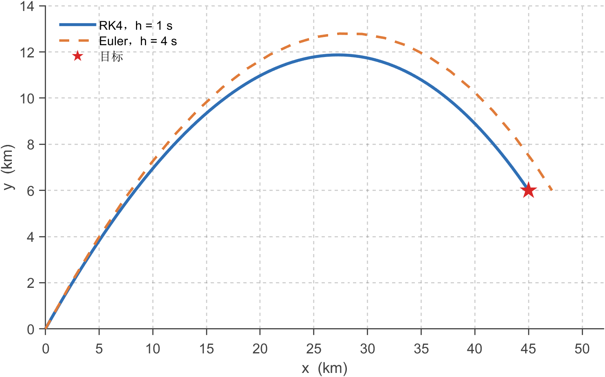
  <br>
  <i>图 11　仿真弹道：RK4（h=1 s）在 (45,6) km 处命中目标；Euler（h=4 s）的弹道整体偏高，落点偏出约 2.2 km<a id="fig10"></a></i>
</div>

<p align="center"><b>表 3　同一发射角下的落点偏差（目标 <i>x</i>=45 km，<i>y</i>=6 km）<a id="tab3"></a></b></p>

| 步长 $h$ (s) | Euler 落点偏差 (m) | Euler 求值次数 | RK4 落点偏差 (m) | RK4 求值次数 |
| :---: | :---: | :---: | :---: | :---: |
| 16 | 8249.6 | 7 | 0.320 | 24 |
| 8 | 4239.9 | 12 | 0.0195 | 44 |
| 4 | 2182.2 | 22 | 0.00169 | 84 |
| 2 | 1099.8 | 43 | 0.000603 | 168 |
| 1 | 554.1 | 85 | 0.000535 | 336 |
| 0.5 | 277.7 | 168 | 0.000531 | 668 |

　　由[表 3](#tab3) 可见，Euler 的落点偏差随步长减半近似减半（相邻比值 1.95、1.94、1.98、1.98、2.00），为一阶收敛；RK4 在 $h=2$ s 时偏差已小于 1 mm，进一步减小步长偏差不再下降，受参考解精度限制。步长同为 $0.5$ s 时，Euler 的偏差为 278 m，RK4 仅为 0.53 mm。由[图 11](#fig10) 可见，RK4 的弹道平滑地穿过目标点；Euler 在 $h=4$ s 时的弹道整体偏高，落点明显偏出。

### 3.1.6　RK4 在今天

<div align="center">
  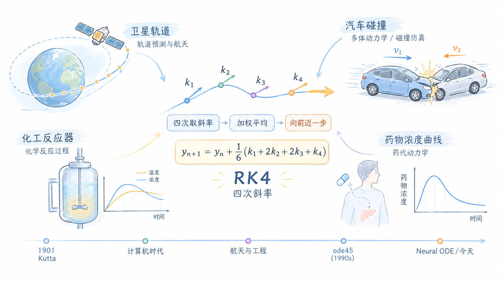
  <br>
  <i>图 12　四类常见应用：卫星轨道、汽车碰撞、化工反应器、药物浓度曲线<a id="fig11"></a></i>
</div>

　　自从 1901 年 Kutta 在纸上写下那四个斜率，这个只有几行的公式就悄悄走出了教科书，不断换上新身份。

　　最先接纳它的是刚诞生的电子计算机。上世纪五六十年代，卫星上天、飞船奔月，工程师第一次可以用机器代替手算表格；预报轨道、计算弹道，最顺手的工具就是每步问四次坡度的 RK4。

　　七十年代，它又走进化工与制药：反应器里的温度与浓度怎样随时间变化，药物在血液里的浓度怎样升、怎样降，都被写成联立的常微分方程，再用 RK4 一步步推出来。

　　1980 年，Dormand 和 Prince 想出了新点子：同一步里同时算出四阶与五阶两个答案，用两者的差估计误差，据此自动调整步长。这对四阶与五阶的搭档[[13]](#ref13) 后来成了 MATLAB 里 `ode45` 的心脏；上世纪九十年代起，工程师不必再自己写积分器，一行 `ode45` 就够了。

　　到了今天，它的舞台更大：航天任务分析、汽车碰撞与多体动力学仿真、锂电池的等效电路、新药研发中的药代动力学曲线，背后都有它的身影。2018 年，Neural ODE 干脆把 `ode45` 装进了神经网络，让网络的“层”变成一段微分方程。

　　跨越一百多年，它万变不离其宗：每一步，在几个位置摸一摸坡度，加权平均，再往前迈一步。多问三次，误差小四百多倍——我们在纸上写下的 RK4，正是这个朴素动作最简洁的数字化表达。

## 第二节（3.2）　PDE 有限差分：热传导与 CFL 条件

*从傅里叶的热流到网格上的稳定边界*

### 3.2.0　引子：一本书与一台机器

　　一块烧红的铁，从一头热到另一头，需要多久？

　　这不是一道纯粹的数学题。冶金作坊要知道铸件多久才能冷透，玻璃工匠要知道退火炉里的温度怎样变化，工程师要知道汽缸壁散失多少热量。更远一点，还有人追问：地球内部为什么越深越热？这些问题的共同点是——只知道此刻的温度，却想预测下一刻、乃至任意时刻的温度。

　　1807 年 12 月 21 日，巴黎科学院。三十九岁的傅里叶宣读了一篇论文，题目是《固体中热的传播》。他当时的身份不是大学教授，而是伊泽尔省省长：修过格勒诺布尔到都灵的大道，排过沼泽地的水，也跟随拿破仑远征过埃及。白天处理行政，夜里回到书房摆弄铁棒、玻璃球和温度计。热，从工业炉（处理金属）、地球内部的温度及其随时间的变化，到他一路见过的地中海与埃及的烈日，都是他长期惦记的问题[[14]](#ref14)[[35]](#ref35)[[36]](#ref36)。

　　傅里叶的出发点很朴素：不去追踪每一个分子，而是把温度看成一个场 $u(x,t)$。取细杆上的一小段，算清流入、流出与内部产生的热量，再假设热流与温度梯度成正比（这套推导写进了他 1807 年的论文 [[15]](#ref15)）：

$$
q=-k\frac{\partial u}{\partial x}.
$$

　　这就是后来以他命名的傅里叶定律。把守恒律与它联立，消去热流 $q$，就得到

$$
\frac{\partial u}{\partial t}=\kappa\frac{\partial^2u}{\partial x^2}.
$$

　　这条方程说的是：温度的变化率正比于温度分布的“弯曲程度”。曲线上凹得越厉害，该点温度变得越快[[16]](#ref16)；温度分布越平，它就越安静。

　　真正的困难在这里：对任意的初始温度 $u_0(x)$，方程怎么解？傅里叶给出的答案是——把 $u_0$ 拆成无穷多条正弦曲线，让每一条按自己的速率衰减，再把结果叠加起来：

$$
u(x,t)=\sum_{n=1}^{\infty}b_n\thinspace e^{-\kappa(n\pi/L)^2t}\sin\frac{n\pi x}{L}.
$$

　　为了说清“任意函数都能这样拆”，他被迫去研究三角级数的收敛性，这就是今天的傅里叶级数。数学史上因此有一个说法：傅里叶级数不是从纯数学的头脑里掉下来的，它是被热传导方程逼出来的[[16]](#ref16)[[36]](#ref36)。

　　这条路并不平坦。1807 年的论文由拉格朗日、拉普拉斯、蒙日与拉克鲁瓦评审，拉格朗日对“任意函数展开成正弦级数”深表怀疑；1811 年巴黎科学院以“固体中热的传播”设奖，傅里叶拿下了奖金，评审报告却仍说他的推导“在严格性和一般性上还有欠缺”；1822 年《热的解析理论》出版。批评没有阻止这条方程，反而把它推到了数学分析的中心。

<div align="center">
  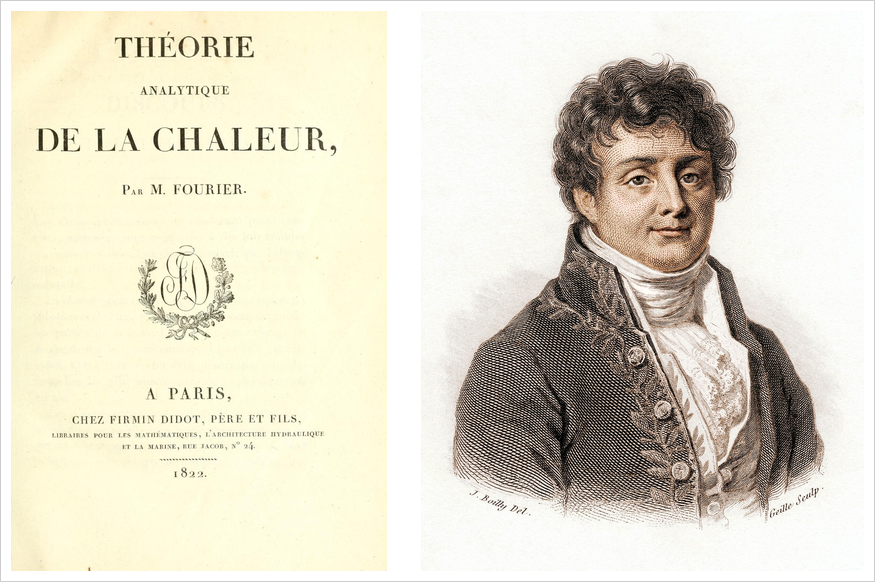
  <br>
  <i>图 13　《热的解析理论》初版扉页（1822，左）与傅里叶像（右，J.-L. Boilly 绘）。图片来源：Internet Archive、Wikimedia Commons<a id="fig12"></a></i>
</div>

　　一百三十八年后，这件事在另一台机器上以另一种形式重新出现。

　　周毓麟原本走的是拓扑学，路已经铺开。后来，他把这条走顺的路收起来，转攻当时国内尚属空白的非线性偏微分方程，在渗流方程上做出了被公认为经典的结果。如果故事停在这里，这是一位数学家漂亮的转身。

　　但一纸调令，把他推到了另一类问题面前。他加入核武器研制队伍，成为理论部“八大主任”之一，站的是数学这一侧。理论突破中最硬的一道坎是“九次计算”——为核对一个关键数据，一群人反复验算了九个月。周毓麟负责的是让机器能算下去：找方法、编程序，把方程变成机器能执行的东西。他参与设计的一些程序，用了近二十年。论文会署名，程序不会说话；但一个程序能跑近二十年，本身就是一种回答。

　　有人问他，放下已经做出结果的方向，后不后悔。他的回答只有一句话：“党叫干啥就干啥。”后来他写过一句注脚：“国家需要我，是我的荣幸。”[[17]](#ref17)

　　等到年近花甲，他又转身一次。这一次不是换问题，而是往问题底下钻：网格上的方程为什么能稳稳地算下去？步长能取多大？越过那道限制，会发生什么？他开创离散泛函分析这一新领域，为非线性发展方程的差分方法建立了严谨的理论体系。从把方程算出来，到追问“为什么这个数可信”，这是一次更安静、也更难的转身[[17]](#ref17)[[37]](#ref37)。

　　1964 年 10 月 16 日，罗布泊上空升起蘑菇云[[29]](#ref29)。蘑菇云是看得见的答案；看不见的，是云柱下方那些把方程变成程序、把程序变成可信数字的判断。

<div align="center">
  
  <br>
  <i>图 14　周毓麟（1923–2021，左）与 1964 年 10 月 16 日罗布泊上空的蘑菇云（右）。图片来源：中国科学家博物馆、Wikimedia Commons<a id="fig13"></a></i>
</div>

本节从这道方程出发：3.2.1 节由守恒律导出方程，给出定解条件与最大值原理；3.2.2 节把方程搬到网格上，设计出可以变成 $A\boldsymbol x=\boldsymbol b$ 的差分格式，再让程序跑出数值解与收敛阶；3.2.3 节讲稳定性——步长能取多大，越过限制会怎样；3.2.4 节用这条方程修复一张被划花的二维码。3.2.5 节把视角拉远，看这道方程今天还在哪些地方工作。

### 3.2.1　热传导方程：从守恒律到适定性

#### 3.2.1.1　热传导方程的导出

　　取细杆上的一小段 $[x,x+\Delta x]$（[图 15](#fig14)），截面积为 $S$，单位体积热容为 $\rho c$，温度为 $u(x,t)$，热流密度为 $q(x,t)$（规定向右为正）。这一段储存的热量为 $\rho cuS\Delta x$，它随时间的变化率，等于从左侧流入的热量减去从右侧流出的热量，再加上段内源项产生的热量：

$$
\rho c\thinspace S\Delta x\thinspace\frac{\partial u}{\partial t}
=S\thinspace q(x,t)-S\thinspace q(x+\Delta x,t)+S\Delta x\thinspace f(x,t).
$$

　　两端同除以 $S\Delta x$ 并令 $\Delta x\to0$：左端化为温度对时间的偏导数，右端化为热流沿杆方向的梯度；再把傅里叶定律 $q=-k\partial u/\partial x$ 代入，即得

$$
\rho c\thinspace\frac{\partial u}{\partial t}=\frac{\partial}{\partial x}\Bigl(k\frac{\partial u}{\partial x}\Bigr)+f.
$$

　　若杆的材料均匀， $k$ 为常数，则可记 $\kappa=k/(\rho c)$、 $g=f/(\rho c)$，把方程整理成热传导方程的标准形式

$$
\frac{\partial u}{\partial t}=\kappa\thinspace\frac{\partial^2 u}{\partial x^2}+g(x,t).\qquad(22)
$$

<a id="eq22"></a>

　　**定义 1（热方程）**　形如 [(22)](#eq22) 的方程称为热传导方程； $\kappa\gt0$ 为热扩散率， $g$ 为源项， $g\equiv0$ 时称为齐次热方程。

　　以上的推导只用到三个假设：介质各向同性；热流对温度梯度的响应是瞬时的；材料没有记忆效应。在常规尺度下，这三条都足够好；但在飞秒激光加热、纳米薄膜与超低温等情形，就需要 Cattaneo–Vernotte 一类的非傅里叶模型。本书只讨论傅里叶模型。

　　值得指出，按傅里叶模型，热的传播速度是无限的：只要 $t\gt0$，杆内部任何一点都会受到初值的影响，只是离得越远、偏离越小。这与“热量一点点渗过去”的直觉不同，也是傅里叶模型的代价；Cattaneo–Vernotte 模型给热流引入有限的松弛时间，修正的正是这一点。

<div align="center">
  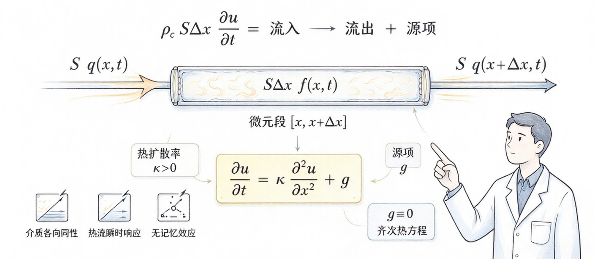
  <br>
  <i>图 15　杆元的热量守恒：流入、流出与源项共同决定这一小段的温度变化<a id="fig14"></a></i>
</div>

#### 3.2.1.2　定解问题与三类边界条件

　　热方程对时间是一阶的，因此需要一个初始条件；对空间是二阶的，因此需要两个边界条件：

$$
\begin{cases}
u_t=\kappa u_{xx}+g(x,t), & 0\lt x\lt L,\quad 0\lt t\le T,\newline
u(x,0)=u_0(x), & 0\le x\le L,\newline
\alpha_0u(0,t)+\beta_0u_x(0,t)=\gamma_0(t), & 0\lt t\le T,\newline
\alpha_Lu(L,t)+\beta_Lu_x(L,t)=\gamma_L(t), & 0\lt t\le T.
\end{cases}\qquad(23)
$$

<a id="eq23"></a>

　　**定义 2（古典解）**　设 $u\in C^{2,1}\bigl((0,L)\times(0,T]\bigr)\cap C\bigl([0,L]\times[0,T]\bigr)$。若 $u$ 在内部逐点满足 [(23)](#eq23) 的方程，在 $t=0$ 与 $x=0,L$ 上逐点满足初值与边界条件，则称 $u$ 为 [(23)](#eq23) 的古典解。

　　系数 $\alpha$、 $\beta$ 取不同的值，就得到三类边界条件；三者的物理含义不同，离散时也必须分别处理（[表 4](#tab4)）：

<p align="center"><b>表 4　三类边界条件及其离散方式<a id="tab4"></a></b></p>

| 名称 | 取法 | 物理含义 | 离散方式 |
| :---: | :---: | :---: | :---: |
| Dirichlet | $\alpha=1,\ \beta=0$ | 端点温度给定 | 边界值直接代入 |
| Neumann | $\alpha=0,\ \beta=1$ | 端点热流给定，零热流即绝热 | 虚拟节点 |
| Robin | $\alpha=h,\ \beta=\pm k$ | 端点与外界对流换热 | 虚拟节点 + 消元 |

　　这三个名字听上去抽象，用一根铁棒就能把它们的区别讲清楚（[图 16](#fig15)）：

- **Dirichlet（第一类）**：把铁棒的一端插进一杯冰水里。只要杯里还有冰，这一端的温度就被“钉”在 0 ℃ 上，无论传过去多少热都一样。这就是“端点温度给定”——这一端的值不是未知数，每一步直接赋成已知值。
- **Neumann（第二类）**：给铁棒的一端裹上厚厚的保温棉。裹得足够好的时候，几乎没有任何热量从这一端进出，也就是“端点热流为零”，即绝热。这就是“端点热流给定”：它不告诉你这一端是多少度，只告诉你从这端流走了多少热（零热流时总热量守恒）。
- **Robin（第三类）**：把铁棒的一端露在空气里，用风扇对着它吹。这一端与空气之间发生对流换热：流走的热量既与“铁棒这端有多热”有关，也与“空气有多冷”有关，二者之间是一个线性的比例关系。这就是“端点对流换热”，也是烧红的铁块在风里凉得更快的数学描述。

　　三类边界的差别可以一句话概括：Dirichlet 管住“温度”，Neumann 管住“流量”，Robin 把两者按比例绑在一起。若 $u_0(0)\neq\gamma_0(0)$，解在角点 $(0,0)$ 处不连续，古典解不存在。

<div align="center">
  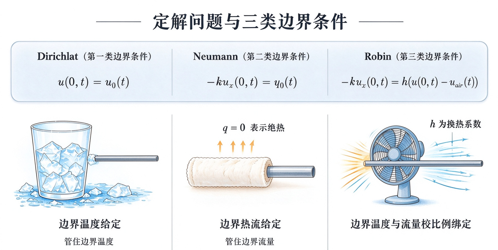
  <br>
  <i>图 16　一根铁棒上的三类边界：冰水定温（Dirichlet）、保温棉绝热（Neumann）、风扇换热（Robin）<a id="fig15"></a></i>
</div>

#### 3.2.1.3　最大值原理与适定性

　　在讨论数值方法能否“收敛”之前，先要确认解本身存在、唯一，并且对初边值的微小扰动不敏感，这就是适定性。最大值原理给出的结论很直观：解不会在区域内部自己长出新的极值[[22]](#ref22)[[23]](#ref23)。

　　**定理 1（最大值原理）**　设 $u$ 在 $Q_T=(0,L)\times(0,T]$ 内满足 $u_t=\kappa u_{xx}$，在 $\bar Q_T$ 上连续。则 $u$ 在 $\bar Q_T$ 上的最大值与最小值都在抛物边界

$$
\Gamma_T=\bigl\lbrace(x,0):0\le x\le L\bigr\rbrace\cup\bigl\lbrace(0,t),(L,t):0\le t\le T\bigr\rbrace
$$

上取到。

　　**证明**　记 $M=\max_{\Gamma_T}u$。先看严格不等式 $u_t-\kappa u_{xx}\lt0$ 的情形。若 $u$ 在内部点 $(x_0,t_0)$， $0\lt x_0\lt L$， $0\lt t_0\le T$，取到最大值，则 $u_x(x_0,t_0)=0$、 $u_{xx}(x_0,t_0)\le0$，且对 $t$ 的偏导非负，于是 $u_t-\kappa u_{xx}\ge0$，矛盾。所以最大值只能在 $\Gamma_T$ 上取到。

　　以上论证要求严格不等式成立。对一般的 $u$，可以用一个扰动把严格性“造”出来：令 $v=u-\varepsilon t$， $\varepsilon\gt0$，则 $v_t-\kappa v_{xx}=u_t-\kappa u_{xx}-\varepsilon\lt0$。由上面的论证， $v$ 的最大值在 $\Gamma_T$ 上取到，于是

$$
u(x,t)-\varepsilon t=v(x,t)\le\max_{\Gamma_T}v\le\max_{\Gamma_T}u=M,
$$

令 $\varepsilon\downarrow0$ 得 $u\le M$。对 $-u$ 重复上述论证得最小值。证毕。

　　**推论 1（唯一性与连续依赖）**　若 [(23)](#eq23) 的解存在，则唯一，且

$$
\max_{\bar Q_T}|u|\le\max_{\Gamma_T}|u|.\qquad(24)
$$

<a id="eq24"></a>

　　**证明**　设 $u_1,u_2$ 是两个解， $w=u_1-u_2$ 满足齐次方程与零初边值，由 [(24)](#eq24) 得 $\max|w|\le0$，故 $w\equiv0$。连续依赖同理：初边值之差不超过 $\varepsilon$，解之差也不超过 $\varepsilon$。证毕。

　　换一个角度，能量方法可以给出 $L^2$ 估计。设 $u$ 满足齐次方程与齐次 Dirichlet 条件，令 $E(t)=\frac12\int_0^Lu^2\mathrm{d}x$，则

$$
\begin{aligned}
\frac{\mathrm dE}{\mathrm dt}
&=\int_0^Lu\thinspace u_t\thinspace\mathrm{d}x
=\kappa\int_0^Lu\thinspace u_{xx}\thinspace\mathrm{d}x
=-\kappa\int_0^L u_x^2\thinspace\mathrm{d}x\le0.
\end{aligned}
$$

　　由 Poincaré 不等式得 $E(t)\le E(0)e^{-2\kappa\pi^2t/L^2}$。最大值原理看的是极值，能量估计看的是平方积分，两种方法说明的却是同一件事：初值的扰动只会被抹平，不会被放大。离散格式能不能保住这条性质，正是 3.2.3 节要回答的问题。

　　上式中的 $\pi^2/L^2$ 来自最慢的模态 $\sin(\pi x/L)$：弯曲得最少的曲线被抹平得最慢，整条曲线的衰减速度就由它决定。

　　**故事｜钎尾还是凉的。**　老陶把一根冷铁钎插进窑火，钎尖很快烧红，钎尾还是凉的。他不能把整根钎子抽出来看，只能用手摸钎尾。

　　铁钎里的热不会凭空冒出来：某一点升温的快慢，取决于它两侧的温度差——温度曲线弯得越厉害，热流进（出）得越快；钎尖在火里，是一个边界；钎尾在空气里，也是一个边界。老陶不懂偏微分方程，但他知道一条：钎子上最烫的地方一定在火上，不会在中间某处自己长出一个更高的温度。

　　这条经验正是最大值原理：边界定了，内部不会自己冒出新的极值。老陶据此断定，钎身里不会有比火端更热的点；要问的是另一件事——热量传到钎尾要多久，温度沿钎子怎样分布。那得把钎子切成小段再算，是 3.2.2 节的事（[图 17](#fig16)）。

<div align="center">
  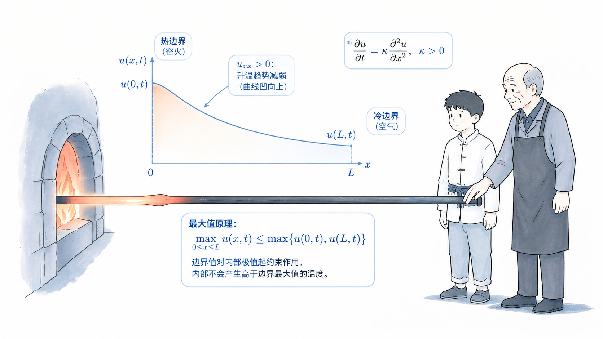
  <br>
  <i>图 17　钎尖与钎尾：边界温度、温度剖面与最大值原理<a id="fig16"></a></i>
</div>

### 3.2.2　空间差分与显式时间推进

　　傅里叶把解写成无穷多条正弦曲线之和，但计算机只能处理有限个数。于是问题变成：把一条连续的温度分布换成一排离散数值之后，下一时刻的这排数值应当如何计算？

　　先看清这幅图景（[图 18](#fig17)）：一条直线上等分着 $N+1$ 个节点，每个节点上的温度按 $U_j^{n}\to U_j^{n+1}$ 逐层向前推进，而推进的依据只有它自己和左右两个邻居。二维情形把这条直线铺成一个平面，每个内点看上下左右四个邻居（[图 19](#fig18)）。本节的差分格式，说到底都是在回答同一件事：取哪几个邻居、各给多大权重。

#### 3.2.2.1　一维热传导方程的离散与求解

　　热方程 $u_t=\kappa u_{xx}$ 的右端衡量的是温度曲线弯曲的程度：某点高于左右邻居的平均值，热量便从该点向两侧流走，温度下降；低于平均值，热量向该点汇聚，温度上升。取节点 $x_j=jh$，用二阶中心差商代替二阶导数，就可以把这一含义写成

$$
U_{xx}\approx\frac{U_{j-1}-2U_j+U_{j+1}}{h^2}
=\frac{2}{h^2}\left(\frac{U_{j-1}+U_{j+1}}{2}-U_j\right),
$$

括号里恰好是“邻居平均减自己”，即该点温度与近邻平均温度之差。再往前推一步：经过一个时间步长，温度的变化量约等于变化率乘以 $\Delta t$。两者合起来，得

$$
U_j^{n+1}=U_j^n+r\bigl(U_{j-1}^n-2U_j^n+U_{j+1}^n\bigr)+\Delta t\thinspace g_j^n,
\qquad r=\frac{\kappa\Delta t}{h^2},\qquad(25)
$$

<a id="eq25"></a>

其中 $j=1,\dots,N-1$。 $r$ 叫网格比，可以读成“一个时间步之内，扩散在网格上推进的相对强度”。初值与 Dirichlet 边界条件相应离散为

$$
U_j^0=u_0(x_j),\qquad U_0^n=\gamma_0(t_n),\qquad U_N^n=\gamma_N(t_n).
$$

<div align="center">
  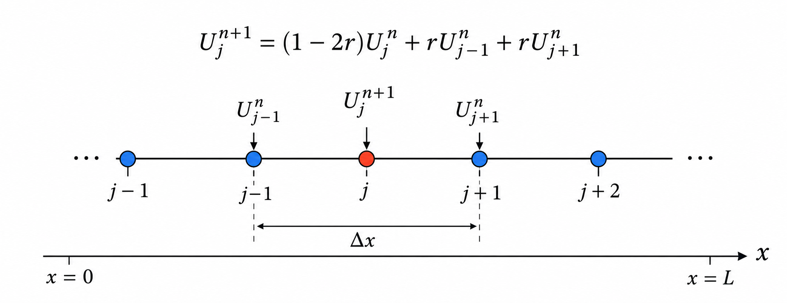
  <br>
  <i>图 18　一维显式格式：新值由同层三个旧值加权得到，两端为已知边界<a id="fig17"></a></i>
</div>

**一维的矩阵形式**

　　要把整个一维网格写成 $A\boldsymbol x=\boldsymbol b$，只需把内点排成一个列向量 $\boldsymbol U^n=(U_1^n,\dots,U_{N-1}^n)^{\mathsf T}$。先写出离散 Laplace 矩阵

$$
L=\begin{pmatrix}
-2& 1& & \newline
1& -2& 1& \newline
& \ddots& \ddots& \ddots\newline
& & 1& -2
\end{pmatrix},
$$

这是一个 $(N-1)$ 阶三对角矩阵：第 $j$ 行依次给出 $U_{j-1}$、 $U_j$、 $U_{j+1}$ 的系数，即 $-2$ 与两个 $1$。于是显式格式可以写成如下的矩阵形式

$$
\boldsymbol U^{n+1}=B\boldsymbol U^n+\Delta t\thinspace\boldsymbol g^n, \qquad
B=I+rL=\begin{pmatrix}
1-2r& r& & \newline
r& 1-2r& r& \newline
& \ddots& \ddots& \ddots\newline
& & r& 1-2r
\end{pmatrix}.\qquad(26)
$$

<a id="eq26"></a>

　　每步只需一次矩阵—向量乘法，不必解方程。

　　真正需要解方程的是隐式格式：把右端取在新一层，得到 $(I-rL)\boldsymbol U^{n+1}=\boldsymbol U^n+\Delta t\boldsymbol g^{n+1}$。这就是标准的 $A\boldsymbol x=\boldsymbol b$，其中 $\boldsymbol x=\boldsymbol U^{n+1}$ 是新一层的未知温度，而

$$
A=I-rL=\begin{pmatrix}
1+2r& -r& & \newline
-r& 1+2r& -r& \newline
& \ddots& \ddots& \ddots\newline
& & -r& 1+2r
\end{pmatrix}.
$$

　　右端 $\boldsymbol b=\boldsymbol U^n+\Delta t\boldsymbol g^{n+1}$ 收集的是旧一层的温度与源项。矩阵 $A$ 对称、三对角且严格对角占优，因此每步只需求解一个三对角方程组；用追赶法即可在 $O(N)$ 次运算内完成。

<p align="center"><b>表 5　边界条件如何进入 <i>A</i> 与 <i>b</i><a id="tab5"></a></b></p>

| 情形 | 处理 | $A$ 的首（末）行 | $\boldsymbol b$ 的首（末）分量 |
| :---: | :---: | :---: | :---: |
| 内部点 $j$ | 三个未知量 | $(-r,\ 1+2r,\ -r)$ | $U_j^n+\Delta tg_j^{n+1}$ |
| 左端 Dirichlet | 边界值移到右端 | $(1+2r,\ -r)$ | $U_1^n+\Delta tg_1^{n+1}+r\gamma_0(t_{n+1})$ |
| 左端 Neumann | 设虚拟点 $U_{-1}=U_1-2h\sigma$ | $(1+2r,\ -2r)$ | $U_0^n+\Delta tg_0^{n+1}-2rh\sigma(t_{n+1})$ |

　　[表 5](#tab5) 概括了“组装矩阵”的全部内容：先按内部点填好 $A$ 的各行，再看两端属于哪一类边界，替换首末两行，并把边界值产生的项移到 $\boldsymbol b$ 中。

#### 3.2.2.2　二维热传导方程的离散与求解

　　二维区域取 $\Omega=(0,1)^2$，两个方向都分成 $N$ 段， $h=1/N$，内点 $(x_i,y_j)=(ih,jh)$。每个内点有四个邻居，把一维的推理照搬过来，离散 Laplace 算子就写成五点模板：

$$
U_{i,j}^{n+1}=U_{i,j}^n+r\bigl(U_{i-1,j}^n+U_{i+1,j}^n+U_{i,j-1}^n+U_{i,j+1}^n-4U_{i,j}^n\bigr).
$$

　　二维画不出“时间轴”，[图 19](#fig18) 只画出同一时刻的网格：每个内点向上下左右各取一个邻居。把它写成加权平均，权重为 $(1-4r,r,r,r,r)$，五项之和为 $1$。中心权重必须非负，由此立刻得到二维的上界 $r\le1/4$，恰是一维上界的一半。

<div align="center">
  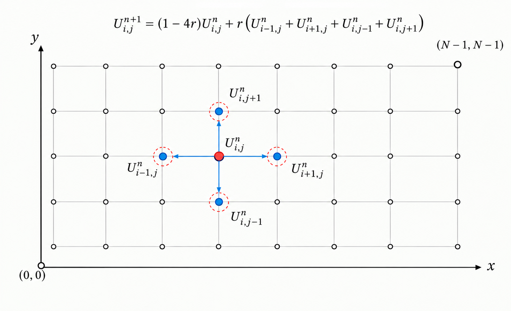
  <br>
  <i>图 19　二维五点模板：新值只用自身与上下左右四个邻居，对角邻居不参与<a id="fig18"></a></i>
</div>

**二维的矩阵形式**

　　二维与一维的本质区别，在于未知量的排列方式。设 $x$ 方向和 $y$ 方向的内点数均为 $N-1$，记 $r=\kappa\Delta t/(\Delta x)^2$（为简洁起见取 $\Delta x=\Delta y$）。把二维网格的内点按**行优先**排成一个长向量：先排第一行内点，再排第二行，依此类推，

$$
\boldsymbol x=\bigl(U_{1,1}^{n+1},U_{2,1}^{n+1},\dots,U_{N-1,1}^{n+1},\mkern5mu{}
U_{1,2}^{n+1},\dots,U_{N-1,2}^{n+1},\mkern5mu{}\dots,\mkern5mu{}
U_{1,N-1}^{n+1},\dots,U_{N-1,N-1}^{n+1}\bigr)^{\mathsf T},
$$

其中 $U_{i,j}^{n+1}$ 表示第 $j$ 行、第 $i$ 列内点的新一层温度。该向量共有 $m=(N-1)^2$ 个分量。因此，二维隐式格式对应的线性方程组

$$
A_{2D}\boldsymbol x=\boldsymbol b,
$$

其中， $A_{2D}$ 是一个 $m\times m$ 的大型稀疏矩阵， $\boldsymbol x$ 和 $\boldsymbol b$ 均为 $m$ 维列向量。当 $N$ 较大时， $m=(N-1)^2$ 增长很快，例如 $N=101$ 时 $m=10000$，此时 $A_{2D}$ 为 $10000\times10000$ 矩阵；但每行至多只有五个非零元，实际计算中并不存储全部零元。

　　为看清 $A_{2D}$ 的具体结构，将 $\boldsymbol x$ 按行分块：

$$
\boldsymbol x=
\begin{pmatrix}
\boldsymbol x_1\newline
\boldsymbol x_2\newline
\vdots\newline
\boldsymbol x_{N-1}
\end{pmatrix},
\qquad
\boldsymbol x_j=
\begin{pmatrix}
U_{1,j}^{n+1}\newline
U_{2,j}^{n+1}\newline
\vdots\newline
U_{N-1,j}^{n+1}
\end{pmatrix},
\qquad j=1,\dots,N-1.
$$

其中每个块 $\boldsymbol x_j$ 对应第 $j$ 行上的 $N-1$ 个内点。相应地，右端向量也按同样方式分块：

$$
\boldsymbol b=
\begin{pmatrix}
\boldsymbol b_1\newline
\boldsymbol b_2\newline
\vdots\newline
\boldsymbol b_{N-1}
\end{pmatrix},
\qquad
\boldsymbol b_j=\boldsymbol U_j^n+\Delta t\thinspace\boldsymbol g_j^{n+1},
$$

其中 $\boldsymbol U_j^n$ 和 $\boldsymbol g_j^{n+1}$ 分别是第 $j$ 行内点的旧层温度和源项。若边界条件非齐次，则边界值产生的已知项也应并入相应的 $\boldsymbol b_j$ 中。

　　在上述按行分块的排列下，二维隐式格式的系数矩阵 $A_{2D}$ 具有分块三对角形式：

$$
A_{2D}=
\begin{pmatrix}
D & -rI & 0 & \cdots & 0\newline
-rI & D & -rI & \ddots & \vdots\newline
0 & -rI & D & \ddots & 0\newline
\vdots & \ddots & \ddots & \ddots & -rI\newline
0 & \cdots & 0 & -rI & D
\end{pmatrix},\qquad(27)
$$

<a id="eq27"></a>

其中 $I$ 是 $N-1$ 阶单位矩阵，而对角块 $D$ 为

$$
D=
\begin{pmatrix}
1+4r & -r & 0 & \cdots & 0\newline
-r & 1+4r & -r & \ddots & \vdots\newline
0 & -r & 1+4r & \ddots & 0\newline
\vdots & \ddots & \ddots & \ddots & -r\newline
0 & \cdots & 0 & -r & 1+4r
\end{pmatrix}_{(N-1)\times(N-1)}.
$$

　　于是， $A_{2D}$ 是一个由 $(N-1)\times(N-1)$ 个块组成的分块矩阵，每个块本身又是 $(N-1)\times(N-1)$ 矩阵；因此 $A_{2D}$ 的总阶数为 $m=(N-1)^2$，其对角块 $D$ 描述同一行内相邻内点之间的耦合，故 $D$ 本身是三对角矩阵；相邻块之间的非对角块为 $-rI$，描述上下相邻两行中同一列内点之间的耦合。除这些位置外，其余块均为零块。因此 $A_{2D}$ 是一个大型、稀疏、分块三对角的矩阵。

　　将 [(27)](#eq27) 的第 $j$ 个块行展开，即得到第 $j$ 行内点所满足的方程组：

$$
-r\boldsymbol x_{j-1}+D\boldsymbol x_j-r\boldsymbol x_{j+1}=\boldsymbol b_j,
\qquad j=1,\dots,N-1,
$$

其中边界行中越界的 $\boldsymbol x_0,\boldsymbol x_N$ 由边界条件处理。若写成单个内点 $(i,j)$ 的方程，则为

$$
-rU_{i-1,j}^{n+1}-rU_{i,j-1}^{n+1}+(1+4r)U_{i,j}^{n+1}
-rU_{i,j+1}^{n+1}-rU_{i+1,j}^{n+1}=b_p,
$$

其中行优先编号 $p=(j-1)(N-1)+i$。

　　这正说明：二维隐式格式中，每个未知量只与自身及上下左右四个邻居耦合，因此矩阵 $A_{2D}$ 的每一行至多有五个非零系数。与一维情形相比，一维矩阵是三对角的；二维矩阵则是分块三对角的，其对角块 $D$ 仍为三对角矩阵，非对角块为 $-rI$。

　　显式二维格式每步一次五点更新， $O(N^2)$，不需要解方程；隐式格式每步要解一个 $m=(N-1)^2$ 阶的稀疏系统，实际计算多用稀疏直接解或迭代法。这就是二维问题里“显式简单、隐式昂贵”的具体含义。

　　需要强调的是，二维并不是把一维做两遍。按行优先排成一根长向量之后，矩阵由三对角变为分块三对角，行与行之间的耦合以非对角块 $-rI$ 的形式出现；若改按列优先排列，得到的只是同一个矩阵的一次置换相似变换，谱不变，分块结构随之转置。

#### 3.2.2.3　数值解与收敛阶

　　数值实验要回答两个问题：格式是否收敛、观测阶是否与理论一致；误差主要由空间离散还是时间离散决定。统一用最大范数度量误差：固定终端时刻 $T$，记

$$
E(h)=\max_{0\le j\le N}\bigl|U_j^M-u(x_j,T)\bigr|,\qquad M=\frac{T}{\Delta t},
$$

　　其中 $u$ 为精确解。若 $E(h)\approx Ch^p$，则网格减半后误差约缩小 $2^p$ 倍，观测阶可由相邻两次的比值估计：

$$
p_{\mathrm{obs}}=\log_2\frac{E(h)}{E(h/2)}.
$$

　　实验分两步。第一步固定网格比 $r$，即令 $\Delta t=r h^2$，让 $h$ 逐次减半：空间误差与时间误差同阶下降，测到的是“时空同步加密”的阶。第二步固定网格、只缩小 $\Delta t$：此时空间误差是一块不随 $\Delta t$ 下降的“地板”，必须改用同一网格上半离散方程的精确解作参考，才能单独测出时间方向的阶。

##### 3.2.2.3.1　一维：数值解与收敛阶

　　取一维模型问题

$$
u_t=u_{xx},\qquad u(x,0)=\sin(\pi x),\qquad u(0,t)=u(1,t)=0,
$$

　　其精确解为 $u(x,t)=e^{-\pi^2t}\sin(\pi x)$。固定 $r=0.4$、 $T=0.1$，令 $N=10,20,40,80,160$，相应地 $h=1/N$、 $\Delta t=r h^2$、 $M=T/\Delta t$。 $N=20$ 时数值解与精确解几乎完全重合（[图 20](#fig19)(a)）；逐次加密后，最大误差在双对数坐标下按斜率 2 下降（[图 20](#fig19)(b)），具体数字列于[表 6](#tab6)。

<div align="center">
  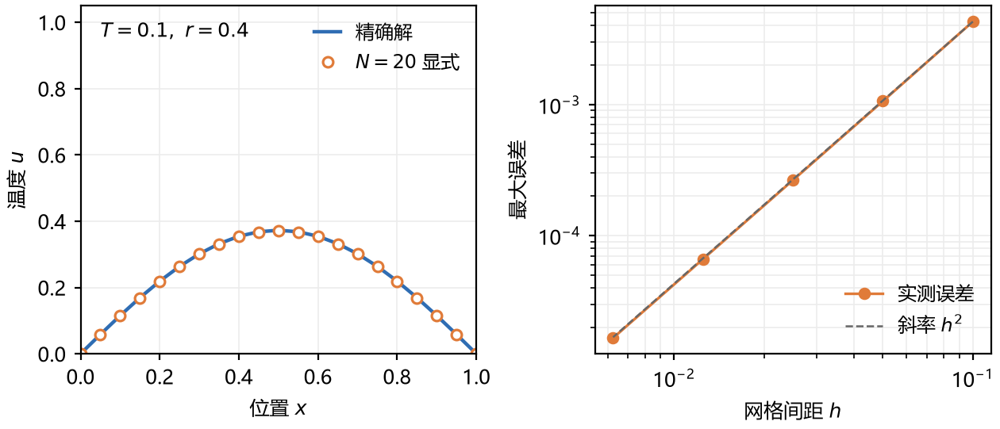
  <br>
  <i>图 20　一维算例：（a）数值解与精确解重合；（b）最大误差以斜率 2 下降<a id="fig19"></a></i>
</div>

<p align="center"><b>表 6　一维空间收敛（<i>T</i>=0.1，<i>r</i>=0.4）<a id="tab6"></a></b></p>

| 网格数 $N$ | 网格间距 $h$ | 时间步 $M$ | 最大误差 | 观测阶 |
| :---: | :---: | :---: | :---: | :---: |
| 10 | 1.00×10⁻¹ | 25 | 4.29×10⁻³ | — |
| 20 | 5.00×10⁻² | 100 | 1.06×10⁻³ | 2.01 |
| 40 | 2.50×10⁻² | 400 | 2.65×10⁻⁴ | 2.00 |
| 80 | 1.25×10⁻² | 1 600 | 6.62×10⁻⁵ | 2.00 |
| 160 | 6.25×10⁻³ | 6 400 | 1.66×10⁻⁵ | 2.00 |

　　由[表 6](#tab6)， $N$ 每翻一倍误差约降到四分之一（比值 4.05、4.00、4.00、3.99），观测阶稳定在 2.00；首行 2.01 略高，是 $N=10$ 时高阶项尚未衰减。最细网格误差 $1.66\times10^{-5}$ 远高于舍入水平，说明误差由截断而非舍入主导。

　　[图 20](#fig19)(b) 的数据点落在斜率 2 的直线上，与[表 6](#tab6) 一致；[图 20](#fig19)(a) 两条曲线已重合，说明仅凭图形判断精度并不可靠。

　　严格说，[表 6](#tab6) 的观测阶 2 是空间与时间误差共同作用的结果： $\Delta t=r h^2$ 使时间方向的一阶误差也按 $h^2$ 下降，两种误差混在一起；要单独看时间阶，需固定网格。

　　为了把时间方向的阶单独测出来，固定 $N=40$，让 $r$ 从 $1/2$ 逐次减半。此时与连续精确解比较，空间误差是一块不随 $\Delta t$ 下降的“地板”，观测阶会被压平；因此参考解换成同一网格上半离散方程的精确解：

$$
u_h(x_j,t)=e^{\lambda_ht}\sin(\pi x_j),\qquad
\lambda_h=-\frac{4\sin^2(\pi/2N)}{h^2}.
$$

　　结果见[表 7](#tab7)：误差逐次减半，观测阶稳定在 1.00，与显式 Euler 的一阶精度相符。这里必须换成半离散参考解，否则空间误差的“地板”会把观测阶压平。

<p align="center"><b>表 7　一维时间收敛：固定网格、只缩步长（<i>N</i>=40，<i>T</i>=0.1）<a id="tab7"></a></b></p>

| 实际 $r$ | 时间步长 $\Delta t$ | 时间步 $M$ | 最大误差 | 观测阶 |
| :---: | :---: | :---: | :---: | :---: |
| 0.5000 | 3.13×10⁻⁴ | 320 | 5.68×10⁻⁴ | — |
| 0.2500 | 1.56×10⁻⁴ | 640 | 2.84×10⁻⁴ | 1.00 |
| 0.1250 | 7.81×10⁻⁵ | 1 280 | 1.42×10⁻⁴ | 1.00 |
| 0.0625 | 3.91×10⁻⁵ | 2 560 | 7.09×10⁻⁵ | 1.00 |
| 0.0312 | 1.95×10⁻⁵ | 5 120 | 3.54×10⁻⁵ | 1.00 |

　　一维的结论：空间二阶、时间一阶；时空同步加密时观测阶为 2，固定网格只缩步长时为 1。

##### 3.2.2.3.2　二维：数值解与收敛阶

　　二维取 $\Omega=(0,1)^2$，初值为两个模态的叠加

$$
u(x,y,0)=\sin(\pi x)\sin(\pi y)+\tfrac12\sin(2\pi x)\sin(\pi y),
$$

　　两端取零边界。对应地，精确解为

$$
u(x,y,t)=e^{-2\pi^2t}\sin(\pi x)\sin(\pi y)
+\tfrac12\thinspace e^{-5\pi^2t}\sin(2\pi x)\sin(\pi y).
$$

　　取 $N=40$、 $r=0.2$、 $T=0.05$，[图 21](#fig20) 给出精确解、数值解、误差场与中心剖面。两张热图几乎无差别；误差场在区域中心最大（温度最高、曲率最大），最大误差 $3.51\times10^{-4}$，与 $h^2=6.25\times10^{-4}$ 同量级。

<div align="center">
  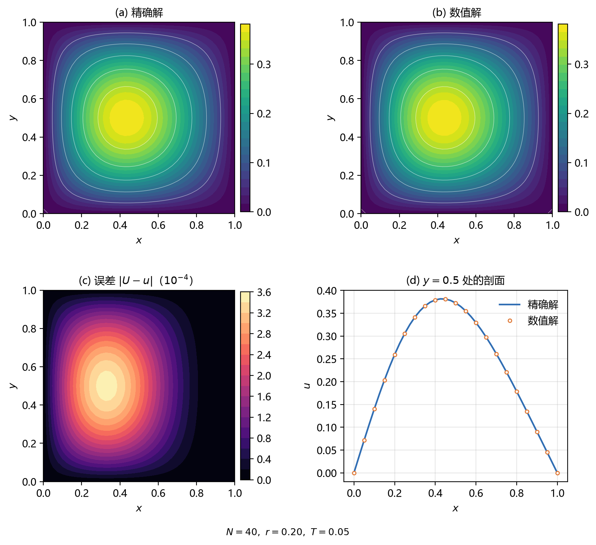
  <br>
  <i>图 21　二维算例：精确解、数值解、误差场与中心剖面<a id="fig20"></a></i>
</div>

　　保持 $r=0.2$、令 $N=10\to160$，结果见[表 8](#tab8)：误差比值 4.02、3.99、4.01、4.00，观测阶稳定在 2.00；[图 22](#fig21)(a) 的斜率同样为 2。

<p align="center"><b>表 8　二维空间收敛（<i>T</i>=0.05，<i>r</i>=0.2）<a id="tab8"></a></b></p>

| 网格数 $N$ | 网格间距 $h$ | 时间步 $M$ | 最大误差 | 观测阶 |
| :---: | :---: | :---: | :---: | :---: |
| 10 | 1.00×10⁻¹ | 25 | 5.63×10⁻³ | — |
| 20 | 5.00×10⁻² | 100 | 1.40×10⁻³ | 2.01 |
| 40 | 2.50×10⁻² | 400 | 3.51×10⁻⁴ | 2.00 |
| 80 | 1.25×10⁻² | 1 600 | 8.76×10⁻⁵ | 2.00 |
| 160 | 6.25×10⁻³ | 6 400 | 2.19×10⁻⁵ | 2.00 |

　　同一 $N$ 下二维误差略大于一维（ $N=10$ 时 $5.63\times10^{-3}$ 对 $4.29\times10^{-3}$）：离散 Laplace 算子是两项二阶差商之和，误差常数相加；这也解释了[图 21](#fig20) 中误差场为何在中心最大。

　　固定 $N=40$、只缩 $\Delta t$，结果见[表 9](#tab9) 与[图 22](#fig21)(b)：误差逐次减半，观测阶 1.00，与一维相同。

<p align="center"><b>表 9　二维时间收敛：固定网格、只缩步长（<i>N</i>=40，<i>T</i>=0.05）<a id="tab9"></a></b></p>

| 实际 $r$ | 时间步长 $\Delta t$ | 时间步 $M$ | 最大误差 | 观测阶 |
| :---: | :---: | :---: | :---: | :---: |
| 0.25000 | 1.56×10⁻⁴ | 320 | 8.44×10⁻⁴ | — |
| 0.12500 | 7.81×10⁻⁵ | 640 | 4.22×10⁻⁴ | 1.00 |
| 0.06250 | 3.91×10⁻⁵ | 1 280 | 2.11×10⁻⁴ | 1.00 |
| 0.03125 | 1.95×10⁻⁵ | 2 560 | 1.05×10⁻⁴ | 1.00 |
| 0.01562 | 9.77×10⁻⁶ | 5 120 | 5.27×10⁻⁵ | 1.00 |

<div align="center">
  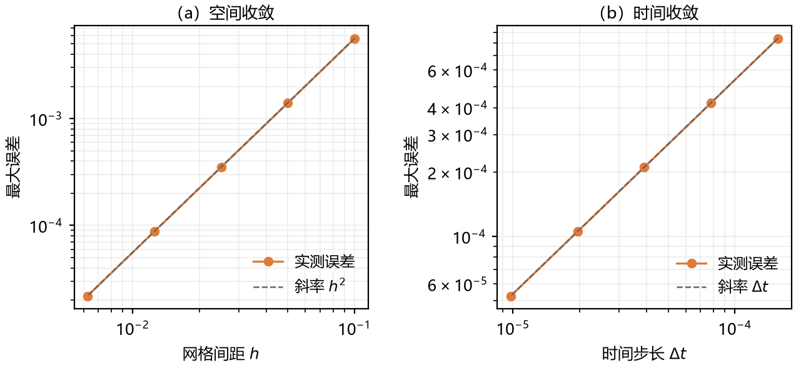
  <br>
  <i>图 22　二维收敛阶：（a）误差随 h<sup>2</sup> 下降；（b）固定网格时误差随 Δt 线性下降<a id="fig21"></a></i>
</div>

　　二维的代价比一维多一笔：网格加密一倍，未知量变成 4 倍，时间步数也变成 4 倍，总工作量约 16 倍。精度提高一倍，一维的代价约为 8 倍，二维约为 16 倍。这笔账的根源是显式格式的稳定限制，下一节把这条限制说清楚。

　　**故事｜十个人的账本。**　老陶的徒弟小满想替师父分担：铁钎烧到哪一段、哪一刻该翻面，不能总靠手背去试。他把钎子量了量，均分成十段，每段正中插一根热电偶。一根连续的钎子，从此变成十个数。

　　头一晚，他守着炉口记时辰。每隔一小会儿，他先照着上一遍的十个数，把每一段的新温度写下来：本段与左右两段一掺，往邻居那边靠一靠。中间那段若和两边一样热，就原地不动；比两边热，就分一点给邻居，自己凉下来；比两边凉，就反过来。十段各算各的，谁也不许偷看刚写下的新数——师父定过规矩：先抄旧账，再记新账。

　　一夜下来，账本积了厚厚一叠：一个时辰一页，每页十个数。后来小满发现，若把“谁分给谁多少”也列成一张表，这张表每行只有三个位置有数，其余都是空格；有了它，可以不必一页页抄，一次把整页账算平——只是每算一页都要解一串方程，不如抄账轻快。他把两种法子都记在扉页：一种快，一种稳。

　　老陶翻着账本笑道：你这不是把一根钎子切成了十个人么？每人只问左右邻居上一遍多少度，问完各记各的账。小满点头。他并不知道，自己刚才做的两件事，一件叫“把空间切成格子”，一件叫“让格子排着队往前走”（[图 23](#fig22)）。

<div align="center">
  
  <br>
  <i>图 23　十个人的账本：空间剖分、逐层更新与三对角矩阵<a id="fig22"></a></i>
</div>

### 3.2.3　稳定性的限制与网格实验

　　3.2.2 节的格式每步只做几次乘加，但时间步不能任意取大：一旦超过某个界限，误差会在迭代中被放大，数值解不再逼近真解，而是自己长成一条振荡的曲线。本节回答两个问题：这条界限在哪里？越过界限后会发生什么、代价有多大？

　　回答第一个问题有三种视角。局部视角看每个点上的权重，回答“凭什么不能更大”；Fourier 视角把一个误差拆成不同波长的波，回答“哪个波长最先出问题”；矩阵视角看整步迭代的谱半径，回答“最坏情况有多坏”。三者不是三套理论，而是同一个限制的三种说法，最后给出同一个数 $r\le1/2$（二维为 $r\le1/4$）。第二个问题用网格实验回答：扫描网格比、观察失稳形态、固定 $\Delta t$ 加密网格，看误差怎样累积、代价怎样增长（[图 24](#fig23)）。

<div align="center">
  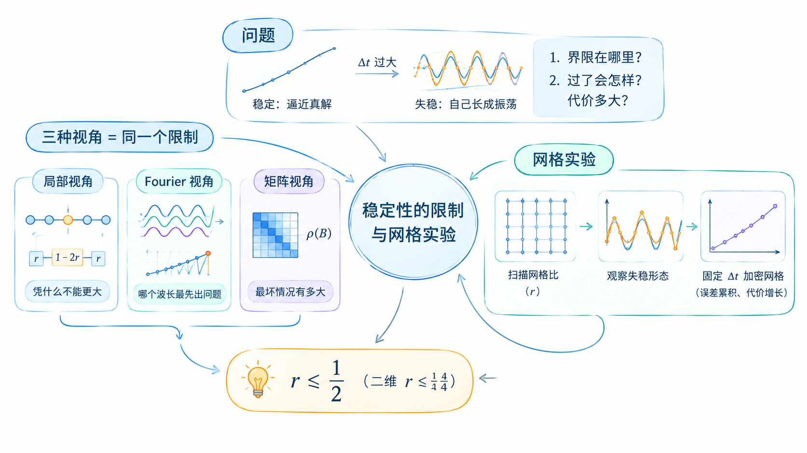
  <br>
  <i>图 24　本节的结构：三种视角给出同一个限制，网格实验检验越过限制的后果<a id="fig23"></a></i>
</div>

#### 3.2.3.1　稳定性的限制：负权重与离散最大值原理

　　把显式格式 [(25)](#eq25) 写成加权平均：

$$
U_j^{n+1}=(1-2r)\thinspace U_j^{n}+r\thinspace U_{j-1}^{n}+r\thinspace U_{j+1}^{n}.
$$

　　 $r\le1/2$ 时三个权重都非负，新值必落在三个旧值的最小值与最大值之间：网格上的最高温度只降不升，最低温度只升不降。这就是离散最大值原理，它与 3.2.1 节的连续版本对应。 $r\gt1/2$ 时对角权重 $1-2r$ 变负，新值不再被旧值夹住，一个局部尖峰可以被越抬越高。限制由此出现：

$$
r=\frac{\kappa\Delta t}{h^2}\le\frac12
\qquad\Longleftrightarrow\qquad
\Delta t\le\frac{h^2}{2\kappa}.
$$

　　这是一条硬约束：空间步长减半，时间步长必须减到四分之一。二维的权重是 $(1-4r,r,r,r,r)$，五项之和为 $1$，中心权重非负给出 $r\le1/4$，恰是一维上界的一半。

　　负权重给出了“为什么”，但它只检查了一个点上的系数，没有回答“哪个波长最先出问题”。下一节的 Fourier 分析补上这一问。

#### 3.2.3.2　放大因子：逐波长看

　　把数值解按波长分解，取一个模态 $U_j^n=g^ne^{\mathrm i j\theta}$ 代入显式格式 [(25)](#eq25)，约去公因子，得

$$
g(\theta)=1+r\left(e^{-\mathrm i\theta}-2+e^{\mathrm i\theta}\right)
=1-4r\sin^2\frac{\theta}{2}.
$$

　　 $g(\theta)$ 与步数无关，只取决于波长（用相位角 $\theta$ 表示）与网格比。要求所有模态都不增长，即 $|g(\theta)|\le1$。 $\theta=0$ 对应常值模态， $g=1$，不涨不落； $\theta=\pi$ 对应网格上能够表示的最高频模态（相邻节点一步一变色），它的放大因子 $1-4r$ 最不利：

$$
|g(\pi)|=|1-4r|\le1
\qquad\Longleftrightarrow\qquad
r\le\frac12.\qquad(28)
$$

<a id="eq28"></a>

　　式 [(28)](#eq28) 既是必要的也是充分的： $r\lt1/2$ 时锯齿被压平， $r=1/2$ 时锯齿幅值不变、每步变号， $r\gt1/2$ 时按 $|1-4r|$ 层层放大。

<div align="center">
  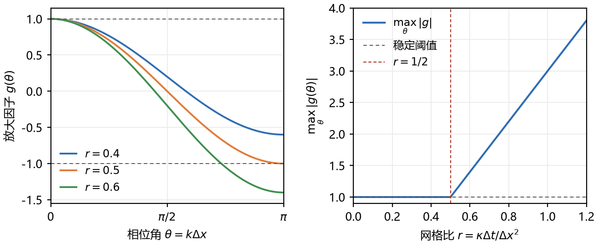
  <br>
  <i>图 25　放大因子：左为 g(θ) 随波长的变化，右为最坏模态随网格比的变化（虚线为阈值 ±1）<a id="fig24"></a></i>
</div>

　　[图 25](#fig24) 左图给出三条曲线： $r=0.4$ 时整条曲线落在 $\pm1$ 之间； $r=0.5$ 时右端恰好触到 $-1$； $r=0.6$ 时曲线在 $\theta\approx2.28$ 处穿过 $-1$，此后越往高频越放大。右图把最坏模态单独画出来： $|1-4r|$ 随 $r$ 线性变化，在 $r=1/2$ 处穿过 1， $r\gt1/2$ 后一路上升。

　　与负权重相比，放大因子多回答了一件事：不是所有波长同时失稳，而是最靠近网格尺度的那个波长最先出问题。这也解释了后面实验中“光滑初值看起来没事、舍入误差却迟早把解吞掉”的现象。

#### 3.2.3.3　谱半径：整体看

　　放大因子逐波长地看，矩阵的语言则是一步看全体。显式格式 [(26)](#eq26) 的误差满足 $\boldsymbol e^{n+1}=B\boldsymbol e^n$，即 $\boldsymbol e^n=B^n\boldsymbol e^0$，是否被放大完全由 $B$ 的幂决定。

　　**定义 3（谱半径）**　设 $B$ 为 $n$ 阶方阵， $\lambda_1,\dots,\lambda_n$ 为它的特征值。称

$$
\rho(B)=\max_{1\le i\le n}|\lambda_i|
$$

　　为 $B$ 的谱半径。

　　**定理 2（稳定性判据）**　若 $B$ 可对角化，则显式格式稳定当且仅当 $\rho(B)\le1$。

　　**证明**　设 $B=Q\Lambda Q^{-1}$， $\Lambda=\mathrm{diag}(\lambda_1,\dots,\lambda_n)$，记 $\kappa(Q)=\Vert Q\Vert_2\Vert Q^{-1}\Vert_2$，则

$$
\begin{aligned}
\Vert\boldsymbol e^n\Vert_2
&\le\Vert Q\Vert_2\Vert\Lambda^n\Vert_2\Vert Q^{-1}\Vert_2\Vert\boldsymbol e^0\Vert_2
\le\kappa(Q)\thinspace\rho(B)^n\thinspace\Vert\boldsymbol e^0\Vert_2 .
\end{aligned}
$$

　　若 $\rho(B)\le1$，误差不放大；若 $\rho(B)\gt1$，取最大特征值对应的特征向量作初值，误差按 $|\lambda_{\max}|^n$ 无限增长。证毕。

　　对本题， $B=I+rL$ 对称，故 $\kappa(Q)=1$。 $L$ 的特征值与特征向量为

$$
\lambda_k=-4\sin^2\frac{k\pi}{2N},\qquad
v_k=\Bigl(\sin\frac{jk\pi}{N}\Bigr)_{j=1}^{N-1},
\qquad k=1,\dots,N-1.
$$

　　证明只需一个三角恒等式： $Lv_k$ 的第 $j$ 个分量为 $\sin((j-1)\theta)-2\sin(j\theta)+\sin((j+1)\theta)=-2\sin(j\theta)(1-\cos\theta)$，记 $\theta=k\pi/N$ 即得 $-4\sin^2(\theta/2)\sin(j\theta)$。于是

$$
\lambda_k(B)=1-4r\sin^2\frac{k\pi}{2N},
\qquad
\rho(B)=\max_{1\le k\le N-1}\Bigl|1-4r\sin^2\frac{k\pi}{2N}\Bigr|.
$$

　　 $\rho(B)\le1$ 最坏的情形发生在 $\sin^2=1$，即 $1-4r\ge-1$，于是 $r\le1/2$，与 [(28)](#eq28) 一致：矩阵的谱恰好对应所有网格波长的放大因子。二维重算一遍，最负的特征值约为 $-8$，限制随之减半为 $1/4$。

　　矩阵视角的价值在于它不依赖 Fourier 模态。对二维、变系数或复杂区域，逐波长的分析不再方便，但误差递推与谱半径仍然成立；只要估出 $B$ 的谱，就能判断稳定性。本题中 $B$ 对称， $\kappa(Q)=1$，谱半径判据还是“紧”的，因此三种视角给出同一个数。

　　限制还有一处细节值得说明。最大值原理要求 $r\le1/2$，而谱半径判据只要求 $\rho(B)\le1$，即

$$
r\le\frac{1}{2\cos^{2}(\pi/2N)},
$$

　　后者略宽： $N=20$ 时约为 $0.503$。差别来自边界—— $\theta=\pi$ 的锯齿模态在两端取值为 $\pm1$，不满足零边界条件，不属于离散正弦基，最负的特征值实际出现在 $k=N-1$； $N\to\infty$ 时两界重合。实用中仍以 $r\le1/2$ 为准，因为它保证的是更强的性质：离散最大值原理。

　　以 Courant、Friedrichs、Lewy 的经典论文为起点，这套“网格比要有上界”的思想后来被统称为 CFL 条件[[19]](#ref19)。三种视角，同一个数（[表 10](#tab10)）：

<p align="center"><b>表 10　同一道限制的三种推导<a id="tab10"></a></b></p>

| 角度 | 依据 | 一维结论 | 二维结论 |
| :---: | :---: | :---: | :---: |
| 负权重 | 加权平均的系数非负 | $r\le1/2$ | $r\le1/4$ |
| Fourier 模态 | $\lvert g(\theta)\rvert\le1$，最坏在 $\theta=\pi$ | $r\le1/2$ | $r\le1/4$ |
| 矩阵谱半径 | $\rho(B)\le1$，最坏特征值 $1-4r$ 或 $1-8r$ | $r\le1/2$ | $r\le1/4$ |

　　负权重说明“凭什么不能更大”，放大因子指出“哪个波长最先出问题”[[20]](#ref20)，谱半径给出“最坏情况有多坏”。三种说法合起来，限制才算说清楚。

#### 3.2.3.4　网格实验：越过限制会怎样

　　限制说完了，接下来看实验。实验都在一维模型问题（ $u_t=u_{xx}$， $u(x,0)=\sin\pi x$，两端为零）上进行，只在初值上叠加一个幅值 $10^{-3}$ 的网格尺度扰动 $\sin((N-1)\pi x)$。由于格式是线性的，把扰动前后的两个解相减，就单独分离出这个高频模态；它的最大范数除以 $10^{-3}$，即为实测的增长倍数。

　　固定 $N=20$、 $T=0.05$，让网格比跨过 $1/2$，结果列于[表 11](#tab11)。

<p align="center"><b>表 11　网格比扫描：理论与实测（<i>N</i>=20，<i>T</i>=0.05）<a id="tab11"></a></b></p>

| 目标 $r$ | 实际 $r$ | $\lvert g(\pi)\rvert$ | 理论增长 | 实测增长 | 判定 |
| :---: | :---: | :---: | :---: | :---: | :---: |
| 0.40 | 0.4000 | 0.600 | 3.53×10⁻¹² | 3.66×10⁻¹² | 稳定 |
| 0.45 | 0.4545 | 0.818 | 7.98×10⁻⁵ | 7.98×10⁻⁵ | 稳定 |
| 0.50 | 0.5000 | 1.000 | 6.09×10⁻¹ | 6.09×10⁻¹ | 稳定 |
| 0.55 | 0.5556 | 1.222 | 9.15×10² | 9.15×10² | 失稳 |
| 0.60 | 0.6061 | 1.424 | 8.27×10⁴ | 8.27×10⁴ | 失稳 |

　　[表 11](#tab11) 的五个网格比分成两段： $r\le0.5$ 的三行，高频扰动被压低或保持不变； $r\gt0.5$ 的两行，扰动被放大到 $10^2$ 与 $10^4$ 量级。“理论增长”按初始扰动的实际波数 $(N-1)\pi/N$ 计算 $|g|^{M}$，与实测值在三位有效数字上相符。

　　[表 11](#tab11) 中 $r=0.5000$ 一行的两个数字需要解释： $\lvert g(\pi)\rvert$ 记为 $1.000$，理论增长却是 $6.09\times10^{-1}$。原因是实验叠加的扰动为 $\sin((N-1)\pi x)$，对应 $\theta=(N-1)\pi/N$，并非 $\theta=\pi$——后者的锯齿在两端取 $\pm1$，同样不满足零边界条件。代入真实波数得 $|1-4r\sin^{2}(\theta/2)|=0.9877$，40 步后为 $0.9877^{40}\approx0.609$，与表中数值一致。

<div align="center">
  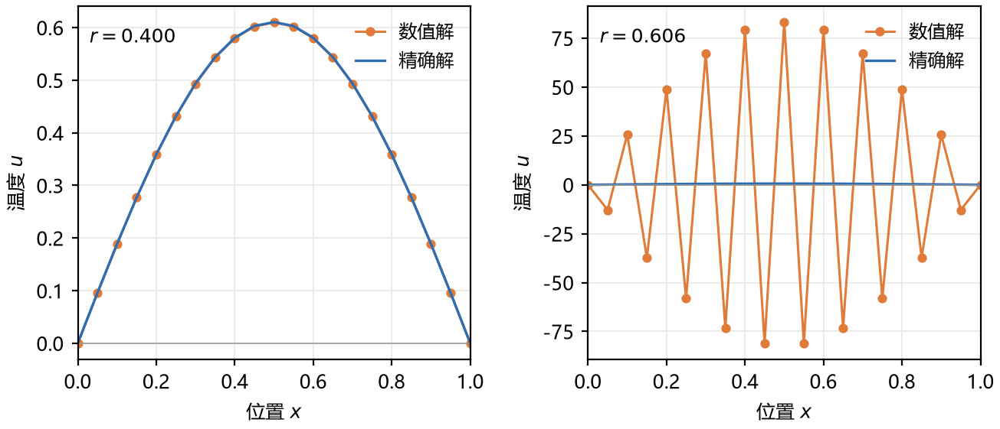
  <br>
  <i>图 26　越过限制后的棋盘振荡：r=0.4 与精确解重合，r=0.606 在 ±83 之间交替<a id="fig25"></a></i>
</div>

　　[图 26](#fig25) 给出两种网格比下的数值解。 $r=0.4$ 时解与精确解重合； $r=0.606$ 时解呈典型棋盘格振荡，19 个内点中变号 18 次。值得注意的是，初值 $\sin\pi x$ 本身是 $N=20$ 下最光滑的模态，它在 $r=0.606$ 时仍按 $0.9851$ 衰减——只拿光滑初值做实验，解不会立刻爆炸。被放大的是高频扰动：浮点舍入误差里就有这一分量，它迟早会把解吞掉。稳定性是格式的性质，不是初值的性质。

　　另一个后果是“加密反而更糟”。固定 $\Delta t=0.002$、 $T=0.02$，网格数从 10 加倍到 80， $r$ 从 $0.20$ 涨到 $12.80$，幅值被放大到 $10^{14}$ 量级。要保持 $r\le1/2$，必须让 $\Delta t$ 与 $h^2$ 同比例缩小（[图 27](#fig26)）：

$$
h\to\frac{h}{2}
\quad\Longrightarrow\quad
\Delta t\to\frac{\Delta t}{4},
\qquad M\to4M.
$$

<div align="center">
  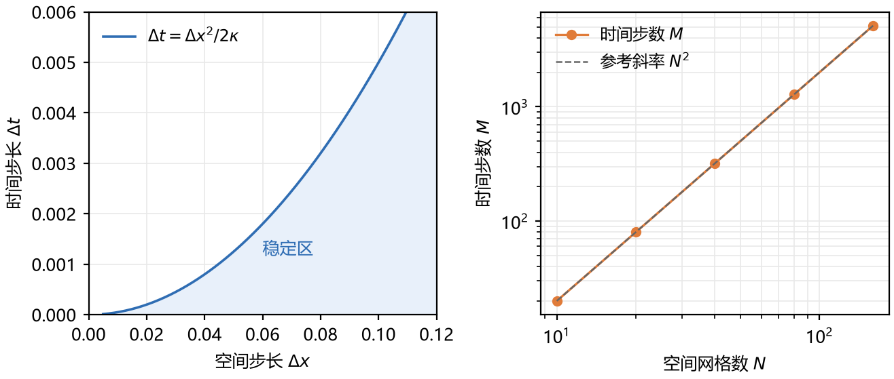
  <br>
  <i>图 27　稳定区域与代价：左为可取的 Δt 上界，右为步数随 N 的增长<a id="fig26"></a></i>
</div>

　　网格数每加倍一次，时间步数增到 4 倍；二维还要再乘上未知量变 4 倍这一笔。把代价写成数量级：一维的网格数 $\propto h^{-1}$、时间步数 $\propto h^{-2}$，总工作量 $\propto h^{-3}$；二维的未知量 $\propto h^{-2}$、时间步数 $\propto h^{-2}$，总工作量 $\propto h^{-4}$。精度提高一倍，代价分别涨到 8 倍与 16 倍。

　　若这一代价难以接受，可以改换时间离散。把右端整体取在新一层（隐式格式），模态代入后得到 $g(\theta)=1/\bigl(1+4r\sin^{2}(\theta/2)\bigr)$，它对一切 $r\gt0$ 都落在 $(0,1]$ 内；若取前后两层的平均，则得 Crank–Nicolson 格式。三者的对照列于[表 12](#tab12)。

<p align="center"><b>表 12　三种时间离散的放大因子<a id="tab12"></a></b></p>

| 格式 | $g(\theta)$ | 稳定条件 | 时间精度 |
| :---: | :---: | :---: | :---: |
| 显式（FTCS） | $1-4r\sin^{2}(\theta/2)$ | $r\le1/2$ | 一阶 |
| 隐式（后向 Euler） | $1/\bigl(1+4r\sin^{2}(\theta/2)\bigr)$ | 无条件 | 一阶 |
| Crank–Nicolson | $\dfrac{1-2r\sin^{2}(\theta/2)}{1+2r\sin^{2}(\theta/2)}$ | 无条件 | 二阶 |

　　无条件稳定并不意味着可以随意取大步长：步长增大，时间离散误差随之增大（显式与隐式均为一阶，Crank–Nicolson 为二阶）。它解除的只是 $\Delta t$ 必须跟随 $h^2$ 的约束，并未取消精度要求。

　　**故事｜锯齿爬上账本。**　为了看清钎尖附近的温度，小满把格子从十段加到八十段，却没改时间步。头几轮无事，到了后半夜，账本上冒出一排锯齿：相邻两段一正一负，越往后越尖。

　　老陶看了一眼说：格子细了，步子也得跟着细——格子缩一半，步子得缩到四分之一。小满只缩了格子，没缩步子，账上的数越滚越大，锯齿被放大到百万亿倍。

　　他换成隐式格式，锯齿平了，步子也能放大；老陶又提醒：稳不等于准，步子太大，时间上的误差照样找上门。小满把两条记在扉页：显式格式里，步子最多只能跟着格子平方的一半走（二维是四分之一）；越过这条线，先坏的不是精度，是稳定（[图 28](#fig27)）。

<div align="center">
  
  <br>
  <i>图 28　锯齿爬上账本：网格加密而步长未减，振荡被放大<a id="fig27"></a></i>
</div>

### 3.2.4　趣味编程——“热传导方程”修复破损二值图像

　　[图 29](#fig28)(a) 是一张 $588\times588$ 的二维码照片，被人用灰色笔划了几道，又盖上一个图案；手机扫不出来，解码器连位置都找不到。输入是一张灰度图，输出是一张 0/1 图（黑模块记 0，白模块记 1），要解决的问题就是把被覆盖的模块补回来。

　　二维码是一个 0/1 矩阵。完好的像素已知，被覆盖的像素未知；已知像素构成边界，未知像素是待求区域。这就是图像修复（image inpainting）——基于 PDE 的做法由 Bertalmío、Sapiro 等人在 2000 年的 SIGGRAPH 论文里系统提出[[30]](#ref30)，Chan 与 Shen 随后把它写成了严格的变分模型[[31]](#ref31)。

　　这里只用其中最简单的一档，叫膜模型（membrane model，也叫调和修复）：在缺失区域 $\Omega_{\rm miss}$ 里找一张“最光滑”的曲面，让它贴住已知像素构成的边界。写成变分问题，就是最小化 Dirichlet 能量

$$
\min_{U}\mkern5mu{}\mathcal J(U)=\int_{\Omega_{\rm miss}}|\nabla U|^2\thinspace\mathrm d x\thinspace\mathrm d y,
\qquad U=U^0\ \text{于}\ \partial\Omega_{\rm miss}.
$$

　　对 $\mathcal J$ 取变分，得 Euler–Lagrange 方程 $\Delta U=0$。也就是说，膜模型的解就是 Laplace 方程在缺失区域上的 Dirichlet 问题，而它正是热方程的稳态：

$$
\Delta_hU=0\quad\text{于 }\Omega_{\rm miss},\qquad
U=U^0\quad\text{于 }\partial\Omega_{\rm miss}.
$$

　　这一步把“补图”换成了“解一个椭圆边值问题”：不用先验知识，也不用训练，信息全部来自那条边界。热方程在这里不是比喻——让缺失区域按热方程一直扩散下去，温度不再变化的那一刻，就是 $\Delta U=0$ 的解。

　　用显式热流来求这个稳态：取 $r=1/4$，缺失点每步取四个邻居的平均，已知像素每步重置为原值，

$$
U_{i,j}^{n+1}=
\begin{cases}
\dfrac14\bigl(U_{i-1,j}^n+U_{i+1,j}^n+U_{i,j-1}^n+U_{i,j+1}^n\bigr), & (i,j)\in\Omega_{\rm miss},\newline
U_{i,j}^{0}, & (i,j)\notin\Omega_{\rm miss}.
\end{cases}\qquad(29)
$$

<a id="eq29"></a>

　　这正是 Jacobi 迭代； $r=1/4$ 恰是二维显式格式的限制（最大值原理意义下的上界），所以迭代一定收敛到离散调和函数[[31]](#ref31)——收敛性与 3.2.3 节那道限制是同一件事。

　　热方程给出的是连续灰度，而二维码只有黑白两种模块，所以最后还要取一次阈值。这一步只是把结果读成 0/1 交给解码器，不属于模型：修复本身由 Laplace 方程决定，阈值只影响“读”的方式。取 $1/2$，是因为灰度会收敛到笔画两侧的加权平均，过半即判为白：

$$
Q_{i,j}=\begin{cases}1, & U_{i,j}\gt 1/2,\newline 0, & U_{i,j}\le1/2.\end{cases}\qquad(30)
$$

<a id="eq30"></a>

　　至于计算速度：若嫌显式迭代太慢，可以换成隐式格式或两层平均的 Crank–Nicolson 格式[[21]](#ref21)。

　　具体做法分四步：第一步，估计缺失区域（笔画是“颜色居中、局部平坦”的灰，用局部标准差筛出，再做闭运算与膨胀）；第二步，按 [(29)](#eq29) 迭代，每步把已知像素重置；第三步，按 [(30)](#eq30) 二值化；第四步，用标准解码器读取。

<div align="center">
  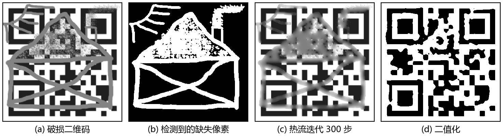
  <br>
  <i>图 29　热方程修复二维码：（a）破损原图；（b）掩膜（35%）；（c）300 步后的灰度场；（d）二值化结果。解码为 “I like coffee”<a id="fig28"></a></i>
</div>

　　修复前，笔画盖住了定位角与大片数据区；修复后，定位角恢复成完整的黑白方块。缺损 35% 里有很大一块是中部那块不携带数据的装饰图案，真正影响解码的笔画只占一部分。[表 13](#tab13) 给出迭代步数与解码结果：20 步不够，40 步才行——热量要从笔画两侧“走”到中央，笔画宽十几个像素，而热扩散一次只走一个像素。

<p align="center"><b>表 13　迭代步数与解码结果（缺损 35%）<a id="tab13"></a></b></p>

| 迭代步数 | 0 | 10 | 20 | 40 | 100 | 300 | 600 |
| :---: | :---: | :---: | :---: | :---: | :---: | :---: | :---: |
| 能否解码 | 否 | 否 | 否 | 是 | 是 | 是 | 是 |

　　[表 13](#tab13) 中步数的量级可以用扩散尺度来估计：热扩散的典型距离随步数按 $\sqrt{n}$ 增长，与笔画半宽（十余像素的一半）相当所需的步数为 $7^{2}\approx50$，与“20 步不够、40 步可解”相符。

　　必须说明：用 PDE 调和延拓修复二维码，并不是主流方法。

　　另一方面，缺失区域并非越大越保险。区域越大，Laplace 解越平坦，原有细节被一并抹去；把完好的模块也标为缺失，等于把可用信息变成未知，只会加重解码器的负担。掩膜应尽量贴近真实缺损。

　　近年的工作多用深度学习[[33]](#ref33)[[34]](#ref34)。PDE 修补的优点是简单、可解释、无需训练；缺点只能补“平滑”的缺失，补不了纹理。调和延拓也只保证“最光滑”，不保证“正确”：被覆盖模块原本是什么，信息已经丢失，最后要靠二维码自带的 Reed–Solomon 纠错码兜底，按版本与等级可容忍约 7%–30% 的码字错误[[32]](#ref32)。

### 3.2.5　热方程的今天

<div align="center">
  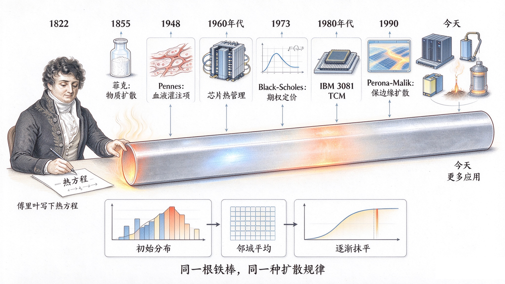
  <br>
  <i>图 30　热方程的两百年：从铁棒到数据中心<a id="fig29"></a></i>
</div>

　　自从 1822 年傅里叶写下热方程之后，这个简单的抛物型方程就悄悄走出了铁棒、火炉的世界，不断换上新身份，去解决各个领域的难题。

　　1855 年，菲克发现它还能描述物质的扩散，于是用它来刻画溶质的慢慢渗透。到了 1948 年，Pennes 给热方程添上了血液灌注项，让它走进生物体内，用来模拟人体组织的传热[[28]](#ref28)。

　　时间来到上世纪 60 年代，计算机产业兴起，IBM 等公司开启了芯片热管理的探索，最早的大型计算机依靠传导模块带走热量。1973 年，Black 和 Scholes 又改造了这个方程，得到期权定价公式[[27]](#ref27)，热方程就此闯入金融领域。

　　80 年代，IBM 3081 登场，它的导热模块靠着弹簧活塞把芯片紧紧压在水冷板上，单个模块就能扛下几百瓦的热量。1990 年，Perona 和 Malik 想出了新点子：让扩散系数跟着梯度变化，用改良后的扩散方程做图像处理，平滑噪声的同时，守住图片里清晰的边缘[[26]](#ref26)。

　　到了今天，热方程的舞台变得更大。数据中心用上冷板液冷，单机柜的功率攀升到几十千瓦；锂电池、激光焊接、地热勘探、返回舱的热防护，背后都有它的身影。

　　跨越两百年，它万变不离其宗：本质都是让一个初始分布，靠着“邻居互相平均”慢慢演化。我们在网格上写下的离散格式，正是这个古老规律简洁的数字化表达。

## 第三节（3.3）　有限元：弱形式与 Galerkin 方法

### 3.3.0　引子：一部手机的半毫秒

　　把一部手机举到胸口，松手。它落到地上只要半秒；真正决定命运的，是触地后的半毫秒。外壳凹下去又弹回来，应力波在玻璃、铝合金和电池之间来回反射，某一条倒角上的拉应力先越过极限，裂纹从那里开始。这个过程太快，肉眼看不见，高速摄像机也只能拍到几十帧。

　　工程师的办法是把它搬进计算机。手机被切成几十万个小四面体，每个小块写一个刚度矩阵，再按节点编号拼成一个巨大的方程组；解出来，就知道哪一角先裂。同一套算法也在桥上、机翼上、鱼竿上工作。它的名字叫有限元（finite element）。今天，汽车碰撞、手机跌落、心脏支架、摩天大楼的抗风，底层都有一张网格和一次装配。

*一部手机跌落的半毫秒：外壳被切成几十万个小四面体，应力波在网格间来回反射，先越过极限的那一角先裂。*

<div align="center">
  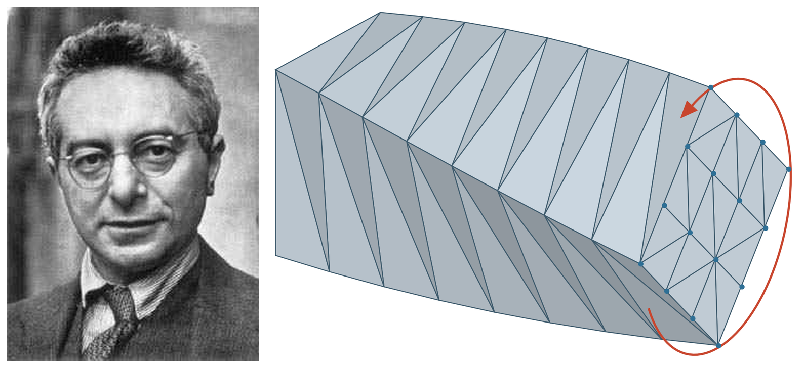
  <br>
  <i>Richard Courant（1888–1972，左）与他求解的圣维南扭转问题（右）。1943 年，他用三角形网格求解圣维南扭转问题，并讨论了收敛性，这被公认为有限元的数学雏形[[49]](#ref49)。左图来源：MacTutor History of Mathematics Archive；右图为自绘示意：方杆扭转 48°，表面与端面都是三角形网格。</i>
</div>

　　有限元不是一个人发明的。它更像三条河：数学家从能量出发，计算数学家从残差出发，工程师从一根杆的刚度出发。三条河各自流了半个世纪，最后汇进同一本矩阵账。本节沿着汇合后的路线走一遍：先把微分方程改写成弱形式，再用一顶顶“帽子”把它压成矩阵，然后按编号装配、上边界条件、量误差。最后，用一根三节鱼竿把整本账从头到尾记一遍。

　　先说清楚范围：本节只做最简单的一维线性元。二维三角形只作选讲，梁的弯曲是四阶方程，这里不碰。这不是偷懒。一维情形已经包含了有限元的全部关键动作——变分、投影、装配、边界、误差；把一维的账记明白，二维只是每个节点多几个邻居。

　　把这五步串起来，就是[图 31](#fig30)：连续问题先改写成弱形式，再剖网格、造分片函数、组装矩阵，最后施加边界并求解。

<div align="center">
  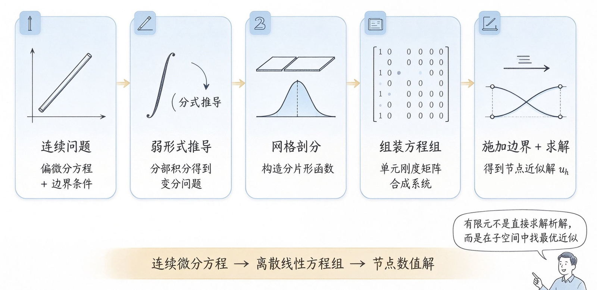
  <br>
  <i>图 31　有限元的五步：从连续问题到节点解<a id="fig30"></a></i>
</div>

### 3.3.1　三条血脉

#### 3.3.1.1　三个人的三条路

　　1956 年，西雅图。波音公司的工程师把一架飞机的机翼拆成几百个小三角形。每个三角形写一个小刚度矩阵，再按节点编号拼成整体矩阵；解出矩阵，就知道机翼在载荷下怎样变形。这是工程界用“拆成小块、再拼回去”分析整架飞机的开端。

　　要看清这件事，得把时钟拨回半个世纪。

　　1908 年，哥廷根。Ritz 的肺结核已经拖了很久。他想的不是“怎样把方程解出来”，而是“怎样让能量最低”：把未知函数写成一组试函数的线性组合，代入能量泛函，让系数自己找到最小值。解方程于是变成求极值。1909 年，Ritz 去世，年仅 31 岁。他没看到这个方法成为工程标准，但“Ritz 法”留在了每一本有限元教材里[[39]](#ref39)。

　　1915 年，彼得格勒。Galerkin 是铁路与结构工程师，面对的是杆与板的弹性平衡。他手里没有能量泛函，于是换了一个问法：把近似解代入方程，得到残差；要求残差与每一个基函数正交。这就是 Galerkin 方法[[40]](#ref40)。它不要求算子对称，适用范围比 Ritz 法宽。

　　把近似解 $u_n=\sum_{j=1}^{n}c_j\varphi_j$ 代入 $Lu=f$，得到残差 $R=Lu_n-f$。Galerkin 的条件是

$$
(R,\varphi_i)=0,\qquad i=1,\dots,n.
$$

　　也就是：残差在每个基函数上的投影为零。没有能量泛函，照样能算。

　　1943 年，纽约。Courant 在《美国数学会公报》上发表《平衡与振动问题求解的变分方法》[[41]](#ref41)。他把区域剖分成三角形，在每个三角形上用分片线性函数，求解圣维南扭转问题，并讨论了网格加密时的收敛性。这就是“Courant 三角形”。

　　三个人彼此不知道对方的工作。Ritz 从能量出发，Galerkin 从残差出发，Courant 从三角形出发；三条路看起来毫不相干，却都在做同一件事：把无限维的微分方程，压成有限维的线性方程组。

#### 3.3.1.2　汇合：从机翼到名字

　　1956 年的机翼并不是凭空出现的。Turner、Clough、Martin 与 Topp 发表《复杂结构的刚度与挠度分析》[[42]](#ref42)。他们把机翼离散成三角形与四边形“单元”，对每个单元写出一个小刚度矩阵，再按节点编号组装成整体刚度矩阵。这是工程界独立发明的有限元。

　　1960 年，Clough 在匹兹堡的第二届 ASCE 电子计算会议上第一次使用“finite element”这个词[[43]](#ref43)，名字从此固定下来。1960 年代，Argyris、Zienkiewicz 等人把方法系统化[[45]](#ref45)，有限元迅速成为航空、土木、机械行业的标准工具。1973 年，Strang 与 Fix 的《An Analysis of the Finite Element Method》给出了严格的误差理论[[44]](#ref44)，Céa 引理与 Aubin–Nitsche 对偶论证这才把工程方法与泛函分析彻底接上。

　　三条线在这里接上。Ritz 和 Galerkin 说明“为什么可以这样算”：把无限维方程投影到有限维子空间，能量最小与残差正交给出同一个方程组。波音的结构分析说明“怎么算才高效”：先算单元，再按编号累加，稀疏矩阵与快速求解都从这里来。Courant 的三角形说明“复杂区域怎么办”：网格可以贴着边界走，不必是矩形。

　　把三条线按年代排开，顺序更清楚：1908 年 Ritz 在哥廷根把能量极小写成线性方程组；1915 年 Galerkin 在彼得格勒用残差正交绕开能量；1943 年 Courant 在纽约把三角形网格带进变分问题；1956 年波音把单元装配用于机翼；1960 年 Clough 给它起名；1973 年 Strang 与 Fix 补上误差理论。工程在前，理论在后，名字最后才出现。

<div align="center">
  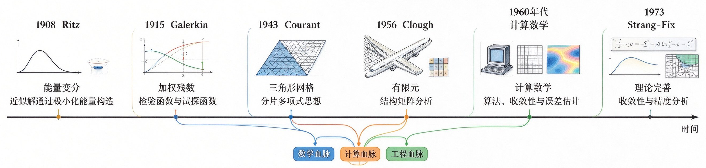
  <br>
  <i>图 32　三条血脉的时间线：数学、计算与工程在 1950—1960 年代汇合<a id="fig31"></a></i>
</div>

　　三条线各有各的出发点。数学家从能量出发：Euler 和 Lagrange 把“能量取极值”写成变分法，Rayleigh 用一组试函数去逼近，Ritz 把它变成解线性方程组；在他们手里，解方程就是找最低点。计算数学家从残差出发：Galerkin 不管能量，只要近似解在每个基函数方向上的残差为零；Strang 和 Fix 后来补上误差理论。工程师从结构出发：Courant 把区域切成三角形，波音把机翼切成单元，Clough 给这个方法起名；在他们手里，解方程就是把许多小矩阵拼成一个大矩阵。

　　三条线各有局限：Ritz 要有能量，Galerkin 要选基函数，Courant 要处理网格。合在一起，局限才被补上。这三根支柱缺一根，有限元都站不稳。

　　1956 年波音的工程师未必读过 Ritz 和 Galerkin，Courant 也未必关心机翼。三条线在各自的行业里长出来，最后在“把方程变成矩阵”这件事上碰头。

　　这也是有限元有意思的地方：它不是先有一套完整理论，再去工程里试用；理论、算法、结构分析几乎同时成熟，才在 1960 年代被叫同一个名字。

　　[图 33](#fig32) 把三条线并排画在一起，底部汇到同一个方框。合流之后的活很具体：选基函数，算单元矩阵，按编号装配，施加边界，估计误差。后面的几节按这个顺序走。

<div align="center">
  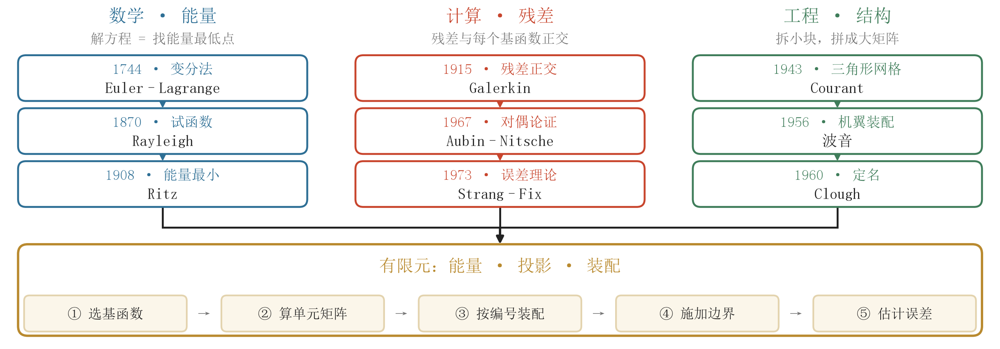
  <br>
  <i>图 33　三条血脉：能量、残差与装配，最后汇成有限元<a id="fig32"></a></i>
</div>

### 3.3.2　从强形式到弱形式

#### 3.3.2.1　强形式与它的软肋

　　考虑一维变系数两点边值问题：

$$
-(a(x)u'(x))'=f(x),\qquad 0\lt x\lt 1,\qquad u(0)=u(1)=0,\qquad(31)
$$

<a id="eq31"></a>

　　其中 $a(x)\ge a_0\gt 0$ 是材料系数（例如导热系数或弹性模量乘截面积）， $f$ 是载荷。本节始终假设 $a\in L^\infty(0,1)$，存在常数 $0\lt a_0\le a_1$ 使 $a_0\le a(x)\le a_1$ 几乎处处成立， $f\in L^2(0,1)$；讨论强形式时再额外假设 $a\in C^1[0,1]$、 $f\in C^0[0,1]$、 $u\in C^2[0,1]$。这就是“强形式”。它要求 $u$ 二阶可导， $a u'$ 一阶可导，逐点满足方程。

<div align="center">
  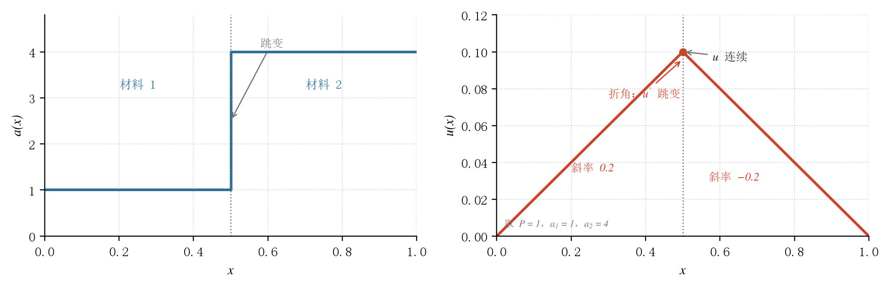
  <br>
  <i>图 34　材料界面：a 跳变，u 连续而 u' 折角，u'' 在接口不存在<a id="fig33"></a></i>
</div>

　　这个要求有时太挑食。一根由两段不同材料粘成的杆， $a$ 在接口处跳变；接口上还可能作用集中力。[图 34](#fig33) 是这种情形：左图 $a$ 在 $x=1/2$ 处从 1 跳到 4，右图位移 $u$ 连续， $u'$ 在接口折了一下， $u''$ 在接口根本没有定义。强形式要求逐点满足 $-(au')'=f$，可接口处连 $u''$ 都不存在；弱形式把导数分一半出去，只要求 $u,u'\in L^2$，这道坎就绕过去了。

#### 3.3.2.2　分部积分与边界项：谁进空间，谁进右端

　　弱形式的做法是：不要求方程在每一点成立，只要求它在“平均意义”下成立。任取一个检验函数 $v$，两边相乘，在 $(0,1)$ 上积分：

$$
\int_0^1 -(a u')'v\thinspace\mathrm{d}x=\int_0^1 fv\thinspace\mathrm{d}x.
$$

　　对左边做分部积分：

$$
\int_0^1 -(a u')'v\thinspace\mathrm{d}x
=\int_0^1 a u'v'\thinspace\mathrm{d}x-\bigl[a u'v\bigr\rbrack_0^1.\qquad(32)
$$

<a id="eq32"></a>

　　一次分部积分，把 $u$ 的二阶导数分了一半给 $v$：左边只剩 $u'$ 与 $v'$ 的乘积，对两者的光滑性要求都降到一阶。代价是多出一个边界项。这一步的几何意思很清楚：把求导的负担分一半给检验函数；[图 35](#fig34) 把它画成一次“分摊”。

　　现在挑检验函数。若要求 $v(0)=v(1)=0$，边界项立刻消失，得到

$$
\int_0^1 a u'v'\thinspace\mathrm{d}x=\int_0^1 fv\thinspace\mathrm{d}x,
\qquad \forall v\in H^1_0(0,1).\qquad(33)
$$

<a id="eq33"></a>

　　这就是弱形式。 $H^1_0(0,1)$ 是“一阶导数平方可积、在两端取零”的函数空间；它比 $C^2$ 大得多，允许导数有间断。

<div align="center">
  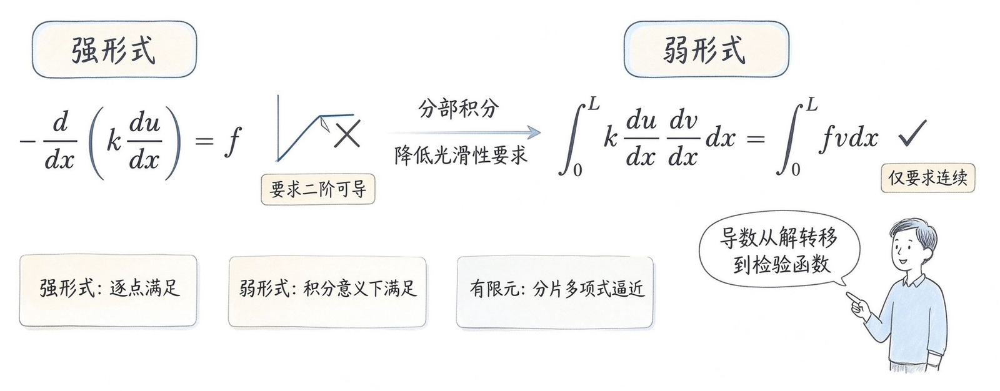
  <br>
  <i>图 35　强形式到弱形式：分部积分把导数分给检验函数<a id="fig34"></a></i>
</div>

　　把双线性形式记作

$$
a(u,v)=\int_0^1 a u'v'\thinspace\mathrm{d}x,\qquad (f,v)=\int_0^1 fv\thinspace\mathrm{d}x,
$$

　　弱形式就可以写成一句很短的话：求 $u\in V=H^1_0(0,1)$，使

$$
a(u,v)=(f,v),\qquad \forall v\in V.\qquad(34)
$$

<a id="eq34"></a>

　　注意“ $\forall v$”三个字的分量。它不是对某一个 $v$ 成立，而是对所有检验函数成立；正是这一点，把逐点方程换成了积分方程。

　　**定义 1（弱解与函数空间）**　记 $L^2(0,1)$ 为平方可积函数空间， $H^1(0,1)=\lbrace v\in L^2(0,1):v'\in L^2(0,1)\rbrace$，其中 $v'$ 是弱导数；其范数与半范数为

$$
\Vert v\Vert_{H^1}^2=\Vert v\Vert_{L^2}^2+\Vert v'\Vert_{L^2}^2,\qquad |v\vert_{H^1}=\Vert v'\Vert_{L^2}.
$$

　　 $H^1_0(0,1)$ 是 $C_c^\infty(0,1)$ 在 $H^1$ 范数下的闭包；对连续代表元，它等价于“ $v(0)=v(1)=0$”。称 $u\in V=H^1_0(0,1)$ 为弱形式 [(34)](#eq34) 的弱解，若 $a(u,v)=(f,v)$ 对一切 $v\in V$ 成立。

　　**定义 2（连续性与强制性）**　若存在常数 $M\gt 0$，使

$$
|a(u,v)|\le M\Vert u\Vert_{H^1}\Vert v\Vert_{H^1},\qquad \forall u,v\in V,
$$

　　则称 $a$ 在 $V$ 上连续；若存在常数 $\alpha\gt 0$，使

$$
a(v,v)\ge\alpha\Vert v\Vert_{H^1}^2,\qquad \forall v\in V,
$$

　　则称 $a$ 在 $V$ 上强制。对 $a(u,v)=\int_0^1 a u'v'\thinspace\mathrm{d}x$，由 $a_0\le a\le a_1$ 得

$$
|a(u,v)|\le a_1|u\vert_{H^1}|v\vert_{H^1}\le a_1\Vert u\Vert_{H^1}\Vert v\Vert_{H^1},
$$

　　故 $M=a_1$。强制性的常数要用下面的 Poincaré 不等式。

　　**引理 1（Poincaré 不等式）**　对 $v\in H^1_0(0,1)$，

$$
\Vert v\Vert_{L^2}\le|v\vert_{H^1},\qquad \Vert v\Vert_{H^1}\le\sqrt2\thinspace|v\vert_{H^1}.
$$

　　**证明**　先取 $v\in C_c^\infty(0,1)$。由微积分基本定理，

$$
v(x)=\int_0^x v'(s)\thinspace\mathrm{d}s,
$$

　　于是 $|v(x)|^2\le x\int_0^x|v'(s)|^2\thinspace\mathrm{d}s\le\int_0^1|v'(s)|^2\thinspace\mathrm{d}s$。对 $x$ 从 $0$ 到 $1$ 积分，得 $\Vert v\Vert_{L^2}^2\le|v\vert_{H^1}^2$。 $C_c^\infty$ 在 $H^1_0$ 中稠密，取极限即得一般情形。证毕。

　　由引理 1， $a(v,v)\ge a_0|v\vert_{H^1}^2\ge\frac{a_0}{2}\Vert v\Vert_{H^1}^2$，故强制常数可取 $\alpha=a_0/2$。

　　**命题 1（弱形式与强形式等价）**　设 $a\in C^1([0,1])$。若 $u\in C^2[0,1]$ 满足强形式 [(31)](#eq31)，则 $u$ 满足弱形式 [(34)](#eq34)；反之，若 $u\in H^1_0(0,1)$ 满足 [(34)](#eq34) 且 $u\in C^2[0,1]$，则 $u$ 满足 [(31)](#eq31)。

　　**证明**　前半段就是 [(32)](#eq32) 的分部积分：取 $v\in H^1_0$，边界项为零，得 [(33)](#eq33)。后半段反过来：对任意 $v\in C_0^\infty(0,1)$，由 [(34)](#eq34) 与分部积分，

$$
\int_0^1\bigl[-(a u')'-f\bigr]v\thinspace\mathrm{d}x=0.
$$

　　由变分法基本引理， $-(a u')'=f$ 在 $(0,1)$ 内处处成立； $u\in H^1_0$ 又给出 $u(0)=u(1)=0$。证毕。

　　边界项没有消失的情形，恰好对应另一类边界条件。设右端是 Neumann 条件

$$
a(1)u'(1)=g,
$$

　　左端仍是 $u(0)=0$。此时 $v(0)=0$，但 $v(1)$ 不为零，边界项只剩 $gv(1)$：

$$
a(u,v)=(f,v)+g\thinspace v(1),\qquad \forall v\in V_0=\lbrace v\in H^1(0,1):v(0)=0\rbrace.
$$

　　这就是 Neumann 边界在弱形式里的位置：它不进函数空间，而是进右端。Dirichlet 条件则相反，必须写进试探空间与检验空间。

　　把这句话说死一点：**Dirichlet 是本质边界条件，Neumann 是自然边界条件。** 本质条件要“请进空间”，自然条件只需“请进右端”。这就是为什么有限元程序里，Dirichlet 要改矩阵，Neumann 只改载荷向量。

　　第三类是 Robin 条件：端点与外界换热，流出的热流与端点温度成正比。设

$$
a(1)u'(1)+\sigma u(1)=g,
$$

　　其中 $\sigma\ge0$ 是换热系数。乘 $v$ 分部积分后，边界项变成 $[g-\sigma u(1)]v(1)$，于是弱形式右端多出 $gv(1)$，左端多出 $\sigma u(1)v(1)$：

$$
a(u,v)+\sigma u(1)v(1)=(f,v)+g\thinspace v(1).
$$

　　Robin 条件既进右端，也进矩阵：它给端点对角元加 $\sigma$，给右端加 $g$。这正是“自然边界条件”的一般形态——Neumann 是 $\sigma=0$ 的特例，Dirichlet 则必须进空间。

　　非齐次 Dirichlet 也不难。设 $u(0)=g_0$、 $u(1)=g_1$，取一个满足边界值的 lift 函数 $u_g$，令 $u=u_0+u_g$，其中 $u_0\in H^1_0$。代入弱形式，把已知项移到右边：

$$
a(u_0,v)=(f,v)-a(u_g,v),\qquad \forall v\in H^1_0.
$$

　　未知量仍是 $u_0$，只是右端多了一项。

#### 3.3.2.3　能量泛函与 Galerkin 投影

　　当 $a$ 对称、正定时，弱形式还可以从能量角度理解。定义

$$
J(v)=\frac12 a(v,v)-(f,v)
=\frac12\int_0^1 a(v')^2\thinspace\mathrm{d}x-\int_0^1 fv\thinspace\mathrm{d}x.
$$

　　**定理 1（能量极小与弱形式等价）**　设 $a(\cdot,\cdot)$ 对称、连续（常数 $M$）、强制（常数 $\alpha$）， $f\in V^*$， $J(v)=\frac12a(v,v)-(f,v)$。则 $u$ 满足弱形式 [(34)](#eq34)，当且仅当 $u$ 是 $J$ 在 $V$ 上的最小值点；若 $a$ 强制，最小值点唯一。

　　**证明**　对任意 $w\in V$，展开

$$
J(u+w)=J(u)+\bigl[a(u,w)-(f,w)\bigr]+\frac12 a(w,w).
$$

　　若 $u$ 满足 [(34)](#eq34)，中括号为零，于是

$$
J(u+w)=J(u)+\frac12 a(w,w)\ge J(u),
$$

　　等号只在 $a(w,w)=0$ 时成立；由强制性，这蕴含 $w=0$。故 $u$ 是严格最小值点。

　　反过来，设 $u$ 是最小值点。对任意 $w\in V$ 与实数 $t$，函数 $\phi(t)=J(u+tw)$ 在 $t=0$ 取最小，故 $\phi'(0)=0$。直接计算

$$
\phi'(0)=a(u,w)-(f,w),
$$

　　由 $w$ 的任意性即得 [(34)](#eq34)。证毕。

　　定理 1 有一个很具体的图像。把 $V_h$ 里的函数写成 $v_h=c_1\varphi_1+c_2\varphi_2$， $J$ 就是 $c_1,c_2$ 的二次函数：二次项正定，所以它是一个开口朝上的碗；Galerkin 方程 $Ac=b$ 恰好是碗底的条件 $\nabla J=0$。[图 36](#fig35) 画的是 $N=3$ 时的等高线，碗底就是有限元解。

<div align="center">
  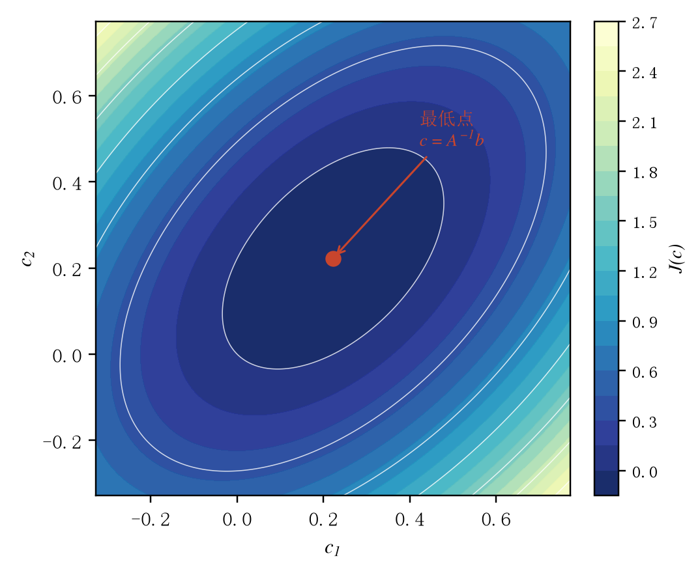
  <br>
  <i>图 36　能量泛函的碗：Galerkin 解落在最低点，∇J=0 与 Ac=b 是同一句话<a id="fig35"></a></i>
</div>

　　这个定理解释了 3.3.1.1 节那句话：对称情形下，Ritz 的“能量最小”与 Galerkin 的“残差正交”是同一件事。它也为有限元提供了存在唯一性的入口。

　　**定理 2（Lax–Milgram，引用）**　设 $V$ 是 Hilbert 空间， $a:V\times V\to\mathbb R$ 连续、强制， $f:V\to\mathbb R$ 连续线性。则存在唯一的 $u\in V$，使 $a(u,v)=f(v)$ 对一切 $v\in V$ 成立，且有估计 $\Vert u\Vert_V\le\Vert f\Vert_{V^*}/\alpha$。证明见 [[46]](#ref46)[[47]](#ref47)。

　　把 $f(v)=(f,v)$ 代入，弱形式 [(34)](#eq34) 在 $a$ 连续、强制时存在唯一弱解；Céa 引理中的常数 $M/\alpha$ 也因此有明确上界。

　　弱形式仍在无限维空间里。Galerkin 的一步，是取一个有限维子空间 $V_h\subset V$，在 $V_h$ 里找近似解。

　　设 $\dim V_h=n$，基函数为 $\varphi_1,\dots,\varphi_n$。令

$$
u_h(x)=\sum_{j=1}^{n}U_j\varphi_j(x),
$$

　　要求 $u_h$ 对每个基函数都满足弱形式：

$$
a(u_h,\varphi_i)=(f,\varphi_i),\qquad i=1,\dots,n.
$$

　　[图 37](#fig36) 是这一步的几何图像：把精确解 $u$ 投影到有限维子空间 $V_h$，误差 $u-u_h$ 与 $V_h$ 正交。

<div align="center">
  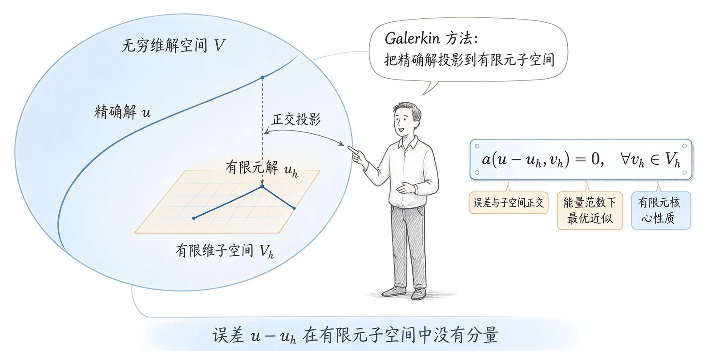
  <br>
  <i>图 37　Galerkin 投影：误差与有限元子空间正交<a id="fig36"></a></i>
</div>

　　把 $u_h$ 的展开代入，得线性方程组

$$
A U=b,\qquad A_{ij}=a(\varphi_j,\varphi_i),\qquad b_i=(f,\varphi_i).
$$

　　矩阵 $A$ 称为刚度矩阵， $b$ 称为载荷向量。 $A$ 对称： $A_{ij}=a(\varphi_j,\varphi_i)=a(\varphi_i,\varphi_j)=A_{ji}$； $A$ 正定： $U^{\mathsf T}AU=a(u_h,u_h)\gt 0$（ $u_h\ne0$）。于是方程组有唯一解。

　　**命题 2（刚度矩阵的对称正定性）**　设 $\lbrace\varphi_1,\dots,\varphi_n\rbrace$ 线性无关， $a$ 对称、强制（常数 $\alpha$）， $A_{ij}=a(\varphi_j,\varphi_i)$。则 $A$ 对称正定，且

$$
U^{\mathsf T}AU=a(u_h,u_h)\ge\alpha\Vert u_h\Vert_{H^1}^2.
$$

　　**证明**　对称性由 $a(u,v)=a(v,u)$ 直接得到。对任意 $U=(U_1,\dots,U_n)^{\mathsf T}\ne0$，令 $u_h=\sum_jU_j\varphi_j$；由基函数线性无关， $u_h\ne0$。于是

$$
U^{\mathsf T}AU=\sum_{i,j}U_iA_{ij}U_j=a(u_h,u_h)\ge\alpha\Vert u_h\Vert_{H^1}^2\gt 0.
$$

　　故 $A$ 正定。证毕。

　　剩下的问题只有一个：这 $n$ 个基函数怎么选？选得越“局部”，矩阵越稀疏；选得越“光滑”，精度越高。有限元的答案是：选帽子。

### 3.3.3　线性单元与刚度矩阵

#### 3.3.3.1　帽函数与 2×2 刚度矩阵

　　把区间 $[0,1]$ 分成 $N$ 个单元，节点 $x_i=ih$， $h=1/N$。在内部节点 $x_i$ 上定义

$$
\varphi_i(x)=
\begin{cases}
\dfrac{x-x_{i-1}}{h}, & x_{i-1}\le x\le x_i,\newline
\dfrac{x_{i+1}-x}{h}, & x_i\le x\le x_{i+1},\newline
0, & \text{其它}.
\end{cases}
$$

　　它的图像是一顶三角形的“帽子”：在 $x_i$ 处高 1，在左右两个邻居处降到 0，再往外一直是 0。更准确地说， $\varphi_i(x_j)=\delta_{ij}$——在自家节点上取 1，在别人家的节点上取 0。

　　**故事｜帽子铺。**　帽子铺的老板只做一种帽子：每顶帽子有三个落脚点，中间高 1，两边落回 0。顾客问：能不能做一顶盖住整条街的帽子？老板说：可以，但那就不是帽子了，是一块布；有限元要的是许多小帽子，不是一块大布。

<div align="center">
  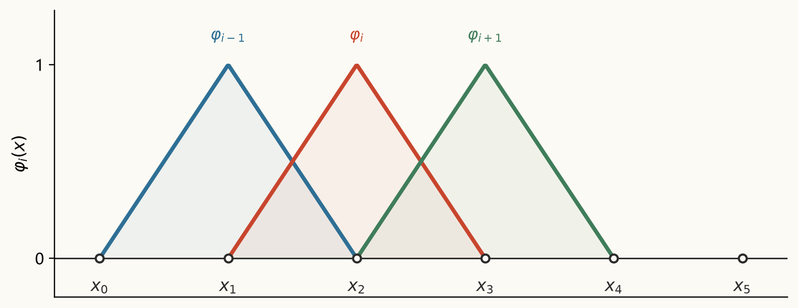
  <br>
  <i>图 38　三顶相邻的帽函数<a id="fig37"></a></i>
</div>

　　把其中一顶单独拿出来看，它的两支斜率、面积与支撑区间就一目了然。

<div align="center">
  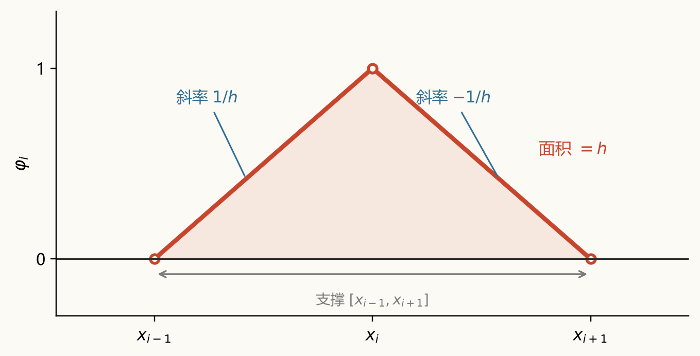
  <br>
  <i>图 39　单顶帽子的斜率、面积与支撑<a id="fig38"></a></i>
</div>

　　**定义 3（线性有限元空间）**　取 $V_h=\mathrm{span}\lbrace\varphi_1,\dots,\varphi_{N-1}\rbrace\subset V$，维数 $N-1$。为什么不要 $\varphi_0$ 与 $\varphi_N$？因为它们对应的节点在边界上，而 $V_h\subset H^1_0$ 要求边界值为零；把边界帽子去掉，剩下的函数在两端自动为零。

　　帽子的局部性带来一个直接后果： $a(\varphi_j,\varphi_i)=0$，只要 $|i-j|\gt 1$。两个相隔两个节点以上的帽子，支撑集不相交，乘积的积分为零。于是 $A$ 是三对角矩阵。 $N=10^4$ 时，矩阵有 $10^8$ 个位置，非零元只有约 $3\times10^4$ 个。

　　在单元 $e=[x_{i-1},x_i]$ 上，只有两顶帽子非零： $\varphi_{i-1}$ 与 $\varphi_i$。它们的导数分别是

$$
\varphi_{i-1}'=-\frac1h,\qquad \varphi_i'=\frac1h.
$$

　　于是单元刚度矩阵是

$$
K^{(e)}=\int_e
\begin{pmatrix}
(\varphi_{i-1}')^2 & \varphi_{i-1}'\varphi_i'\newline
\varphi_i'\varphi_{i-1}' & (\varphi_i')^2
\end{pmatrix}
\mathrm{d}x
=\frac1h
\begin{pmatrix}
1 & -1\newline
-1 & 1
\end{pmatrix}.
$$

　　这个 $2\times2$ 矩阵只有四个数，却是整个方法的心脏。 $h=0.1$ 时它等于

$$
10\begin{pmatrix}1&-1\newline-1&1\end{pmatrix},
$$

　　单元越短，刚度越大，符合“短弹簧更硬”的直觉。

　　若 $a$ 随位置变化，把 $a$ 换成它在单元上的平均值：

$$
K^{(e)}=\frac{\bar a_e}{h}
\begin{pmatrix}
1 & -1\newline
-1 & 1
\end{pmatrix},\qquad
\bar a_e=\frac1h\int_{x_{i-1}}^{x_i}a(x)\thinspace\mathrm{d}x.
$$

　　为什么是平均值？因为 $\int_e a\varphi_{i-1}'\varphi_i'=(-1/h^2)\int_e a$， $a$ 只以积分的形式出现，不需要对 $a$ 求导。若 $a$ 在单元内光滑，两点 Gauss 求积就够；若 $a$ 在单元内跳变，就把跳变面设成单元边界，让每个单元内的 $a$ 是常数。

#### 3.3.3.2　载荷向量与求积

　　载荷向量是

$$
b_i=\int_0^1 f\varphi_i\thinspace\mathrm{d}x.
$$

　　它不是一个点值，而是 $f$ 按帽子的形状加权平均。以 $f=2$ 为例， $\int\varphi_i=h$（内部节点），两端只有半个帽子， $\int\varphi_0=h/2$。于是

$$
b=(h,\thinspace2h,\thinspace2h,\thinspace\dots,\thinspace2h,\thinspace h)^{\mathsf T}.
$$

　　这是有限元与差分的第一处实质差别：差分的右端是 $f(x_i)$，有限元的右端是 $\int f\varphi_i$。 $f$ 光滑时两者只差 $O(h^2)$； $f$ 有间断或剧烈变化时，这个加权平均会把 $f$ 抹平一点，差别就出来了。

　　一般情形用 Gauss 求积。[图 40](#fig39) 把参考单元与 Gauss 点画在一起：物理单元 $[x_{i-1},x_i]$ 先映到参考单元 $[-1,1]$，

$$
x(\xi)=x_{i-1}+\frac h2(\xi+1),\qquad \xi\in[-1,1],
$$

　　再在参考单元上取 $Q$ 个 Gauss 点 $\xi_q$ 与权重 $w_q$：

$$
\int_{x_{i-1}}^{x_i}f\varphi_i\thinspace\mathrm{d}x
=\frac h2\int_{-1}^{1}f(x(\xi))\varphi_i(x(\xi))\thinspace\mathrm{d}\xi
\approx\frac h2\sum_{q=1}^{Q}w_q f(x(\xi_q))\varphi_i(x(\xi_q)).
$$

<div align="center">
  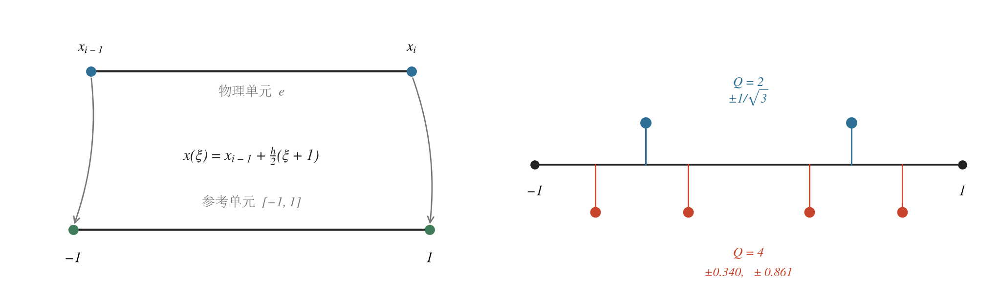
  <br>
  <i>图 40　参考单元与 Gauss 点：物理单元先映到 [−1,1]，再在参考坐标上取点<a id="fig39"></a></i>
</div>

　　注意 $f$ 与 $\varphi_i$ 都要在物理点 $x(\xi_q)$ 上取值，不能把参考坐标直接代进 $f$。这是实现里最常见的错之一：单元很短时它只带来一个小偏差，网格一加密就变成不收敛的常数项。

　　被积函数是“ $f$ 乘一个线性函数”。 $f$ 是常数或线性时，2 点 Gauss 已经精确； $f$ 是 $\sin$、 $\exp$ 这类光滑函数时，4 点通常足够。求积阶数不够，会把求积误差混进离散误差，后面 3.3.5.2 节会看到后果。

#### 3.3.3.3　二维三角形与条件数（选讲）

　　二维的线性单元是三角形。把区域剖分成三角形，每个三角形上取三个顶点处的“帽函数”，在自家顶点取 1、另外两个顶点取 0。单元刚度矩阵有一个只用顶点坐标的漂亮公式：

$$
K^{(e)}=\frac{1}{4|T|}\bigl(bb^{\mathsf T}+cc^{\mathsf T}\bigr),\qquad(35)
$$

<a id="eq35"></a>

　　其中 $|T|$ 是三角形面积，顶点按逆时针编号为 $i,j,k$， $b_i=y_j-y_k$， $c_i=x_k-x_j$，其余两个分量循环排列。

　　以单位直角三角形为例：顶点按逆时针取 $(0,0),(1,0),(0,1)$， $|T|=1/2$， $b=(-1,1,0)$， $c=(-1,0,1)$。代入 [(35)](#eq35) 得

$$
K^{(e)}=\frac12
\begin{pmatrix}
2 & -1 & -1\newline
-1 & 1 & 0\newline
-1 & 0 & 1
\end{pmatrix}.
$$

　　每一行之和为零，说明常向量（整体平移）仍在零空间里；这与一维整体矩阵“角上 $1/h$、内部 $2/h$”是同一本账。

　　这个公式不需要任何数值积分，装配时只用到三个顶点的坐标。二维的装配逻辑与一维完全一样：局部 $3\times3$ 块按全局节点编号累加。不同的只是每个节点多了几个邻居，矩阵从三对角变成带状。

　　二维三角形是 1943 年 Courant 的武器，也是 1956 年波音机翼的积木。一维的帽子是“线段上的三角形”，二维的帽子是“平面上的小帐篷”，高维只是把“邻居”换成“相邻的单纯形”。

　　公式能不能算，要拿数据说话。取单位方形 $\Omega=(0,1)^2$，精确解 $u=\sin\pi x\sin\pi y$，右端 $f=2\pi^2u$，四边为零。把每边分成 $N$ 段，每个小方形沿对角线切成两个三角形； $N=8$ 的网格见[图 41](#fig40)(a)。单元矩阵用 [(35)](#eq35)，载荷用 7 点三角形求积，装配与一维完全相同，只是每个节点最多连 6 个邻居。

<p align="center"><b>表 14　二维三角形单元的误差<a id="tab14"></a></b></p>

| $N$ | $h$ | 自由度 | $L^2$ 误差 | 阶 | $H^1$ 误差 | 阶 |
| :---: | :---: | :---: | :---: | :---: | :---: | :---: |
| 4 | 0.2500 | 9 | 7.91×10⁻² | — | 8.39×10⁻¹ | — |
| 8 | 0.1250 | 49 | 2.11×10⁻² | 1.90 | 4.32×10⁻¹ | 0.96 |
| 16 | 0.0625 | 225 | 5.38×10⁻³ | 1.97 | 2.18×10⁻¹ | 0.99 |
| 32 | 0.03125 | 961 | 1.35×10⁻³ | 1.99 | 1.09×10⁻¹ | 1.00 |

<div align="center">
  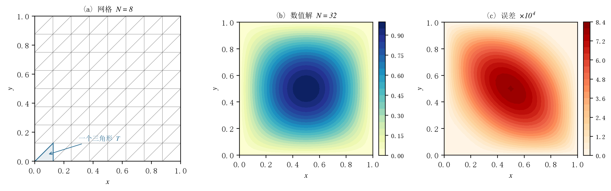
  <br>
  <i>图 41　二维三角形：网格、数值解与误差分布（N=32 时最大误差约 8.4×10<sup>−4</sup>）<a id="fig40"></a></i>
</div>

　　两个阶仍是 2 与 1，只是常数比一维多。误差最大处在区域中心，也就是温度最高、曲率最大的地方； $N=32$ 时最大误差约 $8.4\times10^{-4}$，与 $h^2=9.8\times10^{-4}$ 同量级。这张表说明：二维不是把一维做两遍，未知量按 $(N-1)^2$ 增长，矩阵从三对角变成带状；但装配规则、边界处理和误差阶都没有变[[52]](#ref52)[[53]](#ref53)。

　　刚度矩阵对称正定，但它的条件数随网格加密迅速变坏。对一维 Poisson 问题，内部刚度矩阵的特征值是

$$
\lambda_k=\frac4h\sin^2\frac{k\pi h}{2},\qquad k=1,\dots,N-1,
$$

　　对应的特征向量是 $v_j=\sin(jk\pi/N)$， $j=1,\dots,N-1$；直接代入差分方程即可验证。于是

$$
\kappa(A_{\mathrm{int}})=\frac{\lambda_{\max}}{\lambda_{\min}}
=\cot^2\frac{\pi h}{2}\sim\frac{4}{\pi^2h^2}.\qquad(36)
$$

<a id="eq36"></a>

　　网格加密一倍， $h$ 减半，条件数变四倍。

<p align="center"><b>表 15　内部刚度矩阵的条件数<a id="tab15"></a></b></p>

| $N$ | $h$ | $\kappa(A_{\mathrm{int}})$ | $4/(\pi^2h^2)$ | $\kappa h^2$ |
| :---: | :---: | :---: | :---: | :---: |
| 4 | 0.2500 | 5.83 | 6.48 | 0.364 |
| 8 | 0.1250 | 25.27 | 25.94 | 0.395 |
| 16 | 0.0625 | 103.09 | 103.75 | 0.403 |
| 32 | 0.03125 | 414.35 | 415.01 | 0.405 |
| 64 | 0.015625 | 1659.38 | 1660.05 | 0.405 |

　　[图 42](#fig41) 把[表 15](#tab15) 画成双对数：实测曲线与 $4/(\pi^2h^2)$ 几乎重合，斜率是 $-2$。这说明 [(36)](#eq36) 不只是一个渐近公式，常数也已经在数值上对上了。

<div align="center">
  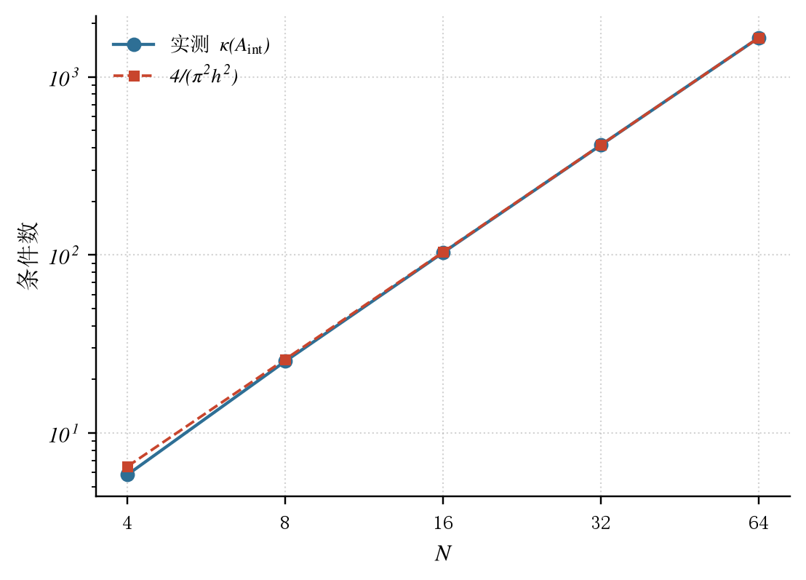
  <br>
  <i>图 42　条件数随网格加密按 h<sup>−2</sup> 增长<a id="fig41"></a></i>
</div>

　　最后一列稳定在 $0.405$ 附近，理论值是 $4/\pi^2=0.4053$；这是对 [(36)](#eq36) 中常数的定量确认。

　　条件数变大有两个后果：迭代法收敛变慢，浮点舍入误差被放大。对对称正定系统，共轭梯度法的误差有一个只依赖 $\kappa$ 的界：

$$
\Vert u_k-u\Vert_A\le2\left(\frac{\sqrt{\kappa}-1}{\sqrt{\kappa}+1}\right)^{k}\Vert u_0-u\Vert_A,
$$

　　其中 $k$ 是迭代步数， $\Vert\cdot\Vert_A$ 是能量范数。由 [(36)](#eq36)， $\sqrt{\kappa}\sim2/(\pi h)$；网格加密一倍，迭代步数也大致翻倍。预处理、多重网格的目的，就是把 $\kappa$ 压回与 $h$ 无关的量级。

　　这不是有限元独有的缺点，而是所有离散化的共同代价；有限元的优势在于矩阵稀疏，稀疏性让迭代法有办法。共轭梯度法的原始文献见 [[50]](#ref50)，稀疏迭代法的系统讨论见 [[51]](#ref51)。

### 3.3.4　装配与边界

#### 3.3.4.1　两套编号与按编号累加

　　装配这一步没有新公式，只有一本账。单元 $e_i=[x_{i-1},x_i]$ 上只有两个节点，局部编号取 $0,1$；整体问题有 $N+1$ 个节点，全局编号取 $0$ 到 $N$。两套编号之间需要一个对应：

$$
e_i\ \longmapsto\ \lbrace i-1,\ i\rbrace,\qquad i=1,\dots,N.
$$

　　映射说的是：单元 $i$ 的局部 $0,1$，分别记到全局的 $i-1$ 与 $i$。

<div align="center">
  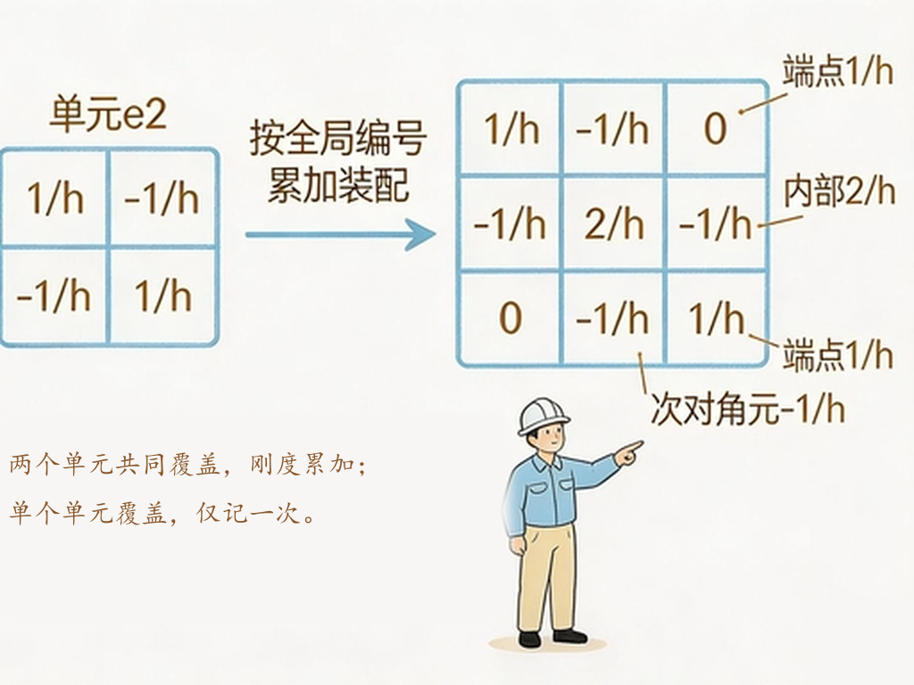
  <br>
  <i>图 43　装配映射：单元 e<sub>2</sub> 的 2×2 小块按全局编号累加<a id="fig42"></a></i>
</div>

　　映射定下来，装配就是按编号累加：

$$
A_{i-1,i-1}\mathrel{+}=\frac1h,\quad
A_{i-1,i}\mathrel{+}=-\frac1h,\quad
A_{i,i-1}\mathrel{+}=-\frac1h,\quad
A_{i,i}\mathrel{+}=\frac1h.\qquad(37)
$$

<a id="eq37"></a>

　　注意是 $\mathrel{+}=$，不是 $=$。一个内部节点同时属于左右两个单元，它会被记两次；端点只记一次。这一句差别，就是下面角上 $1/h$ 与内部 $2/h$ 的全部来历。

　　右端向量走同一本账： $b_j=\int f\varphi_j$，在每个单元上用 Gauss 求积算，再按同样的全局编号累加。

　　**故事｜装配车间。**　车间里，小工面前摆着一盒一模一样的 $2\times2$ 铁片，每片四角写着 $1/h$、 $-1/h$、 $-1/h$、 $1/h$。师傅给他一张节点表：第 $i$ 片装到第 $i-1$ 与第 $i$ 号位置。小工不用懂有限元，只要把四角对准行号列号，往上加。装完一数，中间的节点被左右两片各压了一次，变成 $2/h$；两头的节点只被压一次，还是 $1/h$。师傅说：对了。小工问：为什么？师傅说：因为你没有把端点当成内部节点。

<div align="center">
  
  <br>
  <i>装配车间：小工不懂有限元，只要把每块 2×2 铁片的四角对准大账本上的行号列号往上加；中间节点被左右两片各压一次，叠成 2/h。</i>
</div>

　　把 [(37)](#eq37) 逐单元执行完，得到

$$
A=\frac1h
\begin{pmatrix}
1&-1&&&&\newline
-1&2&-1&&&\newline
&-1&2&-1&&\newline
&&\ddots&\ddots&\ddots&\newline
&&&-1&2&-1\newline
&&&&-1&1
\end{pmatrix}.\qquad(38)
$$

<a id="eq38"></a>

　　看两个角： $x_0$ 上的对角元是 $1/h$，内部的 $x_1$ 是 $2/h$。这不是笔误。 $x_0$ 只被单元 $e_1$ 覆盖，只记一次； $x_1$ 被 $e_1$ 与 $e_2$ 同时覆盖，记两次。

<div align="center">
  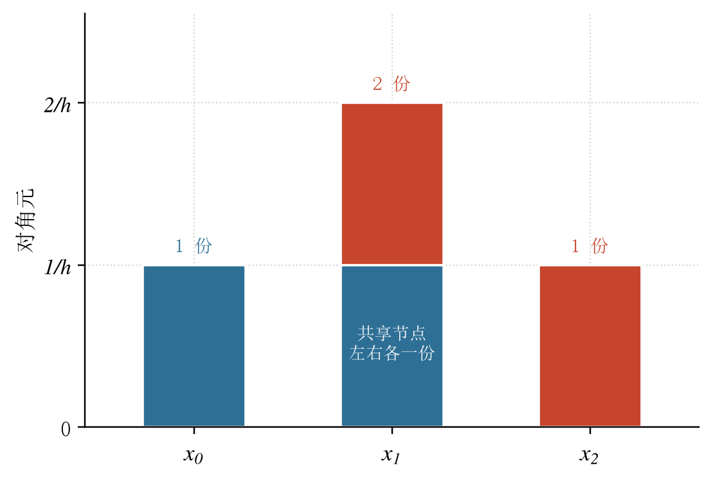
  <br>
  <i>图 44　端点一份、内部两份<a id="fig43"></a></i>
</div>

　　这里要分清两件事。整体矩阵的角上是 $1/h$，这是覆盖次数；一旦用消元法把端点行列删去，角上的值就不再进入方程组，内部块的对角全是 $2/h$。真正危险的是把内部块的首末对角也写成 $1/h$：这时矩阵仍对称，却对应一个错误的边值问题，解在端点附近出现 $O(1)$ 的边界层，程序不会报错。3.3.4.2 节用实验把这件事量出来。

　　一个十秒检查：装配完成、尚未施加边界条件时， $A\mathbf 1$ 应当等于零向量。常向量代表整体平移，没有边界约束时它落在零空间里。若 $A\mathbf 1$ 的两个端点分量不为零，整体矩阵的角上就写错了；注意这一步检查的是整体矩阵，不是消元后的内部块。

#### 3.3.4.2　稀疏结构、存储与角上为什么是 1/h

<div align="center">
  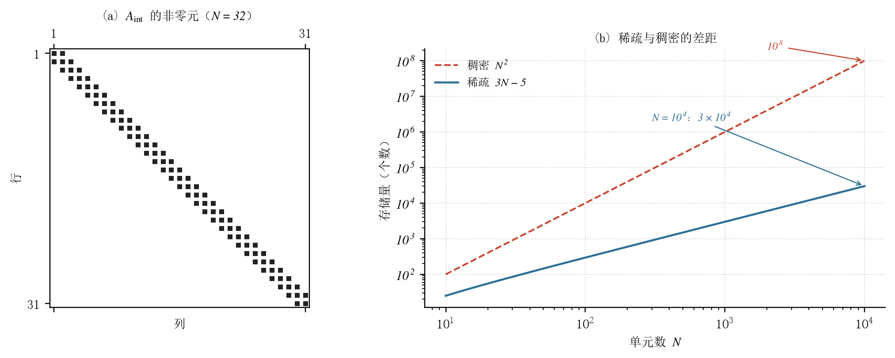
  <br>
  <i>图 45　稀疏结构：(a) A<sub>int</sub> 的非零元只占三条对角线；(b) 稀疏存储 3N−5 与稠密 N<sup>2</sup> 的增长差距<a id="fig44"></a></i>
</div>

　　装配得到的 $A$ 不只是三对角，它的绝大多数位置是零。以 $N=32$ 为例， $A_{\mathrm{int}}$ 是 $31\times31$，只有 91 个非零元；若按稠密矩阵存，要存 $31^2=961$ 个数，九成以上是零。[图 45](#fig44)(a) 是它的 spy 图：非零元只落在主对角与两条次对角上，半带宽为 1。

　　一般的计数是： $A_{\mathrm{int}}$ 有 $N-1$ 行，首末行各 2 个非零元，其余行各 3 个，故

$$
\mathrm{nnz}(A_{\mathrm{int}})=3(N-1)-2=3N-5.
$$

　　 $N=10^4$ 时， $A_{\mathrm{int}}$ 有 $10^8$ 个位置，非零元只有 $3\times10^4$ 个，相差三千多倍。稀疏存储只记非零元与下标，内存从 $O(N^2)$ 降到 $O(N)$；这也是有限元能算几十万、几百万个单元的原因。

　　带宽同样重要。一维线性元的半带宽是 1；二维按行优先编号时，半带宽约为一行的未知量数 $N$，矩阵从三对角变成带状。3.3.4.1 节的两套编号在这里第二次起作用：编号顺序决定带宽，带宽决定直接法的填充与迭代法的收敛[[51]](#ref51)。

　　“角上是 $1/h$”不是一条需要背下来的规则，而是“端点只被一个单元覆盖”的直接推论。记住覆盖次数，比记住结论可靠。

　　这条推论也解释了一个常见 bug，但方向和很多人想的不一样。错误不是“整体矩阵用了 $2/h$”——用消元法时端点行列会被删去，整体矩阵角上写多少都进不了内部块。错误是把内部块的首末对角写成 $1/h$，相当于在 $x_1$ 或 $x_{N-1}$ 处错装了一个自由端。[图 46](#fig45) 是实测： $N$ 从 8 加密到 128，最大误差从 $0.77$ 涨到 $0.98$，不下降；误差集中在端点附近，向内部线性衰减。若两个角都写错，矩阵直接奇异，`numpy.linalg.solve` 会报错。

<div align="center">
  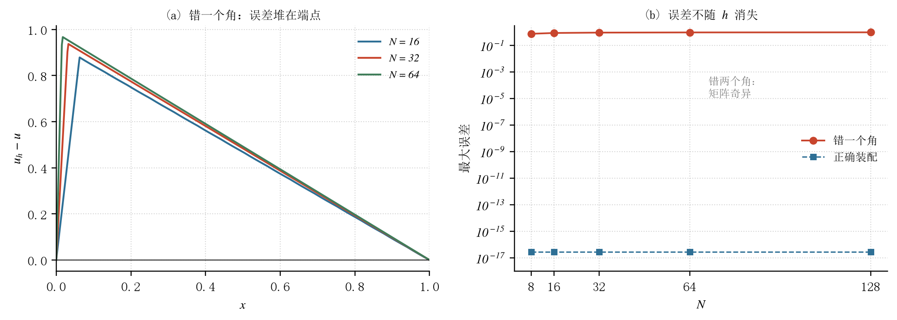
  <br>
  <i>图 46　错角矩阵的边界层：错一个角时误差不随 h 消失；错两个角时矩阵奇异<a id="fig45"></a></i>
</div>

　　若把两个端点消去，剩下的内部块是干净的常系数三对角：

$$
A_{\mathrm{int}}=\frac1h\thinspace\mathrm{tridiag}(-1,\thinspace2,\thinspace-1)_{(N-1)\times(N-1)}.
$$

　　这个闭式只对均匀网格成立。非均匀网格上，每个单元有自己的 $h_e$，整体矩阵不再等对角；装配规则 [(37)](#eq37) 仍然正确，只是把 $1/h$ 换成 $1/h_e$。

#### 3.3.4.3　十秒自检与差分的亲戚关系

　　映射写反、或漏加相邻单元的贡献，程序往往照样能跑，也能解出一条光滑曲线。所以“看着像”不能当验收标准。

　　可靠的办法是用另一种方式算同一个矩阵，再逐位对账。均匀网格上可以按 [(38)](#eq38) 直接构造，与循环装配的结果逐位比对。[表 16](#tab16) 是四个网格上的对账结果。

<p align="center"><b>表 16　装配结果与直接构造的比对<a id="tab16"></a></b></p>

| $N$ | $h$ | 最大差 | 非零元 | 半带宽 | 判定 |
| :---: | :---: | :---: | :---: | :---: | :---: |
| 4 | 0.2500 | 0 | 7 | 1 | 通过 |
| 8 | 0.1250 | 0 | 19 | 1 | 通过 |
| 16 | 0.0625 | 0 | 43 | 1 | 通过 |
| 32 | 0.03125 | 0 | 91 | 1 | 通过 |

　　差值是严格的 0，不是“很小”。若这里出现 $10^{-1}$ 量级的偏差，几乎一定是映射写反了；这不是精度不够，是记账记错了位置。

　　这个自检比“看解像不像”可靠，原因很简单：矩阵承载了离散问题的全部信息。它不依赖右端项，也不依赖求解器；而错误的矩阵照样能解出一条光滑曲线，下游没有任何一道检查会拦住它。

　　再补三条快速检查： $A$ 对称； $A$ 三对角；角上 $1/h$、内部 $2/h$。任一不满足，先别怀疑求解器，去查 `gdof`。

　　在均匀网格上，把内部块与 $-u''=f$ 的中心差分矩阵放在一起看：

$$
A_{\mathrm{int}}=h\thinspace B,\qquad
B=\frac1{h^2}\thinspace\mathrm{tridiag}(-1,\thinspace2,\thinspace-1).
$$

　　刚度矩阵只差一个因子 $h$。不少人由此得出结论：“均匀网格上的线性元就是差分。”这个结论不成立，因为两种方法除了矩阵，还有两处不同。

　　第一，右端项不同。差分的右端是点值 $f(x_i)$；有限元的右端是加权平均 $\int f\varphi_i$。 $f$ 光滑时差别是 $O(h^2)$； $f$ 有间断时，有限元的右端会把间断抹平一点，这既是优点也是缺点。

　　第二，边界处理的含义不同。有限元的边界条件是在变分意义下施加的，差分的边界条件是直接代入。一个是在弱形式里“请进空间”，一个是在代数方程里“换掉一行”。

　　所以“刚度矩阵成比例”不等于“两种方法等价”。真正的差别不在矩阵，而在右端项与边界处理。这也是有限元在变系数、复杂区域上更占优势的原因。

#### 3.3.4.4　矩阵的奇异性与三种上锁方式

　　施加 $u(0)=u(1)=0$ 之前，先要明白为什么必须施加。由装配规则，每一列的元素和都为零：内部列是 $\frac2h-\frac1h-\frac1h$，端列是 $\frac1h-\frac1h$。于是

$$
A\mathbf 1=\mathbf 0.
$$

　　常向量落在 $A$ 的零空间里， $A$ 奇异。物理含义清楚：没有边界约束，解可以整体平移一个常数；每个平移量都给出一个解。

　　这不是数值 bug，而是物理上的刚体位移。必须补上边界条件，解才唯一。

　　补边界条件有三种常见做法，工程量差别很大。

　　**消元法**最直接：删去第 $0$、 $N$ 行与列，只解 $N-1$ 个内部自由度。

$$
A_{\mathrm{int}}U_{\mathrm{int}}=b_{\mathrm{int}},\qquad
A_{\mathrm{int}}=(A_{ij})_{1\le i,j\le N-1}.
$$

　　**置 1 法**保留尺寸：把第 $d$ 行与第 $d$ 列（对角元除外）清零，对角元置 1，右端置 $g_d$：

$$
A_{dd}=1,\qquad A_{dj}=A_{jd}=0\ (j\ne d),\qquad b_d=g_d.
$$

　　第 $d$ 个方程就变成 $1\cdot u_d=g_d$，边界值被直接写进方程。

　　**置大数法**最省事：把 $A_{dd}$ 改成 $10^{12}$，右端置 $10^{12}g_d$：

$$
A_{dd}=10^{12},\qquad b_d=10^{12}g_d.
$$

　　它的效果是把边界条件写成一个极强的惩罚： $u_d$ 被压到 $g_d+O(10^{-12})$，而不是精确等于 $g_d$。三种做法的效果列于[表 17](#tab17)。

<p align="center"><b>表 17　三种边界处理给出同一个解（N=16）<a id="tab17"></a></b></p>

| 做法 | 与消元法的最大差 | $u_h(0)$ | $u_h(1)$ | $\kappa(A)$ |
| :---: | :---: | :---: | :---: | :---: |
| 消元法 | 0 | 0 | 0 | 1.03×10² |
| 置 1 法 | 0 | 0 | 0 | 1.03×10² |
| 置大数法 | 9.38×10⁻¹³ | 9.375×10⁻¹³ | 9.375×10⁻¹³ | 1.63×10¹² |

　　前两种给出完全相同的结果，边界值精确为零，条件数也一样。置大数法差 $10^{-12}$ 量级，边界值也只是近似零；更麻烦的是条件数：它从 $1.03\times10^2$ 抬到 $1.63\times10^{12}$，涨了十个数量级。

　　差别看似微不足道，后果却有两个。一是边界值的精度被永久限制在 $10^{-12}$；二是 $10^{12}$ 的尺度进入矩阵，条件数被恶化到 $10^{12}$ 量级。当 $h$ 继续减小，有限元矩阵本身的条件数已按 $h^{-2}$ 增长，再乘上这个惩罚因子，误差会更快放大。

　　实践上应优先用消元法或置 1 法。置大数法像一位“差不多先生”：临时凑一个能跑的结果可以，进生产代码不行。

### 3.3.5　误差与实验

　　本节按“先预测、再运行”的顺序组织：先把预期写下来，再让程序去检验。实验设计列于[表 18](#tab-design)。

<p align="center"><b>表 18　实验设计：先预测，再运行<a id="tab-design"></a></b></p>

| 要填写的项目 | 本组内容 |
| :---: | :---: |
| 要回答的问题与运行前预测 | 线性元在 $L^2$ 下二阶、 $H^1$ 下一阶；求积不足会破坏节点精确；界面与网格不重合会掉阶。预测 $p_{L^2}\approx2$、 $p_{H^1}\approx1$。 |
| 输入、参数、单位、数据来源与划分 | 一维 Poisson $-u''=f$， $u(0)=u(1)=0$；制造解 $u=\sin(\pi x)$， $f=\pi^2\sin(\pi x)$； $N=8,16,\dots,128$；变系数 $a=1+\frac12\sin2\pi x$；界面 $x=0.5$（对齐）与 $x=0.53$（错位）。 |
| 独立参考解/基线及选择理由 | 解析解作参考；另用差分格式交叉核对矩阵与解，避免“自己验自己”。 |
| 误差指标、容差及其依据 | $\Vert u-u_h\Vert_{L^2}$、 $\vert{}u-u_h\vert_{H^1}$，观测阶 $p=\log_2(e_h/e_{h/2})$；双精度，节点误差容差 $10^{-12}$。 |
| 环境、种子、设备与运行预算 | Python 3.12、NumPy 2.x、Matplotlib 3.11；固定种子 2026（问题本身无随机性）；单次运行 < 10 s。 |

#### 3.3.5.1　Céa 引理与插值估计

　　**两个范数**　有限元的误差要在范数下衡量，而这直接决定“几阶”这个说法的含义。设 $u_h$ 是有限元解，两个标准选择是

$$
\Vert u-u_h\Vert_{L^2}=\Bigl(\int_0^1(u-u_h)^2\thinspace\mathrm{d}x\Bigr)^{1/2},\qquad
|u-u_h\vert_{H^1}=\Bigl(\int_0^1(u'-u_h')^2\thinspace\mathrm{d}x\Bigr)^{1/2}.
$$

　　 $L^2$ 范数看的是“整体高度差”， $H^1$ 半范数看的是“坡度差”。同一个解，两把尺子给出两个阶：

$$
\Vert u-u_h\Vert_{L^2}=O(h^2),\qquad |u-u_h\vert_{H^1}=O(h).\qquad(39)
$$

<a id="eq39"></a>

　　为什么 $H^1$ 低一阶？因为 $H^1$ 里对导数求误差，而 $u_h$ 是分段线性的，它的导数在每段上是常数。用常数去逼近 $u'$，只有一阶精度。

　　**定义 4（收敛阶）**　若误差满足 $E(h)=O(h^p)$，称格式为 $p$ 阶收敛；若 $E(h)\approx Ch^p$，由相邻两次计算可估计观测阶

$$
p_{\mathrm{obs}}=\log_2\frac{E(h)}{E(h/2)}.
$$

　　下面的数值实验就用这个公式判阶。

　　所以，**说“有限元是二阶的”必须先说清是哪个范数**。只报“二阶”而不说 $L^2$，等于没说；导数的误差其实只有一阶。

　　尺子有了，接下来量误差。Galerkin 解有一个关键性质：误差与整个子空间正交。对任意 $v_h\in V_h$，

$$
a(u-u_h,v_h)=a(u,v_h)-a(u_h,v_h)=(f,v_h)-(f,v_h)=0.
$$

　　这叫 Galerkin 正交性。它是所有误差估计的起点。

　　**引理 2（Céa）**　设 $a$ 连续（常数 $M$）、强制（常数 $\alpha$）， $u$ 是弱解， $u_h\in V_h$ 是 Galerkin 解。则

$$
\Vert u-u_h\Vert_a\le\frac{M}{\alpha}\inf_{v_h\in V_h}\Vert u-v_h\Vert_a,\qquad(40)
$$

<a id="eq40"></a>

　　其中 $\Vert v\Vert_a=\sqrt{a(v,v)}$ 是能量范数。

　　**证明**　由强制性、Galerkin 正交性与连续性，有下面的估计。因为 $u_h-v_h\in V_h$，正交性把 $u-u_h$ 与 $u_h-v_h$ 的配对消掉，于是

$$
\Vert u-u_h\Vert_a^2
=a(u-u_h,u-u_h)
=a(u-u_h,u-v_h)
\le\frac{M}{\alpha}\Vert u-u_h\Vert_a\Vert u-v_h\Vert_a.
$$

　　两边约去 $\Vert u-u_h\Vert_a$（若为零则结论显然），再对 $v_h$ 取下确界，即得 [(40)](#eq40)。证毕。

　　Céa 引理把“有限元误差”转化成了“逼近论误差”： $u_h$ 与 $u$ 的距离，不超过 $V_h$ 中最好的那个函数与 $u$ 的距离，只差一个常数 $M/\alpha$。剩下的问题是：分片线性函数能把 $u$ 逼近得多好？

　　**引理 3（一维线性插值）**　设 $u\in H^2(0,1)$， $I_h u$ 是 $u$ 在节点上的分片线性插值。则存在只依赖区间长度的常数 $C$，使

$$
|u-I_h u\vert_{H^1}\le C h|u\vert_{H^2},\qquad
\Vert u-I_h u\Vert_{L^2}\le C h^2|u\vert_{H^2}.\qquad(41)
$$

<a id="eq41"></a>

　　**证明**　在一个单元 $e=[x_{i-1},x_i]$ 上，记 $w=u-I_h u$。 $w$ 在两端为零。由 Taylor 展开与插值条件， $w$ 可以写成 Green 函数形式

$$
w(x)=\int_{x_{i-1}}^{x_i}G(x,s)u''(s)\thinspace\mathrm{d}s,
$$

　　其中 $|G(x,s)|\le h/4$， $|\partial_xG(x,s)|\le1$；直接写出 $G$ 的两段表达式即可验证这两个界。于是

$$
|w(x)|\le\frac h4\int_e|u''|,\qquad |w'(x)|\le\int_e|u''|.
$$

　　对 $x$ 积分并用 Cauchy–Schwarz，得

$$
\Vert w\Vert_{L^2(e)}\le C h^2\Vert u''\Vert_{L^2(e)},\qquad
|w\vert_{H^1(e)}\le C h\Vert u''\Vert_{L^2(e)}.
$$

　　对全部单元求和，即得 [(41)](#eq41)。证毕。

　　[图 47](#fig46) 把误差拆成两段：插值误差 $u-u_I$ 与离散误差 $u_I-u_h$。前者由网格和光滑性决定，后者由 Galerkin 投影决定；两条都控制住，才有 $H^1$ 一阶、 $L^2$ 二阶。

<div align="center">
  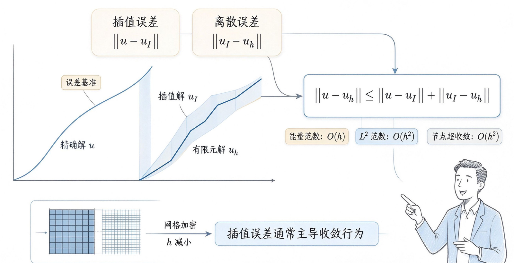
  <br>
  <i>图 47　误差分解：插值误差 + 离散误差<a id="fig46"></a></i>
</div>

　　把 Céa 引理与插值估计接起来， $H^1$ 误差是 $O(h)$。 $L^2$ 误差的高一阶需要另一个工具：对偶论证。

　　**定理 3（Aubin–Nitsche）**　设 $a$ 对称、连续（常数 $M$）、强制（常数 $\alpha$）， $u\in H^2(0,1)$ 是弱解， $u_h\in V_h$ 是 Galerkin 解。假设对偶问题 $a(w,v)=(e,v)$（ $\forall v\in V$， $e=u-u_h$）的解满足正则性估计 $\Vert w\Vert_{H^2}\le C_{\mathrm{reg}}\Vert e\Vert_{L^2}$。则存在与 $h$ 无关的常数 $C$，使

$$
\Vert u-u_h\Vert_{L^2}\le C h|u-u_h\vert_{H^1}.
$$

　　**证明**　记 $e=u-u_h$，取对偶问题的解 $w\in V$。由对称性与 Galerkin 正交性（ $I_h w\in V_h$），

$$
\Vert e\Vert_{L^2}^2=a(e,w)=a(e,w-I_h w).
$$

　　由连续性、引理 3 与正则性假设，

$$
\Vert e\Vert_{L^2}^2
\le M|e\vert_{H^1}|w-I_h w\vert_{H^1}
\le C h\Vert e\Vert_{L^2}|e\vert_{H^1}.
$$

　　若 $\Vert e\Vert_{L^2}=0$ 则结论显然；否则约去 $\Vert e\Vert_{L^2}$，得 $\Vert e\Vert_{L^2}\le C h|e\vert_{H^1}$。证毕。

　　**推论 1（误差阶）**　在引理 2、引理 3 与定理 3 的条件下，存在与 $h$ 无关的常数 $C$，使

$$
|u-u_h\vert_{H^1}\le C h|u\vert_{H^2},\qquad
\Vert u-u_h\Vert_{L^2}\le C h^2|u\vert_{H^2}.
$$

　　**证明**　由 Céa 引理与插值估计， $|u-u_h\vert_{H^1}\le C h|u\vert_{H^2}$；再由定理 3， $\Vert u-u_h\Vert_{L^2}\le C h|u-u_h\vert_{H^1}\le C h^2|u\vert_{H^2}$。证毕。

　　这就是“ $L^2$ 二阶、 $H^1$ 一阶”的完整来源[[47]](#ref47)[[48]](#ref48)。

#### 3.3.5.2　节点超收敛与三条失效条件

　　对一维 Poisson 问题，还有一个更强的结果。

　　**定理 4（节点精确）**　设 $a=1$， $f\in L^2(0,1)$， $u$ 是 $-u''=f$、 $u(0)=u(1)=0$ 的解， $u_h$ 是线性元 Galerkin 解。若载荷 $\int f\varphi_i$ 被精确计算，则

$$
u_h(x_i)=u(x_i),\qquad i=1,\dots,N-1.\qquad(42)
$$

<a id="eq42"></a>

　　**证明**　固定节点 $x_j$，令 $G_j(x)=G(x,x_j)$ 是 $-d^2/dx^2$ 在 $(0,1)$ 上、零 Dirichlet 边界的 Green 函数。 $G_j$ 连续、分段线性，拐点只在 $x_j$，且 $G_j(0)=G_j(1)=0$，所以 $G_j\in V_h$。

　　记 $e=u-u_h$。由 Galerkin 正交性， $a(e,G_j)=0$。另一方面，分部积分两次并用 $-G_j''=\delta_{x_j}$：

$$
a(e,G_j)=\int_0^1 e'G_j'\thinspace\mathrm{d}x
=-\int_0^1 e\thinspace G_j''\thinspace\mathrm{d}x
=e(x_j).
$$

　　两式相减， $e(x_j)=0$。证毕。

　　这个证明值得多看一眼：它没有估计任何误差，只用了两件事——Green 函数恰好落在有限元空间里，以及 Galerkin 误差与整个空间正交。节点上的误差就这样被“正交”掉了。

　　**故事｜节点上的巧合。**　第一次跑出 $2.78\times10^{-17}$ 时，组里先怀疑是 bug：节点误差怎么会比 $L^2$ 误差小十几个数量级？查了映射、查了装配、查了求积，最后才发现不是 bug——是 Green 函数在替我们做消去。程序没有错，错的是“误差一定随网格连续变小”的直觉。

　　推论：既然 $u_h$ 与 $u$ 在所有节点上重合，而两者都是分片线性的，那么 $u_h$ 就是 $u$ 的分片线性插值 $I_h u$。于是 $L^2$ 误差完全来自单元内部，量级是 $O(h^2)$； $H^1$ 误差是 $O(h)$。这与 3.3.5.1 节的估计一致，但节点精确是一个更强的逐点结论。

　　节点精确有一个不能漏的前提：载荷必须精确积分。若 $\int f\varphi_i$ 只算到某个求积阶，节点值就不再精确。下面给出实测。

　　[(39)](#eq39) 与 [(42)](#eq42) 各依赖一条假设，另有一个附带前提。三条都在实际计算中失效过。

　　第一条是载荷的精确积分。若 $\int f\varphi_i$ 只算到某个求积阶，节点值就只能精确到求积误差的阶。[表 19](#tab18) 是实测：取 $u=\sin\pi x$、 $f=\pi^2\sin\pi x$，用 $Q=1,2,4$ 点 Gauss 算载荷，节点误差随 $N$ 的变化一目了然。 $Q=1$ 时节点误差只按 $h^2$ 下降； $Q=2$ 按 $h^4$ 下降， $N=64$ 已到 $4.0\times10^{-9}$； $Q=4$ 在 $N\ge16$ 就碰到机器精度。

<p align="center"><b>表 19　求积阶数与节点误差<a id="tab18"></a></b></p>

| $N$ | $h$ | $Q=1$ | $Q=2$ | $Q=4$ |
| :---: | :---: | :---: | :---: | :---: |
| 4 | 0.2500 | 2.71×10⁻² | 2.73×10⁻⁴ | 5.86×10⁻¹⁰ |
| 8 | 0.1250 | 6.51×10⁻³ | 1.67×10⁻⁵ | 2.24×10⁻¹² |
| 16 | 0.0625 | 1.61×10⁻³ | 1.03×10⁻⁶ | 8.66×10⁻¹⁵ |
| 32 | 0.03125 | 4.02×10⁻⁴ | 6.45×10⁻⁸ | 3.11×10⁻¹⁵ |
| 64 | 0.015625 | 1.00×10⁻⁴ | 4.03×10⁻⁹ | 9.10×10⁻¹⁵ |

　　[图 48](#fig47) 把[表 19](#tab18) 的数据画成双对数： $Q=1$ 的斜率约 2， $Q=2$ 的斜率约 4。换成可精确积分的 $f=2$ 之后， $Q=1$ 就已达到 $2.78\times10^{-17}$。同一套代码、同一个 $N$，只因载荷算法不同，“节点精确”就从成立变成不成立。

<div align="center">
  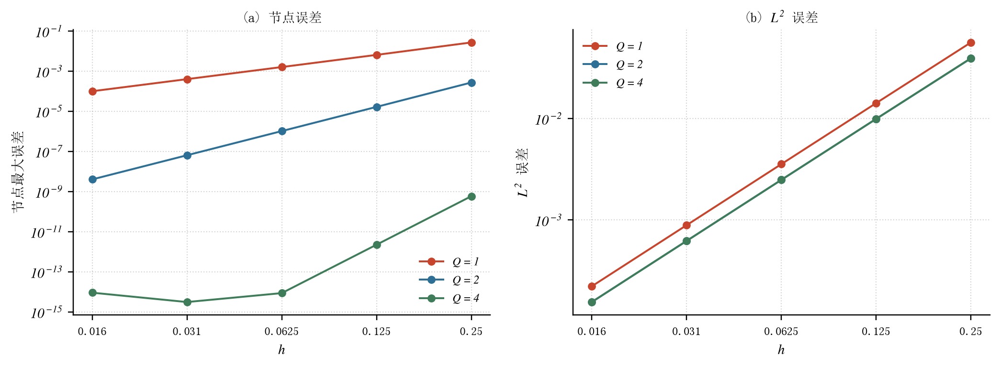
  <br>
  <i>图 48　求积阶数：Q=1 只按 h<sup>2</sup> 收敛，Q=2 按 h<sup>4</sup> 收敛，Q=4 碰到机器精度<a id="fig47"></a></i>
</div>

　　为什么 $Q=1$ 只掉到二阶，而不是更差？被积函数是 $f$ 乘一个线性帽函数， $Q=1$ 对线性部分是精确的，误差只来自 $f$ 的变化； $f$ 光滑时，中点公式是二阶。 $Q=2$ 对三次多项式精确，误差降到四阶； $Q=4$ 对七次精确，对 $\sin$ 已经足够。求积阶数不够不会让解爆掉，只会把节点超收敛悄悄拿掉——这是最容易被忽略的一类误差。

　　第二条是解的正则性。 $L^2$ 二阶来自 Céa 加插值估计，后者要求 $u\in H^2$。一维里，只要 $a$ 足够光滑（或分段常数且界面与单元边界对齐）， $f\in L^2$ 就保证 $u\in H^2$，所以 $f$ 有间断并不会掉阶；真正让阶数掉下来的是 $f\notin L^2$（点载荷、 $x^{-\beta}$ 型奇性右端），或二维区域的角点——那里 $u$ 可能只有 $H^{1+s}$（ $s\lt1$）的正则性，此时 $L^2$ 的阶会掉到 $1+s$，而不是 2。这就是为什么真实问题的收敛阶常常“跑不到 2”。不是程序错了，是解不够光滑，或右端不够好。

　　第三条是网格的均匀性。[(38)](#eq38) 那个漂亮的三对角闭式依赖 $h$ 处处相同。非均匀网格上，装配规则 [(37)](#eq37) 依然正确，但每个单元要用自己的 $h_e$，整体矩阵不再等对角；不能再用“角上 $1/h$、内部 $2/h$”去构造，必须老老实实按映射累加。

　　三条失效条件有一个共同点：它们都不是程序 bug，而是假设不成立。报误差时必须说清范数；说节点精确时必须说清载荷精确积分；说二阶收敛时必须说清解的正则性。

#### 3.3.5.3　数值实验：变系数与混合边界

　　取 $-u''=2$、 $u(0)=u(1)=0$，精确解

$$
u(x)=x(1-x).
$$

<div align="center">
  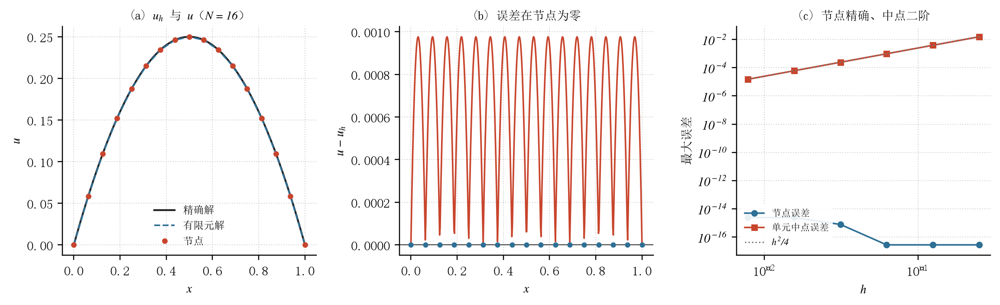
  <br>
  <i>图 49　解、误差与节点超收敛：N=16 的解；误差在节点为零；节点误差停在机器精度，中点误差按 h<sup>2</sup> 下降<a id="fig48"></a></i>
</div>

　　先看解长什么样。[图 49](#fig48) 给了三个画面： $N=16$ 时 $u_h$ 与 $u$ 几乎重合；误差 $u-u_h$ 在每个节点为零，在单元中点达到 $h^2/4$；把节点误差与中点误差画在同一张双对数图上，节点误差停在 $10^{-16}$，中点误差按 $h^2$ 下降。节点精确不是“误差很小”，而是“节点上恰好为零”。

<p align="center"><b>表 20　两个范数下的误差<a id="tab19"></a></b></p>

| $N$ | $h$ | $L^2$ 误差 | 阶 | $H^1$ 半范数 | 阶 | 节点最大误差 |
| :---: | :---: | :---: | :---: | :---: | :---: | :---: |
| 4 | 0.2500 | 1.1411×10⁻² | — | 1.4434×10⁻¹ | — | 2.78×10⁻¹⁷ |
| 8 | 0.1250 | 2.8527×10⁻³ | 2.00 | 7.2169×10⁻² | 1.00 | 2.78×10⁻¹⁷ |
| 16 | 0.0625 | 7.1318×10⁻⁴ | 2.00 | 3.6084×10⁻² | 1.00 | 2.78×10⁻¹⁷ |
| 32 | 0.03125 | 1.7830×10⁻⁴ | 2.00 | 1.8042×10⁻² | 1.00 | 7.77×10⁻¹⁶ |
| 64 | 0.015625 | 4.4574×10⁻⁵ | 2.00 | 9.0211×10⁻³ | 1.00 | 2.39×10⁻¹⁵ |

　　[图 50](#fig49) 把[表 20](#tab19) 的两个阶画成斜率： $L^2$ 的斜率约为 2， $H^1$ 的斜率约为 1。

<div align="center">
  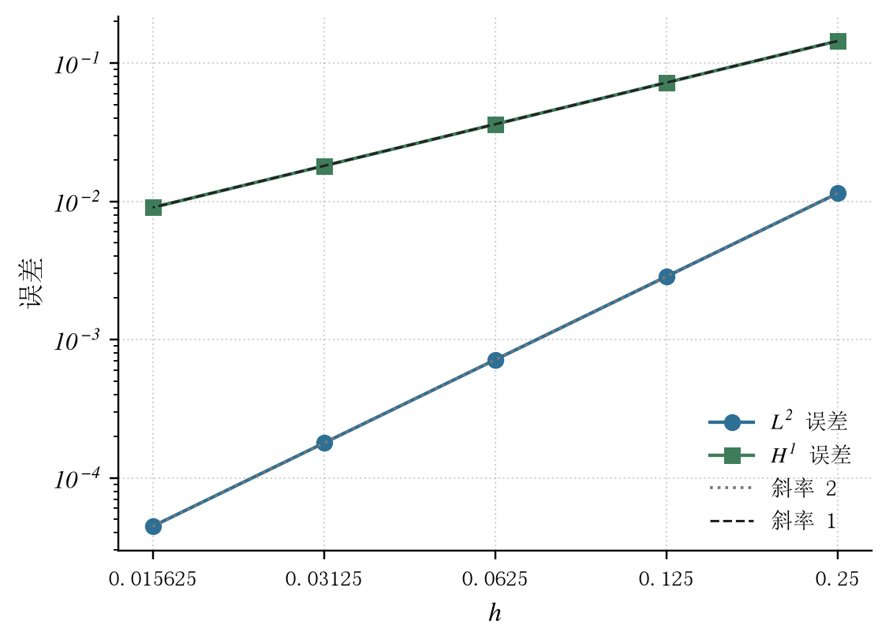
  <br>
  <i>图 50　两个范数下的误差随 h 的变化；虚线为斜率 2 与 1<a id="fig49"></a></i>
</div>

　　[表 20](#tab19) 同时验证了三件事。第一，两个范数的阶严格等于 2 与 1；观测阶全是 $2.00$ 与 $1.00$，没有“接近”的余地。第二，节点误差是机器精度（ $2.78\times10^{-17}$），证实 [(42)](#eq42) 成立。第三， $L^2$ 误差的量级与插值估计相符：既然 $u_h=I_h u$，误差应约为 $\frac{h^2}{8}\max|u''|=\frac{h^2}{4}$； $N=64$ 时 $\frac{1}{4\cdot64^2}=6.1\times10^{-5}$，实测 $4.46\times10^{-5}$，同一量级。

　　真实材料很少是常系数。取

$$
-(a u')'=f,\qquad a(x)=1+\frac12\sin2\pi x,\qquad u(x)=\sin\pi x,
$$

　　则右端为

$$
f(x)=\pi^2\Bigl[\bigl(1+\tfrac12\sin2\pi x\bigr)\sin\pi x-\cos2\pi x\cos\pi x\Bigr].
$$

　　单元刚度用 $a$ 在单元中点的值，载荷用 4 点 Gauss 求积。[表 21](#tab20) 和[图 51](#fig50) 是 $N=8,16,32,64,128$ 的结果。

<p align="center"><b>表 21　变系数问题的误差<a id="tab20"></a></b></p>

| $N$ | $h$ | $L^2$ 误差 | 阶 | $H^1$ 误差 | 阶 |
| :---: | :---: | :---: | :---: | :---: | :---: |
| 8 | 0.1250 | 9.42×10⁻³ | — | 2.53×10⁻¹ | — |
| 16 | 0.0625 | 2.35×10⁻³ | 2.00 | 1.26×10⁻¹ | 1.01 |
| 32 | 0.03125 | 5.89×10⁻⁴ | 2.00 | 6.30×10⁻² | 1.00 |
| 64 | 0.015625 | 1.47×10⁻⁴ | 2.00 | 3.15×10⁻² | 1.00 |
| 128 | 0.0078125 | 3.68×10⁻⁵ | 2.00 | 1.57×10⁻² | 1.00 |

<div align="center">
  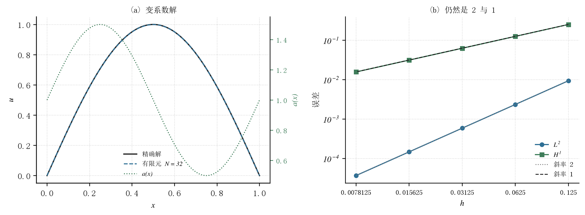
  <br>
  <i>图 51　变系数问题：(a) a(x) 与 u<sub>h</sub>；(b) L<sup>2</sup> 与 H<sup>1</sup> 的收敛；虚线为斜率 2 与 1<a id="fig50"></a></i>
</div>

　　两个阶仍是 2 与 1。原因不神秘： $a$ 光滑，单元中点平均是二阶近似；Céa 引理与插值估计的形式没有变，误差仍由“最佳逼近误差”控制。

　　系数跳变的情形要小心。若 $a$ 有跳变但解仍光滑，阶数通常还是 2/1，只是误差常数变大、节点超收敛失效；真正会掉阶的，是解本身有折角而折角没有落在节点上。看一个能算清楚的例子：两段材料 $a=1$（左）与 $a=4$（右）在 $x=1/2$ 处粘接，接口作用一个单位集中力，两端固定。精确解是一个帐篷：

$$
u(x)=\begin{cases}
2Hx, & 0\le x\le\frac12,\newline
2H(1-x), & \frac12\le x\le1,
\end{cases}
\qquad H=\frac{P}{2(a_1+a_2)}=\frac1{10}.
$$

　　左斜率 $0.2$，右斜率 $-0.2$，接口处折角。若把接口取成节点，线性元空间包含这个帐篷，三个单元就精确到机器精度；若接口落在单元内部，含折角的单元上只能用一条直线去逼近两条直线， $L^2$ 误差掉到一阶、 $H^1$ 误差掉到半阶。[表 22](#tab21) 和[图 52](#fig51) 是实测。

<p align="center"><b>表 22　界面/集中力不对齐的误差<a id="tab21"></a></b></p>

| $N$ | $h$ | $L^2$ 误差 | 阶 | $H^1$ 误差 | 阶 | 最大误差 |
| :---: | :---: | :---: | :---: | :---: | :---: | :---: |
| 7 | 0.142857 | 3.98×10⁻³ | — | 8.11×10⁻² | — | 8.04×10⁻³ |
| 15 | 0.066667 | 1.76×10⁻³ | 1.18 | 5.53×10⁻² | 0.55 | 3.89×10⁻³ |
| 31 | 0.032258 | 8.33×10⁻⁴ | 1.08 | 3.84×10⁻² | 0.53 | 1.91×10⁻³ |
| 63 | 0.015873 | 4.05×10⁻⁴ | 1.04 | 2.69×10⁻² | 0.51 | 9.46×10⁻⁴ |
| 127 | 0.007874 | 2.00×10⁻⁴ | 1.02 | 1.90×10⁻² | 0.51 | 4.71×10⁻⁴ |

<div align="center">
  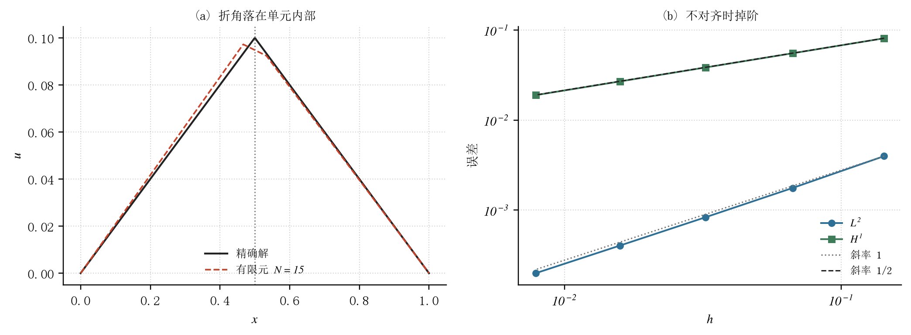
  <br>
  <i>图 52　界面/集中力不对齐：(a) 折角落在单元内部；(b) L<sup>2</sup> 掉到一阶、H<sup>1</sup> 掉到半阶<a id="fig51"></a></i>
</div>

　　对齐时（ $N=8,16,32,64,128$）三个误差都在 $10^{-14}$ 以下；不对齐时 $L^2$ 阶约 1.0、 $H^1$ 阶约 0.5，最大误差也按一阶下降。这不是程序 bug，是离散空间不包含精确解。把界面（或集中力作用点）设成节点，阶数立刻回来——这也是 3.3.3.1 节“跳变面设成单元边界”那句话的真正含义。

　　混合边界也不难。把右端改成非齐次 Neumann，只需把 $g$ 加进载荷向量，矩阵不用动；Robin 条件给端点对角元加 $\sigma$，给右端加 $g$；若边界值非零，取一个满足边界值的提升函数 $u_g$，令 $u=u_g+w$， $w\in H^1_0$，弱形式右端多出 $a(u_g,v)$ 一项。矩阵仍是同一个刚度矩阵，变的只是右端和端点对角元。这也是有限元在工程里好用的原因：几何、材料、边界条件换的时候，装配的账本不用重写。

　　本节的一维实验覆盖常系数、光滑变系数、界面失配三种情形；二维在 3.3.3.3 节，混合边界只改右端与端点对角元，留作练习。

#### 3.3.5.4　实验复现与本节结论

　　这一节的实验不多，但每一组都对应一条结论。[表 23](#tab22) 把它们放在一起：算例、数据文件、图/表、脚本。所有脚本在 `code/` 下，数据在 `工作/数据/` 下；运行环境是 Python 3.12、NumPy 2.5、SciPy 1.18、Matplotlib 3.11，线性方程组用 `numpy.linalg.solve`，误差积分用 8 点 Gauss。

<p align="center"><b>表 23　实验与复现清单<a id="tab22"></a></b></p>

| 实验 | 算例 | 数据 | 图/表 | 脚本 |
| :---: | :---: | :---: | :---: | :---: |
| 常系数收敛 | $-u''=2$， $u=x(1-x)$ | 表 3.3.3-3-收敛阶.csv | [表 20](#tab19) / [图 49](#fig48)、[图 50](#fig49) | `make_fig_data.py` |
| 求积阶数 | $u=\sin\pi x$， $Q=1,2,4$ | 表 3.3-8-求积阶数.csv | [表 19](#tab18) / [图 48](#fig47) | `make_exp33_ext.py` |
| 变系数 | $a=1+\frac12\sin2\pi x$ | 表 3.3-7-变系数收敛.csv | [表 21](#tab20) / [图 51](#fig50) | `make_exp33.py` |
| 界面失配 | $a=1/4$，接口集中力 | 表 3.3-11-界面失配.csv | [表 22](#tab21) / [图 52](#fig51) | `make_exp33_ext.py` |
| 二维三角形 | 单位方形， $u=\sin\pi x\sin\pi y$ | 表 3.3-10-二维收敛.csv | [表 14](#tab14) / [图 41](#fig40) | `make_exp33_ext.py` |
| 条件数 | 一维 Poisson | 表 3.3-5-条件数.csv | [表 15](#tab15) / [图 42](#fig41) | `make_exp33.py` |
| 鱼竿 | 三节变截面杆 | 表 3.3-4-鱼竿.csv | [表 24](#tab23) | 正文代码 |

　　[表 23](#tab22) 的最后一列是“账本”：常系数与变系数验证 2/1；求积实验说明节点超收敛的前提；界面实验说明折角必须落在节点上；二维实验说明同一套装配在三角形上仍然成立。把四组放在一起，才能说“有限元是二阶的”这句话有边界条件：说范数、说光滑性、说网格与界面对齐、说载荷积分足够准。

　　复现时最容易错的三处也列在这里：第一，误差积分要在物理坐标上做，不能把参考坐标直接代进 $f$；第二，误差范数要用足够高阶的求积算，否则会把求积误差当成离散误差；第三，画收敛阶时横轴用 $h$ 而不是 $N$，否则斜率会差一个符号。三处都不难，但每一处都能让“看起来对”的图变成错的。

　　**科普｜有限元在今天。**　今天的商用仿真软件里，装配这一步仍然叫 assemble。一个手机模型几十万单元，整体矩阵上亿个非零元，靠稀疏直接法或共轭梯度法求解；工程师不会手写 $2\times2$ 小块，但每一步做的仍是本节这三件事：算单元、按编号装、解矩阵。区别只在规模，不在思想。

- 常系数、精确求积： $L^2$ 观测阶约 2， $H^1$ 约 1，与 Céa 引理 + 一维线性插值估计一致。
- 载荷改用 1 点 Gauss：节点值不再精确，节点误差降到 $O(h^2)$；这是“求积不足”的直接后果。
- 变系数 $a=1+\frac12\sin2\pi x$： $a$ 光滑且求积足够时阶不变；用中点 $a$ 近似会引入额外误差。
- 界面 $x=0.5$ 与节点对齐时仍是 $2.00/1.00$；错位到 $x=0.53$ 时（本包 Notebook 的均布载荷算例） $L^2$ 误差在 $2\times10^{-5}$ 附近不再下降， $H^1$ 阶降到约 0.7；正文 3.3.5.3 节的集中力算例给出 $L^2\approx1.0$、 $H^1\approx0.5$。两个算例都说明：界面必须落在节点上。
- 结论：二阶/一阶不是“有限元天然如此”，而是“弱形式 + 分片线性 + 足够求积 + 网格贴合界面”共同保证的。

### 3.3.6　趣味编程：给鱼竿量“腰力”

　　周末，老陈在河边掏出一根三节鱼竿，说：“这竿子腰力好。”他把竿梢弯成一个圆弧，又弹回来。不妨算一算：如果一条鱼沿着竿轴方向拉，竿梢会被拉长多少？

　　先泼一盆冷水：鱼竿真正弯的是横向，那是梁的四阶方程，本节不碰。但“拉长”这一小截，恰好是一道标准的一维变系数问题，而且可以用三节竿把装配这本账从头到尾记一遍。老陈听完，说：“行，先算拉，再算弯。”

　　本节只做三件事：第一，把三节竿写成变截面杆，得到方程 [(43)](#eq43)；第二，用三个单元装配，得到 [(44)](#eq44) 和那段十几行代码；第三，用四种算法和自重收敛验证，落到[表 24](#tab23) 与[图 54](#fig53)。三件事做完，这根竿的“拉长账”就记平了。

　　把鱼竿看成一根变截面杆， $x$ 从手柄（ $x=0$）指向竿梢（ $x=L$）。设三节长度相同，截面积分别为 $A_1,A_2,A_3$，弹性模量 $E$，材料密度 $\rho$。轴向位移 $u(x)$ 满足

$$
-(E A u')'=\rho g A,\qquad u(0)=0,\qquad E A(1)u'(1)=P,\qquad(43)
$$

<a id="eq43"></a>

　　其中 $P$ 是竿梢的集中拉力， $\rho gA$ 是自重。左端固定是本质边界，右端受力是自然边界——正好把 3.3.2.2 节的两句话各用一次。

<div align="center">
  
  <br>
  <i>图 53　三节鱼竿的截面与受力<a id="fig52"></a></i>
</div>

　　取 $L=1.8$ m，三节各 $0.6$ m， $A_1=120$ mm²、 $A_2=60$ mm²、 $A_3=25$ mm²， $E=120$ GPa， $\rho=1600$ kg/m³， $P=80$ N。先只算集中力，忽略自重。精确解是分段线性的，竿梢位移为

$$
\delta=\frac{P}{E}\sum_{e=1}^{3}\frac{l_e}{A_e}.
$$

　　代入数字： $\delta=26.0$ μm，约一根头发丝的三分之一。老陈听了直摇头：“我钓一条八斤的鱼，它猛地一挣（瞬时拉力按 80 N 估），竿子才拉长这么点？”——对，鱼竿主要弯，不怎么伸。

　　用有限元算，装配规则一字不改：每个单元用自己的 $h_e$ 与 $A_e$，

$$
K^{(e)}=\frac{E A_e}{h_e}
\begin{pmatrix}
1&-1\newline
-1&1
\end{pmatrix},\qquad
b^{(e)}=\frac{\rho g A_e h_e}{2}
\begin{pmatrix}1\newline1\end{pmatrix},\qquad(44)
$$

<a id="eq44"></a>

　　再按全局编号累加，把 $P$ 加到最后一个自由度上。这段代码只保留骨架：`fem` 按单元循环，先算 $K^{(e)}$ 与 $b^{(e)}$，再把 $2\times2$ 小块加到全局矩阵的对应位置；`A[min(...)]` 用单元中点判断它属于哪一节，`tip` 与 `weight` 两个开关分别控制集中力与自重。代码如下（只保留核心十几行）：

```python
import numpy as np
E, rho, g, P = 120e9, 1600.0, 9.81, 80.0
L, A = 1.8, np.array([120.0, 60.0, 25.0]) * 1e-6
def fem(N, tip=True, weight=True):
    h = L / N; K = np.zeros((N + 1, N + 1)); b = np.zeros(N + 1)
    for e in range(N):
        Ae = A[min(int((e + 0.5) * h / 0.6), 2)]
        K[e:e+2, e:e+2] += E * Ae / h * np.array([[1, -1], [-1, 1]])
        b[e:e+2] += rho * g * Ae * h / 2 if weight else 0.0
    if tip: b[-1] += P
    u = np.zeros(N + 1); u[1:] = np.linalg.solve(K[1:, 1:], b[1:])
    return u[-1]
print(fem(3) * 1e6)   # 26.000
```

<p align="center"><b>表 24　四种算法给出的竿梢位移<a id="tab23"></a></b></p>

| 算法 | 竿梢位移（μm） | 相对误差 | 说明 |
| :---: | :---: | :---: | :---: |
| 逐段精确（三节） | 26.000 | — | 基准 |
| 三单元 FEM | 26.000 | 0 | 与基准一致 |
| 全竿按平均截面 68.3 mm² | 17.561 | −32.5% | 把竿当成等截面 |
| 全竿按手柄截面 120 mm² | 10.000 | −61.5% | 只用手柄截面 |

　　三个结果放在一起，说明了两件事。

　　第一，三单元 FEM 与精确解一模一样，误差在机器精度。原因不是巧合：精确解是分段线性的，而线性元空间恰好包含所有分段线性函数；当网格节点与材料接口重合时，精确解就落在 $V_h$ 里，Galerkin 解只能等于它。这叫“空间包含解”，比“高阶精度”更彻底。

　　这个“一模一样”有一个前提：三个单元边界与材料接口重合。若把接口挪到单元内部，三单元就不再精确，误差会按 3.3.5.3 节的界面失配方式掉阶。

　　第二，按平均截面算，少算 32.5%；按手柄截面算，少算 61.5%。差别全在最软的那一节： $A_3=25$ mm² 只有手柄的 $1/4.8$，它的柔度 $\int \mathrm{d}x/(EA)$ 却占了总柔度的 $24000/39000\approx62$%。把整根竿当成一根粗杆，等于把最软的一节忽略了。

　　再把自重加回去。自重的总重量只有 $1.93$ N，额外位移 $0.12$ μm，约占 0.5%；但它的误差随网格按 $L^2$ 二阶、 $H^1$ 一阶收敛（[图 54](#fig53)），因为自重对应的精确解是分段二次的，不再落在 $V_h$ 里。集中力让解落进空间，自重把解推出空间——同一根竿，两种行为。

<div align="center">
  
  <br>
  <i>图 54　自重位移的收敛<a id="fig53"></a></i>
</div>

　　老陈最后问：“那我这竿子到底算好还是不好？”答案不在这里：竿子的“腰力”取决于弯曲刚度 $EI(x)$ 的分布，要解四阶方程，需要 $C^1$ 单元或混合格式。本节只算清了“拉长”这一小截，但装配的账、边界的账、误差的账，已经从头到尾记了一遍。下一根竿，换一个方程，账本还是这本账。

### 3.3.7　有限元的今天

　　1960 年代，有限元从论文走进工业。NASA 在 1965 年组织开发 NASTRAN，1970 年 ANSYS 成立，1978 年 Abaqus 出现；到 1980 年代，汽车厂已经用整车模型做碰撞，飞机厂用整机模型做静强度。方法没有变，变的是规模：今天一辆车的碰撞模型上千万单元，一部手机跌落的模型几十万到上百万单元，一张芯片的封装模型要同时算热和力。

　　规模变大，算法也要跟着变。三对角在二维变成带状、在三维变成更宽的带状；直接法要靠稀疏消元、嵌套剖分和 GPU 加速，迭代法要靠共轭梯度、多重网格和预处理。3.3.4.2 节的“非零元只有三万个”到了三维会变成几亿个，但“只存非零元”这句话没有变。

　　有限元还从“算一个结果”变成了“改一个设计”。1988 年 Bendsøe 与 Kikuchi 把材料密度当作设计变量，提出拓扑优化：在给定的载荷与体积约束下，让算法自己决定材料该放在哪里[[54]](#ref54)。今天的汽车支架、飞机舱门、人工关节，很多是先由拓扑优化给出形状，再拿有限元复核，最后交给 3D 打印。[图 55](#fig54) 是这条流水线。

　　另一条线是“算得更快”。显式动力学把每一步写成矩阵—向量乘法，适合碰撞、冲击、爆炸；隐式动力学每步解一个稀疏系统，适合长时间、准静态。GPU 把这两类计算都推快了一个数量级；区域分解把上亿自由度的模型拆到几千张卡上。今天的工程师不必手写 $2\times2$ 小块，但 3.3.4.1 节的装配账仍然是并行剖分的依据。

　　还有两条支线。等几何分析（2005）把 CAD 的 NURBS 基函数直接当单元基函数，省掉“几何—网格”转换，让复杂曲面在离散前后保持同一张脸[[55]](#ref55)。数字孪生则把传感器数据回灌到模型：飞机机翼、风机叶片、桥梁，一边测一边更新有限元模型，让“算出来的”和“量出来的”慢慢对齐。

<div align="center">
  
  <br>
  <i>图 55　有限元的今天：从几何、网格、装配到求解与后处理；误差估计把后处理接回网格<a id="fig54"></a></i>
</div>

　　最近十年，AI 也进来了。2019 年 Raissi 等人提出 PINN，把方程残差写进损失函数[[56]](#ref56)；2021 年 Li 等人提出 Fourier 神经算子，直接学“输入函数到输出函数”的映射[[57]](#ref57)。它们的目标不是替代有限元，而是补上有限元最贵的那一段：要算几千次参数扫描时，用一个训练好的代理模型先筛，再用有限元复核。[图 56](#fig55) 是四个典型场景：整车碰撞、手机跌落、人工关节、芯片与电池。它们的单元数、时间尺度、材料模型都不同，但都要回答同一件事：网格够不够细，误差可不可信。

<div align="center">
  
  <br>
  <i>图 56　有限元的四个今天：整车碰撞、手机跌落、人工关节、芯片与电池；尺度不同，账本相同<a id="fig55"></a></i>
</div>

　　所以“有限元的今天”不是某一项新技术，而是三条线同时变粗：规模从万到亿，目标从“算一次”到“改设计”，工具从手写代码到商业软件、开源库和 AI 代理模型。三条线底下还是那三本账：网格、装配、误差。网格可以自适应，装配可以并行，误差可以用 AI 估计，但账本没有换。

　　下次你看到一辆车的碰撞视频、一部手机的跌落仿真、一颗人工关节的应力云图，可以想起这一节：那些彩色云图的背后，仍然是一顶顶帽子、一个个 $2\times2$ 小块，和一次按编号的累加。

## 第四节（3.4）　AI 关联：Neural ODE 与 PINN

*从“拟合一条曲线”到“学一个向量场”*

### 3.4.0　引子：一条曲线，两台机器

　　一位做微生物实验的朋友发来三条几乎重合的生长曲线：横轴是时间，纵轴是菌落面积。她要的不是再拟合出一条形状相同的曲线，而是回答“如果第一天温度低两度，第三天会长成什么样”。换句话说，需要确定的不是 $y$，而是 $y'=f(t,y)$ 中的 $f$——曲线背后的规律。

　　这就是“反问题”。正问题手里有方程，任务是把解算准；反问题手里只有解的若干次观测，方程未知，要把它反推出来。它并不新鲜：开普勒用第谷二十年的观测反推行星轨道，工程师用测得的应力反推材料参数，走的都是这条路。新鲜的是工具：过去五年，神经网络把这件事从“专家手工建模”变成了“可以训练的对象”。

　　2024 年 10 月的诺贝尔奖使这一趋势受到广泛关注：化学奖的一半给了用 AlphaFold 预测蛋白质结构的 Demis Hassabis 与 John Jumper，另一半给了用计算方法设计蛋白质的 David Baker；物理学奖给了神经网络的两位奠基者 John Hopfield 与 Geoffrey Hinton。前者是“用机器学习解决科学问题”，后者是“用物理学的语言理解神经网络”——两条线索在同一周交汇，这就是今天所说的 AI for Science。

<div align="center">
  
  <br>
  <i>图 57　鲸肌红蛋白的三维结构：人类解析出的第一个蛋白质结构（肯德鲁，1958；1962 年诺贝尔化学奖）。AlphaFold 这类模型要预测的，正是这样的形状。图片来源：Wikimedia Commons，公有领域<a id="fig56"></a></i>
</div>

　　就“用机器学方程”而言，2018 年以后出现了两条清晰的技术路线，时间顺序十分清楚。

　　先是 2018 年底：Chen、Rubanova、Bettencourt 与 Duvenaud 把 ResNet 的“一层一次加和”看成“一步 Euler 积分”，进而问——为什么不把层数取到无穷、让网络直接学连续时间的向量场？这就是 Neural ODE[[58]](#ref58)。它学的是 $f$，不是 $y$。

　　紧接着是 2019 年：Raissi、Perdikaris 与 Karniadakis 提出 PINN[[56]](#ref56)——不拟合数据曲线，而是让网络的输出直接满足方程，把“方程残差”当损失。两者的区别可以概括为一句：Neural ODE 学右端函数，PINN 解已知方程。

　　两条路线可用[图 58](#fig57) 对照。二者都遵循同一条“输入 → 网络 → 输出 → 损失”的流程，但网络所处的位置不同，所得模型也随之不同：置于右端，网络成为 $f_\theta$，需经积分器才得到轨迹；置于解上，网络成为 $u_\theta$，需对其求一次导数才得到残差。前者学的是规律，后者学的是这一次的具体轨迹。

<div align="center">
  
  <br>
  <i>图 58　两条训练路线并排：同一条流水线，网络置于右端还是置于解上，决定了所学的是 f 还是 u。图片来源：本组绘制<a id="fig57"></a></i>
</div>

　　用机器学习的语言表述：Neural ODE 是函数空间中的回归——回归的对象不是数据点，而是“从状态到斜率”的映射；PINN 则是以方程为约束的正则化——损失中 $\sum|r_\theta|^2$ 一项不含任何标签，属于自监督项（前者对应 3.4.1.1，后者对应 3.4.2.1）。

　　这两条路线在国内都有落脚点，而且起步并不算晚。由鄂维南等学者倡导的“AI for Science”，在 2018 年前后同时在国内学界与产业界铺开：飞桨的 PaddleScience 把 PINN、XPINNs 等格式做成了可直接调用的求解器与示例[[61]](#ref61)，昇思的 MindSpore Science 提供微分方程求解与科学计算算子库，北京大学团队还基于它发布了二维偏微分方程的基础模型 PDEformer-2[[62]](#ref62)；DeepModeling 社区的 DeePMD-kit 则把机器学习势函数送进了材料与化学的日常计算。这些工具的共同点在于：本书讲过的积分器、残差与边界条件，都被封装成了参数，因此选型的差别最终落在求解器的选择与残差的容忍度上。

<div align="center">
  
  <br>
  <i>图 59　鄂维南院士在 2021 世界人工智能大会上作报告。图片来源：百度百科<a id="fig58"></a></i>
</div>

<div align="center">
  
  <br>
  <i>图 60　左：飞桨（PaddlePaddle）标识；右：昇思（MindSpore）标识。图片来源：飞桨官网、百度百科<a id="fig59"></a></i>
</div>

　　本节的任务是把这套方法拆解开来。可以用一个比喻概括主线：正问题相当于照着菜谱做菜；反问题则相当于只尝一口，就要把菜谱反推出来，而且写出的菜谱必须能做出整桌菜，而不只是还原这一口。

　　下面三节依次回答三个问题。3.4.1 节：方程怎样写成一个网络？关键不在于记住某一条轨迹，而在于学出“在每一点、每一刻该往哪走”的向量场，并弄清它成立需要什么条件。3.4.2 节：结果好不好，用什么标准衡量？是让轨迹贴合观测，还是让方程处处成立——两种标准各有各的缺陷。3.4.3 节：怎样确认结果确实正确？最容易被忽略的是求解过程本身也会出错：积分器的离散误差会进入参数，因此必须在未用于训练的初值、步长和区间上重做一遍。

　　3.4.4 节以一条真实的菌落生长曲线为例，用几十行代码把这三件事完整实现一遍；3.4.5 节转而讨论这两条线今天的产业形态、它们与 AI 的关系，以及尚待解决的问题。

### 3.4.1　学习右端函数

　　1601 年第谷去世，留下二十多年、精度空前的天文观测；开普勒用这些点，最终拟合出火星的椭圆轨道——他知道行星“会经过哪里”，却说不清“为什么”。半个多世纪后，牛顿给出万有引力：每一点上都有一个确定的加速度，行星只是顺着它走。开普勒学到的是一条曲线，牛顿学到的是产生这条曲线的场。

　　本节学的也是后者。给的只有若干观测点，要的是一张网 $f_\theta$：它给出每一个时刻、每一个状态上的“下一步往哪走”。曲线只是这个场的一个投影——这一观点贯穿后续各节。

<div align="center">
  
  <br>
  <i>图 61　开普勒的椭圆轨道与牛顿的运动方程：从观测曲线，到受力分析，再到微分方程。图片来源：豆包生成<a id="fig60"></a></i>
</div>

#### 3.4.1.1　从拟合曲线到拟合斜率

　　先把两个对象分开：曲线是一条轨迹留下的痕迹，向量场则是每一点、每一刻都存在的“水流”。观测数据只提供了几张照片——船在水面上的位置，而 Neural ODE 要学的是水流本身。学到水流之后，无论把船从何处、何时放入，都能推断它的走向；只学到那条曲线，换一条船就必须重来。

　　已知观测点 $(t_i,u_i)$， $i=1,\dots,N$，来自某个未知的初值问题

$$
u'=f(t,u),\qquad u(0)=u_0 .\qquad(45)
$$

<a id="eq45"></a>

　　传统做法是先假定 $u(t)$ 的函数形式（如 logistic），再用最小二乘确定几个参数。Neural ODE 改变的正是被假设的对象：它假设的是 $f$。

　　**定义 1（参数化向量场与轨迹）**　设 $f_\theta:\mathbb{R}\times\mathbb{R}^d\to\mathbb{R}^d$ 是由参数 $\theta$ 决定的神经网络。称初值问题

$$
\frac{\mathrm{d}u_\theta}{\mathrm{d}t}=f_\theta(t,u_\theta),\qquad u_\theta(0)=u_0\qquad(46)
$$

<a id="eq46"></a>

的解 $u_\theta(t)$ 为该网络给出的轨迹。

　　注意式 [(46)](#eq46) 与式 [(45)](#eq45) 形状完全相同，只是把 $f$ 换成了 $f_\theta$。这一步替换带来两个后果：有利的一面是， $f_\theta$ 一旦学到，任意初值、任意区间的轨迹都可以重新积出；代价是式 [(46)](#eq46) 没有解析解，只能依赖数值积分，而积分器的误差会进入训练过程。

　　训练目标就是让轨迹贴合观测：

$$
\mathcal{L}_{\text{traj}}(\theta)=\frac1N\sum_{i=1}^{N}\bigl\Vert u_\theta(t_i)-u_i\bigr\Vert^2+\lambda\bigl\Vert u_\theta(0)-u_0\bigr\Vert^2 .\qquad(47)
$$

<a id="eq47"></a>

　　式 [(47)](#eq47) 里没有出现 $f$ 的任何“真值”， $f$ 只是在积分过程中被反复调用。这正是它与普通回归的本质区别：拟合的对象是曲线背后的向量场，曲线只是这个向量场的一个投影。

　　把这件事写成映射会更清楚。固定 $\theta$ 与初值 $u_0$，式 [(46)](#eq46) 的解定义了一个映射 $\varphi_\theta:(t,u_0)\mapsto u_\theta(t)$，称为流映射。它满足半群性质

$$
\varphi_\theta(t+s,u_0)=\varphi_\theta\bigl(t,\varphi_\theta(s,u_0)\bigr),
$$

先走 $s$ 再走 $t$，与一次走 $t+s$ 相同。这条性质有两个直接后果。其一，学到 $f_\theta$ 之后，任意初值、任意时刻的轨迹都是同一个映射的不同切片——“换初值外推”不是额外的技巧，而是这一表示的必然结果。其二，只要 $f_\theta$ 是 $C^1$ 的， $\varphi_\theta(t,\cdot)$ 对每个 $t$ 都可逆（反向积分即可还原），这是 ResNet 那类离散网络做不到的。连续归一化流（CNF）正是靠它把“可逆变换 + 密度变换”搬进了生成模型：密度沿轨迹的变化率是 $-\nabla\cdot f_\theta$，积分起来就得到对数似然，不必去算 Jacobian 行列式[[58]](#ref58)。

　　由此产生一个自然的问题：既然要拟合的是一个函数，为什么必须用神经网络？多项式、样条、小波同样是函数族，而且更古老、更便于分析。

　　答案在于两者的参数增长方式不同。以三次张量积多项式为例： $d$ 个变量、每个方向 $\le3$ 次，基函数有 $\binom{d+3}{3}$ 个，是 $O(d^3)$ 量级；而要把精度做到 $\varepsilon$，需要的基函数个数是 $O(\varepsilon^{-d/3})$——指数上挂着维数 $d$。神经网络的情形则不同：宽度 $w$、深度 $L$ 的网络大约有 $O(Lw^2)$ 个参数，与 $d$ 无关；对 Barron 型函数类，逼近误差是 $O(1/\sqrt{N})$， $N$ 是参数个数，指数上也没有 $d$[[74]](#ref74)。换言之，维数升高时，基函数一侧的参数按 $10^{d}$ 的方式增长，而网络一侧只需适当增加宽度。这是深度学习能在高维问题上立足的根本原因，也是 3.4.2.4 中“PDE 基础模型开始讨论规模”的伏笔。

　　这一比较有前提：它针对的是“光滑度受限、维数却很高”的函数类。若问题是一维的、函数是解析的，谱方法与 Chebyshev 基函数明显优于网络：速度快、精度高，而且附带误差估计。所以准确的说法不是“神经网络万能”，而是“神经网络是维数高、结构弱、样本多时的默认选择”。

　　[图 62](#fig61) 把这两件事画在一起：左、中两格是“学一个场”的示意——灰色箭头是真实的 $f$，蓝色箭头是学到的 $f_\theta$，三条轨迹换了初值仍然贴着真解；右一格对应上面的比较，横轴是状态维数，纵轴是达到同一精度所需的参数个数。

<div align="center">
  
  <br>
  <i>图 62　表示能力的两个侧面：左、中，学到的向量场（蓝）与真场（灰）几乎重合，换初值仍然适用——学到的是场而不是曲线；右，达到同一精度所需参数个数随维数的增长（量级估计，取 ε=10<sup>−2</sup>、光滑度 p=3）。本组计算并绘制<a id="fig61"></a></i>
</div>

> **科普｜一层网络就是一步 Euler**　ResNet 的一个残差块写成 $h_{t+1}=h_t+F(h_t)$，与显式 Euler 的 $u_{k+1}=u_k+h\thinspace f(t_k,u_k)$ 对照：只要规定“每穿过一层就前进一个单位时间”， $F$ 就是那个 $f$，层数就是步数[[76]](#ref76)。Neural ODE 把这条递推取极限——层数趋于无穷、步长趋于零，离散的层层堆叠就变成一段连续的时间。
>
> 这类离散化并不遥远。手机游戏、动画乃至支付成功后那段“到账”动效，都是一帧一帧算出来的：每一帧只问一次“下一瞬间在哪”，就是 Euler 走一步；帧率从 24 提高到 120，本质上是把 $h$ 缩小，使离散过程逼近连续过程，画面才显得连贯。反过来，Neural ODE 让求解器自行选择步长：平缓处取大步、陡峭处取小步。这正是“学一个连续系统”在算力上优于“固定层数堆叠”的原因。

<div align="center">
  
  <br>
  <i>图 63　从离散步进到连续动力学：步长 h→0 时离散路径逼近连续曲线，Neural ODE 让模型在关键区域自动加密。图片来源：豆包生成<a id="fig62"></a></i>
</div>

<div align="center">
  
  <br>
  <i>图 64　Neural ODE 的结构：网络只负责给出斜率 f<sub>θ</sub>(t,u)，推进轨迹的是积分器。本组绘制<a id="fig63"></a></i>
</div>

#### 3.4.1.2　存在唯一性与连续依赖

　　把 $f$ 换成网络，存在唯一性与连续依赖这两条结论能不能照搬？能，只要网络满足 Lipschitz 条件。

　　这个条件并非多余。取 $f(u)=\sqrt{|u|}$、 $u(0)=0$： $u\equiv0$ 与 $u(t)=t^2/4$ 都满足方程，初值问题有无穷多个解——残差处处为零，却不能说“解对”。网络里若出现这类“平方根型”的尖点（非光滑激活、手工拼接的项），同样的失效就会出现。

<div align="center">
  
  <br>
  <i>图 65　Lipschitz 条件并非多余：左图 u'=√|u| 从 u(0)=0 出发有无穷多条解，右图 u'=−u 的每个初值只有一条解。本组计算并绘制<a id="fig64"></a></i>
</div>

　　**命题 1**　设 $f_\theta$ 在 $D$ 上连续、关于 $u$ 满足 Lipschitz 条件（常数 $L$）。则对任意初值 $(0,u_0)\in D$，式 [(46)](#eq46) 在某个区间 $[0,\delta]$ 上存在唯一解，且解连续依赖于 $u_0$ 与 $\theta$。

　　**证明**　重复 Picard–Lindelöf 定理的证明，只把 $f$ 换成 $f_\theta$： $f_\theta$ 连续有界、Lipschitz，故 Picard 迭代是压缩映射，存在唯一不动点。连续依赖性由 Gronwall 估计直接给出。证毕。

　　证明里最要紧的一步是压缩常数。式 [(46)](#eq46) 等价于积分方程 $u(t)=u_0+\int_0^t f_\theta(s,u(s))\thinspace\mathrm ds$，Picard 映射 $T$ 满足

$$
\Vert T(u)(t)-T(v)(t)\Vert\le L\int_0^t\Vert u(s)-v(s)\Vert\thinspace\mathrm ds\le L\delta\thinspace\Vert u-v\Vert_\infty ,
$$

只要 $\delta\lt 1/L$， $T$ 就是压缩映射，Banach 不动点定理直接给出存在唯一。这也解释了命题 1 为什么只保证“某个小区间”上可解： $L\delta\lt 1$ 是局部条件， $L$ 越大、能保证的区间越短。

　　这条命题的实用价值在于：它说明了哪些网络“可用”。带 $\tanh$ 或 SiLU 激活的多层感知机，其输出关于输入是 Lipschitz 的（复合函数的 Lipschitz 常数是各层常数之积），所以命题 1 成立；而带 ReLU 的网络在原点附近虽然仍 Lipschitz，但其导数不连续，会让后面的伴随方程变得敏感。

　　网络的 Lipschitz 常数可以直接算出：若第 $i$ 层权重矩阵的谱范数为 $s_i$、激活函数的 Lipschitz 常数为 $\ell$（ $\tanh$、SiLU、ReLU 的 $\ell$ 都等于 1），则整网 $L\le\prod_i s_i\ell$。深度增加时该乘积指数增长——“深层网络对输入极其敏感”并非修辞，而是这个乘积的直接结果。工程上的对策是谱归一化：把每层的 $s_i$ 约束在 1 附近，让 $L$ 不随深度爆炸[[67]](#ref67)。

　　这一性质在深度学习中有更出名的名字：对抗样本。在一张熊猫照片上叠加肉眼几乎不可见的扰动（ $\Vert\delta\Vert_\infty\approx10^{-2}$），网络却以很高的置信度把它判为长臂猿——这不是网络“看错”，而是它的 $L$ 过大：输入上 $10^{-2}$ 的误差被放大成输出上的巨大变化[[77]](#ref77)。2013 年这一现象刚被发现时被视为深度学习的缺陷，后来逐渐被理解为高维函数逼近的固有性质： $L$ 大既是网络能够拟合复杂函数的前提，也是它脆弱的根源。对 Neural ODE 来说，这件事直接落在积分上—— $L$ 大， $e^{Lt}$ 就把初值噪声迅速放大，学到的那条轨迹只在训练区间起点附近才可信。

　　还要注意一个容易被忽略的细节： $L$ 越大，连续依赖估计 $|u(t)-z(t)|\le|u_0-z_0|e^{Lt}$ 越松。深层网络的 $L$ 往往很大，这意味着初值的一点点噪声会被放大成轨迹上的大偏差——这也是 3.4.3 节“换初值验证”的动机之一。

　　这不是抽象的顾虑。1963 年，气象学家 Edward Lorenz 在计算机上重新执行一次数值实验，为了省事把初值从 0.506127 记为 0.506——一个看似无碍的省略。头几天两条曲线几乎重合，几个“模式日”之后天气图彻底分道扬镳。九年之后，他把这件事概括成一句更出名的话：一只蝴蝶在巴西扇动翅膀，会不会在得克萨斯引起一场龙卷风？[[63]](#ref63) 用上面的估计来读：初值只差 $10^{-3}$ 量级，可大气的 $L$ 大到让 $e^{Lt}$ 在两周之内就把它放大到与气候信号同量级——因此两周以上的天气预报只能给出概率，无法给出确定答案。对训练 Neural ODE 的人而言，这一教训同样成立： $L$ 大的网络，观测里的一点噪声会被积分成轨迹上的大偏差。

<div align="center">
  
  <br>
  <i>图 66　洛伦兹的两次模拟：初值只差 0.000127，误差被指数放大，两周之后已到气候量级。图片来源：豆包生成<a id="fig65"></a></i>
</div>

#### 3.4.1.3　伴随法：怎样穿过积分器求梯度

　　式 [(47)](#eq47) 的梯度要穿过数值积分器。最直接的做法是“保存每一步、反向逐层求导”（离散反传）：前向 $M$ 步需要保存 $M$ 组中间量，内存随步数线性增长；步长小到 $10^{-3}$、区间长到 $10^3$ 时，内存将无法承受。

　　Neural ODE 原论文给出的替代方案是伴随法：不解轨迹的离散链，而是另外解一个反向的连续方程[[58]](#ref58)。记伴随变量（拉格朗日乘子） $\boldsymbol a(t)=\partial\mathcal{L}/\partial u_\theta(t)$，可以证明它满足

$$
\frac{\mathrm{d}\boldsymbol a}{\mathrm{d}t}=-\thinspace\boldsymbol a^{\mathsf T}\thinspace\frac{\partial f_\theta}{\partial u}(t,u_\theta),\qquad \boldsymbol a(T)=\frac{\partial\mathcal{L}}{\partial u_\theta(T)},\qquad(48)
$$

<a id="eq48"></a>

而参数梯度是一个积分

$$
\frac{\mathrm{d}\mathcal{L}}{\mathrm{d}\theta}=-\int_{T}^{0}\boldsymbol a(t)^{\mathsf T}\frac{\partial f_\theta}{\partial\theta}(t,u_\theta)\thinspace\mathrm dt .\qquad(49)
$$

<a id="eq49"></a>

　　**命题 2（伴随法的代价）**　用伴随法求一次梯度需要额外解一个与状态同维的反向 ODE，内存为 $O(d)$，与时间步数无关；计算量为前向积分的约两倍。

　　**证明要点**　式 [(48)](#eq48) 是把式 [(46)](#eq46) 与 $\mathcal{L}$ 一起写成约束优化的 Lagrange 函数后，对 $u$ 变分得到的；由于约束是逐点成立的 ODE，乘子也满足一个 ODE。反向积分从 $T$ 到 $0$，每步只需当前状态与乘子，故内存与步数无关。计算量约为前向的两倍，因为每一步要算两次 Jacobian–向量积。证毕。

　　这一成本需单独计算。[图 67](#fig66) 的横轴是参数个数 $P$，纵轴是计算一次全梯度所需的前向次数：有限差分为一条斜线（ $2P$ 次），反向模式与伴随法为两条水平线（约 2 次）。 $P=10^6$ 时两者相差 6 个数量级，这是“能否实现”的差别，而非“快慢”的差别。今天任何大模型的训练都建立在“梯度计算量与参数个数无关”这一事实之上；伴随法的作用，是把这一事实从“层”推广到了“时间”。

<div align="center">
  
  <br>
  <i>图 67　计算一次全梯度所需的前向次数：有限差分随参数个数线性增长，反向模式与伴随法均为常数。本组绘制<a id="fig66"></a></i>
</div>

　　这条结论体现的正是精度与成本之间的权衡：伴随法用两倍时间换常数内存；离散反传用线性内存换一次前向。工程上通常按区间长度选择：短区间直接反传，长区间使用伴随法。

　　这里有个容易被忽略的细节：式 [(49)](#eq49) 是“先连续求导、再离散”，而反向传播是“先离散、再求导”。两者给出的梯度并不严格相等，差一个 $O(h^p)$ 的量级（ $p$ 为积分器的阶）。前者与积分过程解耦，训练中可以更换步长与格式；后者精确对应某一次前向计算，梯度与该次计算完全一致。实践中“训练中途更换求解器、损失曲线突然波动”，根源正在于此。

　　内存与计算之间还有第三条路：分段存、分段反传（checkpointing）。把前向切成若干段，只记段首状态，反传时重算段内——内存降到 $O(\sqrt{M}\thinspace d)$，计算约两倍。分段数按显存容量确定，因此这是工程上最常用的折中[[66]](#ref66)。三种做法没有绝对优劣，取决于这次训练更缺内存还是更缺时间。

　　这件事在 AI 里有更熟悉的名字：反向传播。一层层反传是把 $\partial\mathcal{L}/\partial\theta$ 沿计算图逐层链式相乘；伴随法是把同一个链式法则放进时间维，沿 ODE 的轨迹反向积分一次。差别只在“层”是离散还是连续——这也是为什么 PyTorch 的 `torchdiffeq` 只要接一个 ODE 求解器，就能把梯度算对[[60]](#ref60)。今天大模型训练中用于节省显存的“分段重算”（gradient checkpointing），与 3.4.1.3 的分段存储、分段反传是同一思路：以重算换取内存。

<div align="center">
  
  <br>
  <i>图 68　三种反向方式的内存开销随步数 M 的变化（取 d=1）：离散反传线性增长，分段检查点 √M 增长，连续伴随与步数无关。本组计算并绘制<a id="fig67"></a></i>
</div>

> **科普｜伴随法：从天气预报到火箭回收**　“再解一个反向方程来求梯度”这件事，1950 年代就出现在最优控制里（Pontryagin 最大值原理中的协态方程）。1980 年代气象学家把它搬进资料同化，ECMWF 从 1997 年起用四维变分（4D-Var）做业务预报：想知道“初值场该改多少”，就把整个预报模式反向积分一遍，使误差回传到初值[[64]](#ref64)。
>
> 如今这类反向计算十分常见：手机导航重新规划路线、无人机在气流中保持姿态、猎鹰 9 号回收时最后几十秒的制导，本质上都是“给定目标、反推当前应如何动作”的最优控制问题；而计算它的梯度，内存占用最小的办法就是伴随法。Neural ODE 的贡献不在于发明它，而在于把它纳入深度学习的显存预算：内存 $O(d)$、计算量约两倍。

<div align="center">
  
  <br>
  <i>图 69　从庞加莱回归到火箭回收：核心都是动力系统在约束下寻找最优轨迹，梯度靠伴随法回传。图片来源：豆包生成<a id="fig68"></a></i>
</div>

#### 3.4.1.4　数值实验：一步反解出 θ

　　取一个最简单的例子来说明上述内容： $u'=-u$、 $u(0)=1$，真解 $e^{-t}$。设只给出一个观测点 $(0.5,\thinspace0.6065)$，并限定网络只能取线性形式

$$
f_\theta(t,u)=-\theta u .
$$

　　这就是“结构对、参数未知”的最小模型。用前向 Euler 走一步（ $h=0.5$）：

$$
u_1=1-0.5\theta .
$$

　　令 $u_1=0.6065$ 得 $\theta=0.787$。若改用经典 RK4 走同一步，放大因子是 $1-z+z^2/2-z^3/6+z^4/24$（ $z=0.5\theta$），令其等于 $0.6065$，解得 $\theta=1.0009$。同一个观测点、两种积分器，反解出的参数相差 27%。

<p align="center"><b>表 25　同一步反解出的 θ 与它在 <i>t</i>=2 处的外推误差（观测点 (0.5,0.6065)，真值 <i>e</i><sup>−2</sup>=0.1353）<a id="tab24"></a></b></p>

| 积分器 | 步长 h | 反解 θ | 训练点误差 | t=2 处预测 | 相对真值偏差 |
| :---: | :---: | :---: | :---: | :---: | :---: |
| 前向 Euler | 0.5 | 0.787 | 0.0 | 0.2072 | +53% |
| 前向 Euler | 0.25 | 0.885 | 0.0 | 0.1704 | +26% |
| 经典 RK4 | 0.5 | 1.0009 | 0.0 | 0.1351 | −0.2% |
| 经典 RK4 | 0.25 | 1.0001 | 0.0 | 0.1353 | 0.0% |

　　[表 25](#tab24) 中最需注意的是“训练点误差”一列：四种组合都是 0，因为 $\theta$ 本来就是从该点反解得到的。可见训练误差为零并不能说明模型正确。真正的差别在最后一列：Euler 解出的 $\theta$ 系统性偏小，把衰减率学慢了，外推到 $t=2$ 则多计算了 53%。这不是程序的错误，而是离散误差被吸收进了参数：Euler 对衰减问题本身偏快（ $1-h\lt e^{-h}$），网络只能把 $\theta$ 调小来补偿。

　　这个把衰减率量小 21% 的系统偏差可以写成公式。Euler 走 $n=0.5/h$ 步落到观测点，要求 $(1-h\theta)^n=0.6065$，解出

$$
\theta_{\text{Euler}}(h)=\frac{1-0.6065^{\thinspace h/0.5}}{h}.
$$

把 $0.6065\approx e^{-0.5}$ 代进去， $\theta_{\text{Euler}}(h)\approx(1-e^{-h})/h=1-\dfrac{h}{2}+\dfrac{h^2}{6}-\cdots$。 $h=0.5$ 时给出 $1-0.25+0.042=0.792$，与数值 0.787 的差异仅来自舍入；首项 $-h/2$ 表明“步长减半、偏差减半”，这正是[图 71](#fig70) 中那条近似直线的来源。RK4 的同类展开首项为 $O(h^4)$，因此它在 $h=0.5$ 上已看不出偏差。

　　可以用一个比喻：Euler 相当于一把刻度偏短的尺子。用它测量同一个身高，读数会系统性偏小；若不知道尺子偏短，就会得出“身高只有 1 米 68”的错误结论。[表 25](#tab24) 中的 0.787 正是这样一个读数——它在训练点上完全对齐（误差 0.0），却把衰减率量小了 21%，换成刻度准确的 RK4 立刻回到 1.0009。因此“训练误差为零”从不是合格的凭证，它只说明尺子与被测对象已经相互校准。

<div align="center">
  
  <br>
  <i>图 70　同一个观测点、两种积分器：Euler 训练出的衰减率 θ=0.787 明显偏小，外推到 t=2 差了 53%；RK4 的 θ=1.0009 几乎贴合真解。本组计算并绘制<a id="fig69"></a></i>
</div>

<div align="center">
  
  <br>
  <i>图 71　反解出的 θ 随步长减小而趋向真值 1：离散误差消失，参数才回到真值。本组计算并绘制<a id="fig70"></a></i>
</div>

　　这段实验可以重做：取步长 $h$ 依次为 0.5、0.25、0.125，重算 Euler 的 $\theta$ 与外推偏差。可以看到 $\theta$ 单调趋向 1、偏差单调趋向 0——离散误差随 $h\to0$ 消失，这正是收敛阶在“反问题”里的体现。

### 3.4.2　轨迹拟合与方程残差

　　18 世纪的航海者靠“潮汐表”：把每个港口涨落的时间与高度记下来，编成表，直接查用。后来拉普拉斯用月球与太阳的引力写出方程，直接算出潮汐——表上没有的港口，方程也能给。

　　这两种“学”法，正是本节要比较的两条路线：一条把观测当答案背下来（拟合轨迹），一条把规律当答案学下来（拟合方程）。哪一条更省数据、更容易训练、各自的困难在哪里，是 3.4.2.1 到 3.4.2.3 要回答的问题。

<div align="center">
  
  <br>
  <i>图 72　潮汐表的两种做法：精确插值要求曲线穿过每一个观测点，拟合只反映整体趋势。图片来源：豆包生成<a id="fig71"></a></i>
</div>

#### 3.4.2.1　残差算子与两种损失

　　引子里那两条路线的差别，可以用一个算子写清楚。

　　**定义 2（方程残差）**　对任意函数 $u_\theta$，定义

$$
r_\theta(t)=\frac{\partial u_\theta}{\partial t}(t)-f\bigl(t,u_\theta(t)\bigr).
$$

称 $r_\theta$ 为该函数在方程 [(45)](#eq45) 下的残差； $r_\theta\equiv0$ 当且仅当 $u_\theta$ 是方程的解。

　　有了残差，PINN 的损失可以写成三部分：

$$
\mathcal{L}_{\text{pinn}}(\theta)=\underbrace{\frac{1}{N_r}\sum_{j=1}^{N_r}\bigl|r_\theta(t_j)\bigr|^2}_{\text{方程残差}}\mkern5mu{}+\mkern5mu{}\lambda_1\underbrace{\frac{1}{N_b}\sum_{k}\bigl|u_\theta(t_k)-g(t_k)\bigr|^2}_{\text{初边值}}\mkern5mu{}+\mkern5mu{}\lambda_2\underbrace{\frac{1}{N_d}\sum_{i}\bigl|u_\theta(t_i)-u_i\bigr|^2}_{\text{数据}} ,\qquad(50)
$$

<a id="eq50"></a>

其中配点 $t_j$ 可以在区间内任意取（通常随机采样）， $g$ 是边界数据， $\lambda_1,\lambda_2$ 是权重。与式 [(47)](#eq47) 相比，式 [(50)](#eq50) 里的 $f$ 是真方程而不是网络——PINN 学的是解 $u$，Neural ODE 学的是右端 $f$。这是两条路线最根本的分野。

　　两者的适用条件也因此不同：有方程、数据稀少（甚至没有）时用式 [(50)](#eq50)；有数据、方程未知时用式 [(47)](#eq47)；两者都有，则三项同时启用，用 $\lambda$ 调整比例。

　　从机器学习的角度看，这是一次典型的“先验换数据”。纯数据驱动往往需要成千上万个样本才能可靠外推；把方程当作先验，几百个点就能约束住解的形状。大模型时代讲 scaling law，而科学场景里样本永远是稀缺的——这正是“物理 + 少量数据”的组合在工程上长期有效的部分原因。

　　用监督学习的语言重述会更清楚：式 [(50)](#eq50) 的第三项是有监督的（有标签 $u_i$），第一项是自监督的（没有标签，由方程自身提供监督信号），第二项是结构先验（边界条件是已知的硬性信息）。深度学习近年来最有用的几个想法，几乎都围绕“如何利用数据之外的结构构造监督信号”：对比学习用同一张图的两个视图构造标签，语言模型用下一个词构造标签，PINN 用方程残差构造标签。区别只在于，其他领域依靠数据增强构造监督，这里依靠物理定律构造监督。

　　两种目标对应两类实际情形。实验室里只在几个位置埋了热电偶，热传导方程却是确定的——这时式 [(50)](#eq50) 更合适：一边用稀疏的实测点把场校正回来，一边要求场处处满足方程；工程上常说的“数字孪生”，骨架就是这种“方程 + 少量实测”的组合。反过来，如果只有一条形状近似 S 的曲线、连方程是什么都不知道，那就只能采用式 [(47)](#eq47)，由网络自行学出 $f$。目标选择错误，后续调参都是徒劳。

　　式 [(50)](#eq50) 的第一项是“强形式”残差：要求 $u_\theta$ 具有所需的连续导数（对一阶方程即 $C^1$），且方程逐点成立。也可以只要求“对任意测试函数 $\varphi$ 都有 $\int r_\theta\varphi\thinspace\mathrm dt=0$”（弱形式），代价是积分计算量更大，优点是对光滑性要求低，且天然对接有限元式的离散。Deep Ritz 走得更远：直接最小化能量泛函，连残差都不用算，代价是必须先有变分结构——不是每个方程都有[[70]](#ref70)。

　　还有一处常被忽略的细节：量纲。方程中系数相差几个数量级时（热传导系数 $10^{-6}$ 与对流项 $O(1)$ 并存），残差项与数据项的数值大小完全不可比，无论怎样调整 $\lambda$，都得不到“两项同时下降”。先把方程无量纲化到 $O(1)$，是使 PINN 收敛代价最小的一步。

#### 3.4.2.2　残差为零意味着什么

　　“残差小”究竟意味着什么？下面的命题给出确切回答。

　　**命题 3**　设 $u_\theta\in C^1$、 $f$ 连续且关于 $u$ 满足 Lipschitz 条件。若 $r_\theta\equiv0$ 于 $[0,T]$ 且 $u_\theta(0)=u_0$，则 $u_\theta$ 就是初值问题 [(45)](#eq45) 的唯一解。

　　**证明**　 $r_\theta\equiv0$ 即 $u_\theta'=f(t,u_\theta)$，且初值相同，故 $u_\theta$ 满足 [(45)](#eq45)；由 Picard–Lindelöf 定理，解唯一，故 $u_\theta$ 就是那个解。证毕。

　　命题 3 是定性的，下面的推论把它变为定量估计，也是本节最应记住的一个结果。

　　**推论 1（残差到误差）**　设 $f$ 关于 $u$ 满足 Lipschitz 条件（常数 $L$）， $u^\star$ 是初值问题 [(45)](#eq45) 的解， $u_\theta\in C^1$ 与 $u^\star$ 同初值， $r_\theta$ 为其残差。则对 $t\ge0$，

$$
\bigl|u_\theta(t)-u^\star(t)\bigr|\le\int_0^t\bigl|r_\theta(s)\bigr|\thinspace e^{L(t-s)}\thinspace\mathrm ds .
$$

　　**证明**　记 $e=u_\theta-u^\star$。由 $r_\theta=u_\theta'-f(t,u_\theta)$ 与 $u^{\star\prime}=f(t,u^\star)$ 得 $\dot e=r_\theta+f(t,u_\theta)-f(t,u^\star)$，取绝对值并用 Lipschitz 条件， $|\dot e|\le|r_\theta|+L|e|$。两边乘 $e^{-Lt}$，得 $\dfrac{\mathrm d}{\mathrm dt}\bigl(e^{-Lt}|e|\bigr)\le e^{-Lt}|r_\theta|$；注意 $e(0)=0$，从 $0$ 到 $t$ 积分即得。证毕。

　　这条不等式给出了明确结论：残差必须处处小，而且越靠前的残差被放大得越严重。若 $|r_\theta|\equiv\varepsilon$，误差不超过 $\varepsilon(e^{Lt}-1)/L$：取 $L=1$， $t=1$ 的放大因子约 $1.7$， $t=2$ 约 $6.4$， $t=3$ 约 $19$； $L$ 增大时，该因子随指数迅速变大。所以“残差 1%”与“解差 1%”之间没有等号，中间隔着一个由 $L$ 与 $t$ 决定的放大系数。

<div align="center">
  
  <br>
  <i>图 73　推论 1 里的放大因子 (e<sup>Lt</sup>−1)/L：同一条残差曲线，L 越大放大越剧烈。本组计算并绘制<a id="fig72"></a></i>
</div>

　　命题 3 看似平凡，却解释了 PINN 为什么在小数据下有效：只要残差处处为零，网络就“自动”是解，不需要任何观测。但它同时给出一个警告：命题 3 的前提是处处为零。式 [(50)](#eq50) 的第一项只在有限个配点上算残差，配点之外可以任意差。这就是“残差小”与“解对”之间的鸿沟。

　　换言之，命题 3 要求“处处成立”，而式 [(50)](#eq50) 只在有限个配点上检验。如同只在练习过的三道题上取得满分，并不能说明已经掌握这一类问题。

　　**小实验 1（纸笔，10 分钟）｜残差为零的假象。**　取 $u_\theta(t)=1+t$、方程 $u'=u$。算出 $r_\theta(t)=1-(1+t)=-t$。若只取一个配点 $t=0$，则 $r_\theta(0)=0$，残差损失为零；但在 $t=1$ 处 $r_\theta=-1$，解的真值是 $e\approx2.718$，而网络只给 2。请把“配点数为 1、2、3”三种情形的残差损失与 $t=1$ 处误差列成一张小表，体会配点密度与可信度的关系。

<div align="center">
  
  <br>
  <i>图 74　残差 |r<sub>θ</sub>(t)|=t 只在配点（空心圆）处被“看见”，配点之间可以任意大；灰虚线是同一个模型与真解的差，它与残差并不相等。本组绘制<a id="fig73"></a></i>
</div>

#### 3.4.2.3　权重的代价：PINN 为什么难训

　　式 [(50)](#eq50) 里的 $\lambda_1,\lambda_2$ 并非无关紧要的超参数。Wang、Yu 与 Perdikaris 用神经正切核（NTK）分析了这件事[[59]](#ref59)：训练时每一项损失下降的“速度”由该项对应的核特征值决定，若残差项与边界项的核尺度相差几个数量级，优化器就会偏向其中一项——表现是残差下降很快、边界条件却始终不满足，或者相反。这就是文献中“PINN 难以训练”的常见原因[[78]](#ref78)。

　　这件事可以用一个极小的模型算出来。取一个只有两个参数的模型，让残差项的曲率比边界项大 50 倍（真实 PINN 中这个比值由无量纲化与网络的二阶导决定，通常还要大得多），用同一个学习率训练 600 步：权重取 1:1 时，残差项降到 $10^{-10}$，边界项几乎没有变化；把权重按曲率比调到 50:1，两项才同时下降（[图 75](#fig74)）。

<div align="center">
  
  <br>
  <i>图 75　权重的代价：同一个学习率下，曲率大的残差项很快收敛，曲率小的边界项几乎不变；把权重调到曲率比，两项才同步下降。本组计算并绘制<a id="fig74"></a></i>
</div>

　　原因并不复杂：梯度下降每步前进 $\eta\Vert\nabla L\Vert$，而可行步长由曲率决定。曲率大的一项几步即到底，余下几千步都用于曲率小的一项；但步长又受曲率大的一项限制（再大就发散，见 3.4.3.4），因此后者只能缓慢下降。所谓“权重没有调好”，本质是无法为两项分别指定步长，只能指定一个权重。

> **科普｜“偏科”不只发生在教室里**　训练一个同时满足多项损失的网络，很像一个学生同时修两门课，而期末总评把两门按 99 比 1 加权——学生自然会把时间集中在第一门课上。NTK 给出的正是这个“学分”的数学版本：每一项损失下降的快慢由它对应的核特征值决定；两边尺度差上几个数量级，梯度就几乎全流向“容易的那门课”。
> 现实中这类“追逐指标”的现象十分常见：推荐系统若把点击率的权重压得远高于完播率，模型就会用夸张标题吸引点击；考核若只看销量、不看退货率，就会出现“销量越大、口碑越差”的局面。PINN 中的 $\lambda_1,\lambda_2$ 就是这两门课的“学分权重”，权重失衡，网络自然偏重其中一项。

<div align="center">
  
  <br>
  <i>图 76　只看点击量，模型就会追捧刷标内容；把惩罚项的权重配好，才能把它拉回来。图片来源：豆包生成<a id="fig75"></a></i>
</div>

　　实践中的对策有三条：其一，把 $\lambda$ 当作可训练参数，让它随训练自适应（自适应权重）；其二，改用“硬约束”构造网络，例如令 $u_\theta(t)=g(t)+(t-a)(t-b)\thinspace N_\theta(t)$，使边界条件恒满足，把 $\lambda_1$ 彻底消掉；其三，分阶段训练，先拟合边界、再引入残差项。三条都不保证收敛，但都能明显降低调参的随机性。

　　第二条需要单独说明：它把“调权重”换成了“改结构”。[图 77](#fig76) 给出了硬约束的构造：把边界数据 $g(t)$ 直接写进网络的表达式，端点上的值恒等于 $g$， $\lambda_1$ 这一项从此不存在。代价是网络只能在这个流形上搜索，表达能力略减；优点在于训练目标少了一项，需要调整的超参数由三个减少为两个。

<div align="center">
  
  <br>
  <i>图 77　软约束与硬约束：罚项只能让端点“尽量靠近” g，而把 g 写进结构后端点误差恒为零。本组绘制<a id="fig76"></a></i>
</div>

　　这类“把约束写进结构”的做法，今天有一个统一的名字：结构化先验。卷积网络把平移不变性写进权重共享，等变网络把旋转对称性写进层的设计，Hamiltonian 网络把能量守恒写进向量场的形式（3.4.5.2 还会碰到）。它们与硬约束是同一思路在不同尺度上的体现：能够由结构保证的量，就不必交给学习。

　　自适应权重并非经验之谈，常见写法有两种。其一是梯度范数平衡：每步算 $\Vert\nabla_\theta L_r\Vert$ 与 $\Vert\nabla_\theta L_b\Vert$，令 $\lambda\leftarrow\lambda\cdot(\Vert\nabla L_r\Vert/\Vert\nabla L_b\Vert)^{\alpha}$（ $\alpha\approx0.9$），把两边的梯度拉回同一量级[[69]](#ref69)。其二是不确定性加权：把两项写成 $L_i/\sigma_i^2+\log\sigma_i^2$，让 $\sigma_i$ 作为可训练参数——由模型自行学出“哪一项更可信”，等价于用最大似然为每个任务分配权重[[68]](#ref68)。共同点是不再手工调整 $\lambda$，而让它随梯度的实际尺度变化。

　　同样的现象在多任务学习与大模型微调中很常见：几个损失的量级相差两个数量级时，梯度会被较大的那一项主导，模型表面上在训练，实际上只学会了一件事。工程上的解法与 3.4.2.3 相同——归一化、调整权重，或分阶段训练。

#### 3.4.2.4　从 PINN 到数字孪生

　　式 [(50)](#eq50) 这条“把残差当损失”的路线，今天主要落在工程侧。前面三节讨论的是它的数学性质，这一节看它在实际系统中的形态。最直接的是数字孪生：为一个真实设备（芯片、电池、血管、油气藏）配一个可实时计算的模型，传感器数据输入后即更新参数。这类场景的特点是——方程已知，但参数不准、边界条件不全，正是 PINN 所擅长的情形。

　　还有一条介于纯物理模型与纯数据驱动之间的路：通用微分方程（UDE）。方程的主体保留已知的物理项，只把说不清的那一部分换成网络： $\dot u=f_{\text{已知}}(u)+f_\theta(u)$[[83]](#ref83)。这样既有外推能力（物理项负责远处），又有拟合能力（网络负责近处），训练时同样用伴随法求梯度。工程上这是最容易被接受的形式——并不推翻原有模型，只是为它增加一个“可学习的修正项”。

　　再往上一层是算子学习：不学某一个解，而学“给定参数即给出解”的映射。DeepONet 用分支网与主干网分别编码参数与坐标，傅里叶神经算子（FNO）在频域上学一个核[[72]](#ref72)[[57]](#ref57)。它们一次训练可以服务成千上万个参数组合，代价是必须先有一批高质量的数值解作为训练数据。用机器学习的术语说，这是摊销（amortization）：把在线求解的昂贵计算转移到离线训练中一次完成。

　　最近两年最受关注的是 PDE 基础模型：把方程、边界与网格当作 token，用一个骨干网络覆盖多类方程。PDEformer-2、DPOT、M4 都采用这一思路，走的是语言模型“先统一表示、再讨论规模”的路径。它距离“通用”仍很远，但方向已经清楚——这也解释了这一领域近两年为何开始讨论 scaling law。

<div align="center">
  
  <br>
  <i>图 78　从 PINN 到 PDE 基础模型的几个节点（2019—2024）：损失怎么定、算子怎么学、基准怎么建。本组绘制<a id="fig77"></a></i>
</div>

### 3.4.3　求解器误差与独立轨迹验证

　　1922 年，英国气象学家 Richardson 用手摇计算器算了六个星期，得到一份六小时的天气预报；结果地面气压的变化大得不符合物理，同行认为这份结果不可信。事后分析指出两个原因：初值观测太稀、噪声太大；时间步长相对网格取得太大，误差被迅速放大。

　　这两个原因，加上训练本身残留的优化误差，正好对应本节要分别估计的三类误差：模型本身的偏差、积分的离散误差、优化未收敛的残余。Richardson 那份“失败”的预报也说明：一份结果是否正确，必须换一套装置重算才能确认——这就是“三换”的由来。

<div align="center">
  
  <br>
  <i>图 79　Richardson 1922 年的手算预报：初值误差、观测噪声与过粗的时间步长共同放大。图片来源：豆包生成<a id="fig78"></a></i>
</div>

#### 3.4.3.1　误差的三个来源

　　训练结束后通常只关注两个数值：训练损失与测试损失。但使用 Neural ODE 时还有第三项来源——积分器的离散误差。三者混在一起，就会得到“误差 $10^{-4}$”这类没有信息量的结论。

　　数值天气预报领域早在几十年前就对这两类误差作了明确区分：一边是初值误差（今天的探空数据不够准，明天的预报就不准），一边是模式误差（方程离散化、物理参数化带来的系统性偏差）；前者用集合预报处理，后者通过改进模式处理。若混在一起只报一个“预报误差 3℃”，就无法判断应当改进哪一方面。

　　**命题 4（误差分解）**　设 $\hat u$ 是用积分器 $\mathcal{I}$、步长 $h$ 对 $f_{\theta^\star}$ 积分得到的数值轨迹， $u^\star$ 是真实系统的解。则

$$
\bigl\Vert\hat u-u^\star\bigr\Vert\mkern5mu{}\le\mkern5mu{}\underbrace{\bigl\Vert u_{\theta^\star}-u^\star\bigr\Vert}_{\text{逼近误差}}\mkern5mu{}+\mkern5mu{}\underbrace{\bigl\Vert\hat u-u_{\theta^\star}\bigr\Vert}_{\text{离散误差}}\mkern5mu{}+\mkern5mu{}\underbrace{\bigl\Vert u_{\theta^\star}-u_{\theta}\bigr\Vert}_{\text{优化误差}} ,\qquad(51)
$$

<a id="eq51"></a>

其中 $u_\theta$ 是训练得到的参数对应的精确轨迹， $u_{\theta^\star}$ 是“最优参数”对应的精确轨迹。

　　**证明**　三角不等式： $\Vert\hat u-u^\star\Vert\le\Vert\hat u-u_\theta\Vert+\Vert u_\theta-u_{\theta^\star}\Vert+\Vert u_{\theta^\star}-u^\star\Vert$，再把第一项拆成离散误差与优化误差。证毕。

　　第二项可以进一步具体化。对前向 Euler，局部截断误差是 $\tfrac{h^2}{2}|u''|$ 的量级，累积成全局误差

$$
\bigl\Vert\hat u(T)-u_{\theta^\star}(T)\bigr\Vert\le\frac{h}{2}\max_{[0,T]}|u''|\cdot\frac{e^{LT}-1}{L},
$$

和推论 1 是同一个 Gronwall 引理，只是把“残差”换成了“每步的截断误差”[[5]](#ref5)。这条式子解释了本节反复出现的两件事：误差随 $h$ 一阶下降（[表 25](#tab24) 的偏差一栏：步长减半，偏差减半）； $L$ 大、 $T$ 长时步长必须取得极小——刚性方程计算代价高的根本原因，就在这个指数因子上。

<div align="center">
  
  <br>
  <i>图 80　误差分解的实际表现：步长 h 减小，离散误差线性下降，但总误差最终被优化误差与逼近误差托住，不再改善。本组计算并绘制<a id="fig79"></a></i>
</div>

　　式 [(51)](#eq51) 的实用含义是：换一个积分器重算，就能把离散误差单独量出来。若两次结果差别明显，说明离散误差主导，此时讨论“模型是否学到”没有意义。

#### 3.4.3.2　三换：独立轨迹验证协议

　　把 3.1 的建议做成可执行的检查清单，一共三换：

　　（i）换初值。训练只用 $u(0)=1$ 的轨迹，验证时取 $u(0)=0.5$、 $u(0)=2$ 各积一条。若学到的是向量场，三条都应贴合；若只是记住了那一条曲线，换初值后会立刻失效。

　　用 3.4.1.1 的比喻说，就是把船放到另一处水面，检验那股“水流”是否依然成立。

　　（ii）换步长。用训练步长的 $1/2$ 与 $2$ 倍各积一次。真解不随步长变，好模型也不该变；若轨迹随步长明显偏移，说明模型把离散误差吸收进了参数（[表 25](#tab24) 已见）。

　　（iii）换区间。内插段验证通过后，再向两端各外推 20%。外推段的误差通常大一个量级，这是 Neural ODE 的固有局限，报告里应如实写出。

<div align="center">
  
  <br>
  <i>图 81　换初值验证：把学到的向量场放到三条不同初值上积分（细线），与真解（粗线）基本重合——学到的是向量场，而不是某一条曲线。本组计算并绘制<a id="fig80"></a></i>
</div>

　　这套协议与用观测收敛阶检验格式的精神一致：不要用训练时用过的数据证明自己。

　　机器学习界对此有一个更直白的说法：公开榜过拟合。竞赛平台把测试集分为公开榜与私有榜，正是为了避免参赛者反复依据公开榜调参，使它逐渐变成训练集。三换协议是同一道理的小规模版本——凡是调参时看过的数据，都不再构成独立验证。

#### 3.4.3.3　数值实验：换步长之后偏了多少

　　仍用 3.4.1.4 节的线性玩具模型，但这次把 $\theta$ 固定为用 Euler( $h=0.5$) 训练出的 0.787，然后更换积分器与步长重新积分到 $t=2$，考察预测值的偏移。

<p align="center"><b>表 26　固定 θ=0.787，换一套“装置”重算 t=2 的值（真值 0.1353）<a id="tab25"></a></b></p>

| 复算方式 | 步长 | t=2 处预测 | 相对真值偏差 |
| :---: | :---: | :---: | :---: |
| 解析解 $e^{-\theta t}$ | — | 0.2072 | +53% |
| 前向 Euler | 0.5（训练时） | 0.1353 | 0.0% |
| 前向 Euler | 0.25 | 0.1733 | +28% |
| 前向 Euler | 0.125 | 0.1907 | +41% |
| 经典 RK4 | 0.5 | 0.2073 | +53% |
| 经典 RK4 | 0.25 | 0.2072 | +53% |

　　[表 26](#tab25) 把同一个 $\theta=0.787$ 交给不同的方法去算 $t=2$：用训练时的 Euler( $h=0.5$) 重算，预测恰好落回真值 0.1353；步长减半，偏移到 0.1733；再减半，偏移到 0.1907，逐渐接近“拟合模型自身的真值”0.2072。换成 RK4 则不论步长如何，一律给出 0.2072，与解析解一致。

　　这正是“离散误差被吸收进参数”的直接证据： $\theta$ 是按 Euler( $h=0.5$) 和那一个观测点反解出来的，因此只有这一套装置能让误差相互抵消，表面上完美；换一套装置，抵消立即失效，53% 的偏差随即显现。[表 25](#tab24) 与[表 26](#tab25) 是同一诊断的两个方面：[表 25](#tab24) 说明参数被污染了多少，[表 26](#tab25) 说明换装置之后污染暴露得多彻底——两者的共同点是，训练点上的误差始终为 0，而 0 不能证明任何事情。

　　工程上把这一现象概括为：离线指标良好，部署后性能骤降。模型把训练环境中的误差固化进了参数，换一台设备或换一个季节，结果便无法对应。三换协议之所以强调“换”，正是为了在部署之前暴露这一问题。

#### 3.4.3.4　学习率也是步长：优化器就是积分器

　　本节还有最后一处与 AI 有关的对应关系：将梯度下降写成一式， $\theta_{k+1}=\theta_k-\eta\nabla_\theta\mathcal{L}(\theta_k)$。与之对照的是显式 Euler： $u_{k+1}=u_k+h\thinspace f(t_k,u_k)$。把 $u$ 换成 $\theta$、把 $f$ 换成 $-\nabla\mathcal{L}$、把 $h$ 换成 $\eta$，两式形式完全相同。于是有四条对应关系：学习率就是步长；损失面就是向量场（只是它的方向指向极小点）；训练轮数就是积分步数；而损失函数在参数空间中的曲率，就是这一步所面对的刚性。

　　这并非修辞，它能直接给出可用的结论。把损失在极小点附近展开成二次型 $\mathcal{L}\approx\frac12\mu|\theta-\theta^\star|^2$，梯度下降就是 $\theta_{k+1}-\theta^\star=(1-\eta\mu)(\theta_k-\theta^\star)$。要收敛必须 $|1-\eta\mu|\lt 1$，也就是

$$
0\lt \eta\lt \frac{2}{\mu_{\max}} .
$$

　　这与 Euler 法的稳定域是同一个不等式。[图 82](#fig81) 把它画在复平面上：Euler 的稳定域是圆心在 $-1$、半径为 1 的圆盘，学习率落在域内就收敛，落在域外则发散；右侧是四条真实的训练曲线，其中 $\eta=1.0$（ $\mu=1$ 时一步收敛）、 $\eta=1.9$（振荡下降）、 $\eta=2.2$（发散）。

<div align="center">
  
  <br>
  <i>图 82　学习率就是步长：左，四条训练曲线（|1−ημ| 决定收敛还是发散）；右，Euler 与 RK4 的稳定域，以及 ημ 取不同值时落在域内还是域外。本组计算并绘制<a id="fig81"></a></i>
</div>

　　于是 3.4.1 节的三条结论可以照搬。第一，条件数即刚性： $\kappa=\mu_{\max}/\mu_{\min}$ 大，说明这个损失面“又长又窄”，梯度下降在窄方向取小步、在长方向缓慢推进，所需步数与 $\kappa$ 成正比，与刚性方程“必须把步长取得极小”同理。第二，自适应步长对应自适应学习率：DP45 按局部误差调整 $h$，Adam 按梯度的一阶、二阶矩为每个参数调整步长[[79]](#ref79)，两者都是“在陡峭处取小步”。第三，离散误差会进入参数：3.4.3.3 指出“换一套装置，参数里的污染就显现”，在深度学习中的对应现象是“更换优化器或 batch size，训练得到的模型不同”——这不是代码缺陷，而是积分器改变了。

　　这一线索近期又被推进了一步。Cohen 等人发现，实际训练中学习率常常停留在稳定边界附近（ $\eta\approx2/\mu_{\max}$），损失在“尖峰—下降”之间反复振荡，他们把这个现象称为稳定性边缘（edge of stability）[[80]](#ref80)。用本节的语言说：训练并不停留在稳定域内部，而是沿稳定域的边界进行。这也解释了损失曲线为何会波动——那多半不是随机性，而是积分器在边界附近振荡。

　　所以本节的结论还要再推进一步：既然训练本身就是一次积分，那么“求解器误差进入参数”在 AI 中是常态，而非意外。报告一个模型的效果时，至少要说清使用的是哪个优化器、多大的学习率、训练了多少步——正如报告数值解要说清格式与步长一样。三换协议至此也就有了完整的形式：它更换的不只是初值、步长与区间，还包括把参数走出来的那个“积分器”。

#### 3.4.3.5　误差、成本与可信：工程上的三道难关

　　本节讨论的误差分解与三换验证，并不只适用于文中的玩具模型——在今天的实践中，它们仍是三道难关。

　　误差：本节已把逼近误差、离散误差与优化误差分开（命题 4），但多数论文仍只报告训练损失，而训练损失为零并不代表解对。

　　成本：Neural ODE 的一次前向需要几十到几百次网络调用，反向还要再计算一遍（3.4.1.3 的伴随法与 checkpointing）。生成模型中称为 NFE，科学计算中则意味着计算代价过高。

　　可信：是否在未用于训练的初值、步长与区间上验证过（3.4.3.2 的三换）？是否给出误差界或置信区间？换一组参数是否仍然有效？这三个问题没有回答，“AI for Science”就只能停留在演示阶段。

　　目前，社区已在用工程手段回应这些问题：统一的基准让“误差 $10^{-3}$”这一说法具有可比性[[73]](#ref73)；可微求解器保证梯度计算正确；不确定性量化让模型输出一个分布而不只是一个数。

<div align="center">
  
  <br>
  <i>图 83　误差与验证这条线的几个节点：误差分解、自适应权重、可微求解器、基准与不确定性量化。本组绘制<a id="fig82"></a></i>
</div>

　　这三道难关也解释了 3.4.3.2 的验证协议为何值得坚持：它们不是形式上的小心，而是把“能算”与“可信”区分开来的最低要求。

### 3.4.4　趣味编程：给一条生长曲线配一个向量场

　　把问题具体化：可用的只有 21 个数据点，即一条菌落生长曲线在两天里的等距采样，每个点都含 1% 的噪声；要回答的不是“第 22 个点是多少”，而是“这个菌落按什么规律生长”。这相当于只看一部影片的 21 帧，推断整部影片的叙事规则。

　　本节以这 21 个采样点为例，把前三节的内容完整实现一遍：构造数据、反演向量场、更换初值与步长验证。代码在 `A1-G3-3.4-实验.ipynb` 中，篇幅只有几十行，可以逐格运行。

　　这条 S 形曲线并非凭空构造。1838 年，比利时数学家 Verhulst 为了给“人口不可能一直指数增长”这一直觉一个表达式，写下了 $u'=ru(1-u/K)$，并称之为逻辑斯谛（logistic）曲线[[65]](#ref65)。此后一个半世纪，同样的形状在互不相关的领域中反复出现：培养皿里的酵母、肿瘤的体积、一款新产品的市场渗透率，都呈现这一形态。

　　回到引子里那三条菌落生长曲线。取 logistic 型数据

$$
u(t)=\frac{K}{1+\left(\frac{K}{u_0}-1\right)e^{-rt}},\qquad K=1,\ u_0=0.05,\ r=0.8 ,
$$

　　在 $t=0,0.1,\dots,2$ 上采样 21 个点，加 1% 的相对噪声作为观测。任务：只给这些点，反演向量场 $f_\theta(t,u)$。

<div align="center">
  
  <br>
  <i>图 84　21 个含 1% 噪声的观测点（空心圆）、真曲线与反演出的曲线：r̂=0.810，K̂=0.922，û<sub>0</sub>=0.0497。本组计算并绘制<a id="fig83"></a></i>
</div>

　　取 $\theta=(r,K,u_0)$ 三个参数（结构与真值相同），用 RK4( $h=0.1$) 积分，按式 [(47)](#eq47) 训练。为了让读者能复现，实验脚本 `A1-G3-3.4-实验.ipynb` 做了四件事：

　　（1）生成含噪数据，画出观测点与真曲线；

　　（2）分别用 Euler( $h=0.2$)、RK4( $h=0.1$)、RK4( $h=0.05$) 训练，比较反演出的 $r$；

　　（3）用训练好的模型换三个初值 $u(0)=0.02,0.05,0.2$ 各积一条，与真解对比，给出三条轨迹的最大偏差；

　　（4）把评估积分器换成步长的 $1/2$ 与 $2$ 倍，给出“换步长偏移量”表（对应[表 26](#tab25) 的框架）。

　　预期的结论是： $h$ 越细，反演出的 $r$ 越接近 0.8；换初值后三条轨迹都贴合真解（说明学到的是向量场而不是曲线）；换步长引起的偏移远小于换初值——若出现相反的情况，说明数据量不足或噪声过大。具体数值以 Notebook 的实际输出为准，正文不预先给定。

　　这里涉及一个真实反问题中几乎必然遇到的问题：可辨识性。拟合给出 $\hat r=0.810$、 $\hat K=0.922$、 $\hat u_0=0.0497$： $r$ 准到 1%， $K$ 却偏了 8%。这不是优化不充分，而是数据中没有关于 $K$ 的信息。把灵敏度 $\partial u/\partial\theta$ 在采样区间上算出来， $\partial u/\partial r$ 的最大值约 $0.33$， $\partial u/\partial K$ 只有 $0.034$，相差近十倍。同样的噪声对 $K$ 的干扰就大十倍；再加上曲线在 $[0,2]$ 上尚未出现明显弯曲， $u$ 在早期几乎只以 $u_0e^{rt}$ 的形式出现， $K$ 被 $u_0$ 与 $r$ 的组合替代掉了。

　　这正是“换区间”这一步的价值：窗口扩展到曲线开始饱和处（ $t\gtrsim4$）， $\partial u/\partial K$ 会增大到与 $\partial u/\partial r$ 同量级， $K$ 才真正可辨识。在反问题中，能辨识什么取决于观测覆盖了哪一段数据——这一点比任何优化算法都更影响最终结果。

<div align="center">
  
  <br>
  <i>图 85　两个参数的灵敏度：采样窗口内 ∂u/∂r 明显大于 ∂u/∂K，相差近十倍，因此 K 的反演精度较低。本组计算并绘制<a id="fig84"></a></i>
</div>

### 3.4.5　Neural ODE 和 PINN 的今天

　　前四节讨论的是“怎么做”：怎样把 $f$ 表示为一个网络、怎样判断模型是否学到、怎样把误差估计清楚。本节换一个角度，讨论“目前进展到哪一步”——这两条线分别发展成了什么、被谁使用、与 AI 的关系究竟在哪里，以及下一步通向何处。

　　先给出一张全景图。AI 与微分方程的结合可以分为四个方向，彼此的取向并不相同。

<div align="center">
  
  <br>
  <i>图 86　AI 与微分方程的四条交汇线：解方程、学方程、加速求解、约束 AI。四条线共用同一套数学——向量场、积分器、残差与伴随法。本组绘制<a id="fig85"></a></i>
</div>

　　这四条线可以这样概括：用 AI 解方程——方程已知，让网络去满足它，PINN 与算子学习属于这一方向；用 AI 学方程——方程未知，从数据里反推向量场，Neural ODE 与符号回归走这条路；用 AI 加速求解器——网络不改答案，只做预条件、初值猜测、局部修正；用方程约束 AI——把守恒律、对称性、能量结构写进网络结构或损失函数。前两条是本节的主角（3.4.1、3.4.2 节），后两条是它们今天的产业形态。

#### 3.4.5.1　用 AI 学方程：从 Neural ODE 到生成模型

　　首先需要明确“AI”在这一语境下的具体所指。本书所说“用 AI 学方程”，实际引入的是三项要素，它们分别对应后面的一个小节。

　　第一样，一张可微的函数族。多层感知机（MLP）不过是“仿射变换 + 一个非线性函数”重复若干次：

$$
x_1=\sigma(W_1[t;u]+b_1),\quad x_2=\sigma(W_2x_1+b_2),\quad\cdots,\quad f_\theta(t,u)=W_Lx_{L-1}+b_L,
$$

其中 $\theta=\lbrace W_i,b_i\rbrace$ 是全部待定参数。写成这样，它就是一个“由 $\theta$ 决定的函数”： $\theta$ 改变，函数随之改变。1989 年 Cybenko、1991 年 Hornik 等人证明的万能逼近定理说：只要隐层足够宽（或者足够深），这样的函数就能在紧集上以任意精度逼近任何连续函数[[74]](#ref74)。这是“把 $f$ 交给一个网络”的依据所在——但定理只保证“存在一组 $\theta$”，并不保证“梯度下降能找到它”。前半句属于逼近论，后半句属于优化，两者之间的差距，正是后面所有困难的来源。

　　第二样，一次穿过计算图的求导。训练需要的是 $\partial\mathcal{L}/\partial\theta$。参数常有 $10^5$ 到 $10^6$ 个，逐个做有限差分要执行上百万次前向；而反向模式自动微分（即通常所说的反向传播）沿计算图反向遍历一次，代价只有前向的常数倍[[75]](#ref75)。这条反向路径在 Neural ODE 中要穿过数值积分器，因而成为 3.4.1.3 的伴随法；在 PINN 中要穿过 $\partial_tu_\theta$ 这个微分算子，因而要求框架支持“对网络输出再求一次导”。

　　第三样，一条沿梯度推进的路径。有了表示和梯度，余下的步骤即 $\theta\leftarrow\theta-\eta\nabla_\theta\mathcal{L}$，重复数万次。这一式最容易被低估： $\eta$ 是学习率，也就是数值积分中的步长； $\eta$ 过大时，损失会振荡甚至发散，这与 3.1.4.2 节 Euler 法“ $h$ 必须落在稳定域内”是同一件事（3.4.3.4 节给出了这一计算）。

<div align="center">
  
  <br>
  <i>图 87　AI 加进来的三样东西，以及它们各自对应本书的哪一章：表示决定“学什么”，求导决定“怎么量”，优化决定“怎么信”。图片来源：本组绘制<a id="fig86"></a></i>
</div>

　　三样合起来，才构成“用 AI 学方程”这一说法，缺一样都不成立：没有可微函数族，就没有候选；没有自动微分，就无法确定应当往哪个方向修改；没有梯度下降，就无法完成修改。反过来看，本节前三小节恰好对应这三样：3.4.1 节讨论“表示成什么”（学 $f$ 还是学 $u$），3.4.2 节讨论“用哪一把尺子衡量”（轨迹还是残差），3.4.3 节讨论“这些误差怎样区分、怎样验证”。这也是标题中“关联”二字的本意——不是把 AI 与 ODE 并列作类比，而是把 AI 的三个部件，逐一装到微分方程的三个位置上。

　　引子中那两条路线，今天都已成为 AI 的主干应用。Neural ODE 这一支演化出连续归一化流与流匹配，成了图像与视频生成的一类主流方法——采样过程就是解一个 ODE，步数（NFE）直接决定生成成本；PINN 那一支演化出算子学习与 PDE 基础模型，被用于数字孪生、芯片散热、电池与血流仿真，这一支已在 3.4.2.4 讨论。前面几节反复出现的积分器、残差与伴随法，最终都落在这些产品之中。本节先讨论其中的第一条。

　　3.4.1 节开头“学 $f$ 而不是学 $y$”的想法，在生成模型中被运用得最为彻底。把一张图片看成 $\mathbb{R}^{d}$ 里的一个点，把噪声看成另一个点：如果能学到一个速度场 $v(x,t)$，让噪声沿着它积分到 $t=1$ 时正好落在数据分布上，那么“生成一张图”就变成了“解一个 ODE”。

<div align="center">
  
  <br>
  <i>图 88　生成模型的 ODE 视角：噪声（左）沿速度场被推成数据分布（右），四个时刻是同一个积分的四帧。本组计算并绘制<a id="fig87"></a></i>
</div>

　　这条路线的技术演进相当清晰：连续归一化流（CNF）第一次把它做成可训练的模型，代价是每一步都要计算散度；2022 年的流匹配（flow matching）[[71]](#ref71) 绕开散度，直接回归速度场；2023 年之后的整流流（rectified flow）进一步把路径拉直，使得几步甚至一步即可采样。今天主流的图像与视频生成模型中，不少采样器就是 ODE 求解器：采样步数（NFE）直接换算为生成成本，蒸馏与一致性模型所做的正是“把步数压缩到 1—4 步”。

　　这条线上还有一次更彻底的“方程化”。2021 年之后，扩散模型把“加噪—去噪”写成了一个随机微分方程，而它的概率流 ODE 是一个确定性方程：把学到的得分函数代进去，采样就变成解一个 ODE[[81]](#ref81)。于是“生成一张图”与“积一条轨迹”在数学上是同一件事——前者只是后者的高维、非物理版本。这也带来一个十分工程化的后果：采样质量与采样步数之间存在一条可测的曲线（[图 89](#fig88)）。步数从 4 增加到 16，质量提升很快；从 64 增加到 256，几乎看不出差别，成本却增至四倍。因此这一代生成模型的竞争，一半在于改进训练目标（把曲线整体抬高），一半在于把拐点左移（蒸馏、一致性模型、少步采样器）。

<div align="center">
  
  <br>
  <i>图 89　采样步数、生成质量与单张成本的关系（示意图）：质量先快速上升后趋于饱和，成本随步数线性增长，工程折中落在曲线的拐点附近。本组绘制<a id="fig88"></a></i>
</div>

　　第二条应用是时间序列。医疗监护、传感器与金融数据都有两个特点：采样间隔不规则、存在缺失。Latent ODE 把观测映射到低维隐空间再连续积分，Neural CDE 用受控微分方程直接处理不规则的时间戳——相较 RNN 的“固定节拍”，它们更自然地处理“何时观测”这一问题。

　　第三条是控制与强化学习：把策略写成一个向量场，动作即沿它走一步。连续时间的表述使“何时决策”与“决策什么”解耦，采样效率通常更高。

<div align="center">
  
  <br>
  <i>图 90　这一条线的时间线：2018 年 Neural ODE，2019 年连续归一化流，2020 年随机版本与不规则采样，2022 年之后的流匹配，2024 年之后的落地。本组绘制<a id="fig89"></a></i>
</div>

#### 3.4.5.2　用 AI 加速求解器，与用方程约束 AI

　　第三条线最不显眼，却最容易落地：网络不替代求解器，只负责“让求解器更快”。例如用网络给出初值猜测、学习预条件子、在粗网格上先算一遍再修正。这类做法不改变数值格式的收敛性，风险较小，工业界的接受度反而最高。

　　第四条线方向相反：用方程约束 AI。Hamiltonian 网络把向量场写成 $(\partial H_\theta/\partial p,\thinspace-\partial H_\theta/\partial q)$，能量自动守恒；等变网络把旋转、平移对称性写进结构；物理约束的损失则把“不满足方程即惩罚”直接加入训练目标。约束越强，所需样本越少、外推越稳定，代价是表达能力受限——这是一条长期的权衡。

#### 3.4.5.3　展望与结语

　　至于未来，大致有四个值得投入的方向：更大规模的 PDE 基础模型——能否像语言模型那样 scaling；可证明的误差界——目前多为经验结果，理论上仍有较大空白；物理与数据的混合建模——不是二选一，而是分工，物理负责外推、数据负责修正；自动发现方程——从数据直接得到可解释的方程，而不只是一个网络[[82]](#ref82)。这四条都还在早期，也正好是本书留给读者的题目。

　　最后回到标题。所谓“AI 关联”，不是“AI 也能解方程”这种并列关系，而是三层嵌套：表示上，网络提供了一个高维、可微、参数共享的函数族，把“手工建模”换成了“可训练的对象”；求导上，自动微分把梯度送到每一个参数、每一步积分；优化上，梯度下降在损失面上走出的那条路径，本身也是一次积分。三层叠在一起，才有了“用数据反推方程、用方程约束网络”这两件事。也正因为是三层嵌套，任何一层出问题，现象都很相似——训练不收敛、结果不可信、换一个场景就失效。要区分它们，依靠的仍是那三样基本工具：误差分解、独立验证，以及换一套装置重算一遍。

## 参考文献

<a id="ref1"></a>[1] L. Euler. *Institutiones calculi integralis*, Vol. 1. St Petersburg: Imperial Academy of Sciences, 1768.

<a id="ref2"></a>[2] C. Runge. Über die numerische Auflösung von Differentialgleichungen. *Mathematische Annalen*, 1895, 46: 167–178.

<a id="ref3"></a>[3] W. Kutta. Beitrag zur näherungsweisen Integration totaler Differentialgleichungen. *Zeitschrift für Mathematik und Physik*, 1901, 46: 435–453.

<a id="ref4"></a>[4] K. Heun. Neue Methode zur approximativen Integration der Differentialgleichungen einer unabhängigen Veränderlichen. *Zeitschrift für Mathematik und Physik*, 1900, 45: 23–38.

<a id="ref5"></a>[5] E. Hairer, S. P. Nørsett, G. Wanner. *Solving Ordinary Differential Equations I: Nonstiff Problems*, 2nd ed. Berlin: Springer, 1993.

<a id="ref6"></a>[6] E. A. Coddington, N. Levinson. *Theory of Ordinary Differential Equations*. New York: McGraw-Hill, 1955.

<a id="ref7"></a>[7] P. Hartman. *Ordinary Differential Equations*. New York: Wiley, 1964.

<a id="ref8"></a>[8] J. Shiach. *Ordinary Differential Equations*: Error Analysis. https://jonshiach.github.io/ODEs-book/_pages/1.2_Error_Analysis.html

<a id="ref9"></a>[9] J. Shiach. *Ordinary Differential Equations*: Absolute Stability. https://jonshiach.github.io/ODEs-book/_pages/4.3_Absolute_stability.html

<a id="ref10"></a>[10] J. C. Butcher. *Numerical Methods for Ordinary Differential Equations*, 3rd ed. Chichester: Wiley, 2016.

<a id="ref11"></a>[11] R. L. Burden, J. D. Faires. *Numerical Analysis*, 10th ed. Boston: Cengage Learning, 2016.

<a id="ref12"></a>[12] L. F. Richardson. *Weather Prediction by Numerical Process*. Cambridge: Cambridge University Press, 1922.

<a id="ref13"></a>[13] J. R. Dormand, P. J. Prince. A family of embedded Runge–Kutta formulae. *Journal of Computational and Applied Mathematics*, 1980, 6(1): 19–26.

<a id="ref14"></a>[14] J. J. O'Connor, E. F. Robertson. Jean Baptiste Joseph Fourier. *MacTutor History of Mathematics Archive*, University of St Andrews. https://mathshistory.st-andrews.ac.uk/Biographies/Fourier/

<a id="ref15"></a>[15] J. Fourier. Mémoire sur la propagation de la chaleur dans les corps solides. 提交巴黎科学院，1807-12-21.

<a id="ref16"></a>[16] J. Fourier. *Théorie analytique de la chaleur*. Paris: Firmin Didot, 1822.

<a id="ref17"></a>[17] 中国科学家博物馆. 周毓麟：为核武事业奉献终身（中国科学家，2021-03-05）. http://mmcs.cast.org.cn/kxjfc/kxjfc/zyl/bd7590/art/2023/art_d31374394f5a4f95879333fce4307b41.html

<a id="ref18"></a>[18] 华冬英, 李祥贵. 微分方程的数值解法与程序实现——基于 Proteus 仿真. 3 版. 北京: 电子工业出版社, 2016.

<a id="ref19"></a>[19] R. Courant, K. Friedrichs, H. Lewy. Über die partiellen Differenzengleichungen der mathematischen Physik. *Mathematische Annalen*, 1928, 100(1): 32–74.

<a id="ref20"></a>[20] G. G. O'Brien, M. A. Hyman, S. Kaplan. A study of the numerical solution of partial differential equations. *Journal of Mathematics and Physics*, 1951, 29: 223–251.

<a id="ref21"></a>[21] J. Crank, P. Nicolson. A practical method for numerical evaluation of solutions of partial differential equations of the heat-conduction type. *Proceedings of the Cambridge Philosophical Society*, 1947, 43(1): 50–67.

<a id="ref22"></a>[22] R. J. LeVeque. *Finite Difference Methods for Ordinary and Partial Differential Equations: Steady-State and Time-Dependent Problems*. Philadelphia: SIAM, 2007.

<a id="ref23"></a>[23] K. W. Morton, D. F. Mayers. *Numerical Solution of Partial Differential Equations: An Introduction*, 2nd ed. Cambridge: Cambridge University Press, 2005.

<a id="ref24"></a>[24] J. Shiach. *Finite Difference Methods*（在线讲义）. https://jonshiach.github.io/files/notes/finite_difference_methods_notes.pdf

<a id="ref25"></a>[25] B. Seibold. *18.336 Numerical Methods for Partial Differential Equations*, MIT OpenCourseWare, Spring 2009. https://ocw.mit.edu/courses/18-336-numerical-methods-for-partial-differential-equations-spring-2009/

<a id="ref26"></a>[26] P. Perona, J. Malik. Scale-space and edge detection using anisotropic diffusion. *IEEE Transactions on Pattern Analysis and Machine Intelligence*, 1990, 12(7): 629–639.

<a id="ref27"></a>[27] F. Black, M. Scholes. The pricing of options and corporate liabilities. *Journal of Political Economy*, 1973, 81(3): 637–654.

<a id="ref28"></a>[28] H. H. Pennes. Analysis of tissue and arterial blood temperatures in the resting human forearm. *Journal of Applied Physiology*, 1948, 1(2): 93–122.

<a id="ref29"></a>[29] 新华社. 珍贵！我国首颗原子弹爆炸成功画面. 2025-10-16. http://www.xinhuanet.com/politics/20251016/1efa1fbdc27440199e49eff76166891c/c.html

<a id="ref30"></a>[30] M. Bertalmío, G. Sapiro, V. Caselles, C. Ballester. Image inpainting. *Proceedings of SIGGRAPH 2000*: 417–424.

<a id="ref31"></a>[31] T. F. Chan, J. Shen. *Image Processing and Analysis: Variational, PDE, Wavelet, and Stochastic Methods*. Philadelphia: SIAM, 2005.

<a id="ref32"></a>[32] ISO/IEC 18004:2015. Information technology — Automatic identification and data capture techniques — QR Code bar code symbology specification.

<a id="ref33"></a>[33] P. Sirikongtham, A. Nimkoompai. Enhancing the scanability of damaged QR codes through image restoration using GANs combined with the spectral normalization technique. *International Journal of Advanced Computer Science and Applications*, 2025, 16(10).

<a id="ref34"></a>[34] Scratched coating QR code image restoration based on the pluralistic image completion deep learning method. *Journal of Imaging Science and Technology*, 2025, 69(3): 030414.

<a id="ref35"></a>[35] 贾随军. 傅立叶与热传导理论的数学化. *自然辩证法通讯*, 2009, 31(5). https://jdn.ucas.ac.cn/index.php/home/journal/view/id/4816

<a id="ref36"></a>[36] T. N. Narasimhan. Fourier's heat conduction equation: History, influence, and connections. *Reviews of Geophysics*, 1999, 37(1): 151–172. https://doi.org/10.1029/1998RG900006

<a id="ref37"></a>[37] 吴明静. 采数学之美为吾美：周毓麟传. 北京: 中国科学技术出版社, 上海交通大学出版社, 2021.

<a id="ref38"></a>[38] J. J. Koenderink. The structure of images. *Biological Cybernetics*, 1984, 50(5): 363–370.（“图像的多尺度描述由高斯卷积给出”的经典出处）

<a id="ref39"></a>[39] W. Ritz. Über eine neue Methode zur Lösung gewisser Variationsprobleme der mathematischen Physik. *Journal für die reine und angewandte Mathematik*, 1909, 135: 1–61.

<a id="ref40"></a>[40] B. G. Galerkin. Rods and plates: series solution of some problems of elastic equilibrium of rods and plates (in Russian). *Vestnik Inzhenerov*, 1915, 19: 897–908.

<a id="ref41"></a>[41] R. Courant. Variational methods for the solution of problems of equilibrium and vibrations. *Bulletin of the American Mathematical Society*, 1943, 49: 1–23.

<a id="ref42"></a>[42] M. J. Turner, R. W. Clough, H. C. Martin, L. J. Topp. Stiffness and deflection analysis of complex structures. *Journal of the Aeronautical Sciences*, 1956, 23(9): 805–823.

<a id="ref43"></a>[43] R. W. Clough. The finite element method in plane stress analysis. *Proceedings of the 2nd ASCE Conference on Electronic Computation*, Pittsburgh, 1960: 345–378.

<a id="ref44"></a>[44] G. Strang, G. J. Fix. *An Analysis of the Finite Element Method*. Englewood Cliffs: Prentice-Hall, 1973.

<a id="ref45"></a>[45] O. C. Zienkiewicz, R. L. Taylor, J. Z. Zhu. *The Finite Element Method: Its Basis and Fundamentals*, 7th ed. Oxford: Butterworth-Heinemann, 2013.

<a id="ref46"></a>[46] A. Quarteroni, R. Sacco, F. Saleri. *Numerical Mathematics*, 2nd ed. Berlin: Springer, 2007.

<a id="ref47"></a>[47] S. C. Brenner, L. R. Scott. *The Mathematical Theory of Finite Element Methods*, 3rd ed. New York: Springer, 2008.

<a id="ref48"></a>[48] J. Céa. Approximation variationnelle des problèmes aux limites. *Annales de l'Institut Fourier*, 1964, 14(2): 345–444.

<a id="ref49"></a>[49] J. J. O'Connor, E. F. Robertson. Richard Courant. *MacTutor History of Mathematics Archive*, University of St Andrews. https://mathshistory.st-andrews.ac.uk/Biographies/Courant/

<a id="ref50"></a>[50] M. R. Hestenes, E. Stiefel. Methods of conjugate gradients for solving linear systems. *Journal of Research of the National Bureau of Standards*, 1952, 49(6): 409–436.

<a id="ref51"></a>[51] Y. Saad. *Iterative Methods for Sparse Linear Systems*, 2nd ed. Philadelphia: SIAM, 2003.

<a id="ref52"></a>[52] C. Johnson. *Numerical Solution of Partial Differential Equations by the Finite Element Method*. Cambridge: Cambridge University Press, 1987.

<a id="ref53"></a>[53] P. G. Ciarlet. *The Finite Element Method for Elliptic Problems*. Amsterdam: North-Holland, 1978.

<a id="ref54"></a>[54] M. P. Bendsøe, N. Kikuchi. Generating optimal topologies in structural design using a homogenization method. *Computer Methods in Applied Mechanics and Engineering*, 1988, 71(2): 197–224.

<a id="ref55"></a>[55] T. J. R. Hughes, J. A. Cottrell, Y. Bazilevs. Isogeometric analysis: CAD, finite elements, NURBS, exact geometry and mesh refinement. *Computer Methods in Applied Mechanics and Engineering*, 2005, 194(39–41): 4135–4195.

<a id="ref56"></a>[56] M. Raissi, P. Perdikaris, G. E. Karniadakis. Physics-informed neural networks: A deep learning framework for solving forward and inverse problems involving nonlinear partial differential equations. *Journal of Computational Physics*, 2019, 378: 686–707.

<a id="ref57"></a>[57] Z. Li, N. Kovachki, K. Azizzadenesheli, et al. Fourier neural operator for parametric partial differential equations. *International Conference on Learning Representations (ICLR)*, 2021.

<a id="ref58"></a>[58] R. T. Q. Chen, Y. Rubanova, J. Bettencourt, D. Duvenaud. Neural Ordinary Differential Equations. *NeurIPS*, 2018: 6571–6583.

<a id="ref59"></a>[59] S. Wang, X. Yu, P. Perdikaris. When and why PINNs fail to train: A neural tangent kernel perspective. *Journal of Computational Physics*, 2022, 449: 110768.

<a id="ref60"></a>[60] R. T. Q. Chen. torchdiffeq: 可微 ODE 求解器（开源实现）. https://github.com/rtqichen/torchdiffeq

<a id="ref61"></a>[61] 飞桨 PaddleScience：面向科学计算的物理信息神经网络工具. https://www.paddlepaddle.org.cn/paddlescience

<a id="ref62"></a>[62] MindSpore Science 文档（含北京大学团队基于昇思发布的 PDEformer-2）. https://www.mindspore.cn/mindscience/docs/zh-CN/master/index.html

<a id="ref63"></a>[63] E. N. Lorenz. Deterministic nonperiodic flow. *Journal of the Atmospheric Sciences*, 1963, 20: 130–141.

<a id="ref64"></a>[64] F.-X. Le Dimet, O. Talagrand. Variational algorithms for analysis and assimilation of meteorological observations: theoretical aspects. *Tellus A*, 1986, 38: 97–110.

<a id="ref65"></a>[65] P.-F. Verhulst. Notice sur la loi que la population suit dans son accroissement. *Correspondance Mathématique et Physique*, 1838, 10: 113–121.

<a id="ref66"></a>[66] A. Griewank. Achieving logarithmic growth of temporal and spatial complexity in reverse automatic differentiation. *Optimization Methods and Software*, 1992, 1(1): 35–54.

<a id="ref67"></a>[67] T. Miyato, T. Kataoka, M. Koyama, Y. Yoshida. Spectral normalization for generative adversarial networks. *ICLR*, 2018.

<a id="ref68"></a>[68] A. Kendall, Y. Gal, R. Cipolla. Multi-task learning using uncertainty to weigh losses for scene geometry and semantics. *CVPR*, 2018: 7482–7491.

<a id="ref69"></a>[69] S. Wang, Y. Teng, P. Perdikaris. Understanding and mitigating gradient flow pathologies in physics-informed neural networks. *SIAM Journal on Scientific Computing*, 2021, 43(5): A3055–A3081.

<a id="ref70"></a>[70] W. E, B. Yu. The deep Ritz method: A deep learning-based numerical algorithm for solving variational problems. *Communications in Mathematics and Statistics*, 2018, 6(1): 1–12.

<a id="ref71"></a>[71] Y. Lipman, R. T. Q. Chen, H. Ben-Hamu, M. Nickel, M. Le. Flow matching for generative modeling. *ICLR*, 2023.

<a id="ref72"></a>[72] L. Lu, P. Jin, G. Pang, Z. Zhang, G. E. Karniadakis. Learning nonlinear operators via DeepONet based on the universal approximation theorem of operators. *Nature Machine Intelligence*, 2021, 3: 218–229.

<a id="ref73"></a>[73] S. Takamoto, T. Praditia, R. Leong, et al. PDEBench: An extensive benchmark for scientific machine learning. *NeurIPS Datasets and Benchmarks*, 2022.

<a id="ref74"></a>[74] K. Hornik. Approximation capabilities of multilayer feedforward networks. *Neural Networks*, 1991, 4(2): 251–257.

<a id="ref75"></a>[75] A. G. Baydin, B. A. Pearlmutter, A. A. Radul, J. M. Siskind. Automatic differentiation in machine learning: a survey. *Journal of Machine Learning Research*, 2018, 18(153): 1–43.

<a id="ref76"></a>[76] K. He, X. Zhang, S. Ren, J. Sun. Deep residual learning for image recognition. *CVPR*, 2016: 770–778.

<a id="ref77"></a>[77] C. Szegedy, W. Zaremba, I. Sutskever, et al. Intriguing properties of neural networks. *ICLR*, 2014.

<a id="ref78"></a>[78] A. Jacot, F. Gabriel, C. Hongler. Neural tangent kernel: Convergence and generalization in neural networks. *NeurIPS*, 2018.

<a id="ref79"></a>[79] D. P. Kingma, J. Ba. Adam: A method for stochastic optimization. *ICLR*, 2015.

<a id="ref80"></a>[80] J. M. Cohen, S. Kaur, Y. Li, J. Z. Kolter, A. Talwalkar. Gradient descent on neural networks typically occurs at the edge of stability. *ICLR*, 2021.

<a id="ref81"></a>[81] Y. Song, J. Sohl-Dickstein, D. P. Kingma, et al. Score-based generative modeling through stochastic differential equations. *ICLR*, 2021.

<a id="ref82"></a>[82] S. L. Brunton, J. L. Proctor, J. N. Kutz. Discovering governing equations from data by sparse identification of nonlinear dynamical systems. *PNAS*, 2016, 113(15): 3932–3937.

<a id="ref83"></a>[83] C. Rackauckas, Y. Ma, J. Martensen, et al. Universal differential equations for scientific machine learning. *arXiv:2001.04385*, 2020.
