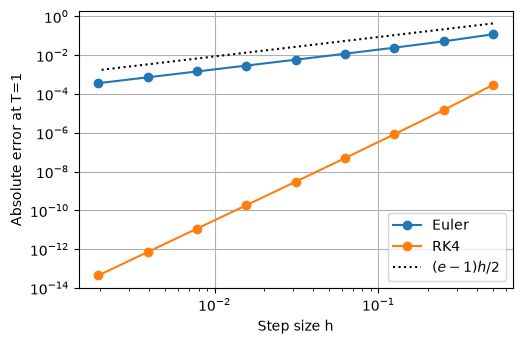
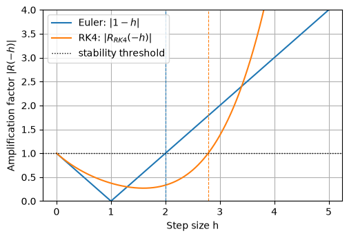
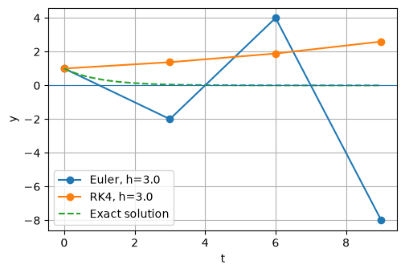

# ODE 初值问题：Euler 与 RK4

> **本文件范围**：当前只含 **3.1 节**（ODE 初值问题：Euler 与 RK4）。3.2、3.3、3.4 待补，后续在本文件中追加。

*从 Euler 的折线到 Runge–Kutta 的四段斜率*

## 目录

- 引子：一条折线与四段斜率
- 1 初值问题与适定性
  - 1.1 微分方程与积分曲线
  - 1.2 Lipschitz 条件
  - 1.3 存在唯一性与连续依赖
  - 1.4 单步法框架与相容性
- 2 显式与隐式 Euler 格式
  - 2.1 显式 Euler 格式
  - 2.2 隐式 Euler 格式
  - 2.3 几何意义与局部误差
- 3 经典 Runge–Kutta 方法
  - 3.1 基本思想与一般形式
  - 3.2 经典 RK4：格式与推导
  - 3.3 几何意义与权重来源
- 4 数值实验
  - 4.1 误差与收敛阶
  - 4.2 稳定性
  - 4.3 计算成本
- 参考文献

## 引子：一条折线与四段斜率

　　1768 年，Euler 在圣彼得堡出版《积分学原理》第一卷[[1]](#ref1)。此时他的视力已经很差，书稿多由他口述、助手笔录。书中有一个今天看来极为朴素的构造：要求一条积分曲线，不必先解出它，只要从已知点出发，沿该点的切线方向走一小步；到了新位置，重新看切线方向，再走一小步。如此反复，得到的是一条折线。没有计算机的年代，折线是少数能真正算出来的东西。

<div align="center">

</div>

*《积分学原理》第一卷扉页（1768）。图片来源：Internet Archive*

　　这条折线留下了一个直到二十世纪才被认真回答的问题：步长越来越小，折线是否真的收敛到真解？收敛得多快？要回答它，先得说清楚"解"是什么、在什么条件下解存在且唯一、初值的微小扰动会不会被放大。这些问题构成了本章第 1 节，也是所有数值方法的共同前提。

　　一百多年后，Göttingen 的 Runge 在 1895 年的《数学年刊》上换了一个问法[[2]](#ref2)：与其把步长缩到无穷小，能否在一步之内多取几个斜率，用它们的加权平均代替切线，从而用更少的步数换到更高的精度？他给出了二阶格式。1900 年，Heun 把"预测—校正"的想法写成一类平均斜率格式[[4]](#ref4)。1901 年，Kutta 在《物理学与数学杂志》上给出了四个斜率、四阶精度的格式[[3]](#ref3)，也就是今天教科书里的经典 RK4。此后一百多年，RK4 一直是科学计算中最常用的通用积分器之一；Hairer、Nørsett 与 Wanner 的《Solving Ordinary Differential Equations I》系统整理了这一族方法的阶条件与稳定性理论[[5]](#ref5)。

<div align="center">

</div>

*图 1　左：Euler（1707–1783）；中：Runge（1856–1927）；右：Kutta（1867–1944）。图片来源：MacTutor History of Mathematics Archive*

　　三个人的问题其实是同一个：怎样用有限个函数值，把一个连续演化过程"压缩"成可以递推的公式。Euler 用一段切线，Runge 用两段斜率的平均，Kutta 用四段斜率的加权平均。本章沿着这条线索展开：第 1 节把初值问题与适定性说清楚，第 2 节给出显式 Euler 格式，第 3 节构造经典 RK4，4.1 至 4.3 节分别讨论误差、稳定性与计算成本。

## 1 初值问题与适定性

### 1.1 微分方程与积分曲线

　　设 $`D\subset\mathbb{R}^2`$ 是开区域，$`f:D\to\mathbb{R}`$ 是给定的函数。一阶常微分方程的初值问题是

```math
y'(t)=f\bigl(t,y(t)\bigr),\qquad y(t_0)=y_0,\qquad t\in I, \qquad (1)
```

其中 $`I`$ 是含 $`t_0`$ 的区间，$`(t_0,y_0)\in D`$。<a id="eq1"></a>

　　**定义 1（经典解）**　若 $`y\in C^1(I)`$，对一切 $`t\in I`$ 有 $`\bigl(t,y(t)\bigr)\in D`$，且逐点满足 [(1)](#eq1)，则称 $`y`$ 是初值问题 [(1)](#eq1) 在 $`I`$ 上的经典解，简称解。

　　例 1　$`f(t,y)=y`$，$`(t_0,y_0)=(0,1)`$：解为 $`y=e^{t}`$，在 $`\mathbb{R}`$ 上处处有定义且唯一。

　　例 2　$`f(t,y)=\sqrt{|y|}`$，$`(t_0,y_0)=(0,0)`$：右端连续，但 $`y\equiv0`$ 与 $`y=t^{2}/4`$（$`t\ge0`$）都是解，两条积分曲线都从原点出发。

　　几何上，[(1)](#eq1) 在 $`D`$ 上给出一个方向场：每一点 $`(t,y)`$ 画一条斜率为 $`f(t,y)`$ 的短线段；解是一条处处与方向场相切的曲线，称为积分曲线。初值条件指定这条曲线经过 $`(t_0,y_0)`$。数值方法要做的，是不去找这条曲线，而用一串短直线段把它"折"出来。

### 1.2 Lipschitz 条件

　　例 2 说明：仅要求 $`f`$ 连续，不足以保证解唯一。症结在于 $`f`$ 在 $`y=0`$ 附近变化得太陡；把"陡"量化，就得到下面的条件。

　　**定义 2（Lipschitz 条件）**　若存在常数 $`L\gt 0`$，使得

```math
\bigl|f(t,u)-f(t,v)\bigr|\le L\,|u-v|,\qquad (t,u),(t,v)\in D, \qquad (2)
```

则称 $`f`$ 在 $`D`$ 上关于 $`y`$ 满足 Lipschitz 条件，$`L`$ 称为 Lipschitz 常数。<a id="eq2"></a>

　　条件 [(2)](#eq2) 只约束 $`f`$ 沿 $`y`$ 方向的变化，对 $`t`$ 方向没有要求；它比"连续"强，比"连续可微"弱。

　　**命题 1**　设 $`D`$ 是凸区域，$`f`$ 在 $`D`$ 上连续可微，且存在常数 $`M`$ 使 $`|\partial f/\partial y|\le M`$。则 $`f`$ 在 $`D`$ 上关于 $`y`$ 满足 Lipschitz 条件，常数可取 $`L=M`$。

　　**证明**　固定 $`(t,u),(t,v)\in D`$。由 $`D`$ 的凸性，线段 $`(t,v+s(u-v))`$，$`0\le s\le1`$ 含于 $`D`$。令 $`g(s)=f(t,v+s(u-v))`$，则 $`g`$ 在 $`[0,1]`$ 上可微，且 $`g'(s)=\partial_y f(t,v+s(u-v))(u-v)`$。由微分中值定理，存在 $`\xi\in(0,1)`$ 使

```math
\bigl|f(t,u)-f(t,v)\bigr|\le M\,|u-v|,
```

取绝对值并用 $`|\partial_y f|\le M`$，即得 [(2)](#eq2)。证毕。

　　反之不成立：$`f`$ 可以 Lipschitz 而处处不可微。因此 Lipschitz 条件是更合适的存在唯一性假设。

　　三个常见例子。

　　（a）$`f(t,y)=-y`$：$`|f(t,u)-f(t,v)|=|u-v|`$，故 $`L=1`$，且是全局 Lipschitz。

　　（b）$`f(t,y)=t^{2}+y^{2}`$：在带形 $`|y|\le R`$ 上 $`|\partial f/\partial y|=2|y|\le2R`$，故在该带形上 $`L=2R`$。这是局部 Lipschitz：$`R`$ 越大 $`L`$ 越大，不存在对全平面成立的有限 $`L`$。

　　（c）$`f(t,y)=\sqrt{|y|}`$：取 $`v=0`$、$`u\gt 0`$，差商 $`\sqrt{u}/u=1/\sqrt{u}\to+\infty`$，故在含 $`y=0`$ 的任何区域上都不满足 Lipschitz 条件。这与例 2 中解不唯一是同一件事的两面。

### 1.3 存在唯一性与连续依赖

　　把微分方程换成积分方程，是处理存在性的标准做法。在连续函数类中，

```math
y(t)=y_0+\int_{t_0}^{t}f\bigl(s,y(s)\bigr)\,\mathrm{d}s
```

与 [(1)](#eq1) 等价。于是求 [(1)](#eq1) 的解，等于求这个积分方程的不动点。

　　**定理 1（Picard–Lindelöf）**　设 $`R=\{(t,y):|t-t_0|\le a,\ |y-y_0|\le b\}\subset D`$，$`f`$ 在 $`R`$ 上连续，$`|f|\le M`$，且关于 $`y`$ 满足 Lipschitz 条件，常数为 $`L`$。令 $`\delta=\min\{a,\,b/M\}`$，则初值问题 [(1)](#eq1) 在 $`I=[t_0-\delta,\,t_0+\delta]`$ 上存在唯一解。

　　**证明**　取 $`y^{(0)}\equiv y_0`$，递推定义 Picard 迭代

```math
y^{(m+1)}(t)=y_0+\int_{t_0}^{t}f\bigl(s,y^{(m)}(s)\bigr)\,\mathrm{d}s,\qquad m=0,1,2,\dots
```

由归纳法可证每个 $`y^{(m)}`$ 连续且不越出 $`R`$，并有估计

```math
\bigl\|y^{(m+1)}-y^{(m)}\bigr\|_\infty\le\frac{M L^{m}}{(m+1)!}\,\delta^{m+1}.
```

右端是收敛级数的通项，故 $`\{y^{(m)}\}`$ 在 $`C(I)`$ 的上确界范数下是 Cauchy 列；由 $`C(I)`$ 的完备性，它一致收敛到某个连续函数 $`y`$。在迭代式中令 $`m\to\infty`$，即知 $`y`$ 满足积分方程，从而是 [(1)](#eq1) 的解。

　　唯一性：设 $`y,z`$ 都是解，令 $`u=|y-z|`$。两式相减并用 Lipschitz 条件，得 $`u(t)\le L|\int_{t_0}^{t}u(s)\,\mathrm{d}s|`$；由前面引理的 $`\alpha=0`$ 情形（或直接对 $`e^{-Lt}v`$ 求导）得 $`u\equiv0`$，故 $`y\equiv z`$。证毕。完整证明见 [[6]](#ref6)[[7]](#ref7)。

　　定理 1 是局部结论：存在区间的长度由 $`b`$ 与 $`M`$ 决定，$`f`$ 增长越快，区间越短。若 $`f`$ 在整个带形上满足增长条件 $`|f(t,y)|\le K(1+|y|)`$，解可以延拓到整个区间。

　　存在唯一性回答"解有没有"；适定性还要回答"解稳不稳"：初值差一点，解会不会差很多。下面的不等式是估计误差的基本工具。

　　**引理 1（Gronwall 不等式）**　设 $`u,\beta\ge0`$ 在 $`[t_0,t_1]`$ 上连续，$`\alpha\ge0`$，且

```math
u(t)\le\alpha+\int_{t_0}^{t}\beta(s)\,u(s)\,\mathrm{d}s,\qquad t\in[t_0,t_1]. \qquad (3)
```

则<a id="eq3"></a>

```math
u(t)\le\alpha\exp\Bigl(\int_{t_0}^{t}\beta(s)\,\mathrm{d}s\Bigr),\qquad t\in[t_0,t_1]. \qquad (4)
```

证明：令 $`U=\alpha+\int\beta u`$，则 $`u\le U`$，$`U'=\beta u\le\beta U`$，故 $`(e^{-\int\beta}U)'\le0`$，在 $`t_0`$ 处取 $`U(t_0)=\alpha`$ 即得。$`\alpha=0`$ 时对 $`\alpha=\varepsilon\downarrow0`$ 取极限。<a id="eq4"></a>

　　**定理 2（对初值的连续依赖）**　设 $`y,z`$ 分别是初值 $`y_0,z_0`$ 的解，都在 $`I`$ 上定义，$`f`$ 的 Lipschitz 常数为 $`L`$。则

```math
\bigl|y(t)-z(t)\bigr|\le|y_0-z_0|\,e^{L|t-t_0|},\qquad t\in I. \qquad (5)
```

证明：两解相减，取绝对值，用 Lipschitz 条件得 $`u(t)\le|y_0-z_0|+L\int_{t_0}^{t}u(s)\mathrm{d}s`$，其中 $`u=|y-z|`$；再由 [(3)](#eq3)[(4)](#eq4) 即得 [(5)](#eq5)。<a id="eq5"></a>

　　式 [(5)](#eq5) 中的因子 $`e^{L|t-t_0|}`$ 是"初值误差被放大多少"的上界，与步长无关，只由方程决定。数值方法把时间离散之后，误差怎样随步数累积，是 4.1 节的内容。

### 1.4 单步法框架与相容性

　　Euler 格式、Heun 格式与 RK4 都是同一个框架的特例。把框架抽象出来，后面讨论不必每次重起炉灶。

　　**定义 3（单步法）**　若格式可以写成

```math
y_{n+1}=y_n+h\,\Phi(t_n,y_n,h), \qquad (6)
```

其中 $`\Phi`$ 是给定函数，称为增量函数，则称该格式为单步法。若 $`\Phi`$ 不含 $`y_{n+1}`$，格式是显式的；若含 $`y_{n+1}`$，格式是隐式的，每一步需要解一个方程。<a id="eq6"></a>

　　显式 Euler 的增量函数是 $`\Phi(t,y,h)=f(t,y)`$。后向 Euler 格式为 $`y_{n+1}=y_n+h f(t_{n+1},y_{n+1})`$，其 $`\Phi`$ 通过 $`y_{n+1}`$ 隐式定义，属于隐式单步法。Heun 格式（改进 Euler）先试走一步，再取两端斜率的平均：

```math
\Phi(t,y,h)=\frac12\Bigl[f(t,y)+f\bigl(t+h,\ y+h f(t,y)\bigr)\Bigr].
```

　　**定义 4（相容性）**　称单步法 [(6)](#eq6) 与方程 [(1)](#eq1) 相容，若

```math
\Phi(t,y,0)=f(t,y),\qquad (t,y)\in D. \qquad (7)
```

相容性的含义是：步长趋于零时，格式的一步增量与微分方程给出的一阶增量一致，格式"认得出原方程"。它是格式可用的最低要求，但不保证收敛，更不说明收敛有多快。对显式 Euler，$`\Phi(t,y,0)=f(t,y)`$；对 Heun，令 $`h=0`$ 得 $`\Phi(t,y,0)=\frac12[f(t,y)+f(t,y)]=f(t,y)`$，故两者都满足 [(7)](#eq7)。<a id="eq7"></a>

## 2 显式与隐式 Euler 格式

### 2.1 显式 Euler 格式

　　[(1)](#eq1) 说的是每一点的导数由 $`f`$ 给出。最直接的离散方式，是把导数换成前向差商。把区间 $`[t_0,T]`$ 等分为 $`M`$ 份，步长 $`h=(T-t_0)/M`$，节点 $`t_n=t_0+nh`$。在 $`t_n`$ 处

```math
y'(t_n)\approx\frac{y(t_{n+1})-y(t_n)}{h}.
```

把它代入 $`y'=f(t,y)`$，并把精确值换成数值近似，得

```math
y_{n+1}=y_n+h\,f(t_n,y_n),\qquad n=0,1,\dots,M-1. \qquad (8)
```

同一个格式也可以从积分方程得到：在 $`[t_n,t_{n+1}]`$ 上 $`y(t_{n+1})=y(t_n)+\int_{t_n}^{t_{n+1}}f(s,y(s))\mathrm{d}s`$，用左端点的值乘区间长近似积分，同样得到 [(8)](#eq8)。差商推导强调"用切线代替曲线"，矩形公式强调"用左端点值代替整段积分"，舍去的是同一个高阶项。<a id="eq8"></a>

### 2.2 隐式 Euler 格式

　　显式 Euler 用左端点的斜率；若改用右端点，就得到隐式 Euler 格式（后向 Euler）：

```math
y_{n+1}=y_n+h\,f(t_{n+1},y_{n+1}).
```

右端含 $`y_{n+1}`$，每一步都要解一个方程：线性问题解线性方程组，非线性问题用 Newton 迭代。它的局部截断误差同样是 $`O(h^2)`$（定义见 2.3 节），一阶精度并不比显式格式高，但稳定性好得多。对测试方程 $`y'=\lambda y`$，放大因子为

```math
R(z)=\frac{1}{1-z},\quad z=h\lambda.
```

当 $`\mathrm{Re}\lambda\lt 0`$ 时对任意 $`h\gt 0`$ 都有 $`|R(z)|\lt 1`$，即无条件稳定；代价是每步的隐式求解。

　　梯形格式：

```math
y_{n+1}=y_n+\frac{h}{2}\left[f(t_n,y_n)+f(t_{n+1},y_{n+1})\right].
```

把两端斜率平均，是二阶隐式格式。显式与隐式的取舍，本质上是每步成本与稳定性之间的取舍。

### 2.3 几何意义与局部误差

　　[(8)](#eq8) 的右端是 $`y_n+h f(t_n,y_n)`$：从 $`(t_n,y_n)`$ 出发，沿该点方向场的方向走水平距离 $`h`$，竖直方向增加 $`h f(t_n,y_n)`$。每一步接起来，得到一条以 $`(t_n,y_n)`$ 为顶点的折线。

　　折线与精确解的相对位置由解的二阶导数决定。若解处处上凸（$`y''\gt 0`$），切线位于曲线下方，折线也落在曲线下方；若处处下凹（$`y''\lt 0`$），情形相反。步长越小，段数越多，折线与曲线贴合越紧。

　　把精确解在 $`t_n`$ 处 Taylor 展开，

```math
y(t_{n+1})=y(t_n)+h f(t_n,y(t_n))+\frac{h^2}{2}y''(\xi_n),
```

与 [(8)](#eq8) 相减，得 Euler 的局部截断误差

```math
\tau_{n+1}=\frac{h^2}{2}y''(\xi_n)=O(h^2). \qquad (9)
```

<a id="eq9"></a>
## 3 经典 Runge–Kutta 方法

### 3.1 基本思想与一般形式

　　一步推进可以写成积分形式

```math
y(t_n+h)=y(t_n)+\int_{t_n}^{t_n+h}f\bigl(t,y(t)\bigr)\,\mathrm{d}t .
```

Euler 格式相当于用左端点值乘区间长度近似这个积分；若在区间内部若干点取样、再按权重组合，就能在不计算高阶导数的前提下提高精度。这是 Runge–Kutta 方法的基本思想：用若干个斜率 $`k_i`$ 的加权平均代替单点斜率。

　　最简单的两步取样是 Heun 格式：先用 Euler 试走一步得到预测值 $`\tilde y_{n+1}=y_n+h f(t_n,y_n)`$，再用两端斜率的平均校正：

```math
y_{n+1}=y_n+\frac{h}{2}\Bigl[f(t_n,y_n)+f\bigl(t_n+h,\tilde y_{n+1}\bigr)\Bigr]. \qquad (10)
```

把 [(10)](#eq10) 在 $`h=0`$ 处展开并与精确解比较，局部误差从 $`O(h^2)`$ 降到 $`O(h^3)`$，即格式是二阶的。<a id="eq10"></a>

　　一般的显式 $`s`$ 级 Runge–Kutta 格式写成

```math
\begin{aligned}
k_i&=f\Bigl(t_n+c_ih,\ y_n+h\sum_{j=1}^{i-1}a_{ij}k_j\Bigr),\qquad i=1,\dots,s,\\
y_{n+1}&=y_n+h\sum_{i=1}^{s}b_ik_i.
\end{aligned} \qquad (11)
```

式 [(11)](#eq11) 中的 $`c_i`$ 为节点系数，$`a_{ij}`$ 为级间耦合系数，$`b_i`$ 为组合权重。系数一旦取定，方法就完全确定，可以用 Butcher 表紧凑地写出。<a id="eq11"></a>

### 3.2 经典 RK4：格式与推导

　　经典四阶 Runge–Kutta 取 $`s=4`$，在步内四个位置各取一次斜率：

```math
\begin{aligned}
k_1&=f(t_n,y_n),\\
k_2&=f\bigl(t_n+h/2,\ y_n+hk_1/2\bigr),\\
k_3&=f\bigl(t_n+h/2,\ y_n+hk_2/2\bigr),\\
k_4&=f\bigl(t_n+h,\ y_n+hk_3\bigr),
\end{aligned} \qquad (12)
```

再以权重 $`1,2,2,1`$ 加权平均：<a id="eq12"></a>

```math
y_{n+1}=y_n+\frac{h}{6}\bigl(k_1+2k_2+2k_3+k_4\bigr). \qquad (13)
```

对应的 Butcher 表为<a id="eq13"></a>

```math
\begin{array}{c|cccc}
0 & & & & \\[2pt]
\tfrac12 & \tfrac12 & & & \\[2pt]
\tfrac12 & 0 & \tfrac12 & & \\[2pt]
1 & 0 & 0 & 1 & \\[2pt] \hline
 & \tfrac16 & \tfrac13 & \tfrac13 & \tfrac16
\end{array}
```

每一步需要四次右端函数求值，记 $`n_f=4M`$。四个斜率的取法不是唯一的：只要系数满足下面列出的阶条件，就能得到四阶格式。

　　把 [(13)](#eq13) 与精确解在 $`t_n`$ 处的 Taylor 展开逐项比较。记 $`F=f(t_n,y_n)`$，沿解曲线取全导数，则

```math
y(t_n+h)=y_n+hF+\frac{h^2}{2}\bigl(f_t+f_yF\bigr)+O(h^3).
```

把 [(12)](#eq12) 的各级斜率在 $`(t_n,y_n)`$ 处展开，代入 [(13)](#eq13)，按 $`h`$ 的幂次合并，得

```math
\begin{aligned}
y_{n+1}={}&y_n+hF\Bigl(\sum_i b_i\Bigr)
+\frac{h^2}{2}\Bigl(\sum_i b_ic_i\Bigr)\bigl(f_t+f_yF\bigr)\\
&+\frac{h^3}{6}\Bigl(\sum_i b_ic_i^2\Bigr)\bigl(f_{tt}+2f_{ty}F+f_{yy}F^2\bigr)
+\frac{h^3}{6}\Bigl(\sum_{i\gt j}b_ia_{ij}c_j\Bigr)f_y\bigl(f_t+f_yF\bigr)+O(h^4).
\end{aligned}
```

令同次幂的系数逐个相等，得 8 条阶条件：

```math
\begin{aligned}
&\sum_i b_i=1,\qquad \sum_i b_ic_i=\frac12,\qquad \sum_i b_ic_i^2=\frac13,\\
&\sum_{i\gt j}b_ia_{ij}c_j=\frac16,\qquad \sum_i b_ic_i^3=\frac14,\qquad \sum_{i\gt j}b_ic_ia_{ij}c_j=\frac18,\\
&\sum_{i\gt j}b_ia_{ij}c_j^2=\frac1{12},\qquad \sum_{i\gt j\gt k}b_ia_{ij}a_{jk}c_k=\frac1{24}.
\end{aligned}
```

这 8 个方程含 10 个未知系数，解中含一个自由参数，故四阶显式方法不唯一[[5]](#ref5)[[10]](#ref10)。把 [(12)](#eq12) 与 [(13)](#eq13) 的节点、权重代入，前两条为 $`\sum_i b_i=1`$、$`\sum_i b_ic_i=\frac12`$，其余各条同样成立，于是 $`y_{n+1}`$ 与真解的展开在 $`h^4`$ 项以内完全一致。经典 RK4 的局部截断误差为

```math
\tau_{n+1}=O(h^5). \qquad (14)
```

四个阶段是达到四阶精度的最低要求：$`s`$ 级显式 Runge–Kutta 的最高阶为 $`s`$（$`s\le4`$），再高的阶需要更多级。这也是 RK4 在精度与每步成本之间取得平衡的原因。<a id="eq14"></a>

### 3.3 几何意义与权重来源

　　取 $`y'=-y`$、$`y(0)=1`$、$`h=0.5`$，真解为 $`y=e^{-t}`$，一步之内四个阶段如下：

```math
\begin{aligned}
k_1&=f(t_n,y_n)=-1,\\
M_1&=\bigl(t_n+h/2,\ y_n+hk_1/2\bigr)=(0.25,\ 0.7500),\qquad k_2=f(M_1)=-0.7500,\\
M_2&=\bigl(t_n+h/2,\ y_n+hk_2/2\bigr)=(0.25,\ 0.8125),\qquad k_3=f(M_2)=-0.8125,\\
E_1&=\bigl(t_n+h,\ y_n+hk_3\bigr)=(0.50,\ 0.59375),\qquad k_4=f(E_1)=-0.59375.
\end{aligned}
```

可见 $`M_1`$ 与 $`M_2`$ 位于同一条竖线 $`t_n+h/2`$ 上，却分居真实解曲线的两侧：$`M_1`$ 由起点切线外推而得，偏低；$`M_2`$ 用中点斜率回头修正，偏高。四个斜率的量值彼此接近，加权后

```math
\bar k=\frac16\bigl(-1+2(-0.75)+2(-0.8125)-0.59375\bigr)=-0.78646,
```

```math
y_1=1+0.5\times(-0.78646)=0.6067708,
```

与真值 $`e^{-0.5}=0.6065307`$ 相比，残差为 $`2.4\times10^{-4}`$。四个斜率的加权平均介于最陡与最平之间，相当于用一条斜率居中的直线代替整段曲线，其截断误差比单点切线小一个量级以上。

　　权重 $`1:2:2:1`$ 并非凑出。把一步的积分用 Simpson 公式近似，需要在左端点、中点、右端点取值，权重比为 $`1:4:1`$；中点被第 2、3 级各取一次，$`4`$ 便拆成 $`2+2`$，这就是 $`1:2:2:1`$ 的由来；节点 $`0,\frac12,\frac12,1`$ 也由这三处取样位置决定[[11]](#ref11)。四阶之所以常用，是因为在这一阶数上阶条件仍可手工核验；继续提高阶数需要增加级数，阶条件迅速增多，精度收益与公式复杂度不再同步改善。

## 4 数值实验

### 4.1 误差与收敛阶

　　局部截断误差衡量单步离散本身带来的误差：假设第 $`n`$ 步以精确解 $`y(t_n)`$ 为输入，一步之后与精确解的偏差。Euler 的局部误差由 [(9)](#eq9) 给出，RK4 的局部误差由 [(14)](#eq14) 给出。全局误差描述多步迭代后的整体偏差：

```math
E_n=y(t_n)-y_n. \qquad (15)
```

单步误差会随时间传播并被放大，因此全局误差一般大于局部误差的简单累加。由 [(15)](#eq15)，把 Euler 格式与精确解相减，用 Lipschitz 条件估计，再由 Gronwall 不等式 [(3)](#eq3)[(4)](#eq4)，得<a id="eq15"></a>

```math
|E_n|\le\frac{M_2}{2L}\bigl(e^{L(T-t_0)}-1\bigr)h,\qquad M_2=\max|y''|. \qquad (16)
```

放大因子仍是 $`e^{L(T-t_0)}`$：区间越长、$`L`$ 越大，误差界越松。<a id="eq16"></a>

　　[(16)](#eq16) 说明 Euler 的全局误差与 $`h`$ 的一次方成正比。对 RK4，同样的推导给出

```math
\max_{0\le n\le M}|y(t_n)-y_n|=O(h^4). \qquad (17)
```

式 [(17)](#eq17) 是四阶收敛的定量表述。总步数 $`M=O(h^{-1})`$ 的累积效应使全局阶比局部阶低一阶：Euler 的局部误差是 $`O(h^2)`$、全局是 $`O(h)`$；RK4 的局部误差是 $`O(h^5)`$、全局是 $`O(h^4)`$。这一"降一阶"的规律，是单步法误差分析的基本结论[[8]](#ref8)。<a id="eq17"></a>

　　若误差近似满足 $`E(h)\approx Ch^p`$，则步长减半后 $`E(h/2)\approx C(h/2)^p`$，两式相除取对数，得观测收敛阶

```math
p_{\mathrm{obs}}=\log_2\frac{E(h)}{E(h/2)}. \qquad (18)
```

式 [(18)](#eq18) 就是由相邻两次误差估计收敛阶的公式。对模型问题 $`y'=-y`$、$`y(0)=1`$、$`t\in[0,1]`$，精确解为 $`e^{-t}`$。取一系列减半的步长，结果列于表 1，误差随步长的变化画在图 2。<a id="eq18"></a>

**表 1　终点误差与观测收敛阶（$`y'=-y`$，$`y(0)=1`$，$`T=1`$）**

| 步长 <i>h</i> | Euler 求值次数 | Euler 误差 | Euler 观测阶 | RK4 求值次数 | RK4 误差 | RK4 观测阶 |
| --- | --- | --- | --- | --- | --- | --- |
| 1/2 | 2 | 1.18×10⁻¹ | --- | 8 | 2.91×10⁻⁴ | --- |
| 1/4 | 4 | 5.15×10⁻² | 1.20 | 16 | 1.48×10⁻⁵ | 4.30 |
| 1/8 | 8 | 2.43×10⁻² | 1.08 | 32 | 8.31×10⁻⁷ | 4.15 |
| 1/16 | 16 | 1.18×10⁻² | 1.04 | 64 | 4.93×10⁻⁸ | 4.08 |
| 1/32 | 32 | 5.82×10⁻³ | 1.02 | 128 | 3.00×10⁻⁹ | 4.04 |
| 1/64 | 64 | 2.89×10⁻³ | 1.01 | 256 | 1.85×10⁻¹⁰ | 4.02 |

<div align="center">

</div>

*图 2　终点误差随步长的变化（双对数坐标）。斜率约为 1 的是 Euler，约为 4 的是 RK4。*

　　表 1 与理论一致：Euler 的观测阶由 1.20 逐步趋近 1，RK4 的观测阶由 4.30 趋近 4。步长较大时观测阶偏高，是因为高阶截断项尚未充分衰减；步长很小时观测阶偏离理论值，是因为舍入误差开始占主导。

### 4.2 稳定性

　　收敛阶描述 $`h\to0`$ 时的渐近精度，无法回答固定步长下误差是否会被放大。为分析稳定性，考虑线性测试方程

```math
y'=\lambda y,\qquad \lambda\in\mathbb{C}. \qquad (19)
```

把数值格式作用于 [(19)](#eq19)，可以把一步迭代写成<a id="eq19"></a>

```math
y_{n+1}=R(z)\,y_n,\qquad z=h\lambda, \qquad (20)
```

式 [(20)](#eq20) 把一步迭代化为乘以放大因子 $`R(z)`$，$`R(z)`$ 称为该格式的稳定函数。要使数值解不增长，需要<a id="eq20"></a>

```math
|R(z)|\le1. \qquad (21)
```

满足 [(21)](#eq21) 的复数 $`z`$ 的集合称为绝对稳定区域。精度与稳定性是相互独立的性质：高阶格式在步长过大时同样可能失去稳定性[[9]](#ref9)。<a id="eq21"></a>

　　对显式 Euler，$`y_{n+1}=y_n+h\lambda y_n=(1+z)y_n`$，故 $`R(z)=1+z`$。条件 $`|1+z|\le1`$ 在复平面上是以 $`-1`$ 为圆心、半径为 1 的圆盘。对模型问题 $`\lambda=-1`$，$`z=-h`$，由 $`|1-h|\le1`$ 得

```math
0\le h\le2. \qquad (22)
```

式 [(22)](#eq22) 给出 Euler 在模型问题上的步长上限。若额外要求数值解保持非负且单调衰减，则放大因子需满足 $`1-h\ge0`$，即 $`h\le1`$。<a id="eq22"></a>

　　对经典 RK4，把测试方程代入 [(12)](#eq12)[(13)](#eq13)，得

```math
R(z)=1+z+\frac{z^2}{2}+\frac{z^3}{6}+\frac{z^4}{24}. \qquad (23)
```

式 [(23)](#eq23) 中的多项式是指数函数 $`e^{z}`$ 的 Taylor 展开截断到四次，故在测试方程上单步放大因子与 $`e^{z}`$ 的差异起始于 $`z^5`$ 量级。在实负轴上，$`|R(z)|\le1`$ 的区间约为<a id="eq23"></a>

```math
-2.785\le z\le0, \qquad (24)
```

式 [(24)](#eq24) 给出 RK4 在实负轴上的步长上限；对 $`\lambda=-1`$ 有 $`h\lesssim2.785`$。图 3 给出两种方法的放大因子随步长的变化。<a id="eq24"></a>

<div align="center">

</div>

*图 3　放大因子 $`|R(-h)|`$ 随步长的变化，虚线为稳定阈值 1。Euler 在 $`h=2`$ 处越过阈值，RK4 在 $`h\approx2.785`$ 处越过阈值。*

　　步长越过稳定区间后，数值解会以交替符号振荡并迅速增长。图 4 是 $`h=3`$、$`T=9`$ 时两种方法的数值解与精确解的对比：Euler 的放大因子为 $`2`$，几步之后幅值已达 $`10^{0}`$ 量级；RK4 的放大因子为 $`1.375`$，同样增长，只是速度稍慢。稳定性是格式的性质，不是初值的性质。

<div align="center">

</div>

*图 4　$`h=3`$ 时两种方法的数值解与精确解（$`T=9`$）。*

### 4.3 计算成本

　　计算成本可用两类指标衡量：右端函数求值次数 $`n_f`$，与编程语言、硬件无关，适合理论比较；CPU 运行时间，反映实际开销，受实现与硬件影响。Euler 每步求值一次，RK4 每步求值四次，故相同步数下 $`n_f^{\mathrm{RK4}}=4n_f^{\mathrm{Euler}}`$。

　　但单步成本不决定总成本。若要求两种方法达到相同精度，设 $`E_{\mathrm{Euler}}\approx ah`$、$`E_{\mathrm{RK4}}\approx bh^4`$，令 $`ah_{\mathrm{Euler}}=bh_{\mathrm{RK4}}^4`$，得

```math
h_{\mathrm{Euler}}\approx\frac{b}{a}\,h_{\mathrm{RK4}}^4 .
```

相应的求值次数之比为

```math
\frac{n_f^{\mathrm{Euler}}}{n_f^{\mathrm{RK4}}}
=\frac{T/h_{\mathrm{Euler}}}{4T/h_{\mathrm{RK4}}}
=\frac{a}{4b\,h_{\mathrm{RK4}}^3}.
```

步长越小，这个比值增长得越快：RK4 每步四次求值的代价，很快被它允许的大步长抵消。

　　取 $`T=1`$、$`h=1/128`$，实测结果列于表 2：Euler 与 RK4 的求值次数分别为 128 与 512，误差分别为 $`1.44\times10^{-3}`$ 与 $`1.15\times10^{-11}`$；求值次数之比为 4，而实际耗时之比为 5.9（不同步长的中位数）。耗时比高于 4，是因为 RK4 每步除四次求值外还要组合四个阶段。只有在同一编程语言、同一实现与同一硬件下，耗时比较才有意义。

**表 2　计算成本对比（$`T=1`$，$`h=1/128`$）**

| 方法 | 求值次数 | 终点误差 | 相对耗时 |
| --- | --- | --- | --- |
| Euler | 128 | 1.44×10⁻³ | 1.0 |
| RK4 | 512 | 1.15×10⁻¹¹ | 5.9 |

<a id="refs"></a>

## 参考文献

<a id="ref1"></a>[1] L. Euler. *Institutiones calculi integralis*, Vol. 1. St Petersburg: Imperial Academy of Sciences, 1768.

<a id="ref2"></a>[2] C. Runge. Über die numerische Auflösung von Differentialgleichungen. *Mathematische Annalen*, 1895, 46: 167–178.

<a id="ref3"></a>[3] W. Kutta. Beitrag zur näherungsweisen Integration totaler Differentialgleichungen. *Zeitschrift für Mathematik und Physik*, 1901, 46: 435–453.

<a id="ref4"></a>[4] K. Heun. Neue Methode zur approximativen Integration der Differentialgleichungen einer unabhängigen Veränderlichen. *Zeitschrift für Mathematik und Physik*, 1900, 45: 23–38.

<a id="ref5"></a>[5] E. Hairer, S. P. Nørsett, G. Wanner. *Solving Ordinary Differential Equations I: Nonstiff Problems*, 2nd ed. Berlin: Springer, 1993.

<a id="ref6"></a>[6] E. A. Coddington, N. Levinson. *Theory of Ordinary Differential Equations*. New York: McGraw-Hill, 1955.

<a id="ref7"></a>[7] P. Hartman. *Ordinary Differential Equations*. New York: Wiley, 1964.

<a id="ref8"></a>[8] J. Shiach. *Ordinary Differential Equations*: Error Analysis. https://jonshiach.github.io/ODEs-book/_pages/1.2_Error_Analysis.html

<a id="ref9"></a>[9] J. Shiach. *Ordinary Differential Equations*: Absolute Stability. https://jonshiach.github.io/ODEs-book/_pages/4.3_Absolute_stability.html

<a id="ref10"></a>[10] J. C. Butcher. *Numerical Methods for Ordinary Differential Equations*, 3rd ed. Chichester: Wiley, 2016.

<a id="ref11"></a>[11] R. L. Burden, J. D. Faires. *Numerical Analysis*, 10th ed. Boston: Cengage Learning, 2016.