# 第03章 离散的世界

## 3.0 章首导入：一次快充，计算机需要回答多少个问题？

在高速服务区，一辆新能源汽车接入快充桩。驾驶员看着屏幕上的充电进度，关心的是：“还要等多久才能充好电？”而负责电池热管理的工程师，却需要思考另一个看不见的问题：

电池内部的热量正在向哪里传递？继续充电后，哪个位置的温度可能最高？

高功率充电不仅涉及电能的输入，也伴随着电池内部的产热与散热。电池包中的温度并不一定处处相同：靠近冷却通道的位置可能较凉，散热条件不同的位置则可能出现更高的温度。

要设计合理的温控策略，工程师不能只知道“现在有多热”，还需要预测：接下来会怎样变化？

<p align="center">
  
</p>

<p align="center">
  <em>图3-1 新能源汽车快充时的电池热管理及其数值建模示意图。图中展示了快充场景、电池冷却结构、内部温度分布及空间离散化过程。</em>
</p>

这幅图揭示了一个重要事实：现实中的温度变化是连续发生的，但计算机却只能通过有限次运算进行预测。那么，计算机究竟怎样描述这样一个连续变化的物理过程？

### 3.0.1 问题一：怎样预测下一时刻的温度？

如果先把电池近似看成温度均匀的整体，就可以用**常微分方程** (ordinary differential equation, ODE) 描述其状态随时间的变化。例如，一般的一阶初值问题可以写为

$$
\begin{cases}
y'(t)=f(t,y(t)),\\
y(t_0)=y_0.
\end{cases}
\tag{3.0.1}
$$

其中，$y(t)$ 表示随时间变化的状态量，$f(t,y)$ 描述其瞬时变化率。然而，计算机通常不能直接获得整个连续时间区间上的解析解，而需要把时间划分成一个个离散节点，再从已知状态逐步计算未来状态。**Euler方法** (Euler method) 和**四阶Runge–Kutta方法** (fourth-order Runge–Kutta method, RK4) 提供了不同的时间推进策略。即使求解同一个微分方程、采用相同的初始条件，它们也可能给出不同的数值结果。

同一个物理过程，为什么不同算法会预测出不同的结果？我们又该相信哪一个？

这正是 3.1 节“ODE初值问题：Euler与RK4”要回答的问题。

### 3.0.2 问题二：怎样发现电池内部的局部高温？

只预测电池的平均温度显然不够。即使平均温度处于合理范围，局部区域也可能存在温度较高的情况。为了描述热量在空间中的传递，就需要从常微分方程进一步走向**偏微分方程** (partial differential equation, PDE)。在适当的简化假设下，一维热传导过程可以用**热方程** (heat equation) 描述：

$$
\frac{\partial u}{\partial t}=
\kappa\frac{\partial^2u}{\partial x^2}.
\tag{3.0.2}
$$

其中，$u(x,t)$ 表示位置 $x$、时刻 $t$ 的温度，$\kappa$ 为热扩散系数。为了利用计算机求解，我们可以沿空间方向设置网格节点，并使用**有限差分方法** (finite difference method) 近似空间导数。但这里存在一个出人意料的现象：即使真实温度正在逐渐趋于平稳，数值计算得到的温度也可能发生剧烈振荡，甚至不断增大。这并不意味着真实电池突然违反了热传导规律，而可能是离散方法的时间步长与空间网格不匹配，导致计算失去了**稳定性** (stability)。

为什么一个看似合理的计算公式，会产生不符合物理规律的结果？

3.2 节“PDE有限差分：热传导与CFL条件”将帮助我们理解数值稳定性及其与网格、时间步长之间的关系。

### 3.0.3 问题三：面对复杂结构，能否换一种计算思路？

实际电池包并不是一根简单的直杆。电芯、冷却通道和结构连接件具有不同的几何形状。如果希望进一步考虑复杂结构中的物理场分布，仅依靠规则网格上的简单差分格式，可能不够方便。有没有办法把复杂区域拆分成许多容易处理的小单元，再将它们组合起来？**有限元方法** (finite element method) 提供了另一种思路。它把连续区域划分为有限个单元，通过简单的局部函数构造近似解，再利用**弱形式** (weak form) 与**Galerkin方法** (Galerkin method) 建立可以求解的代数方程组。更令人意外的是：即使使用分片直线近似一条光滑曲线，且这些直线不能在每一点上满足原微分方程，也可能在某些节点上得到完全准确的数值。这究竟是巧合，还是背后存在更深刻的数学原理？

在 3.3 节“有限元：弱形式与Galerkin方法”中，我们将从一维边值问题出发，理解有限元如何通过改变方程的检验方式，将连续问题转化为有限维计算问题。

### 3.0.4 问题四：人工智能能否参与预测？

随着人工智能技术的发展，神经网络也开始被用于微分方程建模与求解。传统数值方法通常从已知的数学模型出发，通过离散化计算系统状态；而在某些数据驱动任务中，我们还希望利用观测数据学习系统的变化规律。例如，**Neural ODE**（神经常微分方程）利用神经网络表示微分方程的右端函数，并通过数值积分获得连续时间系统的演化轨迹；而 **PINN**（物理信息神经网络）则将微分方程残差、初始条件或边界条件等信息纳入训练目标，使神经网络的预测受到物理规律约束。

这些方法为物理建模与数据驱动计算的结合提供了新的思路。但是，一个新的问题也随之出现：如果神经网络能够很好地拟合已有数据，是否意味着它一定能够准确预测未来？如果改变初始条件、时间步长或数值求解器，预测结果又是否仍然可靠？在 3.4 节“AI关联：Neural ODE与PINN”中，我们将带领读者初步认识数值计算与人工智能之间的联系。

为了突出这些方法的基本数学原理，本章将采用理想化的衰减模型、一维热传导模型及一维边值问题进行推导和实验，而不直接求解完整的新能源汽车电池热管理系统。尽管这些方法采用了不同的离散思想和计算策略，却共同指向本章最重要的问题：当连续的现实世界被转化为有限的时间步长、空间网格和数值变量时，我们凭什么相信计算机得到的结果是准确、稳定且可信的？

### 3.0.5 章首思考

**思考 1：平均温度下降，就意味着处处都在冷却吗？**

如果某个电池包的平均温度正在下降，是否可以认定电池内部每一个位置的温度都在下降？为什么？

**思考 2：网格越细，计算结果就一定越可靠吗？**

对于热传导问题，如果不断缩小空间网格间距，而保持时间步长不变，计算结果是否一定更加准确？

**思考 3：人工智能的预测一定比传统数值方法更好吗？**

如果一个神经网络对已有实验数据拟合得非常准确，是否就说明它在不同初始条件下也能够可靠预测系统的变化？

请读者先形成自己的判断，再带着这些问题进入本章。在后续的数学推导与数值实验中，我们将逐步寻找答案。

## 3.1 常微分方程初值问题：Euler 方法与经典四阶 Runge–Kutta 方法

### 导览：一杯热茶，为什么会被“算”得比室温还冷？

#### 一个看似不可能的预测

一杯刚泡好的热茶放在桌上，周围室温基本保持不变。随着时间推移，热茶逐渐冷却，温度越来越接近室温。若用“茶水温度与室温之差”描述冷却过程，那么在理想化的牛顿冷却模型中，**只要初始时茶水高于室温，这个温差就会逐渐趋于零，而不会突然变成负值。**

假设把温差和时间都作适当的无量纲化处理，初始温差记为 $1$，变化率恰好等于当前温差的相反数。现在不求完整的温度变化曲线，只想预测一段时间之后的温差。

一种直观办法是：测出此刻的降温速度，并假设接下来的一小段时间内，茶水都按这个速度降温。可是，如果把这“一小段时间”取得太长，例如一步跨过 $2.5$ 个无量纲时间单位，计算竟会给出温差 $-1.5$；而相应连续模型的精确温差约为 $0.0821$，仍然为正。

**同一个冷却规律，为什么连续模型的温差始终为正，简单的数值预测却可能越过零点？**

#### 30 秒思考：问题出在哪里？

先不急着计算更多步骤。对于上述反常预测，下面哪一种解释更合理？

- **A．** 微分方程描述的冷却过程本身必然会让温差在某一时刻变成负值。
- **B．** 用当前斜率代表整个时间步的变化可能过于粗糙，尤其在步长较大时，数值结果可能偏离真实解。
- **C．** 只要使用高阶算法，不论时间步取得多大，都一定能得到稳定且准确的结果。

可以先记下判断，读完本节再用更新公式和稳定性分析检验。

#### 从这个问题出发

这杯热茶实际上提出了三个依次深入的数学问题：**如何根据当前状态计算下一步？能否利用更多斜率信息提高精度？怎样判断计算结果是否可信？**

为回答这些问题，本节先建立常微分方程初值问题的离散形式，介绍向前 Euler 与向后 Euler 方法；再由低阶 Runge–Kutta 方法过渡到经典四阶 Runge–Kutta 方法；最后讨论局部误差、全局误差、稳定性以及计算成本。热茶冷却的情境只用于帮助理解，后文将以统一的无量纲线性衰减方程进行严格计算。

---

本节研究常微分方程初值问题的固定步长数值求解。首先介绍时间离散和向前、向后 Euler 方法，继而由一阶、二阶 Runge–Kutta 方法引出经典四阶 Runge–Kutta 方法，最后从误差、稳定性与计算成本三个方面比较这些算法。为使推导与计算相互印证，全文采用统一的符号约定，并以线性衰减方程作为贯穿算例。

### 3.1.1 初值问题与 Euler 方法

#### （一）初值问题及时间离散

考虑一阶常微分方程初值问题（initial value problem，简称 IVP）

$$
\begin{cases}
y'(t)=f\bigl(t,y(t)\bigr), & t\in[t_0,T],\\
y(t_0)=y_0.
\end{cases}
\tag{3.1.1}
$$

其中，$t$ 表示自变量（通常为时间），$y(t)$ 表示待求状态函数，$f(t,y)$ 为已知的右端函数；$t_0$、$y_0$ 和 $T$ 分别为初始时刻、初始状态和终止时刻。以下主要讨论标量方程；对于向量值状态，相关公式可按分量或向量形式推广。

初值问题的求解依赖于微分方程与初始条件两方面的信息。若 $f$ 在初值附近连续，且关于状态变量 $y$ 满足局部 Lipschitz 条件，则可在一定时间区间内保证解的存在唯一性。解能否延拓至整个 $[t_0,T]$，还取决于所研究问题的具体条件。即使解存在唯一，也未必能得到便于计算的解析表达式，因此需要构造离散近似。

将区间 $[t_0,T]$ 均匀划分为 $N$ 个时间步，设

$$
\left\{
\begin{aligned}
h&=\frac{T-t_0}{N}>0,\\
t_n&=t_0+nh,\qquad n=0,1,\ldots,N.
\end{aligned}
\right.
\tag{3.1.2}
$$

记 $y(t_n)$ 为精确解在节点 $t_n$ 处的值，$y_n$ 为它的数值近似，并取 $y_0=y(t_0)$ 作为计算初值。此后，**$y(t_n)$ 始终表示精确值，$y_n$ 始终表示数值近似值**。本节所讨论的方法均属于单步方法，即由当前状态 $y_n$ 和本步内的函数信息计算下一状态 $y_{n+1}$。

根据微积分基本定理，精确解满足

$$
y(t_{n+1})=y(t_n)+\int_{t_n}^{t_{n+1}}f\bigl(t,y(t)\bigr)\,\mathrm{d}t.
\tag{3.1.3}
$$

因此，设计数值方法的一个基本思路是：用可计算的近似表达式代替式（3.3）中的积分，再用数值状态代替精确状态。

#### （二）向前 Euler 方法

若采用积分区间左端点的函数值近似式（3.3）的积分，即取

$$
\int_{t_n}^{t_{n+1}}f\bigl(t,y(t)\bigr)\,\mathrm{d}t
\approx h f\bigl(t_n,y(t_n)\bigr),
\tag{3.1.4}
$$

便得到**向前 Euler 方法**（forward Euler method），亦称**显式 Euler 方法**：

$$
{\left\{
\begin{aligned}
t_{n+1}&=t_n+h,\\
y_{n+1}&=y_n+h f(t_n,y_n).
\end{aligned}
\right.
\tag{3.1.5}
$$

由式（3.5）可见，向前 Euler 方法使用当前点 $(t_n,y_n)$ 处的斜率预测下一步的状态。在几何上，它相当于以当前点的切线近似解曲线在一个时间步内的变化。由于右端只含已知量，下一节点的近似值可以直接计算，故称为显式方法。

这一公式也可由 Taylor 展开得到。若精确解具有连续的二阶导数，则存在 $\xi_n\in(t_n,t_{n+1})$，使

$$
y(t_{n+1})=y(t_n)+h y'(t_n)+\frac{h^2}{2}y''(\xi_n).
\tag{3.1.6}
$$

代入 $y'=f(t,y)$ 并略去二阶余项，即得到式（3.5）。这同时表明：若从精确状态出发推进一步，向前 Euler 的一步局部差值为 $O(h^2)$。有关其多步误差将在 3.1.3 节进一步讨论。

#### （三）向后 Euler 方法

向前 Euler 方法使用左端点斜率。如果改用积分区间右端点的函数值近似式（3.3）的积分，则得到**向后 Euler 方法**（backward Euler method），亦称**隐式 Euler 方法**：

$$
\left\{
\begin{aligned}
t_{n+1}&=t_n+h,\\
y_{n+1}&=y_n+h f(t_{n+1},y_{n+1}).
\end{aligned}
\right.
\tag{3.1.7}
$$

与式（3.5）不同，式（3.7）右端出现了未知的 $y_{n+1}$。因此，向后 Euler 一般不能通过一次直接代入完成更新，而需要求解关于下一时刻状态的代数方程。令

$$
F_n(u)=u-y_n-hf(t_{n+1},u),
\qquad F_n(u)=0,
\tag{3.1.8}
$$

则 $F_n$ 的适当零点即为所求的 $y_{n+1}$。对于非线性右端函数，如果 $f$ 对 $y$ 可微，且迭代初值合适、分母不为零，可采用 Newton 法求解：

$$
u^{(m+1)}=u^{(m)}-
\frac{F_n\bigl(u^{(m)}\bigr)}
{1-hf_y\bigl(t_{n+1},u^{(m)}\bigr)}.
\tag{3.1.9}
$$

其中，$m$ 为非线性迭代次数，$f_y$ 表示 $f$ 对第二个变量的偏导数。若 $y$ 为向量，式（3.9）相应地转化为利用雅可比矩阵求解线性方程组的 Newton 步。应当区分**时间离散误差**与**代数方程求解误差**：只有隐式方程被求解到足够精度时，才能观察到向后 Euler 方法本身的理论精度。

向前 Euler 与向后 Euler 的一步局部差值均为 $O(h^2)$，在通常的光滑性及误差传播条件下均为全局一阶方法；但两者的稳定性有显著区别。向后 Euler 虽然每一步可能需要额外的代数求解工作，却具有更好的衰减稳定性。这说明**显式与隐式主要区别于更新方程的求解方式，而非精度阶数的高低**。

#### （四）Euler 方法的一个基本算例

**例 3.1**　考虑无量纲线性衰减模型

$$
\begin{cases}
y'(t)=-y(t), & t\geqslant 0,\\
y(0)=1.
\end{cases}
\tag{3.1.10}
$$

这里的 $t$ 与 $y$ 均为无量纲变量。利用分离变量法可得解析解

$$
y(t)=e^{-t},\qquad y(0.5)=e^{-0.5}\approx0.606530659713.
\tag{3.1.11}
$$

取步长 $h=0.5$。由式（3.5），向前 Euler 第一步得到 $y_1^{\mathrm{FE}}=1+0.5(-1)=0.5$；由式（3.7），向后 Euler 第一步满足 $y_1^{\mathrm{BE}}=1-0.5y_1^{\mathrm{BE}}$，从而

$$
\left\{
\begin{aligned}
y_1^{\mathrm{FE}}&=0.5,\\
y_1^{\mathrm{BE}}&=\frac{1}{1+h}=\frac23\approx0.666666666667.
\end{aligned}
\right.
\tag{3.1.12}
$$

在这一算例中，向前 Euler 低估真实解，向后 Euler 高估真实解。两种方法分别采用步长起点和终点的变化率，但都只利用了单次斜率近似。若希望在相同步长下进一步提高精度，就需要更充分地利用一个时间步内的斜率信息。

### 3.1.2 Runge–Kutta 方法：从一阶到四阶

#### （一）从单阶段方法到两阶段方法

向前 Euler 方法也可以看作最简单的**一阶显式 Runge–Kutta 方法**。记

$$
\left\{
\begin{aligned}
k_1&=f(t_n,y_n),\\
y_{n+1}&=y_n+hk_1,
\end{aligned}
\right.
\tag{3.1.13}
$$

其中，$k_1$ 表示当前节点的斜率。当一个时间步内变化率变化较快时，仅用 $k_1$ 近似整个区间上的平均变化率，可能产生较大的截断误差。因此，可以通过增加中间阶段获得更充分的信息。

一种典型的**二阶显式 Runge–Kutta 方法**先用起点斜率预测终点状态，再把起点斜率和预测终点的斜率取平均：

$$
\left\{
\begin{aligned}
k_1&=f(t_n,y_n),\\
k_2&=f(t_n+h,y_n+hk_1),\\
y_{n+1}&=y_n+\frac h2(k_1+k_2).
\end{aligned}
\right.
\tag{3.1.14}
$$

该形式通常称为**显式梯形型二阶 Runge–Kutta 方法**（亦称 Heun 方法）；这里仅用它说明从一阶段到多阶段的构造思路，不将其列为 Euler 方法的独立分支。特别要注意，式（3.14）使用的是*预测终点状态*，因而仍为显式方法，不能与需要求解未知终点状态的隐式梯形法混为一谈。

二阶精度可由 Taylor 展开作简要解释。对于足够光滑的标量初值问题，沿精确解有 $y''=f_t+f_y f$，因此

$$
y(t_n+h)=y(t_n)+h f
+\frac{h^2}{2}(f_t+f_yf)+O(h^3),
\tag{3.1.15}
$$

式中右端的 $f$、$f_t$ 与 $f_y$ 均在 $(t_n,y(t_n))$ 处取值。从精确起点出发，将式（3.14）中的 $k_2$ 展开，可以得到与式（3.15）相同的常数项、一次项和二次项，因此式（3.14）的一步局部差值为 $O(h^3)$，在通常条件下全局误差为 $O(h^2)$。

由此可见，Runge–Kutta 方法通过合理选取阶段位置、预测状态和组合权重提高精度，而**并非只要增加函数求值次数就必然获得更高阶数**。

#### （二）经典四阶 Runge–Kutta 方法

经典四阶 Runge–Kutta 方法（classical fourth-order Runge–Kutta method，简称 RK4）在一个时间步内计算四个阶段斜率。其阶段公式为

$$
\left\{
\begin{aligned}
k_1&=f(t_n,y_n),\\
k_2&=f\left(t_n+\frac h2,\;y_n+\frac h2k_1\right),\\
k_3&=f\left(t_n+\frac h2,\;y_n+\frac h2k_2\right),\\
k_4&=f(t_n+h,\;y_n+hk_3).
\end{aligned}
\right.
\tag{3.1.16}
$$

其更新公式为

$$
y_{n+1}=y_n+\frac h6(k_1+2k_2+2k_3+k_4).
\tag{3.1.17}
$$

这里，$k_1$ 表示起点斜率，$k_2$ 和 $k_3$ 分别使用两次不同的中点预测状态，$k_4$ 表示由第三阶段预测得到的终点斜率。由于四个 $k_i$ 在本节均定义为**斜率**，最终增量由式（3.17）统一乘以步长 $h$；这一约定在下文保持不变。

Runge–Kutta 方法通常用系数表（Butcher tableau）简明表示阶段之间的依赖关系。经典 RK4 的系数表为

$$
\begin{array}{c|cccc}
0&0&0&0&0\\
\tfrac12&\tfrac12&0&0&0\\
\tfrac12&0&\tfrac12&0&0\\
1&0&0&1&0\\ \hline
&\tfrac16&\tfrac13&\tfrac13&\tfrac16
\end{array}
\tag{3.1.18}
$$

表中第一列为阶段时间系数 $c_i$，中间四列为阶段系数 $a_{ij}$，最后一行为更新权重 $b_i$。RK4 的四个阶段及 $1:2:2:1$ 的权重共同满足四阶 Runge–Kutta 方法的阶条件；当精确解与右端函数足够光滑时，其一步局部差值为 $O(h^5)$，固定有限区间上的全局误差为 $O(h^4)$。仅对一个测试方程验证 Taylor 级数的匹配，还不能代替对一般非线性问题的四阶阶条件的验证。

#### （三）经典 RK4 的单步计算

继续考虑例 3.1 的方程 $y'=-y$，初值为 $y_0=1$，步长为 $h=0.5$。根据式（3.16），有

$$
\left\{
\begin{aligned}
k_1&=-1,\\
k_2&=-\left(1+\frac{0.5}{2}k_1\right)=-0.75,\\
k_3&=-\left(1+\frac{0.5}{2}k_2\right)=-0.8125,\\
k_4&=-\left(1+0.5k_3\right)=-0.59375.
\end{aligned}
\right.
\tag{3.1.19}
$$

将四个阶段代入式（3.17），得到

$$
\begin{aligned}
y_1^{\mathrm{RK4}}
&=1+\frac{0.5}{6}\bigl[-1+2(-0.75)+2(-0.8125)-0.59375\bigr]\\
&=0.606770833333\ldots.
\end{aligned}
\tag{3.1.20}
$$

与解析值 $y(0.5)\approx0.606530659713$ 比较，三种方法的单步结果见表 3.1-1。

**表 3.1-1　线性衰减方程在 $h=0.5$ 下的一步计算结果**

| 方法 | $t=0.5$ 处的数值解 | 与解析解的绝对误差 |
|:---|---:|---:|
| 向前 Euler | $0.500000000000$ | $0.106530659713$ |
| 向后 Euler | $0.666666666667$ | $0.060136006954$ |
| 经典 RK4 | $0.606770833333$ | $0.000240173621$ |

在该算例及该步长下，经典 RK4 给出了更接近解析解的近似值。不过，这一数值比较不能直接推广为对任意微分方程、任意步长的精度排序。要评价一个方法，还需要考虑多步误差的传播和步长对稳定性的影响。

### 3.1.3 误差、稳定性与计算成本

#### （一）局部误差与全局误差

将一个数值方法的单步更新抽象地记作 $y_{n+1}=\Phi_h(t_n,y_n)$。对于隐式方法，$\Phi_h$ 表示在相关代数方程存在适当唯一解的前提下由此定义的单步映射。**局部截断误差**考察从精确状态出发的一次推进误差，而**全局误差**考察实际计算经过多步后产生的总误差。定义

$$
\left\{
\begin{aligned}
\delta_{n+1}&=y(t_{n+1})-\Phi_h\bigl(t_n,y(t_n)\bigr),\\
e_n&=y(t_n)-y_n.
\end{aligned}
\right.
\tag{3.1.21}
$$

本节采用**局部截断差值不除以步长 $h$**的约定。方法称为 $p$ 阶，通常是指在足够光滑且误差传播可控的条件下，其局部差值为 $O(h^{p+1})$，固定有限区间的全局误差为 $O(h^p)$。两种误差不能仅根据阶数形式相同而混淆。

以向前 Euler 为例，假设 $f$ 对 $y$ 满足 Lipschitz 条件，常数为 $L\geqslant0$，且存在与步长无关的常数 $M>0$，使计算区间内有 $|\delta_{n+1}|\leqslant Mh^2$。由递推式可得

$$
|e_{n+1}|\leqslant(1+hL)|e_n|+Mh^2.
\tag{3.1.22}
$$

当 $L>0$ 且 $e_0=0$ 时，反复应用上述不等式，得到

$$
|e_n|\leqslant\frac{Mh}{L}\bigl[(1+hL)^n-1\bigr]
\leqslant\frac{Mh}{L}\bigl[e^{L(T-t_0)}-1\bigr].
\tag{3.1.23}
$$

因此，在 $T-t_0$ 固定时，向前 Euler 的全局误差为 $O(h)$。当 $L=0$ 时，直接求和仍得到 $|e_n|\leqslant M(T-t_0)h$。这说明**一步局部差值为二阶量，并不意味着多步全局误差也为二阶量**。向后 Euler 与 RK4 也需在各自适用的光滑性和稳定性假设下分析误差传播。

三种主要方法的典型精度阶数见表 3.1-2。

**表 3.1-2　三种单步方法的典型精度与计算特点**

| 方法 | 一步局部差值 | 固定区间全局误差 | 每步主要计算 |
|:---|:---:|:---:|:---|
| 向前 Euler | $O(h^2)$ | $O(h)$ | 1 次右端函数求值 |
| 向后 Euler | $O(h^2)$ | $O(h)$ | 求解 1 个隐式代数方程 |
| 经典 RK4 | $O(h^5)$ | $O(h^4)$ | 4 次右端函数求值 |

表中的误差阶数均为在相应条件下、当 $h\to0$ 时的渐近结论，并不表示任取较大的步长都能达到对应的精度。

#### （二）线性稳定性与稳定函数

为分析一个方法如何传播衰减模态，考虑标准线性测试方程

$$
y'(t)=\lambda y(t),\qquad \operatorname{Re}(\lambda)<0.
\tag{3.1.24}
$$

令 $z=h\lambda$。对于该方程，许多单步方法的更新可以表示为

$$
y_{n+1}=R(z)y_n,
\tag{3.1.25}
$$

其中 $R(z)$ 称为方法的**稳定函数**。对于负实部的衰减模态，条件 $|R(z)|<1$ 表示数值解幅值在每一步严格减小；满足此条件的 $z$ 构成相应的严格绝对稳定区域。

分别将式（3.24）代入向前 Euler、向后 Euler 和经典 RK4 公式，得到

$$
\left\{
\begin{aligned}
R_{\mathrm{FE}}(z)&=1+z,\\
R_{\mathrm{BE}}(z)&=\frac{1}{1-z},\\
R_{\mathrm{RK4}}(z)&=1+z+\frac{z^2}{2}+\frac{z^3}{6}+\frac{z^4}{24}.
\end{aligned}
\right.
\tag{3.1.26}
$$

对于前述衰减模型 $\lambda=-1$，有 $z=-h$。向前 Euler 的衰减条件为 $|1-h|<1$，即 $0<h<2$。向后 Euler 满足 $R_{\mathrm{BE}}(-h)=1/(1+h)$，故对任意 $h>0$ 都有 $0<R_{\mathrm{BE}}(-h)<1$。经典 RK4 在负实轴上的严格稳定区间约为 $-2.7853<z<0$；因此，在该测试方程上要求 $0<h<2.7853$（近似值）。

向后 Euler 的稳定性质还可以扩展到整个左半复平面。若 $\operatorname{Re}(z)\leqslant0$，则

$$
|1-z|^2=(1-\operatorname{Re}z)^2+(\operatorname{Im}z)^2\geqslant1,
\qquad |R_{\mathrm{BE}}(z)|\leqslant1.
\tag{3.1.27}
$$

这表明向后 Euler 是 **A-稳定的**，而向前 Euler 与经典显式 RK4 的绝对稳定区域均有界。因此，向后 Euler 虽然仅为一阶，却可能更适于处理具有快速衰减模态的刚性问题；其代价是每步通常需解隐式方程。

**例 3.2**　仍取 $y'=-y$、$y(0)=1$，但将步长增大为 $h=2.5$，在区间 $[0,10]$ 上推进四步。由式（3.26），三种方法的放大因子分别为

$$
\left\{
\begin{aligned}
R_{\mathrm{FE}}(-2.5)&=-1.5,\\
R_{\mathrm{BE}}(-2.5)&=\frac{2}{7},\\
R_{\mathrm{RK4}}(-2.5)&=0.6484375.
\end{aligned}
\right.
\tag{3.1.28}
$$

由于 $y_0=1$，四步后有 $y_4=[R(-2.5)]^4$。向前 Euler 得到 $y_4^{\mathrm{FE}}=5.0625$，数值解在过程中交替变号且幅值增长，与精确解 $y(10)=e^{-10}\approx4.539993\times10^{-5}$ 的衰减行为相反。向后 Euler 和 RK4 的放大因子绝对值虽小于 $1$，其计算值也未必足够接近这一极小的精确值。这一算例表明，**稳定性反映误差和模态的传播性质，不能替代实际精度检验**。

#### （三）步长、精度与计算成本

固定计算区间 $[t_0,T]$ 且采用等距网格时，步数 $N=(T-t_0)/h$。若只按右端函数 $f$ 的求值次数衡量显式方法的基本成本，则

$$
\left\{
\begin{aligned}
N_f^{\mathrm{FE}}&=N,\\
N_f^{\mathrm{RK4}}&=4N.
\end{aligned}
\right.
\tag{3.29}
$$

其中，$N_f^{\mathrm{FE}}$、$N_f^{\mathrm{RK4}}$ 分别表示向前 Euler 与经典 RK4 的右端函数求值次数。向后 Euler 每步还要进行代数方程求解，其成本依赖方程结构、所用迭代方法和停止准则，不能简单用一个固定的函数求值次数表示。

对于同一平滑且非刚性的初值问题，减小步长通常能够降低离散误差，但也会增加步数；在相同误差要求下，高阶 RK4 可能用较少的总函数求值次数达到目标。另一方面，当稳定性要求迫使显式方法使用很小的步长时，即使精度阶数较低，隐式方法仍可能更具优势。因此，选择数值方法应当综合考虑**误差容限、稳定性限制、单步求解成本与问题本身的性质**。

### 3.1.4 数值实验：线性衰减问题的精度、稳定性与效率

前文分别给出了向前 Euler、向后 Euler 和经典 RK4 的更新公式，并从理论上讨论了它们的误差阶数与稳定性。下面仍以例 3.1 的线性衰减方程为对象，通过数值计算检验这些结论。实验安排为两个相互补充的部分：首先在固定终止时刻逐步缩小步长，研究数值解的收敛规律；然后在较大的步长下观察数值稳定性。最后，在同一误差要求下比较计算成本。

#### （一）实验模型与计算方案

考虑式（3.10）给出的初值问题 $y'(t)=-y(t)$、$y(0)=1$，其解析解由式（3.11）给出，即 $y(t)=e^{-t}$。主实验固定终止时刻为 $T=2$，取步数 $N=4,8,16,32,64$，并令 $h=T/N$；稳定性实验改用区间 $[0,10]$ 和步长 $h=2.5$。所有变量均经过无量纲化，不依赖外部采样数据。

为保证比较公平，三种方法使用相同的初值、网格节点和终止时刻。其中，向前 Euler 与 RK4 直接按式（3.5）和式（3.16）—（3.17）推进；对于本例的线性方程，向后 Euler 的隐式方程可在每一步精确化为 $y_{n+1}=y_n/(1+h)$，因而不必引入 Newton 迭代误差。这一化简仅适用于当前模型，不能据此认为一般隐式 Euler 方法都无需代数求解。

以终点的**绝对误差**作为主要精度指标：

$$
E_T(h)=\left|y_N-y(T)\right|
=\left|y_N-e^{-T}\right|.
\tag{3.30}
$$

当步长减半时，采用相邻两组终点误差估计**观测收敛阶**：

$$
p_{\mathrm{obs}}(h)
=\log_2\!\left(\frac{E_T(h)}{E_T(h/2)}\right).
\tag{3.31}
$$

若计算处于渐近收敛区间且舍入误差尚未占主导，则预期向前、向后 Euler 的 $p_{\mathrm{obs}}$ 趋近于 $1$，而经典 RK4 趋近于 $4$。这只是运行前的理论预测，需要通过计算结果检验。

对于本例，还可把三种更新写成统一的线性递推形式，以独立核查程序输出：

$$
\left\{
\begin{aligned}
y_{n+1}^{\mathrm{FE}}&=(1-h)y_n^{\mathrm{FE}},\\
y_{n+1}^{\mathrm{BE}}&=\frac{1}{1+h}y_n^{\mathrm{BE}},\\
y_{n+1}^{\mathrm{RK4}}&=
\left(1-h+\frac{h^2}{2}-\frac{h^3}{6}+\frac{h^4}{24}\right)y_n^{\mathrm{RK4}},
\end{aligned}
\right.
\qquad
y_0^{\mathrm{FE}}=y_0^{\mathrm{BE}}=y_0^{\mathrm{RK4}}=1.
\tag{3.32}
$$

在每组实验中，将逐步计算结果与式（3.32）的递推值以及解析解 $e^{-t}$ 对照，以检查实现与误差计算是否一致。

#### （二）数值解与终点误差

主实验的精确参考值为 $y(2)=e^{-2}\approx0.135335283237$。三种方法的终点近似值见表 3.1-3，终点绝对误差见表 3.1-4。表内数值由双精度浮点计算得到，并按表头对应的小数位数显示；误差由未舍入的计算结果求得。

**表 3.1-3　不同步长下的终点数值解（$T=2$）**

| 步数 $N$ | 步长 $h$ | 向前 Euler $y_N^{\mathrm{FE}}$ | 向后 Euler $y_N^{\mathrm{BE}}$ | 经典 RK4 $y_N^{\mathrm{RK4}}$ |
|---:|---:|---:|---:|---:|
| 4 | 0.5 | 0.0625000000 | 0.1975308642 | 0.1355497705 |
| 8 | 0.25 | 0.1001129150 | 0.1677721600 | 0.1353461420 |
| 16 | 0.125 | 0.1180670870 | 0.1519006530 | 0.1353358945 |
| 32 | 0.0625 | 0.1267887864 | 0.1437056889 | 0.1353353195 |
| 64 | 0.03125 | 0.1310840325 | 0.1395424874 | 0.1353352854 |

**表 3.1-4　不同步长下的终点绝对误差（$T=2$）**

| 步数 $N$ | 步长 $h$ | 向前 Euler | 向后 Euler | 经典 RK4 |
|---:|---:|---:|---:|---:|
| 4 | 0.5 | $7.2835\times 10^{-2}$ | $6.2196\times 10^{-2}$ | $2.1449\times 10^{-4}$ |
| 8 | 0.25 | $3.5222\times 10^{-2}$ | $3.2437\times 10^{-2}$ | $1.0859\times 10^{-5}$ |
| 16 | 0.125 | $1.7268\times 10^{-2}$ | $1.6565\times 10^{-2}$ | $6.1123\times 10^{-7}$ |
| 32 | 0.0625 | $8.5465\times 10^{-3}$ | $8.3704\times 10^{-3}$ | $3.6259\times 10^{-8}$ |
| 64 | 0.03125 | $4.2513\times 10^{-3}$ | $4.2072\times 10^{-3}$ | $2.2079\times 10^{-9}$ |

以 $h=0.5$ 为例，三种方法在区间 $[0,2]$ 上的数值轨迹与解析曲线如图 3.1-1 所示。

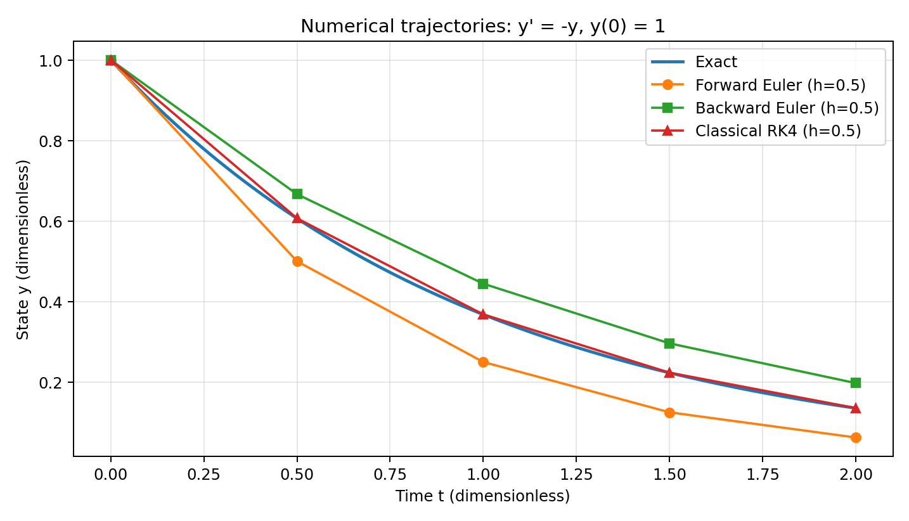

*图 3.1-1　向前 Euler、向后 Euler 与经典 RK4 的数值轨迹。模型为 $y'=-y$、$y(0)=1$，终止时刻 $T=2$，步长 $h=0.5$；横、纵坐标均为无量纲量。*

图 3.1-1 表明，在这一衰减模型中，向前 Euler 的离散值位于精确曲线下方，向后 Euler 的离散值位于其上方，而 RK4 的节点值与精确解较为接近。随着步长减小，表 3.1-4 中三种方法的终点误差均逐渐下降，说明对该问题及所选网格，步长加密确实提高了计算精度。

#### （三）步长加密与收敛阶

利用式（3.31）计算相邻两组步长对应的观测收敛阶，得到表 3.1-5。

**表 3.1-5　步长减半时的观测收敛阶**

| 步数变化 | 向前 Euler | 向后 Euler | 经典 RK4 |
|:---|---:|---:|---:|
| 4 → 8 | 1.0481 | 0.9392 | 4.3040 |
| 8 → 16 | 1.0284 | 0.9695 | 4.1510 |
| 16 → 32 | 1.0147 | 0.9848 | 4.0753 |
| 32 → 64 | 1.0074 | 0.9924 | 4.0376 |

由表可见，向前 Euler 的观测收敛阶由约 $1.048$ 逐渐接近 $1$，向后 Euler 的观测收敛阶从约 $0.939$ 逐渐接近 $1$；经典 RK4 的观测收敛阶则由约 $4.304$ 逐渐接近 $4$。这些现象与表 3.1-2 给出的理论阶数一致。由于有限步长下仍有高阶误差项，观测阶数不必恰好等于方法的理论阶数。

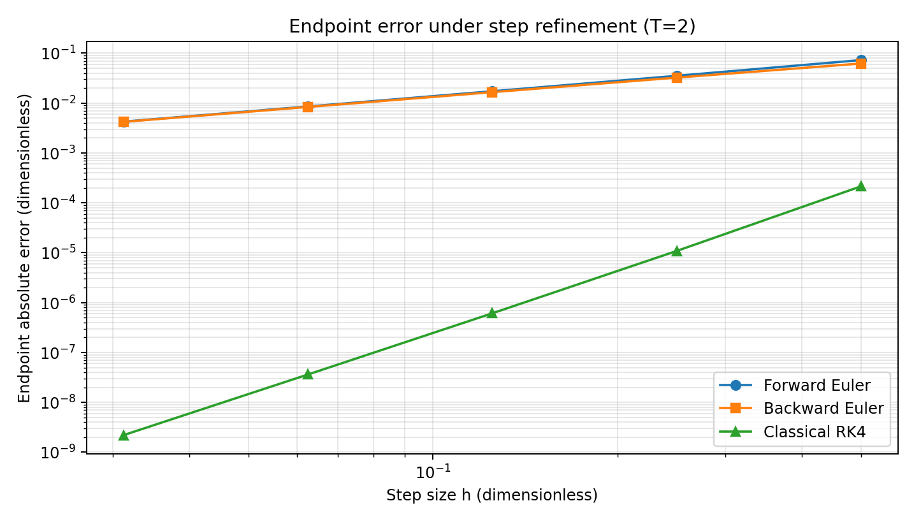

*图 3.1-2　终点绝对误差随步长变化的双对数图。$T=2$，$N=4,8,16,32,64$；横轴为步长 $h$，纵轴为 $E_T(h)$，二者均为无量纲量。*

双对数坐标下，误差曲线的斜率近似反映误差随步长衰减的阶数。图 3.1-2 中两种 Euler 方法的曲线彼此接近，具有近似一阶的变化规律；RK4 的误差随 $h$ 减小而明显更快地下降，表现出接近四阶的收敛规律。需要注意，图中结果只反映所考察的有限步长范围；当步长极小时，浮点舍入误差可能使继续加密不再产生同样的误差下降比例。

#### （四）较大步长下的稳定性

为了区别“数值解是否呈现衰减趋势”与“数值结果是否足够准确”，改取 $T=10$、$h=2.5$，共推进 $N=4$ 步。由式（3.28）可知，三种方法的单步放大因子分别为 $-1.5$、$2/7$ 和 $0.6484375$。此时精确终点值为 $e^{-10}\approx4.539993\times10^{-5}$。

**表 3.1-6　较大步长下的稳定性比较（$T=10$，$h=2.5$）**

| 方法 | 放大因子 $R(-2.5)$ | 终点数值解 $y_4$ | 终点绝对误差 |
|:---|---:|---:|---:|
| 向前 Euler | $-1.5$ | $5.062500000$ | $5.062454600$ |
| 向后 Euler | $0.285714286$ | $0.006663890$ | $0.006618490$ |
| 经典 RK4 | $0.648437500$ | $0.176796023$ | $0.176750623$ |

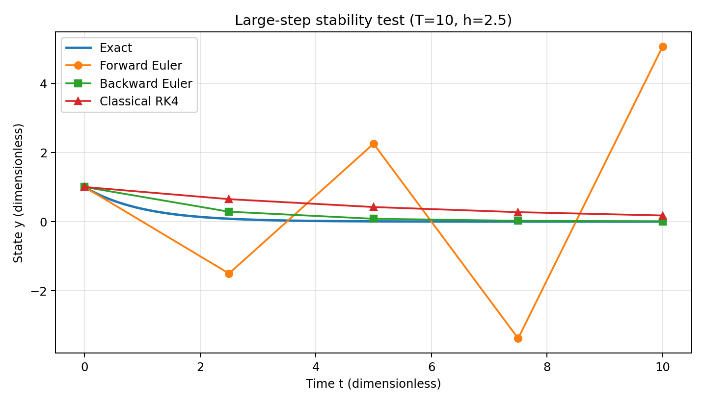

*图 3.1-3　大步长稳定性实验。模型为 $y'=-y$、$y(0)=1$，$T=10$，$h=2.5$；横、纵坐标均为无量纲量。*

向前 Euler 的放大因子满足 $|R_{\mathrm{FE}}(-2.5)|>1$，因此数值序列交替变号，且其幅值逐步增大；导览中出现的负温差预测正是第一步 $y_1=-1.5$ 的结果。相比之下，向后 Euler 与 RK4 在该步长下的放大因子绝对值均小于 $1$，数值序列仍表现为衰减，但表 3.1-6 表明它们的终点误差仍不能忽略。

这说明，**绝对稳定性是关于误差传播和衰减模态的性质，并不等价于数值解已满足某一精度要求**。向后 Euler 对此测试方程的大步长稳定性更好，也不能据此推断它在任意步长下都比 RK4 精确。

#### （五）相同误差要求下的计算成本

比较数值方法的效率时，不宜仅比较同一步长下每一步的函数求值次数。这里规定终点绝对误差应满足 $E_T(h)\leqslant10^{-4}$，并只在 $N=4,8,16,32,\ldots$ 的二分加密候选网格中寻找首次达标的计算结果。该误差阈值是为本次教学比较自行规定的指标，并非适用于所有初值问题的通用标准。

**表 3.1-7　相同终点误差要求下的计算量（$T=2$）**

| 方法 | 首次达标步数 $N$ | 步长 $h$ | 终点绝对误差 | 本例主要计算成本 |
|:---|---:|---:|---:|:---|
| 向前 Euler | $4096$ | $0.00048828125$ | $6.6087\times10^{-5}$ | $4096$ 次右端函数求值 |
| 向后 Euler | $4096$ | $0.00048828125$ | $6.6076\times10^{-5}$ | $4096$ 次线性隐式更新（本例可直接求解） |
| 经典 RK4 | $8$ | $0.25$ | $1.0859\times10^{-5}$ | $32$ 次右端函数求值 |

在本次候选网格和精度目标下，RK4 只需 $32$ 次右端函数求值即可达标；向前 Euler 则需 $4096$ 次，两者之比为 $128$。这说明对于当前平滑、非刚性的模型，提高单步计算精度可以显著减少达到给定精度所需的总函数求值次数。

向后 Euler 的成本不能直接与显式方法按“每步一次函数求值”比较。本例因方程线性，隐式更新可直接化为除法；对于一般非线性初值问题，则需考虑 Newton 迭代、雅可比矩阵、线性方程组求解以及迭代停止准则等额外成本。故表 3.1-7 不构成对所有问题的普遍性能排名。

#### （六）结果讨论与复现说明

本实验得到三个相互关联但不能混同的结论。首先，步长加密实验支持向前、向后 Euler 为一阶方法和经典 RK4 为四阶方法的理论判断。其次，大步长实验说明高阶方法也有有限的绝对稳定区域，而保持数值衰减并不代表误差必然很小。最后，在满足相同精度目标的前提下比较计算成本，往往比只比较“每步多少次函数求值”更有意义。

实验在双精度浮点环境中进行，所有输入均来自确定性的解析模型，不涉及随机种子或数据集划分。配套 [Jupyter Notebook](3_1_课堂数值实验_Euler与RK4.ipynb) 提供三种更新过程、解析递推核查、逐步加密的数值表、三幅图像及计算成本统计，能够独立重新执行。图 3.1-1 至图 3.1-3 均由该 Notebook 生成，图中的坐标、单位、图例和参数与本节一致。

本实验并未检验非线性、强刚性、解不够光滑、不同函数求值成本或自适应步长的情形。因此，本节结论应理解为**标准平滑线性衰减问题上的教学验证**，而不应直接外推到所有常微分方程初值问题。

### 3.1.5 本节小结

常微分方程初值问题的数值求解以离散节点上的近似值代替连续解。向前 Euler 和向后 Euler 分别使用时间步起点和终点的斜率，二者同为一阶方法，但显式、隐式计算机制及稳定性明显不同。Runge–Kutta 方法通过在单步内引入多个精心设计的阶段提高精度；经典 RK4 利用四个阶段斜率的加权组合，实现通常条件下的四阶收敛。

分析数值结果时，应分别回答三个问题：随着步长减小，误差如何变化；给定步长能否正确控制衰减模态；为达到既定误差要求需要付出多少计算代价。只有把这三方面结合起来，才能合理评价不同数值积分方法的适用性。

通过本节的线性衰减数值实验，可以进一步看到：理论误差阶数需通过步长加密与独立参考解检验，稳定性需通过相应稳定函数分析，而计算效率应在相同精度目标下比较。这一认识也是继续学习刚性方程求解与自适应步长算法的基础。

**参考文献**J. C. Butcher, *Numerical Methods for Ordinary Differential Equations*, 2nd ed., John Wiley & Sons, 2008，参见第 2 章中关于 Euler 方法（§20）、Euler 方法分析（§21）与 Runge–Kutta 方法（§23）的相关章节。


## 3.2 PDE有限差分：热传导与CFL条件（2学时）

**本节目标：** 能把一维热方程、初始条件、边界条件以及显式有限差分格式联系起来，并理解空间离散与时间推进的基本构造方式。

本节依次展开 **3.2.1 一维热方程与初边值条件**、**3.2.2 空间差分与显式时间推进** 和 **3.2.3 稳定性限制与网格实验**。其中，3.2.2 建立 FTCS 显式格式，推导局部截断误差及其 CFL 时间步长限制；3.2.3 再通过网格实验比较满足与违反稳定性条件时的数值行为。

### 导入：从“人群散开”理解热扩散


*图 3.2-1　热量扩散的类比。金属杆中部温度较高、两端温度较低；漫画把温度的不均匀类比为“人群在中间过于拥挤”，帮助我们直观理解扩散过程会不断削弱局部差异。*

设想一根金属杆：开始时中间很热、两端较冷。如果把它静置一段时间，我们会观察到中间逐渐降温，而两侧逐渐升温，原本明显的温度差被一点点“摊平”。最终，在没有持续加热且边界条件允许的情况下，温度分布会朝着更加均匀的状态演化。

漫画给出了一个便于理解的比喻：把“温度分布不均”想象成“人群分布不均”。开始时，大量的人挤在中间，而两边比较空；随着人群向较空的位置散开，中间不再那么拥挤，两侧的人逐渐增多，整体分布趋于平缓。热传导也表现出类似的宏观趋势——**局部过高的温度会下降，局部较低的温度会受到周围影响而上升，空间上的温度起伏逐渐减弱。**

这个比喻只用于帮助理解“扩散会抹平差异”这一数学特征，并不意味着热量真的像人一样移动。真正要研究的是一个连续的温度场：在不同位置、不同时间，温度分别是多少。

因此，我们把杆上的位置记为 $x$，把时间记为 $t$，并用

$$
u(x,t)
$$

表示位置 $x$ 在时刻 $t$ 的温度。漫画中的“中间热、两边冷”便可以理解为：在初始时刻，函数 $u(x,0)$ 在杆的中部较大、靠近两端较小；随着时间增加，曲线的峰值逐渐降低，空间分布越来越平缓。

到这里，一个生活中的热传导现象就转化成了几个具体的数学问题：

1. **温度为什么会这样变化？**  
   应当用怎样的偏微分方程描述 $u(x,t)$ 随时间的演化？

2. **只知道方程够不够？**  
   为了确定一根具体金属杆的温度变化，还需要给出怎样的初始温度和边界条件？

3. **计算机怎样求这个连续问题？**  
   计算机只能处理有限个数值，因此需要把空间划分成间距为 $\Delta x$ 的网格，把时间划分成步长为 $\Delta t$ 的时间层，并用差分近似偏导数。

4. **时间步长可以任意大吗？**  
   如果一次时间推进跨得太远，离散算法可能不再像真实热传导那样“抹平差异”，反而产生越来越强的数值振荡。因此，显式格式还必须满足一个把 $\Delta t$、$\Delta x$ 与热扩散系数 $\kappa$ 联系起来的稳定性限制。

本节正沿着这条路线展开：

```text
热传导现象
    ↓
温度函数 u(x,t)
    ↓
热方程 + 初始条件 + 边界条件
    ↓
空间网格 Δx + 时间步长 Δt
    ↓
中心差分 + 前向 Euler
    ↓
FTCS 显式格式
    ↓
CFL 时间步长限制
```

下面先解决前两个问题。在 **3.2.1** 中建立一维热方程及其初边值条件；随后在 **3.2.2** 中把连续模型放到时空网格上，推导显式有限差分格式，并说明为什么时间步长必须受到 CFL 条件的约束。

### 3.2.1 一维热方程与初边值条件

导入中的漫画表明，热传导过程会逐渐削弱空间温度差。要定量描述这一现象，需要建立连续的数学模型。本小节从一维常系数热方程出发，依次讨论控制方程、初始条件、边界条件和相容性，并给出一个可供后续数值验证的解析算例。

#### 3.2.1.1 一维热方程的物理意义

为回答导入中“温度为什么会逐渐变平？”这一问题，首先考虑连续模型。暂不涉及数值求解，将实际金属杆理想化为一根长度为 $L$ 的细长均匀导热杆。沿杆长方向取空间坐标 $x$，用

$$
u(x,t)
$$

表示位置 $x$ 在时刻 $t$ 的温度。若忽略横截面方向的温度变化，并假设材料均匀、热物性参数不随温度变化、杆内没有额外热源，那么温度的演化可由一维常系数热方程描述：

$$
\frac{\partial u}{\partial t}
=
\kappa\frac{\partial^2u}{\partial x^2},
\qquad
0<x<L,\quad t>0,
\tag{3.2.1}
$$

其中 $\kappa>0$ 称为**热扩散系数**（thermal diffusivity），单位为

$$
[\kappa]=\mathrm{m^2/s}.
$$

参数 $\kappa$ 衡量温度差在材料内部被“摊平”的快慢。相同的初始温度分布下，$\kappa$ 越大，热量重新分布得越快，温度场趋于均匀的速度也越快。

热方程中出现空间二阶导数并不是偶然的。可以把 $u_{xx}$ 理解为一点的温度相对于邻域平均温度的“弯曲程度”。如果某处温度低于两侧邻域，温度曲线通常在该处向上弯曲，即 $u_{xx}>0$，于是

$$
u_t=\kappa u_{xx}>0,
$$

该处温度会上升；反之，如果某处形成局部温度峰值，则通常 $u_{xx}<0$，从而 $u_t<0$，温度开始下降。因此，热方程天然具有一种**平滑作用**：尖锐的空间起伏不断衰减，温度分布逐渐变得平缓。

这种连续模型中的耗散性质十分重要。后面建立有限差分格式时，我们不仅要求数值格式“近似了微分方程”，还希望离散解保留类似的平滑行为。稳定性条件正是在回答这个问题。

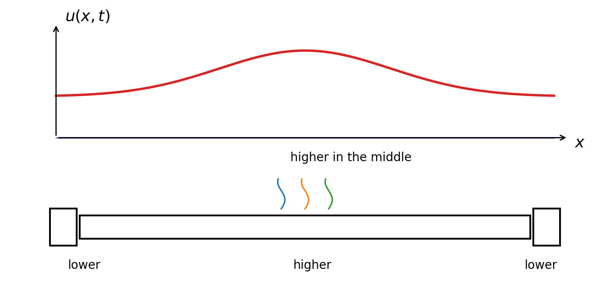

*图 3.2-2　一维热传导问题示意图。下方是一根中部较热、两端较冷的金属杆；上方曲线表示同一时刻的温度分布 $u(x,t)$。这个图把“物理对象”和“数学函数”对应起来，有助于理解热方程研究的是温度曲线如何随时间逐渐变平。*


#### 3.2.1.2 初始条件与边界条件

方程 (3.2.1) 说明了杆内部温度如何演化，却没有告诉我们两个关键信息：初始时刻杆内的温度是多少，以及杆的两个端点如何与外界交换热量。

由于热方程对时间是一阶的，需要给出一个初始状态。本节设

$$
u(x,0)=u_0(x),
\qquad
0\le x\le L,
\tag{3.2.2}
$$

其中 $u_0(x)$ 是给定的初始温度分布。

同时，由于方程对空间是二阶的，还需要在空间区间的两个端点给出边界条件。为了突出有限差分方法本身，本节采用最简单的齐次 Dirichlet 边界条件

$$
u(0,t)=u(L,t)=0,
\qquad t>0.
\tag{3.2.3}
$$

其物理意义是：杆的两端始终与温度为 $0^\circ\mathrm{C}$ 的恒温环境保持理想接触，因此端点温度被固定。这里的“0”主要是为了简化表达；若端点维持在其他恒定温度，经过适当变量平移后，也可转化为类似问题。

于是，本节研究的标准初边值问题为

$$
\begin{cases}
u_t=\kappa u_{xx}, & 0<x<L,\quad t>0,\\[4pt]
u(0,t)=u(L,t)=0, & t>0,\\[4pt]
u(x,0)=u_0(x), & 0\le x\le L.
\end{cases}
\tag{3.2.4}
$$

微分方程、初始条件和边界条件三者共同决定温度随时间的演化。数值计算时也必须同时离散和实现这三部分，而不能只离散方程本身。

#### 3.2.1.3 初边值数据的相容性

若希望解在 $t=0$ 附近保持足够光滑，初始数据还应当与边界数据在两个“角点”

$$
(0,0),\qquad (L,0)
$$

处一致。对于本节的零 Dirichlet 边界，这意味着

$$
u_0(0)=u_0(L)=0.
\tag{3.2.5}
$$

这称为初边值数据的**相容性条件**。

例如，当杆长取 $L=1\,\mathrm{m}$ 时，若令 $u_0(x)=1+\sin(\pi x)$，则初值给出

$$
u_0(0)=u_0(1)=1,
$$

而边界条件要求 $t>0$ 时两个端点立即保持为零。这样会在 $t=0$ 的端点附近形成初始边界层，解的正则性也会受到影响。

需要特别区分：**初边值数据不相容与数值格式不稳定不是同一件事。** 前者属于连续问题的数据正则性问题；后者则是离散误差是否会随着时间步进被不断放大的问题。本节为避免这两种现象相互干扰，统一假设 $u_0$ 足够光滑并满足 (3.2.5)。

#### 3.2.1.4 模型算例及其解析解

取

$$
L=1\,\mathrm{m},\qquad
\kappa=0.1\,\mathrm{m^2/s},
$$

初边值问题为

$$
\begin{cases}
u_t=0.1u_{xx},&0<x<1,\quad t>0,\\[4pt]
u(0,t)=u(1,t)=0,&t>0,\\[4pt]
u(x,0)=\sin(\pi x),&0\le x\le1.
\end{cases}
\tag{3.2.6}
$$

初值 $\sin(\pi x)$ 在两端恰好为零，因此与边界条件相容。它在杆的中央 $x=1/2$ 处取得最大值，表示初始时刻杆的中部温度最高，而两端保持低温。

这个问题还有一个重要优点：解析解可以直接写出，

$$
u(x,t)
=
\sin(\pi x)e^{-0.1\pi^2t}.
\tag{3.2.7}
$$

验证也很直接。由

$$
u_{xx}
=
-\pi^2\sin(\pi x)e^{-0.1\pi^2t},
$$

以及

$$
u_t
=
-0.1\pi^2\sin(\pi x)e^{-0.1\pi^2t},
$$

可见确有 $u_t=0.1u_{xx}$。

式 (3.2.7) 还把热方程的耗散性质表现得十分清楚：空间形状始终保持为 $\sin(\pi x)$，但振幅按照

$$
e^{-0.1\pi^2t}
$$

不断衰减，并最终趋近于零。后面的数值实验将利用这一解析解作为独立参考，从而判断有限差分结果究竟是“稳定但存在离散误差”，还是已经出现了由时间步长选择不当导致的数值不稳定。

#### 3.2.1.5 由连续模型到离散计算

计算机不能直接存储整个连续函数 $u(x,t)$。有限差分方法的基本思路是：只在一组离散的空间点和时间点上近似 $u$，再用相邻网格点函数值的差商近似偏导数。

因此，接下来需要解决两个问题：

空间二阶导数 $u_{xx}$ 应怎样用相邻网格点近似？时间导数 $u_t$ 又应该怎样推进到下一时间层？

本节采用最基本的一组组合：

$$
\text{空间：二阶中心差分}
$$

和

$$
\text{时间：前向 Euler}
$$

由此得到经典的 FTCS（Forward-Time, Centred-Space）显式格式。需要强调的是：一个差分公式即使在 $\Delta x,\Delta t\to0$ 时能够逼近微分方程，也未必能够稳定地进行长时间计算。对于热方程，空间网格与时间步长之间必须满足特定比例关系，这就是本节所讨论的**扩散型 CFL 限制**。

至此，导入中的第一个问题已经明确：我们已经有了连续的控制方程、初始条件和边界条件。下面转向后两个问题——**如何把连续模型变成计算机能够执行的递推公式，以及为什么时间步长不能任意取值。** 这两件事将分别通过差分近似和稳定性分析来回答。

---

### 3.2.2 空间差分与显式时间推进

3.2.1 已经用热方程描述温度演化，并通过初始条件和边界条件确定了具体的初边值问题。现在进一步回答导入漫画提出的计算问题：怎样将连续温度场转化为计算机能够处理的有限个数值？为此，先建立时空网格，再分别离散 $u_{xx}$ 与 $u_t$，进而构造 FTCS 显式格式，并讨论时间步长受到 CFL 条件约束的原因。

#### 3.2.2.1 均匀时空网格及离散记号

在空间区间 $[0,L]$ 上取均匀网格

$$
x_j=j\Delta x,
\qquad
j=0,1,\ldots,J,
$$

其中

$$
\Delta x=\frac{L}{J}.
$$

时间方向同样取等距网格

$$
t_n=n\Delta t,
\qquad
n=0,1,2,\ldots.
$$

记

$$
U_j^n\approx u(x_j,t_n)
$$

为精确温度 $u(x_j,t_n)$ 的数值近似。下文约定：小写 $u$ 表示连续问题的精确解，大写 $U$ 表示离散数值解；$j$ 和 $n$ 分别为空间节点下标与时间层下标。

对于零 Dirichlet 边界，网格端点的数值不需要通过差分方程计算，而是直接由边界条件给出：

$$
U_0^n=U_J^n=0.
\tag{3.2.8}
$$

初始层则由初值采样得到

$$
U_j^0=u_0(x_j).
\tag{3.2.9}
$$

因此，真正需要递推计算的是内部节点

$$
j=1,2,\ldots,J-1.
$$

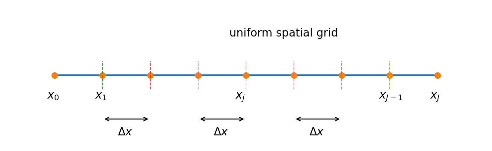

*图 3.2-3　一维均匀空间网格示意图。连续区间 $[0,L]$ 被离散为节点 $x_0,x_1,\ldots,x_J$，相邻节点之间的距离都等于 $\Delta x$。有限差分方法正是在这些节点上存储和更新温度近似值。*


#### 3.2.2.2 二阶中心空间差分

热方程右端包含空间二阶偏导数 $u_{xx}$。有限差分的思路是：不直接计算连续函数的导数，而是使用相邻节点的温度近似这一导数。下面从 Taylor 公式出发，逐步推导二阶中心差分，并确定它的误差阶数。

在固定时间 $t_n$ 上，仍用 $\Delta x$ 表示均匀空间网格间距。为使书写简洁，以下暂用 $u,u_x,u_{xx},\ldots$ 表示它们在同一展开中心 $(x_j,t_n)$ 处的取值。假设精确解关于空间足够光滑。

**（1）向右展开。** 因为 $x_{j+1}=x_j+\Delta x$，根据 Taylor 公式，

$$
\begin{aligned}
u(x_{j+1},t_n)
={}&u+\Delta x u_x+\frac{(\Delta x)^2}{2}u_{xx}
+\frac{(\Delta x)^3}{6}u_{xxx}\\
&+\frac{(\Delta x)^4}{24}u_{xxxx}
+\frac{(\Delta x)^5}{120}u_{xxxxx}
+\mathcal{O}((\Delta x)^6).
\end{aligned}
$$

**（2）向左展开。** 因为 $x_{j-1}=x_j-\Delta x$，只需将上式中的 $\Delta x$ 替换成 $-\Delta x$：

$$
\begin{aligned}
u(x_{j-1},t_n)
={}&u-\Delta x u_x+\frac{(\Delta x)^2}{2}u_{xx}
-\frac{(\Delta x)^3}{6}u_{xxx}\\
&+\frac{(\Delta x)^4}{24}u_{xxxx}
-\frac{(\Delta x)^5}{120}u_{xxxxx}
+\mathcal{O}((\Delta x)^6).
\end{aligned}
$$

**（3）将左右两式相加。** 一阶、三阶和五阶导数项符号相反，因而相互抵消：

$$
\begin{aligned}
u(x_{j+1},t_n)+u(x_{j-1},t_n)
={}&2u+(\Delta x)^2u_{xx}\\
&+\frac{(\Delta x)^4}{12}u_{xxxx}
+\mathcal{O}((\Delta x)^6).
\end{aligned}
$$

**（4）移项并除以 $(\Delta x)^2$。** 从两端减去 $2u=2u(x_j,t_n)$，得到

$$
u(x_{j+1},t_n)-2u(x_j,t_n)+u(x_{j-1},t_n)
=(\Delta x)^2u_{xx}+\frac{(\Delta x)^4}{12}u_{xxxx}+\mathcal{O}((\Delta x)^6).
$$

因此，

$$
\begin{aligned}
\frac{u(x_{j+1},t_n)-2u(x_j,t_n)+u(x_{j-1},t_n)}{(\Delta x)^2}
={}&u_{xx}(x_j,t_n)\\
&+\frac{(\Delta x)^2}{12}u_{xxxx}(x_j,t_n)
+\mathcal{O}((\Delta x)^4).
\end{aligned}
$$

将 $u_{xx}$ 单独放在左侧，得到

$$
u_{xx}(x_j,t_n)=
\frac{u(x_{j+1},t_n)-2u(x_j,t_n)+u(x_{j-1},t_n)}{(\Delta x)^2}
-\frac{(\Delta x)^2}{12}u_{xxxx}(x_j,t_n)
+\mathcal{O}((\Delta x)^4).
\tag{3.2.10}
$$

式 (3.2.10) 表明：**二阶中心差分的误差主项与 $(\Delta x)^2$ 成正比**。若忽略余项，即用

$$
D_{xx}u(x_j,t_n):=
\frac{u(x_{j+1},t_n)-2u(x_j,t_n)+u(x_{j-1},t_n)}{(\Delta x)^2}
$$

近似 $u_{xx}(x_j,t_n)$，则其空间精度为二阶。这里的二阶精度来自左右取点的对称性，而不是仅仅因为差分公式使用了三个节点。

在实际计算中，用未知的精确温度 $u(x_j,t_n)$ 换成可存储的近似值 $U_j^n$，便得到用于后续递推的空间离散算子

$$
D_{xx}U_j^n
=\frac{U_{j+1}^n-2U_j^n+U_{j-1}^n}{(\Delta x)^2}.
$$

#### 3.2.2.3 前向 Euler 时间离散

热方程左端是时间一阶导数 $u_t$。与空间差分的推导类似，在**固定空间位置 $x_j$** 的条件下，对时间作 Taylor 展开；不同的是，显式时间推进只使用已知的当前时间层 $t_n$ 来计算下一层 $t_{n+1}$。

**（1）在 $t_n$ 附近向前展开。** 由 $t_{n+1}=t_n+\Delta t$，

$$
\begin{aligned}
u(x_j,t_{n+1})
={}&u(x_j,t_n)+\Delta t\,u_t(x_j,t_n)\\
&+\frac{(\Delta t)^2}{2}u_{tt}(x_j,t_n)
+\frac{(\Delta t)^3}{6}u_{ttt}(x_j,t_n)
+\mathcal{O}((\Delta t)^4).
\end{aligned}
$$

**（2）减去当前时刻的温度，再除以 $\Delta t$。** 于是

$$
\begin{aligned}
\frac{u(x_j,t_{n+1})-u(x_j,t_n)}{\Delta t}
={}&u_t(x_j,t_n)
+\frac{\Delta t}{2}u_{tt}(x_j,t_n)\\
&+\frac{(\Delta t)^2}{6}u_{ttt}(x_j,t_n)
+\mathcal{O}((\Delta t)^3).
\end{aligned}
$$

**（3）解出时间导数并识别误差主项。** 得到

$$u_t(x_j,t_n)=
\frac{u(x_j,t_{n+1})-u(x_j,t_n)}{\Delta t}
-\frac{\Delta t}{2}u_{tt}(x_j,t_n)
+\mathcal{O}((\Delta t)^2).
\tag{3.2.11}
$$

因此，前向时间差分

$$
D_t^+u(x_j,t_n):=
\frac{u(x_j,t_{n+1})-u(x_j,t_n)}{\Delta t}
$$

对 $u_t$ 具有**一阶时间精度**。式 (3.2.11) 同时提醒我们，时间差分与空间中心差分的精度不同：前者的主误差是 $\mathcal{O}(\Delta t)$，后者的主误差是 $\mathcal{O}((\Delta x)^2)$。

#### 3.2.2.4 FTCS 显式差分格式

现在把两种差分近似放回热方程 $u_t=\kappa u_{xx}$。在内部网格点 $(x_j,t_n)$ 处，$j=1,\ldots,J-1$，依次完成以下步骤。

**（1）用差商代替偏导数。** 使用 3.2.2.3 中的前向时间差分近似 $u_t$，并使用 3.2.2.2 中的中心空间差分近似 $u_{xx}$。将网格点上的精确函数值替换为数值近似值 $U_j^n$，忽略截断误差，得

$$
\frac{U_j^{n+1}-U_j^n}{\Delta t}
=
\kappa
\frac{U_{j+1}^n-2U_j^n+U_{j-1}^n}{(\Delta x)^2},
\qquad j=1,\ldots,J-1.
\tag{3.2.12}
$$

上式左端含有下一时间层的一个未知量 $U_j^{n+1}$，右端仅含当前时间层的三个数值。

**（2）两端乘以 $\Delta t$。** 得到

$$
U_j^{n+1}-U_j^n
=
\frac{\kappa\Delta t}{(\Delta x)^2}
\left(U_{j+1}^n-2U_j^n+U_{j-1}^n\right).
$$

**（3）将 $U_j^n$ 移至右端。** 于是

$$
U_j^{n+1}
=U_j^n+
\frac{\kappa\Delta t}{(\Delta x)^2}
\left(U_{j+1}^n-2U_j^n+U_{j-1}^n\right).
\tag{3.2.13}
$$

**（4）引入无量纲参数并合并同类项。** 记

$$
r=\frac{\kappa\Delta t}{(\Delta x)^2}.
\tag{3.2.14}
$$

则式 (3.2.13) 的右端可依次整理为

$$
\begin{aligned}
U_j^{n+1}
&=U_j^n+r\left(U_{j+1}^n-2U_j^n+U_{j-1}^n\right)\\
&=U_j^n+rU_{j+1}^n-2rU_j^n+rU_{j-1}^n\\
&=rU_{j-1}^n+(1-2r)U_j^n+rU_{j+1}^n.
\end{aligned}
$$

因此，最终得到 **FTCS（Forward-Time, Centred-Space）显式格式**

$$
U_j^{n+1}
=rU_{j-1}^n+(1-2r)U_j^n+rU_{j+1}^n,
\qquad j=1,\ldots,J-1.
\tag{3.2.15}
$$

这里“显式”的含义是：给定第 $n$ 层数据后，不需要求解新的联立方程组，便能直接计算第 $n+1$ 层的每个内部节点。算法的完整规定还包括初始层 $U_j^0=u_0(x_j)$ 和每层边界值 $U_0^n=U_J^n=0$；缺少初值或边界赋值，单靠式 (3.2.15) 不能形成完整的计算程序。

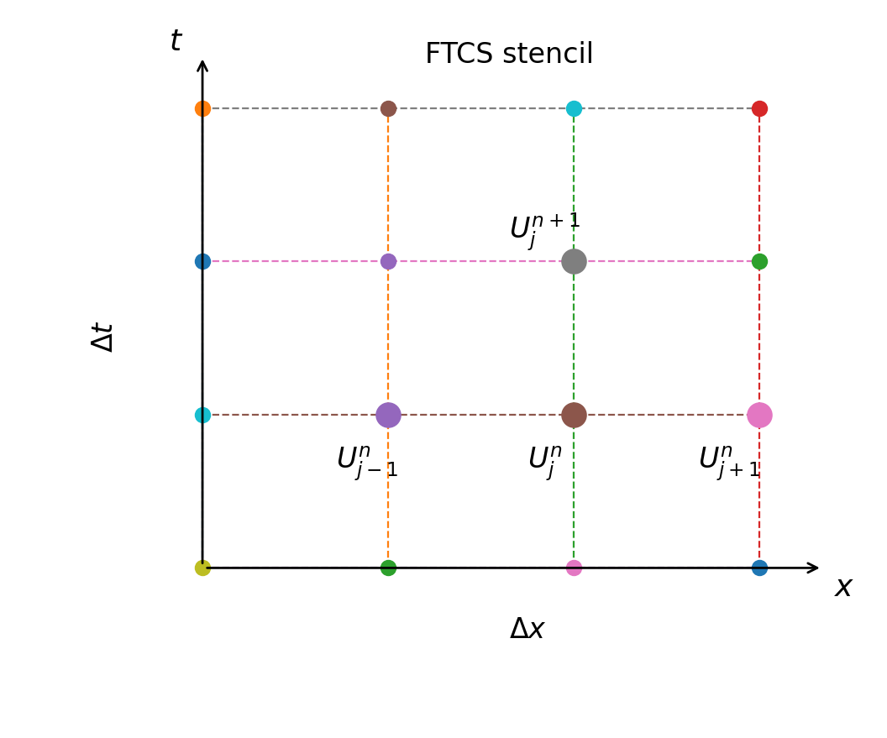

*图 3.2-4　FTCS 显式格式的四点模板。计算新的温度值 $U_j^{n+1}$ 时，只需要上一时间层的三个相邻节点 $U_{j-1}^n$、$U_j^n$ 和 $U_{j+1}^n$。图中清楚展示了“空间中心差分 + 时间前向推进”的结构。*

图 3.2-4 中，新时间层的一个节点与旧时间层三个相邻节点相连，正是式 (3.2.15) 的几何表示。这也解释了为什么显式格式虽然更新方便，仍必须对时间步长加以限制：每一步都在重复使用上一层的近似值，误差也会随之进入下一次计算。

#### 3.2.2.5 无量纲扩散参数 $r$

参数

$$
r=\frac{\kappa\Delta t}{(\Delta x)^2}
$$

同时包含材料性质、空间网格和时间步长，是决定显式格式行为的核心参数。在传热计算中，它也常被称为网格尺度上的 **Fourier 数**。

由于扩散过程在时间 $\Delta t$ 内对应的典型扩散长度为

$$
\ell_d\sim\sqrt{\kappa\Delta t},
$$

于是

$$
r
=\left(
\frac{\sqrt{\kappa\Delta t}}{\Delta x}
\right)^2.
$$

因此，$r$ 可以理解为“一个时间步内的扩散尺度相对于空间网格尺度的平方”。

若 $\Delta t$ 太大，则一次时间推进试图让温度信息跨越过多空间网格，而显式格式只利用当前位置及左右各一个邻点的信息。在这种情况下，离散递推可能无法保持真实热扩散所具有的耗散性质，于是稳定性限制自然出现。

#### 3.2.2.6 局部截断误差与相容性

建立差分格式以后，还必须回答一个基本问题：**当网格逐渐加密时，差分方程能否正确逼近原来的热方程？** 为此，我们研究局部截断误差。下面不仅给出误差的阶数，还推导它的具体主项，并说明误差如何进入每一步的数值更新。

**（1）定义局部截断误差。** 在内部节点 $(x_j,t_n)$，把**精确解** $u$（而不是数值近似 $U$）代入 FTCS 差分方程左、右两端，定义

$$
\tau_j^n
=\frac{u(x_j,t_{n+1})-u(x_j,t_n)}{\Delta t}
-\kappa\,
\frac{u(x_{j+1},t_n)-2u(x_j,t_n)+u(x_{j-1},t_n)}
{(\Delta x)^2}.
\tag{3.2.16}
$$

若差分公式能够完全重现微分方程，那么 $\tau_j^n$ 应等于零。实际计算时 $\tau_j^n$ 一般不为零，它量化了**差分算子作用于精确解时产生的残差**。本书采用除以 $\Delta t$ 之后的残差作为局部截断误差；相应的单步更新缺陷是 $\Delta t\,\tau_j^n$。

为获得具体误差主项，暂假定 $u$ 在所讨论的时空区域内具有足够多的连续导数，使以下 Taylor 展开及余项估计成立。以下所有未注明取值点的导数均在 $(x_j,t_n)$ 处计算。

**（2）计算时间差分产生的误差。** 由 3.2.2.3 的 Taylor 展开，

$$
\begin{aligned}
\frac{u(x_j,t_{n+1})-u(x_j,t_n)}{\Delta t}
&=\frac{\Delta t\,u_t+\frac{(\Delta t)^2}{2}u_{tt}
+\frac{(\Delta t)^3}{6}u_{ttt}
+\mathcal{O}((\Delta t)^4)}{\Delta t}\\
&=u_t+\frac{\Delta t}{2}u_{tt}
+\frac{(\Delta t)^2}{6}u_{ttt}
+\mathcal{O}((\Delta t)^3).
\end{aligned}
$$

因此，前向时间差分相对于精确时间导数的误差为

$$
\underbrace{
\frac{u(x_j,t_{n+1})-u(x_j,t_n)}{\Delta t}
-u_t
}_{\text{时间离散误差}}
=
\frac{\Delta t}{2}u_{tt}
+\frac{(\Delta t)^2}{6}u_{ttt}
+\mathcal{O}((\Delta t)^3).
$$

它的首项与 $\Delta t$ 成正比。

**（3）计算空间差分产生的误差。** 由 3.2.2.2 的左右对称 Taylor 展开，

$$
\begin{aligned}
&u(x_{j+1},t_n)-2u(x_j,t_n)+u(x_{j-1},t_n)\\
&\qquad=(\Delta x)^2u_{xx}
+\frac{(\Delta x)^4}{12}u_{xxxx}
+\mathcal{O}((\Delta x)^6).
\end{aligned}
$$

两端除以 $(\Delta x)^2$，得到

$$
\begin{aligned}
&\frac{u(x_{j+1},t_n)-2u(x_j,t_n)+u(x_{j-1},t_n)}
{(\Delta x)^2}\\
&\qquad=u_{xx}+\frac{(\Delta x)^2}{12}u_{xxxx}
+\mathcal{O}((\Delta x)^4).
\end{aligned}
$$

所以，空间中心差分相对于精确二阶空间导数的误差为

$$
\underbrace{
\frac{u(x_{j+1},t_n)-2u(x_j,t_n)+u(x_{j-1},t_n)}
{(\Delta x)^2}-u_{xx}
}_{\text{空间离散误差}}
=
\frac{(\Delta x)^2}{12}u_{xxxx}
+\mathcal{O}((\Delta x)^4).
$$

它的首项与 $(\Delta x)^2$ 成正比。

**（4）代回残差定义并利用控制方程。** 将步骤（2）、（3）的表达式逐项代入式 (3.2.16)，注意空间项前面带有系数 $-\kappa$：

$$
\begin{aligned}
\tau_j^n
={}&\left[u_t+\frac{\Delta t}{2}u_{tt}
+\frac{(\Delta t)^2}{6}u_{ttt}
+\mathcal{O}((\Delta t)^3)\right]\\
&-\kappa\left[u_{xx}
+\frac{(\Delta x)^2}{12}u_{xxxx}
+\mathcal{O}((\Delta x)^4)\right]\\
={}&\underbrace{(u_t-\kappa u_{xx})}_{=\,0}\\
&+\frac{\Delta t}{2}u_{tt}
-\frac{\kappa(\Delta x)^2}{12}u_{xxxx}
+\frac{(\Delta t)^2}{6}u_{ttt}
+\mathcal{O}((\Delta t)^3+(\Delta x)^4).
\end{aligned}
$$

因为精确解满足 $u_t=\kappa u_{xx}$，第一项严格等于零。因此，

$$
\tau_j^n
=\frac{\Delta t}{2}u_{tt}(x_j,t_n)
-\frac{\kappa(\Delta x)^2}{12}u_{xxxx}(x_j,t_n)
+\mathcal{O}((\Delta t)^2+(\Delta x)^4).
$$

若进一步利用 **$\kappa$ 为常数** 这一假设，则

$$
\begin{aligned}
u_{tt}
&=\frac{\partial}{\partial t}(u_t)
=\frac{\partial}{\partial t}(\kappa u_{xx})\\
&=\kappa\,\frac{\partial^2}{\partial x^2}(u_t)
=\kappa\,\frac{\partial^2}{\partial x^2}(\kappa u_{xx})
=\kappa^2u_{xxxx}.
\end{aligned}
$$

代入上一式后，局部截断误差可以写成

$$
\begin{aligned}
\tau_j^n
&=\left(\frac{\kappa^2\Delta t}{2}
-\frac{\kappa(\Delta x)^2}{12}\right)
u_{xxxx}(x_j,t_n)
+\mathcal{O}((\Delta t)^2+(\Delta x)^4)\\
&=\mathcal{O}(\Delta t+(\Delta x)^2).
\end{aligned}
\tag{3.2.17}
$$

这一结果给出了 FTCS 格式“时间一阶、空间二阶”的准确含义：将精确解代入离散方程后，**时间离散误差的主量级为 $\Delta t$，空间离散误差的主量级为 $(\Delta x)^2$**。当 $\Delta t\to0$、$\Delta x\to0$ 时，$\tau_j^n\to0$，因此该格式与热方程相容。

**（5）给出不依赖高阶渐近展开的误差上界。** 为了后面严格证明收敛性，考虑固定终止时间 $T>0$，并假设 $u_{tt}$ 与 $u_{xxxx}$ 在闭区域 $[0,L]\times[0,T]$ 上连续。记

$$
M_t=\max_{[0,L]\times[0,T]}|u_{tt}|,
\qquad
M_x=\max_{[0,L]\times[0,T]}|u_{xxxx}|.
$$

按带余项的 Taylor 定理，存在 $\eta\in(t_n,t_{n+1})$，使

$$
\frac{u(x_j,t_{n+1})-u(x_j,t_n)}{\Delta t}
-u_t(x_j,t_n)
=\frac{\Delta t}{2}u_{tt}(x_j,\eta).
$$

同样，在 $x_{j-1}$ 与 $x_{j+1}$ 两侧分别作到三阶的 Taylor 展开，其四阶余项表明存在 $\xi_-\in(x_{j-1},x_j)$、$\xi_+\in(x_j,x_{j+1})$，使

$$
\begin{aligned}
&\frac{u(x_{j+1},t_n)-2u(x_j,t_n)+u(x_{j-1},t_n)}
{(\Delta x)^2}
-u_{xx}(x_j,t_n)\\
&\qquad=\frac{(\Delta x)^2}{24}
\left[u_{xxxx}(\xi_-,t_n)+u_{xxxx}(\xi_+,t_n)\right].
\end{aligned}
$$

将上述两式代入 (3.2.16)，再用三角不等式，便得到适用于所有内部节点及 $t_{n+1}\le T$ 的**统一上界**

$$
|\tau_j^n|
\le\frac{\Delta t}{2}M_t
+\frac{\kappa(\Delta x)^2}{12}M_x.
$$

该估计只要求二阶时间导数和四阶空间导数有界，并不需要假设高阶余项的具体展开。它也说明式 (3.2.17) 的大 $\mathcal{O}$ 常数可以在给定时间区间内不依赖网格参数地控制。

**（6）区别局部残差与单步更新误差。** 将 (3.2.16) 两边乘以 $\Delta t$，并把精确解的下一时间层单独写在左端，有

$$
\begin{aligned}
u(x_j,t_{n+1})
={}&u(x_j,t_n)\\
&+r\bigl[u(x_{j+1},t_n)-2u(x_j,t_n)
+u(x_{j-1},t_n)\bigr]\\
&+\Delta t\,\tau_j^n.
\end{aligned}
$$

因此，**一次时间更新造成的缺陷** 为 $\Delta t\,\tau_j^n=\mathcal{O}((\Delta t)^2+\Delta t(\Delta x)^2)$，而式 (3.2.16) 中按 $\Delta t$ 归一化后的**局部截断误差**是 $\mathcal{O}(\Delta t+(\Delta x)^2)$。两者不能混淆。

至此，我们只证明了“差分算子在局部逼近热方程”。这些小误差在许多时间步中是否会积累成大误差，还取决于递推格式的**稳定性**。下一小节将用定理和证明给出严格结论。

#### 3.2.2.7 CFL 稳定性条件与收敛性

上一小节证明 FTCS 格式与热方程相容，但相容性只研究**一次局部差分**与微分方程的接近程度。数值求解需要重复推进许多时间步；如果某种误差在递推中被不断放大，算法即使相容，也不一定能得到可信的结果。下面首先给出稳定性的严格定理，然后用 Fourier 模态解释 CFL 限制的来源。

回顾式 (3.2.15)，对每个内部节点有

$$
U_j^{n+1}
=rU_{j-1}^n+(1-2r)U_j^n+rU_{j+1}^n,
\qquad
r=\frac{\kappa\Delta t}{(\Delta x)^2}.
\tag{3.2.18}
$$

注意右端的三个系数分别为 $r$、$1-2r$、$r$。若希望新温度是上一时间层相邻温度的非负加权平均，就必须要求

$$
r\ge0,\qquad 1-2r\ge0,\qquad r+r+(1-2r)=1.
$$

因为 $\kappa>0$、$\Delta t>0$、$\Delta x>0$，所以 $r>0$；上面的非负性要求只剩下 $r\le 1/2$。因此，**当前 FTCS 格式的标准扩散稳定性限制**为

$$
0\le r=\frac{\kappa\Delta t}{(\Delta x)^2}\le\frac12.
\tag{3.2.19}
$$

移项后，可直接得到可供计算时使用的时间步长上界：

$$
\Delta t\le\frac{(\Delta x)^2}{2\kappa}.
\tag{3.2.20}
$$

这两个等价表达式就是本节所称的扩散型 **CFL 条件**。首先证明它为什么能够确保数值解不发生非物理放大。

**定理 3.2.1（FTCS 格式的离散最大值原理、最大范数稳定性与收敛性）**

设 $L>0$、$\kappa>0$，在空间区间 $[0,L]$ 上取 $J\ge2$ 个等长小区间，网格间距为 $\Delta x=L/J$；时间步长为 $\Delta t>0$。在内部节点采用式 (3.2.18) 的 FTCS 格式，边界节点满足 $U_0^n=U_J^n=0$。若 $0\le r\le 1/2$，则有：

（1）**离散最大值原理与稳定性。** 对任意初始数据及所有整数 $n\ge0$，

$$
\min_{0\le j\le J}U_j^n
\le U_i^{n+1}
\le\max_{0\le j\le J}U_j^n,
\qquad 0\le i\le J.
$$

特别地，若定义离散最大范数

$$
\|U^n\|_\infty:=\max_{0\le j\le J}|U_j^n|,
$$

则

$$
\|U^{n+1}\|_\infty
\le\|U^n\|_\infty
\le\|U^0\|_\infty.
\tag{3.2.21}
$$

并且，对同一差分格式、同一零边界条件下的任意两组数值解 $U^n,V^n$，有

$$
\|U^n-V^n\|_\infty
\le\|U^0-V^0\|_\infty.
$$

这表明初始数据的扰动不会被时间推进放大，因而格式在最大范数意义下稳定。

（2）**收敛性及误差估计。** 设精确解 $u(x,t)$ 满足热方程及零 Dirichlet 边界条件，并且在 $[0,L]\times[0,T]$ 上具有连续且有界的 $u_{tt}$、$u_{xxxx}$；假设初值按 $U_j^0=u(x_j,0)$ 精确采样。记

$$
u^n:=\bigl(u(x_0,t_n),u(x_1,t_n),\ldots,u(x_J,t_n)\bigr),
$$

以及 3.2.2.6 中定义的导数上界 $M_t$、$M_x$。则对每个 $0\le t_n=n\Delta t\le T$，

$$
\|u^n-U^n\|_\infty
\le t_n\left(
\frac{\Delta t}{2}M_t+
\frac{\kappa(\Delta x)^2}{12}M_x
\right)
\le C_T\bigl(\Delta t+(\Delta x)^2\bigr),
\tag{3.2.22}
$$

其中 $C_T$ 可依赖于 $T,\kappa$ 及精确解的相应导数上界，但与 $\Delta x,\Delta t$ 无关。因此，在 CFL 条件成立并且网格加密时，数值解以**时间一阶、空间二阶**收敛到精确解在网格上的取值。

**证明**

*（1）离散最大值原理。* 固定时间层 $n$ 和任意内部节点 $j$。由式 (3.2.18)，

$$
U_j^{n+1}
=rU_{j-1}^n+(1-2r)U_j^n+rU_{j+1}^n.
$$

在 $0\le r\le 1/2$ 时，三个系数非负，而且它们的和等于 $1$，所以右端是三个旧温度值的**凸组合**。设

$$
m_n=\min_{0\le i\le J}U_i^n,
\qquad
M_n=\max_{0\le i\le J}U_i^n.
$$

由于 $m_n\le U_{j-1}^n,U_j^n,U_{j+1}^n\le M_n$，将三个不等式分别乘以非负系数并相加，得到

$$
\begin{aligned}
U_j^{n+1}
&\ge r\,m_n+(1-2r)m_n+r\,m_n=m_n,\\
U_j^{n+1}
&\le r\,M_n+(1-2r)M_n+r\,M_n=M_n.
\end{aligned}
$$

对于边界节点 $j=0$ 和 $j=J$，由于 $U_0^{n+1}=U_J^{n+1}=0$，且上一时间层也有零边界值，所以 $m_n\le0\le M_n$，同样满足上述范围限制。由此得证离散最大值原理。

*（2）最大范数稳定性。* 对任意内部节点使用三角不等式：

$$
\begin{aligned}
|U_j^{n+1}|
&\le r|U_{j-1}^n|+(1-2r)|U_j^n|+r|U_{j+1}^n|\\
&\le\bigl[r+(1-2r)+r\bigr]\|U^n\|_\infty\\
&=\|U^n\|_\infty.
\end{aligned}
$$

边界值为零，因此对所有节点取最大值可得 $\|U^{n+1}\|_\infty\le\|U^n\|_\infty$。反复应用该不等式，得到式 (3.2.21)。

为说明小扰动也不会增长，取同一格式的两组解，记 $W_j^n=U_j^n-V_j^n$。由于格式线性，两个递推式相减后仍有

$$
W_j^{n+1}=rW_{j-1}^n+(1-2r)W_j^n+rW_{j+1}^n.
$$

而 $W_0^n=W_J^n=0$。把刚证明的最大范数估计应用于 $W^n$，得到

$$
\|U^n-V^n\|_\infty=\|W^n\|_\infty
\le\|W^0\|_\infty=\|U^0-V^0\|_\infty.
$$

这便证明了稳定性。特别地，若初始温度非负，则凸组合及零边界还保证全部后续数值温度非负。

*（3）收敛性估计。* 将精确解在网格上的取值记为 $u_j^n=u(x_j,t_n)$，并定义误差 $e_j^n=u_j^n-U_j^n$。由局部截断误差定义式 (3.2.16)，精确解满足含残差的离散关系

$$
u_j^{n+1}
=u_j^n+r(u_{j+1}^n-2u_j^n+u_{j-1}^n)
+\Delta t\,\tau_j^n.
$$

从这条关系中减去 FTCS 数值递推式 (3.2.18)，按 $e_j^n=u_j^n-U_j^n$ 合并项，得到**误差递推方程**

$$
e_j^{n+1}
=r e_{j-1}^n+(1-2r)e_j^n+r e_{j+1}^n
+\Delta t\,\tau_j^n.
\tag{3.2.23}
$$

这里与前面的齐次递推相比，多出了局部截断误差驱动项 $\Delta t\,\tau_j^n$。由于数值初值精确采样，$e_j^0=0$；数值边界与精确边界一致，故对所有 $n$ 均有 $e_0^n=e_J^n=0$。

记

$$
E_n:=\max_{0\le j\le J}|e_j^n|,
\qquad
\Theta_n:=\max_{1\le j\le J-1}|\tau_j^n|.
$$

对式 (3.2.23) 两端取绝对值，再利用 $r\ge0$、$1-2r\ge0$ 与三角不等式，依次得到

$$
\begin{aligned}
|e_j^{n+1}|
&\le r|e_{j-1}^n|+(1-2r)|e_j^n|
+r|e_{j+1}^n|+\Delta t|\tau_j^n|\\
&\le\bigl[r+(1-2r)+r\bigr]E_n+\Delta t\,\Theta_n\\
&=E_n+\Delta t\,\Theta_n.
\end{aligned}
$$

对节点取最大值可得 $E_{n+1}\le E_n+\Delta t\,\Theta_n$。从第 $0$ 层依次递推到第 $n$ 层，且使用 $E_0=0$，得到

$$
\begin{aligned}
E_n
&\le E_0+\Delta t\sum_{m=0}^{n-1}\Theta_m\\
&=\Delta t\sum_{m=0}^{n-1}\Theta_m\\
&\le n\Delta t\max_{0\le m\le n-1}\Theta_m\\
&=t_n\max_{0\le m\le n-1}\Theta_m.
\end{aligned}
$$

再代入 3.2.2.6 已经推导的统一截断误差上界

$$
\Theta_m\le\frac{\Delta t}{2}M_t+
\frac{\kappa(\Delta x)^2}{12}M_x,
$$

便有

$$
E_n\le t_n\left(
\frac{\Delta t}{2}M_t+
\frac{\kappa(\Delta x)^2}{12}M_x
\right).
$$

由于 $t_n\le T$，若取 $C_T=T\max\{M_t/2,\kappa M_x/12\}$，则

$$
E_n\le C_T\bigl(\Delta t+(\Delta x)^2\bigr),
$$

这正是式 (3.2.22)。定理得证。$\square$

上面的证明说明：**稳定性控制了已有误差的传播，截断误差决定每一步新引入多少误差。** 两者合在一起，才能保证全局误差随着网格加密而趋于零。这里直接建立了误差上界，不需要仅凭“相容性加稳定性意味着收敛”作口头推断。

**定理 3.2.2（FTCS 的 Fourier 模态稳定性判据）**

对于一维均匀**无限网格**上的 FTCS 齐次误差递推，在 $\kappa>0$、$\Delta t>0$ 下，所有可分辨的 Fourier 模态均不随时间步进放大的**充要条件**为 $0<r\le 1/2$。若 $r>1/2$，则存在逐步增长的高频误差模态。

**证明**

*第一步：写出齐次误差递推。* 取同一个 FTCS 格式所得的两组数值解之差 $w_j^n$，它满足

$$
w_j^{n+1}=w_j^n+r(w_{j+1}^n-2w_j^n+w_{j-1}^n).
$$

这是线性常系数递推，可以考察一个空间频率单独演化的情形。设

$$
w_j^n=A_n e^{\mathrm{i}j\theta},
\qquad-\pi\le\theta\le\pi,
$$

其中 $\theta$ 为无量纲波数，$\mathrm{i}^2=-1$，$A_n$ 表示该频率在第 $n$ 个时间层的振幅。

*第二步：将 Fourier 模态代入递推式。* 注意相邻节点分别满足

$$
w_{j+1}^n=A_n e^{\mathrm{i}j\theta}e^{\mathrm{i}\theta},
\qquad
w_{j-1}^n=A_n e^{\mathrm{i}j\theta}e^{-\mathrm{i}\theta}.
$$

因此，

$$
\begin{aligned}
A_{n+1}e^{\mathrm{i}j\theta}
={}&A_ne^{\mathrm{i}j\theta}\\
&+rA_ne^{\mathrm{i}j\theta}
\left(e^{\mathrm{i}\theta}-2+e^{-\mathrm{i}\theta}\right).
\end{aligned}
$$

消去公共的非零因子 $e^{\mathrm{i}j\theta}$，即可得到振幅的递推关系

$$
A_{n+1}=G(\theta)A_n,
\qquad
G(\theta)=1+r(e^{\mathrm{i}\theta}-2+e^{-\mathrm{i}\theta}).
$$

其中 $G(\theta)$ 称为**放大因子**。

*第三步：化简放大因子。* 利用恒等式

$$
e^{\mathrm{i}\theta}+e^{-\mathrm{i}\theta}=2\cos\theta,
\qquad
1-\cos\theta=2\sin^2\frac{\theta}{2},
$$

可逐步整理：

$$
\begin{aligned}
G(\theta)
&=1+r(2\cos\theta-2)\\
&=1-2r(1-\cos\theta)\\
&=1-4r\sin^2\frac{\theta}{2}.
\end{aligned}
$$

即

$$
G(\theta)=1-4r\sin^2\left(\frac{\theta}{2}\right).
\tag{3.2.24}
$$

*第四步：要求所有频率的振幅不增长。* 由 $A_n=G(\theta)^nA_0$ 可知，模态不随时间增长等价于 $|G(\theta)|\le1$。因 $G(\theta)$ 是实数，这又等价于

$$
-1\le1-4r\sin^2\left(\frac{\theta}{2}\right)\le1.
$$

对 $r>0$ 而言，右侧不等式自动成立。左侧不等式等价于

$$
4r\sin^2\left(\frac{\theta}{2}\right)\le2.
$$

由于 $0\le\sin^2(\theta/2)\le1$，当 $\theta=\pi$ 时该值达到 $1$，于是上式对所有波数成立的充要条件是

$$
4r\le2
\quad\Longleftrightarrow\quad
r\le\frac12.
$$

反过来，如果 $r>1/2$，取 $\theta=\pi$，就有

$$
G(\pi)=1-4r<-1,
\qquad |G(\pi)|>1.
$$

对应的网格模态为 $e^{\mathrm{i}j\pi}=(-1)^j$，在相邻网格点上正负交替。它的振幅逐步乘以 $|G(\pi)|>1$，因而发生增长。充分性与必要性均已证明。$\square$

**严格性说明：有限零 Dirichlet 网格与无限网格的区别。** 本节实际计算的区间为 $[0,L]$，且具有零 Dirichlet 边界。其空间特征模态是

$$
\phi_j^{(m)}=\sin\left(\frac{m\pi j}{J}\right),
\qquad m=1,2,\ldots,J-1.
$$

利用正弦加法公式可得

$$
\phi_{j-1}^{(m)}+\phi_{j+1}^{(m)}
=2\cos\left(\frac{m\pi}{J}\right)\phi_j^{(m)}.
$$

将其代入齐次递推，得到第 $m$ 个模态的放大因子

$$
G_m
=1-2r+2r\cos\left(\frac{m\pi}{J}\right)
=1-4r\sin^2\left(\frac{m\pi}{2J}\right).
$$

因为 $m=J-1$ 时 $\sin^2(m\pi/(2J))=\cos^2(\pi/(2J))$ 最大，所以对**固定的有限 $J$**，全部离散正弦模态均不增长的精确条件为

$$
r\le\frac{1}{2\cos^2\left(\frac{\pi}{2J}\right)}.
\tag{3.2.25}
$$

当 $J$ 固定时，这个谱界可略大于 $1/2$；然而随着网格加密 $J\to\infty$，右端趋于 $1/2$。因此，$r\le1/2$ 是保证离散最大值原理、最大范数稳定性且**与网格点数无关**的标准 CFL 限制。不能不加说明地把它称为每一个固定有限 Dirichlet 网格的精确谱稳定性充要条件。

**时间步长限制的实际意义。** 由式 (3.2.20) 可知，稳定时间步长的上限与空间网格间距的平方成正比。例如把 $\Delta x$ 减小为原来的 $1/2$，在扩散系数 $\kappa$ 不变时，为保持同样的 $r$，就必须把 $\Delta t$ 减小为原来的 $1/4$。

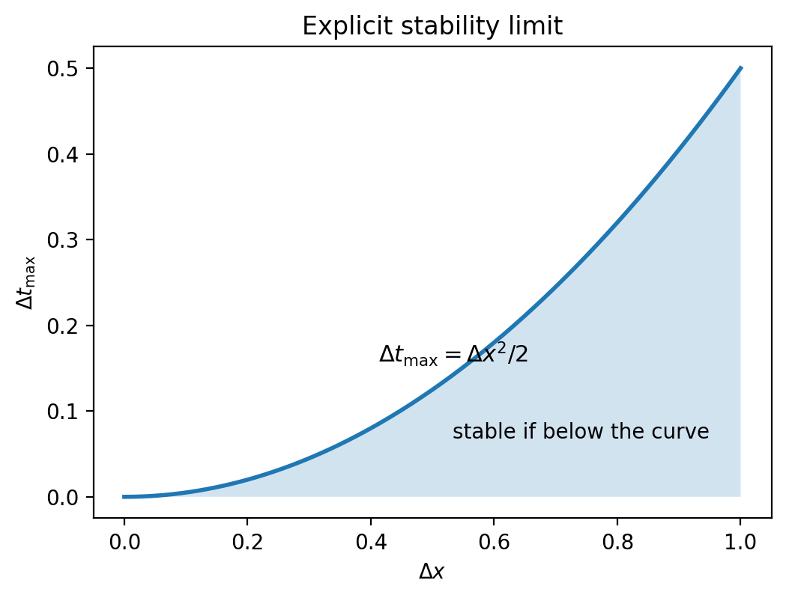

*图 3.2-5　显式稳定性限制的示意图。曲线表示 $\Delta t_{\max}\propto (\Delta x)^2$ 的二次关系（图中取无量纲示意 $\kappa=1$）。它强调：当空间网格加密时，显式方法允许的最大时间步长会更快减小。*

空间网格越细，显式格式在同一物理时间区间内通常需要越多次时间推进，因而计算成本随之增加。对于保持 $r$ 在固定正范围内的网格加密序列，可以把这种关系概括为

$$
\Delta t=\mathcal{O}((\Delta x)^2).
$$

**稳定性与精度是两个不同的问题。** 满足式 (3.2.19) 能控制离散解和扰动的增长，但并不意味着网格已经足够精细。即使 $r<1/2$，若 $\Delta x$ 或 $\Delta t$ 较大，误差也可能明显；反之，当 $r>1/2$ 时，失去非负加权平均性质，而 Fourier 分析表明在充分细的网格上存在被放大的高频模态。故数值方法的合理选择应同时考虑：

$$
\begin{cases}
\text{稳定性：}& \displaystyle
\frac{\kappa\Delta t}{(\Delta x)^2}\le\frac12,\\[6pt]
\text{精度：}&
\Delta t,\Delta x\text{ 足够小，使误差满足计算要求。}
\end{cases}
$$

还须强调，式 (3.2.19) 并非所有偏微分方程通用的 CFL 公式，而是针对**一维常系数热方程、均匀空间网格、二阶中心空间差分与前向 Euler 时间推进**这一具体组合推导出来的。改变维数、离散格式、扩散系数或边界处理时，应重新建立对应的稳定性判据。

至此，我们完成了“连续热方程 $\rightarrow$ 时空离散 $\rightarrow$ FTCS 递推 $\rightarrow$ 截断误差 $\rightarrow$ 稳定性与收敛性”的推导链条。在 3.2.3 中，将通过网格实验检验这些理论结论，并比较稳定时间步与超出 CFL 限制的时间步所产生的误差和振荡现象。
### 3.2.3 稳定性限制与网格实验

上一小节从 Taylor 展开建立了 FTCS 显式格式，并通过离散最大值原理和 Fourier 模态分析得到了扩散型 CFL 限制。理论告诉我们：**差分格式能够逼近微分方程，并不意味着它在任意时间步长下都能可靠地计算。** 本小节不再重复稳定性定理的证明，而是把结论转化为可观察、可测量、可重复的数值现象。

以下沿用 3.2.1 的金属杆模型，并以解析解作为独立参考，考察三个问题：满足稳定性限制时，数值温度是否按预期衰减？违反限制时，微小误差如何被放大？在保持稳定的前提下，网格加密是否能够提高精度？

#### 3.2.3.1 模型与稳定性预测

考虑长度为 $L$、热扩散系数为 $\kappa>0$ 的均匀导热杆，其两端保持零温度。作为主要参考问题，仍取光滑初值 $u(x,0)=A\sin(\pi x/L)$，其中 $A$ 为初始温度振幅。相应的精确解为

$$
u(x,t)=A\sin\left(\frac{\pi x}{L}\right)
\exp\left[-\kappa\left(\frac{\pi}{L}\right)^2t\right].
\tag{3.2.26}
$$

式 (3.2.26) 给出了我们希望数值方法重现的物理趋势：温度曲线保持光滑，其振幅随时间衰减，不会无缘无故出现越来越大的正负振荡。

在均匀网格 $x_j=j\Delta x$、$t_n=n\Delta t$ 上，3.2.2 中推导的 FTCS 格式为

$$
U_j^{n+1}
=
U_j^n+r\left(U_{j+1}^n-2U_j^n+U_{j-1}^n\right),
\qquad
r=\frac{\kappa\Delta t}{(\Delta x)^2}.
\tag{3.2.27}
$$

在零 Dirichlet 边界 $U_0^n=U_J^n=0$ 下，内部离散正弦模态

$$
\phi_j^{(m)}=\sin\left(\frac{m\pi j}{J}\right),
\qquad m=1,2,\ldots,J-1,
$$

经过一次 FTCS 时间推进后，振幅乘以

$$
G_m(r)=1-4r\sin^2\left(\frac{m\pi}{2J}\right).
\tag{3.2.28}
$$

这个放大因子使稳定性判据具有直接的实验含义：当 $|G_m|\leq1$ 时，该模态不会逐步放大；当某个 $|G_m|>1$ 时，即使它的初始振幅极小，也可能在多次迭代后变得十分明显。对于本节的均匀网格 FTCS 格式，标准的、与网格加密相容的稳定性条件是

$$
0<r\leq\frac12
\quad\Longleftrightarrow\quad
\Delta t\leq\frac{(\Delta x)^2}{2\kappa}.
$$

这里有一个容易忽视的细节：**仅以单个低频正弦函数为初值，不一定能在短时间实验中暴露违反 CFL 条件后的不稳定性。** 因为初始的 $\sin(\pi x/L)$ 恰好对应第一个离散正弦模态，纵使 $r>1/2$，它本身的放大因子 $G_1(r)$ 仍可能满足 $|G_1|<1$。为检验格式对微小高频扰动的反应，我们在稳定性对比实验中使用

$$
u_{\varepsilon}(x,0;J)
=
A\sin\left(\frac{\pi x}{L}\right)
+
\varepsilon\sin\left(\frac{(J-1)\pi x}{L}\right),
\tag{3.2.29}
$$

其中 $\varepsilon=10^{-12}\,^\circ\mathrm{C}$。两项均在 $x=0,L$ 处为零，且对固定 $J$ 都是光滑函数，因此初值与边界条件相容。第二项是一种**人为加入且可控的高频测试扰动**，而不是声称真实金属杆内必然存在这一特定波形。

由于热方程是线性的，式 (3.2.29) 对应的解析解可以直接由两个正弦模态叠加得到：

$$
\begin{aligned}
u_{\varepsilon}(x,t;J)
={}&A\sin\left(\frac{\pi x}{L}\right)
e^{-\kappa(\pi/L)^2t}\\
&+\varepsilon\sin\left(\frac{(J-1)\pi x}{L}\right)
e^{-\kappa((J-1)\pi/L)^2t}.
\end{aligned}
\tag{3.2.30}
$$

高频解析模态衰减得比低频模态快得多，而不稳定的离散高频模态却可能反向增长。**这种“解析解快速衰减、数值解反而爆炸”的对照，正是本实验要捕捉的现象。**

#### 3.2.3.2 实验方案与参数设置

本实验不使用外部观测数据，而是构造具有解析解的初边值问题，因此模型假设、数值误差和稳定性效应可以相互区分。为了使比较公平，稳定组与不稳定组采用相同的物理模型、空间网格、终止时间和初值；唯一有意改变的主要参数是时间步长所决定的 $r$。

**表 3.2-1　实验设计与复现信息**

| 实验要素 | 方案与记录 |
| --- | --- |
| **要回答的问题与运行前预测** | ① $r=0.4$ 时温度应保持有界并接近解析解；② $r=0.6$ 时，加入的高频扰动应被放大并导致数值振荡；③ 保持 $r=0.4$、空间网格减半时，误差预计约缩小至原来的四分之一。 |
| **输入、参数、单位、数据来源与划分** | $L=1\,\mathrm{m}$，$\kappa=0.1\,\mathrm{m^2/s}$，$A=1\,^\circ\mathrm{C}$，$T=0.6\,\mathrm{s}$；零 Dirichlet 边界。稳定性对比使用 $J=40$、$\varepsilon=10^{-12}\,^\circ\mathrm{C}$。网格实验采用 $J=20,40,80,160$ 及无扰动初值。所有输入均为人为构造的教学算例，没有训练集或测试集划分。 |
| **独立参考解／基线及选择理由** | 稳定性对比使用式 (3.2.30)，网格收敛实验使用式 (3.2.26)。它们通过连续热方程直接得到，不需要由 FTCS 数值解生成，因此能够独立检验算法。 |
| **误差指标、容差及其依据** | 记录最大节点误差 $E_\infty$、均方根节点误差 $E_{\mathrm{RMS}}$、温度最大模值 $M^n$ 和高频模态系数。教学验收阈值预先设为：稳定组终点 $E_\infty<5\times10^{-4}\,^\circ\mathrm{C}$；不稳定组终点 $E_\infty>10^6\,^\circ\mathrm{C}$；网格加密的相邻观测阶在 $[1.8,2.2]$ 内。这些数值阈值仅针对本算例，不是普适稳定性定理。 |
| **环境、种子、设备与运行预算** | 本次参考运行采用 Python 3.12.10、NumPy 1.26.4、Matplotlib 3.9.2，使用 CPU 和 `float64` 浮点数；不涉及随机抽样，无需设置随机种子。最细网格有 161 个节点、3840 次时间推进；参考运行中数值计算约耗时 0.14 s（不含图像保存，机器不同会有差异）。 |

**实验 3.2-1（稳定与不稳定时间步长的对照）。** 固定 $J=40$，因此 $\Delta x=L/J=0.025\,\mathrm{m}$。由稳定性条件计算得

$$
\Delta t_{\max}
=\frac{0.025^2}{2\times0.1}
=0.003125\,\mathrm{s}.
\tag{3.2.31}
$$

分别选择以下两组时间步长：

| 组别 | $r$ | $\Delta x$（m） | $\Delta t$（s） | 到达 $T=0.6$ s 的步数 $N$ | 事先预测 |
| --- | ---: | ---: | ---: | ---: | --- |
| A：满足 CFL 条件 | 0.4 | 0.025 | 0.002500 | 240 | 高频误差衰减，温度近似解析解 |
| B：违反 CFL 条件 | 0.6 | 0.025 | 0.003750 | 160 | 高频误差被放大，后期出现交替振荡和爆炸 |

两组都采用式 (3.2.29) 的相同初值。为了避免仅比较终点而遗漏误差的发展过程，程序逐步记录误差、最大温度模值和高频模态振幅，并在 $t=0,0.15,0.30,0.45,0.60\,\mathrm{s}$ 检查其变化。

**实验 3.2-2（稳定条件下的网格收敛性）。** 取 $r=0.4$ 不变，令 $J=20,40,80,160$。这一实验采用无扰动初值 $u(x,0)=A\sin(\pi x/L)$，使各个网格逼近同一个连续问题。因为

$$
\Delta t=\frac{r(\Delta x)^2}{\kappa},
\tag{3.2.32}
$$

每次把空间网格间距减半时，时间步长也减为原来的四分之一。3.2.2 已证明，对于足够光滑的解，稳定 FTCS 格式的总体误差典型地满足 $E_\infty=\mathcal{O}(\Delta t+(\Delta x)^2)$。因此，在这里保持 $r$ 不变，应观察到 $E_\infty=\mathcal{O}((\Delta x)^2)$。

#### 3.2.3.3 误差度量与实验记录

设 $u_{\mathrm{ref}}(x_j,t_n)$ 表示相应实验使用的解析解。定义网格节点上的最大绝对误差为

$$
E_\infty^n
=
\max_{1\leq j\leq J-1}
\left|U_j^n-u_{\mathrm{ref}}(x_j,t_n)\right|,
\tag{3.2.33}
$$

内部节点上的均方根误差为

$$
E_{\mathrm{RMS}}^n
=
\left[
\frac{1}{J-1}
\sum_{j=1}^{J-1}
\left(U_j^n-u_{\mathrm{ref}}(x_j,t_n)\right)^2
\right]^{1/2}.
\tag{3.2.34}
$$

两者单位均为 $^\circ\mathrm{C}$。另外用 $M^n=\max_{0\leq j\leq J}|U_j^n|$ 描述数值温度的整体幅值；为观察高频分量，可将离散解投影到 $\phi_j^{(J-1)}$ 上：

$$
a_{\mathrm{hi}}^n
=
\frac{
\sum_{j=1}^{J-1}U_j^n\sin((J-1)\pi j/J)
}{
\sum_{j=1}^{J-1}\sin^2((J-1)\pi j/J)
}.
\tag{3.2.35}
$$

在精确算术中，这一高频模态系数满足 $a_{\mathrm{hi}}^n=\varepsilon G_{J-1}(r)^n$。在双精度浮点计算中，当它衰减到机器舍入误差量级之后，不能再期望观测值继续严格按照这个公式下降。

数值实验按照式 (3.2.27) 对内部节点进行逐层更新，并在每一时间层直接赋值零 Dirichlet 边界 $U_0^n=U_J^n=0$。在计算过程中记录最大绝对误差、均方根误差、温度最大模值及高频模态系数，用于检验稳定性和网格收敛性。后文直接呈现运行得到的实验图像，并结合数据表解释其数学含义。


误差增长曲线和高频模态曲线采用对数纵轴。对初始零误差或接近机器精度的数值，绘图时使用 $10^{-16}$ 作为显示下限，以保证曲线可以在对数坐标上呈现。这一处理仅涉及图形显示，不改变表中的原始误差结果。

#### 3.2.3.4 数值结果与分析

以下数值来自对上述模型和 FTCS 更新的实际运行，而不是依据理论公式预先填写的模拟结果。由于采用 `float64`，不同 Python 或 NumPy 版本、不同处理器上的最后若干位可能略有差别，但不影响稳定与不稳定行为的判断。

**（1）时间步长与数值稳定性。** 时间步长是否满足 CFL 条件，直接改变了数值解的命运。

**表 3.2-2　相同网格、不同时间步长的终点结果（$J=40$，$T=0.6\,\mathrm{s}$）**

| 指标 | A：$r=0.4$，满足 CFL 条件 | B：$r=0.6$，违反 CFL 条件 |
| --- | ---: | ---: |
| 时间步长 $\Delta t$（s） | 0.002500 | 0.003750 |
| 时间步数 $N$ | 240 | 160 |
| 最大绝对误差 $E_\infty$（$^\circ\mathrm{C}$） | $2.35955\times10^{-4}$ | $1.57265\times10^{11}$ |
| 均方根误差 $E_{\mathrm{RMS}}$（$^\circ\mathrm{C}$） | $1.68971\times10^{-4}$ | $1.12620\times10^{11}$ |
| 终点最大温度模值 $M^N$（$^\circ\mathrm{C}$） | $0.552886$ | $1.57265\times10^{11}$ |

由式 (3.2.26) 计算，未扰动主模态在 $T=0.6\,\mathrm{s}$ 的最大温度约为 $0.553122\,^\circ\mathrm{C}$。稳定组的结果 $0.552886\,^\circ\mathrm{C}$ 与其非常接近；不稳定组则出现超过 $10^{11}\,^\circ\mathrm{C}$ 的非物理数值。这不是金属杆真的被加热到了如此高的温度，而是有限差分迭代失去了稳定性。

只看终点有时会掩盖爆炸前的短暂“正常”阶段。因此还应检查误差的增长过程。

**表 3.2-3　不同时间的最大节点误差 $E_\infty^n$（单位：$^\circ\mathrm{C}$）**

| 时间 $t$（s） | A：$r=0.4$ | B：$r=0.6$ |
| ---: | ---: | ---: |
| 0.00 | $0$ | $0$ |
| 0.15 | $9.19863\times10^{-5}$ | $1.71602\times10^{-4}$ |
| 0.30 | $1.58648\times10^{-4}$ | $3.96858\times10^{-1}$ |
| 0.45 | $2.05215\times10^{-4}$ | $2.49731\times10^{5}$ |
| 0.60 | $2.35955\times10^{-4}$ | $1.57265\times10^{11}$ |

在前 $0.15\,\mathrm{s}$，不稳定组看起来仍可能与解析解接近；到 $0.30\,\mathrm{s}$，它的误差已经接近初始主温度振幅；此后误差迅速跨越多个数量级。**图 3.2-6** 使用对数纵轴显示这一过程，**图 3.2-7** 则将同一终止时刻的**稳定组与不稳定组空间温度剖面并列对照**：左图中 $r=0.4$ 的数值解与解析解几乎重合，右图中 $r=0.6$ 的数值解出现剧烈的正负交替振荡。由于两组幅值相差极大，两幅子图使用相同的空间横轴、但各自独立的温度纵轴刻度；比较时应注意纵轴数量级，而不能只比较图上线条的高度。故意保留这些异常值，是因为它们本身就是需要解释的实验现象。

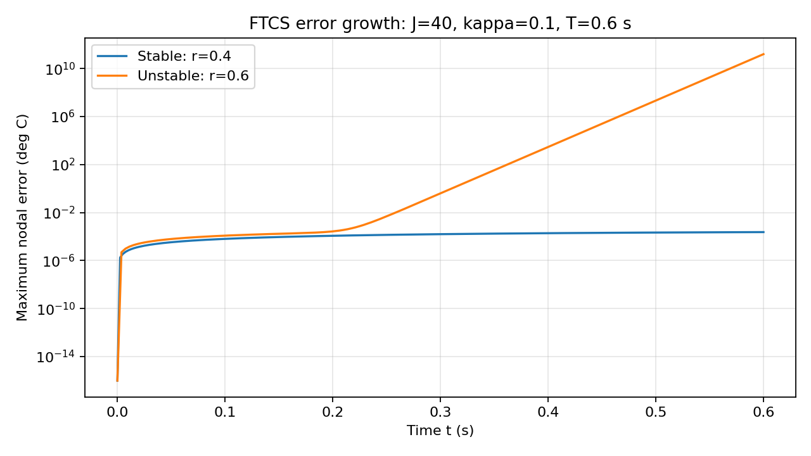

*图 3.2-6　FTCS 最大节点误差随时间的变化。横轴为时间 $t$（s），纵轴为 $E_\infty$（$^\circ\mathrm{C}$，对数刻度）；图例区分稳定组 $r=0.4$ 与不稳定组 $r=0.6$，参数为 $J=40$、$\kappa=0.1\,\mathrm{m^2/s}$。*

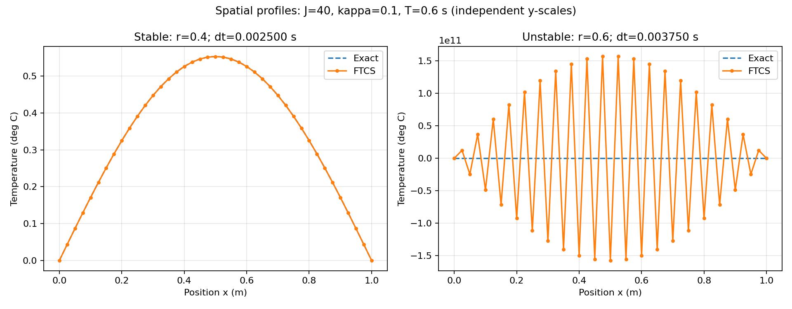

*图 3.2-7　稳定组与不稳定组的空间温度剖面对比（$T=0.6\,\mathrm{s}$，$J=40$，$\kappa=0.1\,\mathrm{m^2/s}$）。左：满足 CFL 条件的 $r=0.4$；右：违反 CFL 条件的 $r=0.6$。两组均绘制 FTCS 数值解与解析解；横轴为位置 $x$（m），纵轴为温度（$^\circ\mathrm{C}$）。两幅子图的纵轴范围不同，以完整呈现稳定组的真实剖面与不稳定组的数值振荡。*

**（2）高频扰动与误差放大。** 为什么微小的高频扰动可以引发如此大的误差？

对于 $J=40$，最高阶离散正弦模态的放大因子为

$$
G_{39}(r)
=
1-4r\cos^2\left(\frac{\pi}{80}\right).
\tag{3.2.36}
$$

计算可得：$r=0.4$ 时，$G_{39}\approx-0.597534$；$r=0.6$ 时，$G_{39}\approx-1.396301$。负号表示这一高频模态在相邻时间层之间改变符号；真正决定增长或衰减的是模长 $|G_{39}|$。

在 $r=0.6$ 的不稳定组中，经过 $N=160$ 步，忽略舍入误差时，初始振幅仅为 $10^{-12}\,^\circ\mathrm{C}$ 的高频扰动理论上会被放大到大约

$$
10^{-12}\times|{-1.396301}|^{160}
\approx1.57\times10^{11}\,^\circ\mathrm{C}.
\tag{3.2.37}
$$

这个预测数量级与实际计算吻合。**图 3.2-8** 通过式 (3.2.35) 的高频投影进一步说明：失控增长主要发生在高频模态上，而不是解析解本身要求温度增长。

这里也揭示了为什么实验要刻意加入微小的高频扰动。如果只使用低频初值 $A\sin(\pi x/L)$，那么在精确算术下只激发第一个离散模态，即使设置了 $r=0.6$，该模态仍可能衰减。一次“没有看到爆炸”的运行**不能反证不稳定性定理**；真正的稳定性要求控制所有允许的误差模态，而不仅是一个特殊初值所激发的模态。

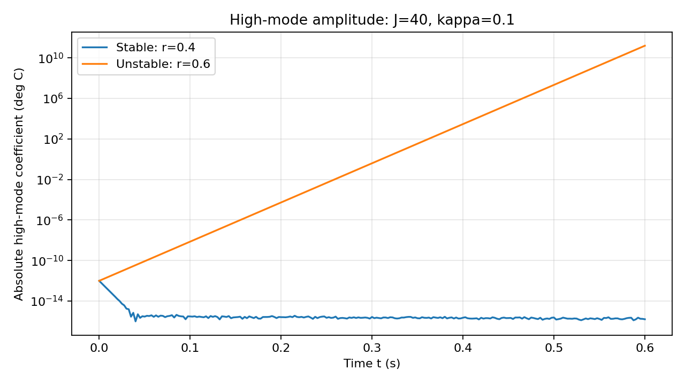

*图 3.2-8　最高阶离散正弦模态的系数绝对值随时间变化。横轴为时间 $t$（s），纵轴为模态振幅（$^\circ\mathrm{C}$，对数刻度）；图例区分 $r=0.4$ 与 $r=0.6$，参数为 $J=40$。*

**（3）网格加密与精度。** 稳定之后，网格加密是否会提高精度？

**表 3.2-4　保持 $r=0.4$ 的网格收敛实验（$T=0.6\,\mathrm{s}$）**

| 空间分段数 $J$ | $\Delta x$（m） | $\Delta t$（s） | 时间步数 $N$ | $E_\infty$（$^\circ\mathrm{C}$） | 观测阶 $p$ |
| ---: | ---: | ---: | ---: | ---: | ---: |
| 20 | 0.05000 | 0.01000000 | 60 | $9.46641\times10^{-4}$ | — |
| 40 | 0.02500 | 0.00250000 | 240 | $2.35955\times10^{-4}$ | 2.0043 |
| 80 | 0.01250 | 0.00062500 | 960 | $5.89449\times10^{-5}$ | 2.0011 |
| 160 | 0.00625 | 0.00015625 | 3840 | $1.47335\times10^{-5}$ | 2.0003 |

其中相邻两组网格的观测收敛阶定义为

$$
p
=
\frac{\log(E_\infty(\Delta x)/E_\infty(\Delta x/2))}
{\log 2}.
\tag{3.2.38}
$$

例如，由 $J=20$ 加密到 $J=40$ 时，最大误差约缩小为原来的 $1/4.012$，从而得到 $p\approx2.0043$。后两次加密也表现出近似二阶收敛。这与前一小节的总体误差估计

$$
E_\infty=\mathcal{O}\left(\Delta t+(\Delta x)^2\right)
$$

相吻合：本实验始终保持 $r$ 为常数，因此 $\Delta t$ 与 $(\Delta x)^2$ 同阶，两部分误差共同表现为二阶空间收敛。**图 3.2-9** 将观测误差曲线与 $\mathcal{O}((\Delta x)^2)$ 参考斜率进行对照。

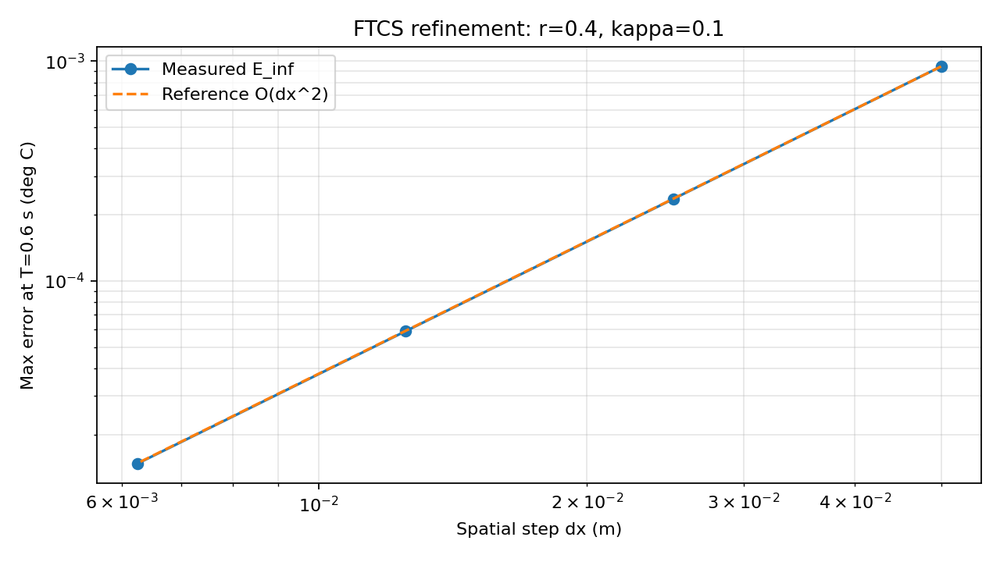

*图 3.2-9　空间网格加密时的最大节点误差。横轴为 $\Delta x$（m，对数刻度），纵轴为终点误差 $E_\infty$（$^\circ\mathrm{C}$，对数刻度）；图例区分实测误差与 $\mathcal{O}((\Delta x)^2)$ 参考曲线，参数为 $r=0.4$、$T=0.6\,\mathrm{s}$。*

需要注意，本实验同时缩小了 $\Delta x$ 和 $\Delta t$，所以它验证的是**保持 $r$ 不变的联合网格收敛趋势**，不能单凭这一组实验把时间误差和空间误差完全分离。若要分别测量时间阶与空间阶，还需设计不同的参数控制实验。

**本节结论。** 对于这里的一维常系数热方程，FTCS 格式在 $r=0.4$ 时能够稳定推进，并在网格加密下表现出预期的二阶误差收敛；取 $r=0.6$ 时，虽然只增加了一个极小的光滑高频扰动，数值解仍因高频误差逐步放大而失控。由此可见，**稳定性决定误差能否受控，精度决定受控后的误差有多小；二者必须分别检查。**

以上结论只在本节测试的常系数、均匀网格、零 Dirichlet 边界、前向 Euler 时间推进和双精度计算设置下得到了数值验证。其他边界条件、非均匀网格、变扩散系数、二维或三维扩散，以及不同时间积分方法尚未进行本节实验，不能由这些数值直接推断其行为。

#### 3.2.3.5 CFL 条件的适用范围

有一种容易出现的错误表述：“求解 PDE 时只要满足 $r=\kappa\Delta t/(\Delta x)^2\leq1/2$ 就稳定。”这一说法遗漏了方程类型与离散格式，因此并不成立。本节的 $r\leq1/2$ 只针对**一维常系数热方程、均匀网格、二阶中心空间差分和前向 Euler 时间推进**这一具体组合的标准网格稳定性要求。

首先，即便仍求解同一个热方程，只要把时间推进改为后向 Euler，就得到隐式格式

$$
\frac{U_j^{n+1}-U_j^n}{\Delta t}
=
\kappa
\frac{U_{j+1}^{n+1}-2U_j^{n+1}+U_{j-1}^{n+1}}
{(\Delta x)^2}.
\tag{3.2.39}
$$

将单个离散正弦模态代入，可得其放大因子

$$
G_m^{\mathrm{BE}}
=
\frac{1}
{1+4r\sin^2(m\pi/(2J))}.
\tag{3.2.40}
$$

由于 $r\geq0$ 时 $0<G_m^{\mathrm{BE}}\leq1$，因此这一隐式格式在该模型的模态稳定性意义下**不要求** $r\leq1/2$。它需要在每一步求解线性方程组，并且即使稳定也仍有离散误差。由此可见，**同一 PDE，改变时间离散方法，稳定性限制就可能改变。**

其次，对一维线性平流方程 $u_t+a u_x=0$（$a>0$），使用前向 Euler 与一阶迎风空间差分时，常见稳定性限制是 $0\leq a\Delta t/\Delta x\leq1$。它所涉及的是与 $\Delta x$ 成一次比例的时间步长，而不是本节扩散格式中的平方关系。

还需要区分“标准网格稳定性条件”和“固定有限网格的精确谱界限”。对于本节的 $J$ 个均匀分段、零 Dirichlet 边界，式 (3.2.28) 在所有 $m=1,\ldots,J-1$ 上满足 $|G_m|\leq1$ 的精确条件为

$$
0\leq r\leq
\frac{1}{2\cos^2(\pi/(2J))}.
\tag{3.2.41}
$$

对 $J=40$，上界约为 $0.500772$，略高于 $1/2$；当 $J\to\infty$ 时，它趋向 $1/2$。所以不能笼统声称“在每一个固定有限零边界网格上，任何 $r>1/2$ 都必然导致增长”。本实验选择的 $r=0.6$ 明显超过固定网格的精确界限，因而确实会激发增长模态。

最后，**稳定不等于精确，观察到暂时不爆炸也不等于已经证明稳定。** 一个计算结果能否可靠，需要同时核对初边值条件、离散格式、时间步长、误差与网格加密趋势。

#### 3.2.3.6 思考题及解析

**思考题。** 对一根长度 $L=1\,\mathrm{m}$ 的金属杆，热扩散系数取 $\kappa=0.1\,\mathrm{m^2/s}$，两端采用零 Dirichlet 边界。将空间区间均匀分成 $J=40$ 段，用 FTCS 显式格式求解。现在有三个候选时间步长：

$$
\Delta t_1=0.0025\,\mathrm{s},\qquad
\Delta t_2=0.003125\,\mathrm{s},\qquad
\Delta t_3=0.00375\,\mathrm{s}.
$$

哪几个满足标准 CFL 条件？若进一步将 $\Delta x$ 减半，允许的最大稳定时间步长是多少？是否只要选了稳定步长，就说明数值解一定足够精确？

**常见回答及其问题。** 有的同学会认为 $\Delta t_3$ 也可以选，因为初始温度曲线足够光滑；另一些同学会认为 $\Delta t_1$ 比 $\Delta t_2$ 小，因此必然得到精确解。这两种看法都混淆了特定初值下的数值表现、格式稳定性与离散精度。

**解答与分析。** 当前网格间距为 $\Delta x=1/40=0.025\,\mathrm{m}$，因此标准稳定性上界为

$$
\Delta t_{\max}
=
\frac{(\Delta x)^2}{2\kappa}
=
0.003125\,\mathrm{s}.
$$

于是 $\Delta t_1$ 对应 $r=0.4$，$\Delta t_2$ 对应 $r=0.5$，二者满足条件；$\Delta t_3$ 对应 $r=0.6$，不满足条件。边界值 $r=0.5$ 在标准线性稳定判据下是允许的，但实际计算常选择略小于上界的步长，留出一定的余量。

若空间步长减半为 $\Delta x'=0.0125\,\mathrm{m}$，则

$$
\Delta t'_{\max}
=
\frac{(0.0125)^2}{2\times0.1}
=
0.00078125\,\mathrm{s}.
$$

在保持 $r=0.4$ 时，应取 $\Delta t'=0.000625\,\mathrm{s}$。这说明网格加密不仅增加了空间节点数，还会显著增加显式时间推进的步数。

至于精度问题，$r\leq1/2$ 只是防止格式在标准稳定性意义下放大误差的要求；误差大小还取决于空间步长、时间步长、解的光滑程度及所需的计算容差。若希望判断结果是否足够精确，应该进一步与解析解对比，并进行网格收敛检验，而不能仅凭 CFL 条件下结论。

通过这一实验与讨论，我们把 3.2.2 的理论分析落实到了可重复的计算证据上：**先确定模型与初边值条件，再选择离散格式；先检查稳定性，再通过独立参考解和网格加密检验精度。**


## 3.3 一维有限元方法：弱形式与 Galerkin 离散

有限元方法将连续求解区域划分为若干单元，在每个单元上选取简单的近似函数，再通过变分形式将局部信息组合为整体代数方程组。本节以一维 Poisson 边值问题为模型，依次讨论弱形式的建立、连续分片线性有限元空间、Galerkin 离散、单元装配、边界条件处理与误差验证。

### 3.3.1 模型问题与有限元基本思想

有限元方法的发展与工程结构分析密切相关。对于形状复杂的机翼等结构，可先将其划分为许多简单单元，再根据单元之间的连接关系建立整体计算模型。这一“局部近似—整体组装”的思想也适用于微分方程的数值求解。

<p align="center">
  
</p>

<p align="center"><em>图 3.3-1　复杂工程结构的单元离散化示意</em></p>

为了说明基本原理，考虑下列一维边值问题：

$$
\begin{cases}
-u''(x)=1, & 0<x<1,\\
u(0)=u(1)=0.
\end{cases}
\tag{3.3.1}
$$

将区间 $[0,1]$ 等分为两个单元，并以连续分片线性函数 $u_h$ 近似精确解 $u$。由于两端节点值已知且为零，有限元近似只包含一个待定的内部节点值 $U_1=u_h(1/2)$。

<p align="center">
  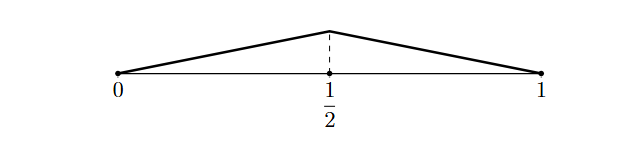
</p>

<p align="center"><em>图 3.3-2　一维两单元网格及分片线性近似</em></p>

在每个单元内部，折线的二阶导数为零，即

$$
u_h''(x)=0.
$$

但原方程要求

$$
-u''(x)=1.
$$

而且在折点处，经典意义下的二阶导数甚至不存在。

因此，分片线性近似通常不能在经典意义下逐点满足原微分方程。

另一方面，直接积分并结合边界条件，可得本例的精确解

$$
u(x)=\frac{x(1-x)}{2},
$$

其中点值为

$$
u\left(\frac12\right)=\frac18.
$$

后文将通过有限元装配计算得到相同的中间节点值：

$$
U_1=\frac18.
$$

中间节点的精确一致并不表示折线在单元内部与精确解重合。这种现象需要通过弱形式及 Galerkin 离散来解释。

有限元方法并不改变原微分方程，而是采用适用于分片函数的**积分检验条件**：先构造弱形式，再在有限维函数空间中寻找近似解。

下面从一般的源项函数出发，建立这一计算过程的数学基础。

### 3.3.2 弱形式与函数空间

以微分方程和边界条件直接描述问题、并要求方程逐点成立的表述称为**强形式**（strong form）。连续分片线性函数在单元内部的一阶导数为常数，在单元交界处可能出现斜率跳跃，因而一般无法满足强形式的经典可微性要求。通过检验函数与分部积分得到的**弱形式**（weak form），仅需处理一阶弱导数，为有限元近似提供了适当的数学框架。在精确解具有充分光滑性的情形下，弱形式可由强形式推导得到；在适当条件下，它为原边值问题提供一致的广义表述。

#### 3.3.2.1 从强形式到弱形式

考虑前述一维 Poisson 边值问题

$$
\begin{cases}
-u''(x)=f(x), & 0<x<1,\\
u(0)=u(1)=0.
\end{cases}
\tag{3.3.2}
$$

为说明弱形式的来源，暂时假定精确解 $u$ 足够光滑。取任意一个足够光滑、且满足 $v(0)=v(1)=0$ 的函数 $v(x)$，称其为**检验函数**（test function）。由于待求解的端点值已经给定，检验函数可以理解为不改变这些端点值的扰动，因此在两端取零。这里的“任意”十分重要：接下来推导的积分关系必须对每一个符合要求的检验函数成立。

将方程 $-u''(x)=f(x)$ 两边乘以 $v(x)$，并在整个区间上积分，得到

$$
-\int_0^1 u''(x)v(x)\,\mathrm{d}x
=\int_0^1 f(x)v(x)\,\mathrm{d}x.
\tag{3.3.3}
$$

对左端进行分部积分，便有

$$
\int_0^1 u'(x)v'(x)\,\mathrm{d}x
-\bigl[u'(x)v(x)\bigr]_0^1
=\int_0^1 f(x)v(x)\,\mathrm{d}x.
\tag{3.3.4}
$$

由于 $v(0)=v(1)=0$，边界项满足

$$
\bigl[u'(x)v(x)\bigr]_0^1
=u'(1)v(1)-u'(0)v(0)=0.
\tag{3.3.5}
$$

因此得到

$$
\int_0^1 u'(x)v'(x)\,\mathrm{d}x
=\int_0^1 f(x)v(x)\,\mathrm{d}x.
\tag{3.3.6}
$$

这就是该边值问题的**弱形式**所依据的积分关系：寻找满足原边界条件的函数 $u$，使上式对所有允许的检验函数 $v$ 成立。需要注意，边界项之所以消失，是因为*检验函数*在端点取零，并不是因为 $u(0)=u(1)=0$ 就能推出 $u'(0)=u'(1)=0$。

与强形式相比，上式仅含 $u$ 的一阶导数。连续分片线性函数在各单元内具有分段常数的一阶导数，即使在单元交界处发生斜率跳跃，仍然可以计算上述积分。因此，弱形式为采用分片线性函数进行有限元近似提供了依据。

至于允许选取哪些试探函数和检验函数，以及如何把弱形式转化为有限个代数方程，将在后面继续讨论。

#### 3.3.2.2 试探空间与检验空间

上文通过积分分部得到了只含一阶导数的积分关系。要将这一关系作为完整的数学问题，还需要说明：未知函数 $u$ 和检验函数 $v$ 分别允许从哪些函数中选取？

对于本节的齐次 Dirichlet 边界条件，取函数空间

$$
V=H_0^1(0,1)
 =\bigl\{w\in H^1(0,1):w(0)=w(1)=0\bigr\}.
\tag{3.3.7}
$$

其中，$H^1(0,1)$ 表示函数本身及其一阶**弱导数**均平方可积的函数空间；$H_0^1(0,1)$ 则进一步要求函数在两个端点取零。在一维区间上，端点值可以按照函数的连续代表来理解。这里还假定已知源项 $f$ 平方可积，以保证下面的积分有意义。

因此，该边值问题的**弱形式**可表述为：求 $u\in V$，使得对任意 $v\in V$，均有

$$
\int_0^1 u'(x)v'(x)\,\mathrm{d}x
=\int_0^1 f(x)v(x)\,\mathrm{d}x.
\tag{3.3.8}
$$

这里，未知函数 $u$ 所属的空间称为**试探空间**，检验函数 $v$ 所属的空间称为**检验空间**。在当前齐次 Dirichlet 问题中，两者取同一个空间 $V$，但作用不同：$u$ 是需要确定的函数，$v$ 用来检验积分关系是否成立。

需要强调，弱形式并没有取消对函数的要求，而是以一阶弱导数的可积性代替了对经典二阶导数的要求。例如，满足端点零值条件的连续分片线性函数属于 $V$：它在单元内部的一阶导数为常数，节点处即使发生斜率跳跃，也不影响相应积分的计算。

#### 3.3.2.3 从无限维问题到有限维近似

至此，我们已经给出了弱问题的完整表述，但还没有得到可以直接求解的有限个代数方程。原因在于：$V$ 是一个**无限维函数空间**，未知量仍然是函数 $u$，而且积分关系必须对 $V$ 中所有检验函数成立。

有限元方法的下一步，是先将区间划分为若干小单元，再从 $V$ 中选取由连续分片线性函数构成的**有限维子空间** $V_h\subset V$。我们将用 $u_h\in V_h$ 近似 $u$，并相应地从 $V_h$ 中选择检验函数。这样，未知函数就可以用有限个系数表示，积分关系也将转化为有限个代数方程。需要注意，离散后只要求积分关系对 $V_h$ 中的检验函数成立，因此得到的是原弱问题的近似，而不是原问题在所有检验函数下的精确解。

这一过程可以概括为

$$
\underbrace{\text{在 }V\text{ 中求 }u}_{\text{无限维弱问题}}
\quad\longrightarrow\quad
\underbrace{\text{在 }V_h\subset V\text{ 中求 }u_h}_{\text{有限维近似问题}}.
\tag{3.3.9}
$$

至于如何建立网格、构造 $V_h$，以及如何把有限维问题写成线性方程组，将在下面依次说明。

### 3.3.3 网格与分片线性有限元空间

#### 3.3.3.1 网格划分

上一小节提出，要用一个有限维空间近似原来的无限维空间。为了构造这样的空间，首先将求解区间 $[0,1]$ 划分为 $N$ 个小区间，取节点

$$
0=x_0<x_1<\cdots<x_N=1.
\tag{3.3.10}
$$

其中，$x_i$ 称为**节点**（node），相邻两个节点之间的区间

$$
K_e=[x_{e-1},x_e],\qquad e=1,2,\ldots,N
\tag{3.3.11}
$$

称为一个**单元**（element）。这些单元共同构成区间 $[0,1]$ 上的**网格**（mesh）。有限元方法中的“元”，指的就是这样的单元。

记第 $e$ 个单元的长度为 $h_e$，并定义网格尺寸 $h$：

$$
h_e=x_e-x_{e-1},\qquad
h=\max_{1\le e\le N}h_e.
\tag{3.3.12}
$$

网格不要求各单元等长；当所有单元等长时，$h_e=h=1/N$。一般来说，$h$ 越小，表示网格划分越细。

建立网格只是完成了区间的划分。接下来还需要规定：在每个单元上，用什么样的函数近似未知解？

#### 3.3.3.2 连续分片线性有限元空间

为使近似函数既易于计算，又能够用于前面建立的弱形式，我们在每个单元上选取次数不超过一次的多项式，并要求它们在相邻节点处连续，同时满足两端的齐次 Dirichlet 边界条件。由此定义**连续分片线性有限元空间**

$$
V_h=\left\{v_h\in C^0([0,1])\;\middle|\;
\begin{aligned}
&v_h|_{K_e}\in P_1(K_e),\quad e=1,2,\ldots,N,\\
&v_h(0)=v_h(1)=0
\end{aligned}
\right\}.
\tag{3.3.13}
$$

这里，$C^0([0,1])$ 表示在整个区间上连续的函数，$P_1(K_e)$ 表示单元 $K_e$ 上次数不超过 $1$ 的多项式构成的空间，$v_h|_{K_e}$ 表示函数 $v_h$ 在该单元上的限制。下标 $h$ 表示这一空间依赖于所选网格。

因此，$V_h$ 中的函数在每个单元上是一条直线段，整体上则是一条连续折线。虽然它们在单元交界处可能存在折角，但其一阶弱导数在各单元内部为常数，因而平方可积。又因为这些函数在两端取零，所以它们属于前面定义的空间 $V=H_0^1(0,1)$，即

$$
V_h\subset V.
\tag{3.3.14}
$$

更重要的是，连续分片线性函数由各节点处的函数值唯一确定。由于两端节点值已经固定为零，只剩下 $N-1$ 个内部节点值可以独立选取。因此，$V_h$ 是一个维数为 $N-1$ 的有限维空间。

至此，我们在原来的无限维空间 $V$ 中构造了一个可由有限个节点值描述的近似子空间 $V_h$。下一步将构造这个空间的基函数，并由此把近似函数写成有限个未知系数的线性组合。

#### 3.3.3.3 帽函数与有限元近似解

上一小节构造了连续分片线性有限元空间 $V_h$，并说明其中的函数由 $N-1$ 个内部节点值唯一确定。为了将求解未知函数的问题转化为确定有限个系数的问题，需要为 $V_h$ 选取一组便于计算的基函数。

对每个内部节点 $x_i$（$i=1,2,\ldots,N-1$），定义函数 $\phi_i\in V_h$，使它在网格节点上满足

$$
\phi_i(x_j)=
\begin{cases}
1,&j=i,\\
0,&j\ne i,
\end{cases}
\qquad j=0,1,\ldots,N.
\tag{3.3.15}
$$

由于 $\phi_i$ 在每个单元上都是次数不超过一次的多项式，以上节点取值条件唯一确定了它。利用相邻节点之间的线性插值，可得

$$
\phi_i(x)=
\begin{cases}
\dfrac{x-x_{i-1}}{x_i-x_{i-1}},
    &x_{i-1}\le x\le x_i,\\[6pt]
\dfrac{x_{i+1}-x}{x_{i+1}-x_i},
    &x_i\le x\le x_{i+1},\\[6pt]
0,&\text{其他位置}.
\end{cases}
\tag{3.3.16}
$$

函数 $\phi_i$ 在节点 $x_i$ 处取值为 $1$，向左右相邻节点线性下降至 $0$，在其他位置为 $0$。由于图形形似帽子，这类基函数称为**帽函数**（hat function）。它只在相邻的两个单元 $K_i$ 和 $K_{i+1}$ 上可能非零，这一性质称为**局部支撑**。

下图给出一维网格上帽函数的形状，可以看到每个基函数只在相邻两个单元上非零：

<p align="center">
  
</p>

<p align="center"><em>图 3.3-3　一维连续分片线性帽函数</em></p>

从图中可以看出，帽函数在对应节点处取值为 $1$，在相邻节点处降为 $0$，其余位置恒为零。这正是它具有局部支撑的原因。
需要注意，图中两端的灰色半帽函数用于示意一般节点形函数。在本节的齐次 Dirichlet 问题中，边界节点值已经固定为零，因此 $V_h$ 的基函数只取内部节点对应的 $\phi_1,\ldots,\phi_{N-1}$。

帽函数的节点取值性质使任意 $u_h\in V_h$ 都可以唯一表示为

$$
u_h(x)=\sum_{j=1}^{N-1}U_j\phi_j(x).
\tag{3.3.17}
$$

事实上，令 $U_j=u_h(x_j)$，则上式右端与 $u_h$ 在全部节点上的取值相同；又因为二者在每个单元上都是一次多项式，所以它们在整个区间上相同。

反过来，令 $x=x_i$，利用 $\phi_j(x_i)=1$（当 $j=i$）和 $\phi_j(x_i)=0$（当 $j\ne i$），得到

$$
u_h(x_i)=\sum_{j=1}^{N-1}U_j\phi_j(x_i)=U_i,
\qquad i=1,\ldots,N-1.
\tag{3.3.18}
$$

因此，$U_i$ 就是有限元近似解在节点 $x_i$ 处的函数值。结合前面的唯一性结论，$\phi_1,\ldots,\phi_{N-1}$ 构成了 $V_h$ 的一组基。

回到3.3.1 节引例中的两单元网格，它只有一个内部节点 $x_1=1/2$，因而 $u_h(x)=U_1\phi_1(x)$。这里的 $U_1$ 正是折线中点尚待确定的高度。一般情况下，有限元节点值 $U_i$ 是未知量，不能预先认为它等于精确解的节点值 $u(x_i)$。

### 3.3.4 Galerkin 离散与线性方程组

#### 3.3.4.1 Galerkin 有限维弱形式

通过帽函数展开，近似函数 $u_h$ 已经由 $N-1$ 个未知系数 $U_1,\ldots,U_{N-1}$ 表示。但是，仅有这一表示还不能确定这些系数。接下来需要利用前面建立的弱形式，给出确定它们的方程。

原弱问题要求：求 $u\in V$，使积分关系对任意 $v\in V$ 成立。有限元方法将试探函数和检验函数都限制在子空间 $V_h\subset V$ 中，得到以下 **Galerkin 有限元问题**：求 $u_h\in V_h$，使得

$$
\int_0^1u_h'(x)v_h'(x)\,\mathrm{d}x
=\int_0^1f(x)v_h(x)\,\mathrm{d}x,
\qquad\forall v_h\in V_h.
\tag{3.3.19}
$$

这里，$u_h$ 所在的试探空间和 $v_h$ 所在的检验空间均为 $V_h$，这就是本节所采用的 **Galerkin 方法**。与原弱问题相比，离散后只要求积分关系对 $V_h$ 中的全部检验函数成立，而不要求对整个 $V$ 中的全部函数成立。

虽然上式包含“任意检验函数”，但 $V_h$ 已经是有限维空间。由于帽函数 $\phi_1,\ldots,\phi_{N-1}$ 构成它的一组基，且积分关系对检验函数是线性的，只需依次取 $v_h=\phi_i$（$i=1,\ldots,N-1$），即可得到 $N-1$ 个方程，用来确定 $N-1$ 个节点未知量。

至此，我们不仅用有限个系数表示了有限元近似解，还得到了确定这些系数的有限个方程。下一部分将把积分方程整理成线性方程组，并介绍逐单元计算与整体装配。

#### 3.3.4.2 刚度矩阵与载荷向量

上一部分已经说明，$\phi_1,\ldots,\phi_{N-1}$ 构成有限元空间 $V_h$ 的一组基。由于 Galerkin 积分关系对检验函数是线性的，只需依次取 $v_h=\phi_i$（$i=1,\ldots,N-1$）。于是有限维弱形式可写为

$$
\int_0^1 u_h'(x)\phi_i'(x)\,\mathrm{d}x
=\int_0^1 f(x)\phi_i(x)\,\mathrm{d}x,
\qquad i=1,\ldots,N-1.
\tag{3.3.20}
$$

由上一小节的帽函数展开式，有限元近似解为

$$
u_h(x)=\sum_{j=1}^{N-1}U_j\phi_j(x).
\tag{3.3.21}
$$

在每个单元内部求导，得到

$$
u_h'(x)=\sum_{j=1}^{N-1}U_j\phi_j'(x).
\tag{3.3.22}
$$

这里的导数可按分段导数理解：虽然帽函数在个别节点处可能没有经典导数，但这不影响上述积分的计算。

将展开式代入 Galerkin 积分关系，并交换有限求和与积分的顺序，得

$$
\sum_{j=1}^{N-1}U_j
\int_0^1\phi_j'(x)\phi_i'(x)\,\mathrm{d}x
=\int_0^1 f(x)\phi_i(x)\,\mathrm{d}x,
\qquad i=1,\ldots,N-1.
\tag{3.3.23}
$$

定义**刚度矩阵**（stiffness matrix）$K$ 和**载荷向量**（load vector）$F$ 的分量为

$$
K_{ij}=\int_0^1\phi_j'(x)\phi_i'(x)\,\mathrm{d}x,
\qquad
F_i=\int_0^1 f(x)\phi_i(x)\,\mathrm{d}x,
\quad i,j=1,\ldots,N-1.
\tag{3.3.24}
$$

这样，上面的积分方程就成为

$$
\sum_{j=1}^{N-1}K_{ij}U_j=F_i,
\qquad i=1,\ldots,N-1.
\tag{3.3.25}
$$

将各个方程组合起来，便得到线性方程组

$$
KU=F,
\qquad
U=\begin{bmatrix}U_1&U_2&\cdots&U_{N-1}\end{bmatrix}^{\mathsf T}.
\tag{3.3.26}
$$

其中，$K\in\mathbb{R}^{(N-1)\times(N-1)}$，$F\in\mathbb{R}^{N-1}$，$U$ 是由内部节点未知值组成的向量。求得 $U$ 后，便可由帽函数展开式重构近似解 $u_h$。

需要注意：这里的 $K$ 和 $F$ *只对应内部节点自由度*，因为两端节点值已由齐次 Dirichlet 边界条件给定。后面介绍逐单元装配时，为了统一处理每个单元的两个端点，将先形成包含全部节点的装配矩阵和向量，再处理边界自由度；两种矩阵应使用不同记号。

#### 3.3.4.3 逐单元积分与矩阵稀疏性

虽然刚度矩阵和载荷向量已经有了明确的积分表达式，但如何实际计算这些积分，还需要结合网格和帽函数的局部结构。

前面把区间 $[0,1]$ 划分为 $N$ 个单元 $K_e=[x_{e-1},x_e]$。由于整个区间上的积分等于各单元积分之和，因此

$$
\begin{aligned}
K_{ij}
&=\sum_{e=1}^{N}\int_{K_e}\phi_j'(x)\phi_i'(x)\,\mathrm{d}x,\\
F_i
&=\sum_{e=1}^{N}\int_{K_e}f(x)\phi_i(x)\,\mathrm{d}x.
\end{aligned}
\tag{3.3.27}
$$

这表明，整体矩阵和向量的各个分量，都可以由单元上的积分贡献累加得到。

进一步，帽函数 $\phi_i$ 只在节点 $x_i$ 左右的两个相邻单元上可能非零。因此，当 $|i-j|>1$ 时，$\phi_i'$ 和 $\phi_j'$ 不会在同一个单元内部同时非零，从而有

$$
K_{ij}=0,\qquad |i-j|>1.
\tag{3.3.28}
$$

也就是说，对本节的一维连续分片线性有限元，刚度矩阵 $K$ 只有主对角线及其相邻两条对角线上可能出现非零元素，即它是一个**三对角稀疏矩阵**。

在每个单元内部，最多只有与该单元两个端点对应的节点形函数非零。因此，可以先计算这个单元产生的小矩阵和小向量，再按照局部节点与全局节点的对应关系，将各单元贡献累加到整体矩阵和向量的相应位置。这一过程称为**装配**（assembly）。

为了清楚展示单元计算与装配过程，后文将首先使用包含全部节点的全局量 $K^{\mathrm{all}}$、$F^{\mathrm{all}}$。对本节的齐次 Dirichlet 边界条件，消去边界自由度后，其内部节点子系统恰好对应前面得到的 $KU=F$。下面先计算一个线性单元的局部刚度矩阵。

### 3.3.5 单元计算、整体装配与边界条件

#### 3.3.5.1 线性单元形函数与局部刚度矩阵

上一小节已经说明，整体刚度矩阵中的积分可以分解为各单元上的积分。为了计算这些单元贡献，考虑第 $e$ 个单元

$$
K_e=[x_{e-1},x_e],\qquad
h_e=x_e-x_{e-1}>0,\qquad e=1,2,\ldots,N.
\tag{3.3.29}
$$

在 $K_e$ 上，线性函数由两个端点值唯一确定。为此，定义两个**局部形函数**：

$$
N_1(x)=\frac{x_e-x}{h_e},\qquad
N_2(x)=\frac{x-x_{e-1}}{h_e},\qquad x\in K_e.
\tag{3.3.30}
$$

其中，$N_1$ 在左端点取 $1$、右端点取 $0$；$N_2$ 则恰好相反。它们分别对应左、右端点的节点值。设 $U_i=u_h(x_i)$，则有限元近似函数在该单元上的表达式为

$$
u_h(x)=U_{e-1}N_1(x)+U_eN_2(x),\qquad x\in K_e.
\tag{3.3.31}
$$

这里省略了局部形函数对单元编号 $e$ 的依赖；对于内部节点，它们正是前面全局帽函数在该单元上的限制。局部计算同时保留单元两端的节点，但全局有限元空间 $V_h$ 的独立未知量只对应内部节点。对于本节的齐次 Dirichlet 问题，边界节点值已知，即 $U_0=U_N=0$。

对两个局部形函数求导，得到

$$
\bigl(N_1\bigr)'(x)=-\frac{1}{h_e},\qquad
\bigl(N_2\bigr)'(x)=\frac{1}{h_e}.
\tag{3.3.32}
$$

与整体刚度矩阵的定义相对应，第 $e$ 个单元的**局部刚度矩阵**定义为

$$
K^{(e)}=
\begin{bmatrix}
\displaystyle\int_{K_e}\bigl((N_1)'\bigr)^2\,\mathrm{d}x &
\displaystyle\int_{K_e}(N_1)'(N_2)'\,\mathrm{d}x\\[10pt]
\displaystyle\int_{K_e}(N_2)'(N_1)'\,\mathrm{d}x &
\displaystyle\int_{K_e}\bigl((N_2)'\bigr)^2\,\mathrm{d}x
\end{bmatrix}.
\tag{3.3.33}
$$

由于形函数的导数在单元内均为常数，例如

$$
\begin{aligned}
\int_{K_e}\bigl((N_1)'\bigr)^2\,\mathrm{d}x
&=\frac{1}{h_e^2}(x_e-x_{e-1})=\frac{1}{h_e},\\
\int_{K_e}(N_1)'(N_2)'\,\mathrm{d}x
&=-\frac{1}{h_e^2}(x_e-x_{e-1})=-\frac{1}{h_e}.
\end{aligned}
\tag{3.3.34}
$$

其余两项同理，于是得到

$$
K^{(e)}=\frac{1}{h_e}
\begin{bmatrix}1&-1\\-1&1\end{bmatrix}.
\tag{3.3.35}
$$

这个结果表明，对当前的一维 Poisson 问题，线性单元的局部刚度矩阵只由单元长度 $h_e$ 决定。它描述的是该单元对整体矩阵的贡献，而不是一个需要单独求解的方程组。

#### 3.3.5.2 局部载荷向量

除了刚度矩阵，还需要计算源项 $f(x)$ 对各节点的贡献。与整体载荷向量的定义对应，第 $e$ 个单元的**局部载荷向量**为

$$
F^{(e)}=
\begin{bmatrix}F_1^{(e)}\\F_2^{(e)}\end{bmatrix}
=
\begin{bmatrix}
\displaystyle\int_{K_e}f(x)N_1(x)\,\mathrm{d}x\\[8pt]
\displaystyle\int_{K_e}f(x)N_2(x)\,\mathrm{d}x
\end{bmatrix}.
\tag{3.3.36}
$$

它的两个分量分别表示该单元对左、右端点载荷的贡献。若源项在单元上为常数 $f(x)=c$，由于两个局部形函数在单元上的积分均为 $h_e/2$，便有

$$
F^{(e)}=\frac{ch_e}{2}\begin{bmatrix}1\\1\end{bmatrix}.
\tag{3.3.37}
$$

例如，3.3.1 节引例中的模型取 $f(x)=1$，因此每个单元的局部载荷向量为 $\frac{h_e}{2}[1,1]^{\mathsf T}$。对于一般的 $f(x)$，若积分可以解析计算，就直接求积分；否则可采用 Gauss 求积等数值积分方法。

至此，每个单元都产生了一对局部计算结果：刚度矩阵 $K^{(e)}$ 与载荷向量 $F^{(e)}$。下一步需要将它们组合成描述整个区间的矩阵和向量。

#### 3.3.5.3 整体矩阵与载荷向量的装配

所谓**装配**（assembly），就是根据局部节点与全局节点的对应关系，将各单元的贡献累加到整体矩阵和载荷向量中。为了与前面只包含内部自由度的 $K$、$F$ 区分，这里将尚未处理边界条件、包含全部节点的装配结果记为 $K^{\mathrm{all}}$ 和 $F^{\mathrm{all}}$。

回到3.3.1 节引例中的两单元网格，取

$$
x_0=0,\qquad
x_1=\frac12,\qquad
x_2=1.
\tag{3.3.38}
$$

两个单元分别为 $K_1=[x_0,x_1]$ 和 $K_2=[x_1,x_2]$，长度均为 $h_1=h_2=1/2$。根据上一小节的结果，两个局部刚度矩阵相同：

$$
K^{(1)}=K^{(2)}=
2\begin{bmatrix}1&-1\\-1&1\end{bmatrix}
=\begin{bmatrix}2&-2\\-2&2\end{bmatrix}.
\tag{3.3.39}
$$

第一个单元的局部节点对应全局节点 $(0,1)$，因此对全部节点组成的矩阵，其贡献位于第 $0,1$ 行及第 $0,1$ 列：

$$
\begin{bmatrix}
2&-2&0\\-2&2&0\\0&0&0
\end{bmatrix}.
\tag{3.3.40}
$$

第二个单元对应全局节点 $(1,2)$，其贡献位于第 $1,2$ 行及第 $1,2$ 列：

$$
\begin{bmatrix}
0&0&0\\0&2&-2\\0&-2&2
\end{bmatrix}.
\tag{3.3.41}
$$

将这两部分逐项相加，得到**未经边界条件处理的完整装配矩阵**

$$
K^{\mathrm{all}}=
\begin{bmatrix}
2&-2&0\\-2&4&-2\\0&-2&2
\end{bmatrix}.
\tag{3.3.42}
$$

下面的示意图直观地展示了两个单元的局部刚度矩阵如何按共享节点累加装配成整体刚度矩阵：

<p align="center">
  
</p>

<p align="center"><em>图 3.3-4　局部刚度矩阵的整体装配示意</em></p>

如上图所示，中间节点 $x_1$ 同时属于左右两个单元，因此两个单元对该节点的刚度贡献相加，使完整装配矩阵对应的对角元素成为 $2+2=4$。这正体现了*共享节点处累加贡献*的装配规则。

载荷向量也按照相同的节点对应关系装配。若继续取3.3.1 节引例中的 $f(x)=1$，由于两个单元长度均为 $1/2$，其局部载荷向量都是

$$
F^{(1)}=F^{(2)}=\begin{bmatrix}1/4\\1/4\end{bmatrix}.
\tag{3.3.43}
$$

因此，完整装配载荷向量为

$$
F^{\mathrm{all}}=
\begin{bmatrix}1/4\\1/4\\0\end{bmatrix}
+
\begin{bmatrix}0\\1/4\\1/4\end{bmatrix}
=\begin{bmatrix}1/4\\1/2\\1/4\end{bmatrix}.
\tag{3.3.44}
$$

应当注意，$K^{\mathrm{all}}$ 与 $F^{\mathrm{all}}$ 只是包含全部节点的装配结果，不能直接当作前文内部自由度方程 $KU=F$ 中的 $K$ 和 $F$。本节的齐次 Dirichlet 边界条件已给定 $U_0=U_2=0$，所以真正需要求解的只有内部节点值 $U_1$。如何从完整装配结果得到最终的求解系统，将在下一小节说明。

#### 3.3.5.4 Dirichlet 边界条件的施加

上一小节通过逐单元装配，得到了包含全部节点的刚度矩阵 $K^{\mathrm{all}}$ 和载荷向量 $F^{\mathrm{all}}$。但这还不是可以直接求解的线性系统，因为本节的**齐次 Dirichlet 边界条件**已经规定

$$
u(0)=u(1)=0,\qquad U_0=U_N=0.
\tag{3.3.45}
$$

也就是说，两端节点值是已知的，真正需要确定的只有内部节点值。更重要的是，前面建立的弱形式仅要求积分关系对端点为零的检验函数成立，因此不能直接要求完整装配矩阵的每一行都满足 $K^{\mathrm{all}}U^{\mathrm{all}}=F^{\mathrm{all}}$。

将内部节点集合记为 $I=\{1,\ldots,N-1\}$，边界节点集合记为 $B=\{0,N\}$。为了书写方便，按内部节点和边界节点的顺序排列相应的矩阵与向量：

$$
K^{\mathrm{all}}=
\begin{bmatrix}
K_{II}^{\mathrm{all}}&K_{IB}^{\mathrm{all}}\\
K_{BI}^{\mathrm{all}}&K_{BB}^{\mathrm{all}}
\end{bmatrix},\qquad
F^{\mathrm{all}}=
\begin{bmatrix}F_I^{\mathrm{all}}\\F_B^{\mathrm{all}}\end{bmatrix},\qquad
U^{\mathrm{all}}=
\begin{bmatrix}U_I\\U_B\end{bmatrix}.
\tag{3.3.46}
$$

这里，$U_I$ 是内部节点未知值组成的向量，$U_B$ 是已知的边界节点值向量。由于检验函数在两端为零，有限元弱形式所对应的是**内部节点方程**

$$
K_{II}^{\mathrm{all}}U_I+K_{IB}^{\mathrm{all}}U_B
=F_I^{\mathrm{all}}.
\tag{3.3.47}
$$

将已知的边界节点值移到右端，得到真正需要求解的系统：

$$
K_{II}^{\mathrm{all}}U_I
=F_I^{\mathrm{all}}-K_{IB}^{\mathrm{all}}U_B.
\tag{3.3.48}
$$

对于本节的齐次 Dirichlet 边界条件，$U_B=0$，因此上式简化为

$$
K_{II}^{\mathrm{all}}U_I=F_I^{\mathrm{all}}.
\tag{3.3.49}
$$

这恰好是前面由内部节点帽函数直接推导的 $KU=F$，其中 $K=K_{II}^{\mathrm{all}}$、$F=F_I^{\mathrm{all}}$、$U=U_I$。

现在完成3.3.1 节引例中的两单元计算。上一小节已经得到

$$
K^{\mathrm{all}}=
\begin{bmatrix}
2&-2&0\\
-2&4&-2\\
0&-2&2
\end{bmatrix},\qquad
F^{\mathrm{all}}=
\begin{bmatrix}
\frac14\\
\frac12\\
\frac14
\end{bmatrix}.
\tag{3.3.50}
$$

因为只有中间节点 $x_1=1/2$ 是内部节点，所以只需取矩阵的中间一行，并代入 $U_0=U_2=0$：

$$
-2U_0+4U_1-2U_2=\frac12
\quad\Longrightarrow\quad
4U_1=\frac12
\quad\Longrightarrow\quad
U_1=\frac18.
\tag{3.3.51}
$$

于是有限元近似解为 $u_h(x)=\frac18\phi_1(x)$。这个中点值与3.3.1 节引例中精确解 $u(x)=x(1-x)/2$ 在 $x=1/2$ 处的取值一致，但两单元折线在单元内部仍不是精确解。

由此可见，施加 Dirichlet 边界条件不是求解结束后才将两端节点值“补成零”，而是在确定未知自由度和建立最终求解系统时就必须考虑。完整装配矩阵的边界节点行并不需要与 $F_B^{\mathrm{all}}$ 逐项相等；这些位置由给定的边界条件约束。

### 3.3.6 数值实现与收敛性验证

为统一记号，下文以 $U_i=u_h(x_i)$ 表示有限元解的节点值，以 $W_i$ 表示中心差分法的节点值；$K^{(e)}$、$F^{(e)}$ 表示单元刚度矩阵和单元载荷向量，$K^{\mathrm{all}}$、$F^{\mathrm{all}}$ 表示尚未施加边界条件的完整装配结果，$K$、$F$ 则仅表示内部自由度系统中的矩阵和向量。

前面已经通过弱形式、连续分片线性有限元空间及 Galerkin 方法，将一维 Poisson 边值问题转化为线性方程组，并完成了单元计算、整体装配与 Dirichlet 边界处理。但是，能够求出节点值并不意味着数值方法已经得到验证：除了检查计算过程是否正确，还要考察近似解在整个区间上的误差。以下采用制造解进行数值验证，并在同一网格上与二阶中心差分法比较，考察节点误差、积分误差以及网格加密时的收敛规律。

#### 3.3.6.1 实验目的与预期误差阶

在相同的一维均匀网格上实现连续分片线性 Galerkin 有限元（FEM）和二阶中心差分法（FDM），重点回答三个问题：

1. 单元矩阵、局部载荷向量、整体装配和边界条件处理是否与前面的理论推导一致？

2. FEM 与 FDM 的节点值能否逼近精确解？FEM 在节点处准确，是否意味着其在单元内部也同样准确？

3. 网格加密后，各种误差以怎样的速度减小？数值结果是否符合理论预期？

**理论预期。** 对本节的光滑一维 Poisson 模型，若单元积分准确计算、精确解满足 $u\in H^2(0,1)\cap H_0^1(0,1)$，则连续分片线性有限元满足相应的典型误差估计：

$$
|u-u_h|_{H^1(0,1)}
\le Ch\|u''\|_{L^2(0,1)},
\qquad
\|u-u_h\|_{L^2(0,1)}
\le Ch^2\|u''\|_{L^2(0,1)}.
$$

这里 $C$ 与网格尺寸 $h$ 无关。因而预期 FEM 的 $H^1$ 半范数误差约为一阶、$L^2$ 误差约为二阶；在本实验的光滑模型上，中心差分法的节点最大误差预期约为二阶。上述误差指标的定义不同，不能仅凭其数值大小判断某一种方法普遍更优。

#### 3.3.6.2 模型问题与计算设置

采用**制造解**（manufactured solution）方法，先指定一个已知的光滑函数

$$
u(x)=\sin(\pi x),\qquad 0\le x\le 1,
$$

再由 $u''(x)=-\pi^2\sin(\pi x)$ 得到待求解的边值问题

$$
\begin{cases}
-u''(x)=f(x)=\pi^2\sin(\pi x),&0<x<1,\\
u(0)=u(1)=0.
\end{cases}
$$

这样便有已知的精确解，可用于评价数值误差。计算 FEM 和 FDM 时，只使用源项 $f(x)$ 与边界数据；已知函数 $u(x)$ 仅用于计算误差，不直接提供内部节点的数值解。

将区间 $[0,1]$ 均匀划分为 $N$ 个单元，取 $x_i=i/N$、$h=1/N$，依次使用 $N=8,16,32,64,128$。FEM 与 FDM 采用相同节点。程序使用 Python 3、NumPy 和 Matplotlib，局部刚度矩阵由解析公式给出；FEM 载荷向量采用每单元四点 Gauss–Legendre 求积，计算积分误差时使用每单元十二点 Gauss–Legendre 求积，以减小误差评估时的数值积分偏差。本实验不涉及随机过程。

#### 3.3.6.3 两种数值离散方法

**（1）Galerkin 有限元。** 在单元 $K_e=[x_{e-1},x_e]$ 上，$h_e=x_e-x_{e-1}$，利用两个局部形函数 $N_1,N_2$，计算

$$
K^{(e)}
=
\frac{1}{h_e}
\begin{bmatrix}
1&-1\\
-1&1
\end{bmatrix},
\qquad
F^{(e)}
=
\begin{bmatrix}
\displaystyle\int_{K_e}f(x)N_1(x)\,\mathrm{d}x\\[6pt]
\displaystyle\int_{K_e}f(x)N_2(x)\,\mathrm{d}x
\end{bmatrix}.
$$

先将各单元贡献累加为完整装配矩阵 $K^{\mathrm{all}}$ 和载荷向量 $F^{\mathrm{all}}$，再结合 $U_0=U_N=0$，求解内部节点方程

$$
K_{II}^{\mathrm{all}}U_I=F_I^{\mathrm{all}}.
$$

最后恢复全部节点值，利用局部线性插值重构连续分片线性函数 $u_h$。这里的 $K_{II}^{\mathrm{all}}$ 是施加边界条件后真正参与求解的内部自由度矩阵，不应与 $K^{\mathrm{all}}$ 混淆。

**（2）中心差分法。** 在相同的内部节点上，采用二阶中心差分近似

$$
-u''(x_i)\approx
\frac{-W_{i-1}+2W_i-W_{i+1}}{h^2},
\qquad i=1,\ldots,N-1.
$$

结合 $W_0=W_N=0$ 构造三对角方程组，求得差分节点值 $W_i$。FDM 首先产生节点数值，而 FEM 还给出单元之间的连续分片线性近似。比较节点值时使用同一类节点误差，评价 FEM 整个区间上的精度时还应使用积分误差。

#### 3.3.6.4 误差指标与经验收敛阶

在共同网格节点上，分别记录

$$
E_{\infty}^{\mathrm{FEM}}
=
\max_{0\le i\le N}|u(x_i)-U_i|,
\qquad
E_{\infty}^{\mathrm{FDM}}
=
\max_{0\le i\le N}|u(x_i)-W_i|.
$$

对于 FEM，还计算整个区间上的两种误差：

$$
E_{L^2}^{\mathrm{FEM}}
=
\left(
\sum_{e=1}^{N}
\int_{K_e}(u-u_h)^2\,\mathrm{d}x
\right)^{1/2},
$$

$$
E_{H^1}^{\mathrm{FEM}}
=
\left(
\sum_{e=1}^{N}
\int_{K_e}(u'-u_h')^2\,\mathrm{d}x
\right)^{1/2}.
$$

其中 $E_{H^1}^{\mathrm{FEM}}$ 表示 $H^1$ **半范数误差**，并非完整的 $H^1$ 范数误差。两个积分误差采用单元上的高阶数值求积近似计算。

若某种误差满足 $E_h\approx Ch^p$，则当网格尺寸从 $h$ 减半为 $h/2$ 时，经验收敛阶为

$$
p_h=
\frac{\log(E_h/E_{h/2})}{\log 2}.
$$

这一指标只有在误差明显大于数值舍入误差时才具有可靠的解释意义。

#### 3.3.6.5 计算步骤与程序核验

**算法 3.3-1　一维 Galerkin 有限元与中心差分的对比计算流程**

可按照如下步骤编写程序：

1. 建立均匀网格并确定局部节点和全局节点的对应关系；

2. 计算各单元 $K^{(e)}$ 与 $F^{(e)}$，完成 $K^{\mathrm{all}}$、$F^{\mathrm{all}}$ 的装配；

3. 施加齐次 Dirichlet 边界条件，求解内部自由度并重构 $u_h$；

4. 在相同节点上实现中心差分法，得到 $W_i$；

5. 计算节点误差、FEM 积分误差和内部线性系统残差；

6. 对各级网格重复计算，整理误差表、收敛阶表和数值图像。

正式实验之前，先用前文的两单元问题 $-u''=1$、$u(0)=u(1)=0$ 检查程序。应得到

$$
K^{\mathrm{all}}
=
\begin{bmatrix}
2&-2&0\\
-2&4&-2\\
0&-2&2
\end{bmatrix},
\qquad
F^{\mathrm{all}}
=
\begin{bmatrix}
\frac14\\[4pt]
\frac12\\[4pt]
\frac14
\end{bmatrix},
\qquad
U_1=\frac18.
$$

同时检查完整刚度矩阵的对称性、内部自由度矩阵的正定性、端点边界值以及求解残差。若上述基本检查不通过，应先修正代码，再进行网格加密实验。根据算法 3.3-1 可编写 `fem_fdm_experiment.py`；本节给出了程序应满足的校验基准与数值结果。

#### 3.3.6.6 数值结果与收敛阶分析

**（1）数值解的图像比较**

先取 $N=8$，比较精确解、连续分片线性有限元解和中心差分节点值。

<p align="center">
  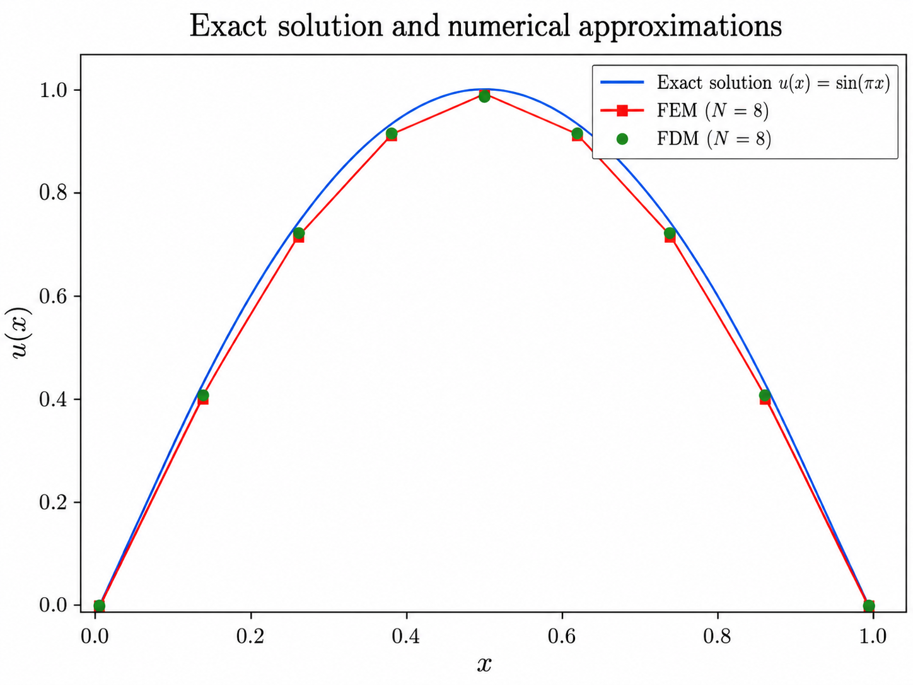
</p>

<p align="center"><em>图 3.3-5　N = 8 时一维 Poisson 问题的精确解、分片线性有限元解和中心差分节点值。FEM 在相邻节点间以直线连接，FDM 以离散节点标记显示。</em></p>

由图 3.3-5 可见，两种方法都能较好地描述解的变化趋势，但它们产生的近似对象不同。以中点 $x=1/2$ 为例，精确解为 $u(1/2)=1$；本实验中四点 Gauss 求积的 FEM 中点值约为 1，而中心差分法得到 $W_{N/2}\approx1.012951$。即使 FEM 在节点处十分准确，它的单元内部仍为直线段，与精确的正弦曲线并不重合。**图像的视觉接近不足以说明收敛速度，需要进一步计算误差。**

**（2）误差随网格加密的变化**

表 3.3-1 给出了不同网格下的 FEM 整体误差和 FDM 节点最大误差。FEM 的节点最大误差另在下文讨论，避免把接近浮点舍入量级的数字用于不可靠的收敛阶计算。

**表 3.3-1　网格加密下的数值误差（FEM 载荷采用四点 Gauss 求积）**

| $N$ | $h$ | $E_{L^2}^{\mathrm{FEM}}$ | $E_{H^1}^{\mathrm{FEM}}$ | $E_{\infty}^{\mathrm{FDM}}$ |
|---:|---:|---:|---:|---:|
| 8 | 0.125000 | $9.920920\times10^{-3}$ | $2.511818\times10^{-1}$ | $1.295075\times10^{-2}$ |
| 16 | 0.062500 | $2.486501\times10^{-3}$ | $1.258332\times10^{-1}$ | $3.218964\times10^{-3}$ |
| 32 | 0.031250 | $6.220178\times10^{-4}$ | $6.294691\times10^{-2}$ | $8.035777\times10^{-4}$ |
| 64 | 0.015625 | $1.555290\times10^{-4}$ | $3.147724\times10^{-2}$ | $2.008218\times10^{-4}$ |
| 128 | 0.0078125 | $3.888378\times10^{-5}$ | $1.573910\times10^{-2}$ | $5.020092\times10^{-5}$ |

随着 $N$ 增大、$h$ 减小，表中三种误差都逐步下降。为了判断下降规律，将相邻两级网格的误差代入前述经验收敛阶公式，得到表 3.3-2。

**表 3.3-2　网格加密时的经验收敛阶**

| 细网格单元数 $N$ | FEM $L^2$ | FEM $H^1$ 半范数 | FDM 节点最大误差 |
|---:|---:|---:|---:|
| 16 | 1.9964 | 0.9972 | 2.0084 |
| 32 | 1.9991 | 0.9993 | 2.0021 |
| 64 | 1.9998 | 0.9998 | 2.0005 |
| 128 | 1.9999 | 1.0000 | 2.0001 |

例如，根据 $N=8$ 与 $N=16$ 的 FEM $L^2$ 误差，有

$$
p_h=
\frac{
\log\left(
\frac{9.920920\times10^{-3}}
{2.486501\times10^{-3}}
\right)
}{
\log 2
}
\approx1.9964,
$$

接近二阶。图 3.3-6 使用双对数坐标展示误差随网格尺寸变化的趋势。

<p align="center">
  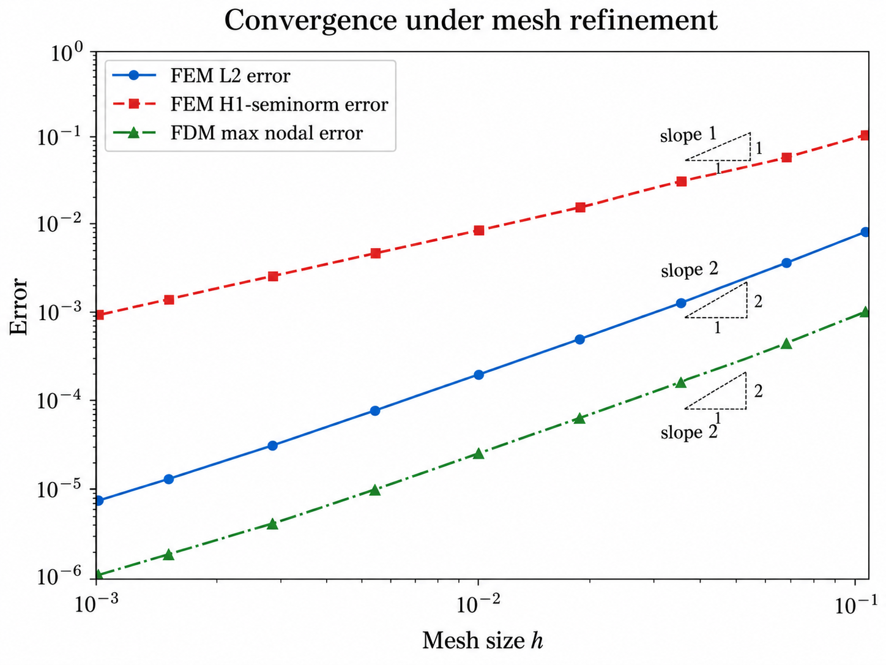
</p>

<p align="center"><em>图 3.3-6　网格加密下的误差收敛曲线。横轴为网格尺寸 h，纵轴为误差，均采用对数坐标；三条曲线对应不同的误差指标。</em></p>

若 $E_h\approx Ch^p$，则

$$
\log E_h\approx\log C+p\log h,
$$

双对数曲线的斜率近似为 $p$。从表 3.3-2 与图 3.3-6 可以看出，本实验中 FEM 的 $L^2$ 误差表现为约二阶收敛、$H^1$ 半范数误差约为一阶收敛，FDM 节点最大误差约为二阶收敛，与运行前预测一致。**这些结论来自同一种误差指标在不同网格上的变化，而不是对不同指标绝对数值大小的直接比较。**

**（3）有限元节点值与精确解的关系**

本实验采用四点 Gauss 求积时，$N=8$ 的 FEM 节点最大误差约为 $2.24\times10^{-12}$，加密后接近浮点舍入量级，因此不适合用这组节点误差计算收敛阶。这是当前**一维常系数 Poisson 问题在精确载荷积分时**的一项特殊性质，而不是一般有限元方法都具有的结论。

设 $I_hu$ 为精确解的分片线性节点插值函数，则

$$
(u-I_hu)(x_i)=0.
$$

由于任意 $v_h\in V_h$ 在每个单元 $K_e$ 上的导数是常数，有

$$
\int_{K_e}(u-I_hu)'v_h'\,\mathrm{d}x
=
v_h'|_{K_e}
\left[
(u-I_hu)(x_e)
-
(u-I_hu)(x_{e-1})
\right]
=0.
$$

对所有单元求和，结合精确弱形式和离散问题解的唯一性，可得

$$
u_h=I_hu.
$$

也就是说，在精确积分的理想情形下，FEM 节点值与精确解的节点值一致；但在单元内部，正弦曲线与线性插值一般不同，因此 $L^2$ 与 $H^1$ 半范数误差仍然不为零。这个现象也解释了3.3.1 节引例中的两单元折线为什么能够准确得到中间节点值。

### 3.3.7 方法比较与边界项讨论

#### 3.3.7.1 Galerkin 有限元与中心差分法

在一维均匀网格 Poisson 问题中，有限差分和有限元最终得到的矩阵可能很像。

中心差分从 $-u''(x_i)$ 出发，用

$$
-u''(x_i)\approx\frac{-W_{i-1}+2W_i-W_{i+1}}{h^2}
$$

直接近似微分算子。

而有限元从弱形式

$$
\int_0^1 u'v'\,\mathrm{d}x
=
\int_0^1 fv\,\mathrm{d}x
$$

出发，再通过基函数得到

$$
K_{ij}=\int_0^1\phi_j'\phi_i'\,\mathrm{d}x.
$$

因此，两者在某些模型中具有相似的系数矩阵，但离散原理并不相同：有限差分法近似微分算子，Galerkin 有限元法近似变分问题。

#### 3.3.7.2 积分分部与 Neumann 边界条件

分部积分得到

$$
\int_0^1 u'v'\,\mathrm{d}x
-
[u'v]_0^1
=
\int_0^1 fv\,\mathrm{d}x.
$$

在本节中，因为 $v(0)=v(1)=0$，所以边界项才消失。

如果右端采用 Neumann 条件，例如

$$
u'(1)=g_N,
$$

而左端仍为 Dirichlet 条件，则检验函数通常只要求 $v(0)=0$。这时

$$
[u'v]_0^1
=
u'(1)v(1)
=
g_Nv(1),
$$

因此弱形式变为

$$
\int_0^1 u'v'\,\mathrm{d}x
=
\int_0^1 fv\,\mathrm{d}x
+
g_Nv(1).
$$

因此，边界积分项是否保留取决于具体的边界条件；对 Neumann 条件，边界数据通常作为右端线性泛函的一部分进入弱形式。

### 3.3.8 本节小结

本节以一维 Poisson 边值问题为例，建立了**从强形式到弱形式、从有限元空间到 Galerkin 离散、从局部单元计算到整体装配与边界处理**的完整联系。分部积分降低了方程对未知函数经典导数的要求，使连续分片线性函数能够用于有限元近似；帽函数则把求解未知函数转化为求解有限个节点值。

通过单元刚度矩阵与载荷向量的计算、整体装配以及 Dirichlet 边界条件处理，原边值问题最终转化为可以由计算机求解的线性代数系统。实验又表明，在本节所选的光滑一维模型上，FEM 的 $H^1$ 半范数误差约按一阶减小、$L^2$ 误差约按二阶减小，中心差分法的节点最大误差约为二阶。

需要特别注意：**节点值接近精确解，并不意味着整个分片线性近似函数处处准确。** 应根据研究目标选取适当的误差指标，并通过网格加密检验数值解的收敛规律。有限元方法的核心也不只是得到一个与差分法形式相似的矩阵，而是先建立弱形式，再在有限维函数空间中进行 Galerkin 近似，最终形成可计算的代数系统。

### 3.3.9 习题

**习题 3.3-1（节点误差与整体误差）**　为什么 FEM 在本实验中几乎准确地求出了全部节点值，$H^1$ 半范数误差却仍不为零？

**习题 3.3-2（数值求积的影响）**　将 FEM 载荷积分由四点 Gauss 求积改为一点求积，观察节点误差如何变化。此时还能用节点误差计算稳定的经验收敛阶吗？

**习题 3.3-3（非齐次 Dirichlet 条件）**　若将一个端点改为非零 Dirichlet 边界值，求解器应该在哪一步引入已知边界值？为什么不能只在解出内部节点后覆盖边界节点值？

**习题 3.3-4（两单元有限元计算）**　考虑下列一维 Poisson 问题：

$$
\begin{cases}
-u''(x)=1, & 0<x<1,\\
u(0)=u(1)=0.
\end{cases}
$$

将区间划分为两个单元

$$
K_1=[0,0.5],\qquad K_2=[0.5,1],
$$

对应三个节点

$$
x_0=0,\qquad x_1=\frac12,\qquad x_2=1.
$$

完成以下计算，并与 3.3.5 节的两单元示例对照：

1. 写出两个单元的局部刚度矩阵；
2. 写出两个单元的局部载荷向量；
3. 完成整体矩阵和整体载荷向量的装配；
4. 说明 Dirichlet 边界条件如何进入计算；
5. 求内部节点值 $U_1$；
6. 用代码核对手算结果。

### 参考文献

[1] Larson M G, Bengzon F. *The Finite Element Method: Theory, Implementation, and Applications*. Springer, 2013. 参见第 2.1 节。

[2] Chandrupatla T R, Belegundu A D. *Introduction to Finite Elements in Engineering*. 5th ed. 参见第 1.6 节和第 4 章。


## 3.4 AI关联：Neural ODE与PINN（2学时）

## 导入：从数值积分走向科学机器学习

在第 3.1 节中，我们研究了一个基本问题：当微分方程的右端函数和初始条件已经给定时，怎样利用 Euler 方法、Runge–Kutta 方法等数值算法计算近似解，并通过误差和稳定性分析评价结果。这一研究以**微分方程已知**为前提。然而，在许多科学与工程问题中，我们面对的往往不只是“怎样求解方程”，还包括“怎样根据有限信息建立方程”。

例如，在某个动态过程的实验中，研究者可能只记录了若干时刻的系统状态，却尚未掌握状态随时间变化的准确规律。如果直接假设一种变化率函数，模型可能无法充分描述观测数据。一个自然的思路是：用带有待定参数的函数来表示未知变化率，根据观测轨迹确定参数，再通过数值积分得到连续时间的模型预测。**Neural ODE** 将这一思路与神经网络结合起来，使动力学模型的学习和常微分方程的数值求解相互联系。

另一些问题具有不同的特点：微分方程本身已知，但求解区域、边界条件或方程结构使解析求解较为困难。传统方法通过网格离散建立代数方程组；**物理信息神经网络（PINN）** 则尝试用可微的神经网络表示未知解，并利用微分方程残差、初始条件和边界条件构造训练目标。这种方法把已知数学规律引入函数近似过程，但仍需要对所得解进行数值检验。

因此，神经网络参与微分方程计算后，需要同时关注两个层面：**模型是否正确表达了所研究的问题，以及计算过程是否足够准确地求解了该模型**。本节将分别介绍 Neural ODE 与 PINN 的基本原理，分析模型误差、数值离散误差和训练误差之间的关系，并通过可复现算例说明独立验证的重要性。

---

本节讨论神经网络与微分方程的两种典型结合机制。学习后，应能够区分“学习微分方程的右端”与“学习满足微分方程的解”，写出相应的训练目标，理解数值积分器与初边值条件对学习结果的作用，并能设计有独立参照的最小数值实验。所需先修知识包括 3.1 节的初值问题、Euler 方法、RK4 方法、误差与稳定性，以及微积分、最小二乘法和导数的基本概念。

### 3.4.1 从已知方程求解到数据驱动建模

#### （一）三类需要区分的计算问题

考虑 3.1 节的一阶常微分方程初值问题

$$
\begin{cases}
 y'(t)=f\bigl(t,y(t)\bigr),&t\in[t_0,T],\\
 y(t_0)=y_0.
\end{cases}
\tag{3.4-1}
$$

这里沿用原有约定：$y(t_n)$ 为精确解在 $t_n$ 处的值，$y_n$ 为数值积分所得的节点近似值，$h$ 表示**时间步长**。当右端 $f$ 已知时，研究重点是如何以适当的精度和成本求出 $y_n$；当 $f$ 不完全已知时，问题就转化为从观测数据中识别演化规律。

另一类问题是边值问题，例如

$$
\begin{cases}
-u''(x)=g(x),&0<x<1,\\
 u(0)=0,\quad u(1)=0.
\end{cases}
\tag{3.4-2}
$$

其中 $x$ 是**空间自变量**，$u(x)$ 是待求函数，$g(x)$ 为已知源项。为了区别时间离散与空间离散，本节空间网格间距统一记为 $\Delta x$，不与时间步长 $h$ 混用。

| 问题 | 已知的信息 | 主要未知量 | 典型方法 |
|:---|:---|:---|:---|
| 常规 ODE 数值求解 | $f$ 与初值 $y_0$ | 节点近似值 $y_n$ | Euler、RK4、自适应积分 |
| 动力学辨识 | 观测轨迹与初值，$f$ 未知或部分未知 | 变化率模型 $f_\theta$ | Neural ODE |
| 方程约束的函数近似 | 微分算子、源项、初边值条件及可用数据 | 解的近似函数 $u_\theta$ | PINN |

这一区分是理解本节的出发点。Neural ODE 与 PINN 不是彼此排斥的技术类别，而是两种典型的**建模与训练方式**；实际工作可以结合轨迹数据与方程残差。

#### （二）Neural ODE：学习微分方程右端

神经常微分方程（Neural Ordinary Differential Equation，Neural ODE）通常以含有可训练参数 $\theta$ 的函数 $f_\theta$ 近似未知动力学：

$$
\boxed{\begin{cases}
 y_\theta'(t)=f_\theta\bigl(t,y_\theta(t)\bigr),\\
 y_\theta(t_0)=y_{\theta,0}.
\end{cases}}
\tag{3.4-3}
$$

其中 $y_\theta(t)$ 为学习到的连续时间模型的解，$f_\theta$ 一般由神经网络表示。应当特别注意：**网络给出的是变化率，ODE 数值积分器据此生成状态轨迹**。这正是它与直接把时间 $t$ 输入网络并输出 $y(t)$ 的普通回归模型的区别。Chen 等人在 2018 年系统研究了这一连续深度建模方式，见参考文献 [3]。

对于给定的时间网格 $t_n=t_0+nh$，用数值积分方法 $S$ 求解式（3.4-3），记所得近似为 $y_{\theta,n}^{S,h}$。若选用向前 Euler，更新形式是

$$
 y_{\theta,n+1}^{\mathrm{FE},h}
 =y_{\theta,n}^{\mathrm{FE},h}
 +h f_\theta\!\left(t_n,y_{\theta,n}^{\mathrm{FE},h}\right).
\tag{3.4-4}
$$

若使用 3.1 节的 RK4，则把原公式中的 $f$ 换成 $f_\theta$ 即可。由此可见，神经网络参数 $\theta$、数值积分方法 $S$ 以及步长 $h$ 会共同影响训练时观察到的轨迹。

设存在 $M$ 条观测轨迹，第 $m$ 条轨迹在 $t_j$ 处的观测为 $y_{m,j}^{\mathrm{obs}}$，并且观测时刻为 $t_0,\ldots,t_K$。对相应初值分别积分后，可以构造观测拟合目标

$$
\boxed{
\mathcal L_{\mathrm{obs}}(\theta;S,h)
 =\frac{1}{M(K+1)}\sum_{m=1}^{M}\sum_{j=0}^{K}
 \left|y_{\theta,m,j}^{S,h}-y_{m,j}^{\mathrm{obs}}\right|^2.}
\tag{3.4-5}
$$

其中 $y_{\theta,m,j}^{S,h}$ 是数值积分器输出的预测值，$\theta$ 由优化算法调整，使目标函数尽可能小。该目标只保证对**指定的观测点和指定的求解器**拟合得好；它并不直接保证学习到的 $f_\theta$ 就是真实的右端函数。

这里的参数优化可通过对离散积分步骤反向传播、伴随灵敏度法等途径实现。不同求导策略及数值求解器的误差应分别分析，不能认为自动微分会自动消除时间离散误差。有关这一点的后续研究见 [5]、[8]。

#### （三）PINN：学习满足方程与条件的解

物理信息神经网络（Physics-Informed Neural Network，PINN）通常令一个可微网络 $u_\theta(x)$ 直接表示未知解的近似，并利用已知微分方程构造训练约束。对于一般微分方程

$$
\mathcal N[u](x)=g(x),\qquad x\in\Omega,
\tag{3.4-6}
$$

设 $\mathcal N$ 为已知微分算子、$\Omega$ 为定义域，定义网络的方程残差

$$
 r_\theta(x)=\mathcal N[u_\theta](x)-g(x).
\tag{3.4-7}
$$

选取 $N_r$ 个内部配点 $x_i^{(r)}$，令

$$
\mathcal L_r(\theta)
 =\frac{1}{N_r}\sum_{i=1}^{N_r}
 \left|r_\theta\!\left(x_i^{(r)}\right)\right|^2.
\tag{3.4-8}
$$

若边界条件写成 $\mathcal B[u](x)=b(x)$，在 $N_b$ 个边界点 $x_j^{(b)}$ 上定义

$$
\mathcal L_b(\theta)
 =\frac{1}{N_b}\sum_{j=1}^{N_b}
 \left|\mathcal B[u_\theta]\!\left(x_j^{(b)}\right)
 -b\!\left(x_j^{(b)}\right)\right|^2.
\tag{3.4-9}
$$

若另有观测数据，可增加数据损失 $\mathcal L_d$。常见的综合目标为

$$
\boxed{
\mathcal L_{\mathrm{PINN}}(\theta)
 =\lambda_r\mathcal L_r(\theta)
 +\lambda_b\mathcal L_b(\theta)
 +\lambda_d\mathcal L_d(\theta),}
\tag{3.4-10}
$$

其中 $\lambda_r,\lambda_b,\lambda_d\geqslant0$ 为预先确定或在训练中调整的权重；没有观测数据时可取 $\lambda_d=0$。在采用二阶微分方程时，可以通过自动微分获得网络关于 $x$ 的二阶导数；但**自动微分计算的是网络函数的导数，而非网络近似误差的证明**。

式（3.4-10）采用边界条件的软约束形式。有时也可以通过结构设计使边界条件被精确满足。例如对于 $u(0)=u(1)=0$，令

$$
 u_\theta(x)=x(1-x)v_\theta(x),
\tag{3.4-11}
$$

其中 $v_\theta$ 为可训练网络，则不论参数如何变化，都有 $u_\theta(0)=u_\theta(1)=0$。这称为**硬边界约束**。硬约束可以消除本例的边界值误差，但不会自动保证内部微分方程成立。

PINN 的代表性工作由 Raissi、Perdikaris 和 Karniadakis 发表在 *Journal of Computational Physics*（2019），见 [4]。对于 PINN 的近似误差、训练误差、泛化误差及稳定性的系统数值分析，可参见 De Ryck 和 Mishra（2024）[7]。

#### （四）两种方法的本质比较

| 比较维度 | Neural ODE 的典型做法 | PINN 的典型做法 |
|:---|:---|:---|
| 网络主要表示 | 未知变化率 $f_\theta(t,y)$ | 未知解 $u_\theta(x)$ |
| 解如何获得 | 用数值 ODE 积分器推进状态 | 直接由网络输出近似解 |
| 主要训练信号 | 观测轨迹误差 | 方程残差、边界条件残差及可选数据误差 |
| 主要数值风险 | 积分步长与求解器偏差、初值敏感性 | 配点覆盖不足、权重失衡、优化误差、边界处理 |
| 本节关注的验证方式 | 更换积分器和步长，用未见初值评估 | 检查完整方程与边界，用独立网格或解析解评估 |

因此，**Neural ODE 典型地学习“状态怎样变化”，PINN 典型地学习“哪个函数满足给定方程与条件”**。这一说法只概括两种常用架构，而不是对所有混合方法的限制。

### 3.4.2 为什么训练损失不等于方程求解误差

#### （一）Neural ODE 中的三类误差

设真实轨迹满足式（3.4-1），而学习到的连续时间轨迹满足式（3.4-3）。在比较时，为简化记号，记真实初值为 $y_0$、模型初值为 $y_{\theta,0}$。定义连续模型误差 $e(t)=y_\theta(t)-y(t)$。

假设在两条轨迹经过的区域，$f_\theta(t,\cdot)$ 对状态变量满足 Lipschitz 条件

$$
 |f_\theta(t,a)-f_\theta(t,b)|\leqslant L|a-b|,
\tag{3.4-12}
$$

并且沿真实轨迹存在统一的模型误差界

$$
 |f_\theta(t,y(t))-f(t,y(t))|\leqslant\varepsilon.
\tag{3.4-13}
$$

由积分形式、三角不等式和 Grönwall 不等式，可得当 $L>0$ 时

$$
\boxed{
|e(t)|\leqslant e^{L(t-t_0)}|e(t_0)|
+\frac{\varepsilon}{L}\bigl(e^{L(t-t_0)}-1\bigr).}
\tag{3.4-14}
$$

当 $L=0$ 时，第二项取极限 $\varepsilon(t-t_0)$。这说明，即便数值积分完全准确，初值偏差和右端模型偏差也可能传播到预测轨迹中。

进一步设数值方法 $S$ 在固定时间区间上，对学习到的微分方程是稳定、收敛且全局精度为 $p$ 阶的方法，并满足所需光滑性条件，那么还可得到相应的数值积分误差估计

$$
 \max_n|y_{\theta,n}^{S,h}-y_\theta(t_n)|\leqslant C h^p.
\tag{3.4-15}
$$

因此，利用三角不等式可得到一个有条件的总体误差上界：真实轨迹与实际积分输出之间的偏差，不超过连续模型误差界与数值积分误差界之和。此处的 $C$ 取决于方程、计算区间及数值方法等条件，**不能仅凭神经网络训练损失较小就假设 $C$ 或 $\varepsilon$ 很小**。经典误差理论参见 [1]、[2]。

这也提醒我们区分：①模型辨识误差；②数值积分误差；③优化与观测误差。三者可能相互作用；观察到的误差通常不能未经设计实验就全部归结为神经网络。

#### （二）Poisson 问题中残差与误差的关系

以一维 Poisson 边值问题为例，考虑

$$
\boxed{\begin{cases}
-u''(x)=\pi^2\sin(\pi x),&0<x<1,\\
 u(0)=0,\quad u(1)=0.
\end{cases}}
\tag{3.4-16}
$$

直接求导可检验解析解为

$$
 u(x)=\sin(\pi x).
\tag{3.4-17}
$$

若用 PINN 近似该解，其残差为

$$
 r_\theta(x)=-u_\theta''(x)-\pi^2\sin(\pi x).
\tag{3.4-18}
$$

**边界遗漏的反例。** 取 $\widetilde u(x)=\sin(\pi x)+x$，则在整个开区间内都满足 $-\widetilde u''(x)=\pi^2\sin(\pi x)$，所以内部残差恒为零；但是 $\widetilde u(1)=1\neq0$，因此它不是式（3.4-16）的解。这一反例说明：**内部方程完全正确，仍不能代替边界条件**。

还可以更严格地解释残差和误差之间的联系。设 $u_\theta\in C^2([0,1])$，令 $e(x)=u_\theta(x)-u(x)$、$b_0=e(0)$、$b_1=e(1)$。由于 $-e''=r_\theta$，该问题的 Green 函数表示为

$$
 e(x)=(1-x)b_0+xb_1
 +\int_0^1G(x,s)r_\theta(s)\,\mathrm ds,
\tag{3.4-19}
$$

其中

$$
G(x,s)=\begin{cases}
 s(1-x),&0\leqslant s\leqslant x,\\
 x(1-s),&x\leqslant s\leqslant1.
\end{cases}
\tag{3.4-20}
$$

因为 $G(x,s)\geqslant0$ 且 $\int_0^1G(x,s)\,\mathrm ds=x(1-x)/2\leqslant1/8$，于是有

$$
\boxed{\|u_\theta-u\|_{\infty}
\leqslant\max\{|b_0|,|b_1|\}
+\frac18\|r_\theta\|_{\infty}.}
\tag{3.4-21}
$$

这一估计只针对当前一维 Poisson 问题，并要求知道**全区间上的一致残差界**。它清楚表明，误差控制既需要边界误差受控，也需要方程残差受控。不同 PDE 是否能建立类似估计、常数如何依赖问题，则应由相应的稳定性理论判断，不能机械套用式（3.4-21）。

**有限配点的反例。** 如果内部配点恰好为 $x_i=i/N$（$i=1,\ldots,N-1$），取

$$
\widetilde u_N(x)=\sin(\pi x)+A\sin(N\pi x),\quad A\neq0.
\tag{3.4-22}
$$

这时 $\widetilde u_N(0)=\widetilde u_N(1)=0$，而每一个内部配点上也有 $-\widetilde u_N''(x_i)-\pi^2\sin(\pi x_i)=0$；然而它与真实解的最大偏差是 $|A|$。这说明**有限训练配点上的残差为零，不代表连续区域内的残差为零**，更不能直接使用式（3.4-21）中的全区间残差界。这是构造性的教学反例，不表示实际 PINN 必然出现这一特定振荡。

### 3.4.3 一维 Poisson 边值问题的有限差分参照解

为了有一个与 PINN 相互独立的数值参照，先用有限差分法求解式（3.4-16）。取整数 $N\geqslant2$，将 $[0,1]$ 均分为 $N$ 个子区间，令

$$
\Delta x=\frac1N,\qquad x_i=i\Delta x,\quad i=0,1,\ldots,N.
\tag{3.4-23}
$$

记 $U_i$ 为 $u(x_i)$ 的数值近似（使用大写 $U_i$，避免同 3.1 节的时间推进量 $y_n$ 混淆）。在内部节点应用中心差分公式，得到

$$
\boxed{\frac{-U_{i-1}+2U_i-U_{i+1}}{(\Delta x)^2}
=\pi^2\sin(\pi x_i),\quad i=1,\ldots,N-1,}
\tag{3.4-24}
$$

同时把两端边界**显式放入**离散系统：

$$
 U_0=0,\qquad U_N=0.
\tag{3.4-25}
$$

对足够光滑的解，中心差分对二阶导数的截断误差为 $O((\Delta x)^2)$；结合该 Dirichlet 问题的离散稳定性，得到其节点误差的二阶收敛性。注意这是有关**数值差分解**的结论，与 PINN 仅在有限配点上最小化残差并非同一命题。有限差分方法及其稳定性理论可参见 [2]。

当前例子还可以解析地检验差分结果。设 $U_i=C_{\Delta x}\sin(\pi x_i)$，将其代入式（3.4-24），利用三角恒等式可得

$$
 C_{\Delta x}
 =\frac{\pi^2(\Delta x)^2}
 {4\sin^2\!\left(\frac{\pi\Delta x}{2}\right)}.
\tag{3.4-26}
$$

由于 $C_{\Delta x}=1+O((\Delta x)^2)$，这为下节的网格收敛实验提供了独立核查途径。因此，这个离散系统不仅具有明确的数学定义，也具备可用于数值实验的独立核查表达式。

### 3.4.4 数值实验一：Neural ODE 的训练误差与方程误差

#### （一）实验目标、已知条件与运行前预测

本实验使用一个已知解析解的线性衰减模型生成观测数据，再分别借助向前 Euler 和 RK4 训练最小 Neural ODE，检验**训练轨迹拟合得非常好，是否就意味着恢复了真实微分方程**。

真实系统为

$$
\begin{cases}
 y'(t)=-a_*y(t),&0\leqslant t\leqslant2,\\
 y(0)=y_0,
\end{cases}
\qquad a_*=1.6,
\tag{3.4-27}
$$

其解析解为 $y(t)=y_0e^{-a_*t}$。为了与 3.1 节的线性衰减算例衔接，这里仍采用相同的方程形式，但把真实衰减系数由 $1$ 改成了 $1.6$；本实验中的时间 $t$ 与状态 $y$ 均视为**无量纲量**，故 $a_*$ 也采用无量纲化后的数值。

为尽量减少网络结构等因素的干扰，使用只有一个可训练权重的线性右端网络

$$
\boxed{f_\theta(y)=-a_\theta y,\qquad a_\theta>0.}
\tag{3.4-28}
$$

这是 Neural ODE 的最小可训练实例，不代表复杂多层神经网络的全部性质。我们在运行前预期：当训练积分器的离散误差足够小时，$a_\theta$ 应接近 $a_*=1.6$；若使用较粗步长的向前 Euler，网络也可能通过改变 $a_\theta$ 来补偿离散误差，从而得到很小的训练损失，却学到不准确的连续动力学。

实验输入与评价方案见表 3.4-1。

**表 3.4-1　Neural ODE 最小实验的统一设定**

| 项目 | 实验设定与选择依据 |
|:---|:---|
| 要回答的问题 | Euler 与 RK4 用相同步长训练时，训练误差和独立求解器评估误差是否一致 |
| 真实方程及数据来源 | $y'=-1.6y$，解析解 $y_0e^{-1.6t}$ 生成**无噪声模拟数据** |
| 自变量与参数 | $t\in[0,2]$，时间与状态均无量纲；真实系数 $a_*=1.6$，待学习参数 $a_\theta>0$ |
| 训练轨迹与时间网格 | 初值 $0.8,1.0,1.2$；时刻 $0,0.2,\ldots,2$，共 $3\times11$ 个状态值 |
| 独立评估设置 | 未参与训练的初值 $0.9,1.4,2.0$；评估间隔 $0.02$，共 $3\times101$ 个状态值 |
| 模型与训练积分器 | $f_\theta(y)=-a_\theta y$；分别使用 Euler、RK4；训练步长均为 $h=0.2$ |
| 参数优化 | 在 $a_\theta\in[0.5,2.5]$ 上对式（3.4-5）进行有界一维最小化；无随机初始化 |
| 独立参考与基线 | 真实解析解为首要参考；另用高精度 DOP853 对已学得的**连续右端模型**重新积分 |
| 误差指标 | 训练均方误差 MSE、独立评估 RMSE、最大绝对误差、$|a_\theta-a_*|$ |
| 自设验收标准 | 独立评估 RMSE $\leqslant10^{-3}$；仅为本教学实验的事前比较阈值，并非普遍精度保证 |
| 数值环境 | Python 3.13.5、NumPy 2.3.5、SciPy 1.17.0；float64、CPU；目标函数确定性，无随机种子需求 |
| 运行预算 | 两个模型各进行一次一维参数优化；本次 Euler、RK4 优化分别使用 12、13 次目标函数求值 |

将训练与独立评估的时间网格、初值及积分器分别记录，是因为如果同一积分器同时负责训练与“验证”，可能遮蔽它自身的系统性偏差。评估初值 $2.0$ 也检验了训练初值范围之外的预测情况。

#### （二）两种训练积分器的解析关系

在模型（3.4-28）下，向前 Euler 的更新为

$$
 y_{\theta,n+1}^{\mathrm{FE},h}
 =(1-a_\theta h)y_{\theta,n}^{\mathrm{FE},h}.
\tag{3.4-29}
$$

真实系统每经过一个长度为 $h$ 的时间段，状态恰好乘以 $e^{-a_*h}$。为了在无噪声训练节点上完全匹配该真实演化，Euler 参数必须满足

$$
1-a_\theta h=e^{-a_*h},
\qquad
\boxed{a_\theta^{\mathrm{FE}}=
\frac{1-e^{-a_*h}}h.}
\tag{3.4-30}
$$

当 $h=0.2$、$a_*=1.6$ 时，代入得 $a_\theta^{\mathrm{FE}}\approx1.3692548$，显著低于 $1.6$。而由 Taylor 公式

$$
a_\theta^{\mathrm{FE}}
=a_*-\frac{a_*^2}{2}h+O(h^2),\qquad h\to0,
\tag{3.4-31}
$$

可见这是**固定非零训练步长**引起的系统性参数偏差，并不表示 Euler 方法在 $h\to0$ 时失去一致性。

RK4 对于 $y'=-a_\theta y$ 的一步放大因子为

$$
R_{\mathrm{RK4}}(-a_\theta h)
=1-a_\theta h+\frac{(a_\theta h)^2}{2}
-\frac{(a_\theta h)^3}{6}+\frac{(a_\theta h)^4}{24}.
\tag{3.4-32}
$$

因此，在本实验所取的参数搜索区间内，RK4 训练的最优系数满足 $R_{\mathrm{RK4}}(-0.2a_\theta)=e^{-0.32}$，给出 $a_\theta^{\mathrm{RK4}}\approx1.6001828$。对这一简单模型，可以由放大因子精确解释训练参数与真实参数的差别；对于复杂非线性系统，还需要研究更一般的离散动力学与模型辨识偏差，参见 [5]。

#### （三）实际数值结果与独立核查

按照表 3.4-1 的设定运行确定性参数优化，并对学得的模型使用 DOP853（相对容差 $10^{-12}$，绝对容差 $10^{-14}$）在独立初值和细时间网格上积分，得到表 3.4-2。表中结果由实际数值运算所得，并非仅凭理论预期填入。

**表 3.4-2　训练结果与独立评估结果**

| 指标 | Euler 训练模型 | RK4 训练模型 |
|:---|---:|---:|
| 训练步长 $h$ | 0.2 | 0.2 |
| 学得参数 $a_\theta$ | 1.369254812 | 1.600182836 |
| 参数绝对误差 $|a_\theta-a_*|$ | 0.230745188 | 0.000182836 |
| 训练集 MSE | $4.77\times10^{-19}$ | $2.68\times10^{-18}$ |
| 独立评估 RMSE | **0.065389496** | **0.000046647** |
| 独立评估最大绝对误差 | 0.114465984 | 0.000084069 |
| 是否达到自设 RMSE 阈值 | 否 | 是 |

这里，独立评估 RMSE 定义为

$$
\mathrm{RMSE}
=\sqrt{\frac1{3\times101}
\sum_{m=1}^{3}\sum_{j=0}^{100}
\left|y_{\theta,m}^{\mathrm{DOP853}}(t_j)-y_m(t_j)\right|^2}.
\tag{3.4-33}
$$

两组模型在训练节点上都几乎完美重合，但 Euler 训练得到的右端系数相对真实系数有明显偏差；换用独立高精度求解器后，误差立即显现。相比之下，RK4 训练模型恢复的系数更接近真实值，独立评估误差也显著较小。这个例子构成了一个明确的反例：**损失函数在训练节点上几乎为零，不蕴含真实动力学辨识准确。**

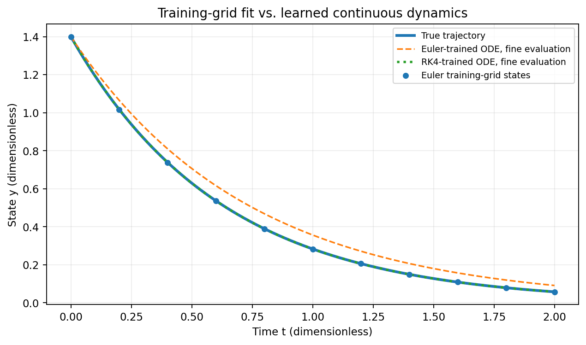

*图 3.4-1　初值 $y_0=1.4$ 下的独立评估轨迹。两模型均在训练步长 $h=0.2$ 下拟合生成数据，图中通过高精度 DOP853 重新积分已学习的右端，并与解析解对比；时间和状态均无量纲。图像由配套复现代码生成。*

#### （四）改变评估步长后的反常现象

固定未参与训练的初值 $y_0=1.4$，仍用各模型对应的训练积分方法，只改变评估步长，观察终点 $t=2$ 的绝对误差。

**表 3.4-3　更换步长后的终点绝对误差**

| 评估方式 | Euler 训练模型 | RK4 训练模型 |
|:---|---:|---:|
| 原方法，$h=0.2$ | $4.76\times10^{-10}$ | $1.13\times10^{-9}$ |
| 原方法，$h=0.1$ | 0.01656955 | $1.97\times10^{-5}$ |
| 原方法，$h=0.05$ | 0.02499400 | $2.08\times10^{-5}$ |
| DOP853 独立积分 | 0.033466（约） | $2.09\times10^{-5}$（约） |

第一行的极小但非零值来自浮点参数优化的终止精度；在解析关系（3.4-30）精确成立时，其离散终点误差为零。Euler 训练模型的终点误差在缩小评估步长后反而变大，这是因为更细步长逐渐逼近的是**学得参数为 $1.3692548$ 的连续模型**，而非真实衰减系数为 $1.6$ 的模型。数值积分精度提高，不会自动修正错误的微分方程。

这一结论只针对所设定的简单线性模型和训练方式。它不能被解释为“Euler 永远不适合 Neural ODE”或“RK4 在任何情况下都更好”。选择数值求解器仍须综合考虑稳定性、问题刚性、所需精度和计算成本。

### 3.4.5 数值实验二：Poisson 边值问题的独立差分基线

为与前一实验形成互补，本实验采用第 3.4.3 节的中心差分法，研究空间网格加密对一维 Poisson 边值问题求解误差的影响。这里的实验对象是**传统有限差分基线**，不涉及完整 PDE PINN 的网络训练；后者可在后续章节结合自动微分、配点采样和参数优化进一步展开。

对式（3.4-16）分别取 $N=5,10,20,40$，由式（3.4-24）—（3.4-25）求 $U_i$。将每个内部节点与解析解 $u(x_i)=\sin(\pi x_i)$ 比较，定义

$$
 E_\infty(\Delta x)=\max_{0\leqslant i\leqslant N}
 |U_i-u(x_i)|.
\tag{3.4-34}
$$

通过式（3.4-26）可以直接核查计算结果。所得数据如下。

**表 3.4-4　Poisson 中心差分的节点最大误差**

| 子区间数 $N$ | 网格间距 $\Delta x$ | $E_\infty(\Delta x)$ | 相邻两组误差比 |
|---:|---:|---:|---:|
| 5 | 0.2000 | 0.031915927 | — |
| 10 | 0.1000 | 0.008265417 | 3.86 |
| 20 | 0.0500 | 0.002058707 | 4.01 |
| 40 | 0.0250 | 0.000514200 | 4.00 |

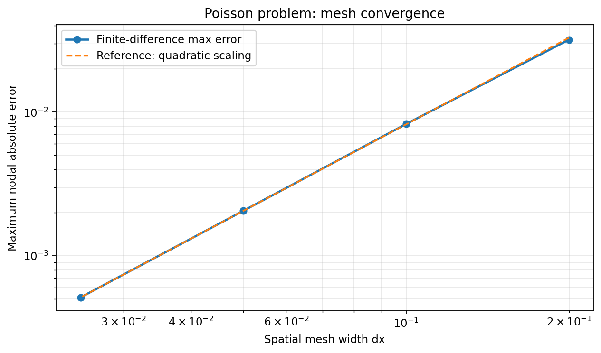

*图 3.4-2　对数坐标下的最大节点误差随空间网格间距的变化。曲线接近斜率为 $2$ 的趋势，与本题中心差分二阶收敛的理论相符。*

当 $\Delta x$ 减半时，误差约缩小到四分之一。这一结果由明确的边界条件、独立解析解和数值误差指标支持，且与网格加密的二阶收敛规律相符。

不过，差分结果仅验证了当前问题上的传统数值基线。不能据此直接得出“任何 PINN 都是二阶收敛的”或“任何足够密的配点都能保证 PINN 正确”。PINN 的精度仍取决于网络表达能力、优化、配点采样、边界处理和方程稳定性等因素 [6,7]。

### 3.4.6 数值结果的可靠性检验与适用范围

#### （一）区分模型误差、离散误差与训练误差

在传统数值求解中，方程已经确定，误差分析通常集中于离散格式、初值或边界数据以及计算过程。引入神经网络后，函数表示和参数优化也成为误差来源，因此不能把所有预测偏差统称为“神经网络误差”。

对于 Neural ODE，首先应区分学习到的右端函数 $f_\\theta$ 与真实右端函数 $f$ 之间的**模型辨识误差**，其次是数值积分器及其步长引入的**离散误差**，最后是有限观测、测量噪声和参数优化产生的误差。式（3.4-14）给出了初值误差与右端模型误差的传播界，式（3.4-15）则描述在相应假设下的积分误差。训练损失只是特定观测节点和求解器下的拟合指标，不能直接代替上述误差界。

对于 PINN，主要应区分网络的**函数逼近误差**、优化目标未充分最小化带来的**训练误差**、有限配点对连续残差的代表性不足，以及初边值条件没有得到准确满足所造成的偏差。式（3.4-21）在一维 Poisson 问题上建立了全区间残差、边界误差与解误差之间的联系，同时说明仅凭有限配点上的残差无法直接推出全区间精度。

#### （二）建立可复核的验证依据

评价学习结果时，应尽量采用独立于训练过程的数值证据，而不是只展示最终损失函数值。不同计算任务的重点如下。

| 检验对象 | 主要检验方式 | 能够支持的判断 |
|:---|:---|:---|
| Neural ODE 的连续动力学 | 固定已学得参数，使用独立积分器与不同步长评估轨迹 | 判断训练时的积分离散是否掩盖了模型偏差 |
| Neural ODE 的预测能力 | 使用未参与训练的初值和观测时刻，并与解析解或可信参考轨迹比较 | 评价模型在指定测试范围内的泛化表现 |
| PINN 的方程与条件 | 在独立测试配点计算方程残差，并分别核查初始条件与边界条件 | 检验近似解是否满足所给微分方程及其约束 |
| 空间离散的传统参照解 | 在相同模型与边界条件下进行网格加密，计算误差与观测收敛阶 | 判断结果是否符合相应差分格式的预期精度 |

实验报告还应明确记录求解区间、初值或边界值、参数与单位、训练和评估数据的划分、误差指标及容差、算法设置，以及用于重现计算的代码。对于无量纲化问题，应明确无量纲化约定；对于有量纲问题，应检查方程各项的单位是否一致。

#### （三）正确界定实验结论

第 3.4.4 节的一参数线性衰减实验表明，Euler 和 RK4 训练模型都能够获得极小的节点拟合误差，但其学得的连续方程并不相同。独立积分与步长变化实验进一步表明，**更准确地积分一个存在辨识偏差的模型，并不等于更准确地恢复真实动力学**。这一现象具有清晰的解析解释，但不意味着任意 Neural ODE 都会表现出同样的参数偏差。

第 3.4.5 节给出的 Poisson 中心差分实验，则在边界条件完整施加的前提下，通过解析解与网格加密验证了当前问题的二阶收敛规律。它是一项**传统数值方法的独立基线实验**，并不是对完整 PINN 网络训练的直接测试；因此不能据此推断 PINN 具有同样的收敛阶。

对于复杂非线性动力系统、刚性方程、含噪声观测和高维偏微分方程，还需进一步研究采样覆盖、参数可辨识性、方程稳定性、网络表示能力和优化算法的影响。相关问题可参阅文献 [5]—[9]。

### 3.4.7 本节小结

本节在经典常微分方程数值积分与有限差分的基础上，介绍了神经网络参与微分方程建模和求解的两种典型方式，并说明了评价计算结果时必须保留的数值分析原则。关键结论归纳如下。

1. **Neural ODE 与 PINN 的学习对象不同。** Neural ODE 通常以神经网络表示微分方程的右端函数，再利用数值积分器生成轨迹；PINN 通常直接以神经网络表示未知解，并使用方程残差以及初边值条件构造训练目标。两者可以结合，但不能混淆其基本作用机制。
2. **训练损失不能直接代替真实解误差。** Neural ODE 的预测同时受初值、右端模型、积分方法及其步长影响；PINN 的结果则还取决于网络表示、配点分布、边界处理与优化过程。误差估计必须陈述相应的数学假设和适用范围。
3. **微分方程与初边值条件共同定义求解问题。** 一维 Poisson 算例表明，内部残差即使为零，也不能忽略边界条件；有限配点处残差很小，也不等于连续区间内残差处处很小。正确处理约束是获得可信近似解的必要环节。
4. **数值结论需要独立验证。** 对 Neural ODE，应开展跨求解器、跨步长和测试初值的评估；对 PINN，应核查独立配点上的方程残差、初边值条件以及可获得的参考解；对传统离散基线，应关注网格加密与收敛阶。任何单一指标都不能替代完整的误差分析。

本节的两个教学实验分别揭示了**模型辨识偏差可能被训练积分器掩盖**，以及**正确边界处理和网格收敛检验能够为数值结果提供独立证据**。这些结论构成继续学习数据驱动动力学、物理约束学习和偏微分方程数值求解的基础。

### 3.4.8 可复现代码与进一步阅读

以下 Python 代码不依赖深度学习框架，用一参数线性网络作为最小 Neural ODE，独立复现表 3.4-2 至表 3.4-4。它用于辨别数值积分与参数学习之间的关系；需要学习一般多层网络的自动微分与 PINN 训练时，可在后续章节中使用 PyTorch 或 JAX 扩展。

```python
import numpy as np
from scipy.integrate import solve_ivp
from scipy.optimize import minimize_scalar

A_TRUE, T, H = 1.6, 2.0, 0.2
TRAIN_Y0 = np.array([0.8, 1.0, 1.2])
TEST_Y0 = np.array([0.9, 1.4, 2.0])
T_TRAIN = np.linspace(0, T, 11)
T_TEST = np.linspace(0, T, 101)

def amplification(a, h, solver):
    z = -a * h
    if solver == "Euler":
        return 1 + z
    return 1 + z + z**2/2 + z**3/6 + z**4/24

def train_mse(a, solver):
    factors = amplification(a, H, solver) ** np.arange(len(T_TRAIN))
    pred = TRAIN_Y0[:, None] * factors[None, :]
    exact = TRAIN_Y0[:, None] * np.exp(-A_TRUE * T_TRAIN)[None, :]
    return np.mean((pred - exact)**2)

for solver in ["Euler", "RK4"]:
    result = minimize_scalar(
        lambda a: train_mse(a, solver),
        bounds=(0.5, 2.5), method="bounded",
        options={"xatol": 1e-14},
    )
    a_fit = result.x
    pred = np.stack([
        solve_ivp(
            lambda t, y: -a_fit*y, (0, T), [y0],
            t_eval=T_TEST, method="DOP853",
            rtol=1e-12, atol=1e-14,
        ).y[0]
        for y0 in TEST_Y0
    ])
    exact = TEST_Y0[:, None] * np.exp(-A_TRUE * T_TEST)[None, :]
    diff = pred - exact
    print(solver, "a=", a_fit,
          "train MSE=", train_mse(a_fit, solver),
          "test RMSE=", np.sqrt(np.mean(diff**2)),
          "test max error=", np.max(np.abs(diff)))
    print("Final-point errors (y0=1.4):")
    for h in [0.2, 0.1, 0.05]:
        n = round(T / h)
        yn = 1.4 * amplification(a_fit, h, solver)**n
        print(" h=", h, " error=", abs(yn-1.4*np.exp(-A_TRUE*T)))

print("Poisson finite-difference errors:")
for N in [5, 10, 20, 40]:
    dx = 1.0/N
    x = np.arange(N+1)*dx
    coefficient = np.pi**2*dx**2/(4*np.sin(np.pi*dx/2)**2)
    approximate = coefficient*np.sin(np.pi*x)
    error = np.max(np.abs(approximate-np.sin(np.pi*x)))
    print("N=", N, "dx=", dx, "max error=", error)
```

代码的输入数据由解析模型直接生成，既不存在随机噪声，也不存在需要设置随机种子的优化初始化。表中极小的训练损失会随平台的舍入及优化终止精度略有变化，不应过度解读其最后几位数字；关键结论由式（3.4-30）及独立评估结果共同支持。

**参考文献**（阅读顺序建议：经典数值方法 [1]、[2]；方法起源 [3]、[4]；数值与训练误差研究 [5]—[9]。）

[1] Hairer E, Nørsett S P, Wanner G. *Solving Ordinary Differential Equations I: Nonstiff Problems*. 2nd ed. Berlin: Springer, 1993. 有关初值问题的稳定性与误差估计，可参考第 I、II 章。https://doi.org/10.1007/978-3-540-78862-1

[2] LeVeque R J. *Finite Difference Methods for Ordinary and Partial Differential Equations: Steady-State and Time-Dependent Problems*. Philadelphia: SIAM, 2007. 关于有限差分、边值问题和误差分析，参见相关章节。https://doi.org/10.1137/1.9780898717839

[3] Chen R T Q, Rubanova Y, Bettencourt J, Duvenaud D K. Neural Ordinary Differential Equations. *Advances in Neural Information Processing Systems*, 31, 2018. https://proceedings.neurips.cc/paper/2018/hash/69386f6bb1dfed68692a24c8686939b9-Abstract.html

[4] Raissi M, Perdikaris P, Karniadakis G E. Physics-informed neural networks: A deep learning framework for solving forward and inverse problems involving nonlinear partial differential equations. *Journal of Computational Physics*, 378: 686–707, 2019. https://doi.org/10.1016/j.jcp.2018.10.045

[5] Zhu A, Jin P, Zhu B, Tang Y. On Numerical Integration in Neural Ordinary Differential Equations. *Proceedings of the 39th International Conference on Machine Learning*, PMLR 162: 27527–27547, 2022. https://proceedings.mlr.press/v162/zhu22f.html

[6] Wang S, Teng Y, Perdikaris P. Understanding and Mitigating Gradient Flow Pathologies in Physics-Informed Neural Networks. *SIAM Journal on Scientific Computing*, 43(5): A3055–A3081, 2021. https://doi.org/10.1137/20M1318043

[7] De Ryck T, Mishra S. Numerical analysis of physics-informed neural networks and related models in physics-informed machine learning. *Acta Numerica*, 33: 633–713, 2024. https://doi.org/10.1017/S0962492923000089

[8] Xu Y, Chen S, Li Q. Correcting Autodifferentiation in Neural ODE Training. *SIAM Journal on Applied Mathematics*, 86(5): 2360–2378, 2026. https://doi.org/10.1137/25M172673X

[9] Celledoni E, Owren B, Ruthotto L, Yang N T. Mixed Precision Training of Neural ODEs. *SIAM Journal on Scientific Computing*, 2026. https://doi.org/10.1137/25M1821405

