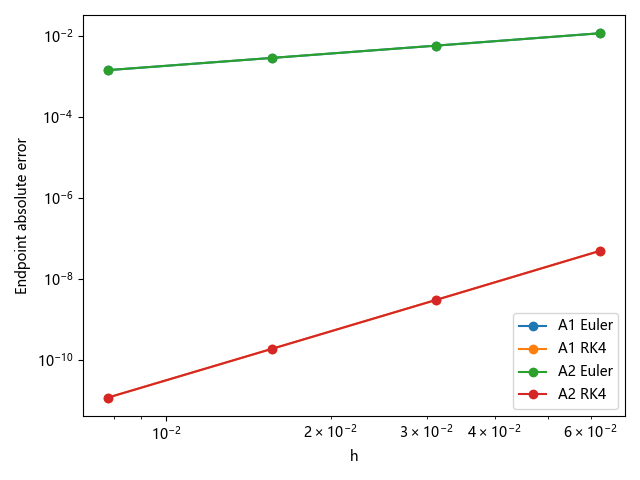
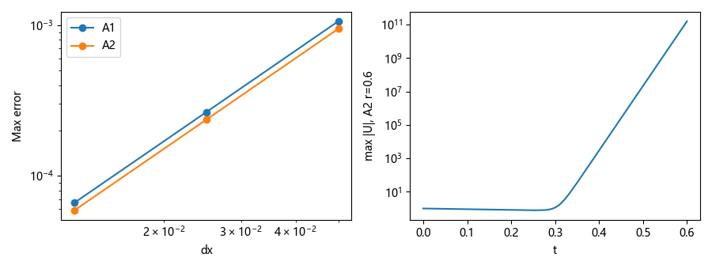
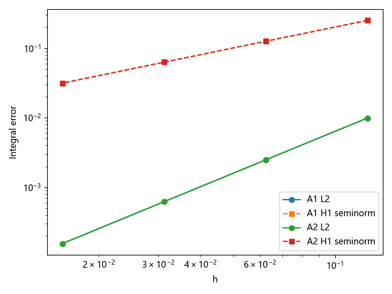
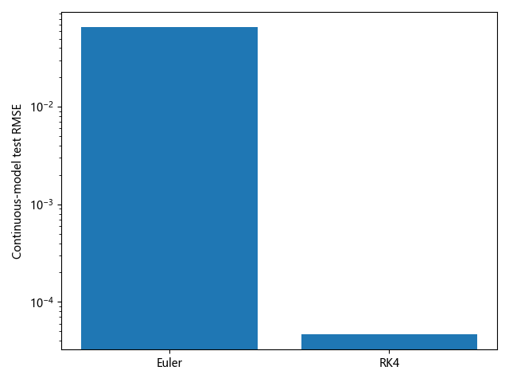

# 第03章 B1组验证报告

- 小组：G8；角色：B1；轮次：初次验证；整理日期：2026-11-10。
- 状态：已完成自动化初次复现与选定基准核验；A1需修订；学生人工签认、另一AI要求及后续A回应/复测待完成。不是“全章验收通过”。
- 本组文件：[验证Notebook](B1组-验证.ipynb)、[修正清单](B1组-修正清单.md)、[AI对话记录](B1组-AI对话记录.md)、[机器可读实测](B1组-测试结果.json)。
- 本次推导说明、测试代码和报告均有Codex辅助；未冒称学生独立手算、手写或签认。未读取B2报告作为结论来源。

## 章节范围（4节，8学时）

| 小节 | 实际核对事项 | 证据与版本 | 实际结论 |
| --- | --- | --- | --- |
| 3.1 Euler与RK4 | 解析终点、收敛阶、实计函数求值、相同预算对照 | 本组Notebook“3.1”，A1单元4及A2单元1定义 | 选定自治算例通过，不代表全部ODE |
| 3.2 热传导与CFL | 零边界正弦参考、离散模态、网格误差、失稳演示、非零Neumann分支 | 本组Notebook“3.2”，A1单元20/25，A2单元3 | 零Dirichlet基准通过，A1边界分支需修订B001 |
| 3.3 弱形式与Galerkin | 单元矩阵、载荷、装配、连续误差积分、边界、条件数 | 本组Notebook“3.3”，A1单元57/61，A2单元2/5/7/9/18 | 选定Poisson基准通过，A1条件数证据需修订B002 |
| 3.4 Neural ODE与PINN | logistic辨识、线性参数训练、独立积分、初值及时间网格、残差反例 | 本组Notebook“3.4”，A1单元82，A2单元1 | 数值可复现；不能表述为完整通用神经网络或PDE PINN训练 |

单元编号采用Notebook文件cells数组的**零基索引**，不是执行计数。两组正文均检查与上述选定实验有关的主张；尚未逐条核验整章全部公式、参考文献、习题及图片授权。

## A1、A2稿件核查与固定版本

两份稿都已在课程main内。本次统一固定在完整提交 `c8a8e947b0d9606caf38302279b48c4f9116567d`，这是同时包含两组内容的课程树版本，不是声称两组各有一个不同SHA。原PR编号未确认，不编造；可直接用下列固定内容链接复核。后续如老师要求原PR来源，需A组或助教补充。

- A1（G3）正文：[A1-G3-正文.md](https://github.com/prince19992516/-2026/blob/c8a8e947b0d9606caf38302279b48c4f9116567d/教材/第03章-离散的世界/工作/A1-G3-正文.md)。
- A1实验：[A1-G3-第03章实验.ipynb](https://github.com/prince19992516/-2026/blob/c8a8e947b0d9606caf38302279b48c4f9116567d/教材/第03章-离散的世界/工作/A1-G3-第03章实验.ipynb)。
- A2（G13）正文：[A2-G13-正文.md](https://github.com/prince19992516/-2026/blob/c8a8e947b0d9606caf38302279b48c4f9116567d/教材/第03章-离散的世界/工作/A2-G13-正文.md)，依本章README当前入口选定，未以旧名正文替代。
- A2实验：`A2组-G13-3.1实验.ipynb`、`A2组-G13-3.2实验.ipynb`、`A2组-G13-3.3实验.ipynb`、`A2组-G13-3.4实验.ipynb`；另运行3.1习题参考解答数值试验。
- A1、A2的实际AI记录仅按其公开声明读取，不验证其历史调用真实性；详情见本组AI记录。

## 独立环境复现

远程main通过git ls-remote核对后克隆，执行git switch --detach固定SHA，git rev-parse HEAD与约定一致。

| 环境 | 用途 | 新建方式 |
| --- | --- | --- |
| 课程源码/.venv | A1全章原始Notebook顺序运行 | Python 3.12单独venv并pip安装 |
| 受审源码/.venv | A2每份原始Notebook分别用新内核运行 | 另一个venv并pip安装，未复制A1环境 |
| .venv-b1 | B1独立对照计算 | 第三个venv并安装课程完整基础包 |

系统：Windows 11 / AMD64；Python 3.12.14；CPU双精度计算，无GPU需求。核心库：NumPy 1.26.4、SciPy 1.14.1、Matplotlib 3.9.2、pandas 2.2.3、SymPy 1.13.3；执行工具nbformat 5.10.4、nbclient 0.10.2、ipykernel 6.29.5。A1/A2安装数值及执行所需子集，B1另安装JupyterLab/Jupyter Book/Sphinx等课程基础包。A原元数据声明Python版本不完全相同，故本次是上述明确环境的兼容复现，未冒称逐位重建A电脑。

运行使用nbclient从清空旧输出的新内核顺序执行，等价于Restart Kernel and Run All Cells；内核用各环境--sys-prefix登记python3。完整执行脚本、锁定依赖、受审文件SHA256、规则快照和执行后Notebook放在交付根目录“本地复现证据”，仅本地留档，**不整目录上传**。公开包附各环境依赖锁和摘要。A文件未覆盖回旧课程工作目录。

| 组别 | 原始Notebook | 代码单元 | 实际执行 | 结果 |
| --- | --- | --- | --- | --- |
| A1 | A1-G3-第03章实验.ipynb | 50 | 50 | 运行成功 |
| A2 | A2组-G13-3.1习题参考解答解数值试验.ipynb | 8 | 8 | 运行成功 |
| A2 | A2组-G13-3.1实验.ipynb | 7 | 7 | 运行成功 |
| A2 | A2组-G13-3.2实验.ipynb | 3 | 3 | 运行成功 |
| A2 | A2组-G13-3.3实验.ipynb | 20 | 20 | 运行成功 |
| A2 | A2组-G13-3.4实验.ipynb | 1 | 1 | 运行成功 |

B1 Notebook另有9个代码单元，全部顺序执行成功。Windows事件循环的兼容警告未导致代码错误。运行前已清除读入的旧输出；原始A文件保持原文，执行结果另存证据副本。A2 3.3末尾含3.4 TODO注释空壳，虽可执行但不作为3.4完成证据；3.4实际证据来自独立的3.4文件。

## 参考值与判定容差

1. ODE：由分离变量得y(t)=exp(-t)，不依赖A输出。N=16/32/64/128；观测阶容许Euler 0.9—1.2、RK4 3.8—4.2，仅用于本渐近算例。实计f次数应分别为N与4N。
2. 热方程：解析正弦解和离散特征模态独立推得；离散实现与模态的最大差容差2e-11。固定r=0.4加密时总体误差应约二阶，阶数容许1.8—2.2。A1 κ=1、T=0.1；A2 κ=0.1、T=0.6，不能直接按误差绝对大小评判两组优劣。
3. FEM：模型为-u''=π²sin(πx)、零边界。用SciPy quad逐单元独立计算连续L2误差与H1半范数，和A高斯积分比较容差1e-9；L2观测阶1.8—2.2、H1半范数0.9—1.1。节点误差不能替代连续函数误差。
4. 3.4：logistic用已知解析式与独立DOP853交叉比较，容差1e-9；参数训练使用另外推得的Euler解析最优a=(1-exp(-1.6h))/h核查，容差1e-7。这些是实现一致性容差，不是普适模型精度验收线。

## 测试与修正：真实数值

### 3.1终点误差、阶数和成本

| 组别 | 方法 | N | T=1终点绝对误差 | 最后一次观测阶 | 实际f求值次数 |
| --- | --- | --- | --- | --- | --- |
| A1 | Euler | 128 | 1.441725249e-03 | 1.00473 | 128 |
| A1 | RK4 | 128 | 1.149497164e-11 | 4.00941 | 512 |
| A2 | Euler | 128 | 1.441725249e-03 | 1.00473 | 128 |
| A2 | RK4 | 128 | 1.149497164e-11 | 4.00941 | 512 |

相同128次f求值预算，Euler误差1.441725249e-3，RK4误差3.000808713e-9。仅对本例成立；CPU耗时受机器噪声影响，未把跨机器耗时作为排名依据。

### 3.2网格误差与CFL

| 组别 | 区间数N | 最大节点误差 | 观测阶 | 与离散模态差 |
| --- | --- | --- | --- | --- |
| A1 | 20 | 1.062511783e-03 | — | 1.39e-15 |
| A1 | 40 | 2.649499589e-04 | 2.00369 | 1.44e-15 |
| A1 | 80 | 6.619528366e-05 | 2.00092 | 1.04e-14 |
| A2 | 20 | 9.466413487e-04 | — | 1.11e-15 |
| A2 | 40 | 2.359551486e-04 | 2.00431 | 1.33e-15 |
| A2 | 80 | 5.894491080e-05 | 2.00107 | 9.21e-15 |

A2 r=0.6、高频微扰1e-12时，终层max|U|=1.572640430e+11；这是预期失稳演示，不列为错误。边界保持零。一维条件r≤1/2；二维等网格FTCS条件r≤1/4，仅限相应格式。二维完整原实验已运行，尚未增加二维独立基准，列为未覆盖。

A1 assemble_1d的非零Neumann分支，输入N=5、r=0.4、左导数1、右值1、旧层u=x，稳态残差应为0；实测第一行-0.16，最大绝对残差0.16≫1e-12。分支未使用给定val_l/val_r，同时未知量编号与边界模板需统一。见CH03-G8-B001；不据此否定零Dirichlet主算例。

### 3.3单元、边界与连续积分误差

局部h=1/2、f=1：K=[[2,-2],[-2,2]]，F=[0.25,0.25]，实测符合。A2非齐次边界u(0)=1、u(1)=3、f=0的线性补丁误差4.44e-16。

| 组别 | 单元数N | 内部自由度 | 连续L2误差 | H1半范数误差 | 最后一次L2/H1阶数 |
| --- | --- | --- | --- | --- | --- |
| A1 | 64 | 63 | 1.555289847e-04 | 3.147724465e-02 | 1.99977/0.99983 |
| A2 | 64 | 63 | 1.555289847e-04 | 3.147724465e-02 | 1.99977/0.99983 |

在相同均匀网格与方程下，两组P1有限元结果一致，独立quad积分与A误差程序一致到1e-9以内。A2中心差分基线的原Notebook自检已顺序通过，但本组未对所有差分变体逐一做外部基准。

A1单元61条件数测试：原内部矩阵cond=25.274142369；置大数后取同一内部子块仍为25.274142369；完整惩罚矩阵cond=8.210663961e11。原打印语句取错比较对象，不能作为惩罚完整系统的条件数证据。见CH03-G8-B002。

### 3.4训练网格、评估网格与已知方程

A1 logistic：已知右端r*u*(1-u/K)，训练21点[0,2]、初值0.05，seed=2024、±1%相对均匀噪声；拟合(r,K,u0)=(0.810401959, 0.922107532, 0.049742901)，训练SSE=9.969050462e-06。评估301点[0,3]，初值0.02/0.05/0.2，最大轨迹误差依次0.002029923/0.003218589/0.033840761。DOP853与拟合方程解析式差小于1e-9。这说明实现一致且换初值存在误差，不证明一般域外泛化。

A2：已知右端族-y*a，真实a=1.6，训练初值0.8/1/1.2、11点[0,2]、h=0.2；评估初值0.9/1.4/2.0、101点[0,2]。本组使用连续解析解独立评估，原Notebook使用DOP853并已运行。

| 训练积分器 | 拟合a | 训练MSE | 连续模型评估RMSE | 最大误差 |
| --- | --- | --- | --- | --- |
| Euler | 1.3692548116 | 4.772e-19 | 6.538949566e-02 | 1.144659840e-01 |
| RK4 | 1.6001828357 | 2.683e-18 | 4.664669886e-05 | 8.406939038e-05 |

Euler拟合的训练MSE极小但连续评估RMSE约0.06539，证明训练积分器可吸收参数偏差。RK4在此例更准，不推广为所有问题的结论。A1的PINN单配点解析反例u=1+t，方程u'=u、u(0)=1，在t=0残差0但t=1误差e-2≈0.71828；它不是训练出来的网络。完整PDE PINN训练未在本次执行，也不是本章最小算例可自动推出的成果。

## 结论与局限、六组讨论与版本选用

初次结论：A1/A2原Notebook全部可在上述新环境运行，选定零边界ODE/PDE/Poisson基准吻合预期；A1两项证据需修订。还不能宣布全章B任务最终验收通过。

| 位置 | A1证据 | A2证据 | 建议与理由 | 整合后复核 |
| --- | --- | --- | --- | --- |
| 3.1 | 自治衰减算例与成本图可复现 | 另有向后Euler与输入校验 | 两份保留；同成本比较可采用B1补充，教学取舍待讨论 | 未进行 |
| 3.2 | 零边界基准通过，Neumann分支需改 | 稳定/失稳及网格证据清楚 | 不直接采用未修复Neumann分支；其余按模型条件选用 | 未进行 |
| 3.3 | P1收敛通过，条件数打印需改 | 局部矩阵、非零边界、误差积分有检查点 | 可参考A2检查点组织；保留A1拓展但修复证据 | 未进行 |
| 3.4 | logistic、换初值及残差玩具案例 | 单参数模型训练及独立评估 | 互补展示，均标明已知方程族，避免称作完整PDE PINN训练 | 未进行 |

待完成：学生人工阅读公式与参考资料、运行结果签认；另一AI要求是否满足由助教确认；A1回应与修复SHA、B1复测；全部习题答案与文献逐条核查尚未完成；二维独立基准、变系数/界面/全部边界分支未穷尽；原始PR来源待补；六组讨论、C复核和整合后复核未开展。本地包没有创建PR或联系他人。

## 本次使用的课程规则（固定版本）

- [教程/03-GitHub协作与提交.md](https://github.com/prince19992516/-2026/blob/c8a8e947b0d9606caf38302279b48c4f9116567d/教程/03-GitHub协作与提交.md)
- [教程/06-B组如何在干净环境复现.md](https://github.com/prince19992516/-2026/blob/c8a8e947b0d9606caf38302279b48c4f9116567d/教程/06-B组如何在干净环境复现.md)
- [教程/08-各组具体操作指南.md](https://github.com/prince19992516/-2026/blob/c8a8e947b0d9606caf38302279b48c4f9116567d/教程/08-各组具体操作指南.md)
- [协作管理/章节分工表.md](https://github.com/prince19992516/-2026/blob/c8a8e947b0d9606caf38302279b48c4f9116567d/协作管理/章节分工表.md)
- [协作管理/三组协作规则.md](https://github.com/prince19992516/-2026/blob/c8a8e947b0d9606caf38302279b48c4f9116567d/协作管理/三组协作规则.md)
- [教材/第03章-离散的世界/README.md](https://github.com/prince19992516/-2026/blob/c8a8e947b0d9606caf38302279b48c4f9116567d/教材/第03章-离散的世界/README.md)

最新版为4个B文件，无单独独立推导文件。旧本地副本包含该要求，未作为本次最新版规则执行。
