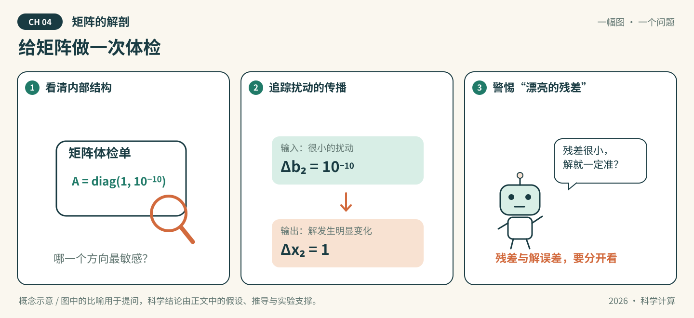
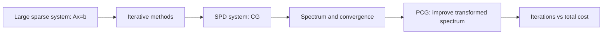
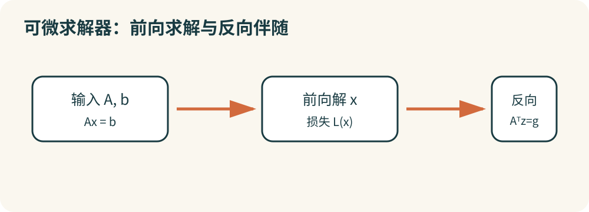
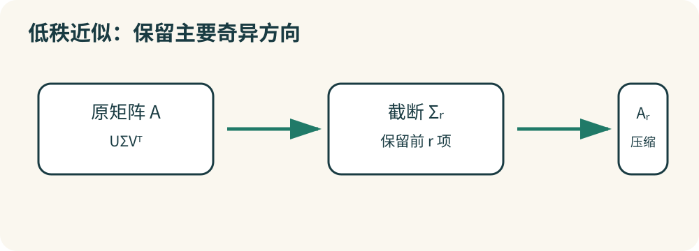

<a id="sec-4"></a>

# 第04章 矩阵的解剖



*图04-1 · 给矩阵做一次体检。初始化概念示意；适用条件见下文，不作为实测结果。*

## 先看一幕：给矩阵做一次体检

求解器递来一份漂亮的报告：“残差几乎为零。”矩阵医生却拿起放大镜：如果输入轻轻动一下，解会不会跳很远？

**先猜，再验证：** 设 $A=\operatorname{diag}(1,10^{-10})$。仅把右端第二个分量增加 $10^{-10}$，解的第二个分量会改变多少？这与求解器报告的小残差是否矛盾？

**把故事翻译成数学：** 在这个对角例子中，解的第二分量增加1，二范数条件数为 $10^{10}$。图中体检对应对矩阵结构与扰动敏感性的分析；小残差和小解误差是不同主张，还要说明残差针对哪个右端计算。

**知识主题：** 线性方程组、特征值与SVD

**本章核心问题：** Ax=b如何高效求解？矩阵的本质结构是什么？

**只聚焦三个核心概念：** LU、CG、SVD

**先修知识：** 矩阵运算、内积、正定性与向量/矩阵范数

**课时：** 4节 × 2学时 = 8学时；原八章共64学时；第09章另列8学时。

### 本章四节安排

| 节 | 内容 | 学时 |
| --- | --- | --- |
| [4.1](#sec-4-1) | 直接法：LU与Cholesky | 2 |
| [4.2](#sec-4-2) | 迭代法：CG与预条件 | 2 |
| [4.3](#sec-4-3) | 特征值与SVD | 2 |
| [4.4](#sec-4-4) | AI关联：可微求解器、PCA、LoRA | 2 |

---

<a id="sec-4-0"></a>

### 先修概念与符号约定

**先修概念**

- 线性方程组：$Ax=b$，其中 $A\in\mathbb R^{n\times n}$，$x,b\in\mathbb R^n$。
- 矩阵运算：转置 $A^T$、逆 $A^{-1}$、行列式 $\det(A)$、迹 $\operatorname{tr}(A)$。
- 内积与范数：$\langle x,y\rangle=x^Ty$；向量 2-范数 $\|x\|_2=\sqrt{x^Tx}$；矩阵范数 $\|A\|_2=\sigma_{\max}(A)$，且满足相容性 $\|Ax\|\leqslant\|A\|\|x\|$。
- 正定性：$A=A^T$ 且对任意非零 $x$ 有 $x^TAx>0$；等价于所有顺序主子式为正。
- 特征值与特征向量：$Av=\lambda v$（$v\ne0$）；对称矩阵可正交对角化 $A=V\Lambda V^T$。
- SVD：任意实矩阵 $A=U\Sigma V^T$，奇异值 $\sigma_1\geqslant\sigma_2\geqslant\cdots\geqslant0$。
- 隐函数定理：若 $F(x,\theta)=0$ 且 $\frac{\partial F}{\partial x}$ 可逆，则 $\frac{\partial x}{\partial\theta}=-(\frac{\partial F}{\partial x})^{-1}\frac{\partial F}{\partial\theta}$。

**符号约定**

| 符号 | 含义 |
| --- | --- |
| $A\in\mathbb R^{n\times n}$ | 系数矩阵（默认方阵、非奇异，除非另述） |
| $x,b\in\mathbb R^n$ | 未知向量与右端向量 |
| $r=b-Ax$ | 残差（$r_k=b-Ax_k$ 为第 $k$ 步残差） |
| $\delta b,\delta x,\delta A$ | 右端、解、系数矩阵的微小扰动 |
| $\Vert\cdot\Vert$ | 某种相容矩阵范数；默认 2-范数，需注明时写 $\Vert\cdot\Vert_2$ |
| $\kappa(A),\operatorname{cond}(A)$ | 条件数，$\kappa(A)=\operatorname{cond}(A)=\Vert A^{-1}\Vert\,\Vert A\Vert$；<br>默认为 $\kappa_2(A)=\operatorname{cond}_2(A)= \frac{\sigma_{\max}}{\sigma_{\min}}$ |
| $\sigma_i$ | 奇异值，按 $\sigma_1\geqslant\sigma_2\geqslant\cdots\geqslant0$ 排列 |
| $\lambda_i$ | 特征值 |
| $\rho(A)$ | 谱半径 |
| $W_0,\Delta W$ | 预训练权重与微调增量 |


<a id="sec-4-1"></a>

## 4.1 直接法：LU 与 Cholesky（2 学时）

**本节目标：** 能根据矩阵结构与适用条件选择 LU、Cholesky 或追赶法，解释主元交换和三角求解，并区分算法稳定性与问题敏感性。

### 概念讲解：把问题说明白

线性方程组 $Ax=b$ 是科学计算最基本的问题之一。尽管在学习线性代数时，我们就学习了手动计算的方法，但假如直接让机器按照手动计算的方法进行运算，会遇到一些现实问题：矩阵规模一旦变大，计算量增长会很快；数值的量级差距过大时，误差可能会被急剧放大。机器需要的不是“能算”，而是“算得稳、算得快、还能反复用”。那么，计算机在解决这类问题时，采用的会是什么方法呢？

一种思想是，想办法将矩阵通过等价变形，化简为容易求解的形式，比如将矩阵分解成若干个易于计算的矩阵。本节会讨论对于不同的系数矩阵提出的各种分解方案，并尝试说明“计算过程稳定”与“问题本身敏感”是两件不同的事。

<a id="sec-4-1-1"></a>

### 4.1.1 从 Gauss 消元法到矩阵的 LU 分解

对我们来说，求解线性方程组 $Ax=b$ 最基础的求解思想，便是通用的手动求解方法—— **Gauss 消元法**。Gauss 消元法的基本思路是：通过对矩阵 $A$ 进行一系列的行变换处理，将矩阵变成一个上三角矩阵，即可从下到上求解每一个未知数。若要将这一思想迁移到机器运算，并设计一种算法的话，我们希望这种算法的流程更加固定、计算更加稳定、能尽量避免误差，还能尽可能地减小所需计算量的规模。

先考虑**不交换行且各步主元均非零**的 Gauss 消元。每一步消元都是左乘一个单位下三角的消元矩阵；把这些变换依次复合为 $T$，便有 $U=TA$，其中 $U$ 为上三角矩阵。原方程等价于 $Ux=Tb$，可以从最后一行向上回代。若消元过程中需要换行，则必须另外记录置换，不能直接套用这里的 $A=LU$。

由于上述消元矩阵均为可逆的单位下三角矩阵，其乘积 $T$ 仍为可逆的单位下三角矩阵。令 $L=T^{-1}$，便得到**无主元交换时**的分解：

<a id="eq-4-1"></a>

$$
\boxed{\,A=LU\,} \tag{4.1}
$$

上述从矩阵分解角度的思考带给我们很多启发，我们能进一步从中总结出直接求解线性方程组的基本概念与核心思想：

<a id="def-4-1"></a>

> **定义 4.1（直接法）**  
> **直接法**是在精确算术中通过有限次预定的算术步骤求得线性方程组解的一类方法；消元法和矩阵分解法是典型代表。矩阵分解是本节讨论的主要实现思路，但不是所有直接法都必须先做矩阵分解。在浮点运算中，直接法也会产生舍入误差，并不意味着得到数学上的精确解。

最基础的分解即式 [(4.1)](#eq-4-1) 中的形式。下面我们给出这种分解的定义：

<a id="def-4-2"></a>

> **定义 4.2（LU 分解）**  
> 在无行交换且分解存在时，将 $A$ 写成 $A=LU$，其中 $L$ 为单位下三角矩阵、$U$ 为上三角矩阵，称为 **LU 分解**。对于非奇异 $A$，规定 $L$ 的对角元为 $1$ 可排除因子间的任意对角缩放，使该分解唯一；当需要行交换时，通常使用 $PA=LU$。

进行 LU 分解后，可以把 $Ax=b$ 的求解过程分为两步：

1. 解 $Ly=b$，得到 $y$；
2. 解 $Ux=y$，得到 $x$。

若采用列主元 LU 分解 $PA=LU$，则第一步应改为解 $Ly=Pb$，而不是 $Ly=b$。

**在无行交换、主元非零的条件下**，Gauss 消元与 LU 分解是同一消元过程的两种表达。第 $k$ 步消去第 $k$ 列主元下方的元素，相当于左乘一个单位下三角消元矩阵 $L_k$，其中

$$
L_k=
\begin{pmatrix}
1&&&&\\
&\ddots&&&\\
&&1&&\\
&&-m_{k+1,k}&1&\\
&&\vdots&&\ddots\\
&&-m_{n,k}&&&1
\end{pmatrix},
$$

其中 $m_{ik}=\frac{a_{ik}^{(k)}}{a_{kk}^{(k)}}$，$a_{ij}^{(k)}$ 表示第 $k$ 步消元**之前**的矩阵元素，并要求 $a_{kk}^{(k)}\ne0$。消元与分解的关系可写为：

$$
\begin{aligned}
A \;&\xrightarrow{\ L_1\ }\; L_1A \;\xrightarrow{\ L_2\ }\; \cdots \;\xrightarrow{\ L_{n-1}\ }\; U \\
A \;&\xrightarrow{\ \text{反过来}\ }\; (L_{n-1}\cdots L_1)^{-1}U = L_1^{-1}\cdots L_{n-1}^{-1}U = LU
\end{aligned}
$$

也就是说，消元把 $A$ 变成 $U$，而把每一步消元的“逆”按顺序乘起来，就得到 $L$。因此消元的最终结果为 $L_{n-1}\cdots L_2L_1A=U$，从而有

<a id="eq-4-2"></a>

$$
A=(L_{n-1}\cdots L_1)^{-1}U=L_1^{-1}L_2^{-1}\cdots L_{n-1}^{-1}U. \tag{4.2}
$$

直接计算可得，$L_k^{-1}$ 恰为 $L_k$ 的非对角元取相反数，也都是单位下三角矩阵。故 $L=L_1^{-1}\cdots L_{n-1}^{-1}$ 也是单位下三角矩阵，且其第 $i$ 行第 $j$ 列（$i>j$）的元素恰为消元过程中使用的乘数 $m_{ij}$。因此式 [(4.2)](#eq-4-2) 本质上和 [(4.1)](#eq-4-1) 的分解形式相同，这样就说明了 Gauss 消元法与 LU 分解的等价关系。

**直接三角分解法**（Doolittle 分解）是 LU 分解的另一种实现方式。既然已知分解目标，那么便可以绕过 Gauss 消元法中间的计算步骤，直接比对 [(4.1)](#eq-4-1) 两边对应位置的元素，即可得递推公式：

$$
\left\{
\begin{array}{ll}
u_{1i}=a_{1i}, & i=1,2,\cdots,n,\\[4pt]
l_{i1}=\dfrac{a_{i1}}{u_{11}}, & i=2,3,\cdots,n,
\end{array}
\right.
$$

对 $r=2,3,\cdots,n$：

$$
\left\{
\begin{array}{ll}
u_{ri}=a_{ri}-\sum\limits_{k=1}^{r-1}l_{rk}u_{ki}, & i=r,r+1,\cdots,n,\\[8pt]
l_{ir}=\dfrac{1}{u_{rr}}\left(a_{ir}-\sum\limits_{k=1}^{r-1}l_{ik}u_{kr}\right), & i=r+1,\cdots,n.
\end{array}
\right.
$$

Doolittle 分解的计算顺序是“先 $U$ 行、后 $L$ 列”：第 $r$ 步先算 $u_{ri}$，再用 $u_{rr}$ 算 $l_{ir}$。上述递推要求每个用作除数的 $u_{rr}$ 非零；若出现零主元或相对过小的主元，应使用带主元交换的分解，不能继续机械地套用无主元递推。

下面估计计算量，并统一说明计数口径。对一般稠密 $n\times n$ 矩阵，Gauss 消元或 LU 分解的主导计算量均为 $O(n^3)$；若乘法和加减法各记一次浮点运算（flop），典型消元/分解约为 $\frac{2}{3}n^3$ flops，而只统计乘除法时主导项约为 $\frac13 n^3$。一次前代或回代为 $O(n^2)$，两次三角求解仍是 $O(n^2)$。

这些数量不应误认为 LU 比 Gauss 消元在单个方程组上降低了复杂度：LU 的主要优势是把一次性分解与后续三角求解分开，从而复用同一系数矩阵的分解结果。

既然复杂度差别不大，和 Gauss 消元法相比，LU 分解是不是就没有什么计算层面的优势了呢？其实并不是这样的，因为对于同一个矩阵 $A$ 来说，LU 分解完成后，假如只改变 $b$ 再次求解，那么复杂度仅为 $O(n^2)$。因此，虽然 LU 分解在单次计算中的复杂度与 Gauss 消元法差别不大，但是在实际问题中，当需要求解多个具有相同系数矩阵 $A$ 而 $b$ 不相同的方程组时，矩阵分解的结果即可反复使用，从而在多次运算中大大节省计算的复杂度。

<a id="sec-4-1-2"></a>

### 4.1.2 LU 分解的性质与改进

对非奇异方阵 $A$，**不交换行的 LU 分解**存在且唯一（约定 $L$ 为单位下三角矩阵）的充要条件，是所有顺序主子式均非零。下面先证明它们均非零时分解存在且唯一；这一条件也等价于无主元消元时各步主元不为零。

设 $A$ 的所有顺序主子式均不为零。当 $n=1$ 时结论显然。假设结论对 $n-1$ 阶矩阵成立，将 $A$ 分块为

$$
A=
\begin{pmatrix}
A_{11}&A_{12}\\
A_{21}&A_{22}
\end{pmatrix},
$$

其中 $A_{11}$ 为 $n-1$ 阶顺序主子矩阵，$A_{22}$ 为标量（$1\times1$ 分块）。由归纳假设，$A_{11}=L_{11}U_{11}$。令

$$
L_{21}=A_{21}U_{11}^{-1},\qquad
U_{12}=L_{11}^{-1}A_{12},\qquad
U_{22}=A_{22}-L_{21}U_{12},
$$

则

$$
A=
\begin{pmatrix}
L_{11}&0\\
L_{21}&I
\end{pmatrix}
\begin{pmatrix}
U_{11}&U_{12}\\
0&U_{22}
\end{pmatrix}.
$$

由 $\det(A)\ne0$ 和 $\det(A_{11})\ne0$ 可知 $U_{22}=\det(A)/\det(A_{11})\ne0$，从而得到非奇异 $A$ 的 LU 分解。反过来，若 $A=LU$ 且 $U$ 非奇异，则任一阶顺序主子式等于 $U$ 的相应前若干个对角元之积，必不为零；所以它也是必要条件。

而 LU 分解的唯一性也很容易说明：若 $A=LU=\bar{L}\bar{U}$，变形后得到 $L^{-1}\bar{L}=U\bar{U}^{-1}$。注意此时左边是单位下三角矩阵，右边是上三角矩阵，因此两边都只能是单位矩阵，从而 $L=\bar{L}$，$U=\bar{U}$。

因此，在**非奇异方阵和不换行**的讨论范围内，顺序主子式均非零是无主元 LU 可以完成的充要条件。某一顺序主子式为零会导致对应步骤遇到零主元，但并不必然说明原矩阵奇异；允许行交换的 Gauss 消元仍可能继续。

为了说明这一点，考虑一个简单但极端的例子：取 $A=\begin{pmatrix}0&1\\1&0\end{pmatrix}$，尽管 $A$ 非奇异，但 $a_{11}=0$，第一步消元就无法进行。

更隐蔽的情况是主元虽然非零，却**相对于同列待消元元素非常小**，产生较大的消元乘数。单凭主元绝对值小不能断言算法不稳定；例如 $10^{-10}I$ 的元素虽小，但其 2-范数条件数为 $1$。危险来自不合适的缩放与消元中的大乘数、抵消等共同作用。

考察输入均能用三位有效数字表示的方程组：
$$
\begin{pmatrix}
10^{-4}&1\\
1&1
\end{pmatrix}
\begin{pmatrix}x_1\\x_2\end{pmatrix}
=
\begin{pmatrix}1\\2\end{pmatrix}.
$$

精确解为 $x_1=10000/9999\approx1.00010001$、$x_2=9998/9999\approx0.99989999$。若按**每一步运算后保留三位有效数字**的模型，不换行而用 $10^{-4}$ 作第一主元，则乘数 $m_{21}=10^4$；更新的第二行系数与右端分别为 $1-10^4=-9999$、$2-10^4=-9998$，舍入后都成为 $-1.00\times10^4$。回代便得到 $\hat x_2=1.00$、$\hat x_1=0$，第一分量严重失真。

若先交换两行，主元变为 $1$，乘数为 $10^{-4}$。同样按三位有效数字计算，回代得到 $\hat x=(1.00,1.00)^T$，更接近精确解。这说明选主元主要是为了降低由消元过程自身引入的额外数值误差，而不是改变原问题的条件数。

常用改进是**列主元（部分选主元）**：在第 $k$ 步，从当前矩阵第 $k$ 列的第 $k$ 行到第 $n$ 行中选绝对值最大的元素作为主元，必要时交换相应行，然后消元。流程为：

$$
\begin{aligned}
&\text{选：第 }k\text{ 列中 }|a_{ik}|\text{ 最大者}\\
&\downarrow\\
&\text{换：与第 }k\text{ 行交换，记入 }P\\
&\downarrow\\
&\text{消：用 }m_{ik}\text{ 消去第 }k\text{ 列下方元素}
\end{aligned}
$$

三步循环 $k=1,\dots,n-1$，就得到 $PA=LU$。

> **列主元法（部分选主元法）**：消元前先做行交换，把每一列中绝对值最大的元素换到主元位置，再按普通消元进行；对应的矩阵形式为 $PA=LU$，其中 $P$ 记录行交换。

列主元 LU 分解的矩阵形式为

<a id="eq-4-3"></a>

$$
\boxed{\,PA=LU\,} \tag{4.3}
$$

其中 $P$ 记录全部行交换。对于每步选取该列绝对值最大的非零主元的算法，最终 $L$ 的严格下三角乘数满足 $|l_{ij}|\leqslant1$。这能够控制**乘数**的大小，却不能保证消元过程中所有矩阵元素都不增长；极端矩阵仍可能出现较大的**元素增长因子**，因而不能把列主元 LU 解释为对任意输入都有很小的前向误差。对于非奇异方阵，精确算术下列主元 LU 总能完成。

实际实现通常可用同一份 $n\times n$ 数组原位存储 $L$ 的严格下三角元素和 $U$ 的上三角元素（$L$ 的单位对角元不必保存），但仍需保存主元交换索引，并可能使用少量工作空间。列主元 LU 仍为 $O(n^3)$；按乘除法主导项计约为 $\frac{n^3}{3}$，按乘加浮点运算计约为 $\frac{2n^3}{3}$。

需要注意的是，列主元 LU 分解必须明确置换约定：$PA=LU$ 中 $P$ 左乘 $A$ 表示行交换，而 $AP=LU$ 表示列交换，$P\ne P^T$ 时不能混用。每次行交换后，$L$ 中已存好的对应行乘子也要同步交换，否则 $PA=LU$ 不成立。

<a id="sec-4-1-3"></a>

### 4.1.3 对称正定矩阵的 Cholesky 分解

下面考虑一类特殊矩阵——**对称正定矩阵**。正定的最小二乘正规方程系数矩阵、某些偏微分方程离散矩阵，以及适当条件下的 Hessian 矩阵，都可能具有这一结构；并非所有正规方程或 Hessian 都必然正定，因此使用分解前必须核对条件。

对称正定矩阵可利用对称性减少计算。由对称消元可写成 $A=L_0DL_0^T$，其中 $L_0$ 是单位下三角矩阵，$D$ 的对角元均为正。将 $D^{1/2}$ 吸收到下三角因子中，令 $L=L_0D^{1/2}$，便得到下式。**这并不表示普通 LU 分解的 $L$ 和 $U$ 互为转置**；普通 LU 与 Cholesky 采用不同的对角归一化约定：

<a id="eq-4-4"></a>

$$
\boxed{\,A=LL^T\,} \tag{4.4}
$$

式 [(4.4)](#eq-4-4) 就是对称正定矩阵的 Cholesky 分解，下面给出定义：

<a id="def-4-3"></a>

> **定义 4.3（Cholesky 分解）**  
> 设 $A$ 对称正定。若 $A=LL^T$，其中 $L$ 为对角元全为正的下三角矩阵，则称该分解为 **Cholesky 分解**。

要求 $L$ 对角元为正可保证该下三角因子唯一。对称正定矩阵的顺序主子式均为正，故分解在精确算术下存在且唯一。Cholesky 也称**平方根法**，但 $L$ 是满足 $LL^T=A$ 的**三角因子**，通常不是满足 $L^2=A$ 的矩阵平方根，更不能直接等同于对称正定平方根 $A^{1/2}$。

下面通过比较 [(4.4)](#eq-4-4) 两边的元素来推导 Cholesky 分解的递推公式：

设 $A=LL^T$，对 $j\leqslant i$，有

$$
a_{ij}=\sum_{k=1}^{j}l_{ik}l_{jk}
=\sum_{k=1}^{j-1}l_{ik}l_{jk}+l_{ij}l_{jj}.
$$

当 $i=j$ 时，

$$
a_{jj}=\sum_{k=1}^{j-1}l_{jk}^2+l_{jj}^2
\quad\Longrightarrow\quad
l_{jj}=\sqrt{a_{jj}-\sum_{k=1}^{j-1}l_{jk}^2}.
$$

由正定性可知每一步的根号内在**精确算术**下均为正，因此 $l_{jj}>0$，不会出现零主元。不过，正数可以非常小；当矩阵接近奇异时，根号内的减法可能发生严重抵消，浮点实现仍须注意舍入影响。当 $i>j$ 时，

$$
l_{ij}=\frac{1}{l_{jj}}
\left(a_{ij}-\sum_{k=1}^{j-1}l_{ik}l_{jk}\right).
$$

标准 Cholesky 对对称正定矩阵通常无需选主元，且具有良好的数值稳定性；原因是正定性保证相应的 Schur 补保持正定，而不是“不会出现小主元”。例如 $A=\operatorname{diag}(1,10^{-12})$ 对称正定，Cholesky 因子仍有很小的对角元 $10^{-6}$。由 $a_{jj}=\sum_{k=1}^j l_{jk}^2$ 确可得到 $|l_{jk}|^2\leqslant a_{jj}$，这控制了因子元素的增长，却**不能**据此断言问题条件良好，或所有计算的前向误差都很小；病态矩阵仍可能导致敏感的解。

对稠密对称正定矩阵，Cholesky 分解的主导计算量约为普通 LU 的一半：若计乘加浮点运算，分别约为 $\frac13 n^3$ 与 $\frac23 n^3$ flops；若只计乘除法，主导项分别约为 $\frac16 n^3$ 与 $\frac13 n^3$。仅存储一个三角因子约需 $n(n+1)/2$ 个数，但还可能需要工作空间。Cholesky 需做 $n$ 次开平方；避免开方的一种方法是改用 $LDL^T$ 分解：

> **$LDL^T$ 分解（改进的平方根法）**：将对称正定矩阵写成 $A=LDL^T$，其中 $L$ 为单位下三角矩阵，$D$ 为对角矩阵。它与 Cholesky 分解计算量相当，但不需要开平方。

<a id="eq-4-5"></a>

$$
\boxed{\,A=LDL^T\,} \tag{4.5}
$$

其中 $L$ 为单位下三角矩阵，$D$ 为对角矩阵。按行计算 $L$ 和 $D$ 的公式为：$d_1=a_{11}$，对 $i=2,3,\cdots,n$，有：

$$
\left\{
\begin{array}{ll}
t_{ij}=a_{ij}-\sum\limits_{k=1}^{j-1}t_{ik}l_{jk}, & j=1,2,\cdots,i-1,\\[4pt]
l_{ij}=\dfrac{t_{ij}}{d_j}, & j=1,2,\cdots,i-1,\\[4pt]
d_i=a_{ii}-\sum\limits_{k=1}^{i-1}t_{ik}l_{ik}.
\end{array}
\right.
$$

该算法不需要开平方。在 $A$ 对称正定时，$D$ 的对角元全为正，且无须选主元。**其代数适用范围比 Cholesky 更宽**：例如 $A=\operatorname{diag}(1,-2)$ 虽是对称不定矩阵，却可以取 $L=I$、$D=\operatorname{diag}(1,-2)$ 完成 $LDL^T$ 分解；只要对称矩阵的各阶顺序主子式非零，无主元标量 $LDL^T$ 就可进行。不过，对一般对称不定矩阵，某步可能出现零或很小的主元；稳定实现往往需要对称置换及 $1\times1$ 或 $2\times2$ 的分块主元，不能仅凭“不开方”就认为任意不定矩阵都可安全地无主元分解。

<a id="sec-4-1-4"></a>

### 4.1.4 三对角矩阵的追赶法

前几节介绍的分解方法都是面向一般的稠密矩阵的方法，并没有针对某些稀疏矩阵的特殊结构进行专门的优化。下面以一种具有特殊结构的矩阵为例，介绍一种针对性强的简化的分解方案。

**三对角矩阵**是指非零元素只能位于主对角线及其相邻的两条对角线上，它经常出现在常微分方程边值问题、三次样条插值和热传导方程的差分格式中。利用带状结构、且在无主元消元不发生零主元时，追赶法只需 $O(n)$ 次运算，而一般稠密 LU 为 $O(n^3)$。

> **追赶法（Thomas 算法）**：利用三对角结构进行**不交换行**的 LU 分解，再通过一次前代（“追”）和一次回代（“赶”）求解。若各步主元 $u_i$ 均非零，可用 $O(n)$ 次运算完成；否则不能直接使用下面的除法递推。

下面设三对角矩阵为

$$
A=\begin{pmatrix}
b_1 & c_1 & & & \\
a_2 & b_2 & c_2 & & \\
 & \ddots & \ddots & \ddots & \\
 & & a_{n-1} & b_{n-1} & c_{n-1}\\
 & & & a_n & b_n
\end{pmatrix},
$$

用角标对应行数，即下对角线为 $a_i\ (i=2,\cdots,n)$，主对角线为 $b_i\ (i=1,\cdots,n)$，上对角线为 $c_i\ (i=1,\cdots,n-1)$。

追赶法的矩阵分解形式仍为 $A=LU$，这里 $L$ 是单位下双对角矩阵（次对角线为 $l_i$，对角元为 $1$），$U$ 是上双对角矩阵（对角元为 $u_i$，上次对角线为 $c_i$）：

$$
L=\begin{pmatrix}
1 & & & \\
l_2 & 1 & & \\
 & \ddots & \ddots & \\
 & & l_n & 1
\end{pmatrix},\qquad
U=\begin{pmatrix}
u_1 & c_1 & & \\
 & u_2 & c_2 & \\
 & & \ddots & \ddots\\
 & & & u_n
\end{pmatrix}.
$$

这里 $U$ 的上次对角线与 $A$ 的上对角线 $c_i$ 保持一致，这是追赶法能够简化的关键：消去过程中上对角线不变。

将 $A=LU$ 按元素展开，比较第一行得 $b_1=u_1,c_1=c_1$。对 $i=2,\cdots,n$，比较第 $i$ 行的次对角元与主对角元，得

$$
a_i=l_i u_{i-1},\qquad b_i=l_i c_{i-1}+u_i .
$$

由此直接解出递推公式：

$$
u_1=b_1,\qquad l_i=\frac{a_i}{u_{i-1}},\qquad u_i=b_i-l_i c_{i-1}\quad(i=2,\cdots,n).
$$

计算顺序是：先由 $b_1$ 得 $u_1$；然后对 $i=2,3,\cdots,n$ 依次算 $l_i=\frac{a_i}{u_{i-1}},u_i=b_i-l_i c_{i-1}$。这里每步只用到前一步的 $u_{i-1}$，因此只需 $O(n)$ 次运算。

得到 $L,U$ 后，求解 $Ax=d$ 分为“追”和“赶”两步：

追——前代求解 $Ly=d$，

$$
y_1=d_1,\qquad y_i=d_i-l_i y_{i-1}\quad(i=2,\cdots,n).
$$

赶——回代求解 $Ux=y$，

$$
x_n=\frac{y_n}{u_n},\qquad x_i=\frac{y_i-c_i x_{i+1}}{u_i}\quad(i=n-1,\cdots,1).
$$

前代自上而下、回代自下而上，故称追赶法。以下计数对 $n\ge2$、一次分解并求解一个右端的标准递推成立，不包括检查输入与特殊主元处理：

> **追**——从上往下前代，$y_i=d_i-l_i y_{i-1}$；\
> **赶**——从下往上回代，$x_i=\frac{y_i-c_i x_{i+1}}{u_i}$。\
> 一追一赶，按上述逐项递推共用 $5n-4$ 次乘除法、$3(n-1)$ 次加减法，复杂度为 $O(n)$；分解结果复用时，每个新右端仅需两次线性复杂度的三角求解。

追赶法**最直接的可执行条件**是递推得到的所有主元 $u_1,\ldots,u_n$ 均非零。为在计算前提供易检查的**充分条件**，可要求严格行对角占优：

$$
|b_1|>|c_1|,\qquad
|b_i|>|a_i|+|c_i|\ (i=2,\ldots,n-1),\qquad
|b_n|>|a_n|.
$$

这里使用全体行严格占优，是为了得到简洁可靠的归纳证明；它不是追赶法可用的必要条件。

证明如下。设 $\beta_i=c_i/u_i$（$i=1,\ldots,n-1$）。由 $u_1=b_1$，得 $u_1\ne0$ 且 $|\beta_1|<1$。若第 $i-1$ 步满足 $|\beta_{i-1}|<1$，则对 $2\le i\le n-1$，
$$
\begin{aligned}
|u_i|
&=|b_i-a_i\beta_{i-1}|\\
&\ge |b_i|-|a_i|\,|\beta_{i-1}|\\
&\ge |b_i|-|a_i|>|c_i|.
\end{aligned}
$$
故 $u_i\ne0$ 且 $|\beta_i|<1$。最后，
$$
|u_n|=|b_n-a_n\beta_{n-1}|
\ge |b_n|-|a_n|>0.
$$
因此每步除法均有定义，追赶法可在精确算术中完成。

严格行对角占优**只是充分条件**。例如 $A=\begin{pmatrix}2&2\\1&3\end{pmatrix}$ 的第一行不严格占优，但追赶法得到 $u_1=2$、$u_2=2$，仍可正常分解。反过来，原先使用“首末严格、内部弱占优”的条件时，不能总推出 $|\beta_i|<1$：矩阵 $\begin{pmatrix}2&1&0\\0&1&1\\0&1&2\end{pmatrix}$ 满足该组不等式，却有 $\beta_2=1$。这正是将证明条件统一改为严格占优的原因。

还须区别：**可顺利分解**并不等于**任何舍入误差都不被放大**。前代、回代的实际误差与数据尺度、主元大小及条件数有关；对不满足上述充分条件的三对角矩阵，应检查主元并考虑带主元交换的带状求解方法。

<a id="sec-4-1-5"></a>

### 4.1.5 误差分析

直接法在精确算术且适用条件满足时，可经有限步得到精确解；在实际浮点计算中，稳定性取决于分解算法、主元策略和矩阵结构，不能将所有直接法一概称为稳定。稠密分解通常需要 $O(n^3)$ 的工作量；某些稀疏矩阵的分解还可能发生**填充**（原本为零的位置出现非零元素），使存储与计算开销增加。但三对角等特殊结构可以显著降低开销，并非所有大型稀疏矩阵都会产生同等程度的填充。

前面关于分解存在性与代数恒等式的讨论主要以精确算术为基础；小主元例子则显示浮点舍入可能产生额外误差。另一个独立的问题是：**即使算法足够稳定，输入端的微小扰动又可能使解改变多少？** 直观地看，这与矩阵在某些方向上压缩向量的程度有关，压缩越强，逆运算在相应方向上越敏感。

下面只讨论**右端扰动**，并明确假设 $A$ 非奇异、$b\ne0$。设 $Ax=b$，保持 $A$ 不变，右端有扰动 $\delta b$，则扰动方程为 $A\widetilde{x}=b+\delta b$。记真解为 $x=A^{-1}b$，解的扰动为 $\delta x=\widetilde{x}-x$。两式相减得 $A\delta x=\delta b$，故

$$
\delta x=A^{-1}\delta b.
$$

两边取范数，得

$$
\|\delta x\|\leqslant\|A^{-1}\|\,\|\delta b\|.
$$

又由 $b=Ax$ 得 $\|b\|\leqslant\|A\|\,\|x\|$，即 $\dfrac{1}{\|x\|}\leqslant\dfrac{\|A\|}{\|b\|}$。两式相乘，得到相对误差上界。推导路线如下：

$$
\frac{\|\delta x\|}{\|x\|}\leqslant \|A^{-1}\|\,\|A\|\,\frac{\|\delta b\|}{\|b\|}.
$$

这里右端出现的因子记为

<a id="eq-4-6"></a>

$$
\boxed{\,\kappa(A)\triangleq \|A^{-1}\|\,\|A\|\,} \tag{4.6}
$$

<a id="def-4-4"></a>

> **定义 4.4（条件数）**  
> 设 $A$ 非奇异，$\|\cdot\|$ 为相容的算子矩阵范数，定义 $\kappa(A)=\|A^{-1}\|\,\|A\|$ 为矩阵 $A$ 的**条件数**。在 $b\ne0$ 且仅右端受到扰动时，它给出相对解误差的**最坏情况上界**：$\frac{\|\delta x\|}{\|x\|}\leqslant\kappa(A)\frac{\|\delta b\|}{\|b\|}$。

该界说明条件数刻画**最坏情况下**的相对敏感性；$\kappa(A)$ 大，不代表每个扰动方向都会达到该放大倍数。条件数是矩阵和所选范数的属性，与具体求解算法无关。选主元、Cholesky 与追赶法改善的是适当条件下的计算过程，不能把病态问题变为良态问题。若用近似解 $\hat x$ 计算原方程残差 $r=b-A\hat x$，则 $x-\hat x=A^{-1}r$；当 $b\ne0$ 时，同样得到 $\|x-\hat x\|/\|x\|\leqslant\kappa(A)\|r\|/\|b\|$。但这一残差必须针对**原右端**定义，不能与扰动后右端的残差混淆。

本章默认条件数使用 2-范数：$\kappa_2(A)=\|A^{-1}\|_2\|A\|_2$，也称为谱条件数；后续若无特殊说明，条件数 $\kappa(A)$ 均指 $\kappa_2(A)$。关于条件数的更多性质，留到后续章节进一步介绍。

### 关键推导：让结论有依据

**例 1**：手算列主元 LU 的消元与回代，明确置换矩阵约定。取

$$
A=\begin{pmatrix}0&2&1\\1&0&3\\2&1&1\end{pmatrix},\quad
x^*=\begin{pmatrix}1\\-2\\3\end{pmatrix},\quad
b=\begin{pmatrix}-1\\10\\3\end{pmatrix}.
$$

约定置换矩阵 $P$ 满足 $PA=LU$，即 $P$ 左乘 $A$ 表示对 $A$ 做行交换；$P$ 由单位矩阵经同样的行交换得到（列主元 LU 的形式见式 [(4.3)](#eq-4-3)）。

**关键步骤**

*第一步：选主元并消元。* 原位第一个主元 $a_{11}=0$，不能直接相除。第一列绝对值最大元素为 $a_{31}=2$，交换第 $1$、$3$ 行，得
$$
\begin{pmatrix}2&1&1\\1&0&3\\0&2&1\end{pmatrix}.
$$
用乘子 $m_{21}=\frac{1}{2}$ 消去第二行首项：
$$
\begin{pmatrix}2&1&1\\0&-\frac{1}{2}&\frac{5}{2}\\0&2&1\end{pmatrix}.
$$
第二列主元为 $-\frac{1}{2}$，第三行第二列元素为 $2$，$|2|>|-\frac{1}{2}|$，需再次换行。

*第二步：第二次换行并消元。* 交换第 $2$、$3$ 行，得
$$
\begin{pmatrix}2&1&1\\0&2&1\\0&-\frac{1}{2}&\frac{5}{2}\end{pmatrix}.
$$
用乘子 $m_{32}=-\frac14$ 消去第三行第二列元素：
$$
\begin{pmatrix}2&1&1\\0&2&1\\0&0&\frac{11}{4}\end{pmatrix}.
$$

*第三步：写出 $P$、$L$、$U$。* 两次行交换对应
$$
P=\begin{pmatrix}0&0&1\\1&0&0\\0&1&0\end{pmatrix},\qquad
U=\begin{pmatrix}2&1&1\\0&2&1\\0&0&\frac{11}{4}\end{pmatrix}.
$$
$L$ 的单位对角元为 $1$，非对角元为消元乘子；第二次换行发生在消元之后，$L$ 中已存好的第 $2$、$3$ 行乘子也要同步交换，得
$$
L=\begin{pmatrix}1&0&0\\0&1&0\\\frac{1}{2}&-\frac14&1\end{pmatrix}.
$$

*第四步：核验 $PA=LU$。* 直接计算
$$
PA=\begin{pmatrix}2&1&1\\0&2&1\\1&0&3\end{pmatrix},
$$
而
$$
LU=\begin{pmatrix}1&0&0\\0&1&0\\\frac{1}{2}&-\frac14&1\end{pmatrix}
\begin{pmatrix}2&1&1\\0&2&1\\0&0&\frac{11}{4}\end{pmatrix}
=\begin{pmatrix}2&1&1\\0&2&1\\1&0&3\end{pmatrix}.
$$
两边相等，验证 $PA=LU$ 成立。本题 $P\ne P^T$，因此 $PA=LU$ 与 $AP=LU$ 不同，必须按约定的左乘形式核验。

*第五步：前代与回代。* 原方程 $Ax=b$ 等价于 $LUx=Pb$。先算
$$
Pb=\begin{pmatrix}3\\-1\\10\end{pmatrix}.
$$
解 $Ly=Pb$：
$$
y_1=3,\qquad y_2=-1,\qquad \frac{1}{2} y_1-\frac14 y_2+y_3=10,
$$
得 $y=(3,-1,\frac{33}{4})^T$。再解 $Ux=y$：
$$
\frac{11}{4}x_3=\frac{33}{4}\ \Rightarrow\ x_3=3,
$$
$$
2x_2+x_3=-1\ \Rightarrow\ x_2=-2,
$$
$$
2x_1+x_2+x_3=3\ \Rightarrow\ x_1=1.
$$

**结论**

列主元 LU 分解 $PA=LU$ 成立，置换约定为“$P$ 左乘 $A$ 做行交换”；回代得 $x=(1,-2,3)^T=x^*$，手算消元与回代完成。

**条件不满足时的限制**

本题 $a_{11}=0$，一阶顺序主子式为零，无主元 LU 第一步即失败（无主元 LU 的存在性条件见 [4.1.2](#sec-4-1-2) 节）；列主元 LU 通过换行绕过，对一般非奇异矩阵总是可行。但列主元 LU 只保证乘数有界，不改善病态性。若 $P\ne P^T$，不能把 $PA=LU$ 与 $AP=LU$ 混用，否则核验不成立。

**推导 2：检验 Cholesky 适用条件。**

**已知条件。** 给定四个小矩阵
$$
A_1=\begin{pmatrix}4&2\\2&5\end{pmatrix},\quad
A_2=\begin{pmatrix}1&2\\2&1\end{pmatrix},\quad
A_3=\begin{pmatrix}4&2\\1&5\end{pmatrix},\quad
A_4=\begin{pmatrix}1&1\\1&1\end{pmatrix}.
$$
Cholesky 分解 $A=LL^T$（$L$ 对角元为正）存在且唯一，当且仅当 $A$ 对称正定；等价地，$A$ 对称且所有顺序主子式为正。逐一对四个矩阵检验。

**关键步骤。**

*对 $A_1$：* 对称。顺序主子式 $\Delta_1=4>0$，$\Delta_2=4\cdot5-2\cdot2=16>0$，正定，可 Cholesky。按递推公式计算：
$$
l_{11}=\sqrt{a_{11}}=\sqrt4=2,
$$
$$
l_{21}=\frac{a_{21}}{l_{11}}=\frac22=1,
$$
$$
l_{22}=\sqrt{a_{22}-l_{21}^2}=\sqrt{5-1}=2.
$$
得
$$
L=\begin{pmatrix}2&0\\1&2\end{pmatrix},\qquad
LL^T=\begin{pmatrix}2&0\\1&2\end{pmatrix}\begin{pmatrix}2&1\\0&2\end{pmatrix}
=\begin{pmatrix}4&2\\2&5\end{pmatrix}=A_1.
$$

*对 $A_2$：* 对称。$\Delta_1=1>0$，$\Delta_2=1\cdot1-2\cdot2=-3<0$，非正定。按公式算到第二步：
$$
l_{11}=1,\qquad l_{21}=2,\qquad
l_{22}=\sqrt{a_{22}-l_{21}^2}=\sqrt{1-4}=\sqrt{-3},
$$
根号下为负数，分解失败。

*对 $A_3$：* $a_{12}=2\ne a_{21}=1$，不对称。若强行按公式计算，$l_{11}=2$，$l_{21}=\frac{a_{21}}{l_{11}}=\frac{1}{2}$，但 $LL^T$ 的 $(1,2)$ 元为 $l_{11}l_{21}=1$，与 $a_{12}=2$ 矛盾，故 $A_3$ 不能写成 $LL^T$。

*对 $A_4$：* 对称。$\Delta_1=1>0$，$\Delta_2=1\cdot1-1\cdot1=0$，半正定但非正定。按公式：
$$
l_{11}=1,\qquad l_{21}=1,\qquad
l_{22}=\sqrt{1-1}=0.
$$
$L$ 的对角元出现零，分解退化，不满足“$L$ 对角元全为正”的唯一性要求。

**结论**

四个矩阵中只有 $A_1$ 可 Cholesky 分解，$L=\begin{pmatrix}2&0\\1&2\end{pmatrix}$；$A_2$ 非正定，根号下出现负数；$A_3$ 不对称，$LL^T$ 必对称不可能等于 $A_3$；$A_4$ 半正定非正定，对角元出现零，分解退化。

**条件不满足时的限制**

非正定矩阵根号下可能出现负数，分解失败；不对称矩阵不能写成 $LL^T$，因为 $LL^T$ 必对称；半正定矩阵对角元可能为零，分解不唯一或退化；接近奇异的对称正定矩阵虽满足理论条件，舍入可能破坏数值正定性。因此 Cholesky 不能无条件用于仅半正定、非正定或不对称矩阵；对对称正定矩阵，Cholesky 无需选主元，计算量约为 LU 的一半。

### 实验设计：先预测，再运行

实验任务：用需要交换主元的一般矩阵与对称正定矩阵检验分解及求解，并与可信库函数比较；另为追赶法增加一个可以手算的三对角解析核验。保留原稿已有的 Notebook 数值记录，不把新增解析核验冒充为原有实测。

| 要填写的项目 | 本组内容 |
| --- | --- |
| 要回答的问题与运行前预测 | 研究列主元 LU 能否处理首个主元为 $0$ 的可逆矩阵；验证 Cholesky 对称正定条件及多右端求解；通过解析例子检查追赶法的每个主元。预测：$PA=LU$，Cholesky 生成正对角下三角因子，三对角例可精确重构；对本节这些条件良好的小矩阵，浮点误差预计低于 $10^{-12}$，但不能推广为任意矩阵都达到机器精度。 |
| 输入、参数、单位、数据来源与划分 | 全部为人工构造的实数稠密矩阵，`float64`，无物理单位。LU 主例：$A_{41}=\begin{pmatrix}0&2&1\\1&0&3\\2&1&1\end{pmatrix}$，已知真解 $x^*=(1,-2,3)^T$，右端 $b=(-1,10,3)^T$；首个对角主元为 $0$，需要交换主元。Cholesky 例：$H=\begin{pmatrix}4&2&2\\2&5&1\\2&1&3\end{pmatrix}$，以 $X^*$ 的三列（$(1,-2,3)^T$、$(1,1,1)^T$、$(-2,1,0)^T$）构造 $B=HX^*$。原稿另记载一个独立构造的 $128\times128$ 稠密矩阵 $A_{\mathrm{exp41}}$，并用制造真解 $x_{\mathrm{direct}}$ 和 $b_{\mathrm{direct}}=A_{\mathrm{exp41}}x_{\mathrm{direct}}$ 作规模核验；但未在本节附出矩阵的完整生成代码或元素公式。新增解析例：$T=\begin{pmatrix}4&1&0&0\\1&4&1&0\\0&1&4&1\\0&0&1&4\end{pmatrix}$，$x^*=(1,1,1,1)^T$，$d=Tx^*=(5,6,6,5)^T$。这些均为无量纲构造数据，无训练/测试集划分。 |
| 独立参考解/基线及选择理由 | LU 与 Cholesky 使用预先制造的真解 $x^*$、$X^*$，避免只将待测算法自己的结果当作真值；原稿还记录以 `scipy.linalg.lu`、`scipy.linalg.cho_factor`、`scipy.linalg.cho_solve` 作库函数对照。三对角例采用独立的有理数递推计算及 $Tx^*=d$ 核验。$128\times128$ 例的制造真解是原稿说明的参考，但其完整构造尚待补充以保证可复现。 |
| 误差指标、容差及其依据 | 分解误差：$\|LU-PA\|_F/\|PA\|_F$（Cholesky 为 $\|LL^T-H\|_F/\|H\|_F$）；单右端相对残差 $\|A\hat x-b\|_2/\|b\|_2$、相对解误差 $\|\hat x-x^*\|_2/\|x^*\|_2$；对三个右端的矩阵 $B$、$X^*$，建议明确使用 Frobenius 范数给出相应矩阵相对误差。原稿表内多右端数值的具体范数调用尚需由代码核对。既有小矩阵容差为 $10^{-12}$ 量级，$128\times128$ 项为 $2\times10^{-12}$ 量级，并记录 $\kappa_2(A)$。 |
| 环境、种子、设备与运行预算 | Notebook 实际记录：Python `3.12.10`、NumPy `1.26.4`、SciPy `1.14.1`；使用 Matplotlib 绘图、`threadpoolctl` 限制线程（这两项的具体版本未在可见输出中记录）。CPU，`float64`，随机种子 `2026`；设置 `OMP_NUM_THREADS`、`OPENBLAS_NUM_THREADS`、`MKL_NUM_THREADS` 为 `1`。本节矩阵最大规模为 $128\times128$；没有单独记录本节运行时间预算。 |

### 结果解释与本节结论

以下前三行**保留原稿 Notebook 记录**；它们是既有结果的整理，不代表本次重新运行了全部实验。尤其 $128\times128$ 项缺少完整矩阵生成公式，尚不能仅凭本节独立复现。

| 方法 | 分解误差 | 相对残差 | 相对解误差 | $\operatorname{cond}_2(A)$ |
| --- | ---: | ---: | ---: | ---: |
| 部分选主元 LU（$3\times3$） | 0 | 0 | 0 | $2.66345$ |
| Cholesky（$3\times3$，3个右端） | $5.38537\times10^{-17}$ | 0 | $1.0847\times10^{-16}$ | $5.51823$ |
| 部分选主元 LU（$128\times128$） | $3.06096\times10^{-16}$ | $5.41247\times10^{-16}$ | $3.8816\times10^{-16}$ | $2.44612$ |

原稿记录的结果与相应小矩阵的理论预测一致。$3\times3$ LU 例完成主元交换，得到满足 $PA=LU$ 的置换与三角因子，$\hat{x}=(1,-2,3)^T$。Cholesky 例得到下三角因子
$$
L=\begin{pmatrix}2&0&0\\1&2&0\\1&0&\sqrt{2}\end{pmatrix},
$$
且 $LL^T=H$，三个右端的解与制造真解及 SciPy 结果一致。$128\times128$ 例的分解误差、相对残差和相对解误差均约为 $10^{-16}$，明显低于设定容差。

原稿还记录了**特定测试程序的输入校验**：非正定、非对称输入被其 Cholesky 检查拒绝；奇异、非有限值及非方阵输入被其 LU 检查拒绝，共五项负例按预期触发异常。这属于该测试程序的校验结果，不能说所有库函数对这些输入都以完全相同方式抛出异常。

**新增三对角解析核验（非原 Notebook 实测）：** 对 $T=\operatorname{tridiag}(1,4,1)$（$4\times4$），追赶法给出 $u_1=4,\ u_2=15/4,\ u_3=56/15,\ u_4=209/56$，以及 $l_2=1/4,\ l_3=4/15,\ l_4=15/56$。每个主元均非零，前代和回代得到 $x^*=(1,1,1,1)^T$；所以在精确算术下 $Tx^*=d$，残差为 $0$。该核验只证明特定三对角例的递推正确，不是一般稳定性实验。

**计算量与证据边界：** 稠密 LU、Cholesky 分解均为 $O(n^3)$，主导 flop 数分别约 $2n^3/3$、$n^3/3$；单右端两次三角求解为 $O(n^2)$，追赶法为 $O(n)$。原稿未记录独立的分解、回代计时，因此不能将理论操作数当作实测运行时间；$128\times128$ 项须附生成脚本和误差范数实现才具备完整可复现性。

### 易错点与讨论

（1）**无主元 LU 与列主元 LU 的条件不同。** 无行交换的 $A=LU$ 可能因零主元失败；一般非奇异矩阵可使用 $PA=LU$。选主元限制消元乘数，却不能保证无元素增长，也不能降低原问题条件数。

（2）**“主元绝对值很小”不等于“必然不稳定”。** 应看它与同列待消元元素的相对大小、数据缩放及数值抵消。$10^{-10}I$ 的条件数仍为 $1$。

（3）**Cholesky 因子并不等于通常的矩阵平方根。** $A=LL^T$ 与 $A=L^2$ 不同；对称正定性保证精确算术下主元为正，却不保证主元不会非常小，也不消除病态性。

（4）**$LDL^T$ 不等于“只能处理正定矩阵”。** 无主元标量 $LDL^T$ 还可用于顺序主子式均非零的对称不定矩阵，且 $D$ 可有负元素；一般不定矩阵的稳定实现通常需要对称选主元。

（5）**追赶法不要求所有三对角矩阵严格对角占优。** 严格行对角占优是本节采用的易验证充分条件，而真正递推时必须检查的是 $u_i\ne0$。原稿“首末严格、内部弱占优”不足以保证每一个 $|\beta_i|<1$；即使 $|\beta_i|<1$，也不能直接声称任何回代误差都不放大。

（6）**条件数给的是相对误差的最坏情况上界。** 使用 $\|\delta b\|/\|b\|$ 或 $\|r\|/\|b\|$ 时，要有 $b\ne0$ 并说明范数与参考右端。小残差与小解误差是不同结论。

（7）**不能混淆第一次交换与最终置换矩阵。** 例 1 经过两次换行，第一次的 $P_1$ 与最终 $P$ 不同；已存入 $L$ 的消元乘子也必须同步置换。

（8）**实验数据要区分解析核验与运行记录。** 小矩阵可给出独立真解；$128\times128$ 原稿没有完整生成方式，暂不能完全复现。多右端的残差、解误差还应明确采用 Frobenius 范数还是谱范数。

**随堂提问：** 给定矩阵

$$
A=\begin{pmatrix}0&2&1\\1&0&3\\2&1&1\end{pmatrix},\qquad
b=\begin{pmatrix}-1\\10\\3\end{pmatrix}.
$$
要求：

(1) 不做行交换，直接按 $a_{11}=0$ 开始消元，说明第一步为何失败；

(2) 改用列主元法，写出第一次行交换后的矩阵、置换矩阵 $P$，并完成 $PA=LU$；

(3) 判断 $A$ 是否对称正定，说明能否对 $A$ 使用 Cholesky 分解；若不能，指出是哪一条适用条件不满足。

**可能的回答：**

- 一部分同学只看到 $a_{11}=0$，回答“主元为零，换行即可”，但没有写出 $P$ 与 $PA=LU$ 的对应关系，也未核验换行后 $L$ 中乘子是否随之交换；
- 一部分同学看到 $A$ 的元素非负、对角元非零，误以为“看起来正定”，直接尝试 Cholesky；实际上 $A$ 不对称（$a_{12}=2\ne a_{21}=1$），且一阶顺序主子式 $a_{11}=0$ 不满足正定性要求；
- 还有同学把“列主元 LU 可行”与“Cholesky 可行”混为一谈，认为既然列主元能分解，Cholesky 也一定能用。

**解释：**

1. 无主元 LU 要求所有顺序主子式非零；本题 $a_{11}=0$，一阶顺序主子式为零，第一步消元即无法进行，但这不说明 $A$ 奇异。
2. 第一列选 $a_{31}=2$，第一次交换第 1、3 行，所得置换为 $P_1=\begin{pmatrix}0&0&1\\0&1&0\\1&0&0\end{pmatrix}$。消去第一列后，还须交换当前第 2、3 行；**两次交换合成的最终置换**才是 $P=\begin{pmatrix}0&0&1\\1&0&0\\0&1&0\end{pmatrix}$。同步交换已经存入 $L$ 的乘子后，得到例 1 的 $PA=LU$。
3. Cholesky 要求 $A$ 对称正定。本题 $A$ 不对称（$a_{12}=2\ne a_{21}=1$），且 $a_{11}=0$ 已使一阶顺序主子式不为正，正定性不成立，因此不能使用 Cholesky。列主元 LU 对一般非奇异矩阵总是可行，但它解决的是算法稳定性，不是正定性；两者适用条件不同，不能互相替代。

### 小结

直接法通过消元与矩阵分解，把求解 $Ax=b$ 转为较简单的三角系统。**选方法应先看矩阵结构和算法适用条件，再评估误差与计算成本**：

- **一般非奇异方阵：** 优先考虑列主元 LU，形式为 $PA=LU$；每个新右端可复用 $P,L,U$，只需两次三角求解。
- **对称正定矩阵：** 可用 Cholesky $A=LL^T$ 或 $LDL^T$，一般无需选主元；对非常病态的输入，仍需注意前向误差与舍入影响。
- **三对角矩阵：** 若不换行消元的全部主元 $u_i$ 均非零，可用追赶法，工作量为 $O(n)$；严格行对角占优是一个易检验的充分条件。若主元检查不通过，应换用合适的带状选主元方法。三对角且对称正定时，也可以利用其带状结构求解。

对于同一系数矩阵的多个右端，一次分解可以复用；稠密 LU、Cholesky 分解均为 $O(n^3)$，但 Cholesky 的主导工作量大约是 LU 的一半。**运算复杂度、算法稳定性和矩阵条件数是三个不同维度**：复杂度衡量代价，稳定性描述计算算法引入的误差，条件数描述问题对扰动的敏感性。

若 $A$ 非奇异、$b\ne0$ 且 $r=b-A\hat x$，则
$$
\frac{\|\hat x-x\|}{\|x\|}
\leqslant
\kappa(A)\frac{\|r\|}{\|b\|}.
$$
因此，小残差不自动保证小解误差；同样应明确残差是对原右端还是扰动后右端计算的。

**建议的两学时重点：** 必学 LU 与置换、Cholesky 正定条件、三角求解、条件数与残差的区别；可讲追赶法的递推与一次手算验证；无主元 LU 的分块存在性证明、$LDL^T$ 的不定矩阵扩展及详细运算量计数适合作为选读。


## 4.2 迭代法：CG 与预条件（2 学时）

**本节目标：** （1）说明迭代法的基本思想及线性定常迭代的谱半径收敛判据；（2）解释对称正定方程组与二次函数最小化的联系，说明 CG 的适用条件，并能完成简单的迭代计算；（3）区分残差与解误差，利用条件数分析误差上界；（4）构造对角预条件子，说明 PCG 改善的对象，并比较迭代成本与预条件开销。本节按每学时 45 分钟、共 90 分钟组织核心教学，高级预条件方法和进一步实验供课后拓展。

### 概念讲解：把问题说明白

[4.1](#sec-4-1) 节所介绍的直接法对于一般稠密矩阵的分解，典型运算量为 $O(n^3)$，存储需求为 $O(n^2)$，对中小规模稠密矩阵足够可靠。但一旦目标换成大规模稀疏矩阵，情况就不同了。稀疏直接法可以利用稀疏结构减少运算与存储，其实际代价与稀疏模式、消元顺序和重排序策略等有关。

以偏微分方程离散化得到的线性方程组 $Ax=b$ 为例。阶数 $n$ 往往能达到 $10^6$，且 $A$ 中只有少数几个非零元（一般为 $O(n)$ 量级）。直接法在这种情境下会遇到两个难题：

第一个麻烦是**填充**：消元过程中，原本为零的位置可能产生非零元，从而增加存储与计算量。填充程度取决于矩阵结构和消元顺序；在不利情况下，存储需求可能从原先的 $O(n)$ 量级显著增长，严重时接近稠密矩阵的 $O(n^2)$ 量级。

第二个麻烦是**计算量**：若按稠密分解的 $O(n^3)$ 模型作数量级示意，$n=10^6$ 时对应约 $10^{18}$ 次运算；即使每秒完成 $10^{12}$ 次浮点运算，也约需 $10^6$ 秒（超过 11 天）。这一估算并非稀疏直接法的普遍成本；实际性能取决于算法、矩阵结构及硬件。相比之下，对于非零元数为 $O(n)$ 的稀疏矩阵，一次矩阵与向量的乘积通常只需 $O(n)$ 次运算。

因此，**对于不少大规模稀疏矩阵，适当的迭代法可能比直接法更具优势**。可以考虑不直接对矩阵进行完整分解，而主要利用“$A$ 作用在向量上”等易于实现的运算，逐步求得满足精度要求的近似解。

<a id="sec-4-2-1"></a>

### 4.2.1 迭代法的定义与线性定常迭代

迭代法的基本思路是：不要求一步求得精确解，而是首先给定一个初始近似解，再按迭代规则反复更新，期望逐步逼近精确解。不同迭代算法可以使用矩阵与向量的乘积、简单线性方程的求解或向量更新等运算，一般不需要对原系数矩阵进行完整的显式分解，因此适合处理许多大型稀疏问题。

上面用自然语言描述了迭代法的基本思路。下面给出它的正式定义。

<a id="def-4-5"></a>

> **定义 4.5（迭代法）**  
> 从给定的初始近似解 $x_0$ 出发，按照一定的迭代规则逐步生成近似解序列 $\{x_k\}$，以求解线性方程组 $Ax=b$ 的方法称为**迭代法**。若 $x_k\to x^*$，其中 $x^*$ 是该方程组的精确解，则称该迭代过程**收敛**。

迭代公式的形式多种多样。特别地，我们先来看一种最简单的迭代方法：

<a id="def-4-6"></a>

> **定义 4.6（线性定常迭代）**  
> 若迭代公式为 $x_{k+1}=Bx_k+f$，其中 $B$ 为固定矩阵、$f$ 为固定向量，则称其为**线性定常迭代**，$B$ 称为**迭代矩阵**。

线性定常迭代是迭代法中最基本、最常用的一类，下面先以这种迭代法为例，展示迭代公式的构造思路。

如何由 $Ax=b$ 构造线性定常迭代？先将矩阵 $A$ 分裂为 $A=P-Q$，其中 $P$ 非奇异且容易求解形如 $Pu=v$ 的方程（例如选择 $A$ 的对角部分或三角部分）。因此 $Ax=b$ 可改写为 $Px=Qx+b$，也即 $x=P^{-1}Qx+P^{-1}b$。

由此构造迭代公式：记 $B=P^{-1}Q=I-P^{-1}A$、$f=P^{-1}b$，得到

<a id="eq-4-7"></a>

$$
x_{k+1}=Bx_k+f,\quad k=0,1,2,\cdots \tag{4.7}
$$

这里 $B$ 被称为迭代矩阵。构造流程如下：

$$
\begin{aligned}
Ax=b
&\;\xrightarrow{\ A=P-Q\ }\; Px=Qx+b\\
&\;\xrightarrow{\ P^{-1}\ }\; x=P^{-1}Qx+P^{-1}b\\
&\;\xrightarrow{\ B=P^{-1}Q,\ f=P^{-1}b\ }\; x=Bx+f\\
&\;\xrightarrow{\ \text{加入迭代步}\ }\; x_{k+1}=Bx_k+f.
\end{aligned}
$$

$P$ 的不同取法对应不同的迭代格式：取 $P$ 为 $A$ 的对角部分得到 Jacobi 迭代，取 $P$ 为 $A$ 的下三角部分得到 Gauss-Seidel 迭代，加权版本得到 SOR 等。这些格式均可写成 [(4.7)](#eq-4-7) 的形式，区别主要在于矩阵分裂的选择。

接下来我们要回答两个问题：线性定常迭代什么时候收敛，收敛多快。这两个问题都与迭代矩阵 $B$ 的特征值有关。

先看收敛性。设 $x^*$ 为精确解，它满足 $x^*=Bx^*+f$。将它与式 [(4.7)](#eq-4-7) 相减，得到误差的递推关系

$$
e_{k+1}=Be_k,\qquad e_k=x_k-x^*,
$$

于是 $e_k=B^ke_0$。因此，$x_k\to x^*$ 对任意初值成立，当且仅当 $B^k\to0$。而 $B^k\to0$ 的充要条件是 $B$ 的所有特征值的模都小于 $1$。记 $B$ 的特征值中绝对值最大者为 $\rho(B)$（称为**谱半径**），这一条件即 $\rho(B)<1$。

> **收敛判据**：线性定常迭代 $x_{k+1}=Bx_k+f$ 对任意初值收敛的充要条件是 $\rho(B)<1$。

谱半径主要反映线性定常迭代的**渐近收敛速度**。通常，较小的 $\rho(B)$ 对应较快的渐近收敛，但有限步误差还取决于迭代矩阵的结构与初始误差，不能据此保证每一步误差范数都减小。例如，

$$
B=\begin{pmatrix}0.5&10\\0&0.5\end{pmatrix},\qquad
e_0=\begin{pmatrix}0\\1\end{pmatrix}.
$$

虽然 $\rho(B)=0.5<1$，但 $e_1=Be_0=(10,\,0.5)^T$，所以 $\|e_1\|_2>\|e_0\|_2$；该迭代仍然渐近收敛。这说明谱半径判据与有限步误差的单调性是两个不同的问题。

上面讨论的线性定常迭代采用固定的迭代矩阵。以下将介绍的共轭梯度法通过残差和搜索方向不断更新迭代规则，属于非定常迭代方法，其收敛分析不再直接依赖某个固定迭代矩阵的谱半径，而依赖对称正定矩阵的谱性质和 Krylov 子空间逼近。

<a id="sec-4-2-2"></a>

### 4.2.2 对称正定矩阵的迭代法：共轭梯度法

[4.1](#sec-4-1) 节中，我们已经介绍过对称正定矩阵的重要性。对大规模稀疏的对称正定矩阵，我们希望采用主要依赖矩阵—向量乘积及向量运算的迭代方法，而不进行系数矩阵的完整分解。

那么，对称正定性又能给迭代法带来什么额外的优势？答案是，它可以把“解方程”转化为严格凸二次函数的最小化问题。在适当选择搜索方向和步长的条件下，可以据此构造具有收敛性质的迭代算法。

我们知道，当 $A$ 对称正定时，函数

<a id="eq-4-8"></a>

$$
\phi(x)=\frac{1}{2}x^TAx-b^Tx \tag{4.8}
$$

是严格凸的二次函数。它的梯度为 $\nabla\phi(x)=Ax-b$，Hessian 矩阵为 $A$（正定），因此 $\phi$ 有唯一最小值点，且易知该最小值点恰好是 $Ax=b$ 的解。于是求解 $Ax=b$ 等价于求 $\phi(x)$ 的最小值点。

这个等价关系为什么有用？因为最小化问题具有直观的几何解释：二维情况下 $\phi$ 的等高线是一族同心椭圆（高维时为椭球面），最小值点位于中心。采用适当的搜索方向和步长，就可以通过降低目标函数值逐步寻找最小值点，从而求解原线性方程组。

最直接的做法是沿负梯度方向搜索。负梯度 $-\nabla\phi(x)=b-Ax$ 正是残差 $r=b-Ax$，因此每一步沿当前残差方向移动，步长则可以取使 $\phi$ 在该方向上最小的值。

<a id="def-4-7"></a>

<a id="eq-4-9"></a>

> **定义 4.7（最速下降法）**  
> 从初始值 $x_0$ 出发，按
> $$x_{k+1}=x_k+\alpha_k r_k,\qquad k=0,1,2,\cdots \tag{4.9}$$
> 迭代，其中 $r_k=b-Ax_k$ 为第 $k$ 步残差，步长 $\alpha_k$ 取使 $\phi(x_k+\alpha r_k)$ 最小的值。称该迭代法为**最速下降法**。

步长的显式表达可以直接求出：令 $\frac{d}{d\alpha}\phi(x_k+\alpha r_k)=0$，得 $\alpha_k=\frac{r_k^Tr_k}{r_k^TA r_k}$。从“解方程”到“找最低点”的推导路线如下：

$$
\begin{aligned}
Ax=b
&\;\xrightarrow{\ A\text{ 对称正定}\ }\; \min_x\ \phi(x)=\tfrac12x^TAx-b^Tx\\
&\;\xrightarrow{\ \nabla\phi=Ax-b\ }\; \text{负梯度}=-\nabla\phi=b-Ax=r\\
&\;\xrightarrow{\ \text{沿 }r_k\text{ 搜索}\ }\; x_{k+1}=x_k+\alpha_k r_k\quad\text{（最速下降）}\\
&\;\xrightarrow{\ \text{改用 }A\text{-共轭方向}\ }\; \text{CG}.
\end{aligned}
$$

最速下降法在每一步都沿负梯度方向搜索，而负梯度垂直于等高线。当 $A$ 的[**条件数**](#def-4-4)很大时，等高线可能是长短轴相差明显的椭圆（高维时为椭球面）。最速下降法的搜索方向可能连续交替变化，产生明显的折返现象，因而即使每一步都在当前方向上使目标函数最小，整体收敛仍可能较慢。

> 最速下降法：沿当前负梯度方向进行精确线搜索，相邻残差在欧氏内积下正交。  
> CG：递推构造关于 $A$ 共轭的搜索方向，在逐步扩大的子空间中避免重复优化已搜索过的方向（精确算术下）。

为了定量说明这一点，需要引入一种新的范数。

<a id="def-4-8"></a>

> **定义 4.8（$A$-范数，能量范数）**  
> 当 $A$ 对称正定时，$\|v\|_A=\sqrt{v^TAv}$ 满足范数的三条公理，称为 **$A$-范数**（或能量范数）。

设 $\kappa=\kappa_2(A)=\lambda_{\max}(A)/\lambda_{\min}(A)$，其中 $\lambda_{\max}$ 和 $\lambda_{\min}$ 分别为 $A$ 的最大、最小特征值。对于对称正定矩阵，在精确算术的理论分析下，最速下降法的误差在 $A$-范数下满足

$$
\|x^*-x_k\|_A\leqslant\left(\frac{\kappa(A)-1}{\kappa(A)+1}\right)^k\|x^*-x_0\|_A,
$$

这里及后文收敛估计中的 $\kappa(A)$ 均指 $\kappa_2(A)$。该上界表明：条件数越接近 $1$，通常越容易获得快速收敛；条件数很大时，最速下降法可能收敛极慢。

最速下降法每一步仅利用当前残差方向，没有显式保存此前的搜索信息。改进的思路是递推构造**关于 $A$ 共轭**的搜索方向，使沿当前方向的优化不会破坏此前方向上的最优性（在精确算术下）。需要区分两种关系：最速下降法在精确线搜索下有 $r_{k+1}^Tr_k=0$，这是欧氏正交；CG 则要求不同搜索方向满足 $p_i^TAp_j=0$（$i\ne j$），这是关于 $A$ 的共轭。

<a id="def-4-9"></a>

> **定义 4.9（$A$-共轭与共轭梯度法）**  
> 设 $A$ 对称正定。若非零向量 $p_i,p_j$ 满足 $p_i^TAp_j=0$（$i\ne j$），则称 $p_i,p_j$ **关于 $A$ 共轭**。共轭梯度法（Conjugate Gradient，CG）是一种利用残差递推构造 $A$-共轭搜索方向、在逐步扩大的 Krylov 子空间中求解对称正定线性方程组的迭代方法；仅仅沿任意一组共轭方向搜索，并不足以刻画标准 CG 的全部特征。

共轭方向的好处是：在精确算术下，对称正定的 $n$ 维问题使用标准 CG 至多 $n$ 步即可得到精确解。CG 第 $k$ 步的搜索方向 $p_k$ 由当前残差与上一方向组合而成，使其与此前搜索方向关于 $A$ 共轭；在浮点计算中，这种性质可能因舍入误差而受到破坏。

**CG 的适用条件**也很明确：$A$ 必须对称正定。若 $A$ 非对称或非正定，$p_k^TAp_k$ 可能不为正，步长公式失去意义，标准 CG 不适用，需要改用其他方法。

CG 每次迭代主要计算一次矩阵与向量的乘积 $Ap_k$，配合向量内积和向量更新，而不需要分解 $A$。若显式存储稀疏矩阵，可使用 CSR 等格式，每次矩阵—向量乘法约需 $O(\operatorname{nnz}(A))$ 次运算；若能直接实现 $v\mapsto Av$，还可以采用不显式存储完整矩阵的无矩阵（matrix-free）方式。$\kappa_2(A)$ 给出 CG 收敛速度的重要上界，但实际速度还与特征值分布、聚簇及初始残差有关。

最后，再从子空间的角度解释 CG 与二次函数最小化的关系。以 $r_0=b-Ax_0$ 为初始残差，定义第 $k$ 阶 Krylov 子空间

$$
\mathcal K_k(A,r_0)=\operatorname{span}\{r_0,Ar_0,\ldots,A^{k-1}r_0\}.
$$

CG 的第 $k$ 步近似解满足 $x_k\in x_0+\mathcal K_k(A,r_0)$；在精确算术下，它使该仿射子空间中的 $A$-范数误差最小。因此 CG 的收敛不只与条件数有关，还与特征值的分布有关。例如 $A_1=\operatorname{diag}(1,1,1,100)$ 与 $A_2=\operatorname{diag}(1,10,50,100)$ 的条件数均为 $100$，但由于不同特征值的个数分别为 $2$ 与 $4$，精确算术下 CG 对前者至多 $2$ 步、对后者至多 $4$ 步收敛。这一视角也把 CG 与更一般的 Krylov 方法联系起来，这里不再展开。

> **算法 4.1（共轭梯度法 CG）**  
> 输入：对称正定矩阵 $A$（或向量作用算子 $v\mapsto Av$）、右端 $b$、初始值 $x_0$、停止容差。  
> 初始化：计算 $r_0=b-Ax_0$，若满足停止准则则输出 $x_0$；否则置 $p_0=r_0$。  
> 对 $k=0,1,\ldots$，依次计算
> $$
> w_k=Ap_k,\qquad
> \alpha_k=\frac{r_k^Tr_k}{p_k^Tw_k},\qquad
> x_{k+1}=x_k+\alpha_kp_k,\qquad
> r_{k+1}=r_k-\alpha_kw_k.
> $$
> 若 $x_{k+1}$ 满足停止准则，则输出；否则计算
> $$
> \beta_k=\frac{r_{k+1}^Tr_{k+1}}{r_k^Tr_k},\qquad
> p_{k+1}=r_{k+1}+\beta_kp_k.
> $$
> 每步应检查分母及数值异常。若已收敛，不再计算下一步的 $\beta_k$。

<a id="sec-4-2-3"></a>

### 4.2.3 误差分析

[4.2.2](#sec-4-2-2) 中我们讨论了 CG 的收敛性质。本节进一步讨论：停止迭代时，残差与解误差有什么关系？

CG 的迭代过程自然产生残差 $r_k=b-Ax_k$。当 $b\ne0$ 时，常用停止准则是相对残差 $\frac{\|r_k\|}{\|b\|}$ 小于给定容差。然而，小残差并不总能保证小解误差。由 $r_k=b-Ax_k$ 及 $Ax^*=b$，得 $A(x^*-x_k)=r_k$，故误差与残差之间的关系是 $x^*-x_k=A^{-1}r_k$。因此

$$
\|x^*-x_k\|\leqslant \|A^{-1}\|\,\|r_k\|.
$$

又由 $b=Ax^*$ 得 $\|b\|\leqslant \|A\|\,\|x^*\|$。当 $b\ne0$ 且采用一致的相容矩阵范数时，可推出在相对误差的形式下，

$$
\frac{\|x^*-x_k\|}{\|x^*\|}\leqslant \|A^{-1}\|\,\|A\|\,\frac{\|r_k\|}{\|b\|}= \kappa(A)\frac{\|r_k\|}{\|b\|}.
$$

这表明条件数给出了**相对残差向相对解误差传递时的最坏情况放大上界**，而不意味着实际误差每次都恰好放大 $\kappa(A)$ 倍。下面用具体例子说明可能的放大效果：

取 $A=\operatorname{diag}(1,10^{-10})$，$b=(1,\,10^{-10})^T$，真解为 $x^*=(1,1)^T$。设近似解为 $x_k=(1,2)^T$，即第二个分量尚未收敛。此时

$$
r_k=b-Ax_k=(0,\,-10^{-10})^T,\qquad
\frac{\|r_k\|}{\|b\|}\approx10^{-10},
$$

而解误差为

$$
x^*-x_k=(0,\,-1)^T,\qquad
\frac{\|x^*-x_k\|}{\|x^*\|}=\frac{1}{\sqrt2}\approx0.707.
$$
相对残差只有 $10^{-10}$，相对解误差却约为 $0.707$，两者相差约 $10^{10}$ 倍。而该矩阵的条件数为 $\kappa_2(A)=10^{10}$，相对解误差的上界 $\kappa_2(A)\frac{\|r_k\|_2}{\|b\|_2}\approx1$。反过来，当 $\kappa_2(A)$ 接近 $1$ 时，足够小的相对残差可以有效约束相对解误差；一般情况下还应结合目标精度、矩阵条件数及采用的范数判断。

实际计算中，可以利用残差建立后验误差上界：$\|x^*-x_k\|\leqslant\|A^{-1}\|\,\|r_k\|$。其中 $\|A^{-1}\|$ 需有可用估计，且当矩阵病态时该界可能较松。$A$-范数误差 $\|x^*-x_k\|_A$ 主要用于理论分析，因为精确解 $x^*$ 通常未知，不能直接作为实际停止量。

当 $b\ne0$ 时，通常使用相对残差；为同时处理零右端或尺度较小的右端向量，程序可采用

$$
\|r_k\|_2\leqslant
\max\{\mathrm{rtol}\,\|b\|_2,\ \mathrm{atol}\}.
$$

这里 $\mathrm{rtol}$ 和 $\mathrm{atol}$ 分别是相对容差和绝对容差，应根据具体问题选取。实际实现还需区分递推残差与重新计算的真实残差，并结合问题精度要求判断停止条件是否足够可靠。

这与 [4.1.5](#sec-4-1-5) 中条件数描述线性系统对数据扰动敏感性的现象相呼应：条件数既可用于分析原问题对数据扰动的敏感性，也给出残差与相对解误差之间的最坏情况界，但不能将这些误差来源混为一谈。

<a id="sec-4-2-4"></a>

### 4.2.4 共轭梯度法的改进

由 [4.2.2](#sec-4-2-2) 的收敛估计可知，条件数较大可能使 CG 收敛较慢，但实际速度还取决于特征值分布等因素。**预条件**的基本思想是选择一个容易应用且与 $A$ 匹配的矩阵 $M$（称为预条件子），改善变换后系统的谱性质。左乘 $M^{-1}$ 可以将原系统 $Ax=b$ 写成如下等价形式：

<a id="eq-4-10"></a>

$$
M^{-1}Ax=M^{-1}b, \tag{4.10}
$$

其中 $M$ 通常选为 $A$ 的适当近似，且能够以较低成本求解 $Mz=r$。必须注意，即使 $A$ 和 $M$ 都对称正定，$M^{-1}A$ 一般也不对称，不能直接对式 [(4.10)](#eq-4-10) 套用标准 CG。对 CG 应使用对称变换后的系数矩阵 $\widetilde A=M^{-1/2}AM^{-1/2}$ 来分析，其目标是使 $\kappa_2(\widetilde A)$ 比 $\kappa_2(A)$ 更小。预条件效果取决于 $M$ 的选择，并不总能改善条件数。

<a id="def-4-10"></a>

> **定义 4.10（预条件共轭梯度法，PCG）**  
> 设 $A$ 为对称正定矩阵，$M$ 为易于求解 $Mz=r$ 的固定对称正定预条件矩阵。对原方程组作对称变量变换，得到 $\widetilde A y=\widetilde b$，其中 $\widetilde A=M^{-1/2}AM^{-1/2}$、$\widetilde b=M^{-1/2}b$、$y=M^{1/2}x$。在该对称正定系统上应用标准 CG 所对应的原变量迭代，称为**预条件共轭梯度法**（Preconditioned Conjugate Gradient，PCG）。实际计算不必显式构造 $M^{-1/2}$，只需在迭代中求解 $Mz_k=r_k$。

这里 $M$ 的基本要求是固定、对称正定，并且对给定向量 $r$ 能以较低成本求解 $Mz=r$；对称正定性保证**对称变换后**的矩阵仍对称正定，并非保证 $M^{-1}A$ 对称。最简单的选择是对角预条件 $M=\operatorname{diag}(A)$，即取 $A$ 的对角线元素构成对角矩阵。相应的对称预条件系统为

$$
M^{-\frac{1}{2}}AM^{-\frac{1}{2}}y=M^{-\frac{1}{2}}b,\qquad y=M^{\frac{1}{2}}x
$$

其中 $\widetilde A=M^{-1/2}AM^{-1/2}$ 对称正定。对角预条件每步只需对残差逐元素除以对角元，代价为 $O(n)$；但它只利用对角信息，对于主要由非对角耦合造成的病态问题，改善可能有限。并非所有对称正定 $M$ 都有利：例如 $A=\operatorname{diag}(1,2)$、$M=\operatorname{diag}(1,100)$ 时，$\kappa_2(A)=2$，而 $\kappa_2(\widetilde A)=50$，反而变差。

除对角预条件外，常见的预条件方法还有以下几类（以下为拓展阅读，本节课堂重点仍为对角预条件，更多内容留待第 8 章学习）：

- **不完全 Cholesky 分解（IC）**：对 $A$ 进行近似 Cholesky 分解，通过控制填充尽量保留稀疏性。该方法对某些稀疏正定系统有效，但构造成本与矩阵结构有关，某些丢弃策略还可能导致分解失败或需进一步调整。使用时通常通过三角方程求解应用预条件，而不是显式计算逆矩阵。
- **多重网格预条件**：利用问题的多尺度结构，构造层次化的预条件子。对由 PDE 离散化得到的矩阵特别有效。
- **稀疏近似逆（Sparse Approximate Inverse，SPAI）**：构造近似逆的稀疏表示，使每步应用预条件器可转化为矩阵—向量乘法；构造成本和近似质量需要权衡。

一个实际运算的例子：取二维对角正定系统

$$
A=\begin{pmatrix}1&0\\0&100\end{pmatrix},\qquad
b=\begin{pmatrix}1\\1\end{pmatrix}.
$$

真解为 $x^*=(1,0.01)^T$，条件数 $\kappa_2(A)=100$。从零初值出发，标准CG的第一步为

$$
r_0=b=(1,1)^T,\quad p_0=r_0,
$$

$$
\alpha_0=\frac{r_0^Tr_0}{p_0^TAp_0}
=\frac{2}{1+100}=\frac{2}{101},
$$

$$
x_1=x_0+\alpha_0p_0
=\left(\frac{2}{101},\frac{2}{101}\right)^T
\approx(0.0198,0.0198)^T.
$$

第二个分量已接近真解 $0.01$ 的量级，但第一个分量 $0.0198$ 与真解 $1$ 之间还有很大差距。若改用对角预条件

$$
M=\operatorname{diag}(A)=\begin{pmatrix}1&0\\0&100\end{pmatrix},
$$

在这个特殊的对角例子中，$M=A$，因此对称预条件矩阵 $\widetilde A=M^{-1/2}AM^{-1/2}=I$，条件数降为 $1$。PCG 从零初值出发，一步即可得到精确解：

$$
x_1=M^{-1}b=(1,0.01)^T=x^*.
$$

该例中对角预条件子恰好等于原矩阵，是一种理想化的特殊情形，不能据此断言一般对角 PCG 都能一步收敛。预条件的几何作用可以通过变量变换 $y=M^{1/2}x$ 理解：若 $M$ 选择得当，变换后二次函数的等高面会更接近球面，但具体的尺度变化由 $M$ 决定，并不能一概描述为沿某个坐标轴拉伸或压缩。

对于具有非对角耦合的例子，取

$$
A=\begin{pmatrix}4&1\\1&9\end{pmatrix},\qquad
M=\operatorname{diag}(4,9).
$$

此时 $M\ne A$，但

$$
\widetilde A=M^{-1/2}AM^{-1/2}
=\begin{pmatrix}1&1/6\\1/6&1\end{pmatrix},\qquad
\kappa_2(\widetilde A)=\frac75=1.4,
$$

而 $\kappa_2(A)\approx2.414$。可见适当的对角预条件即使不能完全消除非对角耦合，也可能改善谱条件数；但二维例子的条件数下降并不意味着实际 CG 迭代次数一定减少。对于复杂耦合问题，可能需要更强的预条件子。

要注意的是，合适的预条件改善的是等价变换后系统的谱性质与迭代求解效率，并不消除原方程组对原始数据扰动的固有敏感性。PCG 的总成本应同时计入预条件建立、每步矩阵—向量乘法、预条件应用，以及向量内积和更新等开销。比较算法性能时应报告迭代次数与总运行时间，而不仅仅是迭代次数。若同一矩阵 $A$ 需要配合多个右端 $b_1,\ldots,b_s$ 重复求解，预条件子通常可以重用，因而可用

$$
T_{\mathrm{total}}=T_{\mathrm{setup}}+sT_{\mathrm{solve}}
$$

衡量多右端求解成本，其中建立成本可在多次求解之间摊销。

> **算法 4.2（预条件共轭梯度法 PCG）**  
> 输入：对称正定矩阵 $A$（或算子 $v\mapsto Av$）、右端 $b$、固定对称正定预条件子 $M$、初始值 $x_0$、停止容差。  
> 初始化：计算 $r_0=b-Ax_0$，若满足停止准则则输出 $x_0$；否则求解 $Mz_0=r_0$，令 $p_0=z_0$。  
> 对 $k=0,1,\ldots$，依次计算
> $$
> w_k=Ap_k,\quad
> \alpha_k=\frac{r_k^Tz_k}{p_k^Tw_k},\quad
> x_{k+1}=x_k+\alpha_kp_k,\quad
> r_{k+1}=r_k-\alpha_kw_k.
> $$
> 若满足停止准则，则输出 $x_{k+1}$；否则求解 $Mz_{k+1}=r_{k+1}$，再计算
> $$
> \beta_k=\frac{r_{k+1}^Tz_{k+1}}{r_k^Tz_k},\qquad
> p_{k+1}=z_{k+1}+\beta_kp_k.
> $$
> 对角预条件时求解 $Mz=r$ 只需逐元素除法；取 $M=I$ 即得到算法 4.1 的 CG。算法实现中还应检查内积分母及数值异常。

### 关键推导：让结论有依据

**推导 1：从二次函数最小化到 CG 迭代格式。** 设 $A$ 对称正定，函数 $\phi(x)=\frac{1}{2} x^T A x-b^T x$。其梯度为 $\nabla\phi(x)=Ax-b$，Hessian矩阵为 $A$，故最小值点满足 $Ax=b$。CG在第 $k$ 步沿方向 $p_k$ 搜索：

$$
x_{k+1}=x_k+\alpha_k p_k.
$$

步长 $\alpha_k$ 通过最小化 $\phi(x_k+\alpha p_k)$ 确定：

$$
\frac{d}{d\alpha}\phi(x_k+\alpha p_k)
=p_k^T(A(x_k+\alpha p_k)-b)=0,
$$

首先得到 $\alpha_k=\frac{p_k^Tr_k}{p_k^TAp_k}$，其中 $r_k=b-Ax_k$ 为第 $k$ 步残差。对标准 CG，在精确算术下，$r_k$ 与此前搜索方向正交，且 $p_k=r_k+\beta_{k-1}p_{k-1}$（$k=0$ 时 $p_0=r_0$），故 $p_k^Tr_k=r_k^Tr_k$。于是得到算法 4.1 使用的步长 $\alpha_k=\frac{r_k^Tr_k}{p_k^TAp_k}$。搜索方向 $p_k$ 由当前残差和上一方向组合而成：

$$
p_{k+1}=r_{k+1}+\beta_k p_k,
$$

其中 $\beta_k=\frac{r_{k+1}^T r_{k+1}}{r_k^T r_k}$。初始方向 $p_0=r_0$；由 $r_{k+1}=r_k-\alpha_kAp_k$ 可以递推残差，每一步主要进行一次矩阵—向量乘法。算法 4.1 将上述关系整理为完整计算流程，其中残差更新后应先检查停止条件，再计算下一搜索方向，以免在残差已为零时出现不必要的除法。

从上述推导中可以看出，若 $A$ 非对称或非正定，$\phi(x)$ 不一定有最小值点，$p_k^TAp_k$ 也可能不为正，标准 CG 不适用。

设 $\kappa=\kappa_2(A)=\frac{\lambda_{\max}}{\lambda_{\min}}$，其中 $\lambda_{\max}$、$\lambda_{\min}$ 为 $A$ 的最大、最小特征值。CG 的误差在 $A$-范数意义下满足

$$
\|x^*-x_k\|_A\leqslant
2\left(\frac{\sqrt{\kappa}-1}{\sqrt{\kappa}+1}\right)^k
\|x^*-x_0\|_A,
$$

其中 $\|v\|_A=\sqrt{v^T A v}$。该估计是在对称正定与精确算术的理论框架下得到的最坏情况上界，右端系数不是每步误差的精确衰减比例。从上界反推的 $k$ 是使该**误差上界**达到给定阈值的充分步数，并不等于实际迭代次数。这个估计通常较保守，尤其当特征值聚簇或不同特征值较少时，实际收敛可能明显更快。

**推导 2：对角 PCG 的格式。** 设 $M=\operatorname{diag}(A)$，通过对称变量变换研究 PCG。实际实现不必显式构造对称变换矩阵，而是对残差求解 $Mz_k=r_k$，记 $z_k=M^{-1}r_k$。从 $r_0=b-Ax_0$ 开始，先求 $Mz_0=r_0$ 并令 $p_0=z_0$，相应的等价迭代格式为：

$$
\alpha_k=\frac{r_k^T z_k}{p_k^T A p_k},\quad
x_{k+1}=x_k+\alpha_k p_k,\quad
r_{k+1}=r_k-\alpha_k A p_k,
$$

$$
z_{k+1}=M^{-1}r_{k+1},\quad
\beta_k=\frac{r_{k+1}^T z_{k+1}}{r_k^T z_k},\quad
p_{k+1}=z_{k+1}+\beta_k p_k.
$$

其中 $M^{-1}r$ 表示解 $Mz=r$，对于对角预条件只需逐元素除以对角元，代价为 $O(n)$。在得到 $r_{k+1}$ 后需先检查停止条件，再更新 $z_{k+1}$、$\beta_k$ 和 $p_{k+1}$。

这里要求 $M$ 对称正定，以保证对称变换后 $\widetilde A=M^{-1/2}AM^{-1/2}$ 仍对称正定。$M^{-1}A$ 与 $\widetilde A$ 相似，因而具有相同的正特征值；但 $M^{-1}A$ 一般并不对称，且相似关系并不保证两者的**二范数条件数**相同。因此，应以 $\kappa_2(\widetilde A)$ 分析 PCG 的收敛速度，而不应将它直接等同于 $\kappa_2(M^{-1}A)$。

PCG 与对变换后系统 $\widetilde A y=\widetilde b$ 应用标准 CG 等价。其收敛上界可用 $\kappa_2(\widetilde A)$ 分析：选择适当的 $M$，有望使 $\kappa_2(\widetilde A)$ 显著小于 $\kappa_2(A)$ 并加速迭代；但预条件的实际效果还取决于特征值分布和计算成本。

### 实验设计：先预测，再运行

实验任务：对同一对称正定系统比较 CG 与对角预条件 CG，在相同停止标准下记录迭代次数、重新计算的真实残差与实际解误差；通过实验结果解释预条件对谱性质及总成本的影响。课堂可完成核心对照实验，更大规模的稀疏实验作为课后拓展。

| 要填写的项目 | 本组内容 |
| --- | --- |
| 要回答的问题与运行前预测 | 比较普通共轭梯度法（CG）与对角预条件共轭梯度法（Jacobi-PCG）在同一对称正定系统上的收敛速度和实际误差。预测：对本实验专门构造的尺度差异矩阵，Jacobi 预条件有望改善对称预条件矩阵的条件数、减少达到相同停止阈值所需的迭代次数；但一般情况下未必有效，评价总成本还应计入预条件矩阵的建立与应用开销。 |
| 输入、参数、单位、数据来源 | 人工构造 $128\times128$ 的三对角对称正定矩阵，以稠密数组存储计算。令 $n=128$、$i=0,\ldots,127$、$d_i=10^{\frac{2i}{127}}$，$T$ 为主对角元 $3$、上下副对角元 $-1$ 的三对角矩阵，记 $D=\operatorname{diag}(d)$，$A_{\mathrm{cg}}=DTD$。制造真解的第 $i$ 个分量为 $x_i^*=\sin\left(\frac{\pi(i+1)}{129}\right)+\frac{1}{2}\cos\left(\frac{3\pi(i+1)}{129}\right)$，取 $b=A_{\mathrm{cg}}x^*$。Jacobi 预条件取 $M=\operatorname{diag}(A_{\mathrm{cg}})$。初始迭代向量 $x_0=0$，$\mathrm{rtol}=10^{-10}$、$\mathrm{atol}=0$、$\mathrm{maxiter}=2000$；数据为确定性合成数据。 |
| 独立参考解/基线及选择理由 | 制造真解 $x^*$ 是主要参考，可直接计算实际解误差；另用 `numpy.linalg.solve(A_cg,b)` 做稠密直接求解对照。使用 SciPy 的 `scipy.sparse.linalg.cg` 分别计算 CG 与 PCG；PCG 的 `M` 参数须传入 $v\mapsto\operatorname{diag}(A_{\mathrm{cg}})^{-1}v$ 的 `LinearOperator`，即逆预条件算子的作用，而非直接传入教材定义的预条件矩阵 $M$。 |
| 误差指标、容差及其依据 | 在计算结束后重新计算真实相对残差 $\frac{\lVert b-A\hat{x}\rVert_2}{\lVert b\rVert_2}$，并将其与递推残差历史比较；停止阈值为 $\max\limits(\mathrm{rtol}\cdot\lVert b\rVert_2,\mathrm{atol})$，其中 $\mathrm{rtol}=10^{-10}$、$\mathrm{atol}=0$；相对解误差 $\frac{\lVert \hat{x}-x^*\rVert_2}{\lVert x^*\rVert_2}$；记录迭代次数、$\operatorname{cond}_2(A)$、对称预条件变换后矩阵的条件数以及运行时间中位数和四分位区间。程序检查解误差与条件数给出的相对误差上界是否相容，并要求解误差小于 $10^{-6}$。 |
| 环境、设备与运行预算 | CPU、双精度浮点数（`float64`）、单线程；$n=128$、最多迭代 $2000$ 次，每种方法重复计时 $9$ 次。具体 Python、NumPy、SciPy 版本及可复现代码见表后内容。 |

<details>
<summary>实验复现环境与代码</summary>

示例复核环境为 Python `3.13.5`、NumPy `2.3.5`、SciPy `1.17.0`，CPU、`float64`、BLAS 单线程。SciPy `1.14.1` 同样使用 `rtol`、`atol` 而不是 `tol`。实验不涉及随机变量，因此无需设置种子。以下程序使用与正文相同的 $r_k,p_k,z_k$ 含义，计算 CG/PCG 的真实残差、相对解误差和实际迭代次数。计时应另行重复运行不带回调的求解过程，避免残差记录的额外开销影响时间比较。

```python
import numpy as np
from scipy.sparse.linalg import cg, LinearOperator

n = 128
i = np.arange(n)
d = 10.0 ** (2 * i / (n - 1))
T = np.diag(np.full(n, 3.0))
T += np.diag(np.full(n - 1, -1.0), 1)
T += np.diag(np.full(n - 1, -1.0), -1)
A = d[:, None] * T * d[None, :]
x_star = np.sin(np.pi * (i + 1) / 129)
x_star += 0.5 * np.cos(3 * np.pi * (i + 1) / 129)
b = A @ x_star
diagonal = np.diag(A).copy()
M_inverse = LinearOperator(
    (n, n), matvec=lambda v: v / diagonal, dtype=float
)

def solve(preconditioner=None):
    history = [1.0]
    def record(x):
        history.append(np.linalg.norm(b - A @ x) / np.linalg.norm(b))
    x, info = cg(
        A, b, x0=np.zeros(n), M=preconditioner,
        rtol=1e-10, atol=0.0, maxiter=2000, callback=record
    )
    return x, info, np.asarray(history)

for name, prec in [("CG", None), ("Jacobi-PCG", M_inverse)]:
    x, info, history = solve(prec)
    print(name, len(history) - 1, info,
          np.linalg.norm(b - A @ x) / np.linalg.norm(b),
          np.linalg.norm(x - x_star) / np.linalg.norm(x_star))

print("Condition numbers:", np.linalg.cond(A),
      np.linalg.cond(T / 3))
```

</details>

该实验矩阵是有意构造的适合对角预条件的例子。由于 $\operatorname{diag}(T)=3I$，有

$$
M=\operatorname{diag}(DTD)=3D^2,\qquad
M^{-1/2}A_{\mathrm{cg}}M^{-1/2}=\frac13T.
$$

因此 Jacobi 预条件恰好消除了由 $D$ 引入的对角尺度差异；它能显著改善本例的谱条件数，并不意味着对其他矩阵也有同样效果。计算公式中的 $r_k,p_k,z_k,\alpha_k,\beta_k$ 与算法 4.1、算法 4.2 一致，程序分别记录迭代次数、递推残差及由 $b-Ax_k$ 重算的真实残差。完整环境与计时细节可通过配套实验程序复现；课堂重点是分析理论性质和收敛曲线。

### 结果解释与本节结论

| 方法 | 迭代次数 | 真实相对残差 | 相对解误差 | 求解时间中位数（秒） |
| --- | ---: | ---: | ---: | ---: |
| CG | $516$ | $6.56\times10^{-11}$ | $1.18\times10^{-8}$ | $0.00649$ |
| Jacobi-PCG | $24$ | $5.84\times10^{-11}$ | $5.25\times10^{-11}$ | $0.000387$ |

原矩阵条件数 $\operatorname{cond}_2(A_{\mathrm{cg}})\approx30888.66$；对称预条件变换后的条件数约为 $4.99644$，约下降 $6182$ 倍。此次复核中，Jacobi-PCG 将迭代次数由 $516$ 次降至 $24$ 次，减少约 $95.35\%$。两种方法的真实相对残差均达到 $10^{-10}$ 以下，实际解误差均小于 $10^{-6}$。尽管本例只有 $n=128$，标准 CG 仍进行了 $516$ 次迭代；这不与精确算术下至多 $n$ 步收敛的理论矛盾，因为浮点舍入会破坏残差的严格正交性及搜索方向的严格共轭性，且严格容差可能使迭代继续进行。

在所列环境下，CG 的求解时间中位数约为 $0.00649\,\mathrm{s}$，四分位区间约为 $[0.00577,0.00667]\,\mathrm{s}$；Jacobi-PCG 的求解时间中位数约为 $0.000387\,\mathrm{s}$，四分位区间约为 $[0.000329,0.000506]\,\mathrm{s}$。Jacobi 预条件建立时间中位数约为 $5.53\times10^{-6}\,\mathrm{s}$，计入建立成本后合计约 $0.000393\,\mathrm{s}$。本次实验的含预条件总耗时约为 CG 的 $1/16.5$，但短时计时容易受到缓存、操作系统调度和运行环境影响；这些数值只适用于所列复核环境，不应外推为普遍加速比。不同软件版本和浮点执行环境下，个别迭代次数及末位数值也可能有所不同。

控制实验使用常数对角矩阵 $T$，CG 与 Jacobi-PCG 均为 $23$ 次迭代，解误差约 $4.46\times10^{-11}$。由于此时 $\operatorname{diag}(T)=3I$，Jacobi 预条件只把系数矩阵整体缩放为 $T/3$，不改变条件数及特征值的相对分布，所以未减少迭代次数。这说明预条件器并非仅因“加入对角矩阵”就必然有效；效果取决于它是否改善了问题的谱性质。下图来自本节矩阵的重新计算：横轴为迭代次数，纵轴为真实相对残差（对数刻度、无量纲），虚线表示 $10^{-10}$ 停止阈值。


本实验的 $128\times128$ 系统适合验证理论，但尚不能全面展现大规模稀疏计算的优势。课后可将规模增大到数千或更高阶，并改用 CSR 稀疏存储，比较非零元数、矩阵—向量乘法成本、求解时间及内存需求；也可进一步比较不完全 Cholesky 等预条件方法及多线程环境。上述扩展情形没有纳入本次结果，不应从当前数据作性能外推。

### 易错点与讨论

1. **残差与解误差的区别（理解题）**：残差 $r_k=b-Ax_k$ 表示方程两端的不一致程度，解误差 $x^*-x_k$ 表示近似解与精确解的差别；条件数给出两者相对误差之间的最坏情况放大上界，而非每次都恰好放大的倍数。思考：相对残差很小，是否就足以判定解误差达到相同数量级？

2. **预条件改善的对象（理解题）**：合适的预条件可以改善 $\widetilde A=M^{-1/2}AM^{-1/2}$ 的谱性质并加速收敛，但不改变原问题对数据扰动的固有敏感性，也不保证总计算时间减少。思考：对 $A=\operatorname{diag}(1,2)$ 和 $M=\operatorname{diag}(1,100)$，计算 $\kappa_2(A)$ 及 $\kappa_2(\widetilde A)$，说明“$M$ 对称正定”是否足以保证预条件有效。

3. **CG 的适用条件（理解题）**：标准 CG 要求 $A$ 对称正定。若 $A$ 非对称或非正定，需要考虑其他适当的 Krylov 方法。思考：线性定常迭代满足 $\rho(B)<1$，是否必然意味着每次迭代的欧氏误差范数都减小？为什么？

4. **最速下降法与 CG 的区别（分析题）**：最速下降法沿负梯度方向精确线搜索，相邻残差欧氏正交；CG 的搜索方向关于 $A$ 共轭，精确算术下具有 Krylov 子空间最优性质。思考：条件数很大时 CG 是否一定慢？浮点实验中为何可能超过 $n$ 次迭代？

**随堂提问：** 设 $A=\operatorname{diag}(1,10,100,1000)$，$b=(1,1,1,1)^T$，$n=4$，$\kappa_2(A)=1000$，初始值 $x_0=0$。

(1) 写出对角预条件子 $M=\operatorname{diag}(A)$，并计算对称预条件矩阵 $\widetilde A=M^{-1/2}AM^{-1/2}$ 及其条件数。

(2) 说明标准 CG 在精确算术下至多需要多少次迭代、对该例实际需要多少步；解释为何 PCG 理论上一步收敛。再用 CG 通用上界 $2\left(\frac{\sqrt{\kappa}-1}{\sqrt{\kappa}+1}\right)^k$ 求使上界不超过 $10^{-6}$ 的充分步数，并说明该数字是否表示实际迭代次数。

(3) 为便于进行教学上的简化比较，暂忽略相同类型的向量更新和内积开销，设每次矩阵—向量乘法成本为 $n$，Jacobi 预条件建立成本为 $n$，每次预条件应用成本也为 $n$。使用第 (2) 问得到的实际精确算术步数，分别建立 CG 和 PCG 的成本模型并比较。

(4) 若仅在这一练习的假设模型中将预条件建立成本改为 $n^2$，而其他成本不变，PCG 还是否划算？给出一般成本不等式，并解释为什么不能把这一人为设定当作不完全 Cholesky 方法的普遍复杂度结论。

**可能的回答：**

- 一部分同学误把通用误差上界给出的约 $230$ 步当成四维问题的实际迭代次数，忽略了精确算术下 CG 至多 $n$ 步收敛的性质；
- 一部分同学只计算 PCG 的预条件建立和应用成本，遗漏了它每步同样需要矩阵—向量乘法；
- 一部分同学认为只要预条件矩阵对称正定，条件数就一定下降，或者认为迭代次数减少便必然节省总时间。

**解释：**

1. $M=\operatorname{diag}(1,10,100,1000)=A$，故 $\widetilde A=I$，$\kappa_2(\widetilde A)=1$。这是一种预条件矩阵恰好等于系数矩阵的理想情况。
2. 标准 CG 在精确算术下至多 $n=4$ 步收敛；本例四个特征值互不相同且初始残差在各特征方向均有非零分量，因此恰好需要 $4$ 步。PCG 由于 $\widetilde A=I$，一步收敛。若按通用上界计算，令 $q=(\sqrt{1000}-1)/(\sqrt{1000}+1)\approx0.93869$，由 $2q^k\leqslant10^{-6}$ 得充分步数 $k=230$。该数是通用误差上界的保守估计，绝不是本例实际运行 $230$ 次。
3. 在给定的简化模型下，CG 的成本为 $4\times n=16$；PCG 为 $n$（建立）$+1\times n$（矩阵—向量乘法）$+1\times n$（预条件应用）$=12$。因此在这一简化成本模型下 PCG 较低；实际时间还需要考虑内积、向量更新和软件实现开销。
4. 将建立成本假定为 $n^2=16$ 时，PCG 的成本为 $16+4+4=24$，高于 CG 的 $16$。一般而言，只有满足
   $$
   T_{\mathrm{setup}}+k_{\mathrm{PCG}}(T_{\mathrm{mv}}+T_{\mathrm{prec}}+T_{\mathrm{vec}})
   <k_{\mathrm{CG}}(T_{\mathrm{mv}}+T_{\mathrm{vec}})
   $$
   时，PCG 才在所设成本模型下更划算。这里的 $T_{\mathrm{vec}}$ 表示每步的内积及向量更新开销；“建立成本为 $n^2$”只是题设假定，不是不完全 Cholesky 的一般复杂度结论。

### 小结

迭代法需要关注**收敛性**、**收敛速度**及**计算成本**。对线性定常迭代，可以用固定迭代矩阵的谱半径分析收敛性；对对称正定系统，CG 根据残差递推构造共轭方向，其收敛速度与系数矩阵的谱性质有关；选取适当预条件子，则有望改善对称变换后系统的谱性质。各部分的知识联系如下：



方法选择可以归纳为以下几步：

1. **先看迭代框架。** 线性定常迭代 $x_{k+1}=Bx_k+f$ 对任意初值收敛的充要条件是 $\rho(B)<1$；谱半径主要反映渐近收敛，不保证有限步误差范数单调下降。CG 则是采用动态搜索方向的非定常迭代。

2. **再看矩阵结构。** 对称正定系统可以使用 CG：将解方程转化为严格凸二次函数最小化，通过残差递推构造 $A$-共轭方向；在精确算术下至多 $n$ 步收敛，而有限精度运算中可能需要更多迭代。

3. **最后看条件数。** $\kappa_2(A)$ 提供 CG 收敛速度的重要上界，实际迭代还与特征值分布和初始残差有关。合适的预条件子可能改善 $\kappa_2(M^{-1/2}AM^{-1/2})$ 并加快收敛，但不改变原问题的固有敏感性，也不能保证总时间一定缩短；总成本需计入预条件建立、矩阵—向量乘法、预条件应用与向量运算。

**适用条件与要点：** 标准 CG 要求 $A$ 对称正定；固定预条件子 $M$ 应对称正定且易于求解 $Mz=r$。条件数给出残差到解误差的最坏情况放大上界，不是实际放大倍数；讨论残差大小时，应说明是原系统 $b-Ax_k$ 的真实残差还是递推残差，以及使用何种范数和停止标准。

<a id="sec-4-3"></a>


## 4.3 特征值与 SVD（2 学时）

**本节目标：** 能区分两种分解，并用奇异值解释敏感性和低秩近似。

### 概念讲解：把问题说明白

[4.1](#sec-4-1) 和 [4.2](#sec-4-2) 分别讨论了求解 $Ax=b$ 的直接法和迭代法。两种方案各有侧重：直接法关心如何稳定、高效地分解矩阵；迭代法关心如何加快并保持收敛速度。但在分析误差时，这两节都有一个概念反复出现——矩阵的[**条件数**](#def-4-4)。

在直接法中，条件数反映输入扰动及算法后向误差可能造成的解误差放大；在迭代法中，条件数影响 CG 的理论收敛速度。那么，条件数究竟由矩阵的什么结构决定？为什么同样是 $n$ 阶方阵，有的“轻轻一碰就跳”，有的“怎么扰动都稳”？只看 $A$ 的元素，很难回答；得看 $A$ 在各个方向上能够让空间如何伸缩。这正是特征值和奇异值要刻画的事。

<a id="sec-4-3-1"></a>

### 4.3.1 特征值与幂迭代算法

**特征值与特征向量**是理解矩阵结构的第一把钥匙。回顾基础定义：

<a id="def-4-11"></a>

> **定义 4.11（特征值与特征向量）**  
> 对方阵 $A$，若存在数 $\lambda$ 和非零向量 $v$，使得 $Av=\lambda v$，则称 $\lambda$ 为 $A$ 的特征值，$v$ 称为 $\lambda$ 的一个特征向量。

如果 $n$ 阶方阵 $A$ 有 $n$ 个线性无关的特征向量，那么 $A$ 可以在这组基下对角化：

<a id="eq-4-11"></a>

$$
A=V\Lambda V^{-1} \tag{4.11}
$$

特征值具有明确的几何意义。对**实特征值和实特征向量**，$Av=\lambda v$ 表示特征向量所在的直线在变换下保持不变：$|\lambda|$ 表示伸缩倍数，$\lambda<0$ 时向量反向，$\lambda=0$ 时向量被映到零。对于一般实矩阵，还可能出现复特征值，此时不能直接用实空间中“方向不变”来描述。若 $A$ 可对角化，则可以在一组特征向量基下分析它的作用；实对称矩阵还可选取正交特征向量基。

特征值在矩阵的相关计算方面最常见的应用是求方阵的幂次。若 $A=V\Lambda V^{-1}$，则对任意非负整数 $m$，有 $A^m=V\Lambda^mV^{-1}$。我们可以利用这个结果更便捷地计算 $A^n$，在求解关于 $A$ 的微分方程，以及一些迭代问题的计算中，这种方法非常重要（不可对角化的方阵可以利用 Jordan 标准型计算幂次，但不是本章重点，不再展开讲解）。特征值还可以用于判断矩阵是否奇异（有零特征值则奇异），以及用来分析矩阵的稳定性（谱半径 $\rho(A)=\max\limits_{1\leqslant i\leqslant n}|\lambda_i|$ 和迭代法的收敛性有关）。此外，特征值还有以下两个基本性质：

<a id="eq-4-12"></a>

$$
\det(A)=\lambda_1\lambda_2\cdots\lambda_n,\qquad
\operatorname{tr}(A)=\lambda_1+\lambda_2+\cdots+\lambda_n.
\tag{4.12}
$$

这两个式子分别联系了特征值与行列式、迹这些矩阵中的重要概念，在理论分析和实际计算中都十分有用。

进一步地，我们希望研究：矩阵作用对向量的影响主要取决于什么？我们通过研究矩阵对向量反复作用，放大其影响效果的方法来说明这一点。为便于推导，假设 $A$ 可对角化，且特征值按模长排列为 $|\lambda_1|>|\lambda_2|\geqslant\cdots\geqslant|\lambda_n|$，其中 $\lambda_i$ 对应特征向量 $v_i$。这里 $\lambda_1$ 称为**主导模特征值**，即模严格最大的特征值；它未必是数值最大的特征值。那么对任意初值 $x_0$，先用 $A$ 的特征向量表示为

$$
x_0=c_1v_1+c_2v_2+ \cdots +c_nv_n,
$$

假设 $c_1\neq0$，反复左乘 $A$，得到：

$$
z_k=A^kx_0=c_1\lambda_1^k v_1+c_2\lambda_2^k v_2+\cdots+c_n\lambda_n^k v_n.
$$

$k$ 充分大时，$|\lambda_1|^k$ 相比其他特征值的模的 $k$ 次幂占据优势，归一化后的向量会逐步靠近 $v_1$ 所在的直线；若 $\lambda_1<0$，向量符号还可能逐步交替。每左乘一次 $A$，各个特征方向上的分量就按各自的特征值被放大一次。$|\lambda_1|$ 严格最大，因此对应分量的相对大小最终占优。归一化去除了长度变化，保留主导的一维特征子空间；当主导特征值为负时，要把正负号交替与子空间收敛区分开。

这就是**幂迭代**的思想：反复用矩阵乘向量并归一化，在上述条件下，最大模特征值对应的特征方向逐渐占据主导地位。

<a id="def-4-12"></a>

> **定义 4.12（幂迭代）**  
> 给定非零初值 $x_0$，按 $y_k=Ax_{k-1}$、$x_k=\dfrac{y_k}{\|y_k\|}$ 迭代（要求每步 $y_k\ne0$），用 Rayleigh 商 $\lambda_1^{(k)}\approx\dfrac{x_k^TAx_k}{x_k^Tx_k}$ 估计主导模特征值（包括其符号）。

迭代得到单位向量 $x_k$ 后，可用 Rayleigh 商估计主导模特征值 $\lambda_1$；第 $k$ 步的估计为：

<a id="eq-4-13"></a>

$$
\lambda_1^{(k)}\approx \frac{x_k^TAx_k}{x_k^Tx_k}. \tag{4.13}
$$

需要强调：上述收敛解释以 $A$ 可对角化、$|\lambda_1|>|\lambda_2|$ 和 $c_1\ne0$ 为**充分条件**。若初值来自连续的随机分布，主方向的展开系数通常不会恰好为零，但不能对任意特定初值作保证。对于非对称矩阵，这里指特征向量基下的展开系数而非简单的欧氏正交投影。如果最大模特征值并列、初值没有主方向分量，或矩阵存在缺陷，简单幂迭代可能不收敛到预期方向；这些充分条件并不是所有收敛情形的必要条件。

<a id="sec-4-3-2"></a>

### 4.3.2 从特征值到奇异值

尽管特征值是一个对于研究矩阵非常重要的概念，特征值分解也还是有两个重要局限：其一，它只适用于方阵；其二，即使对于方阵，也并非所有矩阵都能对角化。因此，我们需要在一般的矩阵上寻找一个具有类似概念和作用的值，并找到一种分解，它对任意矩阵都存在，且像特征值分解一样，能揭示矩阵在若干方向上的伸缩作用的效果。**奇异值分解**（Singular Value Decomposition，SVD）克服了特征值的上述局限：

<a id="def-4-13"></a>

<a id="eq-4-14"></a>

> **定义 4.13（奇异值分解，SVD）**  
> 对任意 $m\times n$ 实矩阵 $A$，都存在分解
> $$\boxed{\,A=U\Sigma V^T\,} \tag{4.14}$$
> 其中 $U$ 为 $m$ 阶正交矩阵，$V$ 为 $n$ 阶正交矩阵，$\Sigma$ 为 $m\times n$ 矩形对角矩阵，对角元 $\sigma_1\geqslant\sigma_2\geqslant\cdots\geqslant\sigma_{\min(m,n)}\geqslant0$ 称为奇异值。

这一分解对任意矩阵都存在，不要求方阵、可逆或对称。正交矩阵 $U$ 和 $V$ 的列向量分别称为左奇异向量和右奇异向量。

SVD 的几何含义是：任意矩阵 $A$ 的作用可以分解为三步——先用 $V^T$ 旋转（或反射）输入空间，再用 $\Sigma$ 沿坐标轴伸缩，最后用 $U$ 旋转输出空间。因此，若 $A$ 把单位球映射为一个椭球，则椭球的半轴长度就对应着矩阵的奇异值。

奇异值与特征值之间有明确的联系。对矩阵 $A=U\Sigma V^T$，把 SVD 代入 $A^TA$ 和 $AA^T$，直接展开就得到了右、左奇异向量：

$$
\begin{aligned}
A=U\Sigma V^T
&\;\Longrightarrow\; A^TA=V\Sigma^T\Sigma V^T
\;\Longrightarrow\; \text{特征值 }\sigma_i^2,\ \text{特征向量 }V\text{ 的列};\\
A=U\Sigma V^T
&\;\Longrightarrow\; AA^T=U\Sigma\Sigma^TU^T
\;\Longrightarrow\; \text{特征值 }\sigma_i^2,\ \text{特征向量 }U\text{ 的列}.
\end{aligned}
$$

因此在理论上，奇异值可以通过求出 $A^TA$ 的特征值再开方得到。

不过，数值计算中通常不通过显式构造 $A^TA$ 再求特征值来计算奇异值，因为可能损失精度：当 $A$ **满列秩**时，$\kappa_2(A^TA)=\kappa_2(A)^2$；若 $A$ 列秩不足，则 $A^TA$ 奇异。实际使用的是专门的 SVD 算法，一般是直接对 $A$ 做正交变换，避免形成 $A^TA$。但 $A^TA$ 的特征值分解在理论分析中仍然重要，它建立了 SVD 与对称矩阵特征值分解的联系。这一联系为 SVD 的数值计算提供了理论基础。更重要的是，奇异值总为非负实数，且左、右奇异向量各自构成正交系，这比特征向量（可能复数、可能不正交）具有更良好的性质。

幂迭代方法的目标是寻找方阵最大模特征值对应的特征方向，而 SVD 可看作把“找主方向”的思想推广到任意矩阵：右奇异向量 $v_i$ 是 $A^TA$ 的特征向量，左奇异向量 $u_i$ 是 $AA^T$ 的特征向量，奇异值 $\sigma_i$ 是 $A^TA$ 特征值的平方根。因此 SVD 同时给出输入空间和输出空间的一对主方向，比特征值分解更通用。

秩与奇异值之间有直接的关系。设矩阵 $A$ 的秩 $r=\operatorname{rank}(A)$，则 $A$ 非零奇异值的个数即为 $r$。若从数值计算角度出发，当某些奇异值极小时，数值运算中会被视为 $0$，因此矩阵的“数值秩”可能小于理论秩。

条件数与奇异值之间也有紧密的关系。设 $A=U\Sigma V^T$ 可逆，则 $A^{-1}=V\Sigma^{-1}U^T$，奇异值为 $\dfrac{1}{\sigma_i}(i=1,2,\cdots,n)$。因此

$$
\|A\|_2=\sigma_1,\qquad
\|A^{-1}\|_2=\frac{1}{\sigma_{\min}},\qquad
\kappa_2(A)=\|A\|_2\|A^{-1}\|_2=\frac{\sigma_1}{\sigma_{\min}}.
$$

特别地，当 $A$ 为**非奇异实对称方阵**时，

$$
\kappa_2(A)=\frac{\max\limits_{1\leqslant i \leqslant n}|\lambda_i|}{\min\limits_{1\leqslant i \leqslant n}|\lambda_i|}.
$$

可以由上式推出条件数的一些基本性质，在处理相关问题时很有用：

（1）对任何非奇异矩阵 $A$，都有 $\kappa(A)\geqslant 1$；

（2）对任何非零常数 $c$，$\kappa(cA)=\kappa(A)$；

（3）若 $Q$ 为正交矩阵，则 $\kappa(QA)=\kappa(AQ)=\kappa(A)$。

性质 3 说明，正交变换不改变 2-范数条件数。稳定的 SVD 数值算法通常利用正交变换，并避免先形成 $A^TA$；但这不意味着所有奇异值或奇异向量的**相对误差**都不受病态性影响。

需要特别强调：**非对称矩阵的特征值绝对值一般不等于奇异值**。比如取 $J=\begin{pmatrix}1&10\\0&1\end{pmatrix}$，则 $J$ 是上三角矩阵，特征值为主对角元，因此两个特征值均为 $1$。而 $J^TJ=\begin{pmatrix}1&10\\10&101\end{pmatrix}$，其特征值为 $51\pm10\sqrt{26}$，开方得 $J$ 的奇异值约为 $\sigma_1\approx10.09902,\sigma_2\approx0.09902$。

显然 $J$ 的奇异值不等于其特征值的绝对值。实对称矩阵确有“奇异值等于特征值绝对值”的性质，更一般的正规矩阵也有相应结论，但不能推广到任意非对称矩阵。这个反例说明：特征值描述矩阵在特征向量方向的代数作用，而奇异值刻画输入单位向量经过线性变换后长度的最大、最小伸缩。对于这里的非正规矩阵，这两套谱信息差异很大；因此不能仅根据非对称矩阵的特征值绝对值计算 2-范数条件数。

<a id="sec-4-3-3"></a>

### 4.3.3 从奇异值角度重新看矩阵

**奇异值分解与敏感性**的联系是本节的核心。考虑 $Ax=b$，$A$ 可逆。若右端有扰动 $\delta b$，解的变化满足 $A\delta x=\delta b$，即 $\delta x=A^{-1}\delta b$。将 SVD 代入，$A^{-1}=V\Sigma^{-1}U^T$。扰动量 $\delta b$ 若在左奇异向量 $u_i$ 方向上有分量，则解中该分量被放大 $\dfrac{1}{\sigma_i}$ 倍。特别地，沿最小奇异值 $\sigma_{\min}$ 对应的左奇异向量方向上的扰动会被放大最多 $\dfrac{1}{\sigma_{\min}}$ 倍，这是最坏情况下的放大。矩阵在 $\sigma_{\min}$ 对应的方向上压缩效果最明显，几乎把向量压成零；而反推回来时，这个方向上的微小扰动就被放得最大。换句话说，$\sigma_{\min}$ 指向矩阵“最薄弱的环节”：沿这个方向轻轻一推，解就晃得最厉害。因此，最小的奇异值对应着最敏感的方向。扰动放大的推导图如下：

$$
\begin{aligned}
A\delta x=\delta b
&\;\Longrightarrow\; \delta x=A^{-1}\delta b\\
&\;\Longrightarrow\; \delta x=V\Sigma^{-1}U^T\delta b\\
&\;\Longrightarrow\; \delta b\text{ 在 }u_i\text{ 方向的分量被放大 }\frac{1}{\sigma_i}\text{ 倍}\\
&\;\Longrightarrow\; \text{最坏情况沿 }u_{\min}\text{，放大 }\frac{1}{\sigma_{\min}}\text{ 倍}.
\end{aligned}
$$

当 $\sigma_{\min}$ 非常小时，$A$ 接近奇异，矩阵的作用在某个方向上几乎把向量压缩为零，因此逆运算在该方向上的放大极大。下面用手算核验这一放大关系。取

$$
A=\operatorname{diag}(1,10^{-10}).
$$

特征值：对角矩阵的特征值就是对角元，因此

$$
\lambda_1=1,\qquad \lambda_2=10^{-10}.
$$

奇异值：对角矩阵的奇异值等于对角元的绝对值，因此

$$
\sigma_1=1,\qquad \sigma_2=10^{-10}.
$$

对这个对角矩阵，特征值绝对值等于奇异值。条件数

$$
\kappa_2(A)=\frac{\sigma_1}{\sigma_2}=10^{10}.
$$

右端第二分量增加 $10^{-10}$ 后，精确解为 $\widetilde x=(1,2)^T$，而原真解为 $x^*=(1,1)^T$，因此

$$
\|\widetilde x-x^*\|_2=1,\qquad
\frac{\|\widetilde x-x^*\|_2}{\|x^*\|_2}=\frac{1}{\sqrt2}\approx0.707107.
$$

对原右端的相对残差为 $10^{-10}$，对扰动后右端的残差为 $0$。因此，小残差与小解误差是不同主张，残差针对哪个右端必须说明。

设 $A$ 可对角化，$A=V\Lambda V^{-1}$。如果系数矩阵有扰动 $E$，特征值也可能发生变化。**Bauer–Fike 定理**给出一种准确的描述：对 $A+E$ 的每个特征值 $\mu$，原矩阵 $A$ 至少存在一个特征值 $\lambda$，满足

$$
\min_{\lambda\in\operatorname{spec}(A)}|\mu-\lambda|
\leqslant\kappa_2(V)\,\|E\|_2,
\qquad \kappa_2(V)=\|V\|_2\|V^{-1}\|_2.
$$

这个结论不意味着可以不加条件地把扰动前后的特征值按相同下标逐一配对。如果 $A$ 是实对称矩阵，则可取正交的 $V$，从而 $\kappa_2(V)=1$；当 $E$ 也对称时，按大小排序的实特征值还满足 $|\lambda_i(A+E)-\lambda_i(A)|\leqslant\|E\|_2$。

奇异值则具有直接的**绝对扰动界**：

$$
|\sigma_i(A+E)-\sigma_i(A)|\leqslant\|E\|_2.
$$

因此奇异值在绝对误差意义下较为稳定，但这不等于“小奇异值的相对变化也很小”；当 $\sigma_i$ 接近 $0$ 时，即使绝对变化有限，相对变化仍可能很大。奇异向量的稳定性还与相邻奇异值之间的间隔有关。稳定的 SVD 数值算法利用正交变换，是为了避免引入额外不稳定，并不改变矩阵本身的敏感性。

类似地，若**仅系数矩阵**有扰动 $\delta A$，保持 $b$ 不变，则新解 $\tilde x$ 满足 $(A+\delta A)\tilde x=b$。设 $A$ 非奇异、$b\ne0$，并令 $\delta x=\tilde x-x$、$\eta=\|A^{-1}\|_2\|\delta A\|_2$。当 $\eta<1$ 时，$A+\delta A$ 仍非奇异，有

$$
(A+\delta A)\delta x=-\delta A\,x,
$$

因此

$$
\|\delta x\|_2
\leqslant\|(A+\delta A)^{-1}\|_2\,\|\delta A\|_2\,\|x\|_2
\leqslant
\frac{\eta}{1-\eta}\|x\|_2.
$$

相对误差的**严格上界**为

<a id="eq-4-15"></a>

$$
\boxed{\,
\frac{\|\delta x\|_2}{\|x\|_2}
\leqslant
\frac{\eta}{1-\eta},
\qquad
\eta=\kappa_2(A)\frac{\|\delta A\|_2}{\|A\|_2}<1
\,} \tag{4.15}
$$

只有在 $\eta\ll1$ 的一阶近似意义下，才有

$$
\frac{\|\delta x\|_2}{\|x\|_2}
\lesssim\kappa_2(A)\frac{\|\delta A\|_2}{\|A\|_2}.
$$

若 $A$ 与 $b$ 同时扰动，则一阶关系为
$\delta x\approx A^{-1}(\delta b-\delta A\,x)$，不能直接套用式 [(4.15)](#eq-4-15) 中“仅扰动 $A$”的界。以上说明：条件数反映问题的敏感性，但**误差界必须附带扰动对象和适用条件**。

<a id="sec-4-3-4"></a>

### 4.3.4 矩阵的低秩近似

**截断奇异值分解与低秩近似**是 SVD 的另一个核心应用。将 SVD 按列写开，写成外积形式：

$$
A=\sum_{i=1}^{r}\sigma_i u_i v_i^T,
$$

其中 $r=\operatorname{rank}(A)$。每一项是一个秩为 $1$ 的矩阵，$\sigma_i$ 给出该项的“权重”。保留前 $k$ 个最大的奇异值及其对应的奇异向量，得到

$$
A_k=\sum_{i=1}^{k}\sigma_i u_i v_i^T.
$$

<a id="def-4-14"></a>

> **定义 4.14（截断 SVD，低秩近似）**  
> 保留前 $k$ 个最大的奇异值及其对应的奇异向量，得到 $A_k=\sum\limits_{i=1}^{k}\sigma_i u_i v_i^T$，其秩不超过 $k$，称为**截断 SVD**（或低秩近似）。

<a id="thm-eckart-young"></a>

> **定理（Eckart–Young–Mirsky）[3]**：在 Frobenius 范数和谱范数下，截断 SVD $A_k$ 是所有秩不超过 $k$ 的矩阵中与 $A$ 最接近的，误差分别为
> $$\|A-A_k\|_F^2=\sum_{i=k+1}^{r}\sigma_i^2,\qquad\|A-A_k\|_2=\sigma_{k+1}.$$ 
>
> 这里 $0\leq k<r$；当 $k=r$ 时 $A_k=A$，两种误差均为零（也可约定 $\sigma_{r+1}=0$）。

这一结论说明，奇异值的衰减速度决定了低秩近似的效果：若奇异值迅速衰减，则较小的 $k$ 就能捕捉 $A$ 的主要结构；若奇异值衰减缓慢，则需要较大的 $k$ 才能达到相同的误差。这为 [4.4](#sec-4-4) 节中的 PCA 和 LoRA 提供了共同的**低秩表达工具**：PCA 在中心化数据上寻找方差占优的方向；LoRA 则把可训练参数增量限制为低秩形式。它们的目标和约束不同，不能仅凭本定理就推出 LoRA 一定达到最优训练效果。

**Eckart-Young-Mirsky 定理的证明思路。** 设

$$
A_k=\sum_{i=1}^k\sigma_i u_i v_i^T.
$$

则

$$
A-A_k=\sum_{i=k+1}^r\sigma_i u_i v_i^T.
$$

由于 $\{u_i\}$ 和 $\{v_i\}$ 均为正交系，

$$
\|A-A_k\|_F^2=\sum_{i=k+1}^r\sigma_i^2,\qquad
\|A-A_k\|_2=\sigma_{k+1}.
$$

在秩不超过 $k$ 的矩阵集合中，$A_k$ 使上述两个范数同时达到最小。

谱范数的证明思路是：对任意秩不超过 $k$ 的矩阵 $B$，子空间 $\operatorname{span}\{v_1,\cdots,v_{k+1}\}$ 的维数为 $k+1$，故 $B$ 在该子空间上的零空间维数至少为 $(k+1)-k=1$，即存在非零向量 $z\in\operatorname{span}\{v_1,\cdots,v_{k+1}\}$ 使 $Bz=0$；将其归一化，即得单位向量 $z$。于是

$$
\|A-B\|_2\geqslant\|(A-B)z\|_2=\|Az\|_2\geqslant\sigma_{k+1}.
$$

而 $A_k$ 恰好达到该下界。**以上是谱范数最优性的证明思路。** Frobenius 范数的完整最优性证明还须说明任意秩不超过 $k$ 的矩阵，其平方逼近误差不小于尾部奇异值平方和 $\sum_{i=k+1}^r\sigma_i^2$；这一点可借助正交投影与奇异值不等式证明，作为选读内容，不把对 $A_k$ 的误差计算误当成所有候选矩阵的最优性证明。另一种代数证明的思路是令 $C=U^TBV$，则 $\|A-B\|_2=\|\Sigma-C\|_2\geqslant\sigma_{k+1}$，当 $C=\operatorname{diag}(\sigma_1,\dots,\sigma_k,0,\dots,0)$ 时取等（对应 $B=A_k$），这里不再详细展开。

**低秩近似的现实意义。** 截断 SVD 把矩阵拆成按奇异值大小排序的若干模式。较大奇异值对应 Frobenius 能量占比较高的模式；较小奇异值有时对应细节或噪声，但不能不加检验就一概视为噪声。图像压缩只保留前 $k$ 个奇异值 $\sigma_1,\dots,\sigma_k$ 及对应的奇异向量 $u_i,v_i$，用远少于原始像素的数据近似原图；奇异值衰减越快，压缩效果越好。数据降噪则丢掉分散噪声的小奇异值再重构，保留主要信号。这两类用途的效果通常依赖奇异值衰减情况及噪声结构，不能断言所有小奇异值都毫无任务信息。[4.4](#sec-4-4) 节将说明低秩思想在数据降维等场景中的应用。秩与条件数已在 [4.3.2](#sec-4-3-2) 和 [4.3.3](#sec-4-3-3) 涉及。

### 关键推导：让结论有依据

**推导 1：奇异值分解的计算实例** 取

$$
A=\begin{pmatrix}
3 & 0\\
4 & 5
\end{pmatrix},
$$

对它做奇异值分解 $A=U\Sigma V^T$。

**第一步：计算 $A^TA$。**

$$
A^T A=
\begin{pmatrix}
3 & 4\\
0 & 5
\end{pmatrix}
\begin{pmatrix}
3 & 0\\
4 & 5
\end{pmatrix}
=
\begin{pmatrix}
25 & 20\\
20 & 25
\end{pmatrix}.
$$

**第二步：求特征值和奇异值。** 解

$$
\det(A^T A-\lambda I)
=(25-\lambda)^2-400=0,
$$

得到 $\lambda_1=45$，$\lambda_2=5$，因此奇异值为

$$
\sigma_1=\sqrt{45}=3\sqrt5,\qquad \sigma_2=\sqrt5,
$$

按从大到小排列为 $\Sigma=\operatorname{diag}(3\sqrt5,\sqrt5)$。

**第三步：求右奇异向量。** 对应 $\lambda_1=45$ 的单位特征向量为

$$
v_1=\frac{1}{\sqrt2}\begin{pmatrix}1\\1\end{pmatrix},
$$

对应 $\lambda_2=5$ 的单位特征向量为

$$
v_2=\frac{1}{\sqrt2}\begin{pmatrix}1\\-1\end{pmatrix},
$$

因此

$$
V=
\begin{pmatrix}
\frac{1}{\sqrt2} & \frac{1}{\sqrt2}\\[4pt]
\frac{1}{\sqrt2} & -\frac{1}{\sqrt2}
\end{pmatrix}.
$$

**第四步：求左奇异向量。** 利用 $u_i=\dfrac{A v_i}{\sigma_i}$：

$$
u_1=\frac{A v_1}{\sigma_1}
=
\begin{pmatrix}
\frac{1}{\sqrt{10}}\\[4pt]
\frac{3}{\sqrt{10}}
\end{pmatrix},
\qquad
u_2=\frac{A v_2}{\sigma_2}
=
\begin{pmatrix}
\frac{3}{\sqrt{10}}\\[4pt]
-\frac{1}{\sqrt{10}}
\end{pmatrix},
$$

所以

$$
U=
\begin{pmatrix}
\frac{1}{\sqrt{10}} & \frac{3}{\sqrt{10}}\\[4pt]
\frac{3}{\sqrt{10}} & -\frac{1}{\sqrt{10}}
\end{pmatrix}.
$$

**第五步：写出 SVD 结果并核验。**

$$
A=
\begin{pmatrix}
\frac{1}{\sqrt{10}} & \frac{3}{\sqrt{10}}\\[4pt]
\frac{3}{\sqrt{10}} & -\frac{1}{\sqrt{10}}
\end{pmatrix}
\begin{pmatrix}
3\sqrt5 & 0\\
0 & \sqrt5
\end{pmatrix}
\begin{pmatrix}
\frac{1}{\sqrt2} & \frac{1}{\sqrt2}\\[4pt]
\frac{1}{\sqrt2} & -\frac{1}{\sqrt2}
\end{pmatrix}
=
\begin{pmatrix}
3 & 0\\
4 & 5
\end{pmatrix}.
$$

**第六步：秩 1 近似与误差。** 只保留最大奇异值，得到

$$
A_1=\sigma_1 u_1 v_1^T
=
3\sqrt5
\begin{pmatrix}
\frac{1}{\sqrt{10}}\\[4pt]
\frac{3}{\sqrt{10}}
\end{pmatrix}
\begin{pmatrix}
\frac{1}{\sqrt2} & \frac{1}{\sqrt2}
\end{pmatrix}
=
\begin{pmatrix}
1.5 & 1.5\\
4.5 & 4.5
\end{pmatrix}.
$$

原始矩阵与近似矩阵之差为

$$
A-A_1=
\begin{pmatrix}
1.5 & -1.5\\
-0.5 & 0.5
\end{pmatrix},
$$

其 Frobenius 范数误差为

$$
\|A-A_1\|_F
=\sqrt{1.5^2+(-1.5)^2+(-0.5)^2+0.5^2}
=\sqrt5\approx2.236,
$$

这正好等于第二个奇异值 $\sigma_2$。原始矩阵的总能量为 $\sigma_1^2+\sigma_2^2=45+5=50$；只保留第一个奇异值后，保留的能量为 $45$，能量保留比例为 $\frac{45}{50}=90\%$。也就是说，只用一个主要模式，就保留了原矩阵约 90% 的 **Frobenius 能量**（奇异值平方和的占比），而不是保证保留了 90% 的任务相关信息。这一结果与本节截断 SVD 的误差公式 $\|A-A_1\|_F=\sigma_2$ 一致，也说明奇异值衰减速度决定低秩近似的效果。

### 实验设计：先预测，再运行

实验任务：运行现有敏感性例子，再对小矩阵做不同秩截断，比较保留奇异值与重构误差。

| 要填写的项目 | 本组内容 |
| --- | --- |
| 要回答的问题与运行前预测 | 研究矩阵条件数如何放大右端扰动对解的影响，并区分残差小与解误差小；验证非对称剪切矩阵的特征值与奇异值并不相同；考察截断 SVD 的秩、重构误差和保留能量之间的关系。预测：条件数越大，固定右端扰动造成的解误差越大；秩越高，截断误差越小、保留能量越高。 |
| 输入、参数、单位、数据来源与划分 | 敏感性例：$A_{43}=\operatorname{diag}(1,10^{-10})$、真解 $x^*=(1,1)^T$、原右端 $b=A_{43}x^*$，扰动 $\delta b=(0,10^{-10})^T$；另将小对角元依次设为 $10^{-2},10^{-4},\ldots,10^{-14}$ 做条件数扫描。特征值例：剪切矩阵 $J=\begin{pmatrix}1&10\\0&1\end{pmatrix}$；幂迭代例 $K=\operatorname{diag}(5,2,-1)$。SVD 主例为 $8\times6$ 合成矩阵，预设奇异值 $(8,4,2,1,0.5,0.1)$，正交因子由种子 `2026` 的随机矩阵 QR 分解构造。全部为无量纲合成数据，无数据集划分。 |
| 独立参考解/基线及选择理由 | 敏感性扫描使用解析解误差公式 $\frac{10^{-10}}{\varepsilon\sqrt{2}}$ 作独立预测；剪切矩阵使用解析特征值 $(1,1)$ 和解析奇异值作基准；SVD 使用预先指定的奇异值谱及截断尾部奇异值公式作为参考，不仅依赖数值分解本身。 |
| 误差指标、容差及其依据 | 敏感性例记录 $\operatorname{cond}_2(A)$、相对于原右端的相对残差、相对于扰动右端的相对残差及相对解误差；扫描解析公式比较采用 $\mathrm{rtol}=10^{-7}$、$\mathrm{atol}=10^{-14}$。SVD 记录谱范数误差、Frobenius 范数误差和保留能量；截断误差与解析尾部比较的绝对容差为 $2\times10^{-12}$。幂迭代记录特征值残差 $\lVert Kv-\lambda v\rVert_2$。 |
| 环境、种子、设备与运行预算 | Python `3.12.10`、NumPy `1.26.4`、SciPy `1.14.1`；CPU、`float64`、种子 `2026`，线程数限制为 $1$。矩阵规模最大为 $8\times6$（敏感性扫描为 $2\times2$）；SVD 截断秩从 $0$ 到 $6$。 |

### 结果解释与本节结论

**（1）病态问题与扰动放大**

对 $A_{43}=\operatorname{diag}(1,10^{-10})$，$\operatorname{cond}_2(A)=10^{10}$。原真解为 $(1,1)^T$，右端增加 $\delta b=(0,10^{-10})^T$ 后得到解 $(1,2)^T$，相对解误差为 $0.70710678$。相对于原右端的相对残差为 $10^{-10}$，但相对于扰动后的右端残差为 $0$。这说明“对当前输入方程残差为零”并不代表“相对于原始真解误差很小”。

固定 $\delta b_2=10^{-10}$ 时，条件数扫描结果如下：

| $\operatorname{cond}_2(A)$ | 相对解误差（实测） | 解析预测 |
| ---: | ---: | ---: |
| $1\times10^2$ | $7.07107\times10^{-9}$ | $7.07107\times10^{-9}$ |
| $1\times10^4$ | $7.07107\times10^{-7}$ | $7.07107\times10^{-7}$ |
| $1\times10^6$ | $7.07107\times10^{-5}$ | $7.07107\times10^{-5}$ |
| $1\times10^8$ | $0.00707107$ | $0.00707107$ |
| $1\times10^{10}$ | $0.707107$ | $0.707107$ |
| $1\times10^{12}$ | $70.7107$ | $70.7107$ |
| $1\times10^{14}$ | $7071.07$ | $7071.07$ |

在这组**固定绝对扰动及方向**的构造中，原稿记录的实测值与解析预测一致，说明病态性可能显著放大某些方向的扰动；不代表任意同样大小的扰动都会产生相同误差。

**（2）特征值与奇异值、幂迭代**

矩阵 $J=\begin{pmatrix}1&10\\0&1\end{pmatrix}$ 的特征值为 $(1,1)$，奇异值约为 $(10.09901951,0.09901951)$，二者明显不同。对 $K=\operatorname{diag}(5,2,-1)$，主导模特征值为 $5$，且 $|5|>|2|>|-1|$。从含第一特征方向非零分量的初值进行 $30$ 次幂迭代，原稿记录得到 $5.0$，特征残差约 $3.46\times10^{-12}$；但若初值为 $(0,1,0)^T$，其主方向分量为零，迭代只能停在第二特征方向，得到 $2.0$。这分别说明了正常收敛条件与特殊初值导致的例外。

**（3）截断 SVD**

| 保留秩 $r$ | 谱范数重构误差 | Frobenius 重构误差 | 保留能量比例 |
| ---: | ---: | ---: | ---: |
| $0$ | $8.0$ | $9.23363$ | $0$ |
| $1$ | $4.0$ | $4.61086$ | $0.750645$ |
| $2$ | $2.0$ | $2.29347$ | $0.938306$ |
| $3$ | $1.0$ | $1.12250$ | $0.985222$ |
| $4$ | $0.5$ | $0.509902$ | $0.996951$ |
| $5$ | $0.1$ | $0.1$ | $0.999883$ |
| $6$ | $6.84056\times10^{-15}$ | $7.17281\times10^{-15}$ | $1.0$ |

随着保留秩增加，重构误差单调下降、保留能量上升；秩 $2$ 已保留约 $93.83\%$ 能量，秩 $3$ 约 $98.52\%$，秩 $4$ 约 $99.70\%$。满秩时理论截断误差为 $0$，实测约 $10^{-15}$ 的残差来自浮点舍入。结果与截断 SVD 理论一致。尚未验证真实图像与文本数据上的降维效果，也未对不同噪声水平作比较。

### 易错点与讨论

（1）**特征值与奇异值的区别**：特征值只适用于方阵，奇异值适用于任意矩阵；非对称矩阵的特征值绝对值一般不等于奇异值；特征向量可能不正交，奇异向量总是正交的。反例：$J=\begin{pmatrix}1&10\\0&1\end{pmatrix}$，特征值全为 $1$，奇异值约为 $10.09902$ 和 $0.09902$。

（2）**低秩近似与预测的区别**：低秩近似是在 Frobenius 或谱范数意义下的最佳逼近，但不代表能准确预测未知数据或泛化到分布之外。低秩假设的有效性依赖于数据的低秩结构。

（3）**数值计算中的 SVD**：不宜通过显式构造 $A^TA$ 再求特征值来计算奇异值，因为可能损失精度；当 $A$ 满列秩时，$\kappa_2(A^TA)=\kappa_2(A)^2$，列秩不足时 $A^TA$ 奇异。实际计算宜使用基于正交变换的稳定 SVD 算法。

（4）**条件数与敏感性的关系**：对非奇异矩阵，最小奇异值对应逆映射最敏感的方向；条件数出现在相对扰动误差界中，但不是每次实际误差的精确放大倍数。病态性属于问题本身，与具体算法无关。

（5）**幂迭代的适用条件**：本节的可对角化推导要求主导模特征值严格最大、初值在主方向的展开系数不为零。若主导模并列、矩阵有缺陷或初值相应分量为零，简单幂迭代可能不能得到预期结果；这些并非一切收敛情况的必要条件。

**随堂提问：** 判断：“对任意方阵，奇异值等于特征值的绝对值。”若正确，说明理由；若错误，举一个反例，并在同一矩阵上分别算出特征值与奇异值。

**可能的回答：**

（1）一部分同学举对称矩阵为例，得到“奇异值等于特征值绝对值”，误以为命题正确；实际上对称矩阵恰好是两者相等的情形，不能用来判断一般命题。

（2）一部分同学举出非对称矩阵，但只写特征值，没有算奇异值，无法说明“不等于”。

（3）还有同学把“特征值只适用于方阵”当作反例本身，但这只说明适用范围不同，没有给出同一矩阵上两个量不相等的具体数值。

**解释：**
命题错误，反例要选**非对称**矩阵。例如 $A=\begin{pmatrix}0&1\\0&0\end{pmatrix}$，它是上三角矩阵，特征值为主对角元，故两个特征值均为 $0$；而 $A^TA=\begin{pmatrix}0&0\\0&1\end{pmatrix}$，特征值为 $0$ 和 $1$，开方得奇异值为 $0$ 和 $1$，与特征值 $0,0$ 不同。这个反例说明“特征值全为 $0$”不意味着“奇异值全为 $0$”。对称矩阵不能作反例，因为对称矩阵的奇异值等于特征值绝对值；只写“特征值只适用于方阵”也不够，因为那不涉及同一矩阵上两个量的数值比较。

### 小结

**特征值分解**和 **SVD** 是理解矩阵结构的两种工具。4.3 节从特征值出发，用幂迭代求主特征方向，再把“找主方向”的思想推广到任意矩阵得到 SVD，最后用奇异值解释扰动敏感性和低秩近似。方法选择可以归纳为以下几步：

（1）**先看特征值。** 特征值适用于方阵；对实特征值，绝对值表示伸缩倍数，负号表示反向。可对角化时 $A=V\Lambda V^{-1}$。幂迭代在主导模严格最大、初值含相应分量等条件下可求主特征方向；本节用可对角化情形解释其收敛机制。

（2）**再看 SVD。** SVD 对任意实矩阵存在，$A=U\Sigma V^T$，奇异值 $\sigma_i\geqslant0$；$A^TA$ 的特征值为 $\sigma_i^2$（必要时含额外零特征值），对应特征向量为 $V$ 的列。数值上通常不通过显式构造 $A^TA$ 求奇异值；满列秩时其 2-范数条件数会被平方。

（3）**再看敏感性。** 最小奇异值对应最敏感方向，$\kappa_2(A)=\frac{\sigma_1}{\sigma_{\min}}$；右端扰动的相对误差上界含 $\kappa_2(A)$；系数矩阵扰动的严格界还需要扰动幅度条件和分母修正。条件数是问题固有属性，与算法无关。

（4）**最后看低秩近似。** 截断 SVD $A_k=\sum\limits_{i=1}^k\sigma_iu_iv_i^T$ 是秩不超过 $k$ 的最佳逼近，误差 $\|A-A_k\|_F^2=\sum\limits_{i=k+1}^r\sigma_i^2$；当 $k<r$ 时 $\|A-A_k\|_2=\sigma_{k+1}$，当 $k=r$ 时为零。奇异值衰减速度决定已知矩阵的低秩逼近效果，但不直接保证模型预测效果。

**适用条件与要点：** 特征值分解要求方阵且可对角化；SVD 对任意实矩阵存在；幂迭代要求主导模严格最大、初值投影非零、最好可对角化；条件数依赖所选范数，本章默认 2-范数 $\kappa_2(A)=\frac{\sigma_1}{\sigma_{\min}}$；非对称矩阵的特征值绝对值一般不等于奇异值，不能混用；截断 SVD 的最优性只在 Frobenius 或谱范数意义下成立，不代表能准确预测未知数据。

<a id="sec-4-4"></a>

## 4.4 AI关联：可微求解器、PCA、LoRA（2学时）

**本节目标：** 能说明矩阵方法与学习模型的连接及其边界。

### 概念讲解：把问题说明白

[4.1](#sec-4-1) 节，[4.2](#sec-4-2) 节以及 [4.3](#sec-4-3) 节分别介绍了矩阵分解、迭代法和谱结构，它们回答的是“如何高效求解 $Ax=b$”和“如何理解矩阵结构”。但这些工具不只用于解方程：在机器学习中，同样的矩阵方法以三种方式出现——可微线性求解把“解方程”嵌入训练流程，PCA 用 SVD 做无监督降维，LoRA 用低秩近似做参数高效微调。

本节依次介绍这三者，并在 4.4.4 用一个**线性层、平方损失、正则化最小二乘**的例子讨论它们可能的联系。需要先明确：PCA 关注数据的方差结构，LoRA 通过训练学习低秩参数增量，可微线性求解处理带梯度的线性系统。它们可以结合，但并不是同一种算法，也不要求 LoRA 学到的方向与 PCA 主方向必然一致。

**适用范围**

（1）可微线性求解：适用于需要把线性方程组求解嵌入神经网络、做端到端训练的场景。

（2）PCA：适用于中心化数据、关心方差结构、想做无监督降维的场景。

（3）LoRA：适用于希望减少特定层的可训练参数、并愿意通过任务验证低秩约束是否有效的微调场景。

---

<a id="sec-4-4-1"></a>

### 4.4.1 可微线性求解

通常单独调用线性求解器时，关注的是“算得快不快、准不准”。但若把 $Ax=b$ 的求解作为训练流程的一部分，还需要计算下游损失对上游参数的梯度。**可微线性求解**强调的是让求解操作支持梯度传播，并非说传统线性代数算法本身不能用于可微实现。两种使用方式的区别主要在于是否需要反向传播：

> **普通求解调用**：前向计算 $x$，不额外要求损失对输入参数的导数。\
> **可微求解调用**：前向计算 $x$，在需要反向传播时进一步计算损失对上游参数的梯度，使其可嵌入端到端训练。

有了这份梯度，$\theta$ 才能被下游损失推动，进而改变 $A$ 和 $b$，让最终的 $x$ 在下游任务上表现更好。

<a id="def-4-15"></a>

> **定义 4.15（可微线性求解）**  
> 设 $A(\theta)$ 与 $b(\theta)$ 对参数 $\theta$ 可微，并且所讨论点的 $A(\theta)$ **非奇异**。前向解出 $A(\theta)x=b(\theta)$ 的唯一解，在反向传播阶段通过隐式微分（或其他可微实现）计算下游损失 $L(x)$ 对 $\theta$ 的梯度，从而把求解操作嵌入端到端训练；这一过程称为**可微线性求解**。



下面给出可微线性求解的核心公式。

给定线性系统 $A(\theta)x=b(\theta)$，前向解出 $x$。前向结束后，把 $x$ 送入损失 $L(x)$。反向时，我们需要 $\frac{\partial L}{\partial \theta}=\frac{\partial L}{\partial x}\cdot \frac{\partial x}{\partial \theta}$，才能把损失梯度传回 $\theta$。

由 $F(x,\theta)=A(\theta)x-b(\theta)=0$，解 $x$ 处用隐函数定理：

$$
\frac{\partial x}{\partial \theta}
=
-A^{-1}\frac{\partial F}{\partial \theta}
=
-A^{-1}\left(\frac{\partial A}{\partial \theta}x-\frac{\partial b}{\partial \theta}\right)
$$

令 $g=\frac{\partial L}{\partial x}$，于是

$$
\frac{\partial L}{\partial \theta}
=
g^T \frac{\partial x}{\partial \theta}
=
-g^T A^{-1}\left(\frac{\partial A}{\partial \theta}x-\frac{\partial b}{\partial \theta}\right)
$$

为了避免显式求 $A^{-1}$，令 $A^T z = g$

解出伴随变量 $z$。推导路线如下：

$$
\begin{aligned}
F(x,\theta)=A(\theta)x-b(\theta)=0
&\;\xrightarrow{\ \text{隐函数定理}\ }\; \frac{\partial x}{\partial\theta}=-A^{-1}\frac{\partial F}{\partial\theta}\\
&\;\xrightarrow{\ g=\partial L/\partial x\ }\; \frac{\partial L}{\partial\theta}=-g^TA^{-1}\frac{\partial F}{\partial\theta}\\
&\;\xrightarrow{\ A^Tz=g\ }\; \frac{\partial L}{\partial\theta}=-z^T\frac{\partial F}{\partial\theta}.
\end{aligned}
$$

则

<a id="eq-4-16"></a>

$$
\boxed{\,\frac{\partial L}{\partial \theta}
=
-z^T\left(\frac{\partial A}{\partial \theta}x-\frac{\partial b}{\partial \theta}\right)\,}
\tag{4.16}
$$

这就是可微线性求解的核心公式。

在上述隐式求导方式下，反向通常还需解一个转置线性系统 $A^Tz=g$。**总成本并不固定等于前向的两倍**：直接法可能复用已有分解；迭代法的前向与反向迭代次数可能不同；另外还要考虑参数导数的计算与必要的中间量存储。

实际实现时，$\frac{\partial A}{\partial \theta}$ 和 $\frac{\partial b}{\partial \theta}$ 通常不显式构造，而是用自动微分的向量-雅可比积（VJP）计算 $z^T \frac{\partial F}{\partial \theta}$。

下面给出可微线性求解的一个具体例子

> **例** $\quad$ 设 $A(\theta)=\begin{pmatrix}\theta & 0\\0 & 1\end{pmatrix}$（$\theta\ne0$），$b=\begin{pmatrix}1\\2\end{pmatrix}$，取损失 $L(x)=x_1^2$，求损失 $L(x)$ 对 $\theta$ 的梯度。

**解**$\quad$由$A(\theta)=\begin{pmatrix}\theta & 0\\0 & 1\end{pmatrix},\quad b=\begin{pmatrix}1\\2\end{pmatrix}$，得到 $x=\begin{pmatrix}\frac{1}{\theta}\\2\end{pmatrix}$

取损失 $L(x)=x_1^2$，于是

$$
g=\frac{\partial L}{\partial x}
=
\begin{pmatrix}
2x_1\\
0
\end{pmatrix}
=
\begin{pmatrix}
\frac{2}{\theta}\\
0
\end{pmatrix}
$$

反向解 $A^T z=g$，因为 $A$ 对称，所以

$$
z=
\begin{pmatrix}
\frac{2}{\theta^2}\\
0
\end{pmatrix}
$$

再算

$$
\frac{\partial A}{\partial \theta}=
\begin{pmatrix}
1 & 0\\
0 & 0
\end{pmatrix}
$$

因此

$$
\frac{\partial L}{\partial \theta}
=
-z^T\left(\frac{\partial A}{\partial \theta}x\right)
=
-\begin{pmatrix}\frac{2}{\theta^2} & 0\end{pmatrix}
\begin{pmatrix}1 & 0\\0 & 0\end{pmatrix}
\begin{pmatrix}\frac{1}{\theta}\\2\end{pmatrix}
=
-\frac{2}{\theta^3}
$$

直接对 $L=\frac{1}{\theta^2}$ 求导，也得到 $-\frac{2}{\theta^3}$，一致。这个例子说明：前向解出 $x$ 后，通过再求解转置系统即可得到所需的伴随梯度。注意例题要求 $\theta\ne0$；当 $\theta\to0$ 时，解和解析导数本身都会变得敏感，这不应被简单理解为数值算法产生了错误。

可微线性求解常用于：

（1）可微物理模拟：解 $K(\theta)u=f(\theta)$，训练材料参数；

（2）可微优化：KKT 系统线性化后求解；

（3）隐式神经网络、Deep Equilibrium Models；

（4）可微渲染、可微控制、元学习；

（5）任何“先解线性系统，再算损失”的端到端流程。

上述逆矩阵与伴随公式要求 $A$ 在所讨论点**非奇异**。即使可逆，若条件数很大，前向解与反向梯度也可能对扰动敏感，需要关注求解精度、正则化或预条件等措施。奇异情形可以另用伪逆或特殊微分规则处理，但不能直接照搬这里的公式。

综合来讲，可微求解器的流程如下所示。

$$
\begin{aligned}
\text{前向：}&\quad \theta \;\xrightarrow{\ \ }\; A(\theta),\,b(\theta) \;\xrightarrow{\ \text{解 }Ax=b\ }\; x \;\xrightarrow{\ \ }\; \text{Loss}\\[6pt]
\text{反向：}&\quad \frac{\partial \text{Loss}}{\partial x} \;\xrightarrow{\ \text{解 }A^Tz=g\ }\; z,\qquad
\frac{\partial \text{Loss}}{\partial \theta}
=
-z^T\frac{\partial(Ax-b)}{\partial \theta}
\end{aligned}
$$

下面给出一张对比表格，以便读者更好地理解可微线性求解。

| 方面 | 普通线性求解 | 可微线性求解 |
| --- | --- | --- |
| 前向 | 解 $Ax=b$ | 解 $Ax=b$ |
| 反向 | 不额外要求梯度 | 可用 $A^T z=g$ 计算梯度 |
| 目标 | 数值精度与计算效率 | 同时满足求解精度与梯度传播要求 |
| 计算成本 | 一次前向求解，成本取决于分解与迭代算法 | 常需额外求解转置系统；若分解可复用，额外成本可能较低，不能统一说成前向成本的两倍 |
| 迭代展开 | 根据求解方法处理 | 可选择保存并展开迭代，或以隐式微分避免保存所有迭代轨迹 |
| 内存 | 依赖分解与求解实现 | 仍可能需要保存因子、解及其他上下文，不等于只存两个向量 |

---

<a id="sec-4-4-2"></a>

### 4.4.2 中心化数据的 PCA

降维是指把高维数据映射到低维空间，同时尽量保留重要信息。它是文件压缩、图像处理等场景中的常用处理手段。



降维通常分为有监督降维和无监督降维两种，其中有标签降维保留对预测标签 $y$ 有用的信息；无标签降维没有对目标的要求，只保留数据自身的结构信息。

<a id="def-4-16"></a>

> **定义 4.16（中心化数据矩阵）**  
> 本节规定数据矩阵 $X\in\mathbb R^{d\times n}$ 的**每列是一个样本、每行是一个特征**。将每一行特征在全部 $n$ 个样本上的均值，从该行各元素中减去，得到的矩阵称为**中心化数据矩阵**。

<a id="def-4-17"></a>

> **定义 4.17（主成分分析，PCA）**  
> 给定中心化数据矩阵 $\tilde X$，主成分分析寻找一组正交方向 $v_1,v_2,\dots$，使得数据投影到这些方向上的方差依次最大；保留前 $k$ 个主成分，即把数据投影到 $v_1,\dots,v_k$ 张成的子空间，实现从高维到低维的降维。

下面将逐步对 PCA 方法进行介绍。

假设有 $n$ 个样本，每个样本有 $d$ 个特征。本节统一把数据排成 $X\in\mathbb R^{d\times n}$，每一列是一个样本、每一行是一个特征维度：

$$
X=
\begin{pmatrix}
x_{11} & x_{12} & \cdots & x_{1n}\\
x_{21} & x_{22} & \cdots & x_{2n}\\
\vdots & \vdots & & \vdots\\
x_{d1} & x_{d2} & \cdots & x_{dn}
\end{pmatrix}
$$

第 $i$ 行是第 $i$ 个特征在所有样本上的取值，则第 $i$ 个特征的均值：

$$
\mu_i=\frac{1}{n}\sum_{j=1}^n x_{ij}
$$

把所有特征的均值排成向量：

$$
\mu=
\begin{pmatrix}
\mu_1\\
\mu_2\\
\vdots\\
\mu_d
\end{pmatrix}
\in\mathbb R^d
$$

对每个样本、每个特征，减去对应特征的均值：

$$
\tilde x_{ij}=x_{ij}-\mu_i
$$

写成矩阵形式：

$$
\tilde X=X-\mu\mathbf 1^T
$$

其中 $\mathbf 1\in\mathbb R^n$ 是全 1 向量。$\tilde X$ 就是**中心化数据矩阵**。它满足：每一行的均值都是 0, 即 $\frac{1}{n}\sum\limits_{j=1}^n \tilde x_{ij}=0,i=1,\dots,d$

在中心化之后，数据点群的“胖瘦”就由方差来量。方差最大的方向，是这群点散得最开的朝向。沿这个方向看，点与点之间的差别最明显。降维时先保留这个方向，再保留第二散的方向，就能用最少的维度留住最多的差别。因此，PCA 寻找的是方差最大的方向。方差定义为：

$$
\mathrm{Var}(v^T x)=\frac{1}{n}\sum_{j=1}^n\left(v^T x_j-\overline{v^T x}\right)^2
$$

如果数据中心不在原点，PCA 会混入均值信息，第一主成分可能只是指向“均值方向”，即从坐标原点到数据均值点的方向，而不是数据波动最大的方向。简单来说，第一主成分可能反映“数据整体离原点有多远”，而不是“数据内部差异有多大”。

中心化后，$\overline{\tilde x}=0$，协方差矩阵变成简单的：

$$
C=\frac{1}{n}\tilde X\tilde X^T
$$

PCA 就是对这个 $C$ 做特征分解，保留前 $r$ 个主成分，得到降维表示。对 $C$ 做特征分解，有：

$$
C=V_{\mathrm{PCA}}\Lambda V_{\mathrm{PCA}}^T,\qquad \lambda_1\geqslant\lambda_2\geqslant\cdots\geqslant\lambda_d\geqslant0,
$$

其中，$V_{\mathrm{PCA}}=[v_1,\ldots,v_d]$ 是协方差矩阵的特征向量矩阵，列向量是**特征空间中的 PCA 主方向**，$\lambda_i$ 是对应方差。后文 SVD 中的 $V$ 是样本空间的右奇异向量矩阵，二者含义与维度不同。

保留前 $r$ 个主成分，得到降维表示：

$$
Z_r=V_{\mathrm{PCA},r}^T\tilde X\in\mathbb R^{r\times n},
$$

这里 $V_{\mathrm{PCA},r}$ 表示协方差矩阵的前 $r$ 个单位特征向量组成的矩阵。

既然可以对 $C$ 做特征分解，那么我们就不免会想到，如果对 $C$ 做 SVD 分解，会得到怎么样的结果？是否会与特征分解得到的结果产生对应？下面，给出中心化数据的 SVD 与主成分的对应关系。

对中心化矩阵做 SVD：

$$
\tilde X=U\Sigma V^T
$$

则：

<a id="eq-4-17"></a>

$$
\boxed{\,C=\frac{1}{n}\tilde X\tilde X^T=U\frac{\Sigma\Sigma^T}{n}U^T\,} \tag{4.17}
$$

所以：

（1）$U$ 的列是**特征空间**中的主成分方向；

（2）$\frac{\sigma_i^2}{n}$ 是对应方差；

（3）前 $r$ 个主成分的得分为 $Z_r=U_r^T\tilde X=\Sigma_r V_r^T\in\mathbb R^{r\times n}$，其中 $U_r$ 和 $V_r$ 分别由前 $r$ 个左、右奇异向量组成。

由此可见，对中心化数据做 PCA，可通过协方差矩阵 $C$ 的特征分解，也可通过 $\tilde X$ 的 SVD 实现；两者得到相同的特征空间主方向（重根时可能在对应子空间内选取不同正交基）。记 $V_{\mathrm{PCA}}=U$，有 $\lambda_i=\sigma_i^2/n$。数值上通常更推荐直接对 $\tilde X$ 做 SVD，避免显式形成 $C$ 可能造成的精度损失。

$$
\begin{array}{c}
X\in\mathbb R^{d\times n}\quad(\text{列为样本})\\[5pt]
\downarrow\quad\text{按特征减均值}\\[5pt]
\tilde X=X-\mu\mathbf1^T\\[6pt]
\downarrow\quad\text{SVD}\\[5pt]
\tilde X=U\Sigma V^T\\[7pt]
\begin{array}{cc}
\text{主方向：}U_r & \text{方差：}\lambda_i=\sigma_i^2/n
\end{array}\\[7pt]
\downarrow\\[5pt]
Z_r=U_r^T\tilde X=\Sigma_rV_r^T\quad(\text{主成分得分})
\end{array}
$$

**注意**：PCA 必须用中心化后的 $\tilde X$，不是原始 $X$。直接对 $X$ 做 SVD 得到的是“未中心化 PCA”，含义不同。

---

<a id="sec-4-4-3"></a>

### 4.4.3 LoRA 的低秩参数增量

<a id="def-4-18"></a>

<a id="eq-4-18"></a>

> **定义 4.18（LoRA 低秩适配）**  
> 设预训练权重为 $W_0\in\mathbb R^{k\times d}$。LoRA 冻结 $W_0$，只学习低秩增量 $\Delta W=BA$，其中 $B\in\mathbb R^{k\times r}$、$A\in\mathbb R^{r\times d}$、$r\ll\min(k,d)$；微调后的权重为
> $$\boxed{\,W=W_0+\Delta W=W_0+BA\,} \tag{4.18}$$
> 训练时只更新 $A,B$，参数量为 $r(k+d)$，相对于全量微调的 $kd$ 个参数，只有在 $r(k+d)<kd$ 时才减少这一层的可训练参数。实际实现中还常写 $\Delta W=(\alpha/r)BA$（$\alpha$ 为缩放系数），不改变低秩性质与参数计数。

LoRA 的关键是对**可训练增量**施加秩不超过 $r$ 的约束，而不是把原有权重 $W_0$ 直接截断。它的参数效率来自 $r(k+d)$ 通常远小于 $kd$；至于低秩约束能否保持任务效果，仍取决于具体任务、层、训练数据、秩及优化方法。[8] 给出了 LoRA 在大模型微调中的代表性研究，但不能据此断言“所有任务的更新都必然具有很低的有效秩”。

从 SVD 的角度，如果已经知道某个完整更新矩阵 $\Delta W^*$，可以用截断 SVD 获得它在 Frobenius 范数下的最佳秩 $r$ 近似。但**标准 LoRA 并不是先求出 $\Delta W^*$ 再截断**，而是直接在低秩因子 $A,B$ 上优化任务损失。Eckart–Young–Mirsky 定理说明低秩矩阵的表达能力及逼近误差，却不直接保证 LoRA 的训练过程达到最优任务损失，也不要求学习到的方向等于输入数据的 PCA 主方向。

$$
\begin{array}{cc}
\text{预训练权重 } W_0\ (\text{冻结}) & \\[8pt]
\downarrow & \\[8pt]
W = W_0 + B\,A
&
\left\{
\begin{array}{l}
B:\ k\times r\ \text{，把 } r \text{ 维隐空间映射回输出}\\[2pt]
A:\ r\times d\ \text{，把输入投影到 } r \text{ 维隐空间}
\end{array}
\right. \\[12pt]
\text{参数量：}\ kd \ \longrightarrow\ r(k+d)
\end{array}
$$

上图比较的是**单层可训练参数数**，仅当 $r(k+d)<kd$ 时，右侧的低秩适配器才比全量微调需要更少的可训练参数。使用缩放形式 $\Delta W=(\alpha/r)BA$ 时，维度和参数数量不变。

---

<a id="sec-4-4-4"></a>

### 4.4.4 一个把三者串起来的连接

可微线性求解、PCA 和 LoRA 可以在同一个教学例子中出现，但要分清它们各自解决的问题：

（1）**PCA**：从中心化数据中找方差最大的正交方向。

（2）**LoRA**：把待学习的权重增量写成低秩因子之积，以减少可训练参数。

（3）**可微线性求解**：当某个训练步骤需要解参数相关的线性方程组时，让前向求解和反向梯度传播都能完成。

**选读推导（基础概念学完后再阅读）：** 下面用一个**线性层、平方损失、正则化最小二乘**模型展示这三者可能的联系。这个模型是帮助理解的简化例子，**不是对所有大模型微调的通用理论证明**；本节必学内容已在 4.4.1—4.4.3 给出。

**第一步：把线性层的权重增量写成最小二乘问题。**

考虑线性层 $z=Wx$，其中 $W\in\mathbb R^{k\times d}$，$x\in\mathbb R^d$。给定输入数据和目标数据

$$
X=[x_1,\ldots,x_n]\in\mathbb R^{d\times n},\qquad
Y=[y_1,\ldots,y_n]\in\mathbb R^{k\times n}.
$$

令预训练权重为 $W_0$，训练残差为

$$
R=Y-W_0X\in\mathbb R^{k\times n}.
$$

寻找权重增量 $\Delta W$，使其能够解释残差，同时避免增量过大：

$$
L(\Delta W)
=\frac{1}{2n}\|R-\Delta WX\|_F^2
+\frac{\gamma}{2}\|\Delta W\|_F^2,
\qquad \boxed{\gamma>0}.
$$

这里 $\gamma$ 是正则化系数。对 $\Delta W$ 求梯度并令其为零，

$$
\nabla_{\Delta W}L
=-\frac1n(R-\Delta WX)X^T+\gamma\Delta W=0.
$$

定义

$$
C=\frac1nXX^T\in\mathbb R^{d\times d},
\qquad G=\frac1nRX^T\in\mathbb R^{k\times d}.
$$

由于 $C$ 半正定且 $\gamma>0$，$C+\gamma I$ 对称正定、可逆。于是最优增量满足

$$
\Delta W^*(C+\gamma I)=G.
$$

因此

<a id="eq-4-19"></a>

$$
\boxed{\,
\Delta W^*=\frac1nRX^T(C+\gamma I)^{-1}
=G(C+\gamma I)^{-1}
\,} \tag{4.19}
$$

这给出了**上述正则化最小二乘模型**中的无低秩约束最优解。如果 $X$ 已经按特征中心化，则 $C$ 是按 $1/n$ 归一的协方差矩阵；若 $X$ 未中心化，$C$ 是二阶矩矩阵，不能直接称为中心化协方差。下文讨论 PCA 联系时，假设 $X$ 已中心化。

**第二步：沿 PCA 方向展开最优增量。**

对 $C$ 作正交特征分解：

$$
C=V_{\mathrm{PCA}}\Lambda V_{\mathrm{PCA}}^T
=\sum_{i=1}^d\lambda_i v_iv_i^T,
\qquad
\lambda_1\geqslant\cdots\geqslant\lambda_d\geqslant0.
$$

由 $\gamma>0$，

$$
(C+\gamma I)^{-1}
=\sum_{i=1}^d\frac{1}{\lambda_i+\gamma}v_iv_i^T.
$$

设 $g_i=Gv_i=\frac1nRX^Tv_i\in\mathbb R^k$，代入式 [(4.19)](#eq-4-19)：

<a id="eq-4-20"></a>

$$
\boxed{\,
\Delta W^*=\sum_{i=1}^d
\frac{g_i}{\lambda_i+\gamma}v_i^T
\,} \tag{4.20}
$$

这个式子中的 $v_i$ 是输入数据的 PCA 方向，$\lambda_i$ 是该方向的方差，$g_i$ 则反映**任务残差与这个方向的关联**。

需要特别注意：$\frac1{\lambda_i+\gamma}$ 在 $\lambda_i$ 变小时会**变大**，不能仅从这个因子推出“小方差方向必然被压制”。真正决定更新大小的是完整向量 $\frac{g_i}{\lambda_i+\gamma}$。正则化系数 $\gamma$ 有助于避免分母接近零，但一个方向是否重要，还要看该方向能否解释任务残差。

**第三步：判断什么时候可以只用前几个 PCA 方向。**

设 $V_{\mathrm{PCA},r}=[v_1,\ldots,v_r]$，$P_r=V_{\mathrm{PCA},r}V_{\mathrm{PCA},r}^T$ 是前 $r$ 个 PCA 方向张成子空间的正交投影。若只保留这些方向，可构造一个秩不超过 $r$ 的更新

$$
\Delta W_r=\Delta W^*P_r
=\sum_{i=1}^r\frac{g_i}{\lambda_i+\gamma}v_i^T.
$$

丢弃的更新能量是

$$
\boxed{\,
\|\Delta W^*-\Delta W_r\|_F^2
=\sum_{i=r+1}^d
\frac{\|g_i\|_2^2}{(\lambda_i+\gamma)^2}
\,}.
$$

所以，**只有当右侧尾部能量足够小时**，前 $r$ 个 PCA 方向才足以近似这次权重更新。进一步，对于本例的平方损失和岭正则化，

$$
L(\Delta W_r)-L(\Delta W^*)
=\frac12\sum_{i=r+1}^d
\frac{\|g_i\|_2^2}{\lambda_i+\gamma}.
$$

这两个表达式分别对应**权重近似误差**和**该例的目标函数损失增加**。它们都依赖 $g_i$，不能只看协方差的特征值 $\lambda_i$。

一个反例能帮助理解为什么“数据方差大”不等于“任务更新一定大”。取四个样本、两个特征，令

$$
X=
\begin{pmatrix}
1&-1&1&-1\\
0.01&0.01&-0.01&-0.01
\end{pmatrix},
\qquad
R=\begin{pmatrix}1&1&-1&-1\end{pmatrix}.
$$

每个特征的样本均值都为零，且

$$
C=\frac14XX^T=\operatorname{diag}(1,10^{-4}),
\qquad
G=\frac14RX^T=(0,10^{-2}).
$$

取 $\gamma=10^{-4}$，式 [(4.19)](#eq-4-19) 给出

$$
\Delta W^*=G(C+\gamma I)^{-1}=(0,50).
$$

尽管第一个特征的方差远大于第二个，最优更新却**完全沿第二个小方差方向**。这个反例说明：协方差谱快速衰减，不能单独保证任务相关更新集中在前几个 PCA 方向。

**第四步：LoRA 如何使用低秩表达。**

LoRA 写成 $\Delta W=BA$，其中 $B\in\mathbb R^{k\times r}$、$A\in\mathbb R^{r\times d}$，因而 $\operatorname{rank}(\Delta W)\leqslant r$。如果前面构造的 $\Delta W_r$ 是合适的更新，那么它确实可以表示为某组低秩因子的乘积。但是：

（1）标准 LoRA **直接训练** $A,B$，不必先求出 $\Delta W^*$；

（2）标准 LoRA **不强制** $A$ 的行空间等于前 $r$ 个 PCA 方向；

（3）Eckart–Young–Mirsky 定理保证的是对**已知矩阵**进行截断 SVD 的范数最优性，并不直接保证 LoRA 对任务损失的训练最优性。

因此，PCA 可为低秩结构分析或某些初始化策略提供参考，但 **“PCA 发现方向 → LoRA 必然沿这些方向训练”不是通用算法流程**。例如，基于预训练权重 SVD 的初始化策略 [9]，也不能与“用输入数据 PCA 初始化”混为一谈。

**第五步：什么时候用到可微线性求解。**

式 [(4.19)](#eq-4-19) 不必显式求逆。令 $Z=(\Delta W^*)^T\in\mathbb R^{d\times k}$，可改写为

$$
\boxed{\,
(C+\gamma I)Z=\frac1nXR^T.
\,}
$$

由于 $\gamma>0$，左侧系数矩阵对称正定，可以根据规模与结构选择 Cholesky 或共轭梯度法（CG）。对于大规模数据，还可使用矩阵自由乘积

$$
(C+\gamma I)v=\frac1nX(X^Tv)+\gamma v
$$

避免显式形成 $C$。这不代表所有 $d\times d$ 系统都不适合直接分解；例如 $d=512$ 的稠密矩阵通常仍可在合适设备上显式构造并进行 Cholesky 分解。选择方法应综合矩阵规模、稀疏结构、多个右端、重复求解次数和总计算成本。

如果 $X$、$R$ 又依赖上游可训练参数，而且后续损失还需要对求出的 $Z$ 反向传播，那么可按 4.4.1 的伴随求解方法做**隐式微分**。需要强调：**通常的 LoRA 微调并不要求先求解上述岭回归系统**，它往往直接利用梯度优化低秩因子；本例只是展示可微线性求解能够怎样与低秩更新模型相接。

**第六步：如何理解条件数和秩。**

本例线性系统的 2-范数条件数是

$$
\kappa_2(C+\gamma I)
=\frac{\lambda_{\max}(C)+\gamma}
{\lambda_{\min}(C)+\gamma}.
$$

增大 $\gamma$ 可改善这一系统的条件数，但也会改变所求解的正则化问题。条件数并不是 PCA“有效秩”的直接定义；选择 PCA 保留维数时，更适合考察累计解释方差比例

$$
E_r=\frac{\sum_{i=1}^r\lambda_i}
{\sum_{i=1}^d\lambda_i},\qquad \sum_{i=1}^d\lambda_i>0.
$$

而 LoRA 的秩 $r$ 需要结合验证集任务效果、显存和训练参数预算确定，不能简单取成 PCA 的有效秩。低秩参数化也不意味着更新矩阵本身的通常谱条件数一定变小：对于秩亏的方阵，包含零奇异值的条件数甚至是无穷大。研究中还存在如 Balanced LoRA [10] 等专门处理低秩因子表示与优化动态的方法；其结论依赖特定算法与假设，不能推广为“所有标准 LoRA 都自动改善条件数或防止过拟合”。

**一个具体的参数量例子。** 假设微调一个线性分类头，$d=512$、$k=10$、$n=5000$，原权重 $W_0\in\mathbb R^{10\times512}$ 有 $5120$ 个参数。LoRA 适配器的参数量为 $r(10+512)$：

（1）$r=4$ 时为 $2088$ 个，占全量的约 $40.78\%$；

（2）$r=8$ 时为 $4176$ 个，占全量的约 $81.56\%$。

二者都小于全量参数数，但在这样一个输出维度仅为 $10$ 的小分类头上，$r=8$ 的节省幅度并不大。即使输入数据的 PCA 显示约 $50$ 个显著方向，也**不能直接证明**选择 $r=4$ 或 $8$ 就足以满足分类效果；仍需实际训练验证。

综上，三者的联系可以概括为：

（1）**PCA**：研究输入数据在什么方向上变化较大；

（2）**LoRA**：通过低秩因子限制可训练增量的表示复杂度；

（3）**可微线性求解**：当模型内出现参数相关的线性系统时，支持稳定求解并传回梯度。

它们共享矩阵分解与谱分析工具，但**用途、最优性标准和适用前提各不相同**。

**三者的关系示意（条件性联系）。**

下面保留原稿的“关系图解”教学形式，但把原先“谱衰减必然带来 LoRA 主方向对齐”的箭头改为**需额外检验的条件**：

$$
\begin{array}{c}
\text{中心化数据：}\ C=\dfrac1nXX^T
\\[7pt]\downarrow\\[7pt]
\text{PCA：}\ C=V_{\mathrm{PCA}}\Lambda V_{\mathrm{PCA}}^T
\quad(\text{输入方差与主方向})
\\[10pt]\downarrow\\[8pt]
\text{任务相关项：}\ G=\dfrac1nRX^T,\quad
\Delta W^*=\sum_i\dfrac{Gv_i}{\lambda_i+\gamma}v_i^T
\\[10pt]\downarrow\\[8pt]
\text{检验尾部更新能量是否足够小}
\\[10pt]
\begin{array}{cc}
\text{若足够小：可用前 }r\text{ 个方向近似}
&
\text{若不小：不能仅据 PCA 截断}
\end{array}
\\[10pt]\downarrow\\[7pt]
\text{LoRA：直接训练 }\Delta W=BA\text{（不要求 PCA 对齐）}
\end{array}
$$

**可微线性求解与 LU、CG、SVD：**

$$
\begin{array}{c}
\text{前向：解 }A(\theta)x=b(\theta)
\\[8pt]\downarrow\\[6pt]
\begin{array}{c}
\text{非奇异稠密系统：可考虑 LU}\\
\text{大规模对称正定系统：可考虑 CG}\\
\text{最小二乘、秩分析或伪逆问题：可考虑 SVD}
\end{array}
\\[11pt]\downarrow\\[7pt]
\text{反向：对非奇异系统解 }A^Tz=\nabla_xL
\\[7pt]\downarrow\\[7pt]
\dfrac{\partial L}{\partial\theta}
=z^T\left(\dfrac{\partial b}{\partial\theta}
-\dfrac{\partial A}{\partial\theta}x\right)
\end{array}
$$

其中“前向/反向用哪种求解器”仍取决于线性系统的性质与精度要求，**不能对任意非对称矩阵直接使用标准 CG**。

**PCA 与 SVD：**

$$
\begin{array}{c}
\tilde X=U\Sigma V^T\quad(\text{列为样本})
\\[9pt]\downarrow\\[8pt]
C=\dfrac1n\tilde X\tilde X^T
=U\dfrac{\Sigma\Sigma^T}{n}U^T
\\[9pt]\downarrow\\[8pt]
\text{PCA 主方向：}U_r,\qquad
\text{主成分得分：}Z_r=U_r^T\tilde X=\Sigma_rV_r^T
\end{array}
$$

**LoRA 与截断 SVD：**

$$
\begin{array}{cc}
\text{已知矩阵 }M
&
\text{可训练增量 }\Delta W
\\[7pt]
\downarrow & \downarrow
\\[7pt]
M_r=\sum_{i=1}^r\sigma_i u_iv_i^T
&
\Delta W=BA,\quad\operatorname{rank}(\Delta W)\leq r
\\[9pt]
\text{范数意义下最佳低秩逼近}
&
\text{以任务损失训练两个因子}
\\[8pt]
\multicolumn{2}{c}{\text{两者共享低秩表示，但最优性标准不同}}
\end{array}
$$

这些图解比较的是**方法间的数学联系和区别**，不能替代分类任务的训练实验，也不意味着计算岭回归解是标准 LoRA 的必要步骤。

---

**注意事项**

（1）**模型边界**：式 [(4.19)](#eq-4-19)–[(4.20)](#eq-4-20) 只针对所写的线性层、平方损失和 $\gamma>0$ 的正则化模型，不能视为一般大模型微调的精确公式。

（2）**中心化约定**：只有 $X$ 已中心化时，$C=XX^T/n$ 才是本节所说的协方差矩阵；否则它是二阶矩。

（3）**谱衰减不等于任务相关性**：低方差方向也可能决定目标，是否值得保留要结合残差和任务损失判断。

（4）**LoRA 的秩**：参数量是否减少需检验 $r(k+d)<kd$；任务效果则要靠实际训练验证。

（5）**可微线性求解的稳定性**：伴随系统同样受条件数影响；必要时采用合理的正则化、预条件和误差检验。

---

### 关键推导：让结论有依据


**推导 ：$Ax=b$ 下的微扰关系**

在 $A$ 可逆的条件下，由 $Ax=b$ 出发，考虑 $A$ 和 $b$ 的微小扰动 $\delta A,\delta b$，看解 $x$ 会产生怎样的扰动 $\delta x$。下面给出推导。

设

$$
A\in\mathbb R^{n\times n},\qquad b\in\mathbb R^n,\qquad x=A^{-1}b
$$

给 $A,b$ 一个微小扰动：

$$
A \to A+\delta A,\qquad b \to b+\delta b
$$

新解记为 $x+\delta x$，它满足

$$
(A+\delta A)(x+\delta x)=b+\delta b
$$

假设扰动足够小，使得 $A+\delta A$ 仍可逆，且 $\delta x$ 是一阶小量。

展开左边：

$$
Ax+A\delta x+\delta A\,x+\delta A\,\delta x=b+\delta b
$$

因为 $Ax=b$，消去后得到

$$
A\delta x+\delta A\,x+\delta A\,\delta x=\delta b
$$

忽略二阶小量 $\delta A\,\delta x$，得到一阶微扰关系：

$$
A\delta x=\delta b-\delta A\,x
$$

由于 $A$ 可逆，两边左乘 $A^{-1}$：

$$
\delta x=A^{-1}(\delta b-\delta A\,x)
$$

这就是最核心的微扰公式。

当 $A,b$ 依赖参数 $\theta$ 时，设

$$
A=A(\theta),\qquad b=b(\theta)
$$

则

$$
\delta A=\frac{\partial A}{\partial \theta}\delta\theta,\qquad
\delta b=\frac{\partial b}{\partial \theta}\delta\theta
$$

代入微扰公式：

$$
\delta x
=
A^{-1}\left(
\frac{\partial b}{\partial \theta}
-
\frac{\partial A}{\partial \theta}x
\right)\delta\theta
$$

因此

$$
\frac{\partial x}{\partial \theta}
=
A^{-1}\left(
\frac{\partial b}{\partial \theta}
-
\frac{\partial A}{\partial \theta}x
\right)
$$

也可以直接对 $Ax=b$ 两边关于 $\theta$ 求导得到同样结果：

$$
\frac{\partial A}{\partial \theta}x+A\frac{\partial x}{\partial \theta}
=
\frac{\partial b}{\partial \theta}
$$

移项即得上式。上式就是可微线性求解中，把解 $x$ 的梯度传回上游参数 $\theta$ 的基础。

说明：

（1）$A$ 可逆保证 $A^{-1}$ 存在，扰动有唯一的一阶响应；

（2）若 $A$ 病态，即条件数 $\kappa(A)=\|A\|\|A^{-1}\|$ 很大，则微小的 $\delta A,\delta b$ 可能被放大成很大的 $\delta x$；

（3）相对误差大致满足
  $\frac{\|\delta x\|}{\|x\|} \lesssim \kappa(A)\left( \frac{\|\delta A\|}{\|A\|} + \frac{\|\delta b\|}{\|b\|} \right)$
  所以可微求解器不仅要能求梯度，还要关注数值稳定性。

### 实验设计：先预测，再运行

实验任务：用小矩阵核对求解器梯度与有限差分，并画 PCA 重构误差；LoRA 只要求维度与参数量的小例子。

| 要填写的项目 | 本组内容 |
| --- | --- |
| 要回答的问题与运行前预测 | 验证线性方程求解器的伴随梯度是否与中心有限差分一致；研究 PCA 中心化对主方向和重构误差的影响；核对 LoRA 低秩更新的维度、参数量及合并前后输出是否一致；并用病态伴随系统与小方差特征反例进行**解析边界核验**，作为未单独记录 Notebook 运行结果的补充。预测：伴随梯度与适当差分步长下的有限差分接近；PCA 保留主成分越多，重构 MSE 越小；LoRA 参数量随秩线性增长，合并权重与分开计算输出应数值一致；病态伴随系统会把固定上游梯度扰动放大，小方差特征仍可能对应大任务相关更新。 |
| 输入、参数、单位、数据来源与划分 | 可微求解器：$A_{\mathrm{lin}}=\begin{pmatrix}2&1\\1&3\end{pmatrix}$、$b_{\mathrm{lin}}=(1,2)^T$，$x=A_{\mathrm{lin}}^{-1}b_{\mathrm{lin}}$，损失 $L=\frac{1}{2}\lVert x\rVert_2^2$；中心差分步长 $h=10^{-1},\ldots,10^{-8}$。PCA：列样本矩阵 $X\in\mathbb{R}^{5\times240}$，五个特征由确定性正弦/余弦序列构造，幅度 $(3,1,0.2,0.05,0.01)$，第二个特征另加均值偏移 $20$。LoRA：基础权重 $W_0\in\mathbb{R}^{256\times128}$，秩 $r=8$、缩放参数 $\alpha=8$，适配器矩阵维度分别为 $8\times128$ 和 $256\times8$；另扫描秩 $(1,2,4,8,16)$。均为合成、无量纲数据，无训练集与测试集划分。 |
| 独立参考解/基线及选择理由 | 可微求解器用伴随方程 $A_{\mathrm{lin}}^T z=\nabla_x L$ 推导 $\nabla_b L=z$、$\nabla_A L=-zx^T$，并用中心有限差分独立核验。PCA 使用构造数据的解析均值和奇异值谱作为参考。LoRA 使用矩阵乘法恒等式比较“分开计算”与“合并权重后计算”的输出，并用参数计数公式 $r(d_{\mathrm{out}}+d_{\mathrm{in}})$ 与全量参数数 $d_{\mathrm{out}}d_{\mathrm{in}}$ 对照。 |
| 误差指标、容差及其依据 | 梯度：记录各差分步长 $h$ 下 $\frac{\partial L}{\partial b_2}$ 的有限差分值及绝对误差，重点检查 $h=10^{-4}$ 时误差是否小于 $10^{-7}$。PCA：记录每元素重构均方误差（MSE）和解释方差比例，实测 MSE 与解析预测的差要求小于 $10^{-12}$。LoRA：记录适配器参数量、占全量参数比例、更新矩阵秩及合并前后输出相对误差，合并相对误差阈值为 $10^{-12}$。适用边界的**解析核验**：推导 $\varepsilon=1,10^{-4},10^{-8}$ 时固定 $10^{-10}$ 上游梯度扰动导致的伴随解变化 $\frac{10^{-10}}{\varepsilon}$；用小方差特征反例的精确矩阵乘法计算 $C,G,\gamma$ 和 $\Delta W^*$。这些数值应标为解析值，除非有相应的独立执行记录。 |
| 环境、种子、设备与运行预算 | Python `3.12.10`、NumPy `1.26.4`、SciPy `1.14.1`；CPU、`float64`、种子 `2026`，线程数限制为 `1`。PCA 样本数 $240$、特征数 $5$；LoRA 权重规模 $256\times128$。Notebook 将 PyTorch 标注为可选；本次运行中 `torch` 未成功导入，因此自动微分分支未执行，本节梯度结论仅基于伴随法与中心差分两路核对。另补充不依赖 PyTorch 的适用边界**解析核验**：病态伴随系统放大与小方差特征反例；未将其记为新增 Notebook 实测。 |

### 结果解释与本节结论

**（1）可微求解器梯度核验**

取损失 $L=\frac{1}{2}\|x\|_2^2$，由 $A_{\text{lin}}x=b$ 解得 $x=(0.2,0.6)^T$，伴随梯度为 $\nabla_b L=A_{\text{lin}}^{-T}x=(0,0.2)^T$，矩阵梯度为
$$
\nabla_A L=-zx^T=\begin{pmatrix}0&0\\-0.04&-0.12\end{pmatrix},\qquad z=A_{\text{lin}}^{-T}x.
$$
中心差分对 $\frac{\partial L}{\partial b_2}$ 的计算值在各步长下均约为 $0.2$；当 $h=10^{-4}$ 时绝对误差约 $2.00007\times10^{-13}$，与伴随梯度高度一致。步长减小到 $10^{-8}$ 时误差增至约 $1.28251\times10^{-9}$，说明差分步长过小会受到浮点舍入影响。

| 差分步长 $h$ | 有限差分 $\frac{\partial L}{\partial b_2}$ | 绝对误差 |
| ---: | ---: | ---: |
| $10^{-1}$ | $0.2$ | $1.66533\times10^{-16}$ |
| $10^{-2}$ | $0.2$ | $2.60902\times10^{-15}$ |
| $10^{-3}$ | $0.2$ | $2.20379\times10^{-14}$ |
| $10^{-4}$ | $0.2$ | $2.00007\times10^{-13}$ |
| $10^{-5}$ | $0.2$ | $1.18780\times10^{-12}$ |
| $10^{-6}$ | $0.2$ | $5.75112\times10^{-12}$ |
| $10^{-7}$ | $0.2$ | $1.05271\times10^{-10}$ |
| $10^{-8}$ | $0.2$ | $1.28251\times10^{-9}$ |

本节结论基于**伴随法与中心差分两路独立核对**；PyTorch 自动微分交叉验证属可选扩展，本次运行中 `torch` 未成功导入，自动微分分支未执行。

**（2）PCA 中心化与重构误差**

$X$ 的形状为 $5\times240$，按列作为样本，原始均值向量为 $(0,20,0,0,0)$，中心化后均为零向量。未中心化时，第二个特征的均值偏移会主导第一主方向。程序核对了中心化后的奇异值谱和协方差特征值。不同保留秩的结果如下：

| 保留主成分数 | 每元素重构 MSE | 解释方差比例 |
| ---: | ---: | ---: |
| $0$ | $1.00426$ | $0$ |
| $1$ | $0.10426$ | $0.896182$ |
| $2$ | $0.00426$ | $0.995758$ |
| $3$ | $0.00026$ | $0.999741$ |
| $4$ | $0.00001$ | $0.999990$ |
| $5$ | $3.89261\times10^{-32}$ | $1.0$ |

保留主成分数增加时重构 MSE 单调下降；保留 $2$ 个主成分已解释约 $99.58\%$ 的方差，保留全部 $5$ 个主成分时重构误差落在机器精度量级。结果支持“先中心化再做 PCA”的实验预测。

**（3）LoRA 维度与参数量**

基础权重矩阵形状为 $256\times128$，全量参数数为 $32768$。LoRA 适配器参数量为 $r(256+128)$：

| LoRA 秩 $r$ | 全量参数数 | 适配器参数数 | 适配器占全量比例 |
| ---: | ---: | ---: | ---: |
| $1$ | $32768$ | $384$ | $1.1719\%$ |
| $2$ | $32768$ | $768$ | $2.3438\%$ |
| $4$ | $32768$ | $1536$ | $4.6875\%$ |
| $8$ | $32768$ | $3072$ | $9.3750\%$ |
| $16$ | $32768$ | $6144$ | $18.7500\%$ |

当 $r=8$ 时适配器参数为 $3072$，仅为全量参数的 $9.375\%$。程序还验证了：更新矩阵 $\delta=\frac{\alpha}{r}BA$ 的秩不超过 $8$；$W_0+\delta$ 仍为满秩（LoRA 不强迫总权重低秩）；零 $B$ 初始化时 $\delta=0$；分开计算与合并计算输出一致，合并相对误差约 $2.784\times10^{-16}$。本实验只验证维度、参数量与代数合并等式；未进行训练，故不构成对 LoRA 训练效果或任务性能的结论。

**（4）适用边界：解析核验**

实验设计中还设置了病态伴随系统和小方差特征的边界检查。这里明确给出**根据构造公式得到的解析结果**，不把它们冒充为额外执行的 Notebook 运行记录。

对 $A_\varepsilon=\operatorname{diag}(1,\varepsilon)$，伴随系统 $A_\varepsilon^Tz=g$。当上游梯度仅在第二个分量增加 $\delta g=(0,10^{-10})^T$ 时，

$$
\delta z=A_\varepsilon^{-T}\delta g
=\left(0,\frac{10^{-10}}{\varepsilon}\right)^T.
$$

| $\varepsilon$ | $\kappa_2(A_\varepsilon)$ | 伴随解绝对变化 $\|\delta z\|_2$（解析值） |
| ---: | ---: | ---: |
| $1$ | $1$ | $10^{-10}$ |
| $10^{-4}$ | $10^4$ | $10^{-6}$ |
| $10^{-8}$ | $10^8$ | $10^{-2}$ |

这说明输入梯度扰动可能在病态伴随系统中被显著放大，但仍需结合具体扰动方向判断实际误差。

4.4.4 给出的中心化两特征反例还表明：即使 $C=\operatorname{diag}(1,10^{-4})$ 的第二个方向方差很小，取任务残差与正则化参数如该例所示时，仍可能得到 $\Delta W^*=(0,50)$。因此，**数据协方差的谱衰减不能单独保证 LoRA 更新与前几个 PCA 主方向对齐**。这一项是对理论适用边界的检查，不等于已经开展 LoRA 训练性能对比。

### 易错点与讨论

（1）**PCA 必须中心化**：未中心化时，第一主成分会同时捕获均值贡献和波动贡献；当均值远离原点时，主成分方向会被均值“带偏”，误读为数据变异最大的方向。中心化后 PCA 才真正分析数据围绕均值的变异结构。

（2）**LoRA 与截断 SVD 的区别**：标准 LoRA 的 $A,B$ 通过训练学习，常见初始化是令一个因子为零，从而初始 $\Delta W=0$；截断 SVD 是对已有矩阵作最佳低秩逼近。前者是“学一个低秩增量”，后者是“截断一个已知矩阵”，两者不能等同。

（3）**LoRA 初始化的影响**：$A,B$ 的初始化会影响训练初期的更新与优化动态。随机初始化、对已有权重作 SVD 的初始化、或某些数据驱动初始化各有不同前提；不能笼统断言“SVD/PCA 初始化一定更接近最优解”。应以所用初始化策略及任务实验为依据。

（4）**可微求解器的条件数风险**：当 $A$ 病态时，伴随系统 $A^Tz=g$ 也可能对输入扰动敏感。下文的解析构造表明，对 $A_\varepsilon=\operatorname{diag}(1,\varepsilon)$，固定第二分量扰动 $10^{-10}$，取 $\varepsilon=10^{-8}$ 时伴随解变化为 $10^{-2}$。这体现了 4.3 节条件数概念在反向传播中的作用；不是说每次训练都会出现同样放大倍数。

**随堂提问：** 设数据矩阵 $X\in\mathbb R^{d\times n}$，$d=512$，$n=5000$；中心化数据 $\tilde X=X-\mu\mathbf 1^T$；协方差 $C=\frac{1}{n}\tilde X\tilde X^T\in\mathbb R^{512\times512}$。预训练权重 $W_0\in\mathbb R^{k\times d}$，$k=10$，$d=512$；LoRA 增量 $\Delta W=BA$，$B\in\mathbb R^{10\times r}$，$A\in\mathbb R^{r\times512}$。

判断下列说法是否正确，并说明理由：

（1） “PCA 就是对原始数据矩阵 $X$ 做 SVD，取左奇异向量作为主方向。”

（2） “LoRA 的参数量是 $r(k+d)$；当 $r=4$ 时，参数量从 $10\times512=5120$ 降到 $4\times(10+512)=2088$。”

（3） “LoRA 的 $B$ 和 $A$ 可以通过对 $W_0$ 做截断 SVD 得到。”

（4） “只要数据协方差的特征值下降得快，LoRA 就必然沿前 $r$ 个 PCA 方向学习，且训练效果一定好。”

**可能的回答：**

（1）一部分同学认为 PCA 可以直接对 $X$ 做 SVD，忽略中心化；或把左、右奇异向量混淆，对 $\tilde X\in\mathbb R^{512\times5000}$，$U\in\mathbb R^{512\times512}$、$V\in\mathbb R^{5000\times5000}$，主方向是 $U$ 的列，不是 $V$ 的列。

（2）一部分同学能算出参数量，但说不清 $kd$ 与 $r(k+d)$ 分别对应什么。

（3）一部分同学把 LoRA 与截断 SVD 混为一谈，认为 $B,A$ 来自对 $W_0$ 的 SVD。

（4）一部分同学把“PCA 谱衰减”“LoRA 的低秩参数化”“训练性能好”当成必然成立的一条因果链，没有区分数据结构与任务相关更新。

**解释：**

（1）**错误**。PCA 必须用中心化数据 $\tilde X$，不是原始 $X$。对 $\tilde X=U\Sigma V^T$ 做 SVD，则 $C=\frac{1}{n}\tilde X\tilde X^T=U\frac{\Sigma\Sigma^T}{n}U^T$，所以 $U$ 的列是主方向，$\lambda_i=\frac{\sigma_i^2}{n}$。对 $X$ 直接做 SVD 得到的是“未中心化 PCA”，第一主成分可能指向均值方向。注意 $\tilde X\in\mathbb R^{512\times5000}$ 时，$U\in\mathbb R^{512\times512}$ 是左奇异向量矩阵，主方向是 $U$ 的列；$V$ 的列不是主方向。

（2）**正确**。$W_0$ 有 $kd=5120$ 个参数；$\Delta W=BA$ 中 $B\in\mathbb R^{10\times r}$、$A\in\mathbb R^{r\times512}$，参数量为 $kr+rd=r(k+d)$。$r=4$ 时 $4\times(10+512)=2088<5120$。

（3）**错误（作为对标准 LoRA 的一般描述）**。标准 LoRA 的 $B,A$ 是训练得到的低秩因子，常见初始化使 $\Delta W=0$；不要求先对 $W_0$ 做截断 SVD。某些变体（如 PiSSA[9]）确实使用预训练权重的奇异分量初始化适配器，但它们有各自的初始化和权重处理方案，不能直接等同于“用截断 SVD 压缩 $W_0$”。

（4）**错误**。协方差谱衰减描述的是输入数据方差的分布，不能单独决定最优更新的方向。在线性岭回归示例中，$\Delta W^*=\sum_i\frac{g_i}{\lambda_i+\gamma}v_i^T$，更新幅度还依赖任务残差相关项 $g_i$。4.4.4 已给出小方差方向承担全部更新的反例。LoRA 只限制 $\operatorname{rank}(\Delta W)\leqslant r$，不强制沿 PCA 主方向，也不保证训练效果。Eckart–Young–Mirsky 定理涉及已知矩阵的范数逼近，不是 LoRA 训练最优性的保证。

### 小结

矩阵方法在 AI 中有三种典型用法：**PCA 分析数据方差结构，LoRA 使用低秩增量提高参数效率，可微线性求解让求解过程支持梯度传播**。三者都利用矩阵结构，但不能相互等同。

（1）**PCA：研究哪些数据方向保留了较多方差。** 本节采用 $X\in\mathbb R^{d\times n}$，每列为一个样本、每行为一个特征。按特征中心化后，令 $\tilde X=U\Sigma V^T$，则 $U$ 的列是特征空间主方向，前 $r$ 个主成分得分为 $Z_r=U_r^T\tilde X=\Sigma_rV_r^T$，对应方差为 $\lambda_i=\sigma_i^2/n$。数值上常直接对中心化矩阵做 SVD，避免构造协方差矩阵可能引起的精度损失。

（2）**LoRA：用少量可训练因子表示权重增量。** 冻结 $W_0$，学习 $\Delta W=BA$（实践中也常乘 $\alpha/r$），使 $\operatorname{rank}(\Delta W)\leqslant r$。适配器参数数为 $r(k+d)$；只有 $r(k+d)<kd$ 才减少对应层的可训练参数。LoRA 不保证总权重 $W_0+\Delta W$ 低秩，也不强制更新方向与输入 PCA 主方向一致，效果需要在任务上验证。

（3）**可微线性求解：把线性系统嵌入可训练计算。** 对非奇异的 $A(\theta)x=b(\theta)$，前向求解 $x$；反向可求 $A^Tz=\nabla_xL$，再由伴随公式得到对参数的梯度。病态性可能影响前向解与反向梯度的敏感性；总成本取决于具体算法和实现，不宜一概而论。

（4）**三者之间的条件性联系。** 在线性层、平方损失、$\gamma>0$ 的岭回归示例中，$\Delta W^*=G(C+\gamma I)^{-1}=\sum_i\frac{g_i}{\lambda_i+\gamma}v_i^T$。这说明最优更新**可以沿 PCA 方向展开**，但是否主要集中于前 $r$ 个方向，还取决于 $g_i$ 和尾部更新能量，不能仅由 $\lambda_i$ 的衰减推断。LoRA 不必先求解该系统；只有在需要把这种线性求解嵌入训练并传播梯度时，才需要相应的可微求解机制。

**适用条件与易混淆点：** PCA 必须明确样本排列和中心化方式；岭回归闭式解在这里使用 $\gamma>0$ 保证可逆；标准 CG 适用于对称正定系统；截断 SVD 的范数最优性不能直接推广为 LoRA 的任务性能保证。选择 PCA 维数看解释方差及实际需求，选择 LoRA 秩看参数预算和任务验证，可微求解则要检查矩阵条件数、求解误差与梯度精度。

## 回到开场：用证据回答

**本章核心问题：** $Ax=b$ 如何高效求解？矩阵的本质结构是什么？

取 $A=\operatorname{diag}(1,10^{-10})$，右端第二分量增加 $10^{-10}$，解的第二分量便从 $1$ 变成 $2$。核对：扰动前后相对解误差约为 $0.707$；而把 $\tilde x=(1,2)^T$ 作为原右端的近似解，相对残差只有 $10^{-10}$，对扰动后右端则残差为零。二者并不矛盾——残差是输出端的偏差，解误差是输入端的偏差，二者隔着 $A^{-1}$。$A$ 在第二个方向上几乎把一切压成零，逆映射在该方向上把微小偏差放大 $10^{10}$ 倍，右端一点扰动就造成解的明显变化，条件数 $\kappa_2(A)=10^{10}$ 正是这个放大倍数的上界。小残差只说明 $Ax$ 接近某个右端，不说明 $x$ 接近真解；讨论残差，必须先说明它针对哪个右端。

再回到本章核心问题。$Ax=b$ 的高效求解有两条主线：直接法用矩阵分解的方法，把 $A$ 分解为结构更简单的矩阵再进行求解；迭代法不显式分解 $A$，只用矩阵与向量的乘积实现的迭代算法逐渐逼近解。

矩阵的本质结构决定了选哪种方法、算法是否稳定。

**分解层面。** 顺序主子式与主元决定无主元 LU 能否进行；对称正定性是 Cholesky 的适用条件；三对角结构和对角占优是追赶法稳定的充分条件。

**迭代层面。** 对称正定性同样是 CG 的前提；谱半径决定线性定常迭代是否收敛。

**谱层面。** 特征值和奇异值决定条件数、收敛快慢与扰动敏感程度；奇异值衰减决定低秩近似效果。

全章的主线是：条件数是问题本身的属性，选主元、Cholesky、追赶法、预条件改善的是算法稳定性或收敛速度，不能把病态问题变成良态问题；残差与解误差是不同主张，二者之间隔着条件数，讨论残差必须说明针对哪个右端。

## 本章小结与课后习题

本章围绕“如何高效求解 $Ax=b$”和“矩阵的本质结构是什么”展开，核心工具有 LU、CG、SVD。三者分别对应直接法、迭代法和谱结构；其他方法大多可以看作这三个概念在特殊结构、特殊条件或特殊应用下的变形。

**LU：解决“怎样用有限步分解把方程化为三角求解”。** LU 分解把 $A$ 写成 $A=LU$，先解 $Ly=b$ 再解 $Ux=y$。列主元 LU 用 $PA=LU$ 保证乘数有界；Cholesky 分解 $A=LL^T$ 和 $LDL^T$ 分解是针对对称正定矩阵的特化；追赶法则是三对角矩阵的 $O(n)$ 版 LU。适用条件要分清：无主元 LU 要求所有顺序主子式非零；一般非奇异矩阵用列主元 LU；Cholesky 要求 $A$ 对称正定，$LDL^T$ 仍要求对称正定或对称且顺序主子式非零；追赶法在对角占优条件下稳定，但对角占优只是充分条件。最容易混淆的是：$a_{11}=0$ 只说明无主元 LU 第一步失败，不说明 $A$ 奇异；列主元 LU 只改善算法稳定性，不改善病态性；Cholesky 不能用于非对称、非正定或仅半正定矩阵；残差小不等于解误差小。

**CG：解决“大规模稀疏对称正定系统怎样不分解矩阵而迭代求解”。** 当 $A$ 对称正定时，解 $Ax=b$ 等价于最小化二次函数 $\phi(x)=\frac12x^TAx-b^Tx$；最速下降法沿负梯度走，条件数大时在扁椭球两侧折返，收敛慢；CG 改用一组关于 $A$ 共轭的方向，在精确算术下至多 $n$ 步收敛，每步只需一次矩阵-向量乘积。适用条件是 $A$ 对称正定；预条件 CG 要求预条件子 $M$ 对称正定且 $M^{-1}$ 易计算，对角预条件是最简单的选择。最容易混淆的是：CG 不能无条件用于非对称或非正定矩阵；预条件改善的是预条件后系统的条件数，从而加快收敛，不改变原问题的病态性；预条件的总成本要同时计入迭代次数减少和预条件子构造、应用开销；残差停止准则同样受条件数放大，相对残差小不能单独作为“解已经足够精确”的依据。

**SVD：解决“任意矩阵的结构、敏感性和低秩近似怎样统一描述”。** 对任意实矩阵 $A=U\Sigma V^T$，奇异值 $\sigma_i\geqslant0$，$\|A\|_2=\sigma_1$，$\|A^{-1}\|_2=\frac{1}{\sigma_{\min}}$，$\kappa_2(A)=\frac{\sigma_1}{\sigma_{\min}}$；最小奇异值对应最敏感方向，右端扰动和系数矩阵扰动的放大上界都含 $\kappa_2(A)$。截断 SVD $A_k=\sum\limits_{i=1}^k\sigma_iu_iv_i^T$ 是秩不超过 $k$ 的最佳逼近，误差满足 $\|A-A_k\|_F^2=\sum\limits_{i=k+1}^r\sigma_i^2$、$\|A-A_k\|_2=\sigma_{k+1}$，奇异值衰减速度决定低秩近似效果。最容易混淆的是：非对称矩阵的特征值绝对值一般不等于奇异值；数值上不应直接计算 $A^TA$ 的特征值来求奇异值，因为条件数会被平方；低秩近似是在 Frobenius 或谱范数意义下的最佳逼近，不等于能准确预测未知数据；PCA 必须对中心化数据做 SVD，直接对原始 $X$ 做 SVD 得到的是“未中心化 PCA”，含义不同。

与其他方法的联系可以归纳为一条链：Gauss 消元与 LU 本质相同；Cholesky、$LDL^T$ 和追赶法分别是 LU 在对称正定、对称正定免开方和三对角结构下的特化；最速下降法是 CG 的前身，CG 用共轭方向克服最速下降的折返；预条件 CG 是在 CG 外层改善条件数；PCA 是中心化数据协方差矩阵的特征分解，也等价于中心化数据矩阵的 SVD；LoRA 用低秩增量 $BA$ 近似微调最优增量，其理论根基是 SVD 低秩近似与 Eckart-Young 定理；可微线性求解前向可用 LU、CG 或 SVD，反向解转置系统 $A^Tz=g$，把矩阵求解嵌入端到端训练。[4.4](#sec-4-4) 节中的“PCA 发现主方向、LoRA 在主方向上做低秩截断、可微线性求解高效且可微地计算增量”正是这三条主线的综合应用。

课后题按四节对应填写到[A2组-习题.md](A2组-习题.md)，参考解答单独放在[A2组-习题参考解答.md](A2组-习题参考解答.md)。本节不重复列题，以免与模板文件不一致。本组AI使用记录见 [A2组-AI对话记录.md](A2组-AI对话记录.md)。

## 选读边界

以下内容非本章学习目标，仅作为进一步的扩展阅读内容，供有兴趣的读者选读。

- 条件数的更多性质与范数依赖
- 盖尔圆盘定理与特征值的分布估计
- Jordan 标准型、不可对角化方阵的幂次
- Krylov 子空间一般理论；GMRES、MINRES 等非对称 Krylov 方法
- 更多预条件子：不完全 Cholesky、多重网格、稀疏近似逆（也可见第 8 章）
- 幂迭代的边界情形：并列主特征值、缺陷矩阵、收敛率精细估计
- 实际 SVD 算法、QR 迭代与特征值全谱计算
- Eckart–Young–Mirsky 定理的完整证明与等号条件
- 稀疏存储细节：CSR/CSC、消元树、填充约简
- 后向误差完整分析
- 可微求解器实现细节：VJP、自动微分机制、病态正则化与伪逆

## 参考资料

[1] Horn R A, Johnson C R. Matrix Analysis[M]. 2nd ed. Cambridge: Cambridge University Press, 2013. ISBN 978-0-521-83940-2 (hardback), 978-0-521-54823-6 (paperback).

[2] 潘建瑜. 数值分析讲义[Z]. 上海: 华东师范大学数学科学学院, 2024. <https://math.ecnu.edu.cn/jypan/Teaching/NA/index.html>.

[3] Eckart G, Young G. The approximation of one matrix by another of lower rank[J]. Psychometrika, 1936, 1(3): 211-218.

[4] Jolliffe I T. Principal Component Analysis[M]. 2nd ed. New York: Springer, 2002.

[5] IBM Corporation. IBM SPSS Modeler Subscription: PCA 构建选项[EB/OL]. (2021-03-01). <https://www.ibm.com/docs/zh/spss-modeler/18.2.2?topic=pca-data-wh-build-options>.

[6] Amos B, Kolter J Z. OptNet: Differentiable optimization as a layer in neural networks[C]//Proceedings of the 34th International Conference on Machine Learning (ICML 2017). 2017: 136-145.

[7] Paszke A, Gross S, Massa F, et al. PyTorch: An imperative style, high-performance deep learning library[C]//Advances in Neural Information Processing Systems 32 (NeurIPS 2019). 2019: 8024-8035.

[8] Hu E J, Shen Y, Wallis P, et al. LoRA: Low-rank adaptation of large language models[EB/OL]. arXiv:2106.09685, 2021.

[9] Meng F, Wang Z, Zhang M. PiSSA: Principal singular values and singular vectors adaptation of large language models[C]//Proceedings of the 38th International Conference on Neural Information Processing Systems (NeurIPS 2024). 2024.

[10] Castin V, Nadjahi K, Ablin P, Peyré G. Balanced LoRA: Removing parameter invariance to accelerate convergence[C]//Proceedings of the 43rd International Conference on Machine Learning (ICML 2026). 2026.
