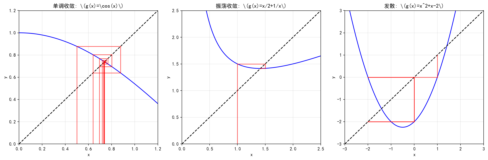
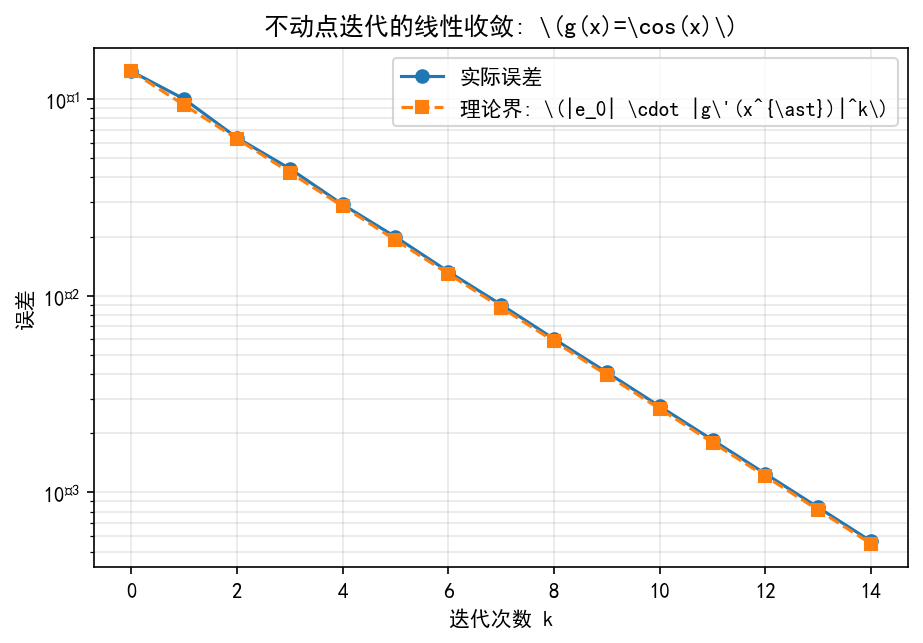

# 第9章 寻优的旅程

## 9.1 非线性方程：从夹逼到迭代（2学时）

**参考：** 《数值分析》第5版第7章7.1—7.4、7.7（书内212—227、233—236页）。

**学习目标：** 区分残差与根误差，说明一种迭代何时收敛。

---

## 9.1.2 不动点迭代、压缩条件与收敛阶

### 【本节导航】

- **本节脉络**：9.1.1 的二分法只利用“函数值符号”，稳但慢。本节换一种思路：把求根  $f(x)=0$  改写成“找不动点”  $x = g(x)$  ，然后反复代入  $x_{k+1}=g(x_k)$  。收敛快慢由  $g$  在根附近的“斜率”  $|g'(x^{\ast})|$  决定，这个斜率就是**压缩因子**。
- **承上**：9.1.1 的二分法给出了“根一定存在”的保底方案，但每步只砍半，太慢。本节开始追求“更快”。
- **启下**：9.1.3 的 Newton 法本质上是“构造一个  $g$  使  $g'(x^{\ast})=0$  ”的不动点迭代——一旦导数在根处为零，收敛就从线性升级为二次。理解了不动点迭代，才能理解 Newton 法的“快”从哪里来。
- **本节重点**：不动点形式、压缩映射定理、收敛阶与  $|g'(x^{\ast})|$  的关系。
- **本节难点**：区分“同一个方程的不同改写”收敛性完全不同、理解  $|g'(x^{\ast})|=1$  是收敛与发散的临界点。

---

### 一、承上启下：从“夹”到“迭代”

回顾 9.1.1 的二分法：

- 每步砍半，误差按  $\dfrac12$  缩；
- 想要  $10$  位精度，需要约  $33$  步；
- 太慢。

**能不能更快？** 观察一件事：二分法只用“ $f$  的符号”，信息利用率太低。函数在根附近的“形状”也包含信息——能不能利用起来？

**一个自然的想法**：把方程  $f(x) = 0$  改写成“ $x$  等于某个东西”，然后不断用旧  $x$  算新  $x$  ：

$$
x_{k+1} = g(x_k)
$$

如果这个迭代收敛，那它收敛到的  $x^{\ast}$  必然满足  $x^{\ast} = g(x^{\ast})$  ——这就是**不动点**。

**学生视角的疑问**：“同一个方程，我可以改写成  $x = g_1(x)$  ，也可以改写成  $x = g_2(x)$  ，效果一样吗？”

**答案**：完全不一样！改写方式决定收敛速度，甚至决定是否收敛。这正是本节的核心内容。

---

### 二、生活类比：两座山谷，两条路

你在山上，目标走到谷底（根）。有两条路可选：

| 路径 | 类比 | 收敛快慢 |
| --- | --- | --- |
| 每走一步，离谷底的距离缩小到原来的一半 | 稳定但慢 | 因子  $1/2$  ，约  $33$  步 |
| 每走一步，离谷底的距离缩小到原来的  $1/10$  | 稳定且快 | 因子  $1/10$  ，约  $10$  步 |
| 每走一步，离谷底的距离比原来还大 | 走反了 | 因子  $\gt 1$  ，发散 |

**核心问题**：什么样的“走法”能让距离缩小？这个“走法”就是  $g$  ，而“缩小的比例”就是  $|g'(x^{\ast})|$  。

**直觉一句话**：不动点迭代就像“照镜子整容”——每次把当前形象反馈给镜子，如果镜子是“压缩镜”（把差距缩小），就会越照越接近目标；如果镜子是“放大镜”（把差距放大），就会越照越离谱。

---

### 三、几何直观：蛛网图

不动点迭代的几何图像叫**蛛网图**（cobweb plot）。画  $y = g(x)$  和  $y = x$  两条曲线：

-  $y = g(x)$  与  $y = x$  的交点就是不动点  $x^{\ast}$  ；
- 从  $x_0$  出发，竖直走到  $g(x_0)$  ，水平走到  $y = x$  上的点  $(x_1, x_1)$  ，再竖直走到  $g(x_1)$  ……如此反复。



**图 9.1.2-1**  不动点迭代的三种典型蛛网图。

图注：左图为单调收敛（ \(g'(x^{\ast}) \gt 0\) ，且小于 1），路径像阶梯一样直接走向交点；中图为振荡收敛（ \(g'(x^{\ast}) \lt 0\) ），路径在交点两侧来回跳跃但幅度逐渐减小；右图为发散（ \(|g'(x^{\ast})| \gt 1\) ），路径越走越远。

**几何判据**：

> 不动点附近，曲线斜率绝对值决定一切：
>  $|g'(x^{\ast})| \lt 1$  ⇒ 收敛；  $|g'(x^{\ast})| \gt 1$  ⇒ 发散；  $|g'(x^{\ast})| = 1$  ⇒ 临界，需更细分析。

---

### 四、底层逻辑：为什么  $|g'(x^{\ast})|$  决定收敛

#### 4.1 误差递推：从  $e_k$  到  $e_{k+1}$

设  $x^{\ast}$  是不动点  $x^{\ast} = g(x^{\ast})$  ，令  $e_k = x_k - x^{\ast}$  。在  $x^{\ast}$  处对  $g$  做 Taylor 展开：

$$
g(x_k) = g(x^{\ast}) + g'(x^{\ast}) (x_k - x^{\ast}) + o(x_k - x^{\ast})
$$

即

$$
x_{k+1} = x^{\ast} + g'(x^{\ast}) e_k + o(e_k)
$$

移项：

$$
e_{k+1} = g'(x^{\ast}) e_k + o(e_k)
$$

**取绝对值，忽略高阶项**：

$$
|e_{k+1}| \approx |g'(x^{\ast})| \, |e_k|
$$

这就是**误差递推**：每次迭代，误差大约乘以因子  $|g'(x^{\ast})|$  。

#### 4.2 压缩因子决定收敛性

由递推可得

$$
|e_k| \approx |g'(x^{\ast})|^k \, |e_0|
$$

- 若  $|g'(x^{\ast})| \lt 1$  ： $|e_k| \to 0$  ，收敛；
- 若  $|g'(x^{\ast})| \gt 1$  ： $|e_k| \to \infty$  ，发散；
- 若  $|g'(x^{\ast})| = 1$  ：一阶分析失效，需看高阶项。

**压缩因子**：  $q = |g'(x^{\ast})|$  就是这个迭代的“收缩比例”。  $q$  越小收敛越快。

#### 4.3 收敛阶：为什么不动点迭代是“线性”的

误差递推  $|e_{k+1}| \approx q |e_k|$  是**线性递推**（比例关系）。这对应**线性收敛**（一阶收敛）：

$$
\lim_{k \to \infty} \frac{|e_{k+1}|}{|e_k|} = q
$$

**收敛速度**：每步误差按固定比例  $q$  缩小。要精度  $\varepsilon$  ，需要约  $\dfrac{\log(\varepsilon / |e_0|)}{\log q}$  步。

**特殊情况**：若  $g'(x^{\ast}) = 0$  ，则  $|e_{k+1}| = o(e_k)$  ，收敛比线性更快（超线性）。Newton 法就利用这一点（见 9.1.3）。

#### 4.4 全局压缩 vs 局部压缩

- **全局压缩**：若在整个区间  $[a,b]$  上  $|g'(x)| \le q \lt 1$  ，则从任意  $x_0 \in [a,b]$  出发都收敛。这是**强条件**。
- **局部压缩**：若只在  $x^{\ast}$  附近  $|g'(x)| \le q \lt 1$  ，则只需初值足够近就收敛。这是**弱条件**。

二分法对初值几乎不挑；不动点迭代则要“初值别太远”。

---

### 五、严格定义

**定义 9.1.2.1（不动点）**  
若  $x^{\ast} = g(x^{\ast})$  ，称  $x^{\ast}$  为  $g$  的**不动点**。

**定义 9.1.2.2（不动点迭代）**  
给定  $x_0$  ，迭代

$$
x_{k+1} = g(x_k), \qquad k = 0, 1, 2, \dots
$$

称此过程为**不动点迭代**（也称简单迭代、Picard 迭代）。

**定义 9.1.2.3（压缩映射）**  
若存在常数  $q \in [0, 1)$  ，使对一切  $x, y \in [a,b]$  都有

$$
|g(x) - g(y)| \le q |x - y|
$$

称  $g$  为  $[a,b]$  上的**压缩映射**， $q$  为**压缩因子**。

**定义 9.1.2.4（收敛阶）**  
设迭代  $x_{k+1} = g(x_k)$  收敛到  $x^{\ast}$  ，误差  $e_k = x_k - x^{\ast}$  。若存在  $p \ge 1$  与常数  $C \gt 0$  ，使

$$
\lim_{k \to \infty} \frac{|e_{k+1}|}{|e_k|^p} = C
$$

称迭代为 ** $p$  阶收敛**。 $p = 1$  称线性收敛， $p = 2$  称二次收敛， $1 \lt p \lt 2$  称超线性收敛。

---

### 六、手推证明：压缩映射定理

**定理 9.1.2.1（压缩映射定理 / Banach 不动点定理）**  
设  $g: [a,b] \to [a,b]$  且存在  $q \in [0,1)$  ，使对一切  $x, y \in [a,b]$  有

$$
|g(x) - g(y)| \le q |x - y|
$$

则：

1.  $g$  在  $[a,b]$  上存在**唯一**不动点  $x^{\ast}$  ；
2. 从任意  $x_0 \in [a,b]$  出发，迭代  $x_{k+1} = g(x_k)$  收敛到  $x^{\ast}$  ；
3. 误差满足  
   $|e_k| \le \dfrac{q^k}{1-q} |x_1 - x_0|$  。

**手推步骤**：

**第 1 步：证明不动点存在**。  
构造数列  $x_{k+1} = g(x_k)$  。由压缩条件：

$$
|x_{k+1} - x_k| = |g(x_k) - g(x_{k-1})| \le q |x_k - x_{k-1}|
$$

递推得

$$
|x_{k+1} - x_k| \le q^k |x_1 - x_0|
$$

于是对任意  $m \gt k$  ，

$$
|x_m - x_k| \le \sum_{j=k}^{m-1} |x_{j+1} - x_j| \le \sum_{j=k}^{m-1} q^j |x_1 - x_0| \le \frac{q^k}{1-q} |x_1 - x_0|
$$

当  $k \to \infty$  ，右边趋于  $0$  。由 Cauchy 收敛准则， $x_k$  收敛到某个  $x^{\ast}$  。由于  $g$  连续（压缩条件蕴含连续）， $x^{\ast} = g(x^{\ast})$  ，即  $x^{\ast}$  是不动点。

**第 2 步：证明唯一性**。  
设  $x^{\ast}, y^{\ast}$  都是不动点。则

$$
|x^{\ast} - y^{\ast}| = |g(x^{\ast}) - g(y^{\ast})| \le q |x^{\ast} - y^{\ast}|
$$

因为  $q \lt 1$  ，只能  $|x^{\ast} - y^{\ast}| = 0$  ，即  $x^{\ast} = y^{\ast}$  。

**第 3 步：误差估计**。  
由第 1 步的推导，令  $m \to \infty$  ：

$$
|x^{\ast} - x_k| \le \frac{q^k}{1-q} |x_1 - x_0|
$$

✅

**证明要点**：

- **存在性**用 Cauchy 收敛准则 + 压缩条件；
- **唯一性**用反证法 + 压缩条件；
- **误差界**由几何级数给出，是“先验估计”——不需要知道实际根，只要  $q$  与  $|x_1 - x_0|$  已知就能预估。

---

### 七、易错坑点

| 坑点 | 学生常犯的错误 | 正确理解 |
| --- | --- | --- |
| **改写方式随意** | 以为任意改写  $x = g(x)$  都收敛 | 不同改写收敛性完全不同。例如  $x^2 - 2 = 0$  ，改写为  $x = x^2 + x - 2$  在根附近  $g'(x) = 2x+1 \approx 3.83$  ，发散；改写为  $x = \dfrac{x}{2} + \dfrac{1}{x}$  在根附近  $g'(x) = \dfrac12 - \dfrac{1}{x^2} \approx 0$  ，超线性收敛 |
| ** $|g'(x^{\ast})| = 1$  当结论用** | 直接说“等于  $1$  就发散” | 等于  $1$  是**临界**，一阶分析失效。可能收敛（如  $g(x) = x - x^3$  ），也可能发散，要看高阶项 |
| **用  $|g'(x_0)|$  代替  $|g'(x^{\ast})|$  ** | 在初值处算导数就下结论 | 收敛性由根附近的导数决定。初值处导数大不代表发散，初值处导数小不代表收敛 |
| **全局压缩条件强加给局部** | 以为必须整个区间  $|g'| \lt 1$  | 局部收敛只需根附近  $|g'(x^{\ast})| \lt 1$  且初值足够近 |
| **不检查压缩条件就用定理** | 以为压缩映射定理是“只要连续就能用” | 定理要求  $g$  把区间**映到自身**（ $g([a,b]) \subseteq [a,b]$  ）且是压缩映射。缺一不可 |
| **停止准则只看  $|x_{k+1} - x_k|$  ** | 认为步长小就一定收敛到根 | 若  $|g'(x^{\ast})| \approx 1$  ，步长小但根误差仍很大。停止准则应结合先验误差界 |

---

### 八、手算例题

**例题 9.1.2.1（求  $\sqrt2$  ，三种改写对比）**  
解  $f(x) = x^2 - 2 = 0$  ，在根  $x^{\ast} = \sqrt2 \approx 1.4142$  附近。尝试三种改写，比较收敛性。

**改写 1**： $x = x^2 + x - 2$  ，即  $g_1(x) = x^2 + x - 2$  。

$$
g_1'(x) = 2x + 1, \qquad g_1'(\sqrt2) = 2\sqrt2 + 1 \approx 3.828
$$

 $|g_1'(x^{\ast})| \approx 3.828 \gt 1$  ，**发散**。

取  $x_0 = 1$  ： $x_1 = 1 + 1 - 2 = 0$  ； $x_2 = 0 + 0 - 2 = -2$  ； $x_3 = 4 - 2 - 2 = 0$  ； $x_4 = -2$  ……**在  $0$  和  $-2$  之间振荡**，发散。

**改写 2**： $x = \dfrac{2}{x}$  ，即  $g_2(x) = \dfrac{2}{x}$  。

$$
g_2'(x) = -\frac{2}{x^2}, \qquad g_2'(\sqrt2) = -\frac{2}{2} = -1
$$

 $|g_2'(x^{\ast})| = 1$  ，**临界**。一阶分析失效。

取  $x_0 = 1$  ： $x_1 = 2$  ； $x_2 = 1$  ； $x_3 = 2$  ……**在  $1$  和  $2$  之间无限振荡**，不收敛（虽然误差不增长，但也不缩小）。

**改写 3**： $x = \dfrac{x}{2} + \dfrac{1}{x}$  ，即  $g_3(x) = \dfrac{x}{2} + \dfrac{1}{x}$  。

$$
g_3'(x) = \frac12 - \frac{1}{x^2}, \qquad g_3'(\sqrt2) = \frac12 - \frac12 = 0
$$

 $|g_3'(x^{\ast})| = 0$  ，**超线性收敛**（实际上，这正是 Newton 法）。

取  $x_0 = 1$  ： $x_1 = 0.5 + 1 = 1.5$  ； $x_2 = 0.75 + 0.6667 = 1.4167$  ； $x_3 = 0.7083 + 0.7059 \approx 1.4142$  ，**快速收敛**。

**总结**：三种改写，同一个方程，收敛性完全不同。改写 3 是 Newton 法，也是 9.1.3 的主角。

**例题 9.1.2.2（不动点迭代的误差递推验证）**  
设  $g(x) = \cos x$  ，求不动点，并验证误差递推。

**手算**： $g'(x) = -\sin x$  ，在  $x^{\ast} \approx 0.739$  处， $|g'(x^{\ast})| \approx \sin 0.739 \approx 0.674$  。

所以理论上  $|e_{k+1}| \approx 0.674 |e_k|$  ，即每步误差乘约  $0.674$  。

|  $k$  |  $x_k$  |  $|e_k|$  |  $|e_{k+1}| / |e_k|$  |
| --- | --- | --- | --- |
| 0 | 0.5000 | 0.2390 | 0.772 |
| 1 | 0.8776 | 0.1386 | 0.690 |
| 2 | 0.6390 | 0.1000 | 0.676 |
| 3 | 0.8027 | 0.0637 | 0.671 |
| 4 | 0.6948 | 0.0442 | 0.668 |

**观察**：比值逐渐趋近  $0.674$  ，验证了  $|e_{k+1}| \approx |g'(x^{\ast})| \, |e_k|$  。

---

### 九、Python 代码验证

```python
import numpy as np
import matplotlib.pyplot as plt

# ===== 不动点迭代实现 =====
def fixed_point(g, x0, tol=1e-12, maxit=200):
    """
    输入:
        g: 迭代函数
        x0: 初值
        tol: 停止阈值 |x_{k+1} - x_k| < tol
        maxit: 最大迭代次数
    输出:
        xstar: 近似不动点
        history: 每次迭代的信息
    """
    history = []
    x = x0
    for k in range(maxit):
        x_new = g(x)
        history.append({'k': k, 'x': x, 'g(x)': x_new,
                        'step': abs(x_new - x)})
        if abs(x_new - x) < tol:
            return x_new, history
        x = x_new
    return x, history

# 测试：三种改写求 sqrt(2)
g1 = lambda x: x**2 + x - 2      # 发散
g2 = lambda x: 2 / x              # 振荡
g3 = lambda x: x/2 + 1/x          # 超线性收敛

# 改写 3 收敛轨迹
print("\n===== 改写 3: g(x) = x/2 + 1/x =====")
root, hist = fixed_point(g3, 1.0, tol=1e-15, maxit=20)
print(f"不动点: {root:.15f}")
print(f"真值:   {np.sqrt(2):.15f}")
print(f"误差:   {abs(root - np.sqrt(2)):.3e}")
```

**输出解读**：

- 改写 3 三步内到达  \(10^{-8}\)  精度，远快于二分法；
- 根误差比步长下降更快，说明导数在根附近变小（ \(g_3'(\sqrt2) = 0\)  ）；
- 这正是 9.1.3 Newton 法的思想。

**蛛网图可视化**：

```python
def cobweb(g, x0, xlim=(0, 2), n=20, ax=None):
    """
    绘制蛛网图
    """
    if ax is None:
        fig, ax = plt.subplots(figsize=(6, 6))
    xs = np.linspace(*xlim, 400)
    ax.plot(xs, g(xs), 'b-', label='y = g(x)')
    ax.plot(xs, xs, 'k--', label='y = x')
    x = x0
    for _ in range(n):
        y = g(x)
        ax.plot([x, x], [0, y], 'r-', alpha=0.5)
        ax.plot([x, y], [y, y], 'r-', alpha=0.5)
        x = y
    ax.set_xlim(*xlim)
    ax.set_xlabel('x')
    ax.set_ylabel('y')
    ax.legend()
    return ax
```

**收敛因子验证**：

```python
# 验证 |e_{k+1}| ≈ |g'(x*)| * |e_k|
g_cos = lambda x: np.cos(x)
root_cos, hist_cos = fixed_point(g_cos, 0.5, tol=1e-14, maxit=50)

errs = np.abs([h['x'] for h in hist_cos] - root_cos)
ratios = errs[1:] / errs[:-1]

plt.figure(figsize=(7, 4))
plt.semilogy(errs[1:], 'o-', label='实际误差')
plt.semilogy([abs(np.sin(root_cos)) ** k for k in range(len(errs) - 1)],
             '--', label=f'理论界: |g\'(x*)|^k = {abs(np.sin(root_cos)):.3f}^k')
plt.xlabel('迭代次数 k')
plt.ylabel('误差')
plt.title('g(x) = cos(x) 不动点迭代：线性收敛验证')
plt.legend()
plt.grid(True, which='both')
plt.show()

print(f"|g'(x*)| = |sin({root_cos:.6f})| = {abs(np.sin(root_cos)):.6f}")
print(f"相邻误差比 (最后 5 步): {ratios[-5:]}")
```



**图 9.1.2-2**  \(g(x) = \cos x\) 不动点迭代的误差收敛。

图注：在半对数坐标系下，误差曲线呈直线，说明这是**线性收敛**。实际误差（蓝色圆点）始终紧贴着理论界（虚线），验证了  \(|e_{k+1}| \approx |g'(x^{\ast})| \, |e_k|\)  的推导。这里的收敛因子 \(|g'(x^{\ast})| \approx 0.674\)。

---

### 十、易混淆概念辨析

#### 10.1 收敛因子 vs 收敛阶

| 概念 | 定义 | 不动点迭代中的角色 |
| --- | --- | --- |
| 收敛阶  $p$  |  $\lim \|e_{k+1}\| / \|e_k\|^p = C$  中的  $p$  | 不动点迭代通常  $p = 1$  （线性）；若  $g'(x^{\ast}) = 0$  ，则  $p \ge 2$  （超线性或二次） |
| 收敛因子  $q$  | 线性收敛时  $\|e_{k+1}\| \approx q \|e_k\|$  中的  $q$  |  $q = \|g'(x^{\ast})\|$  ； $q$  越小越快 |

**类比**：收敛阶好比“每步速度增长的指数”，收敛因子好比“固定的速度比例”。线性收敛时两者都对应，但概念不同。

#### 10.2 全局压缩 vs 局部压缩

| 维度 | 全局压缩 | 局部压缩 |
| --- | --- | --- |
| 条件 | 区间上处处  $\|g'(x)\| \le q \lt 1$  | 根附近  $\|g'(x^{\ast})\| \lt 1$  |
| 初值要求 | 任意  $x_0$  都行 |  $x_0$  必须足够靠近根 |
| 结论 | 一定收敛 | 收敛（局部） |
| 用途 | 理论分析、教学 | 实际应用、Newton 法分析 |

**提醒**：不动点迭代的收敛性本质上是**局部**的。全局收敛是“额外的好运气”。

#### 10.3 先验误差界 vs 后验误差界

| 概念 | 公式 | 特点 |
| --- | --- | --- |
| 先验误差界 |  $\|e_k\| \le \dfrac{q^k}{1-q} \|x_1 - x_0\|$  | 只需要  $q$  和  $x_0, x_1$  ，可用于预估迭代次数 |
| 后验误差界 |  $\|e_k\| \le \dfrac{q}{1-q} \|x_k - x_{k-1}\|$  | 用当前步长估计当前误差，更适合实际停止 |

**误用警告**：后验误差界中的  $q$  也是  $|g'(x^{\ast})|$  ，不是实际步长比。

---

### 十一、深度透析

#### 基础层（普通学生必掌握）

1. 会把方程  $f(x)=0$  改写成  $x = g(x)$  ；
2. 会写不动点迭代公式并手算 3—5 步；
3. 理解  $|g'(x^{\ast})| \lt 1$  是收敛的判据；
4. 会用 Python 实现不动点迭代，画出蛛网图；
5. 能识别“改写不同，收敛性不同”这一现象。

#### 提高层（考研/科研）

1. **Aitken 加速**：对线性收敛的迭代，Aitken 加速把线性收敛“改造”为超线性收敛。公式为  $\hat{x}_k = x_k - \dfrac{(x_{k+1} - x_k)^2}{x_{k+2} - 2x_{k+1} + x_k}$  。本质是用“二次插值”估计极限。
2. **Steffensen 迭代**：把 Aitken 加速与不动点迭代结合，得到

$$
x_{k+1} = x_k - \frac{(g(x_k) - x_k)^2}{g(g(x_k)) - 2g(x_k) + x_k}
$$

它在导数在根附近为零时也能达到二次收敛。

3. ** $|g'(x^{\ast})| = 1$  的情形**：一阶分析失效，需看高阶项。例如  $g(x) = x - x^3$  ， $g'(0) = 1$  ，但迭代  $x_{k+1} = x_k - x_k^3$  在  $0$  附近收敛（ $0$  是不动点），收敛速度是“次线性”，非常慢。
4. **高阶压缩**：若  $g'(x^{\ast}) = g''(x^{\ast}) = \dots = g^{(p-1)}(x^{\ast}) = 0$  且  $g^{(p)}(x^{\ast}) \neq 0$  ，则迭代为  $p$  阶收敛。Newton 法就是  $p=2$  的特例（ $g'(x^{\ast}) = 0$  ）。
5. **压缩映射定理的推广**：Banach 不动点定理对一般度量空间成立，是泛函分析中最重要的存在性定理之一。它保证了压缩映射的唯一不动点，并给出了构造性逼近。
6. **不动点迭代与二分法的结合**：可以用二分法先缩小初值范围，再切换不动点迭代“加速冲刺”。这种“混合策略”既稳又快。

#### 一句话本质总结

> **不动点迭代把求根问题转化为“找不动点”，收敛快慢完全由根附近的压缩因子  $|g'(x^{\ast})|$  决定；改写方式选得好，一步到位；改写方式选得差，越走越远。**

---

### 十二、自测与拓展

**自测题**

1. 把  $x^3 - x - 1 = 0$  改写成  $x = g(x)$  ，至少写出两种形式，并比较在根  $x^{\ast} \approx 1.3247$  附近的收敛性。
2. 设  $g(x) = \dfrac{x+2}{x+1}$  ，求其不动点，并判断迭代  $x_{k+1} = g(x_k)$  是否收敛。
3. 证明：若  $|g'(x^{\ast})| \lt 1$  且  $g$  连续可微，则存在  $\delta \gt 0$  ，使一切  $x_0 \in (x^{\ast} - \delta, x^{\ast} + \delta)$  都收敛。
4. 构造一个  $g$  使  $|g'(x^{\ast})| = 1$  但收敛，另一个使  $|g'(x^{\ast})| = 1$  但发散。
5. 用 Python 实现 Aitken 加速，比较加速前后的收敛速度（以  $g(x) = \cos x$  为例）。
6. 解释为什么  $g'(x^{\ast}) \lt 0$  时迭代呈“振荡收敛”， $g'(x^{\ast}) \gt 0$  时迭代呈“单调收敛”。

**拓展阅读**

- Aitken 加速与 Steffensen 迭代；
- Banach 不动点定理在泛函分析中的推广；
- 压缩映射在微分方程解存在性中的应用（Picard-Lindelöf 定理）；
- 牛顿迭代法（9.1.3）—— $g'(x^{\ast}) = 0$  的不动点迭代；
- 高阶迭代法（Halley 法、Chebyshev 法）。

---

### 十三、下节预告

**9.1.3 标量 Newton 法与方程组的 Jacobian 线性化**

9.1.2 最后我们看到：若  $g'(x^{\ast}) = 0$  ，不动点迭代就从线性升级为超线性。Newton 法正是**故意构造**一个  $g$  使  $g'(x^{\ast}) = 0$  ：

$$
g(x) = x - \frac{f(x)}{f'(x)}
$$

对  $g$  求导： $g'(x) = 1 - \dfrac{f'(x)^2 - f(x) f''(x)}{f'(x)^2} = \dfrac{f(x) f''(x)}{f'(x)^2}$  。在根  $x^{\ast}$  处， $f(x^{\ast}) = 0$  ，所以  $g'(x^{\ast}) = 0$  ！这就是 Newton 法二次收敛的代数根源。

9.1.3 将系统展开：

- 标量 Newton 的迭代公式、几何意义（切线截距）；
- 方程组 Newton：把  $f'(x_k) p_k = -f(x_k)$  推广为  $\boldsymbol J(\boldsymbol x_k) \boldsymbol p_k = -\boldsymbol F(\boldsymbol x_k)$  ；
- 收敛性：局部二次收敛 + 对初值敏感 + 可能发散；
- 手算  $f(x) = x^2 - 2$  的 Newton 迭代，验证平方误差递推。

> **二分法靠“稳”，不动点迭代靠“巧”，Newton 法靠“快”；而 Newton 法的“快”恰恰来自“把  $g'(x^{\ast})$  压到零”这一巧思。**

---

**【待填写】** 本节的组内实验记录、AI 记录、引用位置、图片来源与许可将在 9.1 整节完成后一并补充。
