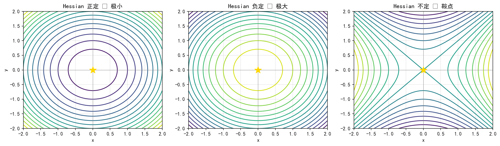

# 9.2 下降方向：往哪里走，走多远

> **本节脉络**：9.1 解决了“解方程”，本章转向“找最小值”。9.2.1 先回答一个前置问题——**什么才算最优**？只有把“最优性条件”讲清楚，才能判断 9.2.2 的负梯度方向、9.2.3 的步长准则、9.3 的 Newton 方向到底在往哪里走。本节的核心结论只有一句：**梯度为零只是入场券，Hessian 才决定你是山谷、山顶还是山口。**

---

## 9.2.1 无约束最优性条件与驻点剖析

### 【本节导航】

- 预习：会求多元函数梯度与 Hessian，知道正定矩阵的定义。
- 核心：一阶必要条件、二阶必要/充分条件、驻点三分类（极小/极大/鞍点）。
- 避坑：驻点 ≠ 极小点；Hessian 半正定 ≠ 极小点；局部极小 ≠ 全局极小。
- 总结：梯度管“平不平”，Hessian 管“弯向哪边”。
- 自测：判断给定驻点类型、手算 Hessian 特征值。
- 拓展：高阶退化、Morse 理论、凸性与全局最优、KKT 预告。

---

### 一、生活类比：雾中找谷底

你在大雾中站在山坡上，目标是走到谷底（最小值点）。你看不见全局，只能感受脚下：

| 你脚下的感受 | 数学对应 | 结论 |
|---|---|---|
| 地面朝某个方向明显倾斜 |  $\nabla f(\boldsymbol x)\neq\boldsymbol 0$  | 还没到谷底，沿下坡方向还能走 |
| 地面完全水平（朝哪都不升不降） |  $\nabla f(\boldsymbol x)=\boldsymbol 0$  | **驻点**，可能是谷底、山顶或山口 |
| 水平，且朝任何方向都微微上翘 | Hessian 正定 | 谷底（局部极小） |
| 水平，且朝任何方向都微微下倾 | Hessian 负定 | 山顶（局部极大） |
| 水平，有的方向翘、有的方向沉 | Hessian 不定 | **山口（鞍点）** |

**直觉一句话**：梯度告诉你“坡在哪”，Hessian 告诉你“碗朝哪开口”。只有两者配合，才能判断你站的是碗底、碗沿还是马鞍。

---

### 二、几何直观：等高线与梯度

设  $f:\mathbb R^2\to\mathbb R$  ，画等高线  $f(x,y)=c$  。

- **梯度  $\nabla f$  垂直于等高线**，指向函数值增加最快的方向；
- 在极小点附近，等高线是一圈圈**闭合的椭圆**，梯度指向外（函数增大）；
- 在极大点附近，等高线也是闭合椭圆，但梯度指向内；
- 在鞍点附近，等高线呈**双曲线形**：沿一个方向是“谷”，沿另一个方向是“脊”。



**图 9.2.1-1**  驻点的三种类型与等高线形状。

图注：三图在原点梯度均为零，但 Hessian 特征值不同。左图等高线是闭合椭圆（碗底），中图椭圆开口反向（山顶），右图等高线是双曲线（山口）。**梯度为零只说明“站平了”，Hessian 才决定“碗朝哪开口”。**

---

### 三、底层逻辑：为什么这些条件成立

#### 3.1 为什么  $\nabla f(\boldsymbol x^{\ast})=\boldsymbol 0$  是必要条件？

反证。若  $\nabla f(\boldsymbol x^{\ast})\neq\boldsymbol 0$  ，取方向  $\boldsymbol d=-\nabla f(\boldsymbol x^{\ast})$  ，沿此方向走一小步  $t>0$  ：

$$
f(\boldsymbol x^{\ast}+t\boldsymbol d)
=f(\boldsymbol x^{\ast})+t\,\nabla f(\boldsymbol x^{\ast})^{\top}\boldsymbol d+o(t)
=f(\boldsymbol x^{\ast})-t\|\nabla f(\boldsymbol x^{\ast})\|^2+o(t)
$$

当  $t$  足够小，第二项占主导且为负，故  $f(\boldsymbol x^{\ast}+t\boldsymbol d)\lt f(\boldsymbol x^{\ast})$  ，与  $\boldsymbol x^{\ast}$  是极小点矛盾。✅

**一句话**：只要还有坡，就还能往下走；所以极小点必须“无坡可下”。

#### 3.2 为什么还要看 Hessian？

梯度为零只说明“一阶平坦”，但平坦处可能是碗底、碗沿或马鞍。把函数在驻点处展开到二阶：

$$
f(\boldsymbol x^{\ast}+\boldsymbol d)
=f(\boldsymbol x^{\ast})+\underbrace{\nabla f(\boldsymbol x^{\ast})^{\top}\boldsymbol d}_{=0}
+\frac12\boldsymbol d^{\top}\boldsymbol H(\boldsymbol x^{\ast})\boldsymbol d+o(\|\boldsymbol d\|^2)
$$

于是**局部形状由二次型  $\boldsymbol d^{\top}\boldsymbol H\boldsymbol d$  决定**：

- 对一切  $\boldsymbol d\neq\boldsymbol 0$  都有  $\boldsymbol d^{\top}\boldsymbol H\boldsymbol d\gt 0$  （ $\boldsymbol H$  正定）⇒ 任何方向都上升 ⇒ 局部极小；
- 对一切  $\boldsymbol d\neq\boldsymbol 0$  都有  $\boldsymbol d^{\top}\boldsymbol H\boldsymbol d\lt 0$  （ $\boldsymbol H$  负定）⇒ 任何方向都下降 ⇒ 局部极大；
- 存在方向使二次型取正、也存在方向使其取负（ $\boldsymbol H$  不定）⇒ 有的方向升、有的方向降 ⇒ 鞍点。

---

### 四、严格定义与定理

**定义 9.2.1.1（全局与局部极小）**  
设  $f:\mathbb R^n\to\mathbb R$  ， $\boldsymbol x^{\ast}\in\mathbb R^n$  。

- 若对一切  $\boldsymbol x$  都有  $f(\boldsymbol x^{\ast})\le f(\boldsymbol x)$  ，称  $\boldsymbol x^{\ast}$  为**全局极小点**；
- 若存在  $\delta\gt 0$  ，使对一切  $\|\boldsymbol x-\boldsymbol x^{\ast}\|\lt \delta$  都有  $f(\boldsymbol x^{\ast})\le f(\boldsymbol x)$  ，称  $\boldsymbol x^{\ast}$  为**局部极小点**。

**定义 9.2.1.2（驻点）**  
若  $\nabla f(\boldsymbol x^{\ast})=\boldsymbol 0$  ，称  $\boldsymbol x^{\ast}$  为**驻点**（稳定点）。

**定理 9.2.1.1（一阶必要条件）**  
设  $f$  在  $\boldsymbol x^{\ast}$  处可微。若  $\boldsymbol x^{\ast}$  是局部极小点，则  $\nabla f(\boldsymbol x^{\ast})=\boldsymbol 0$  。

**定理 9.2.1.2（二阶必要条件）**  
设  $f$  在  $\boldsymbol x^{\ast}$  的邻域内二阶连续可微。若  $\boldsymbol x^{\ast}$  是局部极小点，则  $\nabla f(\boldsymbol x^{\ast})=\boldsymbol 0$  且  $\boldsymbol H(\boldsymbol x^{\ast})$  **半正定**。

**定理 9.2.1.3（二阶充分条件）**  
设  $f$  在  $\boldsymbol x^{\ast}$  的邻域内二阶连续可微。若  $\nabla f(\boldsymbol x^{\ast})=\boldsymbol 0$  且  $\boldsymbol H(\boldsymbol x^{\ast})$  **正定**，则  $\boldsymbol x^{\ast}$  是**严格局部极小点**。

> **逻辑关系提醒**：必要条件是“极小 ⇒ 条件”，充分条件是“条件 ⇒ 极小”。  
> 二阶**必要**用半正定，二阶**充分**用正定——这两个词不能互换（见伪证辨析）。

---

### 五、公式分层与结构

#### 5.1 一阶条件（主项）

一阶必要条件为：

$$
\nabla f(\boldsymbol x^{\ast})=\boldsymbol 0
$$

这是**驻点方程**，是“入场券”，不是“结论”。

#### 5.2 二阶判据（分层）

二阶判据为：

$$
\boldsymbol d^{\top}\boldsymbol H(\boldsymbol x^{\ast})\boldsymbol d
\begin{cases}
\gt 0,\ \forall\boldsymbol d\neq\boldsymbol 0
  & \Rightarrow\ \text{严格局部极小} \\[4pt]
\lt 0,\ \forall\boldsymbol d\neq\boldsymbol 0
  & \Rightarrow\ \text{严格局部极大} \\[4pt]
\text{有正有负}
  & \Rightarrow\ \text{鞍点} \\[4pt]
\ge 0\ \text{且存在}\ =0
  & \Rightarrow\ \text{退化，判据失效}
\end{cases}
$$

- **充分结论**：正定/负定直接给结论。
- **失效区**：半正定或半负定（有零特征值）时，二阶判据**不够用**，需高阶信息。

#### 5.3 用特征值重写（计算上最实用）

设  $\boldsymbol H(\boldsymbol x^{\ast})$  的特征值为  $\lambda_1,\dots,\lambda_n$  ：

$$
\begin{aligned}
\text{全部}\ \lambda_i\gt 0 &\Rightarrow \text{局部极小} \\
\text{全部}\ \lambda_i\lt 0 &\Rightarrow \text{局部极大} \\
\text{有正有负} &\Rightarrow \text{鞍点} \\
\text{含零特征值} &\Rightarrow \text{退化，需高阶判据}
\end{aligned}
$$

---

### 六、可手推证明

#### 6.1 二阶必要条件的证明

设  $\boldsymbol x^{\ast}$  是局部极小。固定任意方向  $\boldsymbol d\neq\boldsymbol 0$  ，定义一元函数

$$
\varphi(t)=f(\boldsymbol x^{\ast}+t\boldsymbol d)
$$

则  $t=0$  是  $\varphi$  的局部极小点。由一元函数二阶必要条件：

$$
\varphi'(0)=0,\qquad \varphi''(0)\ge 0
$$

而

$$
\varphi'(t)=\nabla f(\boldsymbol x^{\ast}+t\boldsymbol d)^{\top}\boldsymbol d,\qquad
\varphi''(t)=\boldsymbol d^{\top}\boldsymbol H(\boldsymbol x^{\ast}+t\boldsymbol d)\boldsymbol d
$$

代入  $t=0$  得  $\nabla f(\boldsymbol x^{\ast})^{\top}\boldsymbol d=0$  对一切  $\boldsymbol d$  成立 ⇒  $\nabla f(\boldsymbol x^{\ast})=\boldsymbol 0$  ；且  $\boldsymbol d^{\top}\boldsymbol H(\boldsymbol x^{\ast})\boldsymbol d\ge 0$  对一切  $\boldsymbol d$  成立 ⇒  $\boldsymbol H$  半正定。✅

#### 6.2 二阶充分条件的证明

设  $\nabla f(\boldsymbol x^{\ast})=\boldsymbol 0$  ， $\boldsymbol H(\boldsymbol x^{\ast})$  正定。由 Taylor 展开：

$$
f(\boldsymbol x^{\ast}+\boldsymbol d)
=f(\boldsymbol x^{\ast})+\frac12\boldsymbol d^{\top}\boldsymbol H(\boldsymbol x^{\ast})\boldsymbol d+o(\|\boldsymbol d\|^2)
$$

设  $\lambda_{\min}\gt 0$  为  $\boldsymbol H(\boldsymbol x^{\ast})$  的最小特征值，则  $\boldsymbol d^{\top}\boldsymbol H\boldsymbol d\ge\lambda_{\min}\|\boldsymbol d\|^2$  。当  $\|\boldsymbol d\|$  足够小， $o(\|\boldsymbol d\|^2)$  可被  $\frac12\lambda_{\min}\|\boldsymbol d\|^2$  控制，于是

$$
f(\boldsymbol x^{\ast}+\boldsymbol d)-f(\boldsymbol x^{\ast})
\ge\frac14\lambda_{\min}\|\boldsymbol d\|^2\gt 0
$$

即  $\boldsymbol x^{\ast}$  是严格局部极小。✅

> **证明要点**：正定性给出“一致的下界  $\lambda_{\min}\gt 0$ ”，这是把二阶项压过余项的关键；半正定时  $\lambda_{\min}=0$  ，下界消失，证明失效——这正是“半正定不够”的根源。

---

### 七、手算例题

**例题 9.2.1.1（二维二次函数）**  
求  $f(x,y)=x^2+y^2-2x-4y+5$  的驻点并判断类型。

**手算**：

1. 梯度：

$$
\nabla f=
\left( \begin{array}{c}
2x-2 \cr
2y-4
\end{array} \right)
$$

2. 令  $\nabla f=\boldsymbol 0$  得驻点  $(x^{\ast},y^{\ast})=(1,2)$  。

3. Hessian 是常数矩阵：

$$
\boldsymbol H=
\left( \begin{array}{cc}
2 & 0 \cr
0 & 2
\end{array} \right)
$$

4. 特征值  $\lambda_1=\lambda_2=2\gt 0$  ⇒ 正定 ⇒ 严格局部极小。

5. 配方验证： $f=(x-1)^2+(y-2)^2\ge 0$  ，且最小值  $0$  在  $(1,2)$  取到 ⇒ 还是**全局**极小。

**例题 9.2.1.2（鞍点）**  
分析  $f(x,y)=x^2-y^2$  在原点。

**手算**： $\nabla f=(2x,\ -2y)^{\top}$  ，原点处为零。Hessian

$$
\boldsymbol H=
\left( \begin{array}{cc}
2 & 0 \cr
0 & -2
\end{array} \right)
$$

特征值  $2$  与  $-2$  ，一正一负 ⇒ **鞍点**。沿  $x$  轴是谷，沿  $y$  轴是脊。✅

**例题 9.2.1.3（一维退化）**  
分别分析  $f_1(x)=x^3$  、 $f_2(x)=x^4$  在  $x=0$  。

| 函数 |  $f'(0)$  |  $f''(0)$  | 二阶判据 | 真实类型 |
|---|---|---|---|---|
|  $x^3$  |  $0$  |  $0$  | 失效 | 不是极值点（拐点） |
|  $x^4$  |  $0$  |  $0$  | 失效 | 严格局部极小 |

**结论**： $f''(x^{\ast})=0$  时二阶判据失效，必须看更高阶导数。一维时：第一个非零导数的阶数为偶数 ⇒ 极值点；为奇数 ⇒ 不是极值点。

---

### 八、Python 代码验证

```python
import numpy as np
import sympy as sp
import matplotlib.pyplot as plt

# ===== 符号求梯度、Hessian、驻点、特征值 =====
x, y = sp.symbols('x y')

def analyze(f_expr, vars_=(x, y)):
    f = sp.sympify(f_expr)
    grad = [sp.diff(f, v) for v in vars_]
    H = sp.Matrix([[sp.diff(f, v1, v2) for v2 in vars_] for v1 in vars_])
    sols = sp.solve(grad, vars_, dict=True)
    print("f =", f)
    print("梯度 =", grad)
    print("Hessian =", H)
    for s in sols:
        Hs = H.subs(s)
        ev = list(Hs.eigenvals().keys())
        ev_num = [complex(e).real for e in ev]
        if all(e > 0 for e in ev_num):
            kind = "局部极小"
        elif all(e < 0 for e in ev_num):
            kind = "局部极大"
        elif any(e > 0 for e in ev_num) and any(e < 0 for e in ev_num):
            kind = "鞍点"
        else:
            kind = "退化，二阶判据失效"
        print(f"驻点 {s}  特征值 {ev_num}  =>  {kind}")

analyze("x**2 + y**2 - 2*x - 4*y + 5")
analyze("x**2 - y**2")
analyze("x**4 + y**4")          # 原点：Hessian 为零矩阵，退化但实为极小
```

**输出解读**：

- 第一个函数特征值全正 ⇒ 局部极小；
- 第二个一正一负 ⇒ 鞍点；
- 第三个 Hessian 在原点为零矩阵，程序判“退化”，但真实是极小——**代码只能执行二阶判据，判据失效时要人来补高阶分析**。

**等高线 + 梯度场可视化**：

```python
def plot_field(f_np, xlim=(-2.5, 2.5), ylim=(-2.5, 2.5), title=""):
    X, Y = np.meshgrid(np.linspace(*xlim, 200), np.linspace(*ylim, 200))
    Z = f_np(X, Y)
    fig, ax = plt.subplots(figsize=(6,5))
    cs = ax.contour(X, Y, Z, levels=20, cmap='viridis')
    ax.clabel(cs, inline=True, fontsize=8)
    # 梯度场（数值差分）
    h = 1e-4
    U = (f_np(X+h, Y) - f_np(X-h, Y)) / (2*h)
    V = (f_np(X, Y+h) - f_np(X, Y-h)) / (2*h)
    ax.quiver(X[::15,::15], Y[::15,::15], U[::15,::15], V[::15,::15],
              color='red', alpha=0.6)
    ax.set_title(title); ax.set_xlabel('x'); ax.set_ylabel('y')
    plt.show()

plot_field(lambda x,y: x**2 + y**2, title="碗底：梯度指向外，等高线闭合")
plot_field(lambda x,y: x**2 - y**2, title="鞍点：等高线双曲线，梯度有进有出")
```

**解读**：

- 碗底图中，红色箭头（梯度）从中心向外辐射，中心处长度为零 ⇒ 驻点；
- 鞍点图中，梯度在  $x$  方向向外、 $y$  方向向内，中心为零 ⇒ 鞍点。

---

### 九、误差与判据可视化：二阶 Taylor 近似

```python
# 在一维上展示：驻点附近，二阶 Taylor 近似能否代表真实形状
f  = lambda x: x**4 - 2*x**2 + 0.5   # 双井函数，驻点 x=0 是局部极大，x=±1 是极小
df = lambda x: 4*x**3 - 4*x
d2f= lambda x: 12*x**2 - 4

xs = np.linspace(-1.8, 1.8, 400)
plt.figure(figsize=(7,4))
plt.plot(xs, f(xs), 'k-', label='f(x)')
for x0, color in [(-1, 'tab:blue'), (0, 'tab:red'), (1, 'tab:green')]:
    taylor2 = f(x0) + df(x0)*(xs-x0) + 0.5*d2f(x0)*(xs-x0)**2
    plt.plot(xs, taylor2, '--', color=color,
             label=f'二阶 Taylor @ x={x0}, f\'\'={d2f(x0):.0f}')
plt.ylim(-2, 2); plt.legend(); plt.grid(True)
plt.title('驻点处二阶 Taylor 近似：曲率决定局部形状')
plt.show()
```

**解读**：

- 在  $x=-1$  与  $x=1$  ， $f''\gt 0$  ，二阶近似是开口向上的抛物线，与真实函数局部吻合 ⇒ 极小；
- 在  $x=0$  ， $f''\lt 0$  ，二阶近似开口向下，与真实函数局部吻合 ⇒ 极大；
- 若某点  $f''=0$  ，二阶近似退化为水平直线，**无法反映真实弯曲**——这就是判据失效的可视化。

---

### 十、易错坑点

| 坑点 | 错误认知 | 正确认知 |
|---|---|---|
| 驻点 = 极小点 |  $\nabla f=\boldsymbol 0$  就是答案 | 驻点还可能是极大或鞍点 |
| 半正定 = 极小 | Hessian 半正定就下结论 | 半正定只是**必要**；有零特征值时需高阶信息 |
| 局部 = 全局 | 找到一个局部极小就收工 | 非凸函数可能有多个局部极小；全局最优需额外论证 |
| 忽略定义域 | 只在内部找驻点 | 无约束问题才只看  $\nabla f=\boldsymbol 0$  ；有约束要看边界（9.5 KKT） |
| 特征值算错 | 手算 Hessian 符号出错 | 用  `np.linalg.eigvalsh`  校验对称矩阵特征值 |
| 正定 = 对角元全正 | 看对角元判断正定 | 对角元全正**不保证**正定，见伪证 5 |

---

### 十一、对比辨析

#### 11.1 一阶 vs 二阶条件

| 维度 | 一阶条件 | 二阶条件 |
|---|---|---|
| 内容 |  $\nabla f(\boldsymbol x^{\ast})=\boldsymbol 0$  | Hessian 正定/半正定/不定 |
| 作用 | 筛出候选点 | 判断候选点类型 |
| 必要性 | 极小 ⇒ 梯度为零 | 极小 ⇒ Hessian 半正定 |
| 充分性 | 不充分 | 正定 ⇒ 严格局部极小 |
| 失效情形 | — | 半正定、含零特征值 |

#### 11.2 极小、极大、鞍点

| 类型 | 一阶 | Hessian 特征值 | 几何 |
|---|---|---|---|
| 严格局部极小 |  $\nabla f=\boldsymbol 0$  | 全正 | 碗底 |
| 严格局部极大 |  $\nabla f=\boldsymbol 0$  | 全负 | 山顶 |
| 鞍点 |  $\nabla f=\boldsymbol 0$  | 有正有负 | 山口 |
| 退化 |  $\nabla f=\boldsymbol 0$  | 含零 | 需高阶 |

#### 11.3 凸函数与非凸函数

| 维度 | 凸函数 | 非凸函数 |
|---|---|---|
| 驻点 | 一定是全局极小 | 可能是极小、极大、鞍点 |
| 局部极小 | 即全局极小 | 不一定 |
| 判据 |  $\boldsymbol H$  处处半正定 | 无全局简单判据 |
| 优化难度 | 容易（9.2.2 梯度法可全局收敛） | 困难（依赖初值） |

> **凸性一句话**：凸函数上“梯度为零”从入场券升级为“全局最优证书”。

---

### 【伪证辨析栏】⭐

> **伪证 1**：“ $\nabla f(\boldsymbol x^{\ast})=\boldsymbol 0$  ，所以  $\boldsymbol x^{\ast}$  是极小点。”  
> **错**。反例  $f(x,y)=x^2-y^2$  ，原点梯度为零，但是鞍点； $f(x,y)=-x^2-y^2$  ，原点梯度为零，但是极大点。梯度为零只说明“一阶平坦”。

> **伪证 2**：“Hessian 半正定，所以是极小点。”  
> **错**。反例  $f(x,y)=x^4-y^4$  ，原点处  $\nabla f=\boldsymbol 0$  ，Hessian 为零矩阵（半正定也半负定），但沿  $x$  轴上升、沿  $y$  轴下降 ⇒ 鞍点。半正定只是**必要**条件，不是充分条件。

> **伪证 3**：“Hessian 正定，所以是全局极小。”  
> **错**。正定只保证**局部**严格极小。反例： $f(x)=x^2+\sin(10x)$  在某些驻点 Hessian 为正，但函数有多个局部极小，该点未必是全局最小。

> **伪证 4**：“一维时  $f'(x^{\ast})=0$  且  $f''(x^{\ast})=0$  ，所以  $x^{\ast}$  不是极值点。”  
> **错**。反例  $f(x)=x^4$  ， $f'(0)=f''(0)=0$  ，但  $x=0$  是严格极小。判据失效 ≠ 结论相反。

> **伪证 5**：“Hessian 对角元全为正，所以正定。”  
> **错**。反例

$$
\boldsymbol H=
\left( \begin{array}{cc}
1 & 2 \cr
2 & 1
\end{array} \right)
$$

> 对角元全为  $1\gt 0$  ，但特征值为  $3$  与  $-1$  ，不定。正定要看**全部特征值**或顺序主子式，不能只看对角元。

> **伪证 6**：“找到驻点且 Hessian 正定，就找到了唯一极小点。”  
> **错**。非凸函数可能有多个局部极小，每个都满足“梯度为零 + Hessian 正定”。唯一性需要凸性或其他全局论证。

---

### 【深度透析】

#### 基础层（普通学生必掌握）

1. 会求梯度与 Hessian，会解  $\nabla f=\boldsymbol 0$  ；
2. 会用特征值符号判断极小、极大、鞍点；
3. 知道一阶条件是必要不充分，二阶正定是充分；
4. 知道半正定、含零特征值时判据失效。

#### 提高层（考研/科研）

1. **高阶退化判据**：一维时看第一个非零导数的阶数（偶极值、奇非极值）；高维时需看三阶、四阶张量，或用代数几何工具（如奇点理论）。
2. **Morse 理论**：若驻点处 Hessian 非奇异（Morse 点），则局部形状完全由惯性指数决定；奇异驻点是“退化”的，需扰动分析。
3. **凸性与全局最优**： $f$  凸 ⇔  $\boldsymbol H$  处处半正定（ $C^2$  情形）；凸函数驻点即全局极小，这是 9.2.2 梯度法全局收敛的理论基础。
4. **鞍点问题**：极小极大问题  $\min_{\boldsymbol x}\max_{\boldsymbol y}L(\boldsymbol x,\boldsymbol y)$  的驻点是鞍点，需专门算法（如 GDA、extragradient），不能直接用梯度下降。
5. **有约束推广**：本节只讲无约束。有约束时一阶条件变为 KKT 条件，Hessian 判据变为“在切空间上正定”（二阶充分条件），见后续 9.5。
6. **数值判定的陷阱**：实际计算中 Hessian 特征值可能因舍入误差“看起来全正”或“看起来有零”，需结合条件数与扰动界判断，不能只看浮点符号。

---

### 一句话本质总结

> **梯度为零只说明“站平了”，Hessian 才说明“碗朝哪开口”；极小点必须“站平 + 碗口朝上”，但“碗口朝上”只保证局部，不保证全局。**

---

### 自测与拓展

**自测题**

1. 求  $f(x,y)=x^2+2xy+3y^2-4x-6y$  的驻点，并用 Hessian 判断类型。
2. 分析  $f(x,y)=x^3+y^3-3xy$  的全部驻点类型（提示：有两个驻点）。
3. 证明：若  $f$  是凸  $C^2$  函数且  $\nabla f(\boldsymbol x^{\ast})=\boldsymbol 0$  ，则  $\boldsymbol x^{\ast}$  是全局极小点。
4. 举一个“Hessian 半正定但驻点不是极小点”的二维例子，并验证。
5. 用 Python 复现本节代码，画出  $f(x,y)=x^4+y^4-2x^2-2y^2$  的等高线与梯度场，找出全部驻点并分类。

**拓展阅读**

- Morse 理论与奇点；
- 凸优化与强凸性；
- 鞍点问题与极小极大；
- KKT 条件与约束优化（9.5）；
- 二阶充分条件在切空间上的推广。

---

> **下节预告**：知道了“什么是最优”，下一个问题是“**怎么走**”。9.2.2 将把“方向”与“步长”拆开：负梯度方向为什么是局部最速下降？Newton 方向为什么可能不是下降方向？方向选对后，步长又该怎么定？
