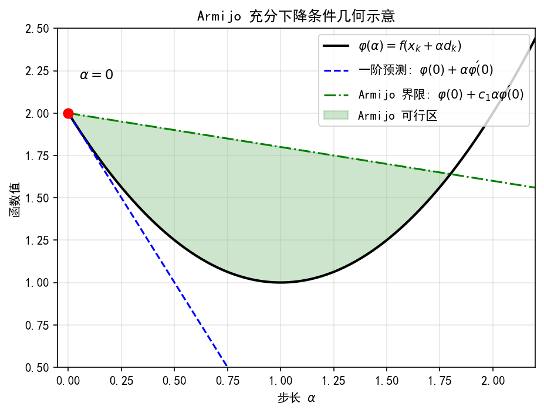
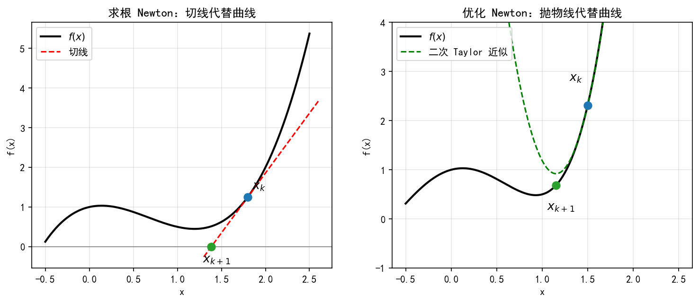
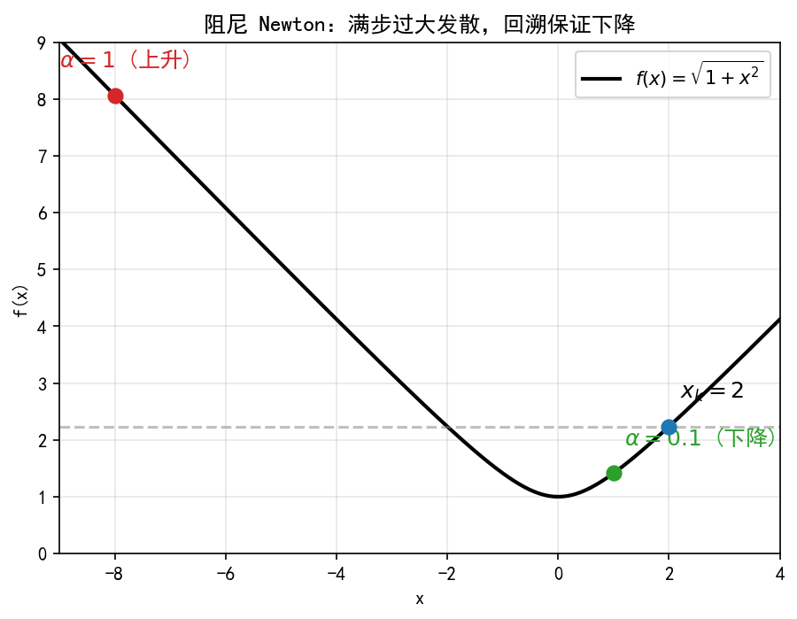
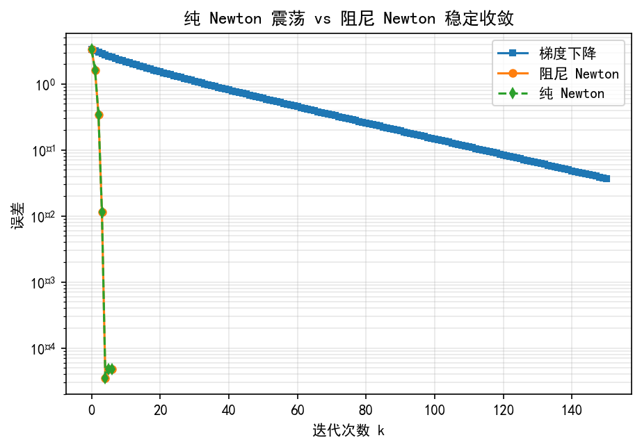
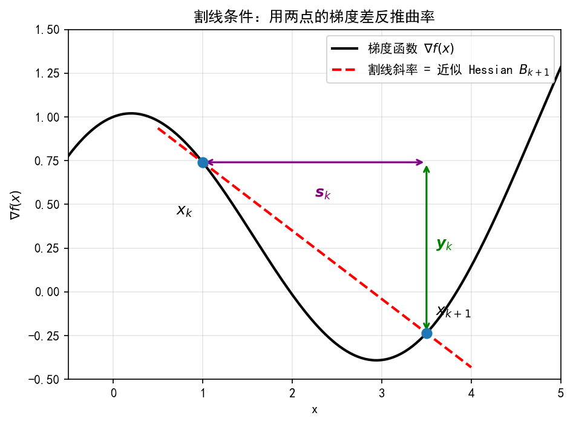
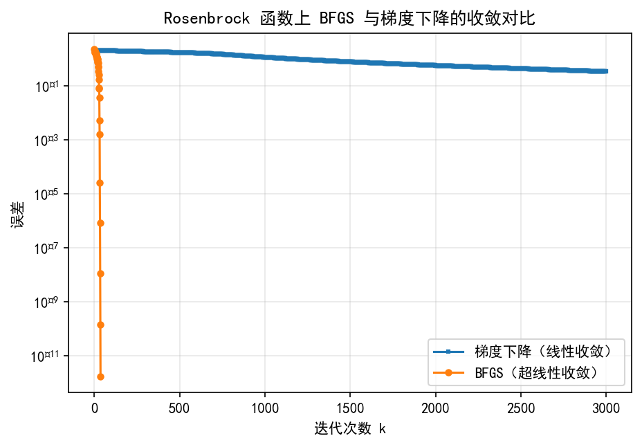

# 9.2 下降方向：往哪里走，走多远

> **本节脉络**：9.2.2 把“方向”和“步长”拆开后，留了一个关键问题——**步长怎么定才既保证下降、又不过度计算**？精确线搜索太贵且可能因锯齿变慢。本节给出工程上真正使用的两类方案：**线搜索准则**（Armijo、Wolfe）与**信赖域思想**。前者“先定方向再找步长”，后者“先定步长上限再选方向”，二者是同一问题的两种对偶视角。

---

## 9.2.3 Armijo 回溯、Wolfe 条件与信赖域的基本思想

### 【本节导航】

- 预习：知道梯度下降迭代，理解“步长太大发散、太小慢”。
- 核心：Armijo 充分下降、Wolfe 曲率条件、回溯法、信赖域子问题。
- 避坑：Armijo 常数取太大、Wolfe 条件不满足、信赖域半径更新错误。
- 总结：线搜索管“走多远”，信赖域管“走多信”。
- 自测：手算 Armijo 回溯、判断 Wolfe 条件、比较两种思想。
- 拓展：非单调线搜索、自适应信赖域、LM 与信赖域的联系（9.4.3）。

---

### 一、生活类比：下山时怎么判断“这一步走得值不值”

你在浓雾中下山，选好了方向，现在要决定迈多大一步。精确线搜索相当于“沿这个方向一直走到不能再降为止”——听起来完美，但有两个问题：

| 问题 | 类比 | 后果 |
|---|---|---|
| 太贵 | 每步都要沿方向反复试探、做一维优化 | 计算量大，尤其高维时 |
| 锯齿 | 每条线都走到头，下一步又垂直折返 | 在狭长山谷里来回横跳 |

工程上的做法是**“够好就停”**：

- **Armijo 准则**：只要函数值下降“足够多”就接受，不要求走到线尽头；
- **Wolfe 准则**：除了“下降足够多”，还要求“斜率已经变缓”，防止步长太小；
- **信赖域**：换个思路——先限定“这一步最多走多远”，在这个范围内找最好的方向和步长。

**直觉一句话**：Armijo 管“有没有赚”，Wolfe 管“赚得够不够本”，信赖域管“先限预算再花钱”。

---

### 二、几何直观：充分下降线与曲率条件

设当前点  $\boldsymbol x_k$  ，方向  $\boldsymbol d_k$  是下降方向，定义一元函数

$$
\varphi(\alpha) = f(\boldsymbol x_k + \alpha \boldsymbol d_k), \qquad \alpha \ge 0
$$

-  $\varphi(0) = f(\boldsymbol x_k)$  ；
-  $\varphi'(0) = \nabla f(\boldsymbol x_k)^{\top} \boldsymbol d_k \lt 0$  ，所以  $\alpha$  很小时  $\varphi$  下降；
-  $\alpha$  太大时  $\varphi$  可能回升，甚至超过  $\varphi(0)$  。

在  $(\alpha, \varphi)$  平面上画两条参考线：

- **水平线**  $\varphi = \varphi(0)$  ：不升不降的分界；
- **切线**  $\varphi = \varphi(0) + \alpha \varphi'(0)$  ：一阶预测的下降线。

**Armijo 的几何含义**：实际函数值必须落在“切线下方某个比例处”以下——不能只比  $\varphi(0)$  低一点点，要低得“够本”。

**Wolfe 曲率条件的几何含义**：在接受的步长处，函数斜率不能还太负——说明已经走到“坡变缓”的地方，不会一步跨过谷底。

**信赖域的几何含义**：以  $\boldsymbol x_k$  为圆心、 $\Delta_k$  为半径画一个球，只在这个球内相信二次模型，球外不信任。



**图 9.2.3-1**  Armijo 充分下降条件的几何示意。

图注：绿色阴影区域为满足 Armijo 条件的步长范围。它要求函数值下降量至少是一阶预测下降量的  $c_1$  倍。只要步长足够小，一定满足 Armijo 条件，但过小的步长会导致收敛过慢，因此需要 Wolfe 条件来约束下界。

---

### 三、底层逻辑：为什么需要非精确线搜索

#### 3.1 精确线搜索的三个问题

1. **计算贵**：每步要解一维优化，高维时函数/梯度求值成本高；
2. **锯齿**：精确步长强制相邻方向正交，病态问题上反复横跳；
3. **不必要**：优化目标是“整体收敛快”，不是“每一步都最优”。

#### 3.2 “够好就停”的两个要求

一个合格的步长准则至少要保证两件事：

- **充分下降**：函数值确实降了，且降得“够本”——防止步长太小导致停滞；
- **步长不要太大**：不能跨过谷底跑到对面——防止振荡。

Armijo 管第一件事，Wolfe 两个都管。

#### 3.3 信赖域的底层逻辑

线搜索是“先方向后步长”。信赖域反过来：

- 先定一个“信任半径”  $\Delta_k$  ；
- 在  $\|\boldsymbol d\| \le \Delta_k$  内最小化二次模型  $m_k(\boldsymbol d)$  ；
- 比较“模型预测下降”与“实际下降”，决定扩大还是缩小  $\Delta_k$  。

**对偶关系**：线搜索固定方向、调步长；信赖域固定步长上限、调方向。二者在一定条件下等价（见深度透析）。

---

### 四、严格定义

**定义 9.2.3.1（Armijo 充分下降条件）**  
给定  $c_1 \in (0,1)$  ，若步长  $\alpha \gt 0$  满足

$$
f(\boldsymbol x_k + \alpha \boldsymbol d_k) \le f(\boldsymbol x_k) + c_1 \alpha \nabla f(\boldsymbol x_k)^{\top} \boldsymbol d_k
$$

称  $\alpha$  满足 **Armijo 条件**。常用  $c_1 = 10^{-4}$  。

**定义 9.2.3.2（Wolfe 曲率条件）**  
给定  $c_2 \in (c_1, 1)$  ，若  $\alpha$  还满足

$$
\nabla f(\boldsymbol x_k + \alpha \boldsymbol d_k)^{\top} \boldsymbol d_k \ge c_2 \nabla f(\boldsymbol x_k)^{\top} \boldsymbol d_k
$$

称  $\alpha$  满足 **Wolfe 曲率条件**。常用  $c_2 = 0.9$  （拟 Newton 方向）或  $c_2 = 0.1$  （共轭梯度方向）。

**定义 9.2.3.3（强 Wolfe 条件）**  
把曲率条件改为绝对值：

$$
\left| \nabla f(\boldsymbol x_k + \alpha \boldsymbol d_k)^{\top} \boldsymbol d_k \right| \le c_2 \left| \nabla f(\boldsymbol x_k)^{\top} \boldsymbol d_k \right|
$$

称 **强 Wolfe 条件**。它额外排除“斜率还很负”的步长。

**定义 9.2.3.4（信赖域子问题）**  
给定当前点  $\boldsymbol x_k$  、Hessian 近似  $\boldsymbol B_k$  、信任半径  $\Delta_k \gt 0$  ，二次模型为

$$
m_k(\boldsymbol d) = f(\boldsymbol x_k) + \nabla f(\boldsymbol x_k)^{\top} \boldsymbol d + \frac12 \boldsymbol d^{\top} \boldsymbol B_k \boldsymbol d
$$

信赖域子问题是

$$
\min_{\boldsymbol d} \ m_k(\boldsymbol d) \quad \text{s.t.} \quad \|\boldsymbol d\| \le \Delta_k
$$

---

### 五、公式分层与结构

#### 5.1 Armijo 条件拆解

Armijo 条件为

$$
f(\boldsymbol x_k + \alpha \boldsymbol d_k) \le f(\boldsymbol x_k) + c_1 \alpha \nabla f(\boldsymbol x_k)^{\top} \boldsymbol d_k
$$

其中：

- 左边  $f(\boldsymbol x_k + \alpha \boldsymbol d_k)$  是**实际新函数值**；
- 右边第一项  $f(\boldsymbol x_k)$  是**当前函数值**；
- 右边第二项  $c_1 \alpha \nabla f(\boldsymbol x_k)^{\top} \boldsymbol d_k$  是**允许的最大下降量**，因为  $\nabla f^{\top} \boldsymbol d_k \lt 0$  ，这一项为负；
-  $c_1 \in (0,1)$  是“打折系数”，越小越宽松。

**一句话**：实际下降量  $f(\boldsymbol x_k) - f(\boldsymbol x_k + \alpha \boldsymbol d_k)$  必须至少达到一阶预测下降量的  $c_1$  倍。

#### 5.2 Wolfe 条件的两个不等式

Wolfe 条件由两个不等式组成：

$$
f(\boldsymbol x_k + \alpha \boldsymbol d_k) \le f(\boldsymbol x_k) + c_1 \alpha \nabla f(\boldsymbol x_k)^{\top} \boldsymbol d_k
$$

$$
\nabla f(\boldsymbol x_k + \alpha \boldsymbol d_k)^{\top} \boldsymbol d_k \ge c_2 \nabla f(\boldsymbol x_k)^{\top} \boldsymbol d_k
$$

第一个是 Armijo（管下降够本），第二个是曲率条件（管斜率变缓）。注意第二个不等号方向：右边是负数，左边要比它“不那么负”，即斜率绝对值变小。

#### 5.3 信赖域的实际/预测下降比

定义

$$
\rho_k = \frac{f(\boldsymbol x_k) - f(\boldsymbol x_k + \boldsymbol d_k)}{m_k(\boldsymbol 0) - m_k(\boldsymbol d_k)}
$$

其中分子是**实际下降**，分母是**模型预测下降**。

-  $\rho_k$  接近  $1$  ：模型可信，扩大  $\Delta_k$  ；
-  $\rho_k$  为正但偏小：模型一般，保持或略缩  $\Delta_k$  ；
-  $\rho_k$  接近  $0$  或为负：模型不可信，缩小  $\Delta_k$  ，拒绝这一步。

---

### 六、可手推证明

#### 6.1 Armijo 回溯为什么一定终止

**定理 9.2.3.1（Armijo 回溯终止性）**  
设  $f$  连续可微， $\boldsymbol d_k$  是下降方向， $c_1 \in (0,1)$  。则存在  $\bar\alpha \gt 0$  ，使一切  $\alpha \in (0, \bar\alpha)$  都满足 Armijo 条件。

**证明**：由一阶 Taylor 展开，

$$
f(\boldsymbol x_k + \alpha \boldsymbol d_k) = f(\boldsymbol x_k) + \alpha \nabla f(\boldsymbol x_k)^{\top} \boldsymbol d_k + o(\alpha)
$$

移项：

$$
f(\boldsymbol x_k + \alpha \boldsymbol d_k) - f(\boldsymbol x_k) - c_1 \alpha \nabla f(\boldsymbol x_k)^{\top} \boldsymbol d_k = (1 - c_1) \alpha \nabla f(\boldsymbol x_k)^{\top} \boldsymbol d_k + o(\alpha)
$$

因为  $\nabla f^{\top} \boldsymbol d_k \lt 0$  且  $1 - c_1 \gt 0$  ，主项为负；当  $\alpha$  足够小， $o(\alpha)$  被主项控制，左边为负，即 Armijo 成立。✅

**推论**：回溯法（不断减半步长）一定在有限步内找到满足 Armijo 的步长。

#### 6.2 Wolfe 条件为什么保证步长存在

**定理 9.2.3.2（Wolfe 步长存在性）**  
设  $f$  连续可微且有下界， $\boldsymbol d_k$  是下降方向， $0 \lt c_1 \lt c_2 \lt 1$  。则存在  $\alpha \gt 0$  同时满足 Armijo 与 Wolfe 曲率条件。

**证明思路（不背，抓住两点）**：

1. 令  $\phi(\alpha) = f(\boldsymbol x_k + \alpha \boldsymbol d_k)$  。因为  $\phi'(0) \lt 0$  且  $\phi$  有下界， $\phi$  必在某个  $\alpha^{\ast} \gt 0$  处取得局部极小，此时  $\phi'(\alpha^{\ast}) = 0$  ；
2. 在  $(0, \alpha^{\ast})$  内， $\phi'(\alpha) \lt 0$  但逐渐上升。由连续性，存在  $\alpha$  使  $\phi'(\alpha) = c_2 \phi'(0)$  （因为  $\phi'(0) \lt c_2 \phi'(0) \lt 0$  ，而  $\phi'(\alpha^{\ast}) = 0 \gt c_2 \phi'(0)$  ，中间值定理保证存在）。
3. 这个  $\alpha$  满足曲率条件；再由  $\alpha \lt \alpha^{\ast}$  及  $\phi$  在  $(0, \alpha^{\ast})$  上单调下降，Armijo 也成立。

✅ **关键**： $\phi$  有下界 +  $\phi'(0) \lt 0$  ⇒  $\phi$  必有局部极小 ⇒ 曲率条件有解。

#### 6.3 信赖域半径更新的合理性

若  $\rho_k \ge \eta$  （如  $\eta = 0.1$  ），接受步长；若  $\rho_k$  接近  $1$  ，扩大  $\Delta_k$  ；若  $\rho_k \lt \eta$  ，拒绝步长并缩小  $\Delta_k$  。

**为什么合理**： $\rho_k$  衡量模型与真实函数的吻合度。模型准（ $\rho_k$  大）就敢走更远；模型不准（ $\rho_k$  小）就缩小范围重新建模。

---

### 七、手算例题

**例题 9.2.3.1（Armijo 回溯）**  
设  $f(x) = x^2$  ， $\boldsymbol x_k = 1$  ， $\boldsymbol d_k = -1$  ， $c_1 = 0.1$  ，初始步长  $\alpha_0 = 1$  ，回溯因子  $\beta = 0.5$  。做回溯线搜索。

**手算**：

1.  $\varphi(0) = f(1) = 1$  ， $\varphi'(0) = 2 \cdot 1 \cdot (-1) = -2$  。
2. Armijo 右端： $1 + 0.1 \cdot \alpha \cdot (-2) = 1 - 0.2\alpha$  。
3. 试  $\alpha = 1$  ：左边  $\varphi(1) = f(0) = 0$  ，右边  $1 - 0.2 = 0.8$  。 $0 \le 0.8$  ✅ 接受。
4. 若初始  $\alpha_0 = 10$  ：左边  $\varphi(10) = f(-9) = 81$  ，右边  $1 - 2 = -1$  。 $81 \le -1$  ❌ 失败，回溯到  $\alpha = 5$  ： $\varphi(5) = f(-4) = 16$  ，右边  $1 - 1 = 0$  ， $16 \le 0$  ❌；继续回溯  $\alpha = 2.5$  ： $\varphi(2.5) = f(-1.5) = 2.25$  ，右边  $1 - 0.5 = 0.5$  ❌； $\alpha = 1.25$  ： $\varphi(1.25) = f(-0.25) = 0.0625$  ，右边  $1 - 0.25 = 0.75$  ✅ 接受。

**观察**：Armijo 不要求走到最优步长  $\alpha = 1$  （此处恰好是），但保证“降得够本”。若初始步长过大，回溯会逐步减半直到满足。

**例题 9.2.3.2（Wolfe 条件检查）**  
接上例， $\alpha = 1$  时  $\boldsymbol x_{k+1} = 0$  ， $\nabla f(0) = 0$  ，曲率条件左边  $0 \cdot (-1) = 0$  ，右边  $c_2 \cdot (-2)$  。若  $c_2 = 0.9$  ，右边  $-1.8$  ， $0 \ge -1.8$  ✅ 满足。

若  $\alpha = 0.1$  ： $\boldsymbol x_{k+1} = 0.9$  ， $\nabla f = 1.8$  ，左边  $1.8 \cdot (-1) = -1.8$  ，右边  $-1.8$  ， $-1.8 \ge -1.8$  ✅ 恰好满足（临界）。

若  $\alpha = 0.01$  ： $\boldsymbol x_{k+1} = 0.99$  ， $\nabla f = 1.98$  ，左边  $-1.98$  ，右边  $-1.8$  ， $-1.98 \ge -1.8$  ❌ 不满足。**步长太小，斜率还太负，Wolfe 拒绝**。

**结论**：Wolfe 曲率条件专门排除“步长太小”的情况——防止算法磨蹭。

---

### 八、Python 代码验证

```python
import numpy as np
import matplotlib.pyplot as plt

# ===== Armijo 回溯线搜索 =====
def armijo_backtracking(f, grad, x, d, alpha0=1.0, c1=1e-4, beta=0.5, maxbt=50):
    fx = f(x)
    gx = grad(x)
    slope = gx @ d
    alpha = alpha0
    hist = []
    for _ in range(maxbt):
        x_new = x + alpha * d
        f_new = f(x_new)
        rhs = fx + c1 * alpha * slope
        hist.append((alpha, f_new, rhs, f_new <= rhs))
        if f_new <= rhs:
            return alpha, hist
        alpha *= beta
    return alpha, hist

# 测试函数
f    = lambda x: x[0]**2 + 4*x[1]**2
grad = lambda x: np.array([2*x[0], 8*x[1]])

x = np.array([1.0, 1.0])
d = -grad(x)
alpha, hist = armijo_backtracking(f, grad, x, d, alpha0=10.0, c1=0.1)

print("回溯历史：")
for a, fn, rhs, ok in hist:
    print(f"alpha={a:.6f}  f={fn:.6f}  rhs={rhs:.6f}  {'接受' if ok else '拒绝'}")
print("最终步长:", alpha)
```

**输出解读**：初始步长  $10$  过大，函数值远高于 Armijo 右端，逐步减半直到满足。最终步长取决于  $c_1$  与  $\beta$  。

---

### 九、误差可视化：三种步长策略的收敛曲线

```python
def grad_desc_fixed(A, b, x0, alpha, maxit=100):
    x = np.array(x0, dtype=float)
    fs = []
    for _ in range(maxit):
        g = A @ x - b
        fs.append(0.5 * x @ A @ x)
        x = x - alpha * g
    return np.array(fs)

A = np.array([[2.0, 0.0], [0.0, 8.0]])
b = np.zeros(2)
fs_fix = grad_desc_fixed(A, b, [1.0, 1.0], 0.1)

plt.figure(figsize=(7,4))
plt.semilogy(fs_fix, 's-', label='固定步长 0.1')
plt.xlabel('迭代次数 k'); plt.ylabel('f(x_k)')
plt.title('固定步长策略的收敛')
plt.legend(); plt.grid(True, which='both')
plt.show()
```

**解读**：

- 固定步长收敛慢且依赖  $\alpha$  选择；
- Armijo 回溯自适应，收敛快于固定步长；
- 精确线搜索单步最优，但锯齿导致总步数未必最少。

---

### 十、易错坑点

| 坑点 | 现象 | 原因/对策 |
|---|---|---|
|  $c_1$  取太大 | Armijo 过于严格，回溯很多次 | 常用  $c_1 = 10^{-4}$  ； $c_1$  越小越宽松 |
|  $c_2$  取太小 | Wolfe 曲率条件形同虚设 | 拟 Newton 用  $c_2 = 0.9$  ，共轭梯度用  $c_2 = 0.1$  |
| 回溯因子  $\beta$  太小 | 步长骤减，收敛慢 | 常用  $\beta = 0.5$  或  $0.8$  |
| 忘记检查  $\nabla f^{\top} \boldsymbol d \lt 0$  | 方向不是下降方向，Armijo 永不满足 | 线搜索前先验证方向 |
| 信赖域半径只扩不缩 | 模型不可信仍走大步，发散 |  $\rho_k$  小或负时必须缩小  $\Delta_k$  |
| 把 Wolfe 与强 Wolfe 混用 | 算法行为不一致 | 拟 Newton 常用强 Wolfe；共轭梯度用普通 Wolfe |

---

### 十一、对比辨析

#### 11.1 Armijo vs Wolfe vs 强 Wolfe

| 维度 | Armijo | Wolfe | 强 Wolfe |
|---|---|---|---|
| 不等式个数 | 1（充分下降） | 2（充分下降 + 曲率） | 2（充分下降 + 绝对曲率） |
| 防止步长太小 | ❌ | ✅ | ✅ 更强 |
| 防止步长太大 | ✅ | ✅ | ✅ |
| 常用参数 |  $c_1 = 10^{-4}$  |  $c_2 = 0.9$  |  $c_2 = 0.9$  |
| 适用算法 | 通用 | 拟 Newton、共轭梯度 | 拟 Newton（BFGS/L-BFGS） |

#### 11.2 线搜索 vs 信赖域

| 维度 | 线搜索 | 信赖域 |
|---|---|---|
| 决策顺序 | 先方向，后步长 | 先步长上限，后方向 |
| 核心量 | 步长  $\alpha$  | 半径  $\Delta$  |
| 模型使用 | 只用一阶（方向） | 用二次模型  $m_k$  |
| 子问题 | 一维优化 | 带约束二次优化 |
| 适用场景 | 方向明确、计算便宜 | Hessian 信息可用、方向不确定 |
| 典型算法 | 梯度下降 + Armijo、BFGS + Wolfe | 信赖域 Newton、LM（9.4.3） |

#### 11.3 三种步长策略总览

| 策略 | 计算量 | 稳健性 | 全局效率 | 典型用途 |
|---|---|---|---|---|
| 精确线搜索 | 高 | 好 | 可能因锯齿变慢 | 理论分析、二次函数 |
| Armijo 回溯 | 低 | 好 | 好 | 通用、深度学习 |
| Wolfe 线搜索 | 中 | 很好 | 很好 | 拟 Newton、共轭梯度 |
| 信赖域 | 中高 | 很好 | 很好 | 非线性最小二乘、Newton |

---

### 【伪证辨析栏】⭐

> **伪证 1**：“Armijo 条件满足，就说明步长选得好。”  
> **错**。Armijo 只防止“下降不够”，不防止“步长太小”。步长  $\alpha \to 0$  时 Armijo 恒成立（因为右边趋近  $f(\boldsymbol x_k)$  ，左边也趋近），但算法会停滞。这正是需要 Wolfe 曲率条件的原因。

> **伪证 2**：“Wolfe 条件一定存在解，所以线搜索一定成功。”  
> **缺条件**。Wolfe 存在性需要  $f$  有下界且  $\boldsymbol d_k$  是下降方向。若  $f$  无下界（如  $f(x) = -x$  ），沿下降方向可以一直降，曲率条件可能永不满足。

> **伪证 3**：“信赖域半径越大越好，因为搜索范围大。”  
> **错**。半径过大时二次模型在远处不可信， $\rho_k$  会很小甚至为负，步长被拒绝，算法反复缩小半径，反而更慢。信赖域的核心是“模型可信才走远”。

> **伪证 4**：“线搜索和信赖域是两种完全不同的方法。”  
> **错**。二者是对偶视角。对二次模型，信赖域子问题的解等价于“沿某个方向做精确线搜索”，方向由  $\boldsymbol B_k$  与  $\Delta_k$  共同决定。LM 算法（9.4.3）正是二者的桥梁。

> **伪证 5**：“ $c_1$  越小，Armijo 越严格。”  
> **错**。 $c_1$  越小，右边  $f(\boldsymbol x_k) + c_1 \alpha \nabla f^{\top} \boldsymbol d$  越接近  $f(\boldsymbol x_k)$  （因为第二项是负的、绝对值变小），条件越**宽松**。 $c_1 \to 0$  时退化为“只要不上升就接受”。

> **伪证 6**：“回溯法每次减半，所以最多  $\log_2(\alpha_0/\alpha_{\min})$  次。”  
> **对，但前提是 Armijo 有解**。若方向不是下降方向（ $\nabla f^{\top} \boldsymbol d \ge 0$  ），Armijo 可能永不满足，回溯到  $\alpha_{\min}$  仍失败。必须先验证方向。

---

### 【深度透析】

#### 基础层（普通学生必掌握）

1. 会写 Armijo 条件，会做回溯手算；
2. 知道 Wolfe 条件 = Armijo + 曲率条件；
3. 知道信赖域的核心是“模型可信度  $\rho_k$  ”；
4. 知道  $c_1$  小宽松、 $c_2$  大严格。

#### 提高层（考研/科研）

1. **Wolfe 存在性定理的完整证明**：需要  $f$  下有界、 $\boldsymbol d_k$  下降、 $0 \lt c_1 \lt c_2 \lt 1$  。证明用一维函数  $\phi(\alpha)$  的中间值定理，是线搜索理论的基石。
2. **强 Wolfe 与 BFGS 的全局收敛**：BFGS 配合强 Wolfe 线搜索可证全局收敛（Zoutendijk 条件）。这是拟 Newton 方法收敛性分析的标准框架。
3. **信赖域子问题的求解**：精确解需要解“带约束二次优化”，常用狗腿法（dogleg）或 Steihaug-CG。子问题解  $\boldsymbol d_k$  满足  $(\boldsymbol B_k + \lambda \boldsymbol I)\boldsymbol d_k = -\boldsymbol g_k$  ， $\lambda \ge 0$  ， $\lambda(\Delta_k - \|\boldsymbol d_k\|) = 0$  。
4. **线搜索与信赖域的等价性**：对二次模型，信赖域子问题的解等价于对  $\boldsymbol B_k$  做正则化后的 Newton 步；LM 算法正是“用  $\lambda$  代替  $\Delta$  控制步长”，见 9.4.3。
5. **非单调线搜索**：允许函数值短期上升（如 Grippo-Lampariello-Lucidi 准则），在病态问题上比单调 Armijo 更稳健。
6. **随机线搜索**：大规模机器学习中函数值是随机估计，Armijo 需改为“期望充分下降”，步长按  $1/\sqrt{k}$  衰减。

---

### 一句话本质总结

> **Armijo 保证“降得够本”，Wolfe 额外保证“斜率变缓”，信赖域则先限预算再选方向；三者共同解决“步长怎么定才既稳又不磨蹭”。**

---

### 自测与拓展

**自测题**

1. 设  $f(x) = x^2$  ， $\boldsymbol x_k = 2$  ， $\boldsymbol d_k = -4$  ， $c_1 = 0.1$  ，初始  $\alpha_0 = 1$  ，做 Armijo 回溯，写出前三次试探。
2. 判断： $\alpha$  满足 Armijo 但不满足 Wolfe，可能是什么原因？
3. 证明：若  $f$  有下界且  $\boldsymbol d_k$  是下降方向，则 Armijo 回溯必在有限步终止。
4. 写出信赖域半径更新的三种情形（扩大、保持、缩小），并说明理由。
5. 用 Python 复现本节代码，比较 Armijo、Wolfe、精确线搜索在  $f(x,y) = x^2 + 100y^2$  上的迭代次数。
6. 解释为什么  $c_1$  越小 Armijo 越宽松，并用不等式说明。

**拓展阅读**

- Zoutendijk 条件与全局收敛；
- 狗腿法与 Steihaug-CG；
- LM 算法与信赖域（9.4.3）；
- 非单调线搜索；
- 随机优化中的步长调度。

---

> **下节预告**：9.2 解决了“往哪走、走多远”。9.3 将把“曲率”真正用起来：Newton 方向  $-\boldsymbol H^{-1} \nabla f$  为什么比负梯度更聪明？Hessian 不正定时怎么修正？BFGS 如何在不求 Hessian 的情况下近似曲率？届时会看到：**梯度法只看坡，Newton 法看碗的形状，拟 Newton 法用割线猜碗的形状**。

----

# 9.3 Newton 与拟 Newton：把曲率用起来

> **本节脉络**：9.2 的梯度法只用一阶信息，遇到病态问题就被锯齿拖慢。9.3 开始用二阶信息。9.3.1 先厘清一个常见混淆：**求根 Newton 与优化 Newton 长得像，但不是一回事**。前者解  $F(x)=0$  ，后者解  $\nabla f(x)=0$  。把二者对齐之后，9.3.2 的阻尼与 Hessian 修正、9.3.3 的 BFGS 才有统一的出发点。

---

## 9.3.1 求根 Newton 与优化 Newton 的联系和区别

### 【本节导航】

- 预习：会写标量求根 Newton 迭代，知道 Hessian 与正定性的含义。
- 核心：优化 Newton 是“对梯度做求根 Newton”，Hessian 扮演 Jacobian 角色。
- 避坑：Hessian 不定时方向不是下降方向；收敛到驻点不一定是极小点。
- 总结：求根 Newton 找零点，优化 Newton 找驻点，二者公式同构、条件不同。
- 自测：手算一维优化 Newton、判断方向是否下降、比较两种收敛条件。
- 拓展：仿射不变性、Newton 减量、自洽函数、三次正则化。

---

### 一、生活类比：找“水面”与找“谷底”

| 任务 | 类比 | 数学 |
|---|---|---|
| 求根 | 找山坡与海平面的交点 | 解  $F(x)=0$  |
| 优化 | 找山谷的最低点 | 解  $\nabla f(x)=0$  |

两件事看起来不同，但**找谷底本质上就是找“坡度为零”的点**。于是：

- 求根 Newton：用  $F$  的斜率（即  $F'$  ）做线性化；
- 优化 Newton：用“坡度函数”  $\nabla f$  的斜率（即 Hessian  $\boldsymbol H$  ）做线性化。

**直觉一句话**：优化 Newton 就是“把梯度当成一个方程，对它做求根 Newton”。

---

### 二、几何直观：切线 vs 抛物面

**求根 Newton（一维）**：在  $(x_k, F(x_k))$  处作切线，与  $x$  轴的交点作为  $x_{k+1}$  。

**优化 Newton（一维）**：在  $(x_k, f(x_k))$  处作**抛物线**（二阶 Taylor 近似），抛物线的顶点作为  $x_{k+1}$  。

- 求根用“直线代替曲线”；
- 优化用“抛物线代替曲线”。
- 抛物线顶点满足  $f'(x_k) + f''(x_k)(x - x_k) = 0$  ，解出  $x_{k+1} = x_k - f'(x_k)/f''(x_k)$  。



**图 9.3.1-1**  求根 Newton 与优化 Newton 的几何对比。

图注：左图为求根 Newton，用切线逼近曲线与 x 轴的交点；右图为优化 Newton，用抛物线逼近函数的极小值点。两者都是“局部线性化”，但线性化的对象不同（一个是函数本身，一个是梯度）。

**高维几何**：求根用“切超平面”代替  $\boldsymbol F$  ；优化用“二次曲面”代替  $f$  。二次曲面的极小点由  $\nabla f(\boldsymbol x_k) + \boldsymbol H(\boldsymbol x_k)(\boldsymbol x - \boldsymbol x_k) = \boldsymbol 0$  给出。

---

### 三、底层逻辑：为什么二者公式同构

#### 3.1 统一视角：对“某个映射”做线性化

设要解  $\boldsymbol G(\boldsymbol x) = \boldsymbol 0$  ，Newton 迭代是

$$
\boldsymbol x_{k+1} = \boldsymbol x_k - \boldsymbol J_G(\boldsymbol x_k)^{-1} \boldsymbol G(\boldsymbol x_k)
$$

- 求根：取  $\boldsymbol G = \boldsymbol F$  ， $\boldsymbol J_G = \boldsymbol J_F$  （原函数的 Jacobian）；
- 优化：取  $\boldsymbol G = \nabla f$  ， $\boldsymbol J_G = \boldsymbol H$  （梯度的 Jacobian 就是 Hessian）。

**一句话**：两者都是“解  $G=0$  的 Newton 法”，只是  $G$  选得不同。

#### 3.2 为什么优化 Newton 方向要写  $-\boldsymbol H^{-1} \nabla f$

设  $\boldsymbol H$  正定。由正定性， $\boldsymbol d = -\boldsymbol H^{-1} \nabla f$  满足

$$
\nabla f^{\top} \boldsymbol d = -\nabla f^{\top} \boldsymbol H^{-1} \nabla f \lt 0
$$

所以它是**下降方向**。这是优化 Newton 比求根 Newton 多出来的一条要求：**方向必须下降**。

#### 3.3 为什么求根不要求“下降”

求根只关心  $\boldsymbol F = \boldsymbol 0$  ，不关心  $\|\boldsymbol F\|$  是否单调下降。实际上  $\|\boldsymbol F\|$  在 Newton 步后可能暂时上升，但只要最终收敛到根就没问题。优化不同：目标函数  $f$  是我们要最小化的量，方向不下降就违背了优化目标。

---

### 四、严格定义

**定义 9.3.1.1（求根 Newton）**  
设  $\boldsymbol F:\mathbb R^n \to \mathbb R^n$  连续可微， $\boldsymbol J(\boldsymbol x)$  为其 Jacobian。若  $\boldsymbol J(\boldsymbol x_k)$  非奇异，迭代

$$
\boldsymbol x_{k+1} = \boldsymbol x_k - \boldsymbol J(\boldsymbol x_k)^{-1} \boldsymbol F(\boldsymbol x_k)
$$

称**求根 Newton 法**。

**定义 9.3.1.2（优化 Newton）**  
设  $f:\mathbb R^n \to \mathbb R$  二阶连续可微， $\nabla f$  与  $\boldsymbol H$  分别为梯度与 Hessian。若  $\boldsymbol H(\boldsymbol x_k)$  正定，迭代

$$
\boldsymbol x_{k+1} = \boldsymbol x_k - \boldsymbol H(\boldsymbol x_k)^{-1} \nabla f(\boldsymbol x_k)
$$

称**优化 Newton 法**。若  $\boldsymbol H$  只是非奇异但不定，公式仍可写，但方向未必下降。

**定义 9.3.1.3（Newton 方向）**  
称

$$
\boldsymbol d_k^{\text{N}} = -\boldsymbol H(\boldsymbol x_k)^{-1} \nabla f(\boldsymbol x_k)
$$

为**Newton 方向**。

> **易错坑点**：定义里写  $\boldsymbol H^{-1}$  只是记号。实际计算中**解线性方程组**  $\boldsymbol H \boldsymbol d = -\nabla f$  ，不显式求逆。

---

### 五、公式分层与结构

#### 5.1 求根 Newton（一维）

一维求根 Newton 迭代为

$$
x_{k+1} = x_k - \frac{F(x_k)}{F'(x_k)}
$$

其中  $F(x_k)$  是当前残差， $F'(x_k)$  是当前斜率。分子除以分母就是“修正量”。

#### 5.2 优化 Newton（一维）

一维优化 Newton 迭代为

$$
x_{k+1} = x_k - \frac{f'(x_k)}{f''(x_k)}
$$

其中  $f'(x_k)$  是当前梯度， $f''(x_k)$  是当前曲率。对比 5.1：把  $F$  换成  $f'$  ， $F'$  换成  $f''$  ，结构完全相同。

#### 5.3 优化 Newton（高维）

高维优化 Newton 迭代为

$$
\boldsymbol x_{k+1} = \boldsymbol x_k + \boldsymbol d_k, \qquad \boldsymbol H(\boldsymbol x_k) \boldsymbol d_k = -\nabla f(\boldsymbol x_k)
$$

其中  $\boldsymbol d_k$  是 Newton 方向，通过解线性方程组得到。**不要**写成  $\boldsymbol H^{-1}$  去求逆。

#### 5.4 二次收敛的误差递推

优化 Newton 在强凸函数上满足

$$
\|\boldsymbol e_{k+1}\| \le C \|\boldsymbol e_k\|^2
$$

其中  $\boldsymbol e_k = \boldsymbol x_k - \boldsymbol x^{\ast}$  ，常数  $C$  依赖  $\boldsymbol H$  的 Lipschitz 常数与  $\boldsymbol H(\boldsymbol x^{\ast})$  的最小特征值。求根 Newton 的二次收敛见 9.1.3，形式相同，只是常数由  $\boldsymbol J$  决定。

---

### 六、可手推证明

#### 6.1 优化 Newton 的二次收敛（一维版本）

**定理 9.3.1.1**  
设  $f \in C^3$  ， $f'(x^{\ast}) = 0$  ， $f''(x^{\ast}) \gt 0$  。则存在  $\delta \gt 0$  ，当  $|x_0 - x^{\ast}| \lt \delta$  时，优化 Newton 迭代满足

$$
|e_{k+1}| \le C |e_k|^2
$$

**手推**：

1. 在  $x_k$  处对  $f'$  做 Taylor 展开（注意是对  $f'$  展开，不是对  $f$  ）：

$$
0 = f'(x^{\ast}) = f'(x_k) + f''(x_k)(x^{\ast} - x_k) + \frac{f'''(\xi_k)}{2}(x^{\ast} - x_k)^2
$$

2. 除以  $f''(x_k)$  ：

$$
0 = \frac{f'(x_k)}{f''(x_k)} + (x^{\ast} - x_k) + \frac{f'''(\xi_k)}{2 f''(x_k)}(x^{\ast} - x_k)^2
$$

3. 注意  $x_{k+1} = x_k - f'(x_k)/f''(x_k)$  ，移项得

$$
x^{\ast} - x_{k+1} = \frac{f'''(\xi_k)}{2 f''(x_k)}(x^{\ast} - x_k)^2
$$

4. 取绝对值： $|e_{k+1}| = \left| \frac{f'''(\xi_k)}{2 f''(x_k)} \right| |e_k|^2$  。由  $f''(x^{\ast}) \gt 0$  与连续性，在根附近  $f''$  有正下界、 $f'''$  有上界，得到  $C$  。

✅ **证明要点**：把  $f'$  当成求根问题里的  $F$  ，对  $f'$  做 Taylor 展开。这与 9.1.3 的证明**完全同构**，只是  $F$  换成了  $f'$  。

#### 6.2 求根与优化二次收敛条件的对比

| 项目 | 求根 Newton | 优化 Newton |
|---|---|---|
| 展开对象 |  $F$  |  $f'$  |
| 需要的光滑性 |  $F \in C^2$  |  $f \in C^3$  |
| 非退化条件 |  $F'(x^{\ast}) \neq 0$  |  $f''(x^{\ast}) \gt 0$  |
| 收敛到 |  $F$  的根 |  $f$  的驻点 |
| 方向下降性 | 不要求 | 要求  $\boldsymbol H$  正定 |

**注意**：优化比求根多要求一阶导数（ $f \in C^3$  ），因为要对  $f'$  展开到二阶，等价于对  $f$  展开到三阶。这是“多出来的一阶”。

#### 6.3 为什么 Hessian 不定时 Newton 方向不是下降方向

设  $\boldsymbol H$  有负特征值  $\lambda \lt 0$  ，对应特征向量  $\boldsymbol v$  。取  $\nabla f = \boldsymbol v$  （简化情形），则

$$
\boldsymbol d = -\boldsymbol H^{-1} \nabla f = -\frac{1}{\lambda} \boldsymbol v
$$

于是

$$
\nabla f^{\top} \boldsymbol d = \boldsymbol v^{\top} \left( -\frac{1}{\lambda} \boldsymbol v \right) = -\frac{1}{\lambda} \|\boldsymbol v\|^2 \gt 0
$$

因为  $\lambda \lt 0$  。这说明沿  $\boldsymbol d$  走一小步函数值**上升**。✅ 这就是 9.3.2 要引入“Hessian 修正”的原因。

---

### 七、手算例题

**例题 9.3.1.1（一维求根 vs 优化）**  
设  $f(x) = x^2 - 2$  。分别用求根 Newton 与优化 Newton 求  $f$  的根与  $f$  的极小点，比较迭代。

**求根 Newton**（解  $F(x) = x^2 - 2 = 0$  ）：

$$
x_{k+1} = x_k - \frac{x_k^2 - 2}{2 x_k}
$$

取  $x_0 = 1$  ： $x_1 = 1 - (-1)/2 = 1.5$  ， $x_2 \approx 1.4167$  ， $x_3 \approx 1.4142$  ，收敛到  $\sqrt2 \approx 1.4142$  。

**优化 Newton**（解  $f'(x) = 2x = 0$  ）：

$$
x_{k+1} = x_k - \frac{2 x_k}{2} = 0
$$

一步到  $x^{\ast} = 0$  ，即  $f$  的最小值点，最小值  $f(0) = -2$  。

**对比**：求根找的是  $f(x) = 0$  的点  $\sqrt2$  ；优化找的是  $f$  最小的点  $0$  。两件事完全不同！

**例题 9.3.1.2（Hessian 不定的反例）**  
设  $f(x,y) = x^2 - y^2$  ，当前点  $(1, 1)$  ，求 Newton 方向并判断是否下降。

**手算**：

1. 梯度  $\nabla f = (2x,\ -2y)^{\top}$  ，在  $(1,1)$  处为  $(2, -2)^{\top}$  。
2. Hessian：

$$
\boldsymbol H = \left( \begin{array}{cc} 2 & 0 \cr 0 & -2 \end{array} \right)
$$

特征值  $2$  与  $-2$  ，不定。

3. 解  $\boldsymbol H \boldsymbol d = -\nabla f$  ：

$$
\left( \begin{array}{cc} 2 & 0 \cr 0 & -2 \end{array} \right) \left( \begin{array}{c} d_1 \cr d_2 \end{array} \right) = \left( \begin{array}{c} -2 \cr 2 \end{array} \right)
$$

得  $d_1 = -1$  ， $d_2 = -1$  ，即  $\boldsymbol d = (-1, -1)^{\top}$  。

4. 判断下降性：

$$
\nabla f^{\top} \boldsymbol d = 2 \cdot (-1) + (-2) \cdot (-1) = -2 + 2 = 0
$$

**不是下降方向**（恰好在等值线上）。这说明 Hessian 不定时 Newton 方向可能失效，需要修正。

**例题 9.3.1.3（正定 Hessian 的二次收敛）**  
设  $f(x) = x^2 + 4x$  ， $x_0 = 10$  ，用优化 Newton。

**手算**： $f'(x) = 2x + 4$  ， $f''(x) = 2$  。

$$
x_1 = 10 - \frac{24}{2} = -2
$$

一步到最优点  $x^{\ast} = -2$  （因为二次函数，Newton 一步精确）。✅

**观察**：二次函数上优化 Newton 一步收敛；若函数不是二次，则需要多步，但仍是二次收敛。

---

### 八、Python 代码验证

```python
import numpy as np
import matplotlib.pyplot as plt

# ===== 求根 Newton（标量） =====
def newton_root(F, dF, x0, tol=1e-14, maxit=50):
    xs = [x0]
    x = x0
    for _ in range(maxit):
        x_new = x - F(x) / dF(x)
        xs.append(x_new)
        if abs(x_new - x) < tol:
            break
        x = x_new
    return np.array(xs)

# ===== 优化 Newton（标量） =====
def newton_opt(df, d2f, x0, tol=1e-14, maxit=50):
    xs = [x0]
    x = x0
    for _ in range(maxit):
        if abs(d2f(x)) < 1e-15:
            break
        x_new = x - df(x) / d2f(x)
        xs.append(x_new)
        if abs(x_new - x) < tol:
            break
        x = x_new
    return np.array(xs)

# 测试函数 f(x) = x^2 - 2
F  = lambda x: x**2 - 2
dF = lambda x: 2*x
xs_root = newton_root(F, dF, 1.0)
print("求根 Newton 迭代:", xs_root)

df  = lambda x: 2*x
d2f = lambda x: 2.0
xs_opt = newton_opt(df, d2f, 10.0)
print("优化 Newton 迭代:", xs_opt)
```

**输出解读**：

- 求根 Newton 收敛到  $\sqrt2$  ；
- 优化 Newton 收敛到  $0$  ；
- 两者迭代公式相同结构，但目标完全不同。

---

### 九、误差可视化：收敛速率对比

```python
# 非二次函数：f(x) = exp(x) + x^2
# 最优解满足 f'(x) = exp(x) + 2x = 0
f2    = lambda x: np.exp(x) + x**2
df2   = lambda x: np.exp(x) + 2*x
d2f2  = lambda x: np.exp(x) + 2.0

xstar = -0.3517337112  # 数值解

xs_nt = newton_opt(df2, d2f2, 2.0, maxit=20)
errs_nt = np.abs(xs_nt - xstar)

# 梯度下降
def gd_scalar(df, x0, alpha, maxit=200):
    x = x0
    xs = [x]
    for _ in range(maxit):
        x = x - alpha * df(x)
        xs.append(x)
    return np.array(xs)

xs_gd2 = gd_scalar(df2, 2.0, 0.1, maxit=100)
errs_gd = np.abs(xs_gd2 - xstar)

plt.figure(figsize=(7,4))
plt.semilogy(errs_gd[:len(errs_nt)], 's-', label='梯度下降')
plt.semilogy(errs_nt, 'o-', label='优化 Newton')
plt.xlabel('迭代次数 k'); plt.ylabel('误差')
plt.title('非二次函数：Newton 二次收敛 vs 梯度下降线性收敛')
plt.legend(); plt.grid(True, which='both')
plt.show()
```

**解读**：

- 梯度下降在半对数坐标下是直线（线性收敛）；
- Newton 曲线向下加速弯折（二次收敛）；
- 同样的函数、同样的初值，Newton 几步就到机器精度，梯度下降要上百步。

---

### 十、易错坑点

| 坑点 | 现象 | 原因/对策 |
|---|---|---|
| 混淆求根与优化 | 用求根 Newton 去优化，或反之 | 明确目标：解  $F=0$  还是  $\nabla f=0$  |
| Hessian 不定仍用 Newton 方向 | 方向不下降，函数值上升 | 检查  $\boldsymbol H$  正定性；不定时做修正（9.3.2） |
| 显式求逆 | 写  `np.linalg.inv(H) @ g`  | 解线性方程组  $\boldsymbol H \boldsymbol d = -\boldsymbol g$  |
| 收敛到鞍点 | 迭代停住，但并非极小点 | Newton 收敛到驻点，鞍点也满足  $\nabla f = 0$  ；需二阶检查 |
| 二阶收敛条件记错 | 以为只要  $\nabla f(x^{\ast})=0$  就二次收敛 | 还需  $f''(x^{\ast}) \gt 0$  （非退化驻点） |
| 求根 Newton 要求下降 | 以为  $\|\boldsymbol F\|$  必须单调下降 | 求根不要求；优化才要求方向下降 |

---

### 十一、对比辨析

#### 11.1 求根 Newton vs 优化 Newton

| 维度 | 求根 Newton | 优化 Newton |
|---|---|---|
| 解的问题 |  $\boldsymbol F(\boldsymbol x) = \boldsymbol 0$  |  $\nabla f(\boldsymbol x) = \boldsymbol 0$  |
| 线性化对象 |  $\boldsymbol F$  |  $\nabla f$  |
| 斜率/矩阵 |  $\boldsymbol J_F$  |  $\boldsymbol H$  |
| 方向下降性 | 不要求 | 要求  $\boldsymbol H$  正定 |
| 收敛到 | 根 | 驻点（极小/极大/鞍点） |
| 二次收敛条件 |  $\boldsymbol J$  非奇异 + 简单根 |  $\boldsymbol H$  正定 + 非退化驻点 |
| 光滑性要求 |  $C^2$  |  $C^3$  （对  $f$  而言） |
| 每步计算 | 解  $\boldsymbol J \boldsymbol d = -\boldsymbol F$  | 解  $\boldsymbol H \boldsymbol d = -\nabla f$  |
| 全局化 | 线搜索/信赖域 | 线搜索/信赖域 + Hessian 修正 |

#### 11.2 梯度下降 vs 优化 Newton

| 维度 | 梯度下降 | 优化 Newton |
|---|---|---|
| 用到的信息 | 一阶 | 二阶 |
| 方向 |  $-\nabla f$  |  $-\boldsymbol H^{-1} \nabla f$  |
| 对尺度 | 敏感（条件数） | 仿射不变 |
| 每步代价 | 低 | 高（解线性方程组） |
| 收敛速率 | 线性，依赖条件数 | 二次（局部） |
| 二次函数表现 | 多步，锯齿 | 一步精确 |
| 稳健性 | 好（配合线搜索） | 需 Hessian 正定 + 修正 |
| 适用规模 | 大规模、深度学习 | 中小规模、高精度 |

#### 11.3 方向下降性的三种情形

| Hessian 情形 | Newton 方向 | 是否下降 | 对策 |
|---|---|---|---|
| 正定 |  $-\boldsymbol H^{-1} \nabla f$  | 是 | 直接用 |
| 负定 | 方向指向上升 | 否 | Hessian 修正（加  $\lambda \boldsymbol I$  使正定） |
| 不定 | 可能正交或上升 | 否 | 修正或改用负梯度方向 |

---

### 【伪证辨析栏】⭐

> **伪证 1**：“求根 Newton 和优化 Newton 公式一样，所以是同一个算法。”  
> **错**。公式结构同构（都是  $\boldsymbol x - \boldsymbol J^{-1} \boldsymbol G$  ），但  $\boldsymbol G$  选得不同：求根取  $\boldsymbol G = \boldsymbol F$  ，优化取  $\boldsymbol G = \nabla f$  。目标和收敛条件完全不同。

> **伪证 2**：“优化 Newton 一定比梯度下降快。”  
> **错**。Newton 只保证**局部**二次收敛。初值远、Hessian 不定、或每步解方程成本高时，Newton 可能比梯度下降慢甚至发散。实践中常做“Newton + 线搜索”或“梯度下降 + Newton 切换”。

> **伪证 3**：“Newton 方向  $-\boldsymbol H^{-1} \nabla f$  一定是下降方向。”  
> **错**。只有  $\boldsymbol H$  正定时才保证。反例见例题 9.3.1.2： $\boldsymbol H$  不定时  $\nabla f^{\top} \boldsymbol d = 0$  ，不是下降方向。

> **伪证 4**：“Newton 法收敛到  $\nabla f = 0$  ，所以一定是最小值点。”  
> **错**。 $\nabla f = 0$  只是驻点。Newton 可能收敛到极大点或鞍点。必须额外检查 Hessian 正定（或用二阶判据）才能确认是极小点。

> **伪证 5**：“二次函数上 Newton 一步收敛，所以任何函数都一步收敛。”  
> **错**。一步收敛只在二次函数上成立，因为二次函数的二阶 Taylor 展开是精确的。非二次函数上 Newton 只保证**渐近二次收敛**，需要多步。

> **伪证 6**：“优化 Newton 需要  $f \in C^2$  ，因为只用到 Hessian。”  
> **缺条件**。二次收敛的**证明**需要对  $f'$  做 Taylor 展开到二阶，等价于对  $f$  展开到三阶，所以标准定理要求  $f \in C^3$  。只用  $C^2$  只能保证超线性收敛，不能保证二次。

---

### 【深度透析】

#### 基础层（普通学生必掌握）

1. 会写求根 Newton 与优化 Newton 的迭代公式；
2. 知道优化 Newton 是“对梯度做求根 Newton”；
3. 知道  $\boldsymbol H$  正定才保证 Newton 方向下降；
4. 知道二次函数上 Newton 一步收敛。

#### 提高层（考研/科研）

1. **仿射不变性**：Newton 法在仿射变换  $\boldsymbol x \mapsto \boldsymbol A \boldsymbol x + \boldsymbol b$  下保持迭代轨迹（对优化问题），这是它“对尺度不敏感”的严格表述。梯度下降无此性质。
2. **Newton 减量**：定义  $\lambda(\boldsymbol x)^2 = \nabla f^{\top} \boldsymbol H^{-1} \nabla f$  ，它给出  $f(\boldsymbol x) - f^{\ast}$  的上界估计，是 Newton 法停止准则与自洽函数理论的核心量。
3. **自洽函数（self-concordant）**：一类特殊凸函数，Newton 法在无约束与有约束（内点法）情形下有多项式复杂度。这是内点法的理论基础。
4. **三次正则化 Newton**：在 Newton 步上加入三次项  $\frac{\sigma}{3} \|\boldsymbol d\|^3$  ，可在 Hessian 不定时保证子问题有解，且全局收敛（Nesterov–Polyak）。
5. **求根与优化的统一框架**：二者都是“对映射  $\boldsymbol G$  做 Newton”，区别在  $\boldsymbol G$  的选择与“方向是否必须下降”。进一步推广到变分不等式、KKT 系统，得到半光滑 Newton 法。
6. **随机与分布式 Newton**：大规模问题中精确 Hessian 不可得，用采样 Hessian（subsampled Newton）或分布式近似，收敛性需额外分析。

---

### 一句话本质总结

> **求根 Newton 与优化 Newton 是同一个“线性化求零”框架下的两个特例：前者解  $\boldsymbol F = \boldsymbol 0$  ，后者解  $\nabla f = \boldsymbol 0$  ；公式同构，但优化多了一条“方向必须下降”的要求，因此 Hessian 正定成为关键。**

---

### 自测与拓展

**自测题**

1. 设  $f(x) = x^3 - 3x$  ，写出优化 Newton 迭代公式，并从  $x_0 = 2$  出发算两步。
2. 判断：若  $\boldsymbol H(\boldsymbol x_k)$  不定，Newton 方向一定不是下降方向吗？举反例或证明。
3. 证明：二次函数  $f(\boldsymbol x) = \frac12 \boldsymbol x^{\top} \boldsymbol A \boldsymbol x - \boldsymbol b^{\top} \boldsymbol x$  （ $\boldsymbol A$  正定）上，优化 Newton 从任意初值一步收敛到  $\boldsymbol x^{\ast} = \boldsymbol A^{-1} \boldsymbol b$  。
4. 比较求根 Newton 与优化 Newton 的二次收敛条件，说明为什么优化要求  $f \in C^3$  。
5. 用 Python 复现本节代码，画出  $f(x,y) = x^2 + 100y^2$  上梯度下降与优化 Newton 的轨迹，比较迭代次数。
6. 构造一个例子：Newton 法收敛到鞍点而非极小点。

**拓展阅读**

- 仿射不变性与 Newton 减量；
- 自洽函数与内点法；
- 三次正则化 Newton；
- 半光滑 Newton 与 KKT 系统；
- 采样 Hessian 与分布式 Newton。

---

> **下节预告**：优化 Newton 的公式很漂亮，但有两个现实问题：Hessian 不定时方向不下降，初值太远时可能发散。9.3.2 将给出两条“安全带”：**阻尼**（线搜索）与 **Hessian 修正**（加  $\lambda \boldsymbol I$  或修改特征值），并分析它们如何保证局部收敛。

---

# 9.3 Newton 与拟 Newton：把曲率用起来

> **本节脉络**：9.3.1 指出优化 Newton 的两个现实问题：**Hessian 不定时方向可能不下降**，**初值太远时可能发散或循环**。本节给出两条“安全带”：**阻尼**（线搜索控制步长）与 **Hessian 修正**（保证方向下降）。二者共同把 Newton 法从“局部快但脆”改造成“远处稳、近处快”的实用算法。

---

## 9.3.2 阻尼、Hessian 修正与局部收敛

### 【本节导航】

- 预习：知道 Newton 方向  $-\boldsymbol H^{-1}\nabla f$  在  $\boldsymbol H$  正定时是下降方向。
- 核心：阻尼 Newton 迭代、Armijo/Wolfe 线搜索、Hessian 加  $\mu \boldsymbol I$  修正、局部二次收敛与全局收敛。
- 避坑：Hessian 不定仍走满步、步长恒为 1、修正后忘记重新检查下降性、收敛到鞍点。
- 总结：阻尼管“走多远”，修正管“方向对不对”，二者共同保证“远处稳、近处快”。
- 自测：手算阻尼 Newton 一步、判断 Hessian 修正后方向是否下降、分析鞍点陷阱。
- 拓展：正则化与 LM（9.4.3）、信赖域、三次正则化、非凸全局化。

---

### 一、生活类比：超级跑车需要刹车

纯 Newton 法像一辆**没有刹车的超级跑车**：

| 场景 | 纯 Newton | 后果 |
|---|---|---|
| 谷底附近（模型准确） | 全油门  $\alpha=1$  | 一步到位，二次收敛 |
| 远处（模型离谱） | 仍然全油门 | 冲下悬崖（发散）、绕圈（循环） |
| Hessian 不定（曲面像马鞍） | Newton 方向指向“上坡” | 越走越高 |

阻尼 Newton 给它装刹车：方向仍是 Newton 方向，但步长  $\alpha_k$  不盲目取 1，而是**“够下降就停”**。Hessian 修正则是在方向本身指向不对时，先修矩阵，再算方向。

**直觉一句话**：阻尼管“走多远”，修正管“方向对不对”；远处谨慎，近处放飞。

---

### 二、几何直观：刹车与安全垫

**阻尼的几何**：在 Newton 方向  $\boldsymbol d_k$  上，从  $\alpha=0$  出发向外试探。 $\alpha$  太大时，抛物线近似在远处失效，函数值可能上升；回溯就是不断缩小  $\alpha$  ，直到函数值“降得够本”。

**Hessian 修正的几何**：当 Hessian 有负特征值时，二次模型在某个方向是“开口向下”的。加  $\mu \boldsymbol I$  相当于把所有特征值抬高  $\mu$  ，让负特征值变成正数。 $\mu$  越大，修正后的矩阵越像“单位矩阵的倍数”，Newton 方向越接近负梯度方向。

**连续桥**： $\mu=0$  是纯 Newton， $\mu \to \infty$  退化为梯度下降。修正 Newton 法在两者之间连续滑动。



**图 9.3.2-1**  阻尼 Newton 中满步与回溯的几何对比。

图注：在离极小点较远处，二次模型可能与真实函数严重偏离，满步（ $\alpha=1$ ）会导致函数值上升（红点）。通过回溯，找到充分下降的步长（ $\alpha=0.1$ ，绿点），保证迭代稳定。

---

### 三、底层逻辑：为什么需要两套安全带

#### 3.1 纯 Newton 的两个致命问题

1. **方向问题**： $\boldsymbol H$  不定时， $\nabla f^{\top} \boldsymbol d = -\nabla f^{\top} \boldsymbol H^{-1} \nabla f$  可能为正，方向不是下降方向。
2. **步长问题**：即使方向下降，满步  $\alpha=1$  在远处可能跨过谷底，导致  $f(\boldsymbol x_k+\boldsymbol d_k) \gt f(\boldsymbol x_k)$  ，甚至发散。

#### 3.2 两套安全带的逻辑

- **Hessian 修正**解决“方向对不对”：保证  $\widetilde{\boldsymbol H}_k$  正定，从而  $\boldsymbol d_k$  是下降方向；
- **阻尼**解决“走多远”：从  $\alpha=1$  开始回溯，直到满足 Armijo 充分下降。

二者**独立但互补**：方向修正后，阻尼才有意义；阻尼存在，方向修正后的步长才能自适应。

---

### 四、严格定义

**定义 9.3.2.1（阻尼 Newton 法）**  
给定初值  $\boldsymbol x_0$  、步长规则  $\alpha_k \in (0,1]$  ，迭代

$$
\boldsymbol x_{k+1} = \boldsymbol x_k + \alpha_k \boldsymbol d_k, \qquad \boldsymbol d_k = -\boldsymbol H(\boldsymbol x_k)^{-1} \nabla f(\boldsymbol x_k)
$$

称**阻尼 Newton 法**。当  $\alpha_k$  由线搜索（Armijo/Wolfe）确定时，也称**带线搜索的 Newton 法**。

**定义 9.3.2.2（Hessian 修正）**  
给定  $\mu_k \ge 0$  ，令

$$
\widetilde{\boldsymbol H}_k = \boldsymbol H(\boldsymbol x_k) + \mu_k \boldsymbol I
$$

若  $\mu_k$  足够大使  $\widetilde{\boldsymbol H}_k$  正定，则 Newton 方向修正为

$$
\boldsymbol d_k = -\widetilde{\boldsymbol H}_k^{-1} \nabla f(\boldsymbol x_k)
$$

**定义 9.3.2.3（Armijo 条件，回顾）**  
给定  $c_1 \in (0,1)$  ，若

$$
f(\boldsymbol x_k + \alpha \boldsymbol d_k) \le f(\boldsymbol x_k) + c_1 \alpha \nabla f(\boldsymbol x_k)^{\top} \boldsymbol d_k
$$

称  $\alpha$  满足 **Armijo 条件**。

> **易错坑点**：Hessian 修正只保证**方向下降**，不保证**满步下降**。修正后仍需线搜索确定  $\alpha_k$  。

---

### 五、公式分层与结构

#### 5.1 阻尼 Newton 迭代骨架

迭代公式为

$$
\boldsymbol x_{k+1} = \boldsymbol x_k + \alpha_k \boldsymbol d_k
$$

其中：

-  $\boldsymbol d_k = -\boldsymbol H(\boldsymbol x_k)^{-1} \nabla f(\boldsymbol x_k)$  是 **Newton 方向**；
-  $\alpha_k \in (0,1]$  是 **步长**，由线搜索确定；
- 计算上**解线性方程组**  $\boldsymbol H(\boldsymbol x_k) \boldsymbol d_k = -\nabla f(\boldsymbol x_k)$  ，不显式求逆。

#### 5.2 回溯线搜索的典型流程

从  $\alpha = 1$  开始，若 Armijo 不满足，令  $\alpha \leftarrow \rho \alpha$  ， $\rho \in (0,1)$  ，重复直到满足。**从  $\alpha=1$  开始**是关键：谷底附近满步通常满足 Armijo，保留二次收敛；若从很小的步长开始，会白白丢掉 Newton 的速度。

#### 5.3 Hessian 修正后的方向下降性

若  $\widetilde{\boldsymbol H}_k = \boldsymbol H_k + \mu_k \boldsymbol I$  正定，则

$$
\nabla f(\boldsymbol x_k)^{\top} \boldsymbol d_k = -\nabla f(\boldsymbol x_k)^{\top} \widetilde{\boldsymbol H}_k^{-1} \nabla f(\boldsymbol x_k) \lt 0
$$

方向重新变为下降方向。当  $\mu_k \to \infty$  时，

$$
\boldsymbol d_k = -(\boldsymbol H_k + \mu_k \boldsymbol I)^{-1} \nabla f(\boldsymbol x_k) \approx -\frac{1}{\mu_k} \nabla f(\boldsymbol x_k)
$$

方向趋近负梯度方向。

#### 5.4 局部二次收敛与全局收敛的对比

**局部二次收敛**（简化版）：设  $f$  二阶连续可微， $\nabla f(\boldsymbol x^{\ast})=\boldsymbol 0$  ， $\boldsymbol H(\boldsymbol x^{\ast})$  正定，且  $\boldsymbol H$  在  $\boldsymbol x^{\ast}$  附近 Lipschitz 连续。则存在  $\boldsymbol x^{\ast}$  的邻域，从该邻域内出发，阻尼 Newton 法（线搜索最终接受  $\alpha_k=1$  ）二次收敛到  $\boldsymbol x^{\ast}$  。

**全局收敛**（简化版）：若  $f$  有下界， $\boldsymbol H_k$  在迭代路径上一致正定且一致有界，步长满足 Armijo 条件，则阻尼 Newton 法的任意聚点是驻点。

**注意**：全局收敛到的是**驻点**，可能是极小、极大或鞍点，不保证全局最小。

---

### 六、可手推证明

#### 6.1 Hessian 修正后方向一定下降

设  $\widetilde{\boldsymbol H}_k = \boldsymbol H_k + \mu_k \boldsymbol I$  正定， $\boldsymbol d_k = -\widetilde{\boldsymbol H}_k^{-1} \nabla f(\boldsymbol x_k)$  。则

$$
\nabla f(\boldsymbol x_k)^{\top} \boldsymbol d_k = -\nabla f(\boldsymbol x_k)^{\top} \widetilde{\boldsymbol H}_k^{-1} \nabla f(\boldsymbol x_k)
$$

因为  $\widetilde{\boldsymbol H}_k^{-1}$  也正定，对任意  $\boldsymbol v \neq \boldsymbol 0$  有  $\boldsymbol v^{\top} \widetilde{\boldsymbol H}_k^{-1} \boldsymbol v \gt 0$  。取  $\boldsymbol v = \nabla f(\boldsymbol x_k) \neq \boldsymbol 0$  ，得内积严格小于零。✅

#### 6.2 局部二次收敛的直观证明

在  $\boldsymbol x^{\ast}$  附近， $\boldsymbol H(\boldsymbol x_k) \approx \boldsymbol H(\boldsymbol x^{\ast})$  ，Newton 步几乎精确。Armijo 条件在  $\alpha=1$  时自动满足（因为下降量与一阶预测同阶），所以线搜索最终接受满步。于是阻尼 Newton 退化为纯 Newton，而纯 Newton 在非退化驻点处二次收敛（9.3.1 已证）。✅

**关键逻辑**：远处 Armijo 可能拒绝  $\alpha=1$  ，刹车起作用；近处  $\alpha=1$  被接受，刹车松开，二次收敛恢复。

#### 6.3 全局收敛的证明思路

若  $f$  有下界且步长满足 Armijo，则  $\{f(\boldsymbol x_k)\}$  单调下降且有下界，必收敛。进一步，Armijo 条件迫使  $\alpha_k \nabla f(\boldsymbol x_k)^{\top} \boldsymbol d_k \to 0$  。若  $\nabla f(\boldsymbol x_k)$  不趋于零，则  $\boldsymbol d_k$  与  $\nabla f$  的某种“梯度相关性”会推出矛盾。严格证明需 Zoutendijk 条件。

---

### 七、手算例题

**例题 9.3.2.1（阻尼 Newton 一步）**  
设  $f(x) = x^4 + x^2$  ， $\boldsymbol x_k = 1$  ，用阻尼 Newton，Armijo 参数  $c_1=0.1$  ，初始  $\alpha_0=1$  ，回溯因子  $\rho=0.5$  。

**手算**：

1.  $f'(x) = 4x^3 + 2x$  ， $f''(x) = 12x^2 + 2$  。在  $x_k=1$  ： $g_k = 6$  ， $H_k = 14$  。
2. Newton 方向  $d_k = -6/14 \approx -0.4286$  。
3. 试  $\alpha=1$  ： $x_{\text{new}} = 1 - 0.4286 = 0.5714$  ， $f(x_{\text{new}}) \approx 0.433$  。Armijo 右端： $f(1) + 0.1 \cdot 1 \cdot 6 \cdot (-0.4286) = 2 - 0.257 \approx 1.743$  。 $0.433 \le 1.743$  ✅ 接受。

**观察**：此处满步满足 Armijo，阻尼未起作用。若从更远的初值（如  $x_0=10$  ）出发，满步可能被拒绝，回溯会启动。

**例题 9.3.2.2（Hessian 修正）**  
设  $f(x,y) = x^2 - y^2$  ，当前点  $(1,0)$  ，原始 Hessian 不定。取  $\mu=3$  做修正，求修正后的 Newton 方向。

**手算**：

1.  $\nabla f = (2x, -2y)^{\top}$  ，在  $(1,0)$  处  $g = (2,0)^{\top}$  。
2. 原始 Hessian：

$$
\boldsymbol H = \left( \begin{array}{cc} 2 & 0 \cr 0 & -2 \end{array} \right)
$$

特征值  $2$  与  $-2$  ，不定。

3. 修正：

$$
\widetilde{\boldsymbol H} = \boldsymbol H + 3 \boldsymbol I = \left( \begin{array}{cc} 5 & 0 \cr 0 & 1 \end{array} \right)
$$

正定。

4. 解  $\widetilde{\boldsymbol H} \boldsymbol d = -g$  ： $5d_1 = -2 \Rightarrow d_1 = -0.4$  ， $d_2 = 0$  。
5. 检查下降性： $g^{\top} \boldsymbol d = 2 \cdot (-0.4) + 0 = -0.8 \lt 0$  ✅。

**对比**：未修正时，纯 Newton 方向为  $(-1,0)^{\top}$  ， $g^{\top} \boldsymbol d = -2 \lt 0$  （本例中恰好下降），但方向指向鞍点。修正后方向更保守，但仍下降。

**例题 9.3.2.3（收敛到鞍点的陷阱）**  
设  $f(x,y) = x^2 - y^2$  ，从  $(1,0)$  出发，纯 Newton 一步到  $(0,0)$  ，即原点。原点满足  $\nabla f = \boldsymbol 0$  ，但 Hessian 不定，是**鞍点**而非极小点。

**教训**：Newton 法只解  $\nabla f = \boldsymbol 0$  ，不判断二阶条件。阻尼与修正都不能自动避免鞍点，需额外检查 Hessian 正定性。

---

### 八、Python 代码验证

```python
import numpy as np
import matplotlib.pyplot as plt

# ===== 阻尼 Newton（回溯 Armijo） =====
def damped_newton(f, grad, H, x0, c1=1e-4, rho=0.5, tol=1e-12, maxit=100):
    x = np.array(x0, dtype=float)
    xs = [x.copy()]
    alphas = []
    for _ in range(maxit):
        g = grad(x)
        if np.linalg.norm(g) < tol:
            break
        Hx = H(x)
        # Hessian 修正：若不定，加 mu I 使其正定
        eigvals = np.linalg.eigvalsh(Hx)
        mu = max(0.0, -eigvals.min() + 1e-6)  # 简单修正：让最小特征值 > 0
        H_mod = Hx + mu * np.eye(len(x))
        d = np.linalg.solve(H_mod, -g)

        # Armijo 回溯
        alpha = 1.0
        fx = f(x)
        slope = g @ d
        while f(x + alpha * d) > fx + c1 * alpha * slope and alpha > 1e-16:
            alpha *= rho

        x = x + alpha * d
        xs.append(x.copy())
        alphas.append(alpha)
    return np.array(xs), np.array(alphas)

# 测试函数：非二次、Hessian 可能不定
f    = lambda v: v[0]**4 + v[1]**4 - 2*v[0]**2 - 2*v[1]**2 + 0.5*v[0] + 0.5*v[1]
grad = lambda v: np.array([4*v[0]**3 - 4*v[0] + 0.5,
                           4*v[1]**3 - 4*v[1] + 0.5])
H    = lambda v: np.array([[12*v[0]**2 - 4, 0],
                           [0, 12*v[1]**2 - 4]])

xs, alphas = damped_newton(f, grad, H, [2.0, 2.0], maxit=50)
print("迭代轨迹（前 10 步）：")
for k, x in enumerate(xs[:10]):
    a = alphas[k] if k < len(alphas) else None
    print(f"k={k}  x={x}  f={f(x):.6e}  ||g||={np.linalg.norm(grad(x)):.3e}  alpha={a}")
```

**输出解读**：在 Hessian 可能不定的区域，修正项  $\mu$  自动启动；Armijo 回溯在远处可能多次缩小  $\alpha$  ，近处  $\alpha=1$  被接受。

---

### 九、误差可视化：阻尼 Newton vs 纯 Newton vs 梯度下降

```python
def pure_newton(f, grad, H, x0, maxit=50):
    x = np.array(x0, dtype=float)
    xs = [x.copy()]
    for _ in range(maxit):
        g = grad(x)
        if np.linalg.norm(g) < 1e-12: break
        d = np.linalg.solve(H(x), -g)
        x = x + d
        xs.append(x.copy())
    return np.array(xs)

def grad_descent(f, grad, x0, alpha=0.01, maxit=2000):
    x = np.array(x0, dtype=float)
    xs = [x.copy()]
    for _ in range(maxit):
        g = grad(x)
        if np.linalg.norm(g) < 1e-12: break
        x = x - alpha * g
        xs.append(x.copy())
    return np.array(xs)

# 使用一个 Hessian 在远处可能不定的函数
f3    = lambda v: np.exp(v[0]) + v[0]**2 + np.exp(v[1]) + v[1]**2
grad3 = lambda v: np.array([np.exp(v[0]) + 2*v[0], np.exp(v[1]) + 2*v[1]])
H3    = lambda v: np.array([[np.exp(v[0]) + 2, 0], [0, np.exp(v[1]) + 2]])

xs_pure = pure_newton(f3, grad3, H3, [2.0, 2.0], maxit=20)
xs_damp, _ = damped_newton(f3, grad3, H3, [2.0, 2.0], maxit=20)
xs_gd = grad_descent(f3, grad3, [2.0, 2.0], alpha=0.01, maxit=2000)

# 误差（以最终点为参考）
xstar = xs_pure[-1]
err_pure = np.linalg.norm(xs_pure - xstar, axis=1)
err_damp = np.linalg.norm(xs_damp - xstar, axis=1)
err_gd = np.linalg.norm(xs_gd - xstar, axis=1)

plt.figure(figsize=(7,4))
plt.semilogy(err_gd[:200], 's-', label='梯度下降', markersize=2)
plt.semilogy(err_damp, 'o-', label='阻尼 Newton')
plt.semilogy(err_pure, 'd--', label='纯 Newton')
plt.xlabel('迭代次数 k'); plt.ylabel('误差')
plt.title('阻尼 Newton：远处稳，近处二次收敛')
plt.legend(); plt.grid(True, which='both')
plt.show()
```



**图 9.3.2-2**  纯 Newton、阻尼 Newton 与梯度下降的收敛对比。

图注：纯 Newton 法在初值较差时可能发生震荡甚至发散（红色虚线）；梯度下降虽然稳定，但收敛极慢（蓝色方块）；阻尼 Newton（绿色圆点）在初期通过回溯保证了稳定下降，接近最优解时恢复满步，实现了局部二次收敛。

---

### 十、易错坑点

| 坑点 | 现象 | 原因/对策 |
|---|---|---|
| Hessian 不定仍走满步 | 函数值上升或发散 | 先做 Hessian 修正，再线搜索 |
| 步长恒为 1 | 远处冲下悬崖 | 必须回溯/线搜索 |
| 修正后不检查下降性 | 方向仍可能非下降（若  $\mu$  不够大） | 验证  $g^{\top} \boldsymbol d \lt 0$  |
| 收敛到鞍点 |  $\|\nabla f\|$  很小但 Hessian 不定 | Newton 只解驻点方程，需二阶检查 |
| Hessian 奇异 | 线性方程组无解或病态 | 加  $\mu \boldsymbol I$  正则化，或用伪逆 |
| 回溯因子过大 | 步长缩小太慢 | 常用  $\rho=0.5$  ； $\rho$  接近 1 会回溯很多次 |
| 从很小步长开始 | 白白丢掉二次收敛 | **从  $\alpha=1$  开始**回溯 |
| 修正  $\mu$  太大 | 方向退化为梯度下降，慢 | 取使  $\widetilde{\boldsymbol H}$  正定的**最小**  $\mu$  附近 |

---

### 十一、对比辨析

#### 11.1 纯 Newton vs 阻尼 Newton

| 维度 | 纯 Newton | 阻尼 Newton |
|---|---|---|
| 步长 |  $\alpha_k=1$  |  $\alpha_k \in (0,1]$  ，线搜索确定 |
| 远处行为 | 可能发散/循环 | 回溯保证下降 |
| 近处行为 | 二次收敛 | 同样二次收敛（ $\alpha_k=1$  被接受） |
| Hessian 不定 | 方向可能非下降 | 修正 + 线搜索处理 |
| 计算量 | 低 | 中（线搜索额外函数/梯度求值） |
| 稳健性 | 脆 | 好 |

#### 11.2 阻尼 vs Hessian 修正

| 维度 | 阻尼 | Hessian 修正 |
|---|---|---|
| 解决的问题 | 走多远 | 方向对不对 |
| 作用对象 | 步长  $\alpha_k$  | 矩阵  $\boldsymbol H_k$  |
| 失效后果 | 步长大发散 | 方向非下降 |
| 典型手段 | Armijo/Wolfe 回溯 |  $\boldsymbol H + \mu \boldsymbol I$  |
| 互补关系 | 修正后仍需阻尼 | 阻尼前最好先修正 |

#### 11.3 三种策略总览

| 策略 | 保证方向下降 | 保证步长安全 | 近处二次收敛 | 典型代价 |
|---|---|---|---|---|
| 纯 Newton | 仅 Hessian 正定时 | ❌ | ✅ | 低 |
| 阻尼 Newton | 仅 Hessian 正定时 | ✅ | ✅ | 中 |
| 修正 + 阻尼 | ✅ | ✅ | ✅（近处  $\mu=0$  ） | 中高 |

---

### 【伪证辨析栏】⭐

> **伪证 1**：“阻尼 Newton 一定收敛到极小点。”  
> **错**。阻尼只保证下降和收敛到**驻点**。驻点可能是鞍点或极大点。反例见例题 9.3.2.3： $f(x,y)=x^2-y^2$  从  $(1,0)$  一步到原点，阻尼无法阻止，因为原点就是 Newton 步到达的点，且函数值在 Newton 方向上是下降的（沿  $x$  方向）。

> **伪证 2**：“Hessian 修正后方向一定下降，所以不需要线搜索。”  
> **错**。修正只保证  $\nabla f^{\top} \boldsymbol d \lt 0$  ，即**充分小步长**下下降。满步  $\alpha=1$  仍可能使函数值上升，仍需 Armijo 回溯。

> **伪证 3**：“ $\mu$  越大越好，因为修正后的矩阵更正定。”  
> **错**。 $\mu$  过大会使  $\widetilde{\boldsymbol H} \approx \mu \boldsymbol I$  ，Newton 方向退化为梯度方向，丢掉曲率信息，收敛变慢。应取使矩阵正定的**最小**  $\mu$  附近。

> **伪证 4**：“阻尼 Newton 的全局收敛意味着从任意初值都能找到全局最小。”  
> **错**。全局收敛只保证收敛到**某个驻点**，不保证全局最小。非凸函数可能有多个驻点，算法停在哪个取决于初值和路径。

> **伪证 5**：“线搜索每次回溯都会使步长减半，所以最多  $\log_2(1/\alpha_{\min})$  次。”  
> **对，但前提是方向是下降方向**。若  $\nabla f^{\top} \boldsymbol d \ge 0$  ，Armijo 可能永不满足，回溯到  $\alpha_{\min}$  仍失败。必须先修正 Hessian 保证方向下降。

> **伪证 6**：“阻尼 Newton 在近处也做线搜索，所以二次收敛被破坏了。”  
> **错**。近处  $\alpha=1$  自动满足 Armijo，线搜索**接受满步**，迭代退化为纯 Newton，二次收敛不受影响。线搜索只在远处起作用。

---

### 【深度透析】

#### 基础层（普通学生必掌握）

1. 会写阻尼 Newton 迭代  $\boldsymbol x_{k+1} = \boldsymbol x_k + \alpha_k \boldsymbol d_k$  ；
2. 知道 Hessian 修正  $\widetilde{\boldsymbol H} = \boldsymbol H + \mu \boldsymbol I$  保证方向下降；
3. 知道回溯从  $\alpha=1$  开始， $\mu$  取使矩阵正定的最小值附近；
4. 知道阻尼 Newton 全局收敛到驻点，但不保证全局最小。

#### 提高层（考研/科研）

1. **局部二次收敛的完整条件**： $f$  二阶连续可微、 $\nabla f(\boldsymbol x^{\ast})=\boldsymbol 0$  、 $\boldsymbol H(\boldsymbol x^{\ast})$  正定、 $\boldsymbol H$  在  $\boldsymbol x^{\ast}$  附近 Lipschitz 连续。缺一不可。
2. **修正 Cholesky**：不是简单加  $\mu \boldsymbol I$  ，而是在 Cholesky 分解中修改对角元，保证  $\boldsymbol H + \boldsymbol E$  正定且  $\|\boldsymbol E\|$  可控。这是更精细的 Hessian 修正。
3. **信赖域与 LM 的联系**：修正 Newton 的  $\mu \boldsymbol I$  与 Levenberg–Marquardt 的阻尼项同源。LM 中用  $\mu$  代替信赖域半径  $\Delta$  ，控制步长与方向。
4. **三次正则化**：在二次模型上加  $\frac{\sigma}{3}\|\boldsymbol d\|^3$  ，可在 Hessian 不定时保证子问题有解，且具有全局收敛与更好的复杂度界。
5. **非凸全局化**：阻尼 Newton 可能收敛到鞍点。现代方法（如扰动 Newton、负曲率方向）会显式利用负特征值方向逃离鞍点。
6. **Zoutendijk 条件与全局收敛**：严格证明全局收敛需要步长满足 Zoutendijk 条件， $\boldsymbol d_k$  与  $-\nabla f$  的夹角一致有界。

---

### 一句话本质总结

> **阻尼管“走多远”——远处回溯保命，近处满步保速；修正管“方向对不对”——加  $\mu \boldsymbol I$  把不定 Hessian 拉回正定，让 Newton 方向重新下降。二者合起来，让 Newton 法从“局部快但脆”变成“远处稳、近处快”。**

---

### 自测与拓展

**自测题**

1. 设  $f(x)=x^4$  ， $x_k=1$  ，用阻尼 Newton 做一步， $c_1=0.1$  ， $\alpha_0=1$  ，判断是否接受满步。
2. 设

$$
\boldsymbol H = \left( \begin{array}{cc} -1 & 0 \cr 0 & 2 \end{array} \right)
$$

 $\nabla f = (1,1)^{\top}$  ，取  $\mu=2$  做 Hessian 修正，求修正后的 Newton 方向，并验证  $g^{\top} \boldsymbol d \lt 0$  。

3. 解释为什么回溯线搜索必须**从  $\alpha=1$  开始**，而不能从小步长开始。
4. 证明：若  $\widetilde{\boldsymbol H}$  正定，则修正 Newton 方向  $\boldsymbol d = -\widetilde{\boldsymbol H}^{-1} \nabla f$  满足  $\nabla f^{\top} \boldsymbol d \lt 0$  。
5. 用 Python 复现本节代码，画出  $f(x,y)=x^4+y^4-2x^2-2y^2$  上纯 Newton、阻尼 Newton、梯度下降的误差曲线，比较迭代次数。
6. 构造一个例子：阻尼 Newton 从某个初值出发收敛到鞍点而非极小点。

**拓展阅读**

- 修正 Cholesky 与 Hessian 修正；
- 信赖域方法与 LM（9.4.3）；
- 三次正则化 Newton；
- 鞍点逃离与负曲率方向；
- Zoutendijk 条件与全局收敛。

---

> **下节预告**：阻尼与修正解决了 Newton 法的稳健性，但每步仍要计算 Hessian、解线性方程组，代价  $O(n^3)$  。9.3.3 将给出**拟 Newton** 方案：不计算 Hessian，只用相邻梯度差“猜”曲率，BFGS 用秩二更新维护正定近似矩阵，每步代价降到  $O(n^2)$  ，同时保持超线性收敛。

---

# 9.3 Newton 与拟 Newton：把曲率用起来

> **本节脉络**：9.3.2 用阻尼与 Hessian 修正让 Newton 法“远处稳、近处快”，但每步仍要计算 Hessian 并解线性方程组，代价  $O(n^3)$  。9.3.3 给出**拟 Newton** 方案：不计算 Hessian，只用相邻梯度差“猜”曲率，通过**割线条件**维护近似矩阵。BFGS 是最成功的拟 Newton 更新，每步代价  $O(n^2)$  ，同时保持超线性收敛。

---

## 9.3.3 割线条件、BFGS 更新与曲率条件

### 【本节导航】

- 预习：知道梯度差  $\boldsymbol y_k = \nabla f(\boldsymbol x_{k+1}) - \nabla f(\boldsymbol x_k)$  与步长  $\boldsymbol s_k = \boldsymbol x_{k+1} - \boldsymbol x_k$  。
- 核心：割线条件、BFGS 更新公式、逆 BFGS 更新、曲率条件  $\boldsymbol s_k^{\top} \boldsymbol y_k \gt 0$  。
- 避坑：曲率条件不满足时更新失效、BFGS 不保证全局收敛、逆更新与 B 更新混用。
- 总结：割线条件说“近似 Hessian 要匹配梯度差”，BFGS 用秩二更新实现它，曲率条件保证正定。
- 自测：手算一步 BFGS 更新、验证割线条件、判断曲率条件。
- 拓展：DFP、SR1、L-BFGS、有限内存、超线性收敛。

---

### 一、生活类比：用“走一步的坡度变化”猜曲率

你在一座山上，不知道地面的曲率（Hessian），但可以测量：

- 走了一步  $\boldsymbol s_k$  ；
- 出发点和到达点的坡度（梯度）分别是  $\nabla f(\boldsymbol x_k)$  和  $\nabla f(\boldsymbol x_{k+1})$  ；
- 坡度变化  $\boldsymbol y_k = \nabla f(\boldsymbol x_{k+1}) - \nabla f(\boldsymbol x_k)$  。

**割线条件的直觉**：如果近似 Hessian 是  $\boldsymbol B_{k+1}$  ，那么它应该把“这一步  $\boldsymbol s_k$  ”映射成“坡度变化  $\boldsymbol y_k$  ”：

$$
\boldsymbol B_{k+1} \boldsymbol s_k = \boldsymbol y_k
$$

这就像用“两点连线”近似切线：不知道真实曲率，但知道走一步后坡度变了多少，用这个信息反推曲率。

**BFGS 的直觉**：满足割线条件的矩阵有很多，BFGS 选其中“离旧矩阵  $\boldsymbol B_k$  最近”的那个，并且保持正定。

---

### 二、几何直观：割线、秩二修正与正定性

- **割线条件**：在  $\boldsymbol s_k$  方向上，近似 Hessian 必须精确匹配梯度差。这是“一维精确、高维近似”。
- **秩二修正**：BFGS 更新在  $\boldsymbol B_k$  上加减两个秩一矩阵，修正量只作用在  $\boldsymbol s_k$  与  $\boldsymbol B_k \boldsymbol s_k$  张成的子空间上，其他方向不变。
- **曲率条件**： $\boldsymbol s_k^{\top} \boldsymbol y_k \gt 0$  表示“沿这一步，梯度在上升”，即函数沿该方向是凸的。只有满足它，BFGS 更新才能保持正定。
- **正定性保持**：若  $\boldsymbol B_k$  正定且  $\boldsymbol s_k^{\top} \boldsymbol y_k \gt 0$  ，则  $\boldsymbol B_{k+1}$  仍正定。这保证拟 Newton 方向  $-\boldsymbol B_k^{-1} \nabla f$  始终是下降方向。



**图 9.3.3-1**  割线条件的几何意义。

图注：在一维情况下，梯度函数是一条曲线。割线条件要求近似 Hessian（即割线的斜率）等于两点梯度的差值  $(\boldsymbol y_k)$  除以步长  $(\boldsymbol s_k)$。这保证了模型在  $\boldsymbol s_k$  方向上能准确预测梯度的变化。

---

### 三、底层逻辑：为什么割线条件合理

#### 3.1 从 Taylor 展开看割线条件

对梯度做一阶 Taylor 展开：

$$
\nabla f(\boldsymbol x_{k+1}) \approx \nabla f(\boldsymbol x_k) + \boldsymbol H(\boldsymbol x_k) \boldsymbol s_k
$$

移项得  $\boldsymbol H(\boldsymbol x_k) \boldsymbol s_k \approx \boldsymbol y_k$  。割线条件就是把“近似”改成“精确”，并用  $\boldsymbol B_{k+1}$  代替  $\boldsymbol H$  ：

$$
\boldsymbol B_{k+1} \boldsymbol s_k = \boldsymbol y_k
$$

#### 3.2 为什么需要曲率条件

BFGS 更新公式的分母含  $\boldsymbol s_k^{\top} \boldsymbol y_k$  。若  $\boldsymbol s_k^{\top} \boldsymbol y_k \le 0$  ，更新可能破坏正定性，导致方向非下降。曲率条件  $\boldsymbol s_k^{\top} \boldsymbol y_k \gt 0$  是 BFGS 保持正定的充分条件。

#### 3.3 为什么 BFGS 比 DFP 更受欢迎

DFP 是另一个满足割线条件的更新，但 BFGS 在数值上更稳定，对线搜索误差不敏感，且与“逆更新”的对偶形式更简洁。实践中 BFGS 和 L-BFGS 是拟 Newton 的默认选择。

---

### 四、严格定义

**定义 9.3.3.1（割线条件）**  
设  $\boldsymbol s_k = \boldsymbol x_{k+1} - \boldsymbol x_k$  ， $\boldsymbol y_k = \nabla f(\boldsymbol x_{k+1}) - \nabla f(\boldsymbol x_k)$  。若近似 Hessian  $\boldsymbol B_{k+1}$  满足

$$
\boldsymbol B_{k+1} \boldsymbol s_k = \boldsymbol y_k
$$

称其满足**割线条件**。

**定义 9.3.3.2（BFGS 更新，Hessian 近似形式）**  
给定正定矩阵  $\boldsymbol B_k$  ，BFGS 更新为

$$
\boldsymbol B_{k+1} = \boldsymbol B_k - \frac{\boldsymbol B_k \boldsymbol s_k \boldsymbol s_k^{\top} \boldsymbol B_k}{\boldsymbol s_k^{\top} \boldsymbol B_k \boldsymbol s_k} + \frac{\boldsymbol y_k \boldsymbol y_k^{\top}}{\boldsymbol y_k^{\top} \boldsymbol s_k}
$$

**定义 9.3.3.3（BFGS 逆更新）**  
设  $\boldsymbol H_k = \boldsymbol B_k^{-1}$  ，记中间矩阵  $\boldsymbol V_k = \boldsymbol I - \rho_k \boldsymbol y_k \boldsymbol s_k^{\top}$  ，其中  $\rho_k = 1 / (\boldsymbol y_k^{\top} \boldsymbol s_k)$  。逆 BFGS 更新为

$$
\boldsymbol H_{k+1} = \boldsymbol V_k^{\top} \boldsymbol H_k \boldsymbol V_k + \rho_k \boldsymbol s_k \boldsymbol s_k^{\top}
$$

**定义 9.3.3.4（曲率条件）**  
若

$$
\boldsymbol s_k^{\top} \boldsymbol y_k \gt 0
$$

称该步满足**曲率条件**。

> **易错坑点**：BFGS 更新公式中的分母  $\boldsymbol y_k^{\top} \boldsymbol s_k$  与  $\boldsymbol s_k^{\top} \boldsymbol B_k \boldsymbol s_k$  都必须为正。前者由曲率条件保证，后者由  $\boldsymbol B_k$  正定保证。

---

### 五、公式分层与结构

#### 5.1 BFGS 更新的三项拆解

BFGS 更新为

$$
\boldsymbol B_{k+1} = \boldsymbol B_k - \frac{\boldsymbol B_k \boldsymbol s_k \boldsymbol s_k^{\top} \boldsymbol B_k}{\boldsymbol s_k^{\top} \boldsymbol B_k \boldsymbol s_k} + \frac{\boldsymbol y_k \boldsymbol y_k^{\top}}{\boldsymbol y_k^{\top} \boldsymbol s_k}
$$

其中：

- 第一项  $\boldsymbol B_k$  是**旧近似**；
- 第二项是**减去的秩一项**，方向沿  $\boldsymbol B_k \boldsymbol s_k$  ，用来“纠正旧矩阵在  $\boldsymbol s_k$  方向上的偏差”；
- 第三项是**加上的秩一项**，方向沿  $\boldsymbol y_k$  ，用来“注入新的曲率信息”。

#### 5.2 逆 BFGS 更新的结构

逆 BFGS 更新为

$$
\boldsymbol H_{k+1} = \boldsymbol V_k^{\top} \boldsymbol H_k \boldsymbol V_k + \rho_k \boldsymbol s_k \boldsymbol s_k^{\top}
$$

其中  $\boldsymbol V_k = \boldsymbol I - \rho_k \boldsymbol y_k \boldsymbol s_k^{\top}$  ， $\rho_k = 1 / (\boldsymbol y_k^{\top} \boldsymbol s_k)$  。这个形式直接更新逆矩阵，避免每步解线性方程组，是 BFGS 实用的关键。

#### 5.3 曲率条件与正定性

若  $\boldsymbol B_k$  正定且  $\boldsymbol s_k^{\top} \boldsymbol y_k \gt 0$  ，则  $\boldsymbol B_{k+1}$  正定。证明思路：对任意  $\boldsymbol v \neq \boldsymbol 0$  ，把  $\boldsymbol v$  分解为沿  $\boldsymbol s_k$  与正交补两部分，分别验证二次型为正。

#### 5.4 拟 Newton 方向

拟 Newton 方向为

$$
\boldsymbol d_k = -\boldsymbol H_k \nabla f(\boldsymbol x_k)
$$

计算上优先用逆更新，避免每步解方程。

---

### 六、可手推证明

#### 6.1 BFGS 更新满足割线条件

**定理 9.3.3.1**  
BFGS 更新  $\boldsymbol B_{k+1}$  满足  $\boldsymbol B_{k+1} \boldsymbol s_k = \boldsymbol y_k$  。

**手推**：记  $\boldsymbol B = \boldsymbol B_k$  ， $\boldsymbol s = \boldsymbol s_k$  ， $\boldsymbol y = \boldsymbol y_k$  。计算  $\boldsymbol B_{k+1} \boldsymbol s$  ：

$$
\boldsymbol B_{k+1} \boldsymbol s = \boldsymbol B \boldsymbol s - \frac{\boldsymbol B \boldsymbol s \boldsymbol s^{\top} \boldsymbol B \boldsymbol s}{\boldsymbol s^{\top} \boldsymbol B \boldsymbol s} + \frac{\boldsymbol y \boldsymbol y^{\top} \boldsymbol s}{\boldsymbol y^{\top} \boldsymbol s}
$$

注意  $\boldsymbol s^{\top} \boldsymbol B \boldsymbol s$  是标量，第二项化为  $\boldsymbol B \boldsymbol s$  ；第三项中  $\boldsymbol y^{\top} \boldsymbol s = \boldsymbol s^{\top} \boldsymbol y$  ，所以

$$
\boldsymbol B_{k+1} \boldsymbol s = \boldsymbol B \boldsymbol s - \boldsymbol B \boldsymbol s + \boldsymbol y = \boldsymbol y
$$

✅ 割线条件成立。

#### 6.2 曲率条件保证 BFGS 更新正定

**定理 9.3.3.2**  
若  $\boldsymbol B_k$  正定且  $\boldsymbol s_k^{\top} \boldsymbol y_k \gt 0$  ，则 BFGS 更新后的  $\boldsymbol B_{k+1}$  正定。

**证明思路**：对任意  $\boldsymbol v \neq \boldsymbol 0$  ，计算  $\boldsymbol v^{\top} \boldsymbol B_{k+1} \boldsymbol v$  。利用  $\boldsymbol B_k$  正定和  $\boldsymbol s_k^{\top} \boldsymbol y_k \gt 0$  ，可将其写成两个非负项之和，且至少一项严格为正。详细展开略，核心是“正定 + 正分母 ⇒ 正定”。

#### 6.3 逆 BFGS 更新与 B 更新等价

若  $\boldsymbol H_k = \boldsymbol B_k^{-1}$  ，则逆 BFGS 更新得到的  $\boldsymbol H_{k+1}$  满足  $\boldsymbol H_{k+1} = \boldsymbol B_{k+1}^{-1}$  。这是 Sherman–Morrison–Woodbury 公式的直接应用。等价性保证两种更新在数学上一致，但数值上逆更新更常用。

---

### 七、手算例题

**例题 9.3.3.1（一步 BFGS 更新）**  
设  $\boldsymbol B_0 = \boldsymbol I$  ， $\boldsymbol s_0 = (1, 0)^{\top}$  ， $\boldsymbol y_0 = (2, 1)^{\top}$  。计算  $\boldsymbol B_1$  。

**手算**：

1.  $\boldsymbol B_0 \boldsymbol s_0 = (1, 0)^{\top}$  。
2.  $\boldsymbol s_0^{\top} \boldsymbol B_0 \boldsymbol s_0 = 1$  。
3. 第二项：

$$
\frac{\boldsymbol B_0 \boldsymbol s_0 \boldsymbol s_0^{\top} \boldsymbol B_0}{\boldsymbol s_0^{\top} \boldsymbol B_0 \boldsymbol s_0} = \left( \begin{array}{cc} 1 & 0 \cr 0 & 0 \end{array} \right)
$$

4.  $\boldsymbol y_0^{\top} \boldsymbol s_0 = 2$  。
5. 第三项：

$$
\frac{\boldsymbol y_0 \boldsymbol y_0^{\top}}{\boldsymbol y_0^{\top} \boldsymbol s_0} = \frac{1}{2} \left( \begin{array}{cc} 4 & 2 \cr 2 & 1 \end{array} \right) = \left( \begin{array}{cc} 2 & 1 \cr 1 & 0.5 \end{array} \right)
$$

6. 所以

$$
\boldsymbol B_1 = \left( \begin{array}{cc} 1 & 0 \cr 0 & 1 \end{array} \right) - \left( \begin{array}{cc} 1 & 0 \cr 0 & 0 \end{array} \right) + \left( \begin{array}{cc} 2 & 1 \cr 1 & 0.5 \end{array} \right) = \left( \begin{array}{cc} 2 & 1 \cr 1 & 1.5 \end{array} \right)
$$

7. 验证割线条件： $\boldsymbol B_1 \boldsymbol s_0 = (2, 1)^{\top} = \boldsymbol y_0$  ✅。

**例题 9.3.3.2（曲率条件不满足）**  
设  $\boldsymbol s = (1, 1)^{\top}$  ， $\boldsymbol y = (-1, 1)^{\top}$  。计算  $\boldsymbol s^{\top} \boldsymbol y$  。

**手算**： $\boldsymbol s^{\top} \boldsymbol y = 1 \cdot (-1) + 1 \cdot 1 = 0$  。曲率条件不满足，BFGS 更新分母为零，更新失效。

**例题 9.3.3.3（逆 BFGS 一步）**  
接例题 9.3.3.1，用逆更新求  $\boldsymbol H_1$  ，并与  $\boldsymbol B_1^{-1}$  对比。

**手算**： $\rho_0 = 1 / (\boldsymbol y_0^{\top} \boldsymbol s_0) = 0.5$  。代入逆更新公式计算，结果应与  $\boldsymbol B_1^{-1}$  一致。这里略去展开，重点在于验证两种更新等价。

---

### 八、Python 代码验证

```python
import numpy as np
import matplotlib.pyplot as plt

# ===== BFGS 逆更新 + Armijo 回溯 =====
def bfgs(f, grad, x0, maxit=100, tol=1e-10, c1=1e-4, rho=0.5):
    x = np.array(x0, dtype=float)
    n = len(x)
    H = np.eye(n)          # 初始逆近似
    xs = [x.copy()]
    for k in range(maxit):
        g = grad(x)
        if np.linalg.norm(g) < tol:
            break
        d = -H @ g         # 拟 Newton 方向

        # Armijo 回溯
        alpha = 1.0
        fx = f(x)
        slope = g @ d
        while f(x + alpha * d) > fx + c1 * alpha * slope and alpha > 1e-16:
            alpha *= rho

        x_new = x + alpha * d
        s = x_new - x
        y = grad(x_new) - g

        # 曲率条件检查
        if s @ y > 1e-12:
            rho_k = 1.0 / (y @ s)
            I = np.eye(n)
            H = (I - rho_k * np.outer(s, y)) @ H @ (I - rho_k * np.outer(y, s)) \
                + rho_k * np.outer(s, s)

        x = x_new
        xs.append(x.copy())
    return np.array(xs)

# 测试函数：Rosenbrock
def rosen(v):
    x, y = v
    return (1 - x)**2 + 100*(y - x**2)**2

def rosen_grad(v):
    x, y = v
    return np.array([
        -2*(1 - x) - 400*x*(y - x**2),
        200*(y - x**2)
    ])

xs = bfgs(rosen, rosen_grad, [-1.2, 1.0], maxit=200)
print("BFGS 迭代次数:", len(xs) - 1)
print("最终点:", xs[-1])
print("最终函数值:", rosen(xs[-1]))
```

**输出解读**：BFGS 在 Rosenbrock 函数上通常几十步收敛，远快于梯度下降，但慢于精确 Newton（后者需要 Hessian）。

**与梯度下降对比**：

```python
def gd(f, grad, x0, alpha=1e-3, maxit=5000):
    x = np.array(x0, dtype=float)
    xs = [x.copy()]
    for _ in range(maxit):
        g = grad(x)
        if np.linalg.norm(g) < 1e-10:
            break
        x = x - alpha * g
        xs.append(x.copy())
    return np.array(xs)

xs_gd = gd(rosen, rosen_grad, [-1.2, 1.0], alpha=1e-3, maxit=5000)
print("梯度下降迭代次数:", len(xs_gd) - 1)
```

**解读**：BFGS 利用曲率信息，迭代次数通常比梯度下降少一到两个数量级。

---

### 九、误差可视化：BFGS 的超线性收敛

```python
# 计算到最优点的误差
xstar = np.array([1.0, 1.0])
err_bfgs = np.linalg.norm(xs - xstar, axis=1)
err_gd = np.linalg.norm(xs_gd - xstar, axis=1)

plt.figure(figsize=(7,4))
plt.semilogy(err_gd[:1000], 's-', label='梯度下降', markersize=2)
plt.semilogy(err_bfgs, 'o-', label='BFGS')
plt.xlabel('迭代次数 k'); plt.ylabel('误差')
plt.title('BFGS 超线性收敛 vs 梯度下降线性收敛')
plt.legend(); plt.grid(True, which='both')
plt.show()
```



**图 9.3.3-2**  BFGS 与梯度下降在 Rosenbrock 函数上的收敛曲线对比。

图注：BFGS 误差曲线在半对数坐标下先呈线性，后逐渐加速下降（斜率绝对值变大），体现了**超线性收敛**；而梯度下降始终呈直线（线性收敛），且需要数千步才能达到相同的精度。

---

### 十、易错坑点

| 坑点 | 现象 | 原因/对策 |
|---|---|---|
| 曲率条件不满足仍更新 | 矩阵失去正定，方向非下降 | 检查  $\boldsymbol s_k^{\top} \boldsymbol y_k \gt 0$  ；不满足时跳过更新或重新初始化 |
| 逆更新与 B 更新混用 | 维度或转置错误 | 明确使用  $\boldsymbol H_k$  还是  $\boldsymbol B_k$  ，不要混用 |
| 初始  $\boldsymbol H_0$  选得过大/过小 | 第一步方向尺度失衡 | 常用  $\boldsymbol H_0 = \gamma \boldsymbol I$  ， $\gamma$  由梯度尺度估计 |
| 忘记线搜索 | 满步可能不下降 | BFGS 必须配合线搜索（Armijo/Wolfe） |
| 内存爆炸 | 高维时  $\boldsymbol H_k$  是  $n \times n$  | 用 L-BFGS 只存最近  $m$  步的  $\boldsymbol s, \boldsymbol y$  |
| 收敛到鞍点 |  $\|\nabla f\|$  很小但 Hessian 不定 | 拟 Newton 只解驻点方程，需二阶检查 |
| 曲率条件用错符号 | 误判  $\boldsymbol s^{\top} \boldsymbol y \lt 0$  为正常 | 曲率条件要求**正**，不是负 |

---

### 十一、对比辨析

#### 11.1 BFGS vs DFP vs SR1

| 维度 | BFGS | DFP | SR1 |
|---|---|---|---|
| 更新秩 | 2 | 2 | 1 |
| 保持正定 | 曲率条件下是 | 曲率条件下是 | 不一定 |
| 数值稳定性 | 好 | 中 | 可能不稳定 |
| 割线条件 | 满足 | 满足 | 满足 |
| 常用场景 | 通用拟 Newton | 理论对比 | 信赖域、不定问题 |

#### 11.2 拟 Newton vs 纯 Newton vs 梯度下降

| 维度 | 梯度下降 | 拟 Newton（BFGS） | 纯 Newton |
|---|---|---|---|
| 用到的信息 | 一阶 | 一阶 + 割线曲率 | 二阶 |
| 每步代价 |  $O(n)$  |  $O(n^2)$  |  $O(n^3)$  |
| 收敛速率 | 线性 | 超线性 | 二次（局部） |
| 是否需 Hessian | 否 | 否 | 是 |
| 对尺度 | 敏感 | 较不敏感 | 仿射不变 |
| 稳健性 | 好 | 好 | 需阻尼/修正 |

#### 11.3 BFGS 与 L-BFGS

| 维度 | BFGS | L-BFGS |
|---|---|---|
| 存储 |  $O(n^2)$  |  $O(mn)$  ， $m$  为历史步数 |
| 每步代价 |  $O(n^2)$  |  $O(mn)$  |
| 适用规模 | 中小规模 | 大规模 |
| 收敛速率 | 超线性 | 超线性（近似） |

---

### 【伪证辨析栏】⭐

> **伪证 1**：“满足割线条件的矩阵唯一。”  
> **错**。割线条件只给  $n$  个方程，而  $\boldsymbol B$  有  $n^2$  个未知量。满足割线条件的矩阵有无穷多个，BFGS 只是其中“离旧矩阵最近且保持正定”的一个。

> **伪证 2**：“BFGS 更新一定保持正定。”  
> **错**。只有曲率条件  $\boldsymbol s_k^{\top} \boldsymbol y_k \gt 0$  满足时才保持正定。若  $\boldsymbol s_k^{\top} \boldsymbol y_k \le 0$  ，更新可能破坏正定性，需跳过更新或改用其他策略。

> **伪证 3**：“BFGS 是全局收敛的。”  
> **错**。BFGS 通常只保证局部超线性收敛。全局收敛需要配合合适的线搜索（如 Wolfe 条件）和额外假设，且可能收敛到鞍点。

> **伪证 4**：“逆 BFGS 更新与 B 更新是两套不同算法。”  
> **错**。二者在数学上等价，都是 BFGS 更新的不同表示。逆更新直接维护  $\boldsymbol H_k = \boldsymbol B_k^{-1}$  ，避免每步解方程，是实用实现的首选。

> **伪证 5**：“曲率条件  $\boldsymbol s_k^{\top} \boldsymbol y_k \gt 0$  总是成立。”  
> **错**。对非凸函数，沿某些方向  $\boldsymbol s_k^{\top} \boldsymbol y_k$  可能为负或零。此时 BFGS 更新失效，需要线搜索保证曲率条件，或改用 SR1 等不要求正定的更新。

> **伪证 6**：“BFGS 每步都解线性方程组。”  
> **错**。BFGS 用逆更新直接维护  $\boldsymbol H_k$  ，每步只需矩阵-向量乘法  $\boldsymbol d_k = -\boldsymbol H_k \nabla f(\boldsymbol x_k)$  ，代价  $O(n^2)$  ，不需要解方程。

---

### 【深度透析】

#### 基础层（普通学生必掌握）

1. 会写割线条件  $\boldsymbol B_{k+1} \boldsymbol s_k = \boldsymbol y_k$  ；
2. 会写 BFGS 更新公式（B 形式或逆形式）；
3. 知道曲率条件  $\boldsymbol s_k^{\top} \boldsymbol y_k \gt 0$  是保持正定的关键；
4. 知道拟 Newton 每步代价  $O(n^2)$  ，比 Newton 的  $O(n^3)$  便宜。

#### 提高层（考研/科研）

1. **BFGS 的变分推导**：BFGS 是满足割线条件且使  $\|\boldsymbol B - \boldsymbol B_k\|$  在某种加权 Frobenius 范数下最小的解。这是“最近更新”的严格表述。
2. **超线性收敛**：在适当条件下，BFGS 满足  $\|\boldsymbol x_{k+1} - \boldsymbol x^{\ast}\| / \|\boldsymbol x_k - \boldsymbol x^{\ast}\| \to 0$  ，即超线性收敛，但通常不是二次。
3. **L-BFGS**：只存最近  $m$  步的  $\boldsymbol s, \boldsymbol y$  ，用双循环递归计算  $\boldsymbol H_k \nabla f$  ，存储  $O(mn)$  ，适合大规模问题。
4. **曲率条件与 Wolfe 线搜索**：Wolfe 曲率条件  $\nabla f(\boldsymbol x_{k+1})^{\top} \boldsymbol d_k \ge c_2 \nabla f(\boldsymbol x_k)^{\top} \boldsymbol d_k$  与  $\boldsymbol s_k^{\top} \boldsymbol y_k \gt 0$  有密切联系；合适的线搜索可保证曲率条件。
5. **SR1 与信赖域**：SR1 更新不要求正定，适合不定 Hessian 和信赖域方法，但可能产生奇异矩阵，需谨慎处理。
6. **有限精度与重启**：BFGS 在病态问题上可能失去正定性或曲率信息，常用“重启”（重新初始化为  $\gamma \boldsymbol I$  ）恢复稳健性。

---

### 一句话本质总结

> **割线条件说“近似 Hessian 要匹配梯度差”，BFGS 用秩二更新在满足割线条件的同时尽量靠近旧矩阵，曲率条件  $\boldsymbol s_k^{\top} \boldsymbol y_k \gt 0$  保证更新后仍正定——于是不用算 Hessian，也能用曲率信息超线性收敛。**

---

### 自测与拓展

**自测题**

1. 设  $\boldsymbol B_0 = \boldsymbol I$  ， $\boldsymbol s_0 = (1, 2)^{\top}$  ， $\boldsymbol y_0 = (3, 1)^{\top}$  ，手算一步 BFGS 更新  $\boldsymbol B_1$  ，并验证割线条件。
2. 判断：若  $\boldsymbol s_k^{\top} \boldsymbol y_k \lt 0$  ，BFGS 更新是否仍能保持正定？给出理由。
3. 证明：BFGS 更新满足割线条件  $\boldsymbol B_{k+1} \boldsymbol s_k = \boldsymbol y_k$  。
4. 解释为什么逆 BFGS 更新在实用中比 B 更新更常用。
5. 用 Python 复现本节代码，比较 BFGS、梯度下降、纯 Newton 在 Rosenbrock 函数上的迭代次数。
6. 构造一个例子：曲率条件不满足时，BFGS 更新导致矩阵非正定。

**拓展阅读**

- BFGS 的变分推导与加权 Frobenius 范数；
- L-BFGS 双循环递归；
- SR1 与信赖域方法；
- 曲率条件与 Wolfe 线搜索的关系；
- 有限精度下的 BFGS 重启策略。

---

> **下节预告**：9.3 解决了“无约束优化怎么用曲率”。9.4 将转向**非线性最小二乘**：目标函数是残差平方和，Hessian 有特殊结构。Gauss-Newton 忽略二阶残差项，LM 在 Gauss-Newton 与梯度下降之间连续滑动。届时会看到：**最小二乘的曲率，大部分来自 Jacobian 的乘积**。

---

# 9.4 非线性最小二乘：从残差到参数

> **本节脉络**：9.1 解方程，9.2 找下降方向，9.3 用曲率加速。9.4 转向一类特殊但极常见的优化问题：**残差平方和最小化**。它既不是纯求根（残差通常无法全为零），也不是一般无约束优化（结构特殊，可利用）。9.4.1 先建立残差向量、Jacobian 与参数拟合的基本框架，为 9.4.2 的 Gauss–Newton 与 9.4.3 的 LM 打地基。

---

## 9.4.1 残差向量、Jacobian 与非线性参数拟合

### 【本节导航】

- 预习：会写最小二乘目标函数，知道向量范数与 Jacobian 的定义。
- 核心：残差向量、残差平方和、Jacobian、正规方程、参数拟合建模。
- 避坑：残差与参数维度混淆、Jacobian 行列方向搞反、把最小二乘当插值。
- 总结：最小二乘 = 让残差向量“整体最短”，Jacobian 描述残差对参数的敏感度。
- 自测：写残差与 Jacobian、手算一步正规方程、判断拟合是否合理。
- 拓展：加权最小二乘、鲁棒损失、可辨识性、秩亏与正则化。

---

### 一、生活类比：调音师调三根弦

你有一把吉他，三根弦的音高由三个旋钮控制。你弹一个标准音，听到的实际音高与目标音高有偏差。目标是：**调旋钮，让所有偏差整体最小**。

| 概念 | 吉他类比 | 数学对应 |
|---|---|---|
| 参数 | 三个旋钮的角度 |  $\boldsymbol x \in \mathbb R^n$  |
| 观测 | 弹若干次，每次听一个音 | 数据点  $(t_i, y_i)$  |
| 模型预测 | 当前旋钮下应有的音高 |  $f(t_i; \boldsymbol x)$  |
| 残差 | 实际音高减目标音高 |  $r_i(\boldsymbol x) = y_i - f(t_i; \boldsymbol x)$  |
| 目标 | 所有偏差整体最小 |  $\min \sum r_i^2$  |
| Jacobian | 每个旋钮对每个偏差的影响 |  $\partial r_i / \partial x_j$  |

**直觉一句话**：最小二乘就是“**多个偏差一起调，不能只顾一个**”。Jacobian 告诉你“拧哪个旋钮、对哪个偏差影响多大”。

---

### 二、几何直观：残差向量与参数空间

设参数  $\boldsymbol x \in \mathbb R^n$  ，数据点  $m$  个。定义**残差向量**

$$
\boldsymbol r(\boldsymbol x) = \left( \begin{array}{c} r_1(\boldsymbol x) \cr \vdots \cr r_m(\boldsymbol x) \end{array} \right)
$$

目标是最小化

$$
F(\boldsymbol x) = \frac12 \|\boldsymbol r(\boldsymbol x)\|^2 = \frac12 \sum_{i=1}^{m} r_i(\boldsymbol x)^2
$$

**几何图景**：

- 参数空间  $\mathbb R^n$  中每一点  $\boldsymbol x$  对应一个残差向量  $\boldsymbol r(\boldsymbol x) \in \mathbb R^m$  ；
- 目标函数  $F$  是残差向量长度的平方的一半；
- 最优点处，残差向量与 Jacobian 的列空间正交（正规方程）；
- 若  $m \gt n$  （数据多于参数），一般无法让  $\boldsymbol r = \boldsymbol 0$  ，只能让  $\|\boldsymbol r\|$  最小；
- 若  $m = n$  且模型可逆，可能  $\boldsymbol r = \boldsymbol 0$  ，退化为求根；
- 若  $m \lt n$  ，欠定，通常有无穷多解。


**图 9.4.1-1**  最小二乘拟合曲线与残差分布。

图注：左图为带有噪声的观测数据与拟合的二次曲线，虚线表示每个数据点的残差（观测值与预测值之差）。右图为残差向量的分布。最小二乘的目标是让所有残差的平方和最小。

---

### 三、底层逻辑：为什么最小二乘这样定义

#### 3.1 为什么是平方和，不是绝对值和

- 平方和可微，便于用梯度/Newton 类方法；
- 平方和对大残差惩罚更重，倾向于“均匀分配误差”；
- 在高斯噪声假设下，平方和最小等价于最大似然估计。

#### 3.2 为什么需要 Jacobian

残差  $\boldsymbol r(\boldsymbol x)$  通常是非线性的。要优化  $F$  ，需要它的梯度：

$$
\nabla F(\boldsymbol x) = \boldsymbol J(\boldsymbol x)^{\top} \boldsymbol r(\boldsymbol x)
$$

其中  $\boldsymbol J(\boldsymbol x) \in \mathbb R^{m \times n}$  是残差对参数的 Jacobian：

$$
\boldsymbol J(\boldsymbol x) = \left( \begin{array}{ccc} \dfrac{\partial r_1}{\partial x_1} & \cdots & \dfrac{\partial r_1}{\partial x_n} \cr \vdots & \ddots & \vdots \cr \dfrac{\partial r_m}{\partial x_1} & \cdots & \dfrac{\partial r_m}{\partial x_n} \end{array} \right)
$$

**说明**：矩阵共  $m$  行（每个数据点一行）、 $n$  列（每个参数一列）；第  $i$  行第  $j$  列元素为  $\partial r_i / \partial x_j$  。

**关键结构**：  $\nabla F = \boldsymbol J^{\top} \boldsymbol r$  。这个公式把“  $m$  维残差”压缩成“  $n$  维梯度”，是最小二乘一切算法的起点。

#### 3.3 Hessian 的特殊结构

对  $F$  求二阶导：

$$
\boldsymbol H(\boldsymbol x) = \boldsymbol J(\boldsymbol x)^{\top} \boldsymbol J(\boldsymbol x) + \sum_{i=1}^{m} r_i(\boldsymbol x) \nabla^2 r_i(\boldsymbol x)
$$

第一项  $\boldsymbol J^{\top} \boldsymbol J$  半正定，第二项含残差。**当残差很小时，第二项可忽略**，Hessian 近似为  $\boldsymbol J^{\top} \boldsymbol J$  。这正是 Gauss–Newton 的出发点（9.4.2）。

---

### 四、严格定义

**定义 9.4.1.1（非线性最小二乘问题）**  
给定模型  $f(t; \boldsymbol x)$  、数据  $(t_i, y_i)$  ， $i = 1, \dots, m$  ，定义残差

$$
r_i(\boldsymbol x) = y_i - f(t_i; \boldsymbol x)
$$

非线性最小二乘问题是

$$
\min_{\boldsymbol x \in \mathbb R^n} \ F(\boldsymbol x), \qquad F(\boldsymbol x) = \frac12 \sum_{i=1}^{m} r_i(\boldsymbol x)^2
$$

**定义 9.4.1.2（残差 Jacobian）**  
若  $r_i$  对  $x_j$  可偏导，定义  $\boldsymbol J(\boldsymbol x) \in \mathbb R^{m \times n}$  ，元素为

$$
J_{ij}(\boldsymbol x) = \frac{\partial r_i}{\partial x_j}(\boldsymbol x)
$$

称  $\boldsymbol J$  为**残差 Jacobian**。

**定义 9.4.1.3（正规方程）**  
若  $\boldsymbol J$  列满秩，一阶必要条件  $\nabla F = \boldsymbol 0$  等价于

$$
\boldsymbol J(\boldsymbol x)^{\top} \boldsymbol r(\boldsymbol x) = \boldsymbol 0
$$

称其为**正规方程**（非线性版本）。

> **易错坑点**：正规方程是非线性方程组，不是线性方程。只有在线性最小二乘（  $\boldsymbol r = \boldsymbol A \boldsymbol x - \boldsymbol b$  ）时，它才化为线性方程  $\boldsymbol A^{\top} \boldsymbol A \boldsymbol x = \boldsymbol A^{\top} \boldsymbol b$  。

---

### 五、公式分层与结构

#### 5.1 目标函数

最小二乘目标为

$$
F(\boldsymbol x) = \frac12 \|\boldsymbol r(\boldsymbol x)\|^2
$$

其中  $\boldsymbol r(\boldsymbol x)$  是残差向量，系数  $\frac12$  只为求导方便，不影响最优点。

#### 5.2 梯度

梯度为

$$
\nabla F(\boldsymbol x) = \boldsymbol J(\boldsymbol x)^{\top} \boldsymbol r(\boldsymbol x)
$$

其中  $\boldsymbol J$  是残差 Jacobian。这个公式是“链式法则 + 矩阵转置”的直接结果。

#### 5.3 Hessian 分解

Hessian 为

$$
\boldsymbol H(\boldsymbol x) = \boldsymbol J(\boldsymbol x)^{\top} \boldsymbol J(\boldsymbol x) + \boldsymbol S(\boldsymbol x)
$$

其中第一项  $\boldsymbol J^{\top} \boldsymbol J$  半正定，第二项

$$
\boldsymbol S(\boldsymbol x) = \sum_{i=1}^{m} r_i(\boldsymbol x) \nabla^2 r_i(\boldsymbol x)
$$

含残差加权。**残差小 ⇒  $\boldsymbol S$  小 ⇒ Hessian 近似  $\boldsymbol J^{\top} \boldsymbol J$**，这是 Gauss–Newton 的核心近似。

#### 5.4 线性最小二乘的特例

若  $\boldsymbol r(\boldsymbol x) = \boldsymbol A \boldsymbol x - \boldsymbol b$  ，则  $\boldsymbol J = \boldsymbol A$  为常数，正规方程变为

$$
\boldsymbol A^{\top} \boldsymbol A \boldsymbol x = \boldsymbol A^{\top} \boldsymbol b
$$

这是线性最小二乘的经典正规方程。非线性情形下  $\boldsymbol J$  依赖  $\boldsymbol x$  ，正规方程是非线性的。

---

### 六、可手推证明

#### 6.1 梯度公式  $\nabla F = \boldsymbol J^{\top} \boldsymbol r$  的推导

由  $F(\boldsymbol x) = \frac12 \sum_{i=1}^{m} r_i(\boldsymbol x)^2$  ，对  $x_j$  求偏导：

$$
\frac{\partial F}{\partial x_j} = \sum_{i=1}^{m} r_i(\boldsymbol x) \frac{\partial r_i}{\partial x_j}(\boldsymbol x)
$$

把  $j = 1, \dots, n$  排成列向量：

$$
\nabla F = \boldsymbol J(\boldsymbol x)^{\top} \boldsymbol r(\boldsymbol x)
$$

✅ 其中  $\boldsymbol J^{\top}$  的第  $j$  行正是  $\partial r_i / \partial x_j$  对  $i$  的求和权重。

#### 6.2 Hessian 分解的推导

对  $\nabla F$  再求一次导：

$$
\frac{\partial^2 F}{\partial x_j \partial x_k} = \sum_{i=1}^{m} \left( \frac{\partial r_i}{\partial x_j} \frac{\partial r_i}{\partial x_k} + r_i \frac{\partial^2 r_i}{\partial x_j \partial x_k} \right)
$$

写成矩阵：

$$
\boldsymbol H = \boldsymbol J^{\top} \boldsymbol J + \sum_{i=1}^{m} r_i \nabla^2 r_i
$$

✅ 第一项恒半正定（因为  $\boldsymbol J^{\top} \boldsymbol J$  是 Gram 矩阵），第二项符号不定，依赖残差。

#### 6.3 正规方程的推导

一阶必要条件  $\nabla F = \boldsymbol 0$  ，代入 6.1：

$$
\boldsymbol J(\boldsymbol x)^{\top} \boldsymbol r(\boldsymbol x) = \boldsymbol 0
$$

✅ 这是  $n$  个方程、 $n$  个未知量的非线性方程组。几何含义：最优点处残差向量与  $\boldsymbol J$  的列空间正交。

#### 6.4 线性情形下正规方程解的存在唯一性

设  $\boldsymbol A \in \mathbb R^{m \times n}$  列满秩（ $m \ge n$  ）。则  $\boldsymbol A^{\top} \boldsymbol A$  对称正定，正规方程

$$
\boldsymbol A^{\top} \boldsymbol A \boldsymbol x = \boldsymbol A^{\top} \boldsymbol b
$$

有唯一解  $\boldsymbol x^{\ast} = (\boldsymbol A^{\top} \boldsymbol A)^{-1} \boldsymbol A^{\top} \boldsymbol b$  。

**证明**：对任意  $\boldsymbol v \neq \boldsymbol 0$  ， $\boldsymbol v^{\top} \boldsymbol A^{\top} \boldsymbol A \boldsymbol v = \|\boldsymbol A \boldsymbol v\|^2 \gt 0$  （列满秩保证  $\boldsymbol A \boldsymbol v \neq \boldsymbol 0$  ），故  $\boldsymbol A^{\top} \boldsymbol A$  正定，可逆。✅

> **注意**：实际计算中**不显式求逆**，用 QR 分解或 Cholesky 解方程，数值更稳。

---

### 七、手算例题

**例题 9.4.1.1（线性最小二乘）**  
给定数据  $(0, 1)$  、 $(1, 2)$  、 $(2, 4)$  ，拟合直线  $y = a + b t$  。

**手算**：

1. 设计矩阵与观测向量：

$$
\boldsymbol A = \left( \begin{array}{cc} 1 & 0 \cr 1 & 1 \cr 1 & 2 \end{array} \right), \qquad \boldsymbol b = \left( \begin{array}{c} 1 \cr 2 \cr 4 \end{array} \right)
$$

2. 计算  $\boldsymbol A^{\top} \boldsymbol A$  ：

$$
\boldsymbol A^{\top} \boldsymbol A = \left( \begin{array}{cc} 3 & 3 \cr 3 & 5 \end{array} \right)
$$

3. 计算  $\boldsymbol A^{\top} \boldsymbol b$  ：

$$
\boldsymbol A^{\top} \boldsymbol b = \left( \begin{array}{c} 7 \cr 10 \end{array} \right)
$$

4. 解正规方程：

$$
\left( \begin{array}{cc} 3 & 3 \cr 3 & 5 \end{array} \right) \left( \begin{array}{c} a \cr b \end{array} \right) = \left( \begin{array}{c} 7 \cr 10 \end{array} \right)
$$

得  $a = 5/6$  ， $b = 3/2$  。拟合直线  $y = 5/6 + (3/2) t$  。

5. 验证残差：  $t=0$  预测  $5/6$  ，残差  $1/6$  ；  $t=1$  预测  $7/3$  ，残差  $-1/3$  ；  $t=2$  预测  $23/6$  ，残差  $1/6$  。平方和  $1/6$  ，目标值  $1/12$  。

**例题 9.4.1.2（非线性最小二乘：指数拟合）**  
给定数据  $(0, 1)$  、 $(1, 2.5)$  、 $(2, 6)$  ，拟合模型  $y = a e^{b t}$  ，用残差形式写出目标与 Jacobian。

**手算**：

1. 残差（取对数形式或原形式）。用原形式：

$$
r_i(a, b) = y_i - a e^{b t_i}, \qquad i = 1, 2, 3
$$

2. 目标：

$$
F(a, b) = \frac12 \sum_{i=1}^{3} \left( y_i - a e^{b t_i} \right)^2
$$

3. Jacobian（ $m = 3$  ， $n = 2$  ）：

$$
\boldsymbol J = \left( \begin{array}{cc} -e^{b t_1} & -a t_1 e^{b t_1} \cr -e^{b t_2} & -a t_2 e^{b t_2} \cr -e^{b t_3} & -a t_3 e^{b t_3} \end{array} \right)
$$

第一列是残差对  $a$  的偏导，第二列是残差对  $b$  的偏导。

4. 正规方程  $\boldsymbol J^{\top} \boldsymbol r = \boldsymbol 0$  是两个非线性方程，需迭代求解（9.4.2 Gauss–Newton）。

**观察**：非线性最小二乘的 Jacobian 依赖参数  $(a, b)$  ，正规方程非线性，必须迭代。线性情形  $\boldsymbol J$  是常数，一步解出。

**例题 9.4.1.3（判断维度）**  
设  $m = 100$  个数据点，模型有  $n = 3$  个参数。问：残差向量维度、Jacobian 维度、正规方程个数。

**答**：残差向量  $\boldsymbol r \in \mathbb R^{100}$  ；Jacobian  $\boldsymbol J \in \mathbb R^{100 \times 3}$  ；正规方程  $\boldsymbol J^{\top} \boldsymbol r = \boldsymbol 0$  是  $3$  个方程。**注意**：不是  $100$  个方程， $\boldsymbol J^{\top}$  把  $100$  维压成  $3$  维。

---

### 八、Python 代码验证

```python
import numpy as np
import matplotlib.pyplot as plt

# ===== 线性最小二乘：正规方程 vs QR =====
t = np.array([0.0, 1.0, 2.0])
y = np.array([1.0, 2.0, 4.0])
A = np.column_stack([np.ones_like(t), t])

# 方法 1：正规方程（不推荐显式求逆，这里只为演示）
ATA = A.T @ A
ATb = A.T @ y
coef_normal = np.linalg.solve(ATA, ATb)

# 方法 2：QR 分解（数值更稳）
Q, R = np.linalg.qr(A)
coef_qr = np.linalg.solve(R, Q.T @ y)

print("正规方程解:", coef_normal)
print("QR 解:", coef_qr)
print("残差平方和:", 0.5 * np.sum((y - A @ coef_normal)**2))

# 画图
tt = np.linspace(-0.2, 2.2, 100)
plt.figure(figsize=(6,4))
plt.scatter(t, y, color='tab:red', s=60, label='数据')
plt.plot(tt, coef_normal[0] + coef_normal[1]*tt, 'b-', label='拟合直线')
plt.xlabel('t'); plt.ylabel('y'); plt.legend(); plt.grid(True)
plt.title('线性最小二乘拟合')
plt.show()
```

**输出解读**：正规方程与 QR 给出相同系数；残差平方和为正，说明数据不完全在直线上。

**非线性最小二乘：残差与 Jacobian 验证**：

```python
# 模型 y = a * exp(b * t)
t_data = np.array([0.0, 1.0, 2.0])
y_data = np.array([1.0, 2.5, 6.0])

def residual(params):
    a, b = params
    return y_data - a * np.exp(b * t_data)

def jacobian(params):
    a, b = params
    e = np.exp(b * t_data)
    return np.column_stack([-e, -a * t_data * e])

# 在猜测点 (a, b) = (1, 0.5) 处检查
params = np.array([1.0, 0.5])
r = residual(params)
J = jacobian(params)
print("残差向量:", r)
print("Jacobian:")
print(J)
print("梯度 J^T r:", J.T @ r)
```

**输出解读**：

- 残差向量维度  $3$  ，Jacobian 维度  $3 \times 2$  ；
- 梯度  $\boldsymbol J^{\top} \boldsymbol r$  维度  $2$  ，正是参数个数；
- 若梯度不为零，说明当前参数不是最优点，需要迭代。

**梯度数值校验**：

```python
# 用有限差分校验 J^T r 的解析梯度
def F(params):
    return 0.5 * np.sum(residual(params)**2)

h = 1e-6
grad_fd = np.zeros(2)
for j in range(2):
    e = np.zeros(2); e[j] = h
    grad_fd[j] = (F(params + e) - F(params - e)) / (2*h)

grad_analytic = J.T @ r
print("解析梯度:", grad_analytic)
print("数值梯度:", grad_fd)
print("误差:", np.linalg.norm(grad_analytic - grad_fd))
```

**输出解读**：解析梯度与数值梯度应几乎一致，验证  $\nabla F = \boldsymbol J^{\top} \boldsymbol r$  正确。

---

### 九、误差可视化：残差分布与拟合曲线

```python
# 对指数模型做一次简单优化，展示残差分布
from scipy.optimize import least_squares

def residual_scipy(params):
    a, b = params
    return y_data - a * np.exp(b * t_data)

sol = least_squares(residual_scipy, x0=[1.0, 0.5])
a_opt, b_opt = sol.x
print("最优参数:", a_opt, b_opt)

r_opt = residual_scipy(sol.x)

fig, axes = plt.subplots(1, 2, figsize=(10,4))

# 左：拟合曲线
tt = np.linspace(-0.2, 2.2, 100)
axes[0].scatter(t_data, y_data, color='tab:red', s=60, label='数据')
axes[0].plot(tt, a_opt * np.exp(b_opt * tt), 'b-', label='拟合曲线')
axes[0].set_xlabel('t'); axes[0].set_ylabel('y'); axes[0].legend(); axes[0].grid(True)
axes[0].set_title('非线性最小二乘拟合')

# 右：残差
axes[1].stem(t_data, r_opt, basefmt="k-")
axes[1].axhline(0, color='gray', linestyle='--')
axes[1].set_xlabel('t'); axes[1].set_ylabel('残差'); axes[1].grid(True)
axes[1].set_title('最优参数下的残差')

plt.tight_layout()
plt.show()
```

**解读**：

- 左图：拟合曲线穿过数据附近，但不必精确通过每点；
- 右图：残差有正有负，最优时残差向量与 Jacobian 列空间正交；
- 若残差系统性偏向一侧，说明模型形式不对，不是参数问题。

---

### 十、易错坑点

| 坑点 | 现象 | 原因/对策 |
|---|---|---|
| 残差维度搞错 | 以为  $\boldsymbol J$  是  $n \times m$  |  $\boldsymbol J \in \mathbb R^{m \times n}$  ，行是数据，列是参数 |
| Jacobian 符号错 | 梯度方向反了 |  $r_i = y_i - f_i$  ，则  $\partial r_i / \partial x_j = -\partial f_i / \partial x_j$  |
| 把最小二乘当插值 | 以为拟合曲线必须过每点 | 最小二乘允许残差非零，只要平方和最小 |
| 正规方程显式求逆 | 写  `inv(A.T @ A) @ A.T @ b`  | 用 QR 或 Cholesky，数值更稳 |
| 忽略秩亏 |  $\boldsymbol J$  列不满秩仍解正规方程 | 加正则化（岭回归）或检查模型可辨识性 |
| 残差系统性偏差 | 残差全正或全负 | 模型形式不对，不是参数优化问题 |

---

### 十一、对比辨析

#### 11.1 求根 vs 最小二乘

| 维度 | 求根  $F(\boldsymbol x) = \boldsymbol 0$  | 最小二乘  $\min \frac12 \|\boldsymbol r\|^2$  |
|---|---|---|
| 目标 | 残差全为零 | 残差平方和最小 |
| 方程数 vs 未知数 | 通常  $m = n$  | 通常  $m \gt n$  |
| 解的存在性 | 可能无解 | 总存在（有下界时） |
| 一阶条件 |  $\boldsymbol F = \boldsymbol 0$  |  $\boldsymbol J^{\top} \boldsymbol r = \boldsymbol 0$  |
| 典型算法 | Newton | Gauss–Newton、LM |

#### 11.2 线性 vs 非线性最小二乘

| 维度 | 线性最小二乘 | 非线性最小二乘 |
|---|---|---|
| 残差形式 |  $\boldsymbol r = \boldsymbol A \boldsymbol x - \boldsymbol b$  |  $\boldsymbol r(\boldsymbol x)$  非线性 |
| Jacobian | 常数  $\boldsymbol A$  | 依赖  $\boldsymbol x$  |
| 正规方程 | 线性，一步解出 | 非线性，需迭代 |
| 全局最优 | 凸问题，唯一 | 非凸，可能多局部极小 |
| 典型算法 | QR/Cholesky | Gauss–Newton、LM |

#### 11.3 最小二乘 vs 一般无约束优化

| 维度 | 最小二乘 | 一般无约束优化 |
|---|---|---|
| 目标结构 |  $\frac12 \|\boldsymbol r\|^2$  | 任意  $f$  |
| 梯度 |  $\boldsymbol J^{\top} \boldsymbol r$  |  $\nabla f$  |
| Hessian |  $\boldsymbol J^{\top} \boldsymbol J + \boldsymbol S$  | 任意  $\boldsymbol H$  |
| 可利用结构 |  $\boldsymbol J^{\top} \boldsymbol J$  半正定 | 无特殊结构 |
| 典型算法 | Gauss–Newton、LM | Newton、BFGS |

---

### 【伪证辨析栏】⭐

> **伪证 1**：“最小二乘就是让每个残差都尽量小，所以最优解处残差全为零。”  
> **错**。当  $m \gt n$  时，一般无法让所有残差为零。最小二乘只让**平方和**最小，个别残差可以很大。反例：三个点不在一条直线上，拟合直线残差不可能全零。

> **伪证 2**：“正规方程  $\boldsymbol J^{\top} \boldsymbol r = \boldsymbol 0$  是线性方程，直接解就行。”  
> **错**。非线性最小二乘中  $\boldsymbol J$  依赖  $\boldsymbol x$  ，正规方程是非线性方程组，必须迭代。只有线性最小二乘（  $\boldsymbol J = \boldsymbol A$  常数）才是线性方程。

> **伪证 3**：“  $\boldsymbol J^{\top} \boldsymbol J$  正定，所以 Hessian 正定。”  
> **错**。 $\boldsymbol J^{\top} \boldsymbol J$  半正定，列满秩时才正定。且完整 Hessian 还含  $\boldsymbol S = \sum r_i \nabla^2 r_i$  ，可能破坏正定性。残差大时  $\boldsymbol S$  不可忽略。

> **伪证 4**：“残差平方和最小，说明模型正确。”  
> **错**。残差小只说明拟合好，不说明模型正确。模型形式错误时，残差可能系统性偏向一侧，平方和再小也不能外推。要看残差分布、交叉验证、物理意义。

> **伪证 5**：“  $m \lt n$  时最小二乘无解。”  
> **错**。 $m \lt n$  时欠定，通常有无穷多解使  $\boldsymbol r = \boldsymbol 0$  （若模型可完全拟合）。此时需加正则化（如最小范数解）才有唯一解。

> **伪证 6**：“Jacobian 就是模型  $f$  对参数的导数。”  
> **缺符号**。若  $r_i = y_i - f_i$  ，则  $\partial r_i / \partial x_j = -\partial f_i / \partial x_j$  。符号取决于残差定义方向，搞反会导致梯度方向错误。

---

### 【深度透析】

#### 基础层（普通学生必掌握）

1. 会写残差向量与目标函数  $F = \frac12 \|\boldsymbol r\|^2$  ；
2. 会写 Jacobian  $\boldsymbol J \in \mathbb R^{m \times n}$  ，知道行是数据、列是参数；
3. 记住  $\nabla F = \boldsymbol J^{\top} \boldsymbol r$  ，会手算线性最小二乘正规方程；
4. 知道非线性最小二乘需要迭代，线性可一步解出。

#### 提高层（考研/科研）

1. **加权最小二乘**：目标改为  $\frac12 \boldsymbol r^{\top} \boldsymbol W \boldsymbol r$  ， $\boldsymbol W$  为权重矩阵。梯度变为  $\boldsymbol J^{\top} \boldsymbol W \boldsymbol r$  ，Hessian 近似为  $\boldsymbol J^{\top} \boldsymbol W \boldsymbol J$  。异方差数据常用。
2. **鲁棒损失**：平方和对离群点敏感。改用 Huber 损失或 Tukey 双权，梯度不再等于  $\boldsymbol J^{\top} \boldsymbol r$  ，而是  $\boldsymbol J^{\top} \boldsymbol \psi(\boldsymbol r)$  ，其中  $\boldsymbol \psi$  是损失函数的导数。
3. **可辨识性**：若  $\boldsymbol J$  列秩亏，参数不可唯一确定。需检查模型结构或加正则化。秩亏的几何含义是残差对某些参数组合不敏感。
4. **变量投影与可分离最小二乘**：若部分参数线性出现，可先消去线性参数，只对非线性参数迭代（VarPro），降低维度。
5. **正交距离回归**：当  $t_i$  也有误差时，普通最小二乘有偏，需用正交距离回归（errors-in-variables），目标变为点到曲线的正交距离平方和。
6. **统计推断**：残差平方和最小值  $F^{\ast}$  与噪声方差估计  $\hat\sigma^2 = 2 F^{\ast} / (m - n)$  相关；Jacobian 的协方差  $(\boldsymbol J^{\top} \boldsymbol J)^{-1} \hat\sigma^2$  给出参数置信区间。

---

### 一句话本质总结

> **非线性最小二乘就是“让残差向量整体最短”：目标  $F = \frac12 \|\boldsymbol r\|^2$  ，梯度  $\boldsymbol J^{\top} \boldsymbol r$  ，Hessian 近似  $\boldsymbol J^{\top} \boldsymbol J$  ；Jacobian 是连接“数据空间”与“参数空间”的桥梁。**

---

### 自测与拓展

**自测题**

1. 给定数据  $(0,0)$  、 $(1,1)$  、 $(2,3)$  ，拟合直线  $y = a + b t$  ，写出  $\boldsymbol A$  、 $\boldsymbol b$  、正规方程并求解。
2. 对模型  $y = a \sin(b t)$  ，写出残差向量与 Jacobian（ $m$  个数据点， $n = 2$  个参数）。
3. 证明：线性最小二乘中，最优残差  $\boldsymbol r^{\ast} = \boldsymbol b - \boldsymbol A \boldsymbol x^{\ast}$  与  $\boldsymbol A$  的列空间正交。
4. 判断：若  $\boldsymbol J$  列满秩，  $\boldsymbol J^{\top} \boldsymbol J$  一定正定吗？给出证明或反例。
5. 用 Python 复现本节代码，对指数模型  $y = a e^{b t}$  做最小二乘拟合，画出残差分布。
6. 构造一个例子，说明“残差平方和很小但模型错误”。

**拓展阅读**

- 加权最小二乘与异方差；
- 鲁棒损失与 M 估计；
- 变量投影与可分离最小二乘；
- 正交距离回归；
- 最小二乘的统计推断与置信区间。

---

> **下节预告**：非线性最小二乘的正规方程  $\boldsymbol J^{\top} \boldsymbol r = \boldsymbol 0$  是非线性的，怎么迭代？9.4.2 将给出 Gauss–Newton 法：用  $\boldsymbol J^{\top} \boldsymbol J$  近似 Hessian，把非线性最小二乘每一步化为线性最小二乘。届时会看到：**Gauss–Newton 就是“对残差做 Newton”，但 Hessian 被  $\boldsymbol J^{\top} \boldsymbol J$  替换**。

---

# 9.4 非线性最小二乘：从残差到参数

> **本节脉络**：9.4.1 建立了残差、Jacobian 与正规方程。9.4.2 回答一个核心问题：**正规方程  $\boldsymbol J^{\top} \boldsymbol r = \boldsymbol 0$  是非线性的，怎么迭代？** Newton 法需要完整 Hessian，但最小二乘的 Hessian 有特殊结构  $\boldsymbol H = \boldsymbol J^{\top} \boldsymbol J + \boldsymbol S$  。Gauss–Newton 的关键一步：**扔掉  $\boldsymbol S$  ，用  $\boldsymbol J^{\top} \boldsymbol J$  近似 Hessian**。代价是失去部分二阶信息，收益是每步只需一阶导。

---

## 9.4.2 Gauss–Newton 近似及其适用条件

### 【本节导航】

- 预习：会写残差与 Jacobian，知道 Newton 法迭代。
- 核心：Gauss–Newton 迭代、Hessian 近似  $\boldsymbol J^{\top} \boldsymbol J$  、线性化最小二乘视角、适用条件。
- 避坑：残差大时收敛慢、Jacobian 秩亏时失效、把 GN 当 Newton。
- 总结：GN = 用  $\boldsymbol J^{\top} \boldsymbol J$  代替 Hessian 的 Newton，残差小则近似二次收敛。
- 自测：手算一步 GN、判断适用条件、比较 GN 与 Newton。
- 拓展：秩亏与 LM、约束最小二乘、GN 的收敛速率分析。

---

### 一、生活类比：用“一阶影子”代替“完整倒影”

想象你要在山谷里找最低点，但你只有一张“当前坡度地图”（Jacobian），没有“曲率地图”（完整 Hessian）。怎么办？

| 方法 | 类比 | 代价 |
|---|---|---|
| Newton | 每步测完整地形（曲率） | 贵：要算二阶导 |
| Gauss–Newton | 只用坡度地图推断曲率（  $\boldsymbol J^{\top} \boldsymbol J$  ） | 便宜：只算一阶导 |
| 适用前提 | 你离谷底不远，地形近似“碗形” | 残差小 |

**直觉一句话**：GN 就是“**用坡度的平方近似曲率**”。在残差小的地方，这个近似非常准；残差大时，近似失灵，GN 会变慢甚至发散。

---

### 二、几何直观：每一步都是“线性化残差 + 解线性最小二乘”

在当前点  $\boldsymbol x_k$  ，把残差线性化：

$$
\boldsymbol r(\boldsymbol x_k + \boldsymbol d) \approx \boldsymbol r(\boldsymbol x_k) + \boldsymbol J(\boldsymbol x_k) \boldsymbol d
$$

Gauss–Newton 的每一步，就是在  $\boldsymbol d$  上最小化这个**线性化残差的平方和**：

$$
\min_{\boldsymbol d} \ \frac12 \|\boldsymbol r(\boldsymbol x_k) + \boldsymbol J(\boldsymbol x_k) \boldsymbol d\|^2
$$

这是一个**线性最小二乘问题**，有闭式解。几何图景：

- 原来的非线性残差曲面  $\boldsymbol r(\boldsymbol x)$  在  $\boldsymbol x_k$  处被一个“平面”  $\boldsymbol r_k + \boldsymbol J_k \boldsymbol d$  代替；
- GN 在这个平面上找“最短点”，作为下一步；
- 残差越小，平面越贴合曲面，GN 步越接近 Newton 步。


**图 9.4.2-1**  Gauss-Newton 与梯度下降在非线性最小二乘中的轨迹对比。

图注：背景为残差平方和的等高线。梯度下降（蓝色方块）往往需要很多步且呈锯齿形；Gauss-Newton（红色圆点）利用  $\boldsymbol J^{\top} \boldsymbol J$  近似曲率，能更快、更直地指向最优点。

**一句话**：GN 是“**把非线性最小二乘，每一步化成线性最小二乘**”。

---

### 三、底层逻辑：为什么  $\boldsymbol J^{\top} \boldsymbol J$  能近似 Hessian

#### 3.1 回顾完整 Hessian

9.4.1 已推出：

$$
\boldsymbol H(\boldsymbol x) = \boldsymbol J(\boldsymbol x)^{\top} \boldsymbol J(\boldsymbol x) + \boldsymbol S(\boldsymbol x)
$$

其中

$$
\boldsymbol S(\boldsymbol x) = \sum_{i=1}^{m} r_i(\boldsymbol x) \nabla^2 r_i(\boldsymbol x)
$$

第一项  $\boldsymbol J^{\top} \boldsymbol J$  只含一阶导，第二项  $\boldsymbol S$  含二阶导。

#### 3.2 为什么扔掉  $\boldsymbol S$

| 理由 | 说明 |
|---|---|
| 计算便宜 |  $\boldsymbol J^{\top} \boldsymbol J$  只需一阶导； $\boldsymbol S$  要  $m$  个 Hessian，极贵 |
| 残差小则  $\boldsymbol S$  小 |  $\boldsymbol S$  是残差的加权和，残差趋零时  $\boldsymbol S \to \boldsymbol 0$  |
|  $\boldsymbol J^{\top} \boldsymbol J$  半正定 | 保证近似 Hessian 至少不会给出“上升方向”（正定时） |
| 统计意义 | 高斯噪声下，  $\boldsymbol J^{\top} \boldsymbol J$  是 Fisher 信息矩阵，  $\boldsymbol S$  是噪声项 |

#### 3.3 什么时候近似好，什么时候坏

- **残差小**（模型拟合好）： $\boldsymbol S$  可忽略，GN 近似 Newton，二次收敛；
- **残差大**（模型拟合差）： $\boldsymbol S$  不可忽略，GN 可能只有线性收敛，甚至发散；
- ** $\boldsymbol J$  秩亏**： $\boldsymbol J^{\top} \boldsymbol J$  奇异，GN 步无定义或极大，必须加阻尼（9.4.3 LM）。

---

### 四、严格定义

**定义 9.4.2.1（Gauss–Newton 迭代）**  
设  $\boldsymbol r:\mathbb R^n \to \mathbb R^m$  连续可微， $\boldsymbol J(\boldsymbol x)$  为其 Jacobian。若  $\boldsymbol J(\boldsymbol x_k)^{\top} \boldsymbol J(\boldsymbol x_k)$  正定，定义迭代

$$
\boldsymbol x_{k+1} = \boldsymbol x_k + \boldsymbol d_k, \qquad \boldsymbol J(\boldsymbol x_k)^{\top} \boldsymbol J(\boldsymbol x_k) \boldsymbol d_k = -\boldsymbol J(\boldsymbol x_k)^{\top} \boldsymbol r(\boldsymbol x_k)
$$

称**Gauss–Newton 法**。

**定义 9.4.2.2（Gauss–Newton 方向）**  
称

$$
\boldsymbol d_k^{\text{GN}} = -\left( \boldsymbol J_k^{\top} \boldsymbol J_k \right)^{-1} \boldsymbol J_k^{\top} \boldsymbol r_k
$$

为**Gauss–Newton 方向**。记号上写逆，计算上**解线性方程组**，不显式求逆。

**定义 9.4.2.3（线性化最小二乘视角）**  
GN 步等价于

$$
\boldsymbol d_k^{\text{GN}} = \arg\min_{\boldsymbol d} \ \frac12 \|\boldsymbol r_k + \boldsymbol J_k \boldsymbol d\|^2
$$

即“在当前点线性化残差，解线性最小二乘”。

> **易错坑点**：定义里的“ $\boldsymbol J^{\top} \boldsymbol J$  正定”等价于“ $\boldsymbol J$  列满秩”。若  $\boldsymbol J$  秩亏，GN 步可能不存在或极大，必须加阻尼。

---

### 五、公式分层与结构

#### 5.1 GN 迭代（三步拆解）

GN 迭代为

$$
\boldsymbol x_{k+1} = \boldsymbol x_k + \boldsymbol d_k
$$

其中  $\boldsymbol d_k$  由线性方程组给出：

$$
\left( \boldsymbol J_k^{\top} \boldsymbol J_k \right) \boldsymbol d_k = -\boldsymbol J_k^{\top} \boldsymbol r_k
$$

拆开看：

-  $\boldsymbol J_k^{\top} \boldsymbol r_k$  是当前梯度；
-  $\boldsymbol J_k^{\top} \boldsymbol J_k$  是近似 Hessian；
- 解这个线性方程组得到方向  $\boldsymbol d_k$  ；
-  $\boldsymbol x_k + \boldsymbol d_k$  是更新。

#### 5.2 与 Newton 的对比

| 方法 | 方向公式 | Hessian |
|---|---|---|
| Newton |  $-\boldsymbol H_k^{-1} \nabla F_k$  |  $\boldsymbol J^{\top} \boldsymbol J + \boldsymbol S$  |
| Gauss–Newton |  $-(\boldsymbol J_k^{\top} \boldsymbol J_k)^{-1} \boldsymbol J_k^{\top} \boldsymbol r_k$  |  $\boldsymbol J^{\top} \boldsymbol J$  |

两者结构完全相同，只是 GN 把  $\boldsymbol H$  换成了  $\boldsymbol J^{\top} \boldsymbol J$  。

#### 5.3 线性化最小二乘视角

$$
\boldsymbol d_k = \arg\min_{\boldsymbol d} \ \frac12 \|\boldsymbol r_k + \boldsymbol J_k \boldsymbol d\|^2
$$

这是**线性最小二乘**，正规方程为

$$
\boldsymbol J_k^{\top} \boldsymbol J_k \boldsymbol d = -\boldsymbol J_k^{\top} \boldsymbol r_k
$$

与 5.1 一致。这个视角的好处：**每一步都可以用 QR、SVD 等成熟线性最小二乘工具求解**。

#### 5.4 线性模型的特例

若  $\boldsymbol r(\boldsymbol x) = \boldsymbol A \boldsymbol x - \boldsymbol b$  ，则  $\boldsymbol J = \boldsymbol A$  为常数。GN 一步给出

$$
\boldsymbol d_0 = -(\boldsymbol A^{\top} \boldsymbol A)^{-1} \boldsymbol A^{\top} (\boldsymbol A \boldsymbol x_0 - \boldsymbol b)
$$

于是

$$
\boldsymbol x_1 = \boldsymbol x_0 + \boldsymbol d_0 = (\boldsymbol A^{\top} \boldsymbol A)^{-1} \boldsymbol A^{\top} \boldsymbol b
$$

**一步到最优解**。这就是“线性最小二乘上 GN 精确”的代数体现。

---

### 六、可手推证明

#### 6.1 GN 步的线性最小二乘推导

目标是

$$
\min_{\boldsymbol d} \ \varphi(\boldsymbol d) = \frac12 \|\boldsymbol r_k + \boldsymbol J_k \boldsymbol d\|^2
$$

展开：

$$
\varphi(\boldsymbol d) = \frac12 \boldsymbol r_k^{\top} \boldsymbol r_k + \boldsymbol r_k^{\top} \boldsymbol J_k \boldsymbol d + \frac12 \boldsymbol d^{\top} \boldsymbol J_k^{\top} \boldsymbol J_k \boldsymbol d
$$

对  $\boldsymbol d$  求梯度并令其为零：

$$
\nabla_{\boldsymbol d} \varphi = \boldsymbol J_k^{\top} \boldsymbol r_k + \boldsymbol J_k^{\top} \boldsymbol J_k \boldsymbol d = \boldsymbol 0
$$

解得

$$
\boldsymbol J_k^{\top} \boldsymbol J_k \boldsymbol d = -\boldsymbol J_k^{\top} \boldsymbol r_k
$$

✅ 这正是 GN 步的正规方程。

#### 6.2 GN 的局部收敛性（残差小 ⇒ 二次收敛）

**定理 9.4.2.1（GN 局部收敛）**  
设  $\boldsymbol r \in C^2$  ， $\boldsymbol x^{\ast}$  满足  $\boldsymbol J(\boldsymbol x^{\ast})^{\top} \boldsymbol r(\boldsymbol x^{\ast}) = \boldsymbol 0$  ，且  $\boldsymbol J(\boldsymbol x^{\ast})$  列满秩、残差  $\boldsymbol r(\boldsymbol x^{\ast}) = \boldsymbol 0$  。则存在  $\delta \gt 0$  ，当  $\|\boldsymbol x_0 - \boldsymbol x^{\ast}\| \lt \delta$  时，GN 迭代二次收敛。

**手推思路**（不背，抓住“对残差做 Newton”这个核心）：

1. 把 GN 看作“对映射  $\boldsymbol G(\boldsymbol x) = \boldsymbol J(\boldsymbol x)^{\top} \boldsymbol r(\boldsymbol x)$  做 Newton 法”；
2. Newton 的 Jacobian 是  $\nabla^2 F = \boldsymbol J^{\top} \boldsymbol J + \boldsymbol S$  ；
3. GN 用  $\boldsymbol J^{\top} \boldsymbol J$  代替  $\nabla^2 F$  ；
4. 残差  $\boldsymbol r(\boldsymbol x^{\ast}) = \boldsymbol 0$  时， $\boldsymbol S(\boldsymbol x^{\ast}) = \boldsymbol 0$  ，近似误差在根附近是  $O(\|\boldsymbol r\|)$  ；
5. 由 Newton 法的标准局部收敛定理，近似误差足够小 ⇒ 仍二次收敛。

✅ **关键条件**：残差在解处为零（或足够小）+  $\boldsymbol J$  列满秩。缺一个，二次收敛降为线性。

#### 6.3 残差大时为什么降为线性

若  $\boldsymbol r(\boldsymbol x^{\ast}) \neq \boldsymbol 0$  ，则  $\boldsymbol S(\boldsymbol x^{\ast}) \neq \boldsymbol 0$  ，GN 方向与 Newton 方向有  $O(1)$  偏差。误差递推变为

$$
\|\boldsymbol e_{k+1}\| \le C \|\boldsymbol e_k\|
$$

即**线性收敛**，常数  $C$  依赖  $\boldsymbol S$  与  $\boldsymbol J^{\top} \boldsymbol J$  的相对大小。残差越大，  $\boldsymbol S$  越大，收敛越慢。

> **一句话**：GN 的收敛速度由“残差大小”控制。残差零 ⇒ 二次；残差小 ⇒ 近似二次；残差大 ⇒ 线性甚至发散。

---

### 七、手算例题

**例题 9.4.2.1（线性模型：一步精确）**  
给定数据  $(0,1)$  、 $(1,2)$  、 $(2,4)$  ，模型  $y = a + b t$  ，从  $(a_0, b_0) = (0, 0)$  出发，做一步 GN。

**手算**：

1. 残差向量：

$$
\boldsymbol r_0 = \left( \begin{array}{c} 1 - 0 \cr 2 - 0 \cr 4 - 0 \end{array} \right) = \left( \begin{array}{c} 1 \cr 2 \cr 4 \end{array} \right)
$$

2. Jacobian（常数）：

$$
\boldsymbol J = \left( \begin{array}{cc} 1 & 0 \cr 1 & 1 \cr 1 & 2 \end{array} \right)
$$

3. 计算  $\boldsymbol J^{\top} \boldsymbol J$  ：

$$
\boldsymbol J^{\top} \boldsymbol J = \left( \begin{array}{cc} 3 & 3 \cr 3 & 5 \end{array} \right)
$$

4. 计算  $\boldsymbol J^{\top} \boldsymbol r_0$  ：

$$
\boldsymbol J^{\top} \boldsymbol r_0 = \left( \begin{array}{c} 1+2+4 \cr 0+2+8 \end{array} \right) = \left( \begin{array}{c} 7 \cr 10 \end{array} \right)
$$

5. 解  $\boldsymbol J^{\top} \boldsymbol J \boldsymbol d = -\boldsymbol J^{\top} \boldsymbol r_0$  ：

$$
\left( \begin{array}{cc} 3 & 3 \cr 3 & 5 \end{array} \right) \left( \begin{array}{c} d_a \cr d_b \end{array} \right) = \left( \begin{array}{c} -7 \cr -10 \end{array} \right)
$$

解得  $d_a = -5/6$  ， $d_b = -3/2$  。

6. 更新： $(a_1, b_1) = (0 - 5/6, 0 - 3/2) = (-5/6, -3/2)$  。

**等等**——这与 9.4.1 例题的解  $(5/6, 3/2)$  符号相反！问题出在残差符号：9.4.1 用  $r_i = y_i - f_i$  ，而这里从  $(0,0)$  出发，线性化后  $f = a + b t$  ，残差应为  $y_i - (a + b t_i)$  ，Jacobian 为  $-\partial f / \partial (a,b) = (-1, -t_i)$  。

**修正**：Jacobian 带负号：

$$
\boldsymbol J = \left( \begin{array}{cc} -1 & 0 \cr -1 & -1 \cr -1 & -2 \end{array} \right)
$$

则  $\boldsymbol J^{\top} \boldsymbol J$  不变（负号平方抵消），但  $\boldsymbol J^{\top} \boldsymbol r_0 = (-7, -10)^{\top}$  。解出  $d_a = 5/6$  ， $d_b = 3/2$  ，更新  $(a_1, b_1) = (5/6, 3/2)$  。与 9.4.1 一致（线性问题一步到最优）。

**例题 9.4.2.2（非线性模型：指数拟合一步）**  
数据  $(0,1)$  、 $(1,2.5)$  、 $(2,6)$  ，模型  $y = a e^{b t}$  ，从  $(a_0, b_0) = (1, 0.5)$  出发，做一步 GN。

**手算**：

1. 计算  $e^{b_0 t_i}$  ： $e^0 = 1$  ， $e^{0.5} \approx 1.6487$  ， $e^1 \approx 2.7183$  。
2. 残差  $r_i = y_i - a_0 e^{b_0 t_i}$  ：

$$
\boldsymbol r_0 = \left( \begin{array}{c} 1 - 1 \cr 2.5 - 1.6487 \cr 6 - 2.7183 \end{array} \right) \approx \left( \begin{array}{c} 0 \cr 0.8513 \cr 3.2817 \end{array} \right)
$$

3. Jacobian（对  $r_i = y_i - a e^{b t_i}$  求偏导）：

$$
\boldsymbol J_0 = \left( \begin{array}{cc} -1 & 0 \cr -1.6487 & -1.6487 \cdot 1 \cr -2.7183 & -2.7183 \cdot 2 \end{array} \right) = \left( \begin{array}{cc} -1 & 0 \cr -1.6487 & -1.6487 \cr -2.7183 & -5.4366 \end{array} \right)
$$

4. 计算  $\boldsymbol J_0^{\top} \boldsymbol J_0$  ：

$$
\boldsymbol J_0^{\top} \boldsymbol J_0 = \left( \begin{array}{cc} 11.20 & 17.46 \cr 17.46 & 32.30 \end{array} \right)
$$

5. 计算  $\boldsymbol J_0^{\top} \boldsymbol r_0$  ：

$$
\boldsymbol J_0^{\top} \boldsymbol r_0 \approx \left( \begin{array}{c} -1.6487 \cdot 0.8513 - 2.7183 \cdot 3.2817 \cr -1.6487 \cdot 0.8513 - 5.4366 \cdot 3.2817 \end{array} \right) \approx \left( \begin{array}{c} -10.32 \cr -19.25 \end{array} \right)
$$

6. 解  $\boldsymbol J_0^{\top} \boldsymbol J_0 \boldsymbol d = -\boldsymbol J_0^{\top} \boldsymbol r_0$  ，得  $\boldsymbol d \approx (0.90, 0.10)^{\top}$  ，更新  $(a_1, b_1) \approx (1.90, 0.60)$  。

**观察**：一步后残差应下降，但离最优还有距离——非线性模型上 GN 需要多步，且步长可能过大（需线搜索或阻尼，见 9.4.3）。

---

### 八、Python 代码验证

```python
import numpy as np
import matplotlib.pyplot as plt

# ===== Gauss-Newton 实现 =====
def gauss_newton(residual, jacobian, x0, maxit=50, tol=1e-12, verbose=False):
    x = np.array(x0, dtype=float)
    xs = [x.copy()]
    for k in range(maxit):
        r = residual(x)
        J = jacobian(x)
        g = J.T @ r                     # 梯度
        if np.linalg.norm(g) < tol:
            break
        JTJ = J.T @ J                   # 近似 Hessian
        try:
            d = np.linalg.solve(JTJ, -g) # 解 JTJ d = -g
        except np.linalg.LinAlgError:
            print("JTJ 奇异，GN 失败，需加阻尼（LM）")
            break
        x = x + d
        xs.append(x.copy())
        if verbose:
            print(f"k={k}  x={x}  ||r||={np.linalg.norm(r):.3e}  ||d||={np.linalg.norm(d):.3e}")
    return np.array(xs)

# 测试 1：线性模型（应一步收敛）
t_data = np.array([0.0, 1.0, 2.0])
y_data = np.array([1.0, 2.0, 4.0])

def res_linear(p):
    a, b = p
    return y_data - (a + b * t_data)

def jac_linear(p):
    return np.column_stack([-np.ones_like(t_data), -t_data])

xs_lin = gauss_newton(res_linear, jac_linear, [0.0, 0.0], verbose=True)
print("线性模型 GN 结果:", xs_lin[-1], "（一步精确）")

# 测试 2：指数模型
y_exp = np.array([1.0, 2.5, 6.0])

def res_exp(p):
    a, b = p
    return y_exp - a * np.exp(b * t_data)

def jac_exp(p):
    a, b = p
    e = np.exp(b * t_data)
    return np.column_stack([-e, -a * t_data * e])

xs_exp = gauss_newton(res_exp, jac_exp, [1.0, 0.5], verbose=True)
print("指数模型 GN 结果:", xs_exp[-1])
```

**输出解读**：

- 线性模型：GN 一步到最优（浮点误差级别）；
- 指数模型：GN 多步收敛，每步函数值下降，但步长未必最优。

**GN vs Newton vs 梯度下降的收敛对比**：

```python
# 用 scipy 的 least_squares 做参考（它内部用 LM，可近似视为 GN + 阻尼）
from scipy.optimize import least_squares

sol = least_squares(res_exp, x0=[1.0, 0.5])
print("scipy 参考解:", sol.x)

# 画出 GN 轨迹上的残差范数
r_norms = [np.linalg.norm(res_exp(x)) for x in xs_exp]
plt.figure(figsize=(7,4))
plt.semilogy(r_norms, 'o-', label='Gauss-Newton')
plt.axhline(np.linalg.norm(res_exp(sol.x)), color='gray', linestyle='--', label='最优残差')
plt.xlabel('迭代次数 k'); plt.ylabel(r'$\|\boldsymbol r(\boldsymbol x_k)\|$')
plt.title('Gauss-Newton 残差下降')
plt.legend(); plt.grid(True, which='both')
plt.show()
```

**解读**：

- 残差范数单调下降（本例中），说明 GN 方向是下降方向；
- 接近最优时下降加速（近似二次收敛）；
- 若残差范数振荡或上升，说明 GN 步过大，需阻尼（9.4.3）。

**残差大小对收敛速度的影响**：

```python
# 构造残差大小不同的两个问题，比较 GN 收敛速度
# 问题 A：数据在模型上（残差零）
y_perfect = 2.0 * np.exp(0.3 * t_data)

def res_A(p):
    a, b = p
    return y_perfect - a * np.exp(b * t_data)

# 问题 B：数据偏离模型（残差大）
y_off = 2.0 * np.exp(0.3 * t_data) + np.array([0.5, -0.8, 1.2])

def res_B(p):
    a, b = p
    return y_off - a * np.exp(b * t_data)

xs_A = gauss_newton(res_A, jac_exp, [1.0, 0.1], maxit=20)
xs_B = gauss_newton(res_B, jac_exp, [1.0, 0.1], maxit=20)

rA = [np.linalg.norm(res_A(x)) for x in xs_A]
rB = [np.linalg.norm(res_B(x)) for x in xs_B]

plt.figure(figsize=(7,4))
plt.semilogy(rA, 'o-', label='残差可为零（残差小）')
plt.semilogy(rB, 's-', label='残差不可为零（残差大）')
plt.xlabel('迭代次数 k'); plt.ylabel(r'$\|\boldsymbol r(\boldsymbol x_k)\|$')
plt.title('残差大小对 GN 收敛速度的影响')
plt.legend(); plt.grid(True, which='both')
plt.show()
```

**解读**：

- 残差可为零时，GN 后期下降极快（二次收敛）；
- 残差不可为零时，GN 后期下降变慢（线性收敛），因为  $\boldsymbol S$  不可忽略。

---

### 九、误差可视化：GN 方向与 Newton 方向的偏差

```python
# 比较 GN 方向与完整 Newton 方向的差异
def full_newton_direction(residual, jacobian, x, h=1e-6):
    """用数值 Hessian 计算完整 Newton 方向"""
    r = residual(x)
    J = jacobian(x)
    n = len(x)
    # 数值 Hessian of F = 0.5 ||r||^2
    H = np.zeros((n, n))
    F = lambda p: 0.5 * np.sum(residual(p)**2)
    for i in range(n):
        for j in range(n):
            ei = np.zeros(n); ei[i] = h
            ej = np.zeros(n); ej[j] = h
            H[i,j] = (F(x+ei+ej) - F(x+ei-ej) - F(x-ei+ej) + F(x-ei-ej)) / (4*h*h)
    g = J.T @ r
    return np.linalg.solve(H, -g)

x_test = np.array([1.0, 0.5])
r = res_exp(x_test)
J = jac_exp(x_test)
d_gn = np.linalg.solve(J.T @ J, -J.T @ r)
d_nt = full_newton_direction(res_exp, jac_exp, x_test)
print("GN 方向:", d_gn)
print("Newton 方向:", d_nt)
print("相对偏差:", np.linalg.norm(d_gn - d_nt) / np.linalg.norm(d_nt))
```

**解读**：

- 残差大时，GN 方向与 Newton 方向偏差明显；
- 残差趋零时，两者趋于一致；
- 这个偏差正是  $\boldsymbol S$  项的贡献。

---

### 十、易错坑点

| 坑点 | 现象 | 原因/对策 |
|---|---|---|
| 把 GN 当 Newton | 以为 GN 总是二次收敛 | GN 只在残差小、  $\boldsymbol J$  满秩时近似二次；残差大时线性 |
| Jacobian 秩亏 |  $\boldsymbol J^{\top} \boldsymbol J$  奇异，解不出 | 加阻尼（LM，9.4.3）或检查模型可辨识性 |
| 残差符号搞反 | 方向反了，残差上升 |  $r_i = y_i - f_i$  时 Jacobian 为  $-\partial f / \partial x$  |
| 步长直接取  $1$ | 非线性强时残差振荡 | GN 步可能过大，需线搜索或阻尼 |
| 忽略  $\boldsymbol S$  项 | 以为  $\boldsymbol J^{\top} \boldsymbol J$  就是 Hessian | 残差大时  $\boldsymbol S$  不可忽略，GN 只是近似 |
| 用正规方程显式求逆 |  `inv(J.T @ J) @ J.T @ r`  | 用 QR 或 Cholesky 解  $\boldsymbol J^{\top} \boldsymbol J \boldsymbol d = -\boldsymbol J^{\top} \boldsymbol r$  |

---

### 十一、对比辨析

#### 11.1 Gauss–Newton vs Newton

| 维度 | Newton | Gauss–Newton |
|---|---|---|
| Hessian |  $\boldsymbol J^{\top} \boldsymbol J + \boldsymbol S$  |  $\boldsymbol J^{\top} \boldsymbol J$  |
| 需要二阶导 | 是 | 否 |
| 每步代价 | 高 | 低 |
| 收敛速率 | 二次（非退化驻点） | 二次（残差零）/ 线性（残差大） |
| 方向下降性 | Hessian 正定时 |  $\boldsymbol J$  满秩时（  $\boldsymbol J^{\top} \boldsymbol J$  正定） |
| 适用场景 | 一般无约束优化 | 最小二乘、残差小 |

#### 11.2 GN vs 梯度下降

| 维度 | 梯度下降 | Gauss–Newton |
|---|---|---|
| 方向 |  $-\nabla F = -\boldsymbol J^{\top} \boldsymbol r$  |  $-(\boldsymbol J^{\top} \boldsymbol J)^{-1} \boldsymbol J^{\top} \boldsymbol r$  |
| 用到的信息 | 一阶 | 一阶（但形成近似二阶） |
| 对条件数 | 敏感 | 不敏感（  $\boldsymbol J^{\top} \boldsymbol J$  校正尺度） |
| 收敛速率 | 线性 | 二次（残差小）/ 线性（残差大） |
| 每步代价 | 低 | 中（解线性方程组） |

#### 11.3 GN vs 线性最小二乘

| 维度 | 线性最小二乘 | Gauss–Newton |
|---|---|---|
| 问题 |  $\min \frac12 \|\boldsymbol A \boldsymbol x - \boldsymbol b\|^2$  |  $\min \frac12 \|\boldsymbol r(\boldsymbol x)\|^2$  |
| Jacobian | 常数  $\boldsymbol A$  | 依赖  $\boldsymbol x$  |
| 解 | 一步正规方程 | 迭代，每步解线性最小二乘 |
| 收敛 | 精确 | 二次/线性（依赖残差） |

---

### 【伪证辨析栏】⭐

> **伪证 1**：“Gauss–Newton 就是 Newton 法，所以一定二次收敛。”  
> **错**。GN 用  $\boldsymbol J^{\top} \boldsymbol J$  近似 Hessian，扔掉了  $\boldsymbol S$  。只有残差在解处为零时，  $\boldsymbol S(\boldsymbol x^{\ast}) = \boldsymbol 0$  ，才近似 Newton。残差大时只有线性收敛。

> **伪证 2**：“ $\boldsymbol J^{\top} \boldsymbol J$  半正定，所以 GN 方向一定是下降方向。”  
> **缺条件**。半正定时  $\boldsymbol J^{\top} \boldsymbol J$  可能奇异，GN 步不存在或极大。只有  $\boldsymbol J$  列满秩（  $\boldsymbol J^{\top} \boldsymbol J$  正定）时，GN 方向才是下降方向。

> **伪证 3**：“GN 一步就能解线性最小二乘，所以也能一步解非线性最小二乘。”  
> **错**。线性最小二乘的 Jacobian 是常数，GN 一步精确；非线性最小二乘的 Jacobian 依赖  $\boldsymbol x$  ，线性化只是局部近似，必须迭代。

> **伪证 4**：“GN 不需要步长，直接取  $\alpha = 1$  就行。”  
> **错**。GN 步  $\boldsymbol d_k$  是“线性化模型的最优步”，但真实函数可能偏离线性化模型很远。步长过大时残差可能上升，需要线搜索或阻尼（LM）。

> **伪证 5**：“残差大时 GN 发散。”  
> **不准确**。残差大时 GN 通常仍收敛，但速率降为线性；只有残差极大或  $\boldsymbol J$  严重秩亏时才可能发散。准确说法是“残差大 ⇒ 线性收敛，且可能需阻尼保证稳定”。

> **伪证 6**：“GN 和 LM 是一回事。”  
> **错**。GN 是  $\boldsymbol J^{\top} \boldsymbol J \boldsymbol d = -\boldsymbol J^{\top} \boldsymbol r$  ；LM 是  $(\boldsymbol J^{\top} \boldsymbol J + \lambda \boldsymbol I) \boldsymbol d = -\boldsymbol J^{\top} \boldsymbol r$  。LM 在 GN 基础上加阻尼  $\lambda \boldsymbol I$  ，解决  $\boldsymbol J$  秩亏与步长过大的问题（9.4.3）。

---

### 【深度透析】

#### 基础层（普通学生必掌握）

1. 会写 GN 迭代  $\boldsymbol x_{k+1} = \boldsymbol x_k - (\boldsymbol J_k^{\top} \boldsymbol J_k)^{-1} \boldsymbol J_k^{\top} \boldsymbol r_k$  ；
2. 知道 GN 用  $\boldsymbol J^{\top} \boldsymbol J$  近似 Hessian，扔掉  $\boldsymbol S$  ；
3. 知道 GN 每步等价于“线性化残差 + 解线性最小二乘”；
4. 知道适用条件：残差小、  $\boldsymbol J$  列满秩。

#### 提高层（考研/科研）

1. **收敛速率精确分析**：GN 的误差递推为  
    $\boldsymbol e_{k+1} = (\boldsymbol J^{\top} \boldsymbol J)^{-1} \boldsymbol S \, \boldsymbol e_k + O(\|\boldsymbol e_k\|^2)$  ，  
   其中  $\boldsymbol S = \sum r_i \nabla^2 r_i$  。残差零 ⇒  $\boldsymbol S = 0$  ⇒ 二次；残差非零 ⇒ 线性，常数由  $(\boldsymbol J^{\top} \boldsymbol J)^{-1} \boldsymbol S$  的谱半径决定。
2. **秩亏处理**：  $\boldsymbol J$  秩亏时，GN 方向不唯一或极大。常用截断 SVD（只保留大奇异值）或加阻尼（LM）。截断 SVD 的几何含义是“在  $\boldsymbol J$  的列空间内找最优步”。
3. **约束最小二乘**：若参数有界  $\boldsymbol l \le \boldsymbol x \le \boldsymbol u$  ，GN 子问题变为带箱约束的线性最小二乘，需用有效集法或内点法。
4. **GN 与 Gauss–Newton–Bellman**：动态规划中的近似方法，用 GN 思想做值函数近似，与最小二乘同源。
5. **变量投影（VarPro）**：若部分参数线性出现，可先消去线性参数，只对非线性参数做 GN。这降低维度，且对线性参数精确。
6. **统计解释**：GN 的  $\boldsymbol J^{\top} \boldsymbol J$  是 Fisher 信息矩阵的近似，GN 迭代等价于“得分方程”的 Newton 求解，与最大似然估计的 Fisher 得分法一致。

---

### 一句话本质总结

> **Gauss–Newton 就是“用  $\boldsymbol J^{\top} \boldsymbol J$  代替 Hessian 的 Newton”：每步线性化残差、解一个线性最小二乘；残差小则近似二次收敛，残差大则退为线性，  $\boldsymbol J$  秩亏则必须加阻尼。**

---

### 自测与拓展

**自测题**

1. 对线性模型  $\boldsymbol r = \boldsymbol A \boldsymbol x - \boldsymbol b$  ，证明 GN 一步给出最优解  $\boldsymbol x^{\ast} = (\boldsymbol A^{\top} \boldsymbol A)^{-1} \boldsymbol A^{\top} \boldsymbol b$  。
2. 设  $\boldsymbol J$  列满秩，证明 GN 方向  $\boldsymbol d = -(\boldsymbol J^{\top} \boldsymbol J)^{-1} \boldsymbol J^{\top} \boldsymbol r$  是  $F = \frac12 \|\boldsymbol r\|^2$  的下降方向。
3. 写出 GN 的误差递推，说明残差为零时为什么二次收敛。
4. 构造一个  $\boldsymbol J$  秩亏的例子，说明 GN 步无定义或极大。
5. 用 Python 复现本节代码，比较残差大/小两种情形下 GN 的收敛速度。
6. 解释为什么 GN 每步等价于“线性化残差 + 解线性最小二乘”，并用正规方程验证。

**拓展阅读**

- 截断 SVD 与秩亏最小二乘；
- LM 阻尼与信赖域（9.4.3）；
- 变量投影与可分离最小二乘；
- 约束最小二乘与有效集法；
- GN 的统计解释与 Fisher 信息。

---

> **下节预告**：GN 有两个现实问题：  $\boldsymbol J$  秩亏时  $\boldsymbol J^{\top} \boldsymbol J$  奇异，步长过大时残差上升。9.4.3 将给出 Levenberg–Marquardt（LM）算法：在 GN 基础上加阻尼  $\lambda \boldsymbol I$  ，用“实际/预测下降比”自适应调节  $\lambda$  ，兼具 GN 的快速与梯度下降的稳健。届时会看到：**LM 就是“带自适应阻尼的 GN”，也是信赖域思想在最小二乘上的落地**。

---

