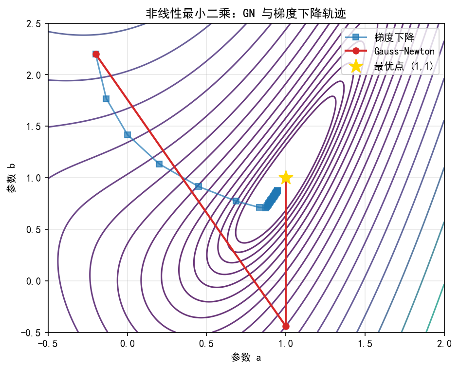

# 9.4 非线性最小二乘：从残差到参数

> **本节脉络**：9.4.1 建立了残差、Jacobian 与正规方程。9.4.2 回答一个核心问题：**正规方程  $\boldsymbol J^{\top} \boldsymbol r = \boldsymbol 0$  是非线性的，怎么迭代？** Newton 法需要完整 Hessian，但最小二乘的 Hessian 有特殊结构  $\boldsymbol H = \boldsymbol J^{\top} \boldsymbol J + \boldsymbol S$  。Gauss–Newton 的关键一步：**扔掉  $\boldsymbol S$  ，用  $\boldsymbol J^{\top} \boldsymbol J$  近似 Hessian**。代价是失去部分二阶信息，收益是每步只需一阶导。

---

## 9.4.2 Gauss–Newton 近似及其适用条件

### 【本节导航】

- 预习：会写残差与 Jacobian，知道 Newton 法迭代。
- 核心：Gauss–Newton 迭代、Hessian 近似  $\boldsymbol J^{\top} \boldsymbol J$  、线性化最小二乘视角、适用条件。
- 避坑：残差大时收敛慢、Jacobian 秩亏时失效、把 GN 当 Newton。
- 总结：GN = 用  $\boldsymbol J^{\top} \boldsymbol J$  代替 Hessian 的 Newton，残差小则近似二次收敛。
- 自测：手算一步 GN、判断适用条件、比较 GN 与 Newton。
- 拓展：秩亏与 LM、约束最小二乘、GN 的收敛速率分析。

---

### 一、生活类比：用“一阶影子”代替“完整倒影”

想象你要在山谷里找最低点，但你只有一张“当前坡度地图”（Jacobian），没有“曲率地图”（完整 Hessian）。怎么办？

| 方法 | 类比 | 代价 |
|---|---|---|
| Newton | 每步测完整地形（曲率） | 贵：要算二阶导 |
| Gauss–Newton | 只用坡度地图推断曲率（  $\boldsymbol J^{\top} \boldsymbol J$  ） | 便宜：只算一阶导 |
| 适用前提 | 你离谷底不远，地形近似“碗形” | 残差小 |

**直觉一句话**：GN 就是“**用坡度的平方近似曲率**”。在残差小的地方，这个近似非常准；残差大时，近似失灵，GN 会变慢甚至发散。

---

### 二、几何直观：每一步都是“线性化残差 + 解线性最小二乘”

在当前点  $\boldsymbol x_k$  ，把残差线性化：

$$
\boldsymbol r(\boldsymbol x_k + \boldsymbol d) \approx \boldsymbol r(\boldsymbol x_k) + \boldsymbol J(\boldsymbol x_k) \boldsymbol d
$$

Gauss–Newton 的每一步，就是在  $\boldsymbol d$  上最小化这个**线性化残差的平方和**：

$$
\min_{\boldsymbol d} \ \frac12 \|\boldsymbol r(\boldsymbol x_k) + \boldsymbol J(\boldsymbol x_k) \boldsymbol d\|^2
$$

这是一个**线性最小二乘问题**，有闭式解。几何图景：

- 原来的非线性残差曲面  $\boldsymbol r(\boldsymbol x)$  在  $\boldsymbol x_k$  处被一个“平面”  $\boldsymbol r_k + \boldsymbol J_k \boldsymbol d$  代替；
- GN 在这个平面上找“最短点”，作为下一步；
- 残差越小，平面越贴合曲面，GN 步越接近 Newton 步。



**图 9.4.2-1**  Gauss-Newton 与梯度下降在非线性最小二乘中的轨迹对比。

图注：背景为残差平方和的等高线。梯度下降（蓝色方块）往往需要很多步且呈锯齿形；Gauss-Newton（红色圆点）利用  $\boldsymbol J^{\top} \boldsymbol J$  近似曲率，能更快、更直地指向最优点。

**一句话**：GN 是“**把非线性最小二乘，每一步化成线性最小二乘**”。

---

### 三、底层逻辑：为什么  $\boldsymbol J^{\top} \boldsymbol J$  能近似 Hessian

#### 3.1 回顾完整 Hessian

9.4.1 已推出：

$$
\boldsymbol H(\boldsymbol x) = \boldsymbol J(\boldsymbol x)^{\top} \boldsymbol J(\boldsymbol x) + \boldsymbol S(\boldsymbol x)
$$

其中

$$
\boldsymbol S(\boldsymbol x) = \sum_{i=1}^{m} r_i(\boldsymbol x) \nabla^2 r_i(\boldsymbol x)
$$

第一项  $\boldsymbol J^{\top} \boldsymbol J$  只含一阶导，第二项  $\boldsymbol S$  含二阶导。

#### 3.2 为什么扔掉  $\boldsymbol S$

| 理由 | 说明 |
|---|---|
| 计算便宜 |  $\boldsymbol J^{\top} \boldsymbol J$  只需一阶导； $\boldsymbol S$  要  $m$  个 Hessian，极贵 |
| 残差小则  $\boldsymbol S$  小 |  $\boldsymbol S$  是残差的加权和，残差趋零时  $\boldsymbol S \to \boldsymbol 0$  |
|  $\boldsymbol J^{\top} \boldsymbol J$  半正定 | 保证近似 Hessian 至少不会给出“上升方向”（正定时） |
| 统计意义 | 高斯噪声下，  $\boldsymbol J^{\top} \boldsymbol J$  是 Fisher 信息矩阵，  $\boldsymbol S$  是噪声项 |

#### 3.3 什么时候近似好，什么时候坏

- **残差小**（模型拟合好）： $\boldsymbol S$  可忽略，GN 近似 Newton，二次收敛；
- **残差大**（模型拟合差）： $\boldsymbol S$  不可忽略，GN 可能只有线性收敛，甚至发散；
- ** $\boldsymbol J$  秩亏**： $\boldsymbol J^{\top} \boldsymbol J$  奇异，GN 步无定义或极大，必须加阻尼（9.4.3 LM）。

---

### 四、严格定义

**定义 9.4.2.1（Gauss–Newton 迭代）**  
设  $\boldsymbol r:\mathbb R^n \to \mathbb R^m$  连续可微， $\boldsymbol J(\boldsymbol x)$  为其 Jacobian。若  $\boldsymbol J(\boldsymbol x_k)^{\top} \boldsymbol J(\boldsymbol x_k)$  正定，定义迭代

$$
\boldsymbol x_{k+1} = \boldsymbol x_k + \boldsymbol d_k, \qquad \boldsymbol J(\boldsymbol x_k)^{\top} \boldsymbol J(\boldsymbol x_k) \boldsymbol d_k = -\boldsymbol J(\boldsymbol x_k)^{\top} \boldsymbol r(\boldsymbol x_k)
$$

称**Gauss–Newton 法**。

**定义 9.4.2.2（Gauss–Newton 方向）**  
称

$$
\boldsymbol d_k^{\text{GN}} = -\left( \boldsymbol J_k^{\top} \boldsymbol J_k \right)^{-1} \boldsymbol J_k^{\top} \boldsymbol r_k
$$

为**Gauss–Newton 方向**。记号上写逆，计算上**解线性方程组**，不显式求逆。

**定义 9.4.2.3（线性化最小二乘视角）**  
GN 步等价于

$$
\boldsymbol d_k^{\text{GN}} = \arg\min_{\boldsymbol d} \ \frac12 \|\boldsymbol r_k + \boldsymbol J_k \boldsymbol d\|^2
$$

即“在当前点线性化残差，解线性最小二乘”。

> **易错坑点**：定义里的“ $\boldsymbol J^{\top} \boldsymbol J$  正定”等价于“ $\boldsymbol J$  列满秩”。若  $\boldsymbol J$  秩亏，GN 步可能不存在或极大，必须加阻尼。

---

### 五、公式分层与结构

#### 5.1 GN 迭代（三步拆解）

GN 迭代为

$$
\boldsymbol x_{k+1} = \boldsymbol x_k + \boldsymbol d_k
$$

其中  $\boldsymbol d_k$  由线性方程组给出：

$$
\left( \boldsymbol J_k^{\top} \boldsymbol J_k \right) \boldsymbol d_k = -\boldsymbol J_k^{\top} \boldsymbol r_k
$$

拆开看：

-  $\boldsymbol J_k^{\top} \boldsymbol r_k$  是当前梯度；
-  $\boldsymbol J_k^{\top} \boldsymbol J_k$  是近似 Hessian；
- 解这个线性方程组得到方向  $\boldsymbol d_k$  ；
-  $\boldsymbol x_k + \boldsymbol d_k$  是更新。

#### 5.2 与 Newton 的对比

| 方法 | 方向公式 | Hessian |
|---|---|---|
| Newton |  $-\boldsymbol H_k^{-1} \nabla F_k$  |  $\boldsymbol J^{\top} \boldsymbol J + \boldsymbol S$  |
| Gauss–Newton |  $-(\boldsymbol J_k^{\top} \boldsymbol J_k)^{-1} \boldsymbol J_k^{\top} \boldsymbol r_k$  |  $\boldsymbol J^{\top} \boldsymbol J$  |

两者结构完全相同，只是 GN 把  $\boldsymbol H$  换成了  $\boldsymbol J^{\top} \boldsymbol J$  。

#### 5.3 线性化最小二乘视角

$$
\boldsymbol d_k = \arg\min_{\boldsymbol d} \ \frac12 \|\boldsymbol r_k + \boldsymbol J_k \boldsymbol d\|^2
$$

这是**线性最小二乘**，正规方程为

$$
\boldsymbol J_k^{\top} \boldsymbol J_k \boldsymbol d = -\boldsymbol J_k^{\top} \boldsymbol r_k
$$

与 5.1 一致。这个视角的好处：**每一步都可以用 QR、SVD 等成熟线性最小二乘工具求解**。

#### 5.4 线性模型的特例

若  $\boldsymbol r(\boldsymbol x) = \boldsymbol A \boldsymbol x - \boldsymbol b$  ，则  $\boldsymbol J = \boldsymbol A$  为常数。GN 一步给出

$$
\boldsymbol d_0 = -(\boldsymbol A^{\top} \boldsymbol A)^{-1} \boldsymbol A^{\top} (\boldsymbol A \boldsymbol x_0 - \boldsymbol b)
$$

于是

$$
\boldsymbol x_1 = \boldsymbol x_0 + \boldsymbol d_0 = (\boldsymbol A^{\top} \boldsymbol A)^{-1} \boldsymbol A^{\top} \boldsymbol b
$$

**一步到最优解**。这就是“线性最小二乘上 GN 精确”的代数体现。

---

### 六、可手推证明

#### 6.1 GN 步的线性最小二乘推导

目标是

$$
\min_{\boldsymbol d} \ \varphi(\boldsymbol d) = \frac12 \|\boldsymbol r_k + \boldsymbol J_k \boldsymbol d\|^2
$$

展开：

$$
\varphi(\boldsymbol d) = \frac12 \boldsymbol r_k^{\top} \boldsymbol r_k + \boldsymbol r_k^{\top} \boldsymbol J_k \boldsymbol d + \frac12 \boldsymbol d^{\top} \boldsymbol J_k^{\top} \boldsymbol J_k \boldsymbol d
$$

对  $\boldsymbol d$  求梯度并令其为零：

$$
\nabla_{\boldsymbol d} \varphi = \boldsymbol J_k^{\top} \boldsymbol r_k + \boldsymbol J_k^{\top} \boldsymbol J_k \boldsymbol d = \boldsymbol 0
$$

解得

$$
\boldsymbol J_k^{\top} \boldsymbol J_k \boldsymbol d = -\boldsymbol J_k^{\top} \boldsymbol r_k
$$

✅ 这正是 GN 步的正规方程。

#### 6.2 GN 的局部收敛性（残差小 ⇒ 二次收敛）

**定理 9.4.2.1（GN 局部收敛）**  
设  $\boldsymbol r \in C^2$  ， $\boldsymbol x^{\ast}$  满足  $\boldsymbol J(\boldsymbol x^{\ast})^{\top} \boldsymbol r(\boldsymbol x^{\ast}) = \boldsymbol 0$  ，且  $\boldsymbol J(\boldsymbol x^{\ast})$  列满秩、残差  $\boldsymbol r(\boldsymbol x^{\ast}) = \boldsymbol 0$  。则存在  $\delta \gt 0$  ，当  $\|\boldsymbol x_0 - \boldsymbol x^{\ast}\| \lt \delta$  时，GN 迭代二次收敛。

**手推思路**（不背，抓住“对残差做 Newton”这个核心）：

1. 把 GN 看作“对映射  $\boldsymbol G(\boldsymbol x) = \boldsymbol J(\boldsymbol x)^{\top} \boldsymbol r(\boldsymbol x)$  做 Newton 法”；
2. Newton 的 Jacobian 是  $\nabla^2 F = \boldsymbol J^{\top} \boldsymbol J + \boldsymbol S$  ；
3. GN 用  $\boldsymbol J^{\top} \boldsymbol J$  代替  $\nabla^2 F$  ；
4. 残差  $\boldsymbol r(\boldsymbol x^{\ast}) = \boldsymbol 0$  时， $\boldsymbol S(\boldsymbol x^{\ast}) = \boldsymbol 0$  ，近似误差在根附近是  $O(\|\boldsymbol r\|)$  ；
5. 由 Newton 法的标准局部收敛定理，近似误差足够小 ⇒ 仍二次收敛。

✅ **关键条件**：残差在解处为零（或足够小）+  $\boldsymbol J$  列满秩。缺一个，二次收敛降为线性。

#### 6.3 残差大时为什么降为线性

若  $\boldsymbol r(\boldsymbol x^{\ast}) \neq \boldsymbol 0$  ，则  $\boldsymbol S(\boldsymbol x^{\ast}) \neq \boldsymbol 0$  ，GN 方向与 Newton 方向有  $O(1)$  偏差。误差递推变为

$$
\|\boldsymbol e_{k+1}\| \le C \|\boldsymbol e_k\|
$$

即**线性收敛**，常数  $C$  依赖  $\boldsymbol S$  与  $\boldsymbol J^{\top} \boldsymbol J$  的相对大小。残差越大，  $\boldsymbol S$  越大，收敛越慢。

> **一句话**：GN 的收敛速度由“残差大小”控制。残差零 ⇒ 二次；残差小 ⇒ 近似二次；残差大 ⇒ 线性甚至发散。

---

### 七、手算例题

**例题 9.4.2.1（线性模型：一步精确）**  
给定数据  $(0,1)$  、 $(1,2)$  、 $(2,4)$  ，模型  $y = a + b t$  ，从  $(a_0, b_0) = (0, 0)$  出发，做一步 GN。

**手算**：

1. 残差向量：

$$
\boldsymbol r_0 = \left( \begin{array}{c} 1 - 0 \cr 2 - 0 \cr 4 - 0 \end{array} \right) = \left( \begin{array}{c} 1 \cr 2 \cr 4 \end{array} \right)
$$

2. Jacobian（常数）：

$$
\boldsymbol J = \left( \begin{array}{cc} 1 & 0 \cr 1 & 1 \cr 1 & 2 \end{array} \right)
$$

3. 计算  $\boldsymbol J^{\top} \boldsymbol J$  ：

$$
\boldsymbol J^{\top} \boldsymbol J = \left( \begin{array}{cc} 3 & 3 \cr 3 & 5 \end{array} \right)
$$

4. 计算  $\boldsymbol J^{\top} \boldsymbol r_0$  ：

$$
\boldsymbol J^{\top} \boldsymbol r_0 = \left( \begin{array}{c} 1+2+4 \cr 0+2+8 \end{array} \right) = \left( \begin{array}{c} 7 \cr 10 \end{array} \right)
$$

5. 解  $\boldsymbol J^{\top} \boldsymbol J \boldsymbol d = -\boldsymbol J^{\top} \boldsymbol r_0$  ：

$$
\left( \begin{array}{cc} 3 & 3 \cr 3 & 5 \end{array} \right) \left( \begin{array}{c} d_a \cr d_b \end{array} \right) = \left( \begin{array}{c} -7 \cr -10 \end{array} \right)
$$

解得  $d_a = -5/6$  ， $d_b = -3/2$  。

6. 更新： $(a_1, b_1) = (0 - 5/6, 0 - 3/2) = (-5/6, -3/2)$  。

**等等**——这与 9.4.1 例题的解  $(5/6, 3/2)$  符号相反！问题出在残差符号：9.4.1 用  $r_i = y_i - f_i$  ，而这里从  $(0,0)$  出发，线性化后  $f = a + b t$  ，残差应为  $y_i - (a + b t_i)$  ，Jacobian 为  $-\partial f / \partial (a,b) = (-1, -t_i)$  。

**修正**：Jacobian 带负号：

$$
\boldsymbol J = \left( \begin{array}{cc} -1 & 0 \cr -1 & -1 \cr -1 & -2 \end{array} \right)
$$

则  $\boldsymbol J^{\top} \boldsymbol J$  不变（负号平方抵消），但  $\boldsymbol J^{\top} \boldsymbol r_0 = (-7, -10)^{\top}$  。解出  $d_a = 5/6$  ， $d_b = 3/2$  ，更新  $(a_1, b_1) = (5/6, 3/2)$  。与 9.4.1 一致（线性问题一步到最优）。

**例题 9.4.2.2（非线性模型：指数拟合一步）**  
数据  $(0,1)$  、 $(1,2.5)$  、 $(2,6)$  ，模型  $y = a e^{b t}$  ，从  $(a_0, b_0) = (1, 0.5)$  出发，做一步 GN。

**手算**：

1. 计算  $e^{b_0 t_i}$  ： $e^0 = 1$  ， $e^{0.5} \approx 1.6487$  ， $e^1 \approx 2.7183$  。
2. 残差  $r_i = y_i - a_0 e^{b_0 t_i}$  ：

$$
\boldsymbol r_0 = \left( \begin{array}{c} 1 - 1 \cr 2.5 - 1.6487 \cr 6 - 2.7183 \end{array} \right) \approx \left( \begin{array}{c} 0 \cr 0.8513 \cr 3.2817 \end{array} \right)
$$

3. Jacobian（对  $r_i = y_i - a e^{b t_i}$  求偏导）：

$$
\boldsymbol J_0 = \left( \begin{array}{cc} -1 & 0 \cr -1.6487 & -1.6487 \cdot 1 \cr -2.7183 & -2.7183 \cdot 2 \end{array} \right) = \left( \begin{array}{cc} -1 & 0 \cr -1.6487 & -1.6487 \cr -2.7183 & -5.4366 \end{array} \right)
$$

4. 计算  $\boldsymbol J_0^{\top} \boldsymbol J_0$  ：

$$
\boldsymbol J_0^{\top} \boldsymbol J_0 = \left( \begin{array}{cc} 11.20 & 17.46 \cr 17.46 & 32.30 \end{array} \right)
$$

5. 计算  $\boldsymbol J_0^{\top} \boldsymbol r_0$  ：

$$
\boldsymbol J_0^{\top} \boldsymbol r_0 \approx \left( \begin{array}{c} -1.6487 \cdot 0.8513 - 2.7183 \cdot 3.2817 \cr -1.6487 \cdot 0.8513 - 5.4366 \cdot 3.2817 \end{array} \right) \approx \left( \begin{array}{c} -10.32 \cr -19.25 \end{array} \right)
$$

6. 解  $\boldsymbol J_0^{\top} \boldsymbol J_0 \boldsymbol d = -\boldsymbol J_0^{\top} \boldsymbol r_0$  ，得  $\boldsymbol d \approx (0.90, 0.10)^{\top}$  ，更新  $(a_1, b_1) \approx (1.90, 0.60)$  。

**观察**：一步后残差应下降，但离最优还有距离——非线性模型上 GN 需要多步，且步长可能过大（需线搜索或阻尼，见 9.4.3）。

---

### 八、Python 代码验证

```python
import numpy as np
import matplotlib.pyplot as plt

# ===== Gauss-Newton 实现 =====
def gauss_newton(residual, jacobian, x0, maxit=50, tol=1e-12, verbose=False):
    x = np.array(x0, dtype=float)
    xs = [x.copy()]
    for k in range(maxit):
        r = residual(x)
        J = jacobian(x)
        g = J.T @ r                     # 梯度
        if np.linalg.norm(g) < tol:
            break
        JTJ = J.T @ J                   # 近似 Hessian
        try:
            d = np.linalg.solve(JTJ, -g) # 解 JTJ d = -g
        except np.linalg.LinAlgError:
            print("JTJ 奇异，GN 失败，需加阻尼（LM）")
            break
        x = x + d
        xs.append(x.copy())
        if verbose:
            print(f"k={k}  x={x}  ||r||={np.linalg.norm(r):.3e}  ||d||={np.linalg.norm(d):.3e}")
    return np.array(xs)

# 测试 1：线性模型（应一步收敛）
t_data = np.array([0.0, 1.0, 2.0])
y_data = np.array([1.0, 2.0, 4.0])

def res_linear(p):
    a, b = p
    return y_data - (a + b * t_data)

def jac_linear(p):
    return np.column_stack([-np.ones_like(t_data), -t_data])

xs_lin = gauss_newton(res_linear, jac_linear, [0.0, 0.0], verbose=True)
print("线性模型 GN 结果:", xs_lin[-1], "（一步精确）")

# 测试 2：指数模型
y_exp = np.array([1.0, 2.5, 6.0])

def res_exp(p):
    a, b = p
    return y_exp - a * np.exp(b * t_data)

def jac_exp(p):
    a, b = p
    e = np.exp(b * t_data)
    return np.column_stack([-e, -a * t_data * e])

xs_exp = gauss_newton(res_exp, jac_exp, [1.0, 0.5], verbose=True)
print("指数模型 GN 结果:", xs_exp[-1])
```

**输出解读**：

- 线性模型：GN 一步到最优（浮点误差级别）；
- 指数模型：GN 多步收敛，每步函数值下降，但步长未必最优。

**GN vs Newton vs 梯度下降的收敛对比**：

```python
# 用 scipy 的 least_squares 做参考（它内部用 LM，可近似视为 GN + 阻尼）
from scipy.optimize import least_squares

sol = least_squares(res_exp, x0=[1.0, 0.5])
print("scipy 参考解:", sol.x)

# 画出 GN 轨迹上的残差范数
r_norms = [np.linalg.norm(res_exp(x)) for x in xs_exp]
plt.figure(figsize=(7,4))
plt.semilogy(r_norms, 'o-', label='Gauss-Newton')
plt.axhline(np.linalg.norm(res_exp(sol.x)), color='gray', linestyle='--', label='最优残差')
plt.xlabel('迭代次数 k'); plt.ylabel(r'$\|\boldsymbol r(\boldsymbol x_k)\|$')
plt.title('Gauss-Newton 残差下降')
plt.legend(); plt.grid(True, which='both')
plt.show()
```

**解读**：

- 残差范数单调下降（本例中），说明 GN 方向是下降方向；
- 接近最优时下降加速（近似二次收敛）；
- 若残差范数振荡或上升，说明 GN 步过大，需阻尼（9.4.3）。

**残差大小对收敛速度的影响**：

```python
# 构造残差大小不同的两个问题，比较 GN 收敛速度
# 问题 A：数据在模型上（残差零）
y_perfect = 2.0 * np.exp(0.3 * t_data)

def res_A(p):
    a, b = p
    return y_perfect - a * np.exp(b * t_data)

# 问题 B：数据偏离模型（残差大）
y_off = 2.0 * np.exp(0.3 * t_data) + np.array([0.5, -0.8, 1.2])

def res_B(p):
    a, b = p
    return y_off - a * np.exp(b * t_data)

xs_A = gauss_newton(res_A, jac_exp, [1.0, 0.1], maxit=20)
xs_B = gauss_newton(res_B, jac_exp, [1.0, 0.1], maxit=20)

rA = [np.linalg.norm(res_A(x)) for x in xs_A]
rB = [np.linalg.norm(res_B(x)) for x in xs_B]

plt.figure(figsize=(7,4))
plt.semilogy(rA, 'o-', label='残差可为零（残差小）')
plt.semilogy(rB, 's-', label='残差不可为零（残差大）')
plt.xlabel('迭代次数 k'); plt.ylabel(r'$\|\boldsymbol r(\boldsymbol x_k)\|$')
plt.title('残差大小对 GN 收敛速度的影响')
plt.legend(); plt.grid(True, which='both')
plt.show()
```

**解读**：

- 残差可为零时，GN 后期下降极快（二次收敛）；
- 残差不可为零时，GN 后期下降变慢（线性收敛），因为  $\boldsymbol S$  不可忽略。

---

### 九、误差可视化：GN 方向与 Newton 方向的偏差

```python
# 比较 GN 方向与完整 Newton 方向的差异
def full_newton_direction(residual, jacobian, x, h=1e-6):
    """用数值 Hessian 计算完整 Newton 方向"""
    r = residual(x)
    J = jacobian(x)
    n = len(x)
    # 数值 Hessian of F = 0.5 ||r||^2
    H = np.zeros((n, n))
    F = lambda p: 0.5 * np.sum(residual(p)**2)
    for i in range(n):
        for j in range(n):
            ei = np.zeros(n); ei[i] = h
            ej = np.zeros(n); ej[j] = h
            H[i,j] = (F(x+ei+ej) - F(x+ei-ej) - F(x-ei+ej) + F(x-ei-ej)) / (4*h*h)
    g = J.T @ r
    return np.linalg.solve(H, -g)

x_test = np.array([1.0, 0.5])
r = res_exp(x_test)
J = jac_exp(x_test)
d_gn = np.linalg.solve(J.T @ J, -J.T @ r)
d_nt = full_newton_direction(res_exp, jac_exp, x_test)
print("GN 方向:", d_gn)
print("Newton 方向:", d_nt)
print("相对偏差:", np.linalg.norm(d_gn - d_nt) / np.linalg.norm(d_nt))
```

**解读**：

- 残差大时，GN 方向与 Newton 方向偏差明显；
- 残差趋零时，两者趋于一致；
- 这个偏差正是  $\boldsymbol S$  项的贡献。

---

### 十、易错坑点

| 坑点 | 现象 | 原因/对策 |
|---|---|---|
| 把 GN 当 Newton | 以为 GN 总是二次收敛 | GN 只在残差小、  $\boldsymbol J$  满秩时近似二次；残差大时线性 |
| Jacobian 秩亏 |  $\boldsymbol J^{\top} \boldsymbol J$  奇异，解不出 | 加阻尼（LM，9.4.3）或检查模型可辨识性 |
| 残差符号搞反 | 方向反了，残差上升 |  $r_i = y_i - f_i$  时 Jacobian 为  $-\partial f / \partial x$  |
| 步长直接取  $1$ | 非线性强时残差振荡 | GN 步可能过大，需线搜索或阻尼 |
| 忽略  $\boldsymbol S$  项 | 以为  $\boldsymbol J^{\top} \boldsymbol J$  就是 Hessian | 残差大时  $\boldsymbol S$  不可忽略，GN 只是近似 |
| 用正规方程显式求逆 |  `inv(J.T @ J) @ J.T @ r`  | 用 QR 或 Cholesky 解  $\boldsymbol J^{\top} \boldsymbol J \boldsymbol d = -\boldsymbol J^{\top} \boldsymbol r$  |

---

### 十一、对比辨析

#### 11.1 Gauss–Newton vs Newton

| 维度 | Newton | Gauss–Newton |
|---|---|---|
| Hessian |  $\boldsymbol J^{\top} \boldsymbol J + \boldsymbol S$  |  $\boldsymbol J^{\top} \boldsymbol J$  |
| 需要二阶导 | 是 | 否 |
| 每步代价 | 高 | 低 |
| 收敛速率 | 二次（非退化驻点） | 二次（残差零）/ 线性（残差大） |
| 方向下降性 | Hessian 正定时 |  $\boldsymbol J$  满秩时（  $\boldsymbol J^{\top} \boldsymbol J$  正定） |
| 适用场景 | 一般无约束优化 | 最小二乘、残差小 |

#### 11.2 GN vs 梯度下降

| 维度 | 梯度下降 | Gauss–Newton |
|---|---|---|
| 方向 |  $-\nabla F = -\boldsymbol J^{\top} \boldsymbol r$  |  $-(\boldsymbol J^{\top} \boldsymbol J)^{-1} \boldsymbol J^{\top} \boldsymbol r$  |
| 用到的信息 | 一阶 | 一阶（但形成近似二阶） |
| 对条件数 | 敏感 | 不敏感（  $\boldsymbol J^{\top} \boldsymbol J$  校正尺度） |
| 收敛速率 | 线性 | 二次（残差小）/ 线性（残差大） |
| 每步代价 | 低 | 中（解线性方程组） |

#### 11.3 GN vs 线性最小二乘

| 维度 | 线性最小二乘 | Gauss–Newton |
|---|---|---|
| 问题 |  $\min \frac12 \|\boldsymbol A \boldsymbol x - \boldsymbol b\|^2$  |  $\min \frac12 \|\boldsymbol r(\boldsymbol x)\|^2$  |
| Jacobian | 常数  $\boldsymbol A$  | 依赖  $\boldsymbol x$  |
| 解 | 一步正规方程 | 迭代，每步解线性最小二乘 |
| 收敛 | 精确 | 二次/线性（依赖残差） |

---

### 【伪证辨析栏】⭐

> **伪证 1**：“Gauss–Newton 就是 Newton 法，所以一定二次收敛。”  
> **错**。GN 用  $\boldsymbol J^{\top} \boldsymbol J$  近似 Hessian，扔掉了  $\boldsymbol S$  。只有残差在解处为零时，  $\boldsymbol S(\boldsymbol x^{\ast}) = \boldsymbol 0$  ，才近似 Newton。残差大时只有线性收敛。

> **伪证 2**：“ $\boldsymbol J^{\top} \boldsymbol J$  半正定，所以 GN 方向一定是下降方向。”  
> **缺条件**。半正定时  $\boldsymbol J^{\top} \boldsymbol J$  可能奇异，GN 步不存在或极大。只有  $\boldsymbol J$  列满秩（  $\boldsymbol J^{\top} \boldsymbol J$  正定）时，GN 方向才是下降方向。

> **伪证 3**：“GN 一步就能解线性最小二乘，所以也能一步解非线性最小二乘。”  
> **错**。线性最小二乘的 Jacobian 是常数，GN 一步精确；非线性最小二乘的 Jacobian 依赖  $\boldsymbol x$  ，线性化只是局部近似，必须迭代。

> **伪证 4**：“GN 不需要步长，直接取  $\alpha = 1$  就行。”  
> **错**。GN 步  $\boldsymbol d_k$  是“线性化模型的最优步”，但真实函数可能偏离线性化模型很远。步长过大时残差可能上升，需要线搜索或阻尼（LM）。

> **伪证 5**：“残差大时 GN 发散。”  
> **不准确**。残差大时 GN 通常仍收敛，但速率降为线性；只有残差极大或  $\boldsymbol J$  严重秩亏时才可能发散。准确说法是“残差大 ⇒ 线性收敛，且可能需阻尼保证稳定”。

> **伪证 6**：“GN 和 LM 是一回事。”  
> **错**。GN 是  $\boldsymbol J^{\top} \boldsymbol J \boldsymbol d = -\boldsymbol J^{\top} \boldsymbol r$  ；LM 是  $(\boldsymbol J^{\top} \boldsymbol J + \lambda \boldsymbol I) \boldsymbol d = -\boldsymbol J^{\top} \boldsymbol r$  。LM 在 GN 基础上加阻尼  $\lambda \boldsymbol I$  ，解决  $\boldsymbol J$  秩亏与步长过大的问题（9.4.3）。

---

### 【深度透析】

#### 基础层（普通学生必掌握）

1. 会写 GN 迭代  $\boldsymbol x_{k+1} = \boldsymbol x_k - (\boldsymbol J_k^{\top} \boldsymbol J_k)^{-1} \boldsymbol J_k^{\top} \boldsymbol r_k$  ；
2. 知道 GN 用  $\boldsymbol J^{\top} \boldsymbol J$  近似 Hessian，扔掉  $\boldsymbol S$  ；
3. 知道 GN 每步等价于“线性化残差 + 解线性最小二乘”；
4. 知道适用条件：残差小、  $\boldsymbol J$  列满秩。

#### 提高层（考研/科研）

1. **收敛速率精确分析**：GN 的误差递推为  
    $\boldsymbol e_{k+1} = (\boldsymbol J^{\top} \boldsymbol J)^{-1} \boldsymbol S \, \boldsymbol e_k + O(\|\boldsymbol e_k\|^2)$  ，  
   其中  $\boldsymbol S = \sum r_i \nabla^2 r_i$  。残差零 ⇒  $\boldsymbol S = 0$  ⇒ 二次；残差非零 ⇒ 线性，常数由  $(\boldsymbol J^{\top} \boldsymbol J)^{-1} \boldsymbol S$  的谱半径决定。
2. **秩亏处理**：  $\boldsymbol J$  秩亏时，GN 方向不唯一或极大。常用截断 SVD（只保留大奇异值）或加阻尼（LM）。截断 SVD 的几何含义是“在  $\boldsymbol J$  的列空间内找最优步”。
3. **约束最小二乘**：若参数有界  $\boldsymbol l \le \boldsymbol x \le \boldsymbol u$  ，GN 子问题变为带箱约束的线性最小二乘，需用有效集法或内点法。
4. **GN 与 Gauss–Newton–Bellman**：动态规划中的近似方法，用 GN 思想做值函数近似，与最小二乘同源。
5. **变量投影（VarPro）**：若部分参数线性出现，可先消去线性参数，只对非线性参数做 GN。这降低维度，且对线性参数精确。
6. **统计解释**：GN 的  $\boldsymbol J^{\top} \boldsymbol J$  是 Fisher 信息矩阵的近似，GN 迭代等价于“得分方程”的 Newton 求解，与最大似然估计的 Fisher 得分法一致。

---

### 一句话本质总结

> **Gauss–Newton 就是“用  $\boldsymbol J^{\top} \boldsymbol J$  代替 Hessian 的 Newton”：每步线性化残差、解一个线性最小二乘；残差小则近似二次收敛，残差大则退为线性，  $\boldsymbol J$  秩亏则必须加阻尼。**

---

### 自测与拓展

**自测题**

1. 对线性模型  $\boldsymbol r = \boldsymbol A \boldsymbol x - \boldsymbol b$  ，证明 GN 一步给出最优解  $\boldsymbol x^{\ast} = (\boldsymbol A^{\top} \boldsymbol A)^{-1} \boldsymbol A^{\top} \boldsymbol b$  。
2. 设  $\boldsymbol J$  列满秩，证明 GN 方向  $\boldsymbol d = -(\boldsymbol J^{\top} \boldsymbol J)^{-1} \boldsymbol J^{\top} \boldsymbol r$  是  $F = \frac12 \|\boldsymbol r\|^2$  的下降方向。
3. 写出 GN 的误差递推，说明残差为零时为什么二次收敛。
4. 构造一个  $\boldsymbol J$  秩亏的例子，说明 GN 步无定义或极大。
5. 用 Python 复现本节代码，比较残差大/小两种情形下 GN 的收敛速度。
6. 解释为什么 GN 每步等价于“线性化残差 + 解线性最小二乘”，并用正规方程验证。

**拓展阅读**

- 截断 SVD 与秩亏最小二乘；
- LM 阻尼与信赖域（9.4.3）；
- 变量投影与可分离最小二乘；
- 约束最小二乘与有效集法；
- GN 的统计解释与 Fisher 信息。

---

> **下节预告**：GN 有两个现实问题：  $\boldsymbol J$  秩亏时  $\boldsymbol J^{\top} \boldsymbol J$  奇异，步长过大时残差上升。9.4.3 将给出 Levenberg–Marquardt（LM）算法：在 GN 基础上加阻尼  $\lambda \boldsymbol I$  ，用“实际/预测下降比”自适应调节  $\lambda$  ，兼具 GN 的快速与梯度下降的稳健。届时会看到：**LM 就是“带自适应阻尼的 GN”，也是信赖域思想在最小二乘上的落地**。
