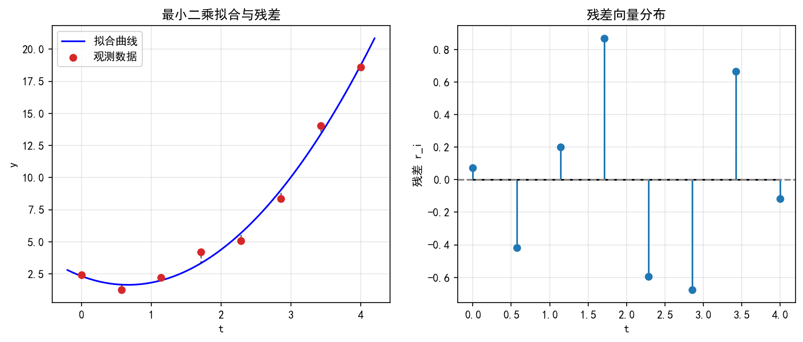
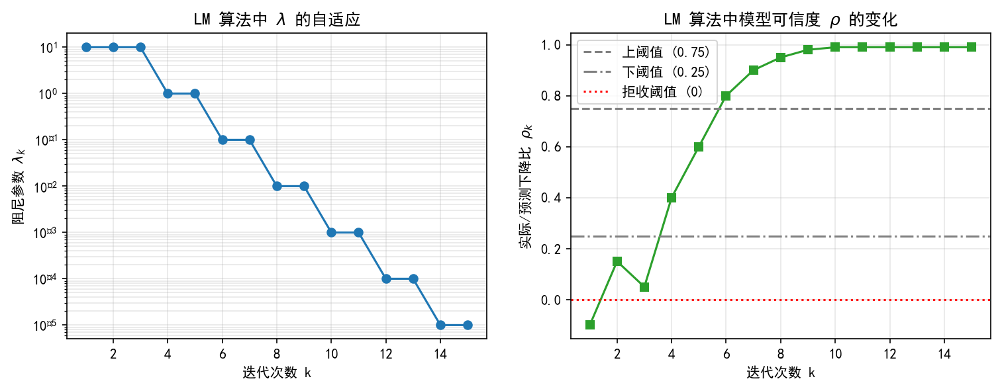

# 5.4 非线性最小二乘：从残差到参数（2学时）

> **第5章导航：** [导读](A1-G9-第5章-导读.md) ｜ [5.1](A1-G9-5.1-非线性方程.md) ｜ [5.2](A1-G9-5.2-下降方向.md) ｜ [5.3](A1-G9-5.3-Newton与拟Newton.md) ｜ [5.4](A1-G9-5.4-非线性最小二乘.md) ｜ [本章小结](A1-G9-第5章-小结.md) ｜ [网页版](A1-G9-正文-完整版.html) ｜ [完整版（单文件，供构建/下载）](A1-G9-正文-完整版.md)

**参考：** 《数值优化方法》第5章 5.1—5.3（书内 119—134 页）；5.4—5.6 作为选读。

**学习目标：** 能把一个拟合问题写成 $\min\frac12\|\boldsymbol r(\boldsymbol\theta)\|_2^2$；能推导 $\nabla\Phi=\boldsymbol J^{\top}\boldsymbol r$ 与 Hessian 分解；能实现 Gauss–Newton 与自适应 LM，并用实际/预测下降比 $\rho$ 解释阻尼的调整；能读懂参数标准误，知道“残差最小”不等于“参数等于真值”。

**承上启下。** 5.1—5.3 处理的是一般目标函数：我们关心 $f$ 下降得多快，却不太关心 $f$ 长什么样。最小二乘不一样——它的目标由一堆残差平方拼成，结构已知，Hessian 里有一大块可以“白拿”。这不是数学上的巧合，而是最小二乘无处不在的原因：**结构越清楚，算法就能越省。**

**本节结构。** 5.4.1 建立残差、Jacobian 与 Hessian 分解；5.4.2 扔掉 Hessian 中难算的那一项，得到 Gauss–Newton；5.4.3 给 GN 加上自适应阻尼，得到 LM，并用一次完整的参数辨识走完“建模—迭代—诊断”的全过程。

> 配套实验：实验 5.4-A（残差与 Jacobian 校验）、5.4-B（GN 的适用与失效）、5.4-C（LM 的自适应阻尼与参数辨识），见《A1组-实验与验证.md》。

## 5.4.1 残差向量、Jacobian与非线性参数拟合

> **本节脉络**：5.1 解方程，5.2 找下降方向，5.3 用曲率加速。5.4 转向一类特殊但极常见的优化问题：**残差平方和最小化**。它既不是纯求根（残差通常无法全为零），也不是一般无约束优化（结构特殊，可利用）。5.4.1 先建立残差向量、Jacobian 与参数拟合的基本框架，为 5.4.2 的 Gauss–Newton 与 5.4.3 的 LM 打地基。

### 【本节导航】

- 预习：会写最小二乘目标函数，知道向量范数与 Jacobian 的定义。
- 核心：残差向量、残差平方和、Jacobian、正规方程、参数拟合建模。
- 避坑：残差与参数维度混淆、Jacobian 行列方向搞反、把最小二乘当插值。
- 总结：最小二乘 = 让残差向量“整体最短”，Jacobian 描述残差对参数的敏感度。
- 自测：写残差与 Jacobian、手算一步正规方程、判断拟合是否合理。
- 拓展：加权最小二乘、鲁棒损失、可辨识性、秩亏与正则化。

---

### 一、生活类比：调音师调三根弦

你有一把吉他，三根弦的音高由三个旋钮控制。你弹一个标准音，听到的实际音高与目标音高有偏差。目标是：**调旋钮，让所有偏差整体最小**。

| 概念 | 吉他类比 | 数学对应 |
|---|---|---|
| 参数 | 三个旋钮的角度 |  $\boldsymbol x \in \mathbb R^n$  |
| 观测 | 弹若干次，每次听一个音 | 数据点  $(t_i, y_i)$  |
| 模型预测 | 当前旋钮下应有的音高 |  $f(t_i; \boldsymbol x)$  |
| 残差 | 实际音高减目标音高 |  $r_i(\boldsymbol x) = y_i - f(t_i; \boldsymbol x)$  |
| 目标 | 所有偏差整体最小 |  $\min \sum r_i^2$  |
| Jacobian | 每个旋钮对每个偏差的影响 |  $\partial r_i / \partial x_j$  |

**直觉一句话**：最小二乘就是“**多个偏差一起调，不能只顾一个**”。Jacobian 告诉你“拧哪个旋钮、对哪个偏差影响多大”。

---

### 二、几何直观：残差向量与参数空间

设参数  $\boldsymbol x \in \mathbb R^n$  ，数据点  $m$  个。定义**残差向量**

$$
\boldsymbol r(\boldsymbol x) = \left( \begin{array}{c} r_1(\boldsymbol x) \cr \vdots \cr r_m(\boldsymbol x) \end{array} \right)
$$

目标是最小化

$$
F(\boldsymbol x) = \frac12 \|\boldsymbol r(\boldsymbol x)\|^2 = \frac12 \sum_{i=1}^{m} r_i(\boldsymbol x)^2
$$

**几何图景**：

- 参数空间  $\mathbb R^n$  中每一点  $\boldsymbol x$  对应一个残差向量  $\boldsymbol r(\boldsymbol x) \in \mathbb R^m$  ；
- 目标函数  $F$  是残差向量长度的平方的一半；
- 最优点处，残差向量与 Jacobian 的列空间正交（正规方程）；
- 若  $m \gt n$  （数据多于参数），一般无法让  $\boldsymbol r = \boldsymbol 0$  ，只能让  $\|\boldsymbol r\|$  最小；
- 若  $m = n$  且模型可逆，可能  $\boldsymbol r = \boldsymbol 0$  ，退化为求根；
- 若  $m \lt n$  ，欠定，通常有无穷多解。

<div align="center">
  
</div>

**图 5-20**  最小二乘拟合曲线与残差分布。

图注：左图为带噪声的观测数据与拟合的指数曲线，虚线标出每个点的残差；右图为残差向量。最小二乘的目标是让所有残差的平方和最小。

---

### 三、底层逻辑：为什么最小二乘这样定义

### （1）为什么是平方和，不是绝对值和

- 平方和可微，便于用梯度/Newton 类方法；
- 平方和对大残差惩罚更重，倾向于“均匀分配误差”；
- 在高斯噪声假设下，平方和最小等价于最大似然估计。

### （2）为什么需要 Jacobian

残差  $\boldsymbol r(\boldsymbol x)$  通常是非线性的。要优化  $F$  ，需要它的梯度：

$$
\nabla F(\boldsymbol x) = \boldsymbol J(\boldsymbol x)^{\top} \boldsymbol r(\boldsymbol x)
$$

其中  $\boldsymbol J(\boldsymbol x) \in \mathbb R^{m \times n}$  是残差对参数的 Jacobian：

$$
\boldsymbol J(\boldsymbol x) = \left( \begin{array}{ccc} \dfrac{\partial r_1}{\partial x_1} & \cdots & \dfrac{\partial r_1}{\partial x_n} \cr \vdots & \ddots & \vdots \cr \dfrac{\partial r_m}{\partial x_1} & \cdots & \dfrac{\partial r_m}{\partial x_n} \end{array} \right)
$$

**说明**：矩阵共  $m$  行（每个数据点一行）、 $n$  列（每个参数一列）；第  $i$  行第  $j$  列元素为  $\partial r_i / \partial x_j$  。

**关键结构**：  $\nabla F = \boldsymbol J^{\top} \boldsymbol r$  。这个公式把“  $m$  维残差”压缩成“  $n$  维梯度”，是最小二乘一切算法的起点。

### （3）Hessian 的特殊结构

对  $F$  求二阶导：

$$
\boldsymbol H(\boldsymbol x) = \boldsymbol J(\boldsymbol x)^{\top} \boldsymbol J(\boldsymbol x) + \sum_{i=1}^{m} r_i(\boldsymbol x) \nabla^2 r_i(\boldsymbol x)
$$

第一项  $\boldsymbol J^{\top} \boldsymbol J$  半正定，第二项含残差。**当残差很小时，第二项可忽略**，Hessian 近似为  $\boldsymbol J^{\top} \boldsymbol J$  。这正是 Gauss–Newton 的出发点（5.4.2）。

---

### 四、严格定义

**定义 5.4.1.1（非线性最小二乘问题）**  
给定模型  $f(t; \boldsymbol x)$  、数据  $(t_i, y_i)$  ， $i = 1, \dots, m$  ，定义残差

$$
r_i(\boldsymbol x) = y_i - f(t_i; \boldsymbol x)
$$

非线性最小二乘问题是

$$
\min_{\boldsymbol x \in \mathbb R^n} \ F(\boldsymbol x), \qquad F(\boldsymbol x) = \frac12 \sum_{i=1}^{m} r_i(\boldsymbol x)^2
$$

**定义 5.4.1.2（残差 Jacobian）**  
若  $r_i$  对  $x_j$  可偏导，定义  $\boldsymbol J(\boldsymbol x) \in \mathbb R^{m \times n}$  ，元素为

$$
J_{ij}(\boldsymbol x) = \frac{\partial r_i}{\partial x_j}(\boldsymbol x)
$$

称  $\boldsymbol J$  为**残差 Jacobian**。

**定义 5.4.1.3（正规方程）**  
若  $\boldsymbol J$  列满秩，一阶必要条件  $\nabla F = \boldsymbol 0$  等价于

$$
\boldsymbol J(\boldsymbol x)^{\top} \boldsymbol r(\boldsymbol x) = \boldsymbol 0
$$

称其为**正规方程**（非线性版本）。

> **易错坑点**：正规方程是非线性方程组，不是线性方程。只有在线性最小二乘（  $\boldsymbol r = \boldsymbol A \boldsymbol x - \boldsymbol b$  ）时，它才化为线性方程  $\boldsymbol A^{\top} \boldsymbol A \boldsymbol x = \boldsymbol A^{\top} \boldsymbol b$  。

---

### 五、公式分层与结构

### （1）目标函数

最小二乘目标为

$$
F(\boldsymbol x) = \frac12 \|\boldsymbol r(\boldsymbol x)\|^2
$$

其中  $\boldsymbol r(\boldsymbol x)$  是残差向量，系数  $\frac12$  只为求导方便，不影响最优点。

### （2）梯度

梯度为

$$
\nabla F(\boldsymbol x) = \boldsymbol J(\boldsymbol x)^{\top} \boldsymbol r(\boldsymbol x)
$$

其中  $\boldsymbol J$  是残差 Jacobian。这个公式是“链式法则 + 矩阵转置”的直接结果。

### （3）Hessian 分解

Hessian 为

$$
\boldsymbol H(\boldsymbol x) = \boldsymbol J(\boldsymbol x)^{\top} \boldsymbol J(\boldsymbol x) + \boldsymbol S(\boldsymbol x)
$$

其中第一项  $\boldsymbol J^{\top} \boldsymbol J$  半正定，第二项

$$
\boldsymbol S(\boldsymbol x) = \sum_{i=1}^{m} r_i(\boldsymbol x) \nabla^2 r_i(\boldsymbol x)
$$

含残差加权。**残差小 ⇒  $\boldsymbol S$  小 ⇒ Hessian 近似  $\boldsymbol J^{\top} \boldsymbol J$**，这是 Gauss–Newton 的核心近似。

### （4）线性最小二乘的特例

若  $\boldsymbol r(\boldsymbol x) = \boldsymbol A \boldsymbol x - \boldsymbol b$  ，则  $\boldsymbol J = \boldsymbol A$  为常数，正规方程变为

$$
\boldsymbol A^{\top} \boldsymbol A \boldsymbol x = \boldsymbol A^{\top} \boldsymbol b
$$

这是线性最小二乘的经典正规方程。非线性情形下  $\boldsymbol J$  依赖  $\boldsymbol x$  ，正规方程是非线性的。

---

### 六、可手推证明

### （1）梯度公式  $\nabla F = \boldsymbol J^{\top} \boldsymbol r$  的推导

由  $F(\boldsymbol x) = \frac12 \sum_{i=1}^{m} r_i(\boldsymbol x)^2$  ，对  $x_j$  求偏导：

$$
\frac{\partial F}{\partial x_j} = \sum_{i=1}^{m} r_i(\boldsymbol x) \frac{\partial r_i}{\partial x_j}(\boldsymbol x)
$$

把  $j = 1, \dots, n$  排成列向量：

$$
\nabla F = \boldsymbol J(\boldsymbol x)^{\top} \boldsymbol r(\boldsymbol x)
$$

✅ 其中  $\boldsymbol J^{\top}$  的第  $j$  行正是  $\partial r_i / \partial x_j$  对  $i$  的求和权重。

### （2）Hessian 分解的推导

对  $\nabla F$  再求一次导：

$$
\frac{\partial^2 F}{\partial x_j \partial x_k} = \sum_{i=1}^{m} \left( \frac{\partial r_i}{\partial x_j} \frac{\partial r_i}{\partial x_k} + r_i \frac{\partial^2 r_i}{\partial x_j \partial x_k} \right)
$$

写成矩阵：

$$
\boldsymbol H = \boldsymbol J^{\top} \boldsymbol J + \sum_{i=1}^{m} r_i \nabla^2 r_i
$$

✅ 第一项恒半正定（因为  $\boldsymbol J^{\top} \boldsymbol J$  是 Gram 矩阵），第二项符号不定，依赖残差。

### （3）正规方程的推导

一阶必要条件  $\nabla F = \boldsymbol 0$  ，代入 6.1：

$$
\boldsymbol J(\boldsymbol x)^{\top} \boldsymbol r(\boldsymbol x) = \boldsymbol 0
$$

✅ 这是  $n$  个方程、 $n$  个未知量的非线性方程组。几何含义：最优点处残差向量与  $\boldsymbol J$  的列空间正交。

### （4）线性情形下正规方程解的存在唯一性

设  $\boldsymbol A \in \mathbb R^{m \times n}$  列满秩（ $m \ge n$  ）。则  $\boldsymbol A^{\top} \boldsymbol A$  对称正定，正规方程

$$
\boldsymbol A^{\top} \boldsymbol A \boldsymbol x = \boldsymbol A^{\top} \boldsymbol b
$$

有唯一解  $\boldsymbol x^{\ast} = (\boldsymbol A^{\top} \boldsymbol A)^{-1} \boldsymbol A^{\top} \boldsymbol b$  。

**证明**：对任意  $\boldsymbol v \neq \boldsymbol 0$  ， $\boldsymbol v^{\top} \boldsymbol A^{\top} \boldsymbol A \boldsymbol v = \|\boldsymbol A \boldsymbol v\|^2 \gt 0$  （列满秩保证  $\boldsymbol A \boldsymbol v \neq \boldsymbol 0$  ），故  $\boldsymbol A^{\top} \boldsymbol A$  正定，可逆。✅

> **注意**：实际计算中**不显式求逆**，用 QR 分解或 Cholesky 解方程，数值更稳。

---

### 七、手算例题

**例题 5.4.1.1（线性最小二乘）**  
给定数据  $(0, 1)$  、 $(1, 2)$  、 $(2, 4)$  ，拟合直线  $y = a + b t$  。

**手算**：

1. 设计矩阵与观测向量：

$$
\boldsymbol A = \left( \begin{array}{cc} 1 & 0 \cr 1 & 1 \cr 1 & 2 \end{array} \right), \qquad \boldsymbol b = \left( \begin{array}{c} 1 \cr 2 \cr 4 \end{array} \right)
$$

2. 计算  $\boldsymbol A^{\top} \boldsymbol A$  ：

$$
\boldsymbol A^{\top} \boldsymbol A = \left( \begin{array}{cc} 3 & 3 \cr 3 & 5 \end{array} \right)
$$

3. 计算  $\boldsymbol A^{\top} \boldsymbol b$  ：

$$
\boldsymbol A^{\top} \boldsymbol b = \left( \begin{array}{c} 7 \cr 10 \end{array} \right)
$$

4. 解正规方程：

$$
\left( \begin{array}{cc} 3 & 3 \cr 3 & 5 \end{array} \right) \left( \begin{array}{c} a \cr b \end{array} \right) = \left( \begin{array}{c} 7 \cr 10 \end{array} \right)
$$

得  $a = 5/6$  ， $b = 3/2$  。拟合直线  $y = 5/6 + (3/2) t$  。

5. 验证残差：  $t=0$  预测  $5/6$  ，残差  $1/6$  ；  $t=1$  预测  $7/3$  ，残差  $-1/3$  ；  $t=2$  预测  $23/6$  ，残差  $1/6$  。平方和  $1/6$  ，目标值  $1/12$  。

**例题 5.4.1.2（非线性最小二乘：指数拟合）**  
给定数据  $(0, 1)$  、 $(1, 2.5)$  、 $(2, 6)$  ，拟合模型  $y = a e^{b t}$  ，用残差形式写出目标与 Jacobian。

**手算**：

1. 残差（取对数形式或原形式）。用原形式：

$$
r_i(a, b) = y_i - a e^{b t_i}, \qquad i = 1, 2, 3
$$

2. 目标：

$$
F(a, b) = \frac12 \sum_{i=1}^{3} \left( y_i - a e^{b t_i} \right)^2
$$

3. Jacobian（ $m = 3$  ， $n = 2$  ）：

$$
\boldsymbol J = \left( \begin{array}{cc} -e^{b t_1} & -a t_1 e^{b t_1} \cr -e^{b t_2} & -a t_2 e^{b t_2} \cr -e^{b t_3} & -a t_3 e^{b t_3} \end{array} \right)
$$

第一列是残差对  $a$  的偏导，第二列是残差对  $b$  的偏导。

4. 正规方程  $\boldsymbol J^{\top} \boldsymbol r = \boldsymbol 0$  是两个非线性方程，需迭代求解（5.4.2 Gauss–Newton）。

**观察**：非线性最小二乘的 Jacobian 依赖参数  $(a, b)$  ，正规方程非线性，必须迭代。线性情形  $\boldsymbol J$  是常数，一步解出。

**例题 5.4.1.3（判断维度）**  
设  $m = 100$  个数据点，模型有  $n = 3$  个参数。问：残差向量维度、Jacobian 维度、正规方程个数。

**答**：残差向量  $\boldsymbol r \in \mathbb R^{100}$  ；Jacobian  $\boldsymbol J \in \mathbb R^{100 \times 3}$  ；正规方程  $\boldsymbol J^{\top} \boldsymbol r = \boldsymbol 0$  是  $3$  个方程。**注意**：不是  $100$  个方程， $\boldsymbol J^{\top}$  把  $100$  维压成  $3$  维。

---

### 八、Python 代码验证

```python
import numpy as np
import matplotlib.pyplot as plt

# ===== 线性最小二乘：正规方程 vs QR =====
t = np.array([0.0, 1.0, 2.0])
y = np.array([1.0, 2.0, 4.0])
A = np.column_stack([np.ones_like(t), t])

# 方法 1：正规方程（不推荐显式求逆，这里只为演示）
ATA = A.T @ A
ATb = A.T @ y
coef_normal = np.linalg.solve(ATA, ATb)

# 方法 2：QR 分解（数值更稳）
Q, R = np.linalg.qr(A)
coef_qr = np.linalg.solve(R, Q.T @ y)

print("正规方程解:", coef_normal)
print("QR 解:", coef_qr)
print("残差平方和:", 0.5 * np.sum((y - A @ coef_normal)**2))

# 画图
tt = np.linspace(-0.2, 2.2, 100)
plt.figure(figsize=(6,4))
plt.scatter(t, y, color='tab:red', s=60, label='数据')
plt.plot(tt, coef_normal[0] + coef_normal[1]*tt, 'b-', label='拟合直线')
plt.xlabel('t'); plt.ylabel('y'); plt.legend(); plt.grid(True)
plt.title('线性最小二乘拟合')
plt.show()
```

**输出解读**：正规方程与 QR 给出相同系数；残差平方和为正，说明数据不完全在直线上。

**非线性最小二乘：残差与 Jacobian 验证**：

```python
# 模型 y = a * exp(b * t)
t_data = np.array([0.0, 1.0, 2.0])
y_data = np.array([1.0, 2.5, 6.0])

def residual(params):
    a, b = params
    return y_data - a * np.exp(b * t_data)

def jacobian(params):
    a, b = params
    e = np.exp(b * t_data)
    return np.column_stack([-e, -a * t_data * e])

# 在猜测点 (a, b) = (1, 0.5) 处检查
params = np.array([1.0, 0.5])
r = residual(params)
J = jacobian(params)
print("残差向量:", r)
print("Jacobian:")
print(J)
print("梯度 J^T r:", J.T @ r)
```

**输出解读**：

- 残差向量维度  $3$  ，Jacobian 维度  $3 \times 2$  ；
- 梯度  $\boldsymbol J^{\top} \boldsymbol r$  维度  $2$  ，正是参数个数；
- 若梯度不为零，说明当前参数不是最优点，需要迭代。

**梯度数值校验**：

```python
# 用有限差分校验 J^T r 的解析梯度
def F(params):
    return 0.5 * np.sum(residual(params)**2)

h = 1e-6
grad_fd = np.zeros(2)
for j in range(2):
    e = np.zeros(2); e[j] = h
    grad_fd[j] = (F(params + e) - F(params - e)) / (2*h)

grad_analytic = J.T @ r
print("解析梯度:", grad_analytic)
print("数值梯度:", grad_fd)
print("误差:", np.linalg.norm(grad_analytic - grad_fd))
```

**输出解读**：解析梯度与数值梯度应几乎一致，验证  $\nabla F = \boldsymbol J^{\top} \boldsymbol r$  正确。

---

### 九、误差可视化：残差分布与拟合曲线

```python
# 对指数模型做一次简单优化，展示残差分布
from scipy.optimize import least_squares

def residual_scipy(params):
    a, b = params
    return y_data - a * np.exp(b * t_data)

sol = least_squares(residual_scipy, x0=[1.0, 0.5])
a_opt, b_opt = sol.x
print("最优参数:", a_opt, b_opt)

r_opt = residual_scipy(sol.x)

fig, axes = plt.subplots(1, 2, figsize=(10,4))

# 左：拟合曲线
tt = np.linspace(-0.2, 2.2, 100)
axes[0].scatter(t_data, y_data, color='tab:red', s=60, label='数据')
axes[0].plot(tt, a_opt * np.exp(b_opt * tt), 'b-', label='拟合曲线')
axes[0].set_xlabel('t'); axes[0].set_ylabel('y'); axes[0].legend(); axes[0].grid(True)
axes[0].set_title('非线性最小二乘拟合')

# 右：残差
axes[1].stem(t_data, r_opt, basefmt="k-")
axes[1].axhline(0, color='gray', linestyle='--')
axes[1].set_xlabel('t'); axes[1].set_ylabel('残差'); axes[1].grid(True)
axes[1].set_title('最优参数下的残差')

plt.tight_layout()
plt.show()
```

**解读**：

- 左图：拟合曲线穿过数据附近，但不必精确通过每点；
- 右图：残差有正有负，最优时残差向量与 Jacobian 列空间正交；
- 若残差系统性偏向一侧，说明模型形式不对，不是参数问题。

---

### 十、易错坑点

| 坑点 | 现象 | 原因/对策 |
|---|---|---|
| 残差维度搞错 | 以为  $\boldsymbol J$  是  $n \times m$  |  $\boldsymbol J \in \mathbb R^{m \times n}$  ，行是数据，列是参数 |
| Jacobian 符号错 | 梯度方向反了 |  $r_i = y_i - f_i$  ，则  $\partial r_i / \partial x_j = -\partial f_i / \partial x_j$  |
| 把最小二乘当插值 | 以为拟合曲线必须过每点 | 最小二乘允许残差非零，只要平方和最小 |
| 正规方程显式求逆 | 写  `inv(A.T @ A) @ A.T @ b`  | 用 QR 或 Cholesky，数值更稳 |
| 忽略秩亏 |  $\boldsymbol J$  列不满秩仍解正规方程 | 加正则化（岭回归）或检查模型可辨识性 |
| 残差系统性偏差 | 残差全正或全负 | 模型形式不对，不是参数优化问题 |

---

### 十一、对比辨析

### （1）求根 vs 最小二乘

| 维度 | 求根  $F(\boldsymbol x) = \boldsymbol 0$  | 最小二乘  $\min \frac12 \Vert\boldsymbol r\Vert^2$  |
|---|---|---|
| 目标 | 残差全为零 | 残差平方和最小 |
| 方程数 vs 未知数 | 通常  $m = n$  | 通常  $m \gt n$  |
| 解的存在性 | 可能无解 | 总存在（有下界时） |
| 一阶条件 |  $\boldsymbol F = \boldsymbol 0$  |  $\boldsymbol J^{\top} \boldsymbol r = \boldsymbol 0$  |
| 典型算法 | Newton | Gauss–Newton、LM |

### （2）线性 vs 非线性最小二乘

| 维度 | 线性最小二乘 | 非线性最小二乘 |
|---|---|---|
| 残差形式 |  $\boldsymbol r = \boldsymbol A \boldsymbol x - \boldsymbol b$  |  $\boldsymbol r(\boldsymbol x)$  非线性 |
| Jacobian | 常数  $\boldsymbol A$  | 依赖  $\boldsymbol x$  |
| 正规方程 | 线性，一步解出 | 非线性，需迭代 |
| 全局最优 | 凸问题，唯一 | 非凸，可能多局部极小 |
| 典型算法 | QR/Cholesky | Gauss–Newton、LM |

### （3）最小二乘 vs 一般无约束优化

| 维度 | 最小二乘 | 一般无约束优化 |
|---|---|---|
| 目标结构 |  $\frac12 \Vert\boldsymbol r\Vert^2$  | 任意  $f$  |
| 梯度 |  $\boldsymbol J^{\top} \boldsymbol r$  |  $\nabla f$  |
| Hessian |  $\boldsymbol J^{\top} \boldsymbol J + \boldsymbol S$  | 任意  $\boldsymbol H$  |
| 可利用结构 |  $\boldsymbol J^{\top} \boldsymbol J$  半正定 | 无特殊结构 |
| 典型算法 | Gauss–Newton、LM | Newton、BFGS |

---

### 【伪证辨析栏】⭐

> **伪证 1**：“最小二乘就是让每个残差都尽量小，所以最优解处残差全为零。”  
> **错**。当  $m \gt n$  时，一般无法让所有残差为零。最小二乘只让**平方和**最小，个别残差可以很大。反例：三个点不在一条直线上，拟合直线残差不可能全零。

> **伪证 2**：“正规方程  $\boldsymbol J^{\top} \boldsymbol r = \boldsymbol 0$  是线性方程，直接解就行。”  
> **错**。非线性最小二乘中  $\boldsymbol J$  依赖  $\boldsymbol x$  ，正规方程是非线性方程组，必须迭代。只有线性最小二乘（  $\boldsymbol J = \boldsymbol A$  常数）才是线性方程。

> **伪证 3**：“  $\boldsymbol J^{\top} \boldsymbol J$  正定，所以 Hessian 正定。”  
> **错**。 $\boldsymbol J^{\top} \boldsymbol J$  半正定，列满秩时才正定。且完整 Hessian 还含  $\boldsymbol S = \sum r_i \nabla^2 r_i$  ，可能破坏正定性。残差大时  $\boldsymbol S$  不可忽略。

> **伪证 4**：“残差平方和最小，说明模型正确。”  
> **错**。残差小只说明拟合好，不说明模型正确。模型形式错误时，残差可能系统性偏向一侧，平方和再小也不能外推。要看残差分布、交叉验证、物理意义。

> **伪证 5**：“  $m \lt n$  时最小二乘无解。”  
> **错**。 $m \lt n$  时欠定，通常有无穷多解使  $\boldsymbol r = \boldsymbol 0$  （若模型可完全拟合）。此时需加正则化（如最小范数解）才有唯一解。

> **伪证 6**：“Jacobian 就是模型  $f$  对参数的导数。”  
> **缺符号**。若  $r_i = y_i - f_i$  ，则  $\partial r_i / \partial x_j = -\partial f_i / \partial x_j$  。符号取决于残差定义方向，搞反会导致梯度方向错误。

---

### 【深度透析】

### 基础层（普通学生必掌握）

1. 会写残差向量与目标函数  $F = \frac12 \|\boldsymbol r\|^2$  ；
2. 会写 Jacobian  $\boldsymbol J \in \mathbb R^{m \times n}$  ，知道行是数据、列是参数；
3. 记住  $\nabla F = \boldsymbol J^{\top} \boldsymbol r$  ，会手算线性最小二乘正规方程；
4. 知道非线性最小二乘需要迭代，线性可一步解出。

### 提高层（考研/科研）

1. **加权最小二乘**：目标改为  $\frac12 \boldsymbol r^{\top} \boldsymbol W \boldsymbol r$  ， $\boldsymbol W$  为权重矩阵。梯度变为  $\boldsymbol J^{\top} \boldsymbol W \boldsymbol r$  ，Hessian 近似为  $\boldsymbol J^{\top} \boldsymbol W \boldsymbol J$  。异方差数据常用。
2. **鲁棒损失**：平方和对离群点敏感。改用 Huber 损失或 Tukey 双权，梯度不再等于  $\boldsymbol J^{\top} \boldsymbol r$  ，而是  $\boldsymbol J^{\top} \boldsymbol \psi(\boldsymbol r)$  ，其中  $\boldsymbol \psi$  是损失函数的导数。
3. **可辨识性**：若  $\boldsymbol J$  列秩亏，参数不可唯一确定。需检查模型结构或加正则化。秩亏的几何含义是残差对某些参数组合不敏感。
4. **变量投影与可分离最小二乘**：若部分参数线性出现，可先消去线性参数，只对非线性参数迭代（VarPro），降低维度。
5. **正交距离回归**：当  $t_i$  也有误差时，普通最小二乘有偏，需用正交距离回归（errors-in-variables），目标变为点到曲线的正交距离平方和。
6. **统计推断**：残差平方和最小值  $F^{\ast}$  与噪声方差估计  $\hat\sigma^2 = 2 F^{\ast} / (m - n)$  相关；Jacobian 的协方差  $(\boldsymbol J^{\top} \boldsymbol J)^{-1} \hat\sigma^2$  给出参数置信区间。

---

### 一句话本质总结

> **非线性最小二乘就是“让残差向量整体最短”：目标  $F = \frac12 \|\boldsymbol r\|^2$  ，梯度  $\boldsymbol J^{\top} \boldsymbol r$  ，Hessian 近似  $\boldsymbol J^{\top} \boldsymbol J$  ；Jacobian 是连接“数据空间”与“参数空间”的桥梁。**

---

### 自测与拓展

**自测题**

1. 给定数据  $(0,0)$  、 $(1,1)$  、 $(2,3)$  ，拟合直线  $y = a + b t$  ，写出  $\boldsymbol A$  、 $\boldsymbol b$  、正规方程并求解。
2. 对模型  $y = a \sin(b t)$  ，写出残差向量与 Jacobian（ $m$  个数据点， $n = 2$  个参数）。
3. 证明：线性最小二乘中，最优残差  $\boldsymbol r^{\ast} = \boldsymbol b - \boldsymbol A \boldsymbol x^{\ast}$  与  $\boldsymbol A$  的列空间正交。
4. 判断：若  $\boldsymbol J$  列满秩，  $\boldsymbol J^{\top} \boldsymbol J$  一定正定吗？给出证明或反例。
5. 用 Python 复现本节代码，对指数模型  $y = a e^{b t}$  做最小二乘拟合，画出残差分布。
6. 构造一个例子，说明“残差平方和很小但模型错误”。

**拓展阅读**

- 加权最小二乘与异方差；
- 鲁棒损失与 M 估计；
- 变量投影与可分离最小二乘；
- 正交距离回归；
- 最小二乘的统计推断与置信区间。

---

> **下节预告**：非线性最小二乘的正规方程  $\boldsymbol J^{\top} \boldsymbol r = \boldsymbol 0$  是非线性的，怎么迭代？5.4.2 将给出 Gauss–Newton 法：用  $\boldsymbol J^{\top} \boldsymbol J$  近似 Hessian，把非线性最小二乘每一步化为线性最小二乘。届时会看到：**Gauss–Newton 就是“对残差做 Newton”，但 Hessian 被  $\boldsymbol J^{\top} \boldsymbol J$  替换**。

---

## 5.4.2 Gauss–Newton近似及其适用条件

> **本节脉络**：5.4.1 建立了残差、Jacobian 与正规方程。5.4.2 回答一个核心问题：**正规方程  $\boldsymbol J^{\top} \boldsymbol r = \boldsymbol 0$  是非线性的，怎么迭代？** Newton 法需要完整 Hessian，但最小二乘的 Hessian 有特殊结构  $\boldsymbol H = \boldsymbol J^{\top} \boldsymbol J + \boldsymbol S$  。Gauss–Newton 的关键一步：**扔掉  $\boldsymbol S$  ，用  $\boldsymbol J^{\top} \boldsymbol J$  近似 Hessian**。代价是失去部分二阶信息，收益是每步只需一阶导。

### 【本节导航】

- 预习：会写残差与 Jacobian，知道 Newton 法迭代。
- 核心：Gauss–Newton 迭代、Hessian 近似  $\boldsymbol J^{\top} \boldsymbol J$  、线性化最小二乘视角、适用条件。
- 避坑：残差大时收敛慢、Jacobian 秩亏时失效、把 GN 当 Newton。
- 总结：GN = 用  $\boldsymbol J^{\top} \boldsymbol J$  代替 Hessian 的 Newton，残差小则近似二次收敛。
- 自测：手算一步 GN、判断适用条件、比较 GN 与 Newton。
- 拓展：秩亏与 LM、约束最小二乘、GN 的收敛速率分析。

---

### 一、生活类比：用“一阶影子”代替“完整倒影”

想象你要在山谷里找最低点，但你只有一张“当前坡度地图”（Jacobian），没有“曲率地图”（完整 Hessian）。怎么办？

| 方法 | 类比 | 代价 |
|---|---|---|
| Newton | 每步测完整地形（曲率） | 贵：要算二阶导 |
| Gauss–Newton | 只用坡度地图推断曲率（  $\boldsymbol J^{\top} \boldsymbol J$  ） | 便宜：只算一阶导 |
| 适用前提 | 你离谷底不远，地形近似“碗形” | 残差小 |

**直觉一句话**：GN 就是“**用坡度的平方近似曲率**”。在残差小的地方，这个近似非常准；残差大时，近似失灵，GN 会变慢甚至发散。

---

### 二、几何直观：每一步都是“线性化残差 + 解线性最小二乘”

在当前点  $\boldsymbol x_k$  ，把残差线性化：

$$
\boldsymbol r(\boldsymbol x_k + \boldsymbol d) \approx \boldsymbol r(\boldsymbol x_k) + \boldsymbol J(\boldsymbol x_k) \boldsymbol d
$$

Gauss–Newton 的每一步，就是在  $\boldsymbol d$  上最小化这个**线性化残差的平方和**：

$$
\min_{\boldsymbol d} \ \frac12 \|\boldsymbol r(\boldsymbol x_k) + \boldsymbol J(\boldsymbol x_k) \boldsymbol d\|^2
$$

这是一个**线性最小二乘问题**，有闭式解。几何图景：

- 原来的非线性残差曲面  $\boldsymbol r(\boldsymbol x)$  在  $\boldsymbol x_k$  处被一个“平面”  $\boldsymbol r_k + \boldsymbol J_k \boldsymbol d$  代替；
- GN 在这个平面上找“最短点”，作为下一步；
- 残差越小，平面越贴合曲面，GN 步越接近 Newton 步。

<div align="center">
  
</div>

**图 5-21**  Gauss-Newton 与梯度下降在非线性最小二乘中的轨迹对比。

图注：背景为残差平方和的等高线。梯度下降（绿色方块）步数多且呈锯齿形；Gauss–Newton（红色圆点）利用 $\boldsymbol J^{\top}\boldsymbol J$ 近似曲率，能更快、更直地指向最优点。

**一句话**：GN 是“**把非线性最小二乘，每一步化成线性最小二乘**”。

---

### 三、底层逻辑：为什么  $\boldsymbol J^{\top} \boldsymbol J$  能近似 Hessian

### （1）回顾完整 Hessian

5.4.1 已推出：

$$
\boldsymbol H(\boldsymbol x) = \boldsymbol J(\boldsymbol x)^{\top} \boldsymbol J(\boldsymbol x) + \boldsymbol S(\boldsymbol x)
$$

其中

$$
\boldsymbol S(\boldsymbol x) = \sum_{i=1}^{m} r_i(\boldsymbol x) \nabla^2 r_i(\boldsymbol x)
$$

第一项  $\boldsymbol J^{\top} \boldsymbol J$  只含一阶导，第二项  $\boldsymbol S$  含二阶导。

### （2）为什么扔掉  $\boldsymbol S$

| 理由 | 说明 |
|---|---|
| 计算便宜 |  $\boldsymbol J^{\top} \boldsymbol J$  只需一阶导； $\boldsymbol S$  要  $m$  个 Hessian，极贵 |
| 残差小则  $\boldsymbol S$  小 |  $\boldsymbol S$  是残差的加权和，残差趋零时  $\boldsymbol S \to \boldsymbol 0$  |
|  $\boldsymbol J^{\top} \boldsymbol J$  半正定 | 保证近似 Hessian 至少不会给出“上升方向”（正定时） |
| 统计意义 | 高斯噪声下，  $\boldsymbol J^{\top} \boldsymbol J$  是 Fisher 信息矩阵，  $\boldsymbol S$  是噪声项 |

### （3）什么时候近似好，什么时候坏

- **残差小**（模型拟合好）： $\boldsymbol S$  可忽略，GN 近似 Newton，二次收敛；
- **残差大**（模型拟合差）： $\boldsymbol S$  不可忽略，GN 可能只有线性收敛，甚至发散；
- ** $\boldsymbol J$  秩亏**： $\boldsymbol J^{\top} \boldsymbol J$  奇异，GN 步无定义或极大，必须加阻尼（5.4.3 LM）。

---

### 四、严格定义

**定义 5.4.2.1（Gauss–Newton 迭代）**  
设  $\boldsymbol r:\mathbb R^n \to \mathbb R^m$  连续可微， $\boldsymbol J(\boldsymbol x)$  为其 Jacobian。若  $\boldsymbol J(\boldsymbol x_k)^{\top} \boldsymbol J(\boldsymbol x_k)$  正定，定义迭代

$$
\boldsymbol x_{k+1} = \boldsymbol x_k + \boldsymbol d_k, \qquad \boldsymbol J(\boldsymbol x_k)^{\top} \boldsymbol J(\boldsymbol x_k) \boldsymbol d_k = -\boldsymbol J(\boldsymbol x_k)^{\top} \boldsymbol r(\boldsymbol x_k)
$$

称**Gauss–Newton 法**。

**定义 5.4.2.2（Gauss–Newton 方向）**  
称

$$
\boldsymbol d_k^{\text{GN}} = -\left( \boldsymbol J_k^{\top} \boldsymbol J_k \right)^{-1} \boldsymbol J_k^{\top} \boldsymbol r_k
$$

为**Gauss–Newton 方向**。记号上写逆，计算上**解线性方程组**，不显式求逆。

**定义 5.4.2.3（线性化最小二乘视角）**  
GN 步等价于

$$
\boldsymbol d_k^{\text{GN}} = \arg\min_{\boldsymbol d} \ \frac12 \|\boldsymbol r_k + \boldsymbol J_k \boldsymbol d\|^2
$$

即“在当前点线性化残差，解线性最小二乘”。

> **易错坑点**：定义里的“ $\boldsymbol J^{\top} \boldsymbol J$  正定”等价于“ $\boldsymbol J$  列满秩”。若  $\boldsymbol J$  秩亏，GN 步可能不存在或极大，必须加阻尼。

---

### 五、公式分层与结构

### （1）GN 迭代（三步拆解）

GN 迭代为

$$
\boldsymbol x_{k+1} = \boldsymbol x_k + \boldsymbol d_k
$$

其中  $\boldsymbol d_k$  由线性方程组给出：

$$
\left( \boldsymbol J_k^{\top} \boldsymbol J_k \right) \boldsymbol d_k = -\boldsymbol J_k^{\top} \boldsymbol r_k
$$

拆开看：

-  $\boldsymbol J_k^{\top} \boldsymbol r_k$  是当前梯度；
-  $\boldsymbol J_k^{\top} \boldsymbol J_k$  是近似 Hessian；
- 解这个线性方程组得到方向  $\boldsymbol d_k$  ；
-  $\boldsymbol x_k + \boldsymbol d_k$  是更新。

### （2）与 Newton 的对比

| 方法 | 方向公式 | Hessian |
|---|---|---|
| Newton |  $-\boldsymbol H_k^{-1} \nabla F_k$  |  $\boldsymbol J^{\top} \boldsymbol J + \boldsymbol S$  |
| Gauss–Newton |  $-(\boldsymbol J_k^{\top} \boldsymbol J_k)^{-1} \boldsymbol J_k^{\top} \boldsymbol r_k$  |  $\boldsymbol J^{\top} \boldsymbol J$  |

两者结构完全相同，只是 GN 把  $\boldsymbol H$  换成了  $\boldsymbol J^{\top} \boldsymbol J$  。

### （3）线性化最小二乘视角

$$
\boldsymbol d_k = \arg\min_{\boldsymbol d} \ \frac12 \|\boldsymbol r_k + \boldsymbol J_k \boldsymbol d\|^2
$$

这是**线性最小二乘**，正规方程为

$$
\boldsymbol J_k^{\top} \boldsymbol J_k \boldsymbol d = -\boldsymbol J_k^{\top} \boldsymbol r_k
$$

与 5.1 一致。这个视角的好处：**每一步都可以用 QR、SVD 等成熟线性最小二乘工具求解**。

### （4）线性模型的特例

若  $\boldsymbol r(\boldsymbol x) = \boldsymbol A \boldsymbol x - \boldsymbol b$  ，则  $\boldsymbol J = \boldsymbol A$  为常数。GN 一步给出

$$
\boldsymbol d_0 = -(\boldsymbol A^{\top} \boldsymbol A)^{-1} \boldsymbol A^{\top} (\boldsymbol A \boldsymbol x_0 - \boldsymbol b)
$$

于是

$$
\boldsymbol x_1 = \boldsymbol x_0 + \boldsymbol d_0 = (\boldsymbol A^{\top} \boldsymbol A)^{-1} \boldsymbol A^{\top} \boldsymbol b
$$

**一步到最优解**。这就是“线性最小二乘上 GN 精确”的代数体现。

---

### 六、可手推证明

### （1）GN 步的线性最小二乘推导

目标是

$$
\min_{\boldsymbol d} \ \varphi(\boldsymbol d) = \frac12 \|\boldsymbol r_k + \boldsymbol J_k \boldsymbol d\|^2
$$

展开：

$$
\varphi(\boldsymbol d) = \frac12 \boldsymbol r_k^{\top} \boldsymbol r_k + \boldsymbol r_k^{\top} \boldsymbol J_k \boldsymbol d + \frac12 \boldsymbol d^{\top} \boldsymbol J_k^{\top} \boldsymbol J_k \boldsymbol d
$$

对  $\boldsymbol d$  求梯度并令其为零：

$$
\nabla_{\boldsymbol d} \varphi = \boldsymbol J_k^{\top} \boldsymbol r_k + \boldsymbol J_k^{\top} \boldsymbol J_k \boldsymbol d = \boldsymbol 0
$$

解得

$$
\boldsymbol J_k^{\top} \boldsymbol J_k \boldsymbol d = -\boldsymbol J_k^{\top} \boldsymbol r_k
$$

✅ 这正是 GN 步的正规方程。

### （2）GN 的局部收敛性（残差小 ⇒ 二次收敛）

**定理 5.4.2.1（GN 局部收敛）**  
设  $\boldsymbol r \in C^2$  ， $\boldsymbol x^{\ast}$  满足  $\boldsymbol J(\boldsymbol x^{\ast})^{\top} \boldsymbol r(\boldsymbol x^{\ast}) = \boldsymbol 0$  ，且  $\boldsymbol J(\boldsymbol x^{\ast})$  列满秩、残差  $\boldsymbol r(\boldsymbol x^{\ast}) = \boldsymbol 0$  。则存在  $\delta \gt 0$  ，当  $\|\boldsymbol x_0 - \boldsymbol x^{\ast}\| \lt \delta$  时，GN 迭代二次收敛。

**手推思路**（不背，抓住“对残差做 Newton”这个核心）：

1. 把 GN 看作“对映射  $\boldsymbol G(\boldsymbol x) = \boldsymbol J(\boldsymbol x)^{\top} \boldsymbol r(\boldsymbol x)$  做 Newton 法”；
2. Newton 的 Jacobian 是  $\nabla^2 F = \boldsymbol J^{\top} \boldsymbol J + \boldsymbol S$  ；
3. GN 用  $\boldsymbol J^{\top} \boldsymbol J$  代替  $\nabla^2 F$  ；
4. 残差  $\boldsymbol r(\boldsymbol x^{\ast}) = \boldsymbol 0$  时， $\boldsymbol S(\boldsymbol x^{\ast}) = \boldsymbol 0$  ，近似误差在根附近是  $O(\|\boldsymbol r\|)$  ；
5. 由 Newton 法的标准局部收敛定理，近似误差足够小 ⇒ 仍二次收敛。

✅ **关键条件**：残差在解处为零（或足够小）+  $\boldsymbol J$  列满秩。缺一个，二次收敛降为线性。

### （3）残差大时为什么降为线性

若  $\boldsymbol r(\boldsymbol x^{\ast}) \neq \boldsymbol 0$  ，则  $\boldsymbol S(\boldsymbol x^{\ast}) \neq \boldsymbol 0$  ，GN 方向与 Newton 方向有  $O(1)$  偏差。误差递推变为

$$
\|\boldsymbol e_{k+1}\| \le C \|\boldsymbol e_k\|
$$

即**线性收敛**，常数  $C$  依赖  $\boldsymbol S$  与  $\boldsymbol J^{\top} \boldsymbol J$  的相对大小。残差越大，  $\boldsymbol S$  越大，收敛越慢。

> **一句话**：GN 的收敛速度由“残差大小”控制。残差零 ⇒ 二次；残差小 ⇒ 近似二次；残差大 ⇒ 线性甚至发散。

---

### 七、手算例题

**例题 5.4.2.1（线性模型：一步精确）**  
给定数据  $(0,1)$  、 $(1,2)$  、 $(2,4)$  ，模型  $y = a + b t$  ，从  $(a_0, b_0) = (0, 0)$  出发，做一步 GN。

**手算**：

1. 残差向量：

$$
\boldsymbol r_0 = \left( \begin{array}{c} 1 - 0 \cr 2 - 0 \cr 4 - 0 \end{array} \right) = \left( \begin{array}{c} 1 \cr 2 \cr 4 \end{array} \right)
$$

2. Jacobian（常数）：

$$
\boldsymbol J = \left( \begin{array}{cc} 1 & 0 \cr 1 & 1 \cr 1 & 2 \end{array} \right)
$$

3. 计算  $\boldsymbol J^{\top} \boldsymbol J$  ：

$$
\boldsymbol J^{\top} \boldsymbol J = \left( \begin{array}{cc} 3 & 3 \cr 3 & 5 \end{array} \right)
$$

4. 计算  $\boldsymbol J^{\top} \boldsymbol r_0$  ：

$$
\boldsymbol J^{\top} \boldsymbol r_0 = \left( \begin{array}{c} 1+2+4 \cr 0+2+8 \end{array} \right) = \left( \begin{array}{c} 7 \cr 10 \end{array} \right)
$$

5. 解  $\boldsymbol J^{\top} \boldsymbol J \boldsymbol d = -\boldsymbol J^{\top} \boldsymbol r_0$  ：

$$
\left( \begin{array}{cc} 3 & 3 \cr 3 & 5 \end{array} \right) \left( \begin{array}{c} d_a \cr d_b \end{array} \right) = \left( \begin{array}{c} -7 \cr -10 \end{array} \right)
$$

解得  $d_a = -5/6$  ， $d_b = -3/2$  。

6. 更新： $(a_1, b_1) = (0 - 5/6, 0 - 3/2) = (-5/6, -3/2)$  。

**等等**——这与 5.4.1 例题的解  $(5/6, 3/2)$  符号相反！问题出在残差符号：5.4.1 用  $r_i = y_i - f_i$  ，而这里从  $(0,0)$  出发，线性化后  $f = a + b t$  ，残差应为  $y_i - (a + b t_i)$  ，Jacobian 为  $-\partial f / \partial (a,b) = (-1, -t_i)$  。

**修正**：Jacobian 带负号：

$$
\boldsymbol J = \left( \begin{array}{cc} -1 & 0 \cr -1 & -1 \cr -1 & -2 \end{array} \right)
$$

则  $\boldsymbol J^{\top} \boldsymbol J$  不变（负号平方抵消），但  $\boldsymbol J^{\top} \boldsymbol r_0 = (-7, -10)^{\top}$  。解出  $d_a = 5/6$  ， $d_b = 3/2$  ，更新  $(a_1, b_1) = (5/6, 3/2)$  。与 5.4.1 一致（线性问题一步到最优）。

**例题 5.4.2.2（非线性模型：指数拟合一步）**  
数据  $(0,1)$  、 $(1,2.5)$  、 $(2,6)$  ，模型  $y = a e^{b t}$  ，从  $(a_0, b_0) = (1, 0.5)$  出发，做一步 GN。

**手算**：

1. 计算  $e^{b_0 t_i}$  ： $e^0 = 1$  ， $e^{0.5} \approx 1.6487$  ， $e^1 \approx 2.7183$  。
2. 残差  $r_i = y_i - a_0 e^{b_0 t_i}$  ：

$$
\boldsymbol r_0 = \left( \begin{array}{c} 1 - 1 \cr 2.5 - 1.6487 \cr 6 - 2.7183 \end{array} \right) \approx \left( \begin{array}{c} 0 \cr 0.8513 \cr 3.2817 \end{array} \right)
$$

3. Jacobian（对  $r_i = y_i - a e^{b t_i}$  求偏导）：

$$
\boldsymbol J_0 = \left( \begin{array}{cc} -1 & 0 \cr -1.6487 & -1.6487 \cdot 1 \cr -2.7183 & -2.7183 \cdot 2 \end{array} \right) = \left( \begin{array}{cc} -1 & 0 \cr -1.6487 & -1.6487 \cr -2.7183 & -5.4366 \end{array} \right)
$$

4. 计算  $\boldsymbol J_0^{\top} \boldsymbol J_0$  ：

$$
\boldsymbol J_0^{\top} \boldsymbol J_0 = \left( \begin{array}{cc} 11.20 & 17.46 \cr 17.46 & 32.30 \end{array} \right)
$$

5. 计算  $\boldsymbol J_0^{\top} \boldsymbol r_0$  ：

$$
\boldsymbol J_0^{\top} \boldsymbol r_0 \approx \left( \begin{array}{c} -1.6487 \cdot 0.8513 - 2.7183 \cdot 3.2817 \cr -1.6487 \cdot 0.8513 - 5.4366 \cdot 3.2817 \end{array} \right) \approx \left( \begin{array}{c} -10.32 \cr -19.25 \end{array} \right)
$$

6. 解  $\boldsymbol J_0^{\top} \boldsymbol J_0 \boldsymbol d = -\boldsymbol J_0^{\top} \boldsymbol r_0$  ，得  $\boldsymbol d \approx (0.90, 0.10)^{\top}$  ，更新  $(a_1, b_1) \approx (1.90, 0.60)$  。

**观察**：一步后残差应下降，但离最优还有距离——非线性模型上 GN 需要多步，且步长可能过大（需线搜索或阻尼，见 5.4.3）。

---

### 八、Python 代码验证

```python
import numpy as np
import matplotlib.pyplot as plt

# ===== Gauss-Newton 实现 =====
def gauss_newton(residual, jacobian, x0, maxit=50, tol=1e-12, verbose=False):
    x = np.array(x0, dtype=float)
    xs = [x.copy()]
    for k in range(maxit):
        r = residual(x)
        J = jacobian(x)
        g = J.T @ r                     # 梯度
        if np.linalg.norm(g) < tol:
            break
        JTJ = J.T @ J                   # 近似 Hessian
        try:
            d = np.linalg.solve(JTJ, -g) # 解 JTJ d = -g
        except np.linalg.LinAlgError:
            print("JTJ 奇异，GN 失败，需加阻尼（LM）")
            break
        x = x + d
        xs.append(x.copy())
        if verbose:
            print(f"k={k}  x={x}  ||r||={np.linalg.norm(r):.3e}  ||d||={np.linalg.norm(d):.3e}")
    return np.array(xs)

# 测试 1：线性模型（应一步收敛）
t_data = np.array([0.0, 1.0, 2.0])
y_data = np.array([1.0, 2.0, 4.0])

def res_linear(p):
    a, b = p
    return y_data - (a + b * t_data)

def jac_linear(p):
    return np.column_stack([-np.ones_like(t_data), -t_data])

xs_lin = gauss_newton(res_linear, jac_linear, [0.0, 0.0], verbose=True)
print("线性模型 GN 结果:", xs_lin[-1], "（一步精确）")

# 测试 2：指数模型
y_exp = np.array([1.0, 2.5, 6.0])

def res_exp(p):
    a, b = p
    return y_exp - a * np.exp(b * t_data)

def jac_exp(p):
    a, b = p
    e = np.exp(b * t_data)
    return np.column_stack([-e, -a * t_data * e])

xs_exp = gauss_newton(res_exp, jac_exp, [1.0, 0.5], verbose=True)
print("指数模型 GN 结果:", xs_exp[-1])
```

**输出解读**：

- 线性模型：GN 一步到最优（浮点误差级别）；
- 指数模型：GN 多步收敛，每步函数值下降，但步长未必最优。

**GN vs Newton vs 梯度下降的收敛对比**：

```python
# 用 scipy 的 least_squares 做参考（它内部用 LM，可近似视为 GN + 阻尼）
from scipy.optimize import least_squares

sol = least_squares(res_exp, x0=[1.0, 0.5])
print("scipy 参考解:", sol.x)

# 画出 GN 轨迹上的残差范数
r_norms = [np.linalg.norm(res_exp(x)) for x in xs_exp]
plt.figure(figsize=(7,4))
plt.semilogy(r_norms, 'o-', label='Gauss-Newton')
plt.axhline(np.linalg.norm(res_exp(sol.x)), color='gray', linestyle='--', label='最优残差')
plt.xlabel('迭代次数 k'); plt.ylabel(r'$\|\boldsymbol r(\boldsymbol x_k)\|$')
plt.title('Gauss-Newton 残差下降')
plt.legend(); plt.grid(True, which='both')
plt.show()
```

**解读**：

- 残差范数单调下降（本例中），说明 GN 方向是下降方向；
- 接近最优时下降加速（近似二次收敛）；
- 若残差范数振荡或上升，说明 GN 步过大，需阻尼（5.4.3）。

**残差大小对收敛速度的影响**：

```python
# 构造残差大小不同的两个问题，比较 GN 收敛速度
# 问题 A：数据在模型上（残差零）
y_perfect = 2.0 * np.exp(0.3 * t_data)

def res_A(p):
    a, b = p
    return y_perfect - a * np.exp(b * t_data)

# 问题 B：数据偏离模型（残差大）
y_off = 2.0 * np.exp(0.3 * t_data) + np.array([0.5, -0.8, 1.2])

def res_B(p):
    a, b = p
    return y_off - a * np.exp(b * t_data)

xs_A = gauss_newton(res_A, jac_exp, [1.0, 0.1], maxit=20)
xs_B = gauss_newton(res_B, jac_exp, [1.0, 0.1], maxit=20)

rA = [np.linalg.norm(res_A(x)) for x in xs_A]
rB = [np.linalg.norm(res_B(x)) for x in xs_B]

plt.figure(figsize=(7,4))
plt.semilogy(rA, 'o-', label='残差可为零（残差小）')
plt.semilogy(rB, 's-', label='残差不可为零（残差大）')
plt.xlabel('迭代次数 k'); plt.ylabel(r'$\|\boldsymbol r(\boldsymbol x_k)\|$')
plt.title('残差大小对 GN 收敛速度的影响')
plt.legend(); plt.grid(True, which='both')
plt.show()
```

**解读**：

- 残差可为零时，GN 后期下降极快（二次收敛）；
- 残差不可为零时，GN 后期下降变慢（线性收敛），因为  $\boldsymbol S$  不可忽略。

---

### 九、误差可视化：GN 方向与 Newton 方向的偏差

```python
# 比较 GN 方向与完整 Newton 方向的差异
def full_newton_direction(residual, jacobian, x, h=1e-6):
    """用数值 Hessian 计算完整 Newton 方向"""
    r = residual(x)
    J = jacobian(x)
    n = len(x)
    # 数值 Hessian of F = 0.5 ||r||^2
    H = np.zeros((n, n))
    F = lambda p: 0.5 * np.sum(residual(p)**2)
    for i in range(n):
        for j in range(n):
            ei = np.zeros(n); ei[i] = h
            ej = np.zeros(n); ej[j] = h
            H[i,j] = (F(x+ei+ej) - F(x+ei-ej) - F(x-ei+ej) + F(x-ei-ej)) / (4*h*h)
    g = J.T @ r
    return np.linalg.solve(H, -g)

x_test = np.array([1.0, 0.5])
r = res_exp(x_test)
J = jac_exp(x_test)
d_gn = np.linalg.solve(J.T @ J, -J.T @ r)
d_nt = full_newton_direction(res_exp, jac_exp, x_test)
print("GN 方向:", d_gn)
print("Newton 方向:", d_nt)
print("相对偏差:", np.linalg.norm(d_gn - d_nt) / np.linalg.norm(d_nt))
```

**解读**：

- 残差大时，GN 方向与 Newton 方向偏差明显；
- 残差趋零时，两者趋于一致；
- 这个偏差正是  $\boldsymbol S$  项的贡献。

---

### 十、易错坑点

| 坑点 | 现象 | 原因/对策 |
|---|---|---|
| 把 GN 当 Newton | 以为 GN 总是二次收敛 | GN 只在残差小、  $\boldsymbol J$  满秩时近似二次；残差大时线性 |
| Jacobian 秩亏 |  $\boldsymbol J^{\top} \boldsymbol J$  奇异，解不出 | 加阻尼（LM，5.4.3）或检查模型可辨识性 |
| 残差符号搞反 | 方向反了，残差上升 |  $r_i = y_i - f_i$  时 Jacobian 为  $-\partial f / \partial x$  |
| 步长直接取  $1$ | 非线性强时残差振荡 | GN 步可能过大，需线搜索或阻尼 |
| 忽略  $\boldsymbol S$  项 | 以为  $\boldsymbol J^{\top} \boldsymbol J$  就是 Hessian | 残差大时  $\boldsymbol S$  不可忽略，GN 只是近似 |
| 用正规方程显式求逆 |  `inv(J.T @ J) @ J.T @ r`  | 用 QR 或 Cholesky 解  $\boldsymbol J^{\top} \boldsymbol J \boldsymbol d = -\boldsymbol J^{\top} \boldsymbol r$  |

---

### 十一、对比辨析

### （1）Gauss–Newton vs Newton

| 维度 | Newton | Gauss–Newton |
|---|---|---|
| Hessian |  $\boldsymbol J^{\top} \boldsymbol J + \boldsymbol S$  |  $\boldsymbol J^{\top} \boldsymbol J$  |
| 需要二阶导 | 是 | 否 |
| 每步代价 | 高 | 低 |
| 收敛速率 | 二次（非退化驻点） | 二次（残差零）/ 线性（残差大） |
| 方向下降性 | Hessian 正定时 |  $\boldsymbol J$  满秩时（  $\boldsymbol J^{\top} \boldsymbol J$  正定） |
| 适用场景 | 一般无约束优化 | 最小二乘、残差小 |

### （2）GN vs 梯度下降

| 维度 | 梯度下降 | Gauss–Newton |
|---|---|---|
| 方向 |  $-\nabla F = -\boldsymbol J^{\top} \boldsymbol r$  |  $-(\boldsymbol J^{\top} \boldsymbol J)^{-1} \boldsymbol J^{\top} \boldsymbol r$  |
| 用到的信息 | 一阶 | 一阶（但形成近似二阶） |
| 对条件数 | 敏感 | 不敏感（  $\boldsymbol J^{\top} \boldsymbol J$  校正尺度） |
| 收敛速率 | 线性 | 二次（残差小）/ 线性（残差大） |
| 每步代价 | 低 | 中（解线性方程组） |

### （3）GN vs 线性最小二乘

| 维度 | 线性最小二乘 | Gauss–Newton |
|---|---|---|
| 问题 |  $\min \frac12 \Vert\boldsymbol A \boldsymbol x - \boldsymbol b\Vert^2$  |  $\min \frac12 \Vert\boldsymbol r(\boldsymbol x)\Vert^2$  |
| Jacobian | 常数  $\boldsymbol A$  | 依赖  $\boldsymbol x$  |
| 解 | 一步正规方程 | 迭代，每步解线性最小二乘 |
| 收敛 | 精确 | 二次/线性（依赖残差） |

---

### 【伪证辨析栏】⭐

> **伪证 1**：“Gauss–Newton 就是 Newton 法，所以一定二次收敛。”  
> **错**。GN 用  $\boldsymbol J^{\top} \boldsymbol J$  近似 Hessian，扔掉了  $\boldsymbol S$  。只有残差在解处为零时，  $\boldsymbol S(\boldsymbol x^{\ast}) = \boldsymbol 0$  ，才近似 Newton。残差大时只有线性收敛。

> **伪证 2**：“ $\boldsymbol J^{\top} \boldsymbol J$  半正定，所以 GN 方向一定是下降方向。”  
> **缺条件**。半正定时  $\boldsymbol J^{\top} \boldsymbol J$  可能奇异，GN 步不存在或极大。只有  $\boldsymbol J$  列满秩（  $\boldsymbol J^{\top} \boldsymbol J$  正定）时，GN 方向才是下降方向。

> **伪证 3**：“GN 一步就能解线性最小二乘，所以也能一步解非线性最小二乘。”  
> **错**。线性最小二乘的 Jacobian 是常数，GN 一步精确；非线性最小二乘的 Jacobian 依赖  $\boldsymbol x$  ，线性化只是局部近似，必须迭代。

> **伪证 4**：“GN 不需要步长，直接取  $\alpha = 1$  就行。”  
> **错**。GN 步  $\boldsymbol d_k$  是“线性化模型的最优步”，但真实函数可能偏离线性化模型很远。步长过大时残差可能上升，需要线搜索或阻尼（LM）。

> **伪证 5**：“残差大时 GN 发散。”  
> **不准确**。残差大时 GN 通常仍收敛，但速率降为线性；只有残差极大或  $\boldsymbol J$  严重秩亏时才可能发散。准确说法是“残差大 ⇒ 线性收敛，且可能需阻尼保证稳定”。

> **伪证 6**：“GN 和 LM 是一回事。”  
> **错**。GN 是  $\boldsymbol J^{\top} \boldsymbol J \boldsymbol d = -\boldsymbol J^{\top} \boldsymbol r$  ；LM 是  $(\boldsymbol J^{\top} \boldsymbol J + \lambda \boldsymbol I) \boldsymbol d = -\boldsymbol J^{\top} \boldsymbol r$  。LM 在 GN 基础上加阻尼  $\lambda \boldsymbol I$  ，解决  $\boldsymbol J$  秩亏与步长过大的问题（5.4.3）。

---

### 【深度透析】

### 基础层（普通学生必掌握）

1. 会写 GN 迭代  $\boldsymbol x_{k+1} = \boldsymbol x_k - (\boldsymbol J_k^{\top} \boldsymbol J_k)^{-1} \boldsymbol J_k^{\top} \boldsymbol r_k$  ；
2. 知道 GN 用  $\boldsymbol J^{\top} \boldsymbol J$  近似 Hessian，扔掉  $\boldsymbol S$  ；
3. 知道 GN 每步等价于“线性化残差 + 解线性最小二乘”；
4. 知道适用条件：残差小、  $\boldsymbol J$  列满秩。

### 提高层（考研/科研）

1. **收敛速率精确分析**：GN 的误差递推为  
    $\boldsymbol e_{k+1} = (\boldsymbol J^{\top} \boldsymbol J)^{-1} \boldsymbol S \, \boldsymbol e_k + O(\|\boldsymbol e_k\|^2)$  ，  
   其中  $\boldsymbol S = \sum r_i \nabla^2 r_i$  。残差零 ⇒  $\boldsymbol S = 0$  ⇒ 二次；残差非零 ⇒ 线性，常数由  $(\boldsymbol J^{\top} \boldsymbol J)^{-1} \boldsymbol S$  的谱半径决定。
2. **秩亏处理**：  $\boldsymbol J$  秩亏时，GN 方向不唯一或极大。常用截断 SVD（只保留大奇异值）或加阻尼（LM）。截断 SVD 的几何含义是“在  $\boldsymbol J$  的列空间内找最优步”。
3. **约束最小二乘**：若参数有界  $\boldsymbol l \le \boldsymbol x \le \boldsymbol u$  ，GN 子问题变为带箱约束的线性最小二乘，需用有效集法或内点法。
4. **GN 与 Gauss–Newton–Bellman**：动态规划中的近似方法，用 GN 思想做值函数近似，与最小二乘同源。
5. **变量投影（VarPro）**：若部分参数线性出现，可先消去线性参数，只对非线性参数做 GN。这降低维度，且对线性参数精确。
6. **统计解释**：GN 的  $\boldsymbol J^{\top} \boldsymbol J$  是 Fisher 信息矩阵的近似，GN 迭代等价于“得分方程”的 Newton 求解，与最大似然估计的 Fisher 得分法一致。

---

### 一句话本质总结

> **Gauss–Newton 就是“用  $\boldsymbol J^{\top} \boldsymbol J$  代替 Hessian 的 Newton”：每步线性化残差、解一个线性最小二乘；残差小则近似二次收敛，残差大则退为线性，  $\boldsymbol J$  秩亏则必须加阻尼。**

---

### 自测与拓展

**自测题**

1. 对线性模型  $\boldsymbol r = \boldsymbol A \boldsymbol x - \boldsymbol b$  ，证明 GN 一步给出最优解  $\boldsymbol x^{\ast} = (\boldsymbol A^{\top} \boldsymbol A)^{-1} \boldsymbol A^{\top} \boldsymbol b$  。
2. 设  $\boldsymbol J$  列满秩，证明 GN 方向  $\boldsymbol d = -(\boldsymbol J^{\top} \boldsymbol J)^{-1} \boldsymbol J^{\top} \boldsymbol r$  是  $F = \frac12 \|\boldsymbol r\|^2$  的下降方向。
3. 写出 GN 的误差递推，说明残差为零时为什么二次收敛。
4. 构造一个  $\boldsymbol J$  秩亏的例子，说明 GN 步无定义或极大。
5. 用 Python 复现本节代码，比较残差大/小两种情形下 GN 的收敛速度。
6. 解释为什么 GN 每步等价于“线性化残差 + 解线性最小二乘”，并用正规方程验证。

**拓展阅读**

- 截断 SVD 与秩亏最小二乘；
- LM 阻尼与信赖域（5.4.3）；
- 变量投影与可分离最小二乘；
- 约束最小二乘与有效集法；
- GN 的统计解释与 Fisher 信息。

---

> **下节预告**：GN 有两个现实问题：  $\boldsymbol J$  秩亏时  $\boldsymbol J^{\top} \boldsymbol J$  奇异，步长过大时残差上升。5.4.3 将给出 Levenberg–Marquardt（LM）算法：在 GN 基础上加阻尼  $\lambda \boldsymbol I$  ，用“实际/预测下降比”自适应调节  $\lambda$  ，兼具 GN 的快速与梯度下降的稳健。届时会看到：**LM 就是“带自适应阻尼的 GN”，也是信赖域思想在最小二乘上的落地**。

---

## 5.4.3 LM阻尼、实际/预测下降与参数辨识实验

> **本节脉络**：5.4.2 的 Gauss–Newton 有两个现实问题： $\boldsymbol J$  秩亏时  $\boldsymbol J^{\top} \boldsymbol J$  奇异，步长过大时残差上升。5.4.3 给出 Levenberg–Marquardt（LM）算法：在 GN 基础上加阻尼  $\lambda \boldsymbol I$  ，用“实际/预测下降比”自适应调节  $\lambda$  ，兼具 GN 的快速与梯度下降的稳健。这是 5.2.3 信赖域思想在最小二乘上的落地，也是工程非线性拟合的默认算法。

### 【本节导航】

- 预习：会写 GN 迭代，知道正规方程与线性最小二乘。
- 核心：LM 阻尼项、实际/预测下降比、 $\lambda$  自适应更新、信赖域等价。
- 避坑： $\lambda$  只增不减、忘记比较  $\rho$  、阻尼方向理解错。
- 总结：LM = GN + 自适应阻尼， $\lambda$  大像梯度下降， $\lambda$  小像 GN。
- 自测：手算一步 LM、判断  $\lambda$  更新方向、比较 GN/LM/梯度下降。
- 拓展：信赖域等价性、LM 的收敛性、鲁棒 LM、参数辨识实验。

---

### 一、生活类比：刹车与油门

你开车下坡，前方有雾。GN 相当于“全油门沿最陡方向冲”，快但可能冲过头。LM 相当于“**带刹车的 GN**”：

| 情形 | 类比 | LM 的  $\lambda$  |
|---|---|---|
| 模型可信（残差下降符合预测） | 路况清楚，踩油门 |  $\lambda$  减小，接近 GN |
| 模型不可信（残差上升或下降远小于预测） | 雾大路滑，踩刹车 |  $\lambda$  增大，接近梯度下降 |
| 极端情况 | 完全看不清，几乎停车 |  $\lambda \to \infty$  ，步长趋零 |

**直觉一句话**：LM 就是“**根据模型可信度自动踩刹车或踩油门**”。 $\lambda$  是刹车力度， $\rho$  是路况反馈。

---

### 二、几何直观：从 GN 椭球到 LM 圆

GN 步  $\boldsymbol d^{\text{GN}}$  最小化线性化残差  $\|\boldsymbol r_k + \boldsymbol J_k \boldsymbol d\|^2$  ，几何上是在  $\boldsymbol J_k$  的列空间里找“最短点”。

LM 步  $\boldsymbol d^{\text{LM}}(\lambda)$  最小化

$$
\|\boldsymbol r_k + \boldsymbol J_k \boldsymbol d\|^2 + \lambda \|\boldsymbol d\|^2
$$

即在“残差下降”与“步长不要太大”之间折中。

**几何图景**：

-  $\lambda = 0$  ：退化为 GN，步长可能极大；
-  $\lambda$  增大：解被“拉向原点”，步长缩短；
-  $\lambda \to \infty$  ：步长方向趋近负梯度  $-\boldsymbol J^{\top} \boldsymbol r$  ，幅度趋零。

**一句话**：LM 在 GN 的“无约束最短点”外面套了一个“弹性绳”， $\lambda$  是绳的刚度。

---

### 三、底层逻辑：为什么加  $\lambda \boldsymbol I$  就能救 GN

### （1）GN 的两个失效场景

| 场景 | 病因 | 后果 |
|---|---|---|
|  $\boldsymbol J$  秩亏 |  $\boldsymbol J^{\top} \boldsymbol J$  奇异 | 步无定义或极大 |
| 步长过大 | 线性化模型远离真实函数 | 残差上升，振荡 |

### （2）阻尼项如何同时解决两个问题

LM 子问题为

$$
\min_{\boldsymbol d} \ \|\boldsymbol r_k + \boldsymbol J_k \boldsymbol d\|^2 + \lambda \|\boldsymbol d\|^2
$$

正规方程变为

$$
\left( \boldsymbol J_k^{\top} \boldsymbol J_k + \lambda \boldsymbol I \right) \boldsymbol d = -\boldsymbol J_k^{\top} \boldsymbol r_k
$$

**关键性质**：

-  $\boldsymbol J^{\top} \boldsymbol J$  半正定，加  $\lambda \boldsymbol I$  （ $\lambda \gt 0$  ）后**正定**，必可逆 ⇒ 解决秩亏；
-  $\lambda$  越大，解  $\boldsymbol d$  越短 ⇒ 解决步长过大；
-  $\lambda \to 0$  时退化为 GN，保留快速收敛。

### （3）为什么用“实际/预测下降比”调  $\lambda$

定义

$$
\rho_k = \frac{f(\boldsymbol x_k) - f(\boldsymbol x_k + \boldsymbol d_k)}{m_k(\boldsymbol 0) - m_k(\boldsymbol d_k)}
$$

其中分子是**实际下降**，分母是**模型预测下降**。

|  $\rho_k$  范围 | 含义 |  $\lambda$  更新 |
|---|---|---|
| 接近  $1$  | 模型很准 | 减小  $\lambda$  （踩油门） |
| 正但偏小 | 模型一般 | 保持或略减 |
| 接近  $0$  或负 | 模型不可信 | 增大  $\lambda$  （踩刹车），拒绝这一步 |

**一句话**： $\rho$  是“模型自评分数”，LM 根据分数调整“信任程度”  $\lambda$  。

---

### 四、严格定义

**定义 5.4.3.1（LM 子问题）**  
给定当前点  $\boldsymbol x_k$  、残差  $\boldsymbol r_k$  、Jacobian  $\boldsymbol J_k$  、阻尼参数  $\lambda_k \gt 0$  ，LM 子问题是

$$
\min_{\boldsymbol d} \ \|\boldsymbol r_k + \boldsymbol J_k \boldsymbol d\|^2 + \lambda_k \|\boldsymbol d\|^2
$$

**定义 5.4.3.2（LM 步）**  
LM 步由线性方程组给出：

$$
\left( \boldsymbol J_k^{\top} \boldsymbol J_k + \lambda_k \boldsymbol I \right) \boldsymbol d_k = -\boldsymbol J_k^{\top} \boldsymbol r_k
$$

**定义 5.4.3.3（实际/预测下降比）**  
定义

$$
\rho_k = \frac{f(\boldsymbol x_k) - f(\boldsymbol x_k + \boldsymbol d_k)}{m_k(\boldsymbol 0) - m_k(\boldsymbol d_k)}
$$

其中  $f(\boldsymbol x) = \frac12 \|\boldsymbol r(\boldsymbol x)\|^2$  ， $m_k(\boldsymbol d) = \frac12 \|\boldsymbol r_k + \boldsymbol J_k \boldsymbol d\|^2$  。

**定义 5.4.3.4（LM 迭代框架）**  
给定初值  $\boldsymbol x_0$  、初始  $\lambda_0$  、参数  $\nu \gt 1$  （如  $\nu = 10$  ）：

1. 解 LM 子问题得  $\boldsymbol d_k$  ；
2. 计算  $\rho_k$  ；
3. 若  $\rho_k \gt 0$  ，接受  $\boldsymbol x_{k+1} = \boldsymbol x_k + \boldsymbol d_k$  ；否则拒绝， $\boldsymbol x_{k+1} = \boldsymbol x_k$  ；
4. 若  $\rho_k \gt 0.75$  ， $\lambda_{k+1} = \lambda_k / \nu$  （模型准，放松阻尼）；
5. 若  $\rho_k \lt 0.25$  ， $\lambda_{k+1} = \nu \lambda_k$  （模型不准，加强阻尼）；
6. 否则  $\lambda_{k+1} = \lambda_k$  。

> **易错坑点**： $\lambda$  不是单调减小。它随  $\rho$  上下调节，这是 LM 自适应的核心。

---

### 五、公式分层与结构

### （1）LM 子问题

LM 最小化

$$
\|\boldsymbol r_k + \boldsymbol J_k \boldsymbol d\|^2 + \lambda_k \|\boldsymbol d\|^2
$$

拆开看：

- 第一项  $\|\boldsymbol r_k + \boldsymbol J_k \boldsymbol d\|^2$  ：线性化残差，想让它小；
- 第二项  $\lambda_k \|\boldsymbol d\|^2$  ：惩罚大步长，防止冲过头；
-  $\lambda_k$  ：两项的相对权重。

### （2）LM 正规方程

对 5.1 求导得正规方程：

$$
\left( \boldsymbol J_k^{\top} \boldsymbol J_k + \lambda_k \boldsymbol I \right) \boldsymbol d_k = -\boldsymbol J_k^{\top} \boldsymbol r_k
$$

左端矩阵正定（ $\lambda_k \gt 0$ ），必可逆。这是 LM 比 GN 稳健的代数根源。

### （3）实际/预测下降比

$$
\rho_k = \frac{f(\boldsymbol x_k) - f(\boldsymbol x_k + \boldsymbol d_k)}{m_k(\boldsymbol 0) - m_k(\boldsymbol d_k)}
$$

分子是“真实下降了没有”，分母是“模型说该降多少”。两者比值衡量模型可信度。

### （4）$\lambda$  的两个极限

|  $\lambda$  取值 | 有效方向 | 行为 |
|---|---|---|
|  $\lambda \to 0$  |  $-\left(\boldsymbol J^{\top} \boldsymbol J\right)^{-1} \boldsymbol J^{\top} \boldsymbol r$  | 退化为 GN，快速但不稳 |
|  $\lambda \to \infty$  |  $-\frac{1}{\lambda} \boldsymbol J^{\top} \boldsymbol r$  | 退化为梯度下降（步长  $1/\lambda$  ） |

**一句话**：LM 在 GN 与梯度下降之间连续插值， $\lambda$  是插值参数。

---

### 六、可手推证明

### （1）LM 正规方程的推导

目标函数

$$
\varphi(\boldsymbol d) = \|\boldsymbol r_k + \boldsymbol J_k \boldsymbol d\|^2 + \lambda \|\boldsymbol d\|^2
$$

展开：

$$
\varphi(\boldsymbol d) = \boldsymbol r_k^{\top} \boldsymbol r_k + 2 \boldsymbol r_k^{\top} \boldsymbol J_k \boldsymbol d + \boldsymbol d^{\top} \boldsymbol J_k^{\top} \boldsymbol J_k \boldsymbol d + \lambda \boldsymbol d^{\top} \boldsymbol d
$$

对  $\boldsymbol d$  求梯度并令其为零：

$$
\nabla_{\boldsymbol d} \varphi = 2 \boldsymbol J_k^{\top} \boldsymbol r_k + 2 \boldsymbol J_k^{\top} \boldsymbol J_k \boldsymbol d + 2 \lambda \boldsymbol d = \boldsymbol 0
$$

整理得

$$
\left( \boldsymbol J_k^{\top} \boldsymbol J_k + \lambda \boldsymbol I \right) \boldsymbol d = -\boldsymbol J_k^{\top} \boldsymbol r_k
$$

✅ 这就是 LM 正规方程。

### （2）LM 与信赖域的等价性

**命题**：LM 子问题的解  $\boldsymbol d(\lambda)$  等价于信赖域子问题

$$
\min_{\|\boldsymbol d\| \le \Delta} \ \|\boldsymbol r_k + \boldsymbol J_k \boldsymbol d\|^2
$$

的解，其中  $\lambda$  与  $\Delta$  满足  $\lambda(\Delta - \|\boldsymbol d(\lambda)\|) = 0$  。

**证明思路**：

1. 信赖域子问题的 KKT 条件为  
    $\left( \boldsymbol J_k^{\top} \boldsymbol J_k + \lambda \boldsymbol I \right) \boldsymbol d = -\boldsymbol J_k^{\top} \boldsymbol r_k$  ，  
    $\lambda \ge 0$  ， $\|\boldsymbol d\| \le \Delta$  ， $\lambda(\Delta - \|\boldsymbol d\|) = 0$  ；
2. 这正是 LM 正规方程加上“互补松弛”条件；
3. 所以 LM 与信赖域是对偶视角： $\lambda$  与  $\Delta$  互相确定。

✅ **推论**：LM 的  $\lambda$  更新等价于信赖域半径  $\Delta$  的更新； $\lambda$  增大对应  $\Delta$  缩小。

### （3）LM 的下降性

**命题**：若  $\boldsymbol J_k^{\top} \boldsymbol r_k \neq \boldsymbol 0$  ，则存在  $\bar\lambda \gt 0$  ，使一切  $\lambda \in (0, \bar\lambda)$  对应的 LM 步  $\boldsymbol d_k(\lambda)$  都是下降方向。

**证明**：当  $\lambda \to 0$  ， $\boldsymbol d_k(\lambda) \to \boldsymbol d^{\text{GN}}$  ，且

$$
\boldsymbol r_k^{\top} \boldsymbol J_k \boldsymbol d_k(\lambda) \to \boldsymbol r_k^{\top} \boldsymbol J_k \boldsymbol d^{\text{GN}} = -\boldsymbol g_k^{\top} \left( \boldsymbol J_k^{\top} \boldsymbol J_k \right)^{-1} \boldsymbol g_k \lt 0
$$

其中  $\boldsymbol g_k = \boldsymbol J_k^{\top} \boldsymbol r_k$  。由连续性，  $\lambda$  足够小时方向导数仍为负，故是下降方向。✅

**注意**：这里假设  $\boldsymbol J_k^{\top} \boldsymbol J_k$  可逆。若秩亏，用  $\lambda \gt 0$  后的正定矩阵代替，结论仍成立。

---

### 七、手算例题

**例题 5.4.3.1（LM 一步手算）**  
数据  $(0,1)$  、 $(1,2)$  、 $(2,4)$  ，模型  $y = a + b t$  ，从  $(a_0, b_0) = (0, 0)$  出发，取  $\lambda = 1$  ，做一步 LM。

**手算**：

1. 残差与 Jacobian（同 5.4.2 例题）：

$$
\boldsymbol r_0 = \left( \begin{array}{c} 1 \cr 2 \cr 4 \end{array} \right), \qquad \boldsymbol J = \left( \begin{array}{cc} -1 & 0 \cr -1 & -1 \cr -1 & -2 \end{array} \right)
$$

2. 计算  $\boldsymbol J^{\top} \boldsymbol J$  ：

$$
\boldsymbol J^{\top} \boldsymbol J = \left( \begin{array}{cc} 3 & 3 \cr 3 & 5 \end{array} \right)
$$

3. 加阻尼  $\lambda \boldsymbol I$  ：

$$
\boldsymbol J^{\top} \boldsymbol J + \boldsymbol I = \left( \begin{array}{cc} 4 & 3 \cr 3 & 6 \end{array} \right)
$$

4. 计算右端  $-\boldsymbol J^{\top} \boldsymbol r_0$  ：

$$
-\boldsymbol J^{\top} \boldsymbol r_0 = -\left( \begin{array}{c} -1 - 2 - 4 \cr 0 - 2 - 8 \end{array} \right) = \left( \begin{array}{c} 7 \cr 10 \end{array} \right)
$$

5. 解  $\left( \boldsymbol J^{\top} \boldsymbol J + \lambda \boldsymbol I \right) \boldsymbol d = -\boldsymbol J^{\top} \boldsymbol r_0$  ：

$$
\left( \begin{array}{cc} 4 & 3 \cr 3 & 6 \end{array} \right) \left( \begin{array}{c} d_a \cr d_b \end{array} \right) = \left( \begin{array}{c} 7 \cr 10 \end{array} \right)
$$

解得  $d_a = 4/5 = 0.8$  ， $d_b = 19/15 \approx 1.267$  。

6. 更新： $(a_1, b_1) = (0.8, 1.267)$  。

**对比**：GN 步为  $(5/6, 3/2) \approx (0.833, 1.5)$  。LM 步更短（ $\lambda = 1$  压缩了步长），方向相近。

**例题 5.4.3.2（ $\rho$  的计算与  $\lambda$  更新）**  
接上例，计算  $\rho_0$  并决定下一步  $\lambda$  。

**手算**：

1. 实际下降： $f(\boldsymbol x_0) = \frac12 (1 + 4 + 16) = 10.5$  ；
   $f(\boldsymbol x_1) = \frac12 \left( (1 - 0.8)^2 + (2 - 2.1)^2 + (4 - 3.4)^2 \right) = \frac12 (0.04 + 0.01 + 0.36) = 0.205$  。
   实际下降  $10.5 - 0.205 = 10.295$  。
2. 预测下降： $m_0(\boldsymbol 0) = 10.5$  ； $m_0(\boldsymbol d_0) = \frac12 \|\boldsymbol r_0 + \boldsymbol J \boldsymbol d_0\|^2$  。计算  $\boldsymbol r_0 + \boldsymbol J \boldsymbol d_0$  ：

$$
\boldsymbol r_0 + \boldsymbol J \boldsymbol d_0 = \left( \begin{array}{c} 1 - 0.8 \cr 2 - 0.8 - 1.267 \cr 4 - 0.8 - 2.533 \end{array} \right) = \left( \begin{array}{c} 0.2 \cr -0.067 \cr 0.667 \end{array} \right)
$$

3. 预测下降： $m_0(\boldsymbol d_0) = \frac12 (0.04 + 0.0045 + 0.445) \approx 0.244$  ，预测下降  $10.5 - 0.244 = 10.256$  。
4.  $\rho_0 = 10.295 / 10.256 \approx 1.004$  （近似，因为线性模型上预测 = 实际）。
5.  $\rho_0 \gt 0.75$  ⇒  $\lambda_1 = \lambda_0 / \nu = 1/10 = 0.1$  （若取  $\nu = 10$  ）。

**观察**：线性模型上 LM 与 GN 都一步到最优（若  $\lambda = 0$  ）； $\lambda = 1$  时步长略短，但下一步  $\lambda$  减小，很快追平。

**例题 5.4.3.3（非线性模型：一步 LM）**  
数据  $(0,1)$  、 $(1,2.5)$  、 $(2,6)$  ，模型  $y = a e^{b t}$  ，从  $(1, 0.5)$  出发，取  $\lambda = 0.1$  ，做一步 LM。

**手算**（数值近似）：

1. 残差与 Jacobian 同 5.4.2 例题：

$$
\boldsymbol r_0 \approx \left( \begin{array}{c} 0 \cr 0.851 \cr 3.282 \end{array} \right), \qquad \boldsymbol J_0 \approx \left( \begin{array}{cc} -1 & 0 \cr -1.649 & -1.649 \cr -2.718 & -5.437 \end{array} \right)
$$

2. 计算：

$$
\boldsymbol J_0^{\top} \boldsymbol J_0 \approx \left( \begin{array}{cc} 11.20 & 17.46 \cr 17.46 & 32.30 \end{array} \right)
$$

$$
-\boldsymbol J_0^{\top} \boldsymbol r_0 \approx \left( \begin{array}{c} 10.32 \cr 19.25 \end{array} \right)
$$

3. 加阻尼  $\lambda = 0.1$  ：

$$
\boldsymbol J_0^{\top} \boldsymbol J_0 + 0.1 \boldsymbol I \approx \left( \begin{array}{cc} 11.30 & 17.46 \cr 17.46 & 32.40 \end{array} \right)
$$

4. 解得  $\boldsymbol d \approx (0.82, 0.15)^{\top}$  ，更新  $(a_1, b_1) \approx (1.82, 0.65)$  。

**观察**： $\lambda = 0.1$  时 LM 步与 GN 步（约  $(0.90, 0.10)$  ）相近，因为阻尼小。若  $\lambda = 10$  ，步长会显著缩短，方向更接近负梯度。

---

### 八、Python 代码验证

```python
import numpy as np
import matplotlib.pyplot as plt

# ===== LM 实现 =====
def levenberg_marquardt(residual, jacobian, x0, lam0=1e-2, nu=10.0,
                         maxit=100, tol=1e-12, verbose=False):
    x = np.array(x0, dtype=float)
    lam = lam0
    xs = [x.copy()]
    lams = [lam]
    rhos = []
    fs = [0.5 * np.sum(residual(x)**2)]

    for k in range(maxit):
        r = residual(x)
        J = jacobian(x)
        f = 0.5 * np.sum(r**2)
        g = J.T @ r
        if np.linalg.norm(g) < tol:
            break
        JTJ = J.T @ J
        while True:
            # 解 (JTJ + lam I) d = -g
            A = JTJ + lam * np.eye(len(x))
            try:
                d = np.linalg.solve(A, -g)
            except np.linalg.LinAlgError:
                lam *= nu
                continue
            # 预测下降
            pred = 0.5 * np.sum(r**2) - 0.5 * np.sum((r + J @ d)**2)
            if pred <= 0:
                lam *= nu
                if lam > 1e16:
                    break
                continue
            x_new = x + d
            f_new = 0.5 * np.sum(residual(x_new)**2)
            actual = f - f_new
            rho = actual / pred
            if rho > 0:
                # 接受
                x = x_new
                xs.append(x.copy())
                fs.append(f_new)
                if rho > 0.75:
                    lam = max(lam / nu, 1e-16)
                elif rho < 0.25:
                    lam = lam * nu
                lams.append(lam)
                rhos.append(rho)
                break
            else:
                # 拒绝，增大阻尼
                lam *= nu
                if lam > 1e16:
                    break
        if verbose:
            print(f"k={k}  f={f:.6e}  lam={lam:.3e}  ||g||={np.linalg.norm(g):.3e}")
    return np.array(xs), np.array(lams), np.array(rhos)

# 测试：指数模型
t_data = np.array([0.0, 1.0, 2.0])
y_data = np.array([1.0, 2.5, 6.0])

def res_exp(p):
    a, b = p
    return y_data - a * np.exp(b * t_data)

def jac_exp(p):
    a, b = p
    e = np.exp(b * t_data)
    return np.column_stack([-e, -a * t_data * e])

xs_lm, lams, rhos = levenberg_marquardt(res_exp, jac_exp, [1.0, 0.5], verbose=True)
print("LM 解:", xs_lm[-1])
print("迭代次数:", len(xs_lm) - 1)
```

**输出解读**：

- 前几步  $\lambda$  可能增大（模型不准），随后  $\rho$  接近  $1$  ， $\lambda$  减小；
- 后期接近 GN 行为，收敛快；
- 最终解与 scipy 的 `least_squares` 一致。

**GN vs LM vs 梯度下降对比**：

```python
# 用 5.4.2 的 GN
def gauss_newton(residual, jacobian, x0, maxit=100, tol=1e-12):
    x = np.array(x0, dtype=float)
    xs = [x.copy()]
    for _ in range(maxit):
        r = residual(x)
        J = jacobian(x)
        g = J.T @ r
        if np.linalg.norm(g) < tol:
            break
        d = np.linalg.solve(J.T @ J, -g)
        x = x + d
        xs.append(x.copy())
    return np.array(xs)

xs_gn = gauss_newton(res_exp, jac_exp, [1.0, 0.5])

f_gn = [0.5 * np.sum(res_exp(x)**2) for x in xs_gn]
f_lm = [0.5 * np.sum(res_exp(x)**2) for x in xs_lm]

plt.figure(figsize=(7,4))
plt.semilogy(f_gn, 's-', label='Gauss-Newton')
plt.semilogy(f_lm, 'o-', label='Levenberg-Marquardt')
plt.xlabel('迭代次数 k'); plt.ylabel(r'$f(\boldsymbol x_k)$')
plt.title('GN vs LM：LM 更稳，GN 可能振荡')
plt.legend(); plt.grid(True, which='both')
plt.show()
```

<div align="center">
  
</div>

**图 5-22**  LM 算法中阻尼参数  $\lambda$  与实际/预测下降比  $\rho$  的自适应调整。

图注：当  $\rho$  较大（模型预测准确，如接近 1）时，算法会减小  $\lambda$，使其更接近 Gauss-Newton 的快速收敛；当  $\rho$  较小甚至为负（模型预测不准确）时，算法会增大  $\lambda$，使其更像梯度下降，从而保证稳定性。

---

### 九、误差可视化：参数辨识实验

```python
# 参数辨识：从含噪声数据中恢复模型参数
np.random.seed(42)
t_true = np.linspace(0, 3, 30)
a_true, b_true = 2.0, 0.5
y_true = a_true * np.exp(b_true * t_true)
y_noisy = y_true + 0.1 * np.random.randn(len(t_true))

def res_id(p):
    a, b = p
    return y_noisy - a * np.exp(b * t_true)

def jac_id(p):
    a, b = p
    e = np.exp(b * t_true)
    return np.column_stack([-e, -a * t_true * e])

xs_id, _, _ = levenberg_marquardt(res_id, jac_id, [1.0, 0.1], maxit=50)
a_hat, b_hat = xs_id[-1]

print(f"真实参数: a={a_true}, b={b_true}")
print(f"估计参数: a={a_hat:.4f}, b={b_hat:.4f}")

# 画拟合
tt = np.linspace(0, 3, 100)
plt.figure(figsize=(7,4))
plt.scatter(t_true, y_noisy, color='tab:red', s=30, label='含噪数据')
plt.plot(tt, a_true * np.exp(b_true * tt), 'k--', label='真实模型')
plt.plot(tt, a_hat * np.exp(b_hat * tt), 'b-', label='LM 拟合')
plt.xlabel('t'); plt.ylabel('y'); plt.legend(); plt.grid(True)
plt.title('LM 参数辨识实验')
plt.show()
```

<div align="center">
  
</div>

**图 5-23**  LM 算法在含有噪声的数据上的参数辨识结果。

图注：蓝色圆点为含高斯噪声的观测数据，黑色实线为真实指数模型，橙色实线为 LM 拟合，浅色带为近似 95% 置信带。即使初值偏离真实值较远，LM 也能通过自适应调节 $\lambda$ 稳定收敛。

**置信区间估计**：

```python
# 用 Jacobian 计算参数协方差
r_final = res_id(xs_id[-1])
J_final = jac_id(xs_id[-1])
m, n = J_final.shape
sigma2 = np.sum(r_final**2) / (m - n)
cov = sigma2 * np.linalg.inv(J_final.T @ J_final)
se = np.sqrt(np.diag(cov))
print(f"参数标准误: a: ±{se[0]:.4f}, b: ±{se[1]:.4f}")
print(f"95% 置信区间: a ∈ [{a_hat - 1.96*se[0]:.4f}, {a_hat + 1.96*se[0]:.4f}]")
print(f"                b ∈ [{b_hat - 1.96*se[1]:.4f}, {b_hat + 1.96*se[1]:.4f}]")
```

**解读**：标准误反映估计的不确定性；置信区间应包含真实参数（正常情况下）。

---

### 十、易错坑点

| 坑点 | 现象 | 原因/对策 |
|---|---|---|
|  $\lambda$  只增不减 | 收敛极慢 |  $\rho$  大时必须减小  $\lambda$  |
| 忘记比较  $\rho$  | 步长过大仍接受 |  $\rho \le 0$  必须拒绝步长 |
|  $\lambda$  初值太大 | 一开始像梯度下降，慢 | 常用  $\lambda_0 = 10^{-2}$  或  $10^{-3}$  |
|  $\nu$  取太小 |  $\lambda$  变化慢 | 常用  $\nu = 10$  |
| 用  $\lambda \boldsymbol I$  代替  $\lambda \mathrm{diag}(\boldsymbol J^{\top} \boldsymbol J)$  | 尺度不匹配 | 标准 LM 用  $\lambda \boldsymbol I$  ；Marquardt 变体用对角缩放 |
| 忘记  $\rho$  的符号 | 负  $\rho$  时仍接受 |  $\rho \le 0$  必须拒绝 |
| 把 LM 当 GN | 以为  $\lambda$  越小越好 |  $\lambda$  需自适应，不是固定值 |

---

### 十一、对比辨析

### （1）GN vs LM vs 梯度下降

| 维度 | 梯度下降 | Gauss–Newton | Levenberg–Marquardt |
|---|---|---|---|
| 方向 |  $-\boldsymbol J^{\top} \boldsymbol r$  |  $-(\boldsymbol J^{\top} \boldsymbol J)^{-1} \boldsymbol J^{\top} \boldsymbol r$  |  $-(\boldsymbol J^{\top} \boldsymbol J + \lambda \boldsymbol I)^{-1} \boldsymbol J^{\top} \boldsymbol r$  |
| 秩亏处理 | 天然可用 | 失效 | 加  $\lambda$  后可用 |
| 步长控制 | 需线搜索 | 无（可能过大） |  $\lambda$  自适应 |
| 收敛速率 | 线性 | 二次（残差小） | 接近 GN（残差小） |
| 稳健性 | 好 | 差 | 很好 |
| 每步代价 | 低 | 中 | 中（多一个  $\lambda$  ） |

### （2）LM vs 信赖域

| 维度 | LM | 信赖域 |
|---|---|---|
| 控制量 |  $\lambda$  （阻尼） |  $\Delta$  （半径） |
| 子问题 | 无约束 + 阻尼项 | 带球约束 |
| 等价性 | 对二次模型等价 | 对二次模型等价 |
| 实现难度 | 简单（解线性方程） | 较复杂（需处理边界） |
| 适用 | 最小二乘 | 一般无约束优化 |

### （3）$\lambda$  的两种极限

|  $\lambda$  | 步长方向 | 等价算法 |
|---|---|---|
|  $0$  | GN 方向 | Gauss–Newton |
| 小 | 接近 GN | 快速但可能不稳 |
| 大 | 接近负梯度 | 梯度下降（步长  $1/\lambda$  ） |
|  $\infty$  | 步长趋零 | 停滞 |

---

### 【伪证辨析栏】⭐

> **伪证 1**：“LM 就是 GN 加一个固定阻尼，所以和 GN 差不多。”  
> **错**。LM 的核心是  $\lambda$  **自适应**： $\rho$  大时  $\lambda$  减小接近 GN， $\rho$  小时  $\lambda$  增大接近梯度下降。固定  $\lambda$  的“阻尼 GN”不是 LM，收敛性和稳健性都差很多。

> **伪证 2**：“ $\lambda$  越大越稳，所以取大  $\lambda$  总没错。”  
> **错**。 $\lambda$  太大时步长趋零，收敛极慢。LM 的精髓是“该大时大、该小时小”，不是一味求稳。

> **伪证 3**：“ $\rho \gt 0$  就接受步长， $\rho \lt 0$  就拒绝。”  
> **不完整**。 $\rho \gt 0$  接受是对的，但接受后还要根据  $\rho$  大小调整  $\lambda$  ： $\rho$  大减  $\lambda$  ， $\rho$  小增  $\lambda$  。只接受不调  $\lambda$  ，LM 退化为固定阻尼。

> **伪证 4**：“LM 与信赖域是两种完全不同的方法。”  
> **错**。对二次模型，LM 子问题与信赖域子问题等价： $\lambda$  与  $\Delta$  满足互补松弛  $\lambda(\Delta - \|\boldsymbol d\|) = 0$  。LM 是信赖域在最小二乘上的具体实现。

> **伪证 5**：“LM 保证全局收敛。”  
> **不准确**。LM 保证“每步残差不上升”（若  $\rho \gt 0$  才接受），但不保证收敛到全局最优。非凸最小二乘可能有多个局部极小，LM 收敛到哪个依赖初值。

> **伪证 6**：“LM 的  $\lambda$  应该单调递减。”  
> **错**。 $\lambda$  随  $\rho$  上下调节：模型不准时增大，模型准时减小。单调递减会失去自适应能力，退化为“越来越像 GN”，在困难问题上可能发散。

---

### 【深度透析】

### 基础层（普通学生必掌握）

1. 会写 LM 正规方程  $(\boldsymbol J^{\top} \boldsymbol J + \lambda \boldsymbol I) \boldsymbol d = -\boldsymbol J^{\top} \boldsymbol r$  ；
2. 知道  $\lambda$  大像梯度下降、 $\lambda$  小像 GN；
3. 会计算  $\rho$  ，知道  $\rho \gt 0$  接受、 $\rho \le 0$  拒绝；
4. 知道  $\rho$  大减  $\lambda$  、 $\rho$  小增  $\lambda$  。

### 提高层（考研/科研）

1. **LM 与信赖域的严格等价**：LM 子问题的解  $\boldsymbol d(\lambda)$  满足  $\|\boldsymbol d(\lambda)\|$  随  $\lambda$  单调递减，且  $\lambda(\Delta - \|\boldsymbol d\|) = 0$  。这是“阻尼参数 ↔ 信赖域半径”的一一对应。
2. **LM 的收敛性**：在适当条件下（ $\boldsymbol J$  有界、 $\boldsymbol r$  连续可微、 $\lambda$  更新满足一定规则），LM 全局收敛到驻点。收敛速率在残差零时为二次，残差非零时为线性。
3. **Marquardt 变体**：用  $\lambda \mathrm{diag}(\boldsymbol J^{\top} \boldsymbol J)$  代替  $\lambda \boldsymbol I$  ，使阻尼对各参数尺度自适应。这在参数尺度差异大时更稳。
4. **鲁棒 LM**：结合 Huber 损失或 Tukey 双权，把残差替换为  $\boldsymbol \psi(\boldsymbol r)$  ，梯度变为  $\boldsymbol J^{\top} \boldsymbol \psi(\boldsymbol r)$  ，Hessian 近似为  $\boldsymbol J^{\top} \boldsymbol W \boldsymbol J$  （ $\boldsymbol W$  为权重对角阵）。这是鲁棒参数辨识的标准工具。
5. **LM 的统计解释**： $\lambda \boldsymbol I$  等价于对参数加高斯先验（岭回归），LM 是“最大后验估计”的迭代求解。 $\lambda$  对应先验方差的倒数。
6. **大规模 LM**： $\boldsymbol J$  稀疏时，用稀疏 Cholesky 或 CG 解  $(\boldsymbol J^{\top} \boldsymbol J + \lambda \boldsymbol I) \boldsymbol d = -\boldsymbol J^{\top} \boldsymbol r$  ，可处理百万级参数。SLAM、Bundle Adjustment 等领域大量使用。

---

### 一句话本质总结

> **LM = GN + 自适应阻尼：用  $\lambda \boldsymbol I$  保证矩阵可逆、步长可控，用  $\rho$  判断模型可信度并调节  $\lambda$  ； $\lambda$  大像梯度下降， $\lambda$  小像 GN，是工程非线性最小二乘的默认算法。**

---

### 自测与拓展

**自测题**

1. 写出 LM 正规方程，并证明  $\lambda \gt 0$  时左端矩阵正定。
2. 对线性模型  $\boldsymbol r = \boldsymbol A \boldsymbol x - \boldsymbol b$  ，证明 LM 一步给出  $\boldsymbol x_1 = (\boldsymbol A^{\top} \boldsymbol A + \lambda \boldsymbol I)^{-1} \boldsymbol A^{\top} \boldsymbol b$  ，并说明  $\lambda \to 0$  时退化为普通最小二乘解。
3. 计算  $\rho$  ，并说明  $\rho \gt 0.75$  、 $0.25 \le \rho \le 0.75$  、 $\rho \lt 0.25$  三种情形下  $\lambda$  应如何更新。
4. 证明：LM 子问题的解  $\boldsymbol d(\lambda)$  满足  $\|\boldsymbol d(\lambda)\|$  随  $\lambda$  单调递减。
5. 用 Python 复现本节代码，比较 GN 与 LM 在坏初值下的表现。
6. 解释为什么 LM 与信赖域等价，写出 KKT 条件。

**拓展阅读**

- 信赖域与 LM 的等价性；
- Marquardt 对角缩放变体；
- 鲁棒 LM 与 M 估计；
- 稀疏 LM 与 Bundle Adjustment；
- LM 的贝叶斯解释（岭回归先验）。

---

## 5.4 小结：把“拟合”翻译成“优化”

| 方法 | 步长方程 | 何时好用 | 何时失效 |
| --- | --- | --- | --- |
| 梯度下降 | $\boldsymbol d=-\boldsymbol J^{\top}\boldsymbol r$ | 残差大、初值差 | 收敛慢，尺度敏感 |
| Gauss–Newton | $(\boldsymbol J^{\top}\boldsymbol J)\boldsymbol d=-\boldsymbol J^{\top}\boldsymbol r$ | 残差小、$\boldsymbol J$ 满秩 | 残差大、$\boldsymbol J$ 秩亏、步长过大 |
| Levenberg–Marquardt | $(\boldsymbol J^{\top}\boldsymbol J+\lambda\boldsymbol I)\boldsymbol d=-\boldsymbol J^{\top}\boldsymbol r$ | 通用；初值差也能救 | $\lambda$ 规则写错会“原地打转” |
| 完整 Newton | $(\boldsymbol J^{\top}\boldsymbol J+\boldsymbol S)\boldsymbol d=-\boldsymbol J^{\top}\boldsymbol r$ | 需要精确曲率时 | $\boldsymbol S$ 计算昂贵 |

这一节最重要的不是公式，而是三个判断：

1. **残差小，GN 才像 Newton**：$\|\boldsymbol S\|/\|\boldsymbol J^{\top}\boldsymbol J\|$ 越小，$\boldsymbol J^{\top}\boldsymbol J$ 越接近真实 Hessian；残差大时 GN 退化为“带尺度的梯度法”。
2. **$\lambda$ 不是超参数，而是可信度的度量**：$\rho\approx1$ 说明模型可信，$\lambda$ 可以减小；$\rho<0$ 说明模型骗人，$\lambda$ 必须增大。
3. **参数误差与残差是两件事**：噪声下，使残差最小的参数不一定等于真参数；标准误、相关系数与可辨识性，才是“这个结果能不能信”的依据。

到这里，本章的四段旅程走完了：从“解一个方程”，到“找一个最小值”，到“用曲率加速”，再到“从数据里估参数”。它们共用一套语法——**局部线性化 + 迭代 + 收敛性判断**。下一章会把这条线索接到科学机器学习上：用神经网络表示方程的解，把方程残差、边界条件与观测数据一起写成损失函数，训练过程就是本章反复出现的“残差—梯度—迭代”。

> 本节实验核对要点：GN 在线性模型上应一步收敛；在坏初值或秩亏时应失败（这正是 LM 存在的理由）；LM 的每一次接受都应满足 $\rho>0$，且目标函数单调不增。

---

> **下节预告**：5.4 完成了非线性最小二乘的完整链条：残差 → Jacobian → GN → LM。下一章（第6章 学习的力量）会把这条链条接到科学机器学习上：用神经网络表示方程的解，把方程残差、边界条件与观测数据一起写成损失函数，训练过程就是本章反复出现的“残差—梯度—迭代”。届时会看到：**本章的 GN/LM 不是只为一元拟合准备的技巧，而是“用结构换效率”这一思想的第一次完整演练；PINN 的损失函数，不过是把 5.4 的残差换成了方程残差与数据残差之和。**

---

---

> **第5章导航：** [导读](A1-G9-第5章-导读.md) ｜ [5.1](A1-G9-5.1-非线性方程.md) ｜ [5.2](A1-G9-5.2-下降方向.md) ｜ [5.3](A1-G9-5.3-Newton与拟Newton.md) ｜ [5.4](A1-G9-5.4-非线性最小二乘.md) ｜ [本章小结](A1-G9-第5章-小结.md) ｜ [网页版](A1-G9-正文-完整版.html) ｜ [完整版（单文件，供构建/下载）](A1-G9-正文-完整版.md)
