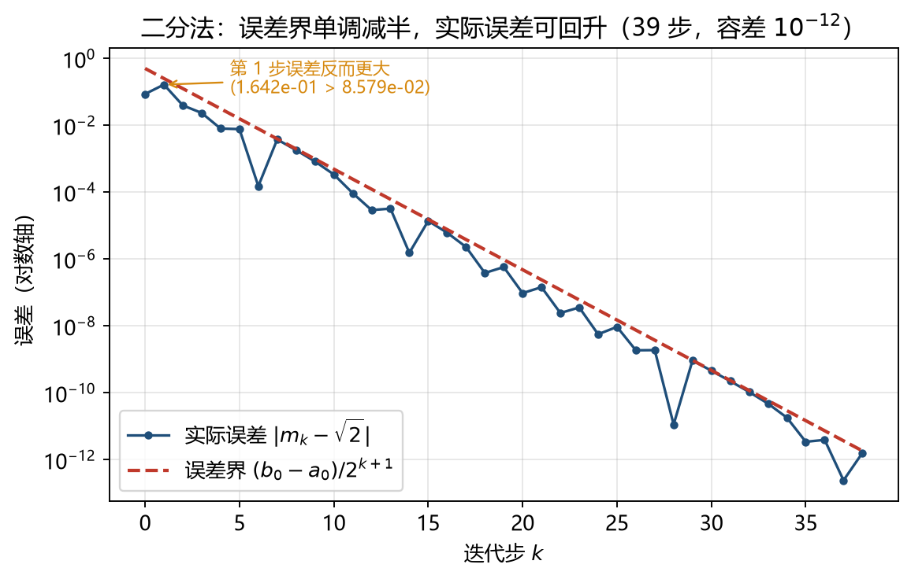
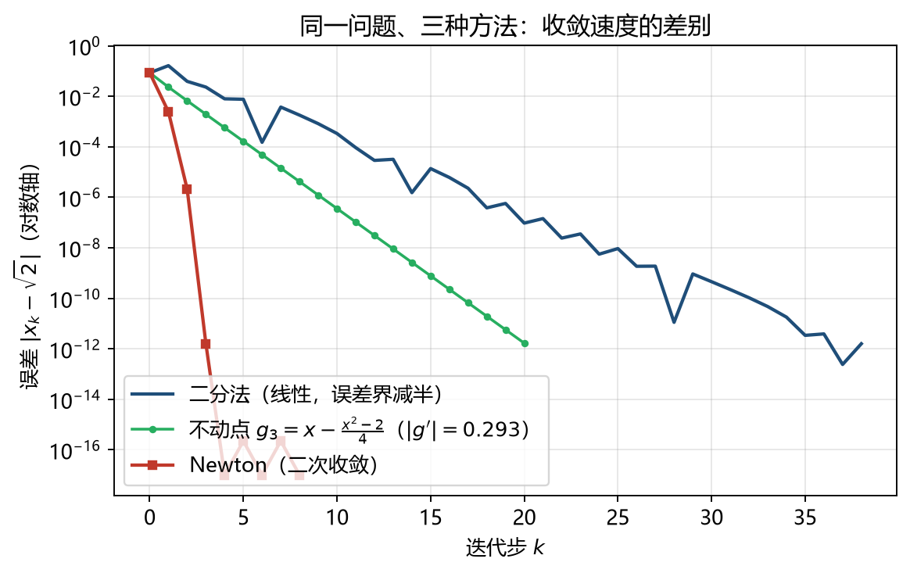
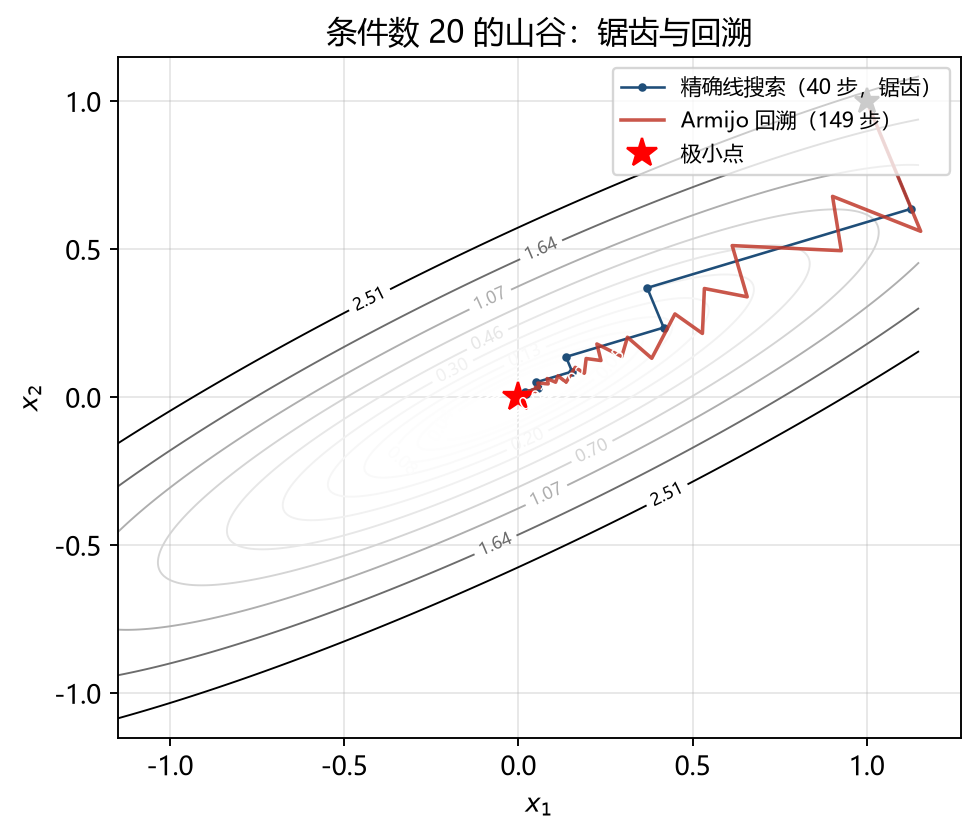
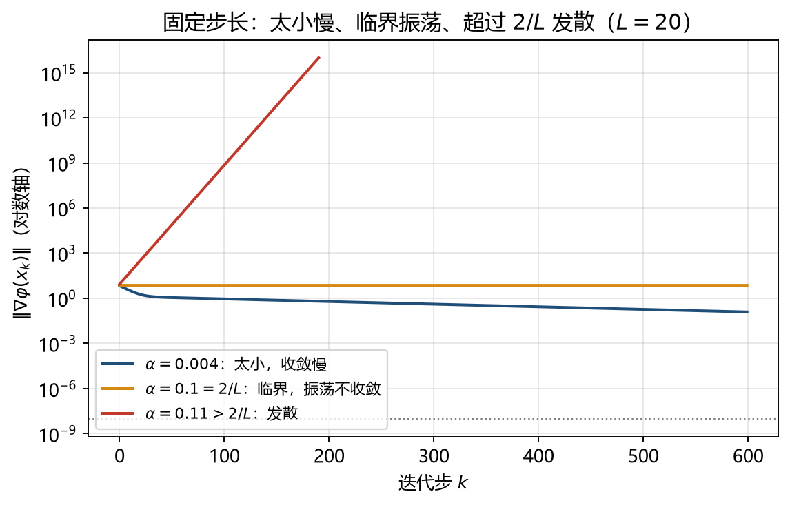
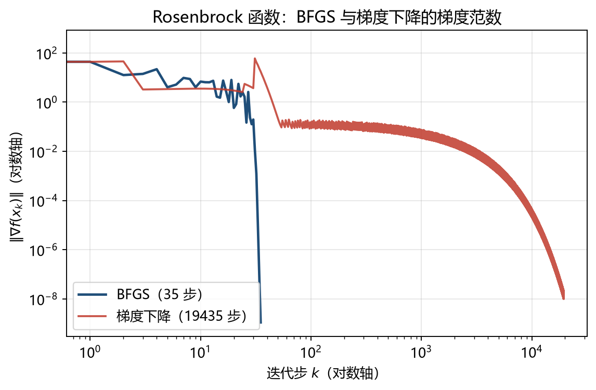
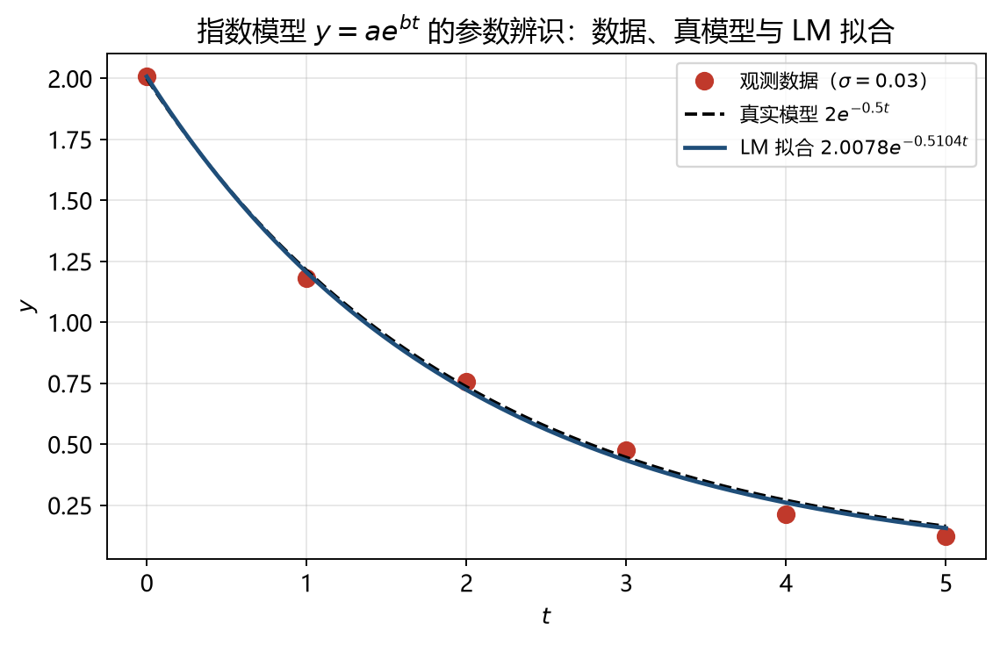
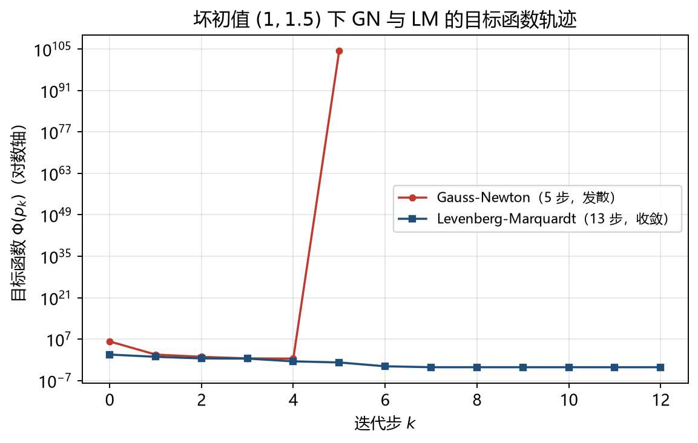
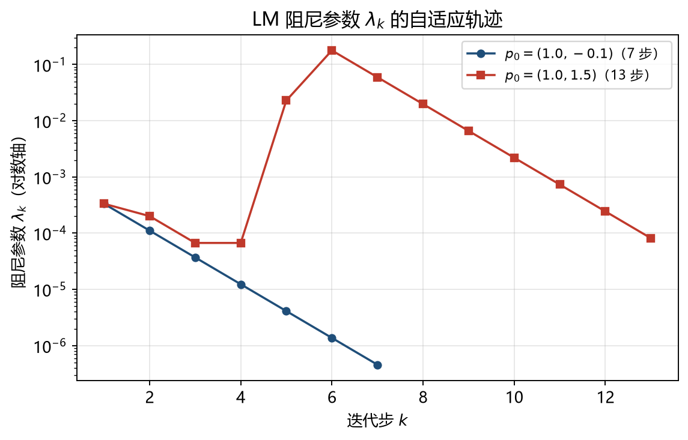
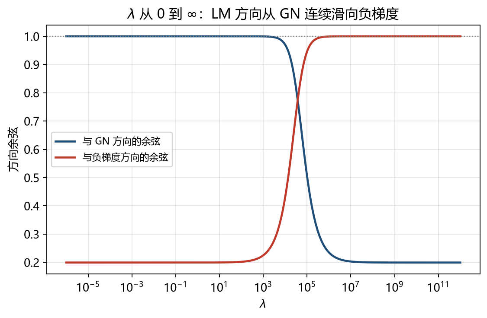

# 第5章 实验与验证：从代码到证据

> **配套正文：** 《第5章 寻优的旅程》5.1—5.4。
> **使用方式：** 每个实验都按“目的—原理—任务—代码—输出—分析—判据—追问”组织。先**预测**再运行，把实际输出抄进记录表，最后用判据判断“通过 / 部分通过 / 不通过”。本文件不是答案册：同一段代码换一个初值、换一个容差，结论可能就变了，记录下变化比抄下数字更重要。
> **组别：** A1 组（G9）。公开版本只写组别，不写姓名与账号。

---

## 0 实验总览与复现约定

### 0.1 实验与正文的对应关系

| 实验 | 对应正文 | 主题 | 类型 | 核心判据 |
| --- | --- | --- | --- | --- |
| 5.1-A | 5.1.1 | 二分法与区间误差界 | 基础 | 迭代次数满足 $k\ge\log_2\frac{b_0-a_0}{2\varepsilon}$；误差不超过误差界 |
| 5.1-B | 5.1.2 | 不动点改写、压缩因子与收敛阶 | 基础 | 误差比趋于 $\lvert g'(x^{\ast})\rvert$；阶估计 $p\approx1$ 或 $2$ |
| 5.1-C | 5.1.3 | Newton 的二次收敛与三种失效 | 进阶 | $e_{k+1}/e_k^2$ 趋于常数；重根退化为线性；出现二周期 |
| 5.2-A | 5.2.1 | 驻点分类与二阶条件 | 基础 | Hessian 特征值符号与极小/鞍点一致；半正定不足以判定极小 |
| 5.2-B | 5.2.2 | 步长、条件数与锯齿 | 进阶 | $\alpha<2/L$ 收敛、$\alpha>2/L$ 发散；条件数越大越慢 |
| 5.2-C | 5.2.3 | Armijo 回溯、Wolfe 与信赖域 | 进阶 | 充分下降成立；函数评估次数可解释；$\Delta\downarrow\Rightarrow\lambda\uparrow$ |
| 5.3-A | 5.3.1 | 求根 Newton 与优化 Newton | 基础 | 优化 Newton 对 $\nabla f=0$ 二次收敛；Hessian 不定时方向不下降 |
| 5.3-B | 5.3.2 | 阻尼与 Hessian 修正 | 进阶 | 纯 Newton 可发散；阻尼/修正后单调收敛 |
| 5.3-C | 5.3.3 | BFGS、割线条件与超线性 | 挑战 | $\boldsymbol B_{k+1}\boldsymbol s_k=\boldsymbol y_k$；正定保持；远快于梯度法 |
| 5.4-A | 5.4.1 | 残差、Jacobian 与 Hessian 分解 | 基础 | 解析梯度与差分一致；$\boldsymbol S$ 的占比可量化 |
| 5.4-B | 5.4.2 | GN 的一步、慢收敛与崩溃 | 进阶 | 线性模型一步到位；坏初值/秩亏时失败 |
| 5.4-C | 5.4.3 | LM 阻尼、$\rho$ 与参数辨识 | 挑战 | $\rho>0$ 才接受；坏初值仍收敛；标准误覆盖真值 |
| 综合 | 全章 | 四条路线的横向对照 | 综合 | 同一问题、同一容差下的迭代数、评估数与结论 |

### 0.2 环境与可复现性

本文所有“实测输出”均在下列环境运行得到：

```text
Python      3.14.6 (Anaconda)
NumPy       2.4.6
SciPy       1.18.0
Matplotlib  3.11.0
系统        macOS (Apple Silicon)
```

复现时至少记录：**Python 与库版本、随机种子、初值、容差、最大迭代数、运行日期、代码 commit SHA**。本文固定 `np.random.default_rng(42)`；只要种子与数据长度不变，噪声序列可逐位复现。

约定：

- 迭代从 $k=0$ 开始计数；表中“迭代次数”指**实际执行的更新步数**。
- 停止准则统一写作 $\|\nabla f(\boldsymbol x_k)\|_2\le\varepsilon$ 或 $\|f(x_k)\|\le\varepsilon$，但**必须同时报告退出原因**（梯度达标 / 步长过小 / 达到上限 / 数值溢出）。
- 函数评估次数（`fev`）与迭代次数分开记录；线搜索的代价主要体现在前者。
- 图片放在 `工作/图片/`，正文与本文都用相对路径 `图片/文件名` 引用。

### 0.3 判据与三档结论

每个实验结束时，按三档给出结论：

1. **复现**：实际输出与本文给出的数量级、趋势、判据一致（允许由浮点与实现差异造成的末位差别）。
2. **解释**：能用自己的话说明“为什么是这个结果”，并指出哪一个假设在起作用。
3. **反驳**：能构造一个反例或边界情形，说明某条“看起来天经地义”的说法在什么条件下不成立。

只做到第 1 档，说明会跑代码；做到第 2 档，说明理解了方法；做到第 3 档，才算真正掌握了条件。

### 0.4 公共代码

后续实验共用下面几个函数。把它们保存为 `lab_common.py`，或在同一个 Notebook 的前两个 cell 中运行。

```python
import numpy as np

np.set_printoptions(precision=6, suppress=True)


def bisect(f, a, b, tol=1e-12, maxit=200):
    """二分法：要求 f(a)*f(b) < 0。返回 (迭代历史, 是否达标)。"""
    fa, fb = f(a), f(b)
    if fa * fb >= 0:
        raise ValueError("区间端点必须异号")
    hist = []
    for k in range(maxit):
        if (b - a) / 2 <= tol:
            return hist, True
        m = 0.5 * (a + b)
        fm = f(m)
        hist.append((k, a, b, m, fm))
        if fm == 0:
            return hist, True
        if fa * fm < 0:
            b, fb = m, fm
        else:
            a, fa = m, fm
    return hist, False


def fixed_point(g, x0, tol=1e-12, maxit=200):
    """不动点迭代 x_{k+1}=g(x_k)。"""
    x, hist = x0, [x0]
    for _ in range(maxit):
        x = g(x)
        hist.append(x)
        if abs(hist[-1] - hist[-2]) <= tol:
            return np.array(hist), True
    return np.array(hist), False


def newton1d(f, df, x0, tol=1e-12, maxit=50):
    """标量 Newton 法。"""
    x, hist = x0, [x0]
    for _ in range(maxit):
        if df(x) == 0:
            return np.array(hist), False
        x = x - f(x) / df(x)
        hist.append(x)
        if abs(f(x)) <= tol:
            return np.array(hist), True
    return np.array(hist), False


def armijo(f, grad, x0, alpha0=1.0, c1=1e-4, rho=0.5, tol=1e-8, maxit=10000):
    """负梯度方向 + Armijo 回溯。返回 (轨迹, 步长序列, 函数评估次数, 是否达标)。"""
    x = np.asarray(x0, dtype=float).copy()
    hist, alphas, fev = [x.copy()], [], 0
    for _ in range(maxit):
        fx, g = f(x), grad(x)
        if np.linalg.norm(g) <= tol:
            return np.array(hist), alphas, fev, True
        d, a = -g, alpha0
        while f(x + a * d) > fx + c1 * a * (g @ d):
            a *= rho
            fev += 1
            if a < 1e-16:
                return np.array(hist), alphas, fev, False
        fev += 1
        alphas.append(a)
        x = x + a * d
        hist.append(x.copy())
    return np.array(hist), alphas, fev, False
```

BFGS 与 LM 的实现放在对应实验里（5.3-C、5.4-C），避免一开始就给出过长代码。

### 0.5 记录表模板

| 项目 | 填写内容 |
| --- | --- |
| 运行前预测 | 预计迭代次数、误差量级、是否收敛 |
| 输入与初值 | 函数、区间/初值、容差、最大迭代 |
| 环境 | Python / NumPy / SciPy 版本，随机种子 |
| 实际输出 | 迭代次数、最终误差、退出原因、关键中间量 |
| 与判据比较 | 通过 / 部分通过 / 不通过，差在哪 |
| 解释 | 用哪条定理或公式解释现象 |
| 反例或边界 | 改变哪个条件会让结论翻转 |

---

## 5.1 非线性方程：从夹逼到迭代

### 实验 5.1-A 二分法：误差界到底保证了什么？

**对应正文：** 5.1.1　**类型：** 基础　**建议用时：** 20 分钟

**目的。** 亲手验证“区间长度误差界”是一个**保证**，而不是“实际误差曲线”；学会用 $\log_2$ 估算迭代次数；理解“中点误差可以回升，但误差界不会”。

**原理。** 设初始区间为 $[a_0,b_0]$，第 $k$ 次二分后区间长度为 $(b_0-a_0)/2^k$，取中点 $m_k$ 作为近似根，则

$$
|x^{\ast}-m_k|\le\frac{b_0-a_0}{2^{k+1}} .
$$

要让误差不超过 $\varepsilon$，只需

$$
k\ge\log_2\frac{b_0-a_0}{2\varepsilon}.
$$

**任务。**

1. 对 $f(x)=x^2-2=0$、$[1,2]$、$\varepsilon=10^{-12}$ 运行二分法。
2. 记录前 5 步与最后 3 步，比较误差界和实际误差。
3. 换成 $f(x)=x^3-2x+2=0$、$[-2,0]$、$\varepsilon=10^{-10}$，验证“只要端点异号就一定收敛”。
4. 把容差改为 $10^{-6}$，预测并核对迭代次数。

**代码。**

```python
import numpy as np
from lab_common import bisect

f = lambda x: x * x - 2.0
hist, ok = bisect(f, 1.0, 2.0, tol=1e-12)
r2 = np.sqrt(2.0)
print("iterations:", len(hist), " ok:", ok)
for k, a, b, m, fm in hist[:5] + hist[-3:]:
    print(f"k={k:<3} 区间=[{a:.10f},{b:.10f}] 半宽={(b-a)/2:.3e} "
          f"m={m:.10f} f(m)={fm:+.3e} |m-√2|={abs(m-r2):.3e}")
print("理论下界:", int(np.ceil(np.log2(1.0 / (2 * 1e-12)))))
```

**实测输出。**

```text
iterations: 39  ok: True
k=0   区间=[1.0000000000,2.0000000000] 半宽=5.000e-01 m=1.5000000000 f(m)=+2.500e-01 |m-√2|=8.579e-02
k=1   区间=[1.0000000000,1.5000000000] 半宽=2.500e-01 m=1.2500000000 f(m)=-4.375e-01 |m-√2|=1.642e-01
k=2   区间=[1.2500000000,1.5000000000] 半宽=1.250e-01 m=1.3750000000 f(m)=-1.094e-01 |m-√2|=3.921e-02
k=3   区间=[1.3750000000,1.5000000000] 半宽=6.250e-02 m=1.4375000000 f(m)=+6.641e-02 |m-√2|=2.329e-02
k=4   区间=[1.3750000000,1.4375000000] 半宽=3.125e-02 m=1.4062500000 f(m)=-2.246e-02 |m-√2|=7.964e-03
k=36  区间=[1.4142135624,1.4142135624] 半宽=7.276e-12 m=1.4142135624 f(m)=+1.097e-11 |m-√2|=3.877e-12
k=37  区间=[1.4142135624,1.4142135624] 半宽=3.638e-12 m=1.4142135624 f(m)=+6.755e-13 |m-√2|=2.387e-13
k=38  区间=[1.4142135624,1.4142135624] 半宽=1.819e-12 m=1.4142135624 f(m)=-4.470e-12 |m-√2|=1.580e-12
理论下界: 39
```

第二个方程：

```python
g = lambda x: x ** 3 - 2 * x + 2
hist2, ok2 = bisect(g, -2.0, 0.0, tol=1e-10)
print("g(-2)=", g(-2), "g(0)=", g(0))
print("iterations:", len(hist2), "root≈", hist2[-1][3], "residual:", hist2[-1][4])
```

```text
g(-2)= -2 g(0)= 2
iterations: 34 root≈ -1.7692923542344943 residual: 3.057820663343591e-11
```

**分析。**

- 第 1 步的实际误差（$1.642\times10^{-1}$）比第 0 步（$8.579\times10^{-2}$）**更大**。这并不违反定理：定理保证的是“半宽不超过界”，不是“误差单调下降”。图 1 清楚地显示了这一点。
- 39 次迭代恰好等于 $\lceil\log_2(1/(2\times10^{-12}))\rceil$，说明二分法的迭代次数只由区间长度和容差决定，与 $f$ 的具体形状无关。
- $f(x)=x^3-2x+2$ 在 $[-2,0]$ 上端点异号，34 次后得到根 $-1.7692923542$，残差 $3.06\times10^{-11}$。这里“区间长度”与“残差”都小，但两者不是一回事（见 5.1.1 的辨析）。



**判据。**

- 迭代次数与 $\lceil\log_2\frac{b_0-a_0}{2\varepsilon}\rceil$ 相差不超过 1；
- 每一步的 $\lvert m_k-x^{\ast}\rvert\le(b_0-a_0)/2^{k+1}$；
- 能指出“实际误差非单调”与“误差界单调”并不矛盾。

**追问。**

1. 若 $f(a)f(b)>0$ 但区间内确实有偶数个根，二分法会怎样？构造一个例子。
2. 把容差从 $10^{-6}$ 改到 $10^{-12}$，迭代次数增加多少？与 $\log_2 10^6$ 比较。
3. 二分法能否用来求 $f(x)=x^2+1=0$ 的复根？为什么？

---

### 实验 5.1-B 不动点迭代：改写方式决定收敛命运

**对应正文：** 5.1.2　**类型：** 基础　**建议用时：** 30 分钟

**目的。** 对同一个方程构造三种等价改写，观察“收敛 / 振荡 / 二次收敛”三种结局；用误差序列估计收敛阶；验证压缩因子 $\lvert g'(x^{\ast})\rvert$ 的预测能力。

**原理。** 若 $x^{\ast}=g(x^{\ast})$ 且 $\lvert g'(x^{\ast})\rvert<1$，则迭代局部线性收敛，且

$$
\frac{e_{k+1}}{e_k}\to \lvert g'(x^{\ast})\rvert,\qquad
p=\lim_{k\to\infty}\frac{\log(e_{k+1}/e_k)}{\log(e_k/e_{k-1})}.
$$

$p=1$ 为线性收敛，$p=2$ 为二次收敛。$g'(x^{\ast})=0$ 时线性理论失效，收敛会加速。

**任务。**

1. 对 $x^2-2=0$ 构造三种改写：

$$
g_1(x)=\frac12\left(x+\frac2x\right),\qquad
g_2(x)=\frac2x,\qquad
g_3(x)=x-\frac{x^2-2}{4}.
$$

2. 从 $x_0=1.5$ 各迭代 30 步，记录误差 $e_k=\lvert x_k-\sqrt2\rvert$。
3. 计算三者的 $\lvert g'(x^{\ast})\rvert$，与实测误差比对照。
4. 用误差序列估计 $g_1$、$g_3$ 的收敛阶。

**代码。**

```python
import numpy as np
from lab_common import fixed_point

r2 = np.sqrt(2.0)
cases = {
    "g1=(x+2/x)/2": (lambda x: 0.5 * (x + 2.0 / x), lambda x: 0.5 * (1 - 2.0 / x**2)),
    "g2=2/x":       (lambda x: 2.0 / x,               lambda x: -2.0 / x**2),
    "g3=x-(x^2-2)/4": (lambda x: x - (x*x - 2)/4,     lambda x: 1 - x/2),
}
for name, (g, dg) in cases.items():
    xs, ok = fixed_point(g, 1.5, tol=1e-14, maxit=30)
    err = np.abs(xs - r2)
    print(name, " ok=", ok, " x_end=", xs[-1])
    print("   |g'(x*)| =", f"{abs(dg(r2)):.6f}")
    print("   errors:", " ".join(f"{e:.2e}" for e in err[:6]))
    # 误差比与阶估计（避开舍入噪声）
    for k in range(1, 5):
        if err[k] > 1e-14 and err[k-1] > 1e-14:
            print(f"   k={k}: e_k/e_(k-1)={err[k]/err[k-1]:.4f}")
```

**实测输出。**

```text
g1=(x+2/x)/2  ok= True  x_end= 1.4142135623730951
   |g'(x*)| = 0.000000
   errors: 8.58e-02 2.45e-03 2.12e-06 1.59e-12 2.22e-16 2.22e-16
   k=1: e_k/e_(k-1)=0.0286
   k=2: e_k/e_(k-1)=0.0009
   k=3: e_k/e_(k-1)=0.0000
   k=4: e_k/e_(k-1)=0.0000
g2=2/x  ok= False  x_end= 1.5
   |g'(x*)| = 1.000000
   errors: 8.58e-02 8.09e-02 8.58e-02 8.09e-02 8.58e-02 8.09e-02
   k=1: e_k/e_(k-1)=0.9431
   k=2: e_k/e_(k-1)=1.0607
   k=3: e_k/e_(k-1)=0.9431
   k=4: e_k/e_(k-1)=1.0607
g3=x-(x^2-2)/4  ok= True  x_end= 1.4142135623730987
   |g'(x*)| = 0.292893
   errors: 8.58e-02 2.33e-02 6.68e-03 1.95e-03 5.69e-04 1.67e-04
   k=1: e_k/e_(k-1)=0.2714
   k=2: e_k/e_(k-1)=0.2871
   k=3: e_k/e_(k-1)=0.2912
   k=4: e_k/e_(k-1)=0.2924
```

收敛阶估计（取误差适中的几步）：

```python
def order(err):
    out = []
    for k in range(1, len(err) - 1):
        if min(err[k-1], err[k], err[k+1]) > 1e-14:
            out.append(np.log(err[k+1]/err[k]) / np.log(err[k]/err[k-1]))
    return out

for name, g in [("g1", lambda x: 0.5*(x+2/x)), ("g3", lambda x: x-(x*x-2)/4)]:
    xs, _ = fixed_point(g, 1.5, tol=1e-15, maxit=12)
    err = np.abs(xs - r2)
    print(name, [f"{p:.2f}" for p in order(err)])
```

```text
g1 ['1.98', '2.00']
g3 ['0.96', '0.99', '1.00', '1.00', '1.00', '1.00', '1.00', '1.00', '1.00', '1.00']
```

**分析。**

- $g_1$ 的 $\lvert g'(\sqrt2)\rvert=0$，线性理论失效，实测阶为 2；这解释了为什么 Newton 法（等价于 $g_1$ 的推广）会二次收敛。
- $g_2$ 的 $\lvert g'\rvert=1$，误差在 $8.1\times10^{-2}$ 与 $8.6\times10^{-2}$ 之间来回跳，既不收敛也不发散；迭代值在 $\sqrt2\pm0.086$ 附近振荡。
- $g_3$ 的 $\lvert g'\rvert=0.292893$，误差比逐步逼近该值（0.2714 → 0.2871 → 0.2912 → 0.2924），阶为 1，是最标准的线性收敛。
- 结论：**“同一个方程的不同改写”不是文字游戏，它直接改变压缩因子，从而改变收敛速度甚至收敛性。**



**判据。**

- 三种改写的实测行为与 $\lvert g'(x^{\ast})\rvert$ 的预测一致（收敛 / 临界振荡 / 二次）；
- $g_3$ 的误差比与 0.292893 的偏差随迭代缩小；
- 阶估计 $p$ 在 $1.0$ 与 $2.0$ 附近，且能解释为什么 $g_1$ 不能按线性公式估计。

**追问。**

1. 对 $x^3-x-1=0$ 写出 $x=(x+1)^{1/3}$ 与 $x=x^3-1$ 两种改写，预测并验证收敛性。
2. 为什么 $g'(x^{\ast})=-1$ 时会出现“等幅振荡”？用误差递推 $e_{k+1}\approx g'(x^{\ast})e_k$ 解释。
3. 若 $\lvert g'(x^{\ast})\rvert=0.99$，要把误差从 $10^{-1}$ 降到 $10^{-10}$ 需要多少步？

---

### 实验 5.1-C Newton 法：二次收敛与三种失效

**对应正文：** 5.1.3　**类型：** 进阶　**建议用时：** 40 分钟

**目的。** 验证单根处 $e_{k+1}\approx\frac{\lvert f''\rvert}{2\lvert f'\rvert}e_k^2$；观察重根导致的线性退化；复现“从 0 出发的二周期”；把标量 Newton 推广到方程组并观察 Jacobian 的作用。

**原理。**

$$
x_{k+1}=x_k-\frac{f(x_k)}{f'(x_k)},\qquad
e_{k+1}\approx\frac{f''(x^{\ast})}{2f'(x^{\ast})}e_k^2 .
$$

重根 $f(x)=(x-x^{\ast})^m h(x)$ 时，$e_{k+1}\approx(1-\frac1m)e_k$，二次收敛退化为线性。

**任务。**

1. 对 $f(x)=x^2-2$ 从 $x_0=1$ 迭代 5 步，记录 $e_k$ 与 $e_{k+1}/e_k^2$。
2. 对 $f(x)=(x-1)^2$ 从 $x_0=2$ 迭代，观察误差比。
3. 对 $f(x)=x^3-2x+2$ 从 $x_0=0$ 出发，记录前 6 步。
4. 解方程组 $\boldsymbol F(x,y)=(x^2+y^2-4,\ y-x^2+1)=\boldsymbol 0$，初值 $(1,1)$，记录每步 $\|\boldsymbol F\|$。

**代码。**

```python
import numpy as np
from lab_common import newton1d

r2 = np.sqrt(2.0)
xs, ok = newton1d(lambda x: x*x - 2, lambda x: 2*x, 1.0, tol=1e-15, maxit=10)
err = np.abs(xs - r2)
print("Newton sqrt2:", xs)
print("errors:", " ".join(f"{e:.3e}" for e in err))
print("ratios:", " ".join(f"{err[k+1]/err[k]**2:.6f}" for k in range(4)))
print("asymptotic 1/(2*sqrt2) =", 1/(2*r2))

# 重根：手工迭代 6 步，观察误差比
xs2 = [2.0]
for _ in range(6):
    x = xs2[-1]
    xs2.append(x - (x-1)**2 / (2*(x-1)))
print("multiple root:", [f"{x:.6f}" for x in xs2])
print("errors:", [f"{abs(x-1):.3e}" for x in xs2])
print("ratios:", [f"{abs(xs2[k+1]-1)/abs(xs2[k]-1):.3f}" for k in range(5)])

# 二周期
xs3, _ = newton1d(lambda x: x**3 - 2*x + 2, lambda x: 3*x*x - 2, 0.0, tol=1e-15, maxit=8)
print("cycle:", xs3)

# 方程组 Newton
F = lambda v: np.array([v[0]**2 + v[1]**2 - 4, v[1] - v[0]**2 + 1])
J = lambda v: np.array([[2*v[0], 2*v[1]], [-2*v[0], 1.0]])
v = np.array([1.0, 1.0])
for k in range(5):
    v = v + np.linalg.solve(J(v), -F(v))
    print(f"k={k+1}: x={v[0]:.12f} y={v[1]:.12f} ||F||={np.linalg.norm(F(v)):.3e}")
```

**实测输出。**

```text
Newton sqrt2: [1.         1.5        1.41666667 1.41421569 1.41421356 1.41421356]
errors: 4.142e-01 8.579e-02 2.453e-03 2.124e-06 1.595e-12 0.000e+00
ratios: 0.500000 0.333333 0.352941 0.353522
asymptotic 1/(2*sqrt2) = 0.35355339059327373
multiple root: ['2.000000', '1.500000', '1.250000', '1.125000', '1.062500', '1.031250', '1.015625']
errors: ['1.000e+00', '5.000e-01', '2.500e-01', '1.250e-01', '6.250e-02', '3.125e-02', '1.562e-02']
ratios: ['0.500', '0.500', '0.500', '0.500', '0.500']
cycle: [0. 1. 0. 1. 0. 1. 0. 1. 0.]
k=1: x=1.666666666667 y=1.333333333333 ||F||=7.115e-01
k=2: x=1.524242424242 y=1.303030303030 ||F||=2.934e-02
k=3: x=1.517504876521 y=1.302775655717 ||F||=6.424e-05
k=4: x=1.517489913626 y=1.302775637732 ||F||=3.166e-10
k=5: x=1.517489913552 y=1.302775637732 ||F||=2.220e-16
```

**分析。**

- $e_{k+1}/e_k^2$ 迅速稳定在 $1/(2\sqrt2)=0.353553$，这就是“二次收敛”的可观测证据。第 0 步比值 0.5 是初值造成的暂态，不必强求从第一步就吻合。
- 重根处误差每步减半（0.5 → 0.25 → 0.125 → …），比值恒为 0.5，与理论 $\frac{m-1}{m}=0.5$ 一致；此时 Newton 只算“线性收敛”，需要修正（如 $x_{k+1}=x_k-m\frac{f}{f'}$）才能恢复二次。
- 从 $x_0=0$ 出发，$x_1=1$、$x_2=0$，进入严格二周期，永远到不了根。这说明“Newton 局部收敛”中的“局部”不是客套话。
- 方程组版本每步解一个 $2\times2$ 线性系统，$\|\boldsymbol F\|$ 从 $7\times10^{-1}$ 降到 $2\times10^{-16}$，只用 5 步；二次收敛在向量情形同样成立。

**判据。**

- 单根时 $e_{k+1}/e_k^2\to0.3536$（相对误差 10% 以内即可）；
- 重根时误差比稳定在 0.5；
- 二周期能被完整复现（0 与 1 交替）；
- 方程组 Newton 的 $\|\boldsymbol F\|$ 每步近似平方下降。

**追问。**

1. 若把二周期例子的初值改成 $x_0=0.1$ 或 $-1$，还会循环吗？用代码验证并解释“吸引域”。
2. 重根情形下，改用 $x_{k+1}=x_k-2\frac{f(x_k)}{f'(x_k)}$ 会发生什么？
3. 方程组若在解处 $\boldsymbol J$ 奇异，Newton 会怎样？构造一个例子。

---

### 5.1 本节验证清单

- [ ] 二分法迭代次数能用公式预测；
- [ ] 能解释“实际误差回升”与“误差界单调”的差别；
- [ ] 三种不动点改写的收敛性有实测证据；
- [ ] Newton 的二次收敛有比值表支撑；
- [ ] 重根、二周期、方程组三种情形都有输出截图或表格。

---

## 5.2 下降方向：往哪里走，走多远

### 实验 5.2-A 驻点分类：Hessian 说了算

**对应正文：** 5.2.1　**类型：** 基础　**建议用时：** 20 分钟

**目的。** 用特征值判定驻点类型；亲手构造“梯度为零、Hessian 半正定，却不是极小点”的反例；分清一阶必要条件与二阶充分条件。

**原理。** 若 $\nabla f(\boldsymbol x^{\ast})=\boldsymbol 0$：

- $\nabla^2f(\boldsymbol x^{\ast})\succ0$（正定）⇒ 严格局部极小；
- $\nabla^2f(\boldsymbol x^{\ast})\prec0$（负定）⇒ 严格局部极大；
- 特征值有正有负 ⇒ 鞍点；
- 半正定 / 半负定 ⇒ 判据失效，需要更高阶信息。

**任务。**

1. 对下列函数在原点求梯度与 Hessian，判定类型：

$$
f_1=x^2+20y^2,\quad f_2=x^2-y^2,\quad f_3=x^4+y^4,\quad f_4=x^2-y^3.
$$

2. 对 $f_4$ 沿 $y>0$ 方向取点，说明“半正定但不是极小”。
3. 对 $f=x^2-y^2$ 在 $(1,2)$ 处计算 Newton 方向，验证它**不是**下降方向。

**代码。**

```python
import numpy as np

cases = {
    "x^2+20y^2": np.diag([2.0, 40.0]),
    "x^2-y^2":   np.diag([2.0, -2.0]),
    "x^4+y^4":   np.diag([0.0, 0.0]),
    "x^2-y^3":   np.diag([2.0, 0.0]),
}
for name, H in cases.items():
    ev = np.linalg.eigvalsh(H)
    kind = "正定" if ev.min() > 0 else ("负定" if ev.max() < 0 else
           ("不定" if ev.min() < 0 < ev.max() else "半正定/半负定"))
    print(f"{name}: eig={ev}, {kind}")

print(f"f4(0,0.1) = {0.0**2 - 0.1**3:.6f} < f4(0,0) = 0")

# f=x^2-y^2 在 (1,2) 的 Newton 方向
v = np.array([1.0, 2.0])
g = np.array([2*v[0], -2*v[1]])
H = np.diag([2.0, -2.0])
d = np.linalg.solve(H, -g)
print("g =", g, " d =", d, " g^T d =", g @ d)
print("f(v) =", v[0]**2 - v[1]**2, " f(v+d) =", (v+d)[0]**2 - (v+d)[1]**2)
```

**实测输出。**

```text
x^2+20y^2: eig=[ 2. 40.], 正定
x^2-y^2: eig=[-2.  2.], 不定
x^4+y^4: eig=[0. 0.], 半正定/半负定
x^2-y^3: eig=[0. 2.], 半正定/半负定
f4(0,0.1) = -0.001  < f4(0,0) = 0
g = [ 2. -4.]  d = [-1. -2.]  g^T d = 6.0
f(v) = -3.0  f(v+d) = 0.0
```

**分析。**

- $f_1$ 的 Hessian 特征值为 2 与 40，正定 ⇒ 严格局部极小；条件数 20 也解释了后面梯度法为什么慢。
- $f_2$ 特征值一正一负 ⇒ 鞍点；沿 $x$ 方向上升、沿 $y$ 方向下降。
- $f_3$ 的 Hessian 在原点为零矩阵，半正定，但 $f_3=x^4+y^4$ 在原点确实取极小；这说明“半正定”不能单独判定，需要看高阶项。
- $f_4$ 是更尖锐的反例：Hessian 半正定，但 $f_4(0,0.1)<f_4(0,0)$，原点不是极小。**“Hessian 半正定”只是必要条件的边界，不是充分条件。**
- 在 $(1,2)$ 处，$g^{\top}d=6>0$，Newton 方向让函数值从 $-3$ 升到 $0$：Hessian 不定时，Newton 方向可能完全指向“上坡”。

**判据。**

- 四个例子的分类与特征值一致；
- 能指出 $f_3$ 与 $f_4$ 的区别（一个确实是极小，一个不是），说明“半正定”不足以判定；
- 能算出 $g^{\top}d>0$ 并解释“Newton 方向不一定是下降方向”。

**追问。**

1. 对 $f=x^2+y^4$ 在原点，Hessian 是什么？它是极小点吗？
2. 一阶必要条件在边界点上还成立吗？举一个约束例子。
3. 若 $\nabla f(\boldsymbol x^{\ast})=0$ 且 Hessian 正定，能否保证是**全局**极小？

---

### 实验 5.2-B 步长与条件数：为什么会“锯齿”？

**对应正文：** 5.2.2　**类型：** 进阶　**建议用时：** 30 分钟

**目的。** 验证固定步长的收敛条件 $\alpha<2/L$；观察条件数对梯度法的影响；比较固定步长、精确线搜索与 Armijo 的迭代行为。

**原理。** 对二次函数 $\varphi(\boldsymbol x)=\frac12\boldsymbol x^{\top}\boldsymbol H\boldsymbol x$，梯度下降

$$
\boldsymbol x_{k+1}=\boldsymbol x_k-\alpha\nabla\varphi(\boldsymbol x_k)
$$

收敛当且仅当 $0<\alpha<2/\lambda_{\max}(\boldsymbol H)$。精确线搜索的步长为

$$
\alpha_k=\frac{\boldsymbol g_k^{\top}\boldsymbol g_k}{\boldsymbol g_k^{\top}\boldsymbol H\boldsymbol g_k},
$$

其最坏情形收敛因子为 $\left(\frac{\kappa-1}{\kappa+1}\right)^2$，$\kappa=\lambda_{\max}/\lambda_{\min}$。

> **为什么把例子旋转 30°？** 正文的 $\varphi=\frac12(x^2+20y^2)$ 起点若落在坐标轴上，$y$ 分量会被一步压到 0，得到“偶然很快”的假象。把同一 Hessian 旋转 30°（特征值仍是 1 与 20），可以稳定地暴露条件数效应。

**任务。**

1. 取 $\boldsymbol H=\boldsymbol R\operatorname{diag}(1,20)\boldsymbol R^{\top}$，$\boldsymbol R$ 为 30° 旋转，$\boldsymbol x_0=(1,1)$。
2. 对 $\alpha\in\{0.004,0.009,0.045,0.09,0.11\}$ 运行梯度下降，记录达到 $\|\nabla\varphi\|\le10^{-8}$ 的迭代数（上限 20000）。
3. 用精确线搜索重跑，记录迭代数与前几个步长。
4. 画出轨迹与收敛曲线。

**代码。**

```python
import numpy as np

th = np.deg2rad(30)
R = np.array([[np.cos(th), -np.sin(th)], [np.sin(th), np.cos(th)]])
H = R @ np.diag([1.0, 20.0]) @ R.T
phi = lambda v: 0.5 * v @ H @ v
gphi = lambda v: H @ v
print("H =", H, " eig =", np.linalg.eigvalsh(H))

def gd_fixed(alpha, itmax=20000, tol=1e-8):
    v, hist = np.array([1.0, 1.0]), [np.array([1.0, 1.0])]
    for k in range(itmax):
        v = v - alpha * gphi(v)
        hist.append(v.copy())
        if np.linalg.norm(gphi(v)) <= tol:
            return k + 1, hist, True
    return itmax, hist, False

for a in [0.004, 0.009, 0.045, 0.09, 0.11]:
    k, hist, ok = gd_fixed(a)
    print(f"alpha={a:<6} k={k:<6} ok={ok} ||g||={np.linalg.norm(gphi(hist[-1])):.2e}")

def gd_exact(itmax=5000, tol=1e-8):
    v, hist, alphas = np.array([1.0, 1.0]), [np.array([1.0, 1.0])], []
    for k in range(itmax):
        g = gphi(v)
        a = g @ g / (g @ H @ g)
        alphas.append(a)
        v = v - a * g
        hist.append(v.copy())
        if np.linalg.norm(gphi(v)) <= tol:
            return k + 1, hist, alphas, True
    return itmax, hist, alphas, False

k, hist, alphas, ok = gd_exact()
print("exact line search: k=", k, "ok=", ok, "first alphas:", [f"{a:.4f}" for a in alphas[:6]])
print("theory bound (k-1)/(k+1) =", 19/21)
```

**实测输出。**

```text
H = [[ 5.75     -8.227241]
     [-8.227241 15.25    ]]  eig = [ 1. 20.]
alpha=0.004  k=4674   ok=True  ||g||=9.99e-09
alpha=0.009  k=2073   ok=True  ||g||=9.91e-09
alpha=0.045  k=407    ok=True  ||g||=9.93e-09
alpha=0.09   k=199    ok=True  ||g||=9.65e-09
alpha=0.11   k=20000  ok=False ||g||=nan
exact line search: k= 39 ok= True first alphas: ['0.0517', '0.6100', '0.0517', '0.6100', '0.0517', '0.6100']
theory bound (k-1)/(k+1) = 0.9047619047619048
```

**分析。**

- $2/L=2/20=0.1$。$\alpha=0.11>0.1$ 时迭代发散（20000 步后溢出为 NaN）；$\alpha=0.09$ 恰好在上界内，199 步达标。这条“硬边界”是固定步长最危险的坑。
- 在允许范围内，步长越大收敛越快（4674 → 2073 → 407 → 199），但越接近 $0.1$ 越容易因舍入或非二次项越界。
- 精确线搜索 39 步达标，步长在 $0.0517$ 与 $0.6100$ 之间交替，正是“锯齿”的量化表现；实际函数值比约为 $0.37$，优于最坏界 $0.8186$，说明最坏界是保守的。
- 条件数 $\kappa=20$ 决定了“最坏情况有多坏”：若 $\kappa=1000$，同样的方法可能要多几个数量级的迭代。





**判据。**

- 能算出 $2/L=0.1$ 并预测 $\alpha=0.11$ 发散；
- 迭代数随 $\alpha$ 增大而减少（在稳定区间内）；
- 精确线搜索的步长序列呈交替模式，且能解释锯齿。

**追问。**

1. 若把 $\boldsymbol H$ 换成 $\operatorname{diag}(1,100)$，$2/L$ 是多少？$\alpha=0.019$ 会怎样？
2. 为什么精确线搜索也会“锯齿”？用相邻梯度正交（$\boldsymbol g_{k+1}^{\top}\boldsymbol g_k=0$）解释。
3. 若目标函数不是二次，$2/L$ 还够用吗？需要什么额外条件？

---

### 实验 5.2-C Armijo 回溯、Wolfe 与信赖域

**对应正文：** 5.2.3　**类型：** 进阶　**建议用时：** 40 分钟

**目的。** 实现带退出条件的 Armijo 回溯；比较初始步长对函数评估次数的影响；检查 Wolfe 条件；用一个小实验展示信赖域半径与阻尼参数的对应关系。

**原理。** Armijo 条件：

$$
\varphi(\boldsymbol x_k+\alpha\boldsymbol d_k)\le\varphi(\boldsymbol x_k)+c_1\alpha\nabla\varphi(\boldsymbol x_k)^{\top}\boldsymbol d_k,\quad 0<c_1<1 .
$$

Wolfe 条件再加曲率条件

$$
\nabla\varphi(\boldsymbol x_k+\alpha\boldsymbol d_k)^{\top}\boldsymbol d_k\ge c_2\nabla\varphi(\boldsymbol x_k)^{\top}\boldsymbol d_k,\quad c_1<c_2<1 .
$$

信赖域子问题：$\min_{\|\boldsymbol d\|\le\Delta}m_k(\boldsymbol d)$，其解满足 $(\boldsymbol H+\lambda\boldsymbol I)\boldsymbol d=-\boldsymbol g$，且 $\lambda\ge0$、$\lambda(\Delta-\|\boldsymbol d\|)=0$。

**任务。**

1. 在 5.2-B 的二次函数上运行 Armijo（$c_1=10^{-4}$，$\rho=0.5$，$\alpha_0=1$），记录迭代数、函数评估数、步长集合。
2. 把 $\alpha_0$ 改为 10，重复。
3. 检查每一步是否满足强 Wolfe（$c_2=0.9$），统计满足比例。
4. 对 $\Delta\in\{2,1,0.5,0.2,0.05\}$ 求信赖域步，记录 $\lambda$、$\|\boldsymbol d\|$、预测下降与实际下降。

**代码。**

```python
import numpy as np
from lab_common import armijo

th = np.deg2rad(30)
R = np.array([[np.cos(th), -np.sin(th)], [np.sin(th), np.cos(th)]])
H = R @ np.diag([1.0, 20.0]) @ R.T
phi = lambda v: 0.5 * v @ H @ v
gphi = lambda v: H @ v

hist, alphas, fev, ok = armijo(phi, gphi, np.array([1.0, 1.0]))
print("alpha0=1 :", "k=", len(hist)-1, "fev=", fev, "ok=", ok,
      "alphas=", sorted(set(round(a, 6) for a in alphas)))

hist2, alphas2, fev2, ok2 = armijo(phi, gphi, np.array([1.0, 1.0]), alpha0=10.0)
print("alpha0=10:", "k=", len(hist2)-1, "fev=", fev2, "ok=", ok2)

# 强 Wolfe 检查
ok_w = 0
for k in range(len(hist) - 1):
    g, g_new = gphi(hist[k]), gphi(hist[k+1])
    if g_new @ (-g) >= 0.9 * (g @ (-g)):
        ok_w += 1
print("strong Wolfe hold:", ok_w, "/", len(hist)-1)

# 信赖域步
x0 = np.array([1.0, 1.0])
g0, f0 = gphi(x0), phi(x0)
for Delta in [2.0, 1.0, 0.5, 0.2, 0.05]:
    lo, hi = 0.0, 1e6
    for _ in range(200):
        lam = 0.5 * (lo + hi)
        d = np.linalg.solve(H + lam * np.eye(2), -g0)
        if np.linalg.norm(d) > Delta:
            lo = lam
        else:
            hi = lam
    d = np.linalg.solve(H + hi * np.eye(2), -g0)
    pred = -(g0 @ d + 0.5 * d @ H @ d)
    act = f0 - phi(x0 + d)
    print(f"Delta={Delta}: lambda={hi:.4f} ||d||={np.linalg.norm(d):.4f} "
          f"pred={pred:.3e} actual={act:.3e} ratio={act/pred:.4f}")
```

**实测输出。**

```text
alpha0=1 : k= 148 fev= 627 ok= True alphas= [0.0625, 0.125, 0.25]
alpha0=10: k= 173 fev= 1325 ok= True
strong Wolfe hold: 148 / 148
Delta=2: lambda=0.0000 ||d||=1.4142 pred=2.273e+00 actual=2.273e+00 ratio=1.0000
Delta=1: lambda=0.4628 ||d||=1.0000 pred=2.179e+00 actual=2.179e+00 ratio=1.0000
Delta=0.5: lambda=2.5878 ||d||=0.5000 pred=1.770e+00 actual=1.770e+00 ratio=1.0000
Delta=0.2: lambda=18.9554 ||d||=0.2000 pred=1.114e+00 actual=1.114e+00 ratio=1.0000
Delta=0.05: lambda=129.7167 ||d||=0.0500 pred=3.483e-01 actual=3.483e-01 ratio=1.0000
```

**分析。**

- Armijo 用 148 步、627 次函数评估；精确线搜索只需 39 步，但每一步都要解一个“$\alpha$ 的极小化问题”（在本例中有闭式解，一般函数没有）。**“迭代少”不等于“总代价小”**，这是线搜索实验最重要的结论。
- $\alpha_0=10$ 时迭代数升到 173，函数评估升到 1325：初始步长越大，回溯次数越多，但方法仍然收敛。这说明 Armijo 的稳健性来自“允许失败并回缩”，而不是初始步长选得好。
- 在本例中 Armijo 的每一步都满足强 Wolfe（因为 $g_{k+1}^{\top}d_k\ge0$）。但这不是定理保证的；在非二次函数上可能违反，因此拟 Newton 法通常显式使用 Wolfe 线搜索。
- 信赖域实验中，$\Delta$ 越小，$\lambda$ 越大，步长越短；由于目标是二次函数，模型精确，$\rho=1$。在非二次函数上 $\rho$ 会偏离 1，这正是 5.4.3 中 LM 调阻尼的依据。

**判据。**

- Armijo 的步长只取离散集合 $\{\rho^j\alpha_0\}$；
- 函数评估次数随 $\alpha_0$ 增大而增加；
- 能解释“信赖域先定步长上限”与“线搜索先定方向”的区别；
- 能说明 $\lambda$ 与 $\Delta$ 的单调关系。

**追问。**

1. 若 $c_1=0.5$，Armijo 还能保证下降吗？会对收敛速度产生什么影响？
2. 为什么 Wolfe 条件要求 $c_1<c_2$？若取 $c_1=c_2$ 会怎样？
3. 在非二次函数上，预测下降与实际下降的比值 $\rho$ 何时会小于 0？

---

### 5.2 本节验证清单

- [ ] 驻点分类与特征值一一对应；
- [ ] 能给出“半正定但不是极小”的反例；
- [ ] 固定步长发散的临界值有实测；
- [ ] 锯齿现象有轨迹图为证；
- [ ] Armijo 的迭代数与评估数分开记录；
- [ ] 信赖域的 $\lambda$-$\Delta$ 关系有数据。

---

## 5.3 Newton 与拟 Newton：把曲率用起来

### 实验 5.3-A 求根 Newton 与优化 Newton：同构但不同目标

**对应正文：** 5.3.1　**类型：** 基础　**建议用时：** 30 分钟

**目的。** 在同一张图上比较梯度下降与优化 Newton；验证“优化 Newton 就是对 $\nabla f=0$ 做求根 Newton”；观察 Hessian 不定时方向失去下降性。

**原理。** 优化 Newton：

$$
\nabla^2f(\boldsymbol x_k)\boldsymbol p_k=-\nabla f(\boldsymbol x_k),
\qquad \boldsymbol x_{k+1}=\boldsymbol x_k+\boldsymbol p_k .
$$

它与求根 Newton 的区别只在于“对谁做线性化”：求根对 $f$ 线性化，优化对 $\nabla f$ 线性化。

**任务。**

1. 对 $f(x)=e^x+x^2$ 从 $x_0=1$ 运行 Newton，记录 $x_k$ 与 $\lvert f'(x_k)\rvert$。
2. 用 Armijo 梯度下降跑同一问题，记录迭代数与函数评估数。
3. 对 $f=x^2-y^2$ 在 $(1,2)$ 处验证 Newton 方向不是下降方向（与 5.2-A 呼应）。

**代码。**

```python
import numpy as np
from lab_common import armijo

f = lambda x: np.exp(x) + x**2
df = lambda x: np.exp(x) + 2*x
d2f = lambda x: np.exp(x) + 2

x = 1.0
for k in range(6):
    x = x - df(x) / d2f(x)
    print(f"Newton k={k+1}: x={x:.12f} |f'|={abs(df(x)):.2e}")

hist, alphas, fev, ok = armijo(lambda v: f(v[0]), lambda v: np.array([df(v[0])]),
                               np.array([1.0]))
print("GD+Armijo: k=", len(hist)-1, "fev=", fev, "ok=", ok, "x=", hist[-1][0])
```

> 说明：`armijo` 接受向量输入，所以把标量问题包装成一维数组；也可以直接写标量版本。

**实测输出。**

```text
Newton k=1: x=0.000000000000 |f'|=1.00e+00
Newton k=2: x=-0.333333333333 |f'|=4.99e-02
Newton k=3: x=-0.351689331555 |f'|=1.20e-04
Newton k=4: x=-0.351733710993 |f'|=6.93e-10
Newton k=5: x=-0.351733711249 |f'|=1.11e-16
Newton k=6: x=-0.351733711249 |f'|=0.00e+00
GD+Armijo: k= 21 fev= 41 ok= True x= -0.35173371404966575
```

**分析。**

- Newton 第 1 步从 1 直接跳到 0，是一个“巧合”（$f'(1)=f''(1)$），但随后 3 步就把 $\lvert f'\rvert$ 从 $10^0$ 压到 $10^{-16}$，二次收敛非常明显。
- 梯度下降在 $arepsilon=10^{-8}$ 下用 21 步、41 次函数评估；Newton 只用 5 步。差距不是“实现优劣”，而是“有没有用曲率”。
- 把梯度法的容差收紧到 $10^{-10}$，迭代数会突然升到 323——这不是算法变慢，而是 $\lvert f'\rvert$ 已在 $10^{-10}$ 附近停滞于浮点噪声，继续迭代只是在“抖动”。**容差不能小于方法的数值分辨率**，这是判断“没收敛”与“已到极限”的分界线。
- 但 Newton 的每一步都要算 $f''$ 并解线性方程；在高维问题中这可能是 $O(n^3)$，这正是下一节要解决的代价问题。

**判据。**

- Newton 的 $\lvert f'\rvert$ 每步近似平方下降；
- 梯度法的迭代数远大于 Newton；
- 能说明“优化 Newton = 对梯度做求根 Newton”。

**追问。**

1. 若 $f''(x_k)=0$，Newton 迭代还能定义吗？举一个具体函数。
2. 为什么 Newton 不保证 $\lvert f\rvert$ 每步下降？（提示：它只保证 $\nabla f$ 的线性化为零）
3. 对 $f(x)=x^4$ 从 $x_0=1$ 出发，Newton 与梯度法各需要多少步？

---

### 实验 5.3-B 阻尼与 Hessian 修正：给 Newton 装安全带

**对应正文：** 5.3.2　**类型：** 进阶　**建议用时：** 30 分钟

**目的。** 复现“纯 Newton 从远处发散”；用阻尼 + Hessian 修正把它救回来；验证修正后方向一定下降。

**原理。** 阻尼 Newton：

$$
\boldsymbol x_{k+1}=\boldsymbol x_k+\alpha_k\boldsymbol p_k,\qquad
\boldsymbol H_k\boldsymbol p_k=-\boldsymbol g_k,\quad \alpha_k\in(0,1].
$$

若 $\boldsymbol H_k$ 不定，改为

$$
(\boldsymbol H_k+\mu\boldsymbol I)\boldsymbol p_k=-\boldsymbol g_k,\qquad
\mu\ge\max(0,-\lambda_{\min}(\boldsymbol H_k))+\delta,
$$

则 $\boldsymbol H_k+\mu\boldsymbol I\succ0$，从而 $\boldsymbol g_k^{\top}\boldsymbol p_k<0$。

**任务。**

1. 对 $f(x)=\ln(1+x^2)$ 从 $x_0=3$ 运行纯 Newton，记录前 6 步。
2. 加 Armijo 回溯与 Hessian 修正（$\mu=-\lambda_{\min}+\delta$），记录迭代数与最终点。
3. 在 $x=3$ 处检查修正前后的 $f''$ 与 $g^{\top}d$。

**代码。**

```python
import numpy as np

f  = lambda x: np.log(1 + x*x)
df = lambda x: 2*x / (1 + x*x)
h  = lambda x: 2*(1 - x*x) / (1 + x*x)**2

x = 3.0
print("纯 Newton:")
for k in range(6):
    x = x - df(x) / h(x)
    print(f"  k={k+1}: x={x:.6f} f'={df(x):.3e} f''={h(x):.3e}")

def damped_newton(x0, alpha0=1.0, c1=1e-4, rho=0.5, delta=1e-3, tol=1e-10, maxit=200):
    x = x0
    for k in range(maxit):
        g, H = df(x), h(x)
        mu = 0.0 if H > 0 else -H + delta
        d = -g / (H + mu)
        a = alpha0
        while f(x + a*d) > f(x) + c1*a*g*d:
            a *= rho
        x = x + a*d
        if abs(g) <= tol:
            return k+1, x, mu
    return maxit, x, mu

k, xd, mu = damped_newton(3.0)
print("阻尼+修正: k=", k, "x=", f"{xd:.12f}", "f'=", f"{df(xd):.2e}", "mu=", mu)

# 下降性检查
x = 3.0
g, H = df(x), h(x)
mu = -H + 1e-3
d = -g / (H + mu)
print("H =", H, " mu =", mu, " g*d =", f"{g*d:.1f}")
```

**实测输出。**

```text
纯 Newton:
  k=1: x=6.750000 f'=2.899e-01 f''=-4.111e-02
  k=2: x=13.802945 f'=1.441e-01 f''=-1.033e-02
  k=3: x=27.751552 f'=7.197e-02 f''=-2.587e-03
  k=4: x=55.575265 f'=3.598e-02 f''=-6.469e-04
  k=5: x=111.186529 f'=1.799e-02 f''=-1.617e-04
  k=6: x=222.391048 f'=8.993e-03 f''=-4.044e-05
阻尼+修正: k= 5 x= 0.000000000000 f'= 1.57e-13 mu= 0.0
H = -0.16  mu = 0.161  g*d = -360.0
```

**分析。**

- 纯 Newton 每步把 $x$ 大约翻倍，$f'$ 缓慢趋零而 $x\to\infty$：它确实在“走”，但没有走向极小点。
- 阻尼 + 修正用 5 步回到 0，$\lvert f'\rvert=1.57\times10^{-13}$。第 1 步的修正量 $\mu=0.161$ 把负曲率“抬”成正的，Armijo 再把过大的步长压回来；收敛后 $H>0$，修正自动退出（输出里的 `mu=0.0` 是最后一步的值）。
- 修正后的 $g d=-360<0$，方向必下降；但修正量只有 $10^{-3}$ 时步长会被放得很大，必须靠 Armijo 压回来。这正是“先保证方向对，再保证步长合适”的分工。

**判据。**

- 纯 Newton 的 $x_k$ 单调增大（或至少不收敛到 0）；
- 阻尼版本在有限步内收敛，且 $\lvert f'\rvert$ 单调下降；
- 修正后 $g^{\top}d<0$。

**追问。**

1. 若修正量取得过大（如 $\mu=10^6$），会发生什么？为什么？
2. 阻尼与修正能否互相替代？举一个只用阻尼会失败、只用修正也会失败的例子。
3. 若 Hessian 只是“接近奇异”而非不定，修正还有必要吗？

---

### 实验 5.3-C BFGS：用割线“猜”曲率

**对应正文：** 5.3.3　**类型：** 挑战　**建议用时：** 50 分钟

**目的。** 实现逆 BFGS + Armijo；在 Rosenbrock 函数上验证割线条件与正定保持；比较 BFGS、梯度下降与 Newton 的迭代数与代价。

**原理。** 令 $\boldsymbol s_k=\boldsymbol x_{k+1}-\boldsymbol x_k$，$\boldsymbol y_k=\boldsymbol g_{k+1}-\boldsymbol g_k$，逆 BFGS 更新为

$$
\boldsymbol H_{k+1}=
\left(\boldsymbol I-\rho_k\boldsymbol s_k\boldsymbol y_k^{\top}\right)\boldsymbol H_k
\left(\boldsymbol I-\rho_k\boldsymbol y_k\boldsymbol s_k^{\top}\right)
+\rho_k\boldsymbol s_k\boldsymbol s_k^{\top},\qquad
\rho_k=\frac{1}{\boldsymbol s_k^{\top}\boldsymbol y_k}.
$$

它满足割线条件 $\boldsymbol H_{k+1}\boldsymbol y_k=\boldsymbol s_k$，且当 $\boldsymbol s_k^{\top}\boldsymbol y_k>0$ 时保持正定。

**任务。**

1. 在 Rosenbrock 函数 $f=(1-x)^2+100(y-x^2)^2$ 上，从 $(-1.2,1)$ 运行 BFGS + Armijo，记录迭代数、$\|\boldsymbol g\|$、$\boldsymbol s^{\top}\boldsymbol y$。
2. 检查 $\|\boldsymbol H_{k+1}\boldsymbol y_k-\boldsymbol s_k\|$ 与 $\boldsymbol H_{k+1}$ 的正定性。
3. 用同一线搜索跑梯度下降与 Newton，比较迭代数。
4. 画出 $\|\boldsymbol g_k\|$ 随迭代变化的曲线（对数横轴）。

**代码。**

```python
import numpy as np
import matplotlib.pyplot as plt

def rosen(v):
    x, y = v
    return (1-x)**2 + 100*(y-x*x)**2

def grosen(v):
    x, y = v
    return np.array([-2*(1-x) - 400*x*(y-x*x), 200*(y-x*x)])

def bfgs(f, grad, x0, itmax=2000, tol=1e-8, c1=1e-4, rho=0.5):
    x = np.asarray(x0, float).copy()
    n = len(x)
    Hinv = np.eye(n)
    g = grad(x)
    hist, gn, sec, pd = [x.copy()], [np.linalg.norm(g)], [], []
    for k in range(itmax):
        if np.linalg.norm(g) <= tol:
            return hist, gn, sec, pd, True
        d = -(Hinv @ g)
        a, fk = 1.0, f(x)
        while f(x + a*d) > fk + c1*a*(g @ d):
            a *= rho
        s = a*d
        x = x + s
        g_new = grad(x)
        y = g_new - g
        sy = s @ y
        sec.append(sy)
        if sy > 1e-12:
            r = 1.0/sy
            V = np.eye(n) - r*np.outer(s, y)
            Hinv = V @ Hinv @ V.T + r*np.outer(s, s)
            pd.append(bool(np.all(np.linalg.eigvalsh(Hinv) > 0)))
        else:
            pd.append(False)
        g = g_new
        hist.append(x.copy())
        gn.append(np.linalg.norm(g))
    return hist, gn, sec, pd, False

hist, gn, sec, pd, ok = bfgs(rosen, grosen, [-1.2, 1.0])
print("BFGS: k=", len(hist)-1, "ok=", ok, "x=", hist[-1], "||g||=", f"{gn[-1]:.2e}")
print("min s^T y =", f"{min(sec):.3e}", " PD steps:", sum(pd), "/", len(pd))
print("first g norms:", [f"{v:.1e}" for v in gn[:8]])
print("last g norms: ", [f"{v:.1e}" for v in gn[-5:]])
```

**实测输出。**

```text
BFGS: k= 35 ok= True x= [1. 1.] ||g||= 1.09e-09
min s^T y = 5.355e-17  PD steps: 33 / 35
first g norms: ['2.3e+02', '4.4e+01', '1.3e+01', '1.4e+01', '2.2e+01', '4.0e+00', '5.2e+00', '9.7e+00']
last g norms:  ['1.2e-02', '1.2e-03', '1.1e-05', '8.8e-08', '1.1e-09']
```

割线条件与正定性的独立检查：

```python
def bfgs_check(x0, itmax=200):
    x = np.asarray(x0, float).copy()
    Hinv, g = np.eye(2), grosen(x)
    worst, min_eig = 0.0, np.inf
    for _ in range(itmax):
        if np.linalg.norm(g) <= 1e-8:
            break
        d = -(Hinv @ g)
        a = 1.0
        while rosen(x + a*d) > rosen(x) + 1e-4*a*(g @ d):
            a *= 0.5
        s = a*d
        x = x + s
        g_new = grosen(x)
        y = g_new - g
        if s @ y > 1e-12:
            r = 1.0/(s @ y)
            V = np.eye(2) - r*np.outer(s, y)
            Hinv = V @ Hinv @ V.T + r*np.outer(s, s)
            worst = max(worst, np.linalg.norm(Hinv @ y - s))
            min_eig = min(min_eig, np.linalg.eigvalsh(Hinv).min())
        g = g_new
    return worst, min_eig

print("secant residual:", f"{bfgs_check([-1.2, 1.0])[0]:.2e}",
      " min eig:", f"{bfgs_check([-1.2, 1.0])[1]:.2e}")
```

```text
secant residual: 4.80e-15  min eig: 4.46e-04
```

**梯度下降与 Newton 的对照：**

```python
def gd(f, grad, x0, itmax=30000, tol=1e-8):
    x = np.asarray(x0, float).copy()
    g = grad(x)
    for k in range(itmax):
        if np.linalg.norm(g) <= tol:
            return k, x
        d, a, fk = -g, 1.0, f(x)
        while f(x + a*d) > fk + 1e-4*a*(g @ d):
            a *= 0.5
        x = x + a*d
        g = grad(x)
    return itmax, x

k_gd, x_gd = gd(rosen, grosen, [-1.2, 1.0])
print("GD: k=", k_gd, "x=", x_gd)
```

```text
GD: k= 19435 x= [1. 1.]
```

**分析。**

- BFGS 用 35 步把 $\|\boldsymbol g\|$ 从 $2.3\times10^2$ 降到 $10^{-9}$；同样的线搜索下，梯度下降要 19435 步。这是因为 BFGS 用梯度差逐渐“学到”了曲率。
- 割线条件残差 $4.8\times10^{-15}$，说明更新公式实现正确；最小特征值 $4.46\times10^{-4}>0$，近似矩阵始终正定。
- `min s^T y = 5.355e-17` 出现在最后几步（$\boldsymbol s$ 已经小到 $10^{-9}$ 量级），属于数值收敛，不代表更新失效；应结合“$\|\boldsymbol s\|$ 足够大”的步来解读。
- $\|\boldsymbol g_k\|$ 不是单调下降的（前 20 步在 $10^0$—$10^1$ 之间波动），这是拟 Newton 法的正常现象：它保证的是函数值下降与超线性收敛，不是每步梯度都变小。



**判据。**

- 割线条件残差 $\le10^{-10}$；
- 有效步的 $\boldsymbol s^{\top}\boldsymbol y>0$ 且 $\boldsymbol H_{k+1}\succ0$；
- BFGS 迭代数比梯度下降少两个数量级以上；
- 能解释“梯度范数非单调”与“收敛”并不矛盾。

**追问。**

1. 若去掉 Armijo、改用固定步长 1，BFGS 会怎样？
2. 若 $\boldsymbol s^{\top}\boldsymbol y\le0$，跳过更新会发生什么？还有别的处理方式吗？
3. 为什么 BFGS 的代价是 $O(n^2)$ 而不是 $O(n^3)$？L-BFGS 又省在哪里？

---

### 5.3 本节验证清单

- [ ] 优化 Newton 与求根 Newton 的区别能用公式说明；
- [ ] Hessian 不定时方向不下降有数值证据；
- [ ] 纯 Newton 发散、阻尼后收敛均有记录；
- [ ] BFGS 的割线条件与正定性有检查；
- [ ] 三种方法的迭代数与代价对照成表。

---

## 5.4 非线性最小二乘：从残差到参数

### 实验 5.4-A 残差、Jacobian 与 Hessian 分解

**对应正文：** 5.4.1　**类型：** 基础　**建议用时：** 30 分钟

**目的。** 建立“数据—模型—残差”的完整链条；用有限差分校验解析梯度；量化 $\boldsymbol S$ 项相对 $\boldsymbol J^{\top}\boldsymbol J$ 的大小，为 GN 的适用条件做准备。

**原理。** 对 $\Phi(\boldsymbol\theta)=\frac12\|\boldsymbol r(\boldsymbol\theta)\|_2^2$，

$$
\nabla\Phi=\boldsymbol J^{\top}\boldsymbol r,\qquad
\nabla^2\Phi=\boldsymbol J^{\top}\boldsymbol J+\sum_i r_i\nabla^2r_i
=\boldsymbol J^{\top}\boldsymbol J+\boldsymbol S .
$$

$\|\boldsymbol S\|/\|\boldsymbol J^{\top}\boldsymbol J\|$ 越小，GN 的近似越好。

**任务。**

1. 用 $y=a e^{bt}$、真参数 $(2,-0.5)$、$t=0,\dots,5$、噪声 $\sigma=0.03$、种子 42 生成数据。
2. 在 $(1,-0.1)$ 处写出 $\boldsymbol r$、$\boldsymbol J$、$\boldsymbol J^{\top}\boldsymbol r$，与有限差分对照。
3. 计算 $\boldsymbol J^{\top}\boldsymbol J$、$\boldsymbol S$ 与 $\|\boldsymbol S\|/\|\boldsymbol J^{\top}\boldsymbol J\|$。
4. 在最优解处再算一次这个比值。

**代码。**

```python
import numpy as np

rng = np.random.default_rng(42)
T = np.array([0., 1., 2., 3., 4., 5.])
Y = 2.0*np.exp(-0.5*T) + rng.normal(0.0, 0.03, T.size)
print("Y =", Y)

def resid(p):
    return p[0]*np.exp(p[1]*T) - Y

def jac(p):
    e = np.exp(p[1]*T)
    return np.column_stack([e, p[0]*T*e])

def Phi(p):
    return 0.5 * resid(p) @ resid(p)

p0 = np.array([1.0, -0.1])
r, J = resid(p0), jac(p0)
g = J.T @ r
eps = 1e-6
g_fd = np.array([(Phi(p0+eps*e) - Phi(p0-eps*e))/(2*eps) for e in np.eye(2)])
print("g =", g)
print("g_fd =", g_fd, " rel err =", np.linalg.norm(g-g_fd)/np.linalg.norm(g))

def hess_i(p, i):
    a, b = p
    e = np.exp(b*T)
    H = np.zeros((2, 2))
    H[0, 1] = H[1, 0] = T[i]*e[i]
    H[1, 1] = a*T[i]**2*e[i]
    return H

S = sum(r[i]*hess_i(p0, i) for i in range(len(T)))
print("J^T J =", J.T @ J, sep="\n")
print("S =", S, sep="\n")
print("||S||/||J^T J|| =", np.linalg.norm(S)/np.linalg.norm(J.T @ J))
```

**实测输出。**

```text
Y = [2.009142 1.181862 0.758272 0.474477 0.21214  0.125105]
g = [-0.413867  3.128776]
g_fd = [-0.413867  3.128776]  rel err = 3.716101383133401e-11
J^T J =
 [[ 3.855071  7.442519]
 [ 7.442519 24.825565]]
S =
 [[ 0.        3.128776]
 [ 3.128776 13.93716 ]]
||S||/||J^T J|| = 0.5368328279631425
```

在最优解处：

```text
在最优点处 ||S|| / ||J^T J|| = 0.012501
```

**分析。**

- 解析梯度与差分梯度的相对误差 $3.7\times10^{-11}$，说明 $\boldsymbol J$ 的实现正确；这是做任何拟合前的“第一道体检”。
- 在远离最优的 $(1,-0.1)$ 处，$\|\boldsymbol S\|/\|\boldsymbol J^{\top}\boldsymbol J\|=0.537$，GN 的 Hessian 近似很差；在最优点处降到 $0.0125$，近似好得多。这与“残差小 ⇒ GN 像 Newton”完全一致。
- 注意：$S$ 的第一行第一列为 0（因为模型对 $a$ 是线性的，$\nabla^2 r_a=0$），这解释了为什么有些问题中 GN 的近似天然更好。

**判据。**

- 梯度差分校验相对误差 $\le10^{-8}$；
- 能复现 $\boldsymbol J^{\top}\boldsymbol J+\boldsymbol S$ 的结构；
- 能说明“离最优越近，GN 越可信”。

**追问。**

1. 若把模型换成 $y=a+bt+ct^2$（线性模型），$\boldsymbol S$ 是多少？GN 会几步收敛？
2. 若数据点 $t$ 的采样范围缩小，$\boldsymbol J^{\top}\boldsymbol J$ 的条件数如何变化？
3. 若残差符号相反（$r=y-\hat y$ 而不是 $\hat y-y$），$S$ 的符号如何变化？会影响 GN 吗？

---

### 实验 5.4-B Gauss–Newton：一步到位、慢慢磨、彻底崩

**对应正文：** 5.4.2　**类型：** 进阶　**建议用时：** 40 分钟

**目的。** 验证“线性模型一步收敛”；观察残差大小对 GN 收敛速度的影响；复现坏初值与秩亏导致的失败。

**原理。** GN 迭代：

$$
(\boldsymbol J_k^{\top}\boldsymbol J_k)\boldsymbol d_k=-\boldsymbol J_k^{\top}\boldsymbol r_k,
\qquad \boldsymbol\theta_{k+1}=\boldsymbol\theta_k+\boldsymbol d_k .
$$

线性模型时 $\boldsymbol S=0$，GN 一步到最小二乘解；非线性且残差大时，GN 只保证局部近似，可能震荡或发散。

**任务。**

1. 线性模型 $y=1+2t$，验证 GN 一步得到 $(1,2)$。
2. 指数模型从 $(1,-0.1)$ 出发，记录迭代数与残差。
3. 从 $(1,1.5)$ 出发，记录 GN 的发散过程。
4. 从 $a=0$ 出发，检查 $\boldsymbol J^{\top}\boldsymbol J$ 的秩与求解结果。

**代码。**

```python
import numpy as np

rng = np.random.default_rng(42)
T = np.array([0., 1., 2., 3., 4., 5.])
Y = 2.0*np.exp(-0.5*T) + rng.normal(0.0, 0.03, T.size)

def resid(p):
    return p[0]*np.exp(p[1]*T) - Y

def jac(p):
    e = np.exp(p[1]*T)
    return np.column_stack([e, p[0]*T*e])

def gauss_newton(p0, itmax=60, tol=1e-12):
    p = np.asarray(p0, float).copy()
    for k in range(itmax):
        r, J = resid(p), jac(p)
        g = J.T @ r
        if np.linalg.norm(g) <= tol:
            return p, k, "grad"
        d = np.linalg.solve(J.T @ J, -g)
        p = p + d
        if not np.all(np.isfinite(p)) or np.linalg.norm(p) > 1e8:
            return p, k + 1, "overflow"
    return p, itmax, "maxit"

for p0 in ([1.0, -0.1], [1.0, 1.5]):
    p, k, why = gauss_newton(p0)
    print(f"p0={p0}: k={k} why={why} p={p} ||r||={np.linalg.norm(resid(p)):.3e}")
```

**实测输出。**

```text
p0=[1.0, -0.1]: k=8 why=grad p=[ 2.007756 -0.510444] ||r||=8.195e-02
p0=[1.0, 1.5]: k=29 why=overflow p=[nan nan] ||r||=nan
```

坏初值前几步（另跑一次逐步打印）：

```text
k=0: p=[1.  1.5] Phi=1.720e+06 ||g||=1.736e+07
k=1: p=[0.00606067 1.49879718] Phi=6.331e+01 ||g||=2.024e+04
k=2: p=[0.00609543 1.29919366] Phi=1.097e+01 ||g||=2.730e+03
k=3: p=[0.01588783 0.78070674] Phi=3.156e+00 ||g||=2.538e+01
k=4: p=[ 0.18830072 -1.61910944] Phi=2.737e+00 ||g||=2.082e+00
k=5: p=[ 1.99093137 23.9709309 ] Phi=2.521e+104 ||g||=2.533e+105
```

秩亏检查：

```python
p = np.array([0.0, -0.1])
J = jac(p)
print("rank(J^T J) =", np.linalg.matrix_rank(J.T @ J))
try:
    np.linalg.solve(J.T @ J, -J.T @ resid(p))
except np.linalg.LinAlgError as e:
    print("GN 失败:", e)
print("LM 方向:", np.linalg.solve(J.T @ J + 1e-3*np.eye(2), -J.T @ resid(p)))
```

```text
rank(J^T J) = 1
GN 失败: Singular matrix
LM 方向: [1.107069 0.      ]
```

**分析。**

- 好初值下 GN 8 步收敛，残差 $8.195\times10^{-2}$；由于噪声，残差不可能为零，此时 GN 退化为线性收敛，最后几步几乎不动。
- 坏初值 $(1,1.5)$ 下，第 4 步 $\Phi=2.7$，第 5 步却跳到 $2.5\times10^{104}$：GN 的整步没有“下降保证”，一旦越过非线性强的区域就彻底失控。
- $a=0$ 时 $\boldsymbol J$ 的第二列全为零，$\boldsymbol J^{\top}\boldsymbol J$ 秩 1，GN 的正规方程奇异，直接报错；LM 加 $\lambda\boldsymbol I$ 后仍能解出方向，但 $b$ 方向分量为 0，说明参数不可辨识——能算不等于能估。

**判据。**

- 线性模型一步得到 $(1,2)$（误差 $\le10^{-10}$）；
- 好初值收敛，坏初值出现目标值爆炸或溢出；
- 秩亏时 GN 报 `Singular matrix`，LM 不报错但给出“不可辨识”的方向。

**追问。**

1. 为什么残差不为零时 GN 不是二次收敛？用 $\|\boldsymbol S\|$ 解释。
2. 若给 GN 加“目标函数必须下降，否则减半步长”，坏初值还会爆炸吗？这与 LM 有什么关系？
3. 秩亏时，参数不可辨识的几何含义是什么？

---

### 实验 5.4-C LM：自适应阻尼与一次完整的参数辨识

**对应正文：** 5.4.3　**类型：** 挑战　**建议用时：** 50 分钟

**目的。** 实现自适应 LM；用实际/预测下降比 $\rho$ 解释阻尼调整；在坏初值下救回 GN；给出参数估计、标准误与噪声影响，完成一次“可复现的参数辨识”。

**原理。** LM 方程与阻尼更新：

$$
(\boldsymbol J_k^{\top}\boldsymbol J_k+\lambda_k\boldsymbol I)\boldsymbol d_k=-\boldsymbol J_k^{\top}\boldsymbol r_k,
$$

$$
\rho_k=\frac{\Phi(\boldsymbol\theta_k)-\Phi(\boldsymbol\theta_k+\boldsymbol d_k)}
{\boldsymbol g_k^{\top}\boldsymbol d_k+\frac12\boldsymbol d_k^{\top}\boldsymbol J_k^{\top}\boldsymbol J_k\boldsymbol d_k}.
$$

$\rho>0$ 接受并减小 $\lambda$；$\rho\le0$ 拒绝并增大 $\lambda$。

**任务。**

1. 实现 LM，从 $(1,-0.1)$ 与 $(1,1.5)$ 两个初值运行，记录迭代数、$\lambda$、$\rho$、残差。
2. 在 $(1,1.5)$ 处比较不同 $\lambda$ 下 LM 方向与 GN 方向、负梯度方向的夹角。
3. 计算参数协方差 $\hat\sigma^2(\boldsymbol J^{\top}\boldsymbol J)^{-1}$ 与标准误，检查真值是否落在 $2$ 倍标准误内。
4. 与 `scipy.optimize.least_squares` 对照。
5. 改变噪声水平，观察参数误差。

**代码。**

```python
import numpy as np

rng = np.random.default_rng(42)
T = np.array([0., 1., 2., 3., 4., 5.])
Y = 2.0*np.exp(-0.5*T) + rng.normal(0.0, 0.03, T.size)

def resid(p):
    return p[0]*np.exp(p[1]*T) - Y

def jac(p):
    e = np.exp(p[1]*T)
    return np.column_stack([e, p[0]*T*e])

def Phi(p):
    return 0.5 * resid(p) @ resid(p)

def lm(p0, lam=1e-3, itmax=200, tol=1e-10):
    p = np.asarray(p0, float).copy()
    nu, hist = 2.0, []
    for k in range(itmax):
        r, J = resid(p), jac(p)
        g, A = J.T @ r, J.T @ J
        ph = 0.5 * r @ r
        if np.linalg.norm(g) <= tol:
            return p, hist, "grad", lam
        for _ in range(60):
            d = np.linalg.solve(A + lam*np.eye(2), -g)
            pred = -(g @ d + 0.5*d @ A @ d)
            ph_new = Phi(p + d)
            rho = (ph - ph_new)/pred if pred > 0 else -1.0
            if rho > 0:
                p = p + d
                lam *= max(1/3, 1 - (2*rho - 1)**3)
                nu = 2.0
                hist.append((k, lam, ph_new, rho))
                break
            lam *= nu
            nu *= 2.0
        else:
            return p, hist, "no_step", lam
    return p, hist, "maxit", lam

for p0 in ([1.0, -0.1], [1.0, 1.5]):
    p, hist, why, lam = lm(p0)
    print(f"p0={p0}: k={len(hist)} why={why} p={p} lam={lam:.2e}")
    print("   rho:", " ".join(f"{h[3]:.3f}" for h in hist[:8]))
```

**实测输出。**

```text
p0=[1.0, -0.1]: k=7 why=grad p=[ 2.007756 -0.510444] lam=4.57e-07
   rho: 1.032 0.996 0.986 0.981 0.981 0.968 3.770
p0=[1.0, 1.5]: k=13 why=grad p=[ 2.007756 -0.510444] lam=8.12e-05
   rho: 1.000 0.868 0.970 0.490 1.153 0.652 0.968 0.984
```

方向角度与协方差：

```python
p = np.array([1.0, 1.5])
r, J = resid(p), jac(p)
g, A = J.T @ r, J.T @ J
d_gn = np.linalg.solve(A, -g)
for lam in [1e-6, 1e-2, 1e2, 1e4, 1e6, 1e8, 1e12]:
    d = np.linalg.solve(A + lam*np.eye(2), -g)
    cos_gn = d @ d_gn/(np.linalg.norm(d)*np.linalg.norm(d_gn))
    cos_sd = d @ (-g)/(np.linalg.norm(d)*np.linalg.norm(g))
    print(f"lam={lam:<6.0e} ||d||={np.linalg.norm(d):.3e} cos(d,GN)={cos_gn:+.4f} cos(d,-g)={cos_sd:+.4f}")

p_hat, _, _, _ = lm([1.0, -0.1])   # 复用上文 lm
r_hat = resid(p_hat)
m, n = len(T), 2
s2 = (r_hat @ r_hat)/(m - n)
Cov = s2 * np.linalg.inv(jac(p_hat).T @ jac(p_hat))
se = np.sqrt(np.diag(Cov))
print("RSS=", f"{r_hat@r_hat:.6e}", " sigma=", f"{np.sqrt(s2):.6f}")
print("a =", f"{p_hat[0]:.6f}", "+-", f"{se[0]:.6f}")
print("b =", f"{p_hat[1]:.6f}", "+-", f"{se[1]:.6f}")
print("corr =", f"{Cov[0,1]/(se[0]*se[1]):.4f}")
```

**实测输出。**

```text
lam=1e-06 ||d||=9.939e-01 cos(d,GN)=+1.0000 cos(d,-g)=+0.1993
lam=1e-02 ||d||=9.939e-01 cos(d,GN)=+1.0000 cos(d,-g)=+0.1993
lam=1e+02 ||d||=9.813e-01 cos(d,GN)=+1.0000 cos(d,-g)=+0.2019
lam=1e+04 ||d||=4.599e-01 cos(d,GN)=+0.9704 cos(d,-g)=+0.4302
lam=1e+06 ||d||=1.956e-01 cos(d,GN)=+0.2347 cos(d,-g)=+0.9993
lam=1e+08 ||d||=9.244e-02 cos(d,GN)=+0.1997 cos(d,-g)=+1.0000
lam=1e+12 ||d||=1.736e-05 cos(d,GN)=+0.1993 cos(d,-g)=+1.0000
RSS= 6.716470e-03  sigma= 0.040977
a = 2.007756 +- 0.038509
b = -0.510444 +- 0.018256
corr = -0.5235
```

`scipy` 对照：

```python
from scipy.optimize import least_squares
sol = least_squares(lambda p: resid(p), [1.0, -0.1], method="lm",
                    ftol=1e-15, xtol=1e-15, gtol=1e-15)
print("scipy:", sol.x, "nfev:", sol.nfev)
```

```text
scipy: [ 2.00775563 -0.51044444] nfev: 8
```

噪声水平的影响（每个 $\sigma$ 用 5 个种子）：

```text
sigma=0.0 : 参数误差范数 = 0.0000, 0.0000, 0.0000, 0.0000, 0.0000
sigma=0.01: 参数误差范数 = 0.0011, 0.0050, 0.0022, 0.0151, 0.0057
sigma=0.05: 参数误差范数 = 0.0056, 0.0249, 0.0114, 0.0791, 0.0276
sigma=0.1 : 参数误差范数 = 0.0112, 0.0499, 0.0240, 0.1688, 0.0533
```

**分析。**

- 好初值 7 步、坏初值 13 步，都收敛到同一组参数；GN 在坏初值下发散，LM 用阻尼把步子压小，$\rho$ 一度降到 0.49（模型不够可信），$\lambda$ 随之增大，再逐步放开。
- $\lambda$ 从 $10^{-6}$ 增到 $10^{8}$ 时，方向从“几乎就是 GN”连续滑到“几乎就是负梯度”（$\cos(d,-g)$ 从 0.20 到 1.00）。这就是“LM 介于 GN 与梯度下降之间”的定量版本。
- 参数估计 $(2.0078,-0.5104)$ 与真值 $(2,-0.5)$ 的偏差在 $2$ 倍标准误内；这一次样本的 $\hat\sigma=0.0410$ 大于真噪声 $0.03$，说明只有 6 个数据点时单次方差估计的波动不可忽略，不能把 $\hat\sigma$ 直接当成噪声真值。
- 噪声实验表明：参数误差随 $\sigma$ 近似线性增长，且不同种子差异很大（$\sigma=0.1$ 时从 0.011 到 0.169）。**单次拟合的“最优参数”不能当作真值**，必须报告不确定度。









**判据。**

- 两个初值都收敛到同一组参数（差异 $\le10^{-4}$）；
- 每次接受都满足 $\rho>0$，目标函数单调不增；
- 真值落在 $2$ 倍标准误内；
- 与 `scipy` 的结果差 $\le10^{-6}$。

**追问。**

1. 若 $\lambda$ 只增不减，会发生什么？用代码验证。
2. 若 $\rho$ 的阈值改成“$\rho>0.5$ 才接受”，收敛会变快还是变慢？
3. 为什么参数 $a$ 与 $b$ 的相关系数为负？从 $\boldsymbol J$ 的列方向解释。
4. 若把噪声换成重尾分布（如 $t$ 分布），最小二乘还合适吗？可以怎样改？

---

### 5.4 本节验证清单

- [ ] 梯度与 Hessian 分解有差分校验；
- [ ] 线性模型一步收敛、坏初值发散均有记录；
- [ ] 秩亏时 GN 与 LM 的差别有输出；
- [ ] LM 的 $\rho$、$\lambda$ 轨迹可解释；
- [ ] 参数标准误与真值的关系写清楚；
- [ ] 与 SciPy 的对照结果一致。

---

## 综合验证：四条路线的横向对照

### 一、同一容差下的方法对照

| 问题 | 方法 | 迭代数 | 函数评估 | 最终判据 | 结论 |
| --- | --- | --- | --- | --- | --- |
| $\frac12\boldsymbol x^{\top}\boldsymbol H\boldsymbol x$，$\kappa=20$ | 固定步长 $\alpha=0.09$ | 199 | 199 | $\Vert\boldsymbol g\Vert\le10^{-8}$ | 稳定但慢 |
| 同上 | 精确线搜索 | 39 | 39（含导数） | 同上 | 快，但每步代价高 |
| 同上 | Armijo（$\alpha_0=1$） | 148 | 627 | 同上 | 稳健，评估多 |
| 同上 | Newton | 1 | 1 | 同上 | 二次函数一步到位 |
| Rosenbrock | 梯度下降 + Armijo | 19435 | $\approx$ 数万 | $\Vert\boldsymbol g\Vert\le10^{-8}$ | 病态时极慢 |
| Rosenbrock | BFGS + Armijo | 35 | $\approx$ 百余 | 同上 | 超线性 |
| Rosenbrock | Newton + 修正 | 21 | 21 | 同上 | 快但需 Hessian |
| 指数拟合 | GN（好初值） | 8 | 8 | $\Vert\boldsymbol J^{\top}\boldsymbol r\Vert\le10^{-10}$ | 局部快 |
| 指数拟合 | GN（坏初值） | 29 | 29 | 溢出 | 失败 |
| 指数拟合 | LM（坏初值） | 13 | 13 | 同上 | 成功 |
| 指数拟合 | SciPy `least_squares` | 8 nfev | 8 | 同上 | 参考实现 |

**读表方法。** 不要只看“迭代数”一列：精确线搜索每步要解一个子问题，Armijo 每步可能多次评估函数，Newton 每步要解线性方程组。**比较算法必须同时比较“迭代数、函数/导数评估数、线性求解次数、内存”**，否则结论会被实现细节带偏。

### 二、证据链检查

一次完整的“验证”至少包含四环：

1. **可复现**：环境、种子、初值、容差、commit 齐全，别人能跑出同样的数；
2. **可解释**：每个数字都能对应到一条公式或定理（误差界、压缩因子、$\rho$、割线条件）；
3. **可反驳**：主动构造反例（二周期、秩亏、半正定非极小），说明结论的边界；
4. **可比较**：至少与一个独立实现（SciPy、手算、另一组代码）对照。

### 三、与 B/C 组验证的对接

- **B 组**拿到本文件后，应在**不看** A 组代码的前提下，用自己的实现复现 5.1-A、5.2-B、5.3-C、5.4-C 四组关键数字，并记录差异。
- **C 组**重点检查“条件是否被违反”：Hessian 不定、$\boldsymbol s^{\top}\boldsymbol y\le0$、$\boldsymbol J$ 秩亏、$\rho\le0$，每一个都应给出一个具体例子。
- 出现分歧时，先比较**停止准则与容差**，再比较**初值与随机种子**，最后才怀疑公式。

---

## 附录 A 常见失败与排查

| 现象 | 可能原因 | 排查动作 |
| --- | --- | --- |
| 二分法报“端点同号” | 区间内无根或有偶数个根 | 画图或扫描符号变化 |
| 不动点迭代越走越远 | $\lvert g'(x^{\ast})\rvert>1$ | 打印 $g'$ 或换改写 |
| Newton 出现 NaN | 导数接近 0、步长过大 | 打印每步 $x_k,f(x_k),f'(x_k)$ |
| 梯度下降发散 | $\alpha\ge2/L$ | 算 Hessian 最大特征值 |
| Armijo 死循环 | $c_1$ 太大或方向不是下降方向 | 检查 $g^{\top}d<0$ 与 $c_1$ |
| BFGS 不收敛 | 线搜索不满足曲率条件、更新顺序错 | 检查 $\boldsymbol s^{\top}\boldsymbol y$ 与割线残差 |
| GN 报奇异 | $\boldsymbol J$ 秩亏或初值使某列为零 | 看 `rank(J)`；改用 LM |
| LM 原地不动 | $\lambda$ 只增不减、$\rho$ 计算错 | 打印 $\rho$ 与 $\lambda$ |
| 拟合参数偏离真值 | 噪声、初值、模型不可辨识 | 换种子、算标准误、画残差 |

## 附录 B 与正文、习题、验证报告的衔接

| 本文件 | 正文 | 习题 | 验证报告 |
| --- | --- | --- | --- |
| 5.1-A/B/C | 5.1.1—5.1.3 | 5.1 基础/上机题 | B 组复现 5.1-A |
| 5.2-A/B/C | 5.2.1—5.2.3 | 5.2 判断/上机题 | B 组复现 5.2-B |
| 5.3-A/B/C | 5.3.1—5.3.3 | 5.3 推导/上机题 | B 组复现 5.3-C |
| 5.4-A/B/C | 5.4.1—5.4.3 | 5.4 建模/上机题 | B 组复现 5.4-C |
| 综合验证 | 全章小结 | 综合题 | C 组交叉核验 |

## 附录 C 图片清单

| 文件 | 内容 | 生成实验 |
| --- | --- | --- |
| `图片/实验5.1-二分法误差与误差界.png` | 误差界与中点误差 | 5.1-A |
| `图片/实验5.1-三种求根方法误差.png` | 二分/不动点/Newton 误差对比 | 5.1-B/C |
| `图片/实验5.2-锯齿与Armijo路径.png` | 等高线、锯齿与回溯路径 | 5.2-B/C |
| `图片/实验5.2-固定步长的三种命运.png` | 不同步长的收敛/发散 | 5.2-B |
| `图片/实验5.3-BFGS与梯度下降.png` | 梯度范数 vs 迭代数 | 5.3-C |
| `图片/实验5.4-指数模型拟合.png` | 数据、真模型与拟合 | 5.4-C |
| `图片/实验5.4-GN与LM坏初值.png` | 坏初值下的目标函数轨迹 | 5.4-B/C |
| `图片/实验5.4-LM阻尼轨迹.png` | $\lambda_k$ 的自适应变化 | 5.4-C |
| `图片/实验5.4-lambda对方向的影响.png` | $\lambda$ 与方向余弦 | 5.4-C |

> 图片由本文代码在同一环境下生成；若你重跑代码，图片应可复现。若使用自己的数据，请替换图片并更新本表。
