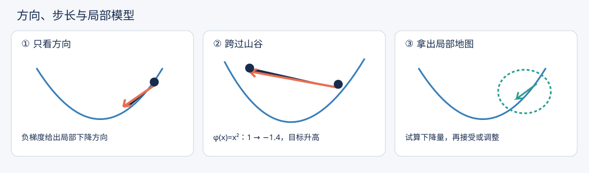
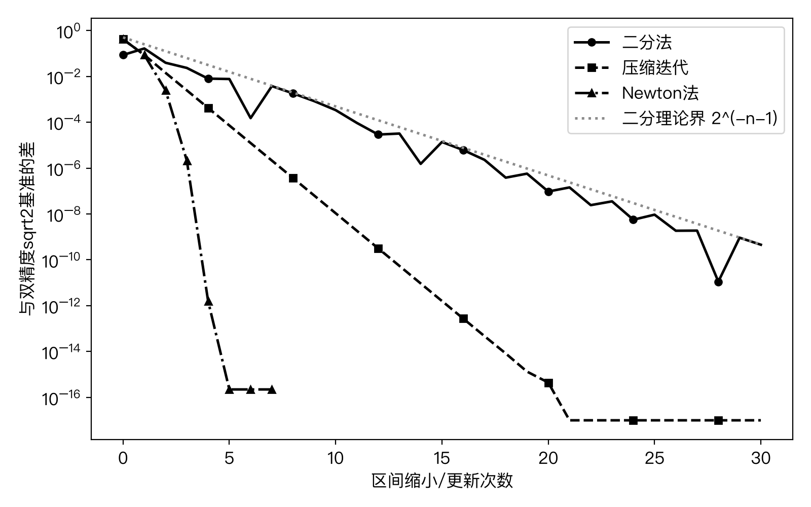
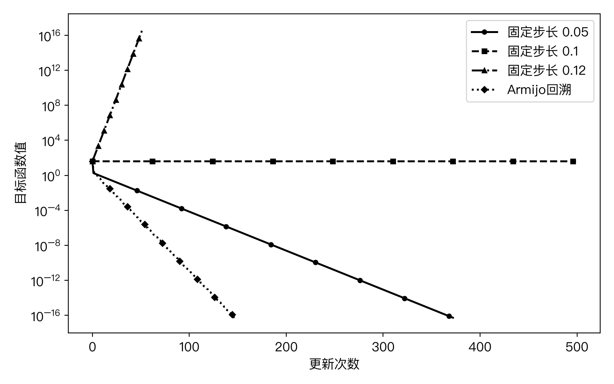
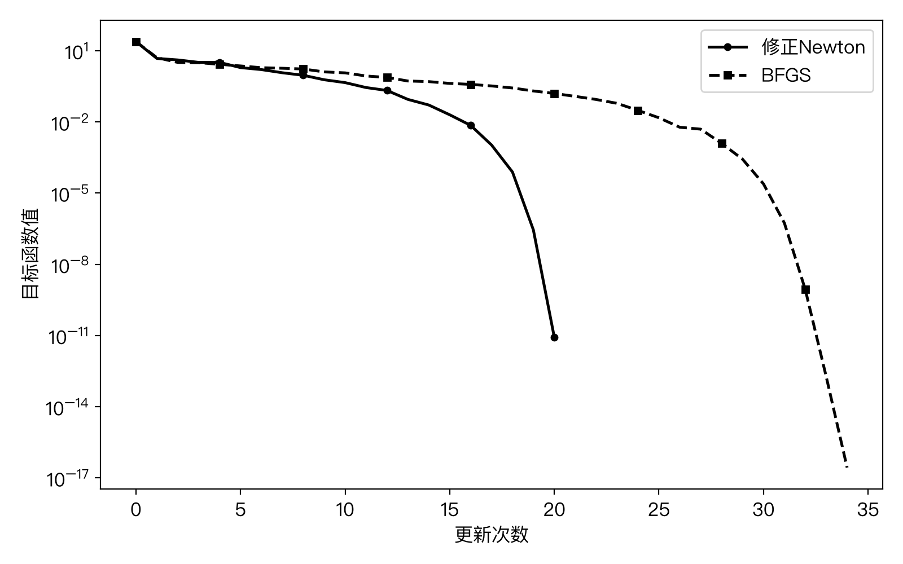
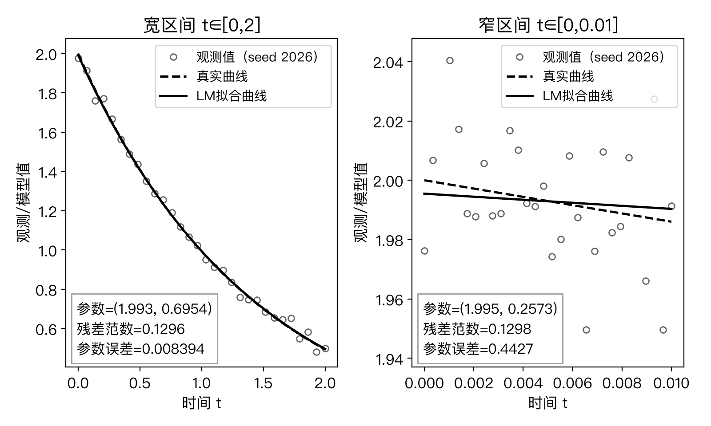
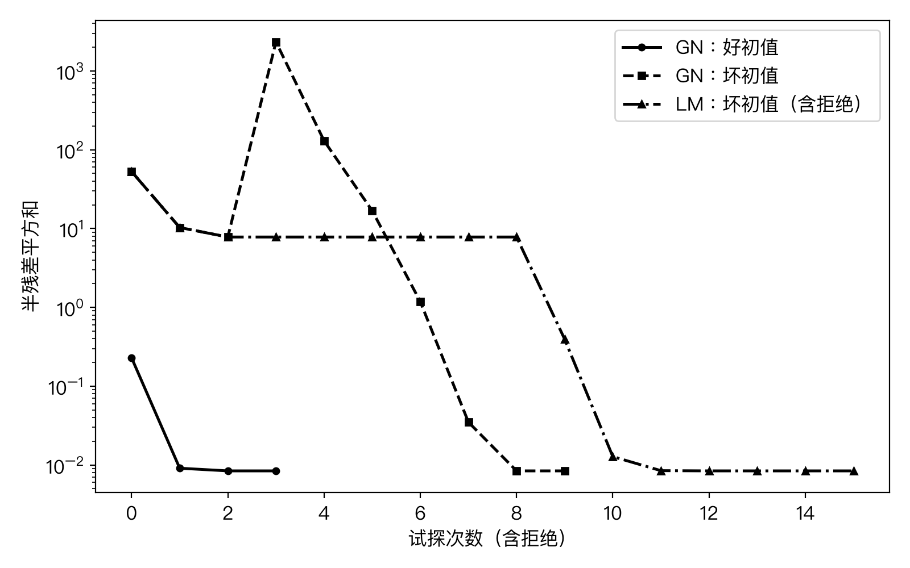

# 第05章 寻优的旅程

**非线性方程与数值优化**

## 先看一幕：机器人下山，为什么越走越远？



*图5-1：方向、步长与局部模型的概念示意。曲线和箭头用于解释方向与步长的分工，不是实测迭代轨迹；第二格的数值来自下述一维问题。*

机器人看到下坡箭头，决定迈一大步；跨过山谷后，它却站得更高。同伴拿出局部地图：箭头告诉我们往哪里走，曲率帮助判断地形，而试算后的下降量告诉我们这一步是否值得接受。这幅图只借用“下山”解释目标函数降低，真正的算法还必须明确变量、函数、方向和步长。

先作一个可以手算的预测：对 $\phi(x)=x^2$，从 $x_0=1$ 沿负梯度方向走，取步长 $\alpha=1.2$，则 $x_1=1-1.2\times2=-1.4$，而 $\phi(x_1)=1.96>\phi(x_0)=1$。方向的局部正确性为什么没有换来目标值降低？如果把问题换成 $f(x)=0$，还应当检查什么？

此前的线性方程组可以通过分解或迭代求解，线性最小二乘的目标具有固定的二次结构。非线性问题的难点在于：局部线性或二次模型随当前位置改变，一步的预测在远处可能失效。本章从能给出位置保证的区间法出发，逐步建立局部迭代、方向与步长、曲率模型和残差拟合之间的联系。

阅读本章需要连续性、Taylor 展开与多元微分，以及正定矩阵、线性方程组和线性最小二乘。5.2 的二次型分析还用到对称矩阵的正交特征分解，5.4 的辨识讨论用到奇异值分解（SVD）。梯度、Hessian、Jacobian 与 Lipschitz 条件在使用时给出定义。对矩阵 $A$，诱导二范数是 $\|A\|=\max_{\|v\|=1}\|Av\|$，因而 $\|Av\|\le\|A\|\|v\|$。

一般目标记为 $\phi:\mathbb R^n\to\mathbb R$，残差平方和记为 $\Phi$；向量采用列向量，$\|\cdot\|$ 表示欧氏范数，矩阵范数为其诱导范数。求根变量用 $x$，待拟合参数用 $\theta$。本章配套[实验 Notebook](A2-G19-实验.ipynb)、[习题](A2-G19-习题.md)和[参考解答](A2-G19-习题参考解答.md)分别提供实际计算、练习和核验步骤。


## 学习目标与阅读路线

读完本章，应能为求根、极小化或残差拟合选择合适的迭代；按算法框独立计算并实现一次更新；依据问题尺度、最优性条件和退出原因判断结果。

| 核心阅读 | 需要回答的问题 | 完成后的操作 |
| --- | --- | --- |
| 5.1 位置保证与迭代 | 根在哪里，迭代为什么收敛或失败？ | 二分、标量 Newton 与方程组一步手算 |
| 5.2 方向与步长 | 方向向下，为什么大步仍会失败？ | 判断下降方向并执行 Armijo 回溯 |
| 5.3 曲率 | 怎样利用曲率，曲率不定时怎么办？ | Newton 方向修正及一次 BFGS 更新 |
| 5.4 残差与参数 | 怎样由残差构造方法，拟合好为何参数仍不准？ | GN/LM 拟合及辨识诊断 |

主文和完整算例构成核心阅读；“深入阅读”保留更细的证明，可在掌握主线后展开；每节“实验探索”与配套实验题提供课后实践。具体讲授与实验分配见[教学说明](A2-G19-编写报告.md#教学说明)。


## 5.1 非线性方程：从夹逼到迭代

线性方程可以用消元法求解，非线性方程则通常需要逐步修正近似值。例如，求边长使正方形面积等于2，就是求解 $f(x)=x^2-2=0$。即使根有解析表达式 $\sqrt2$，计算机仍须用有限步运算给出它的近似。更一般的方程未必有可用的解析解。因此，求根算法需要回答两个问题：下一步怎样算，以及目前离真正的根有多远。

本节先用连续性把根夹在区间内，再把“解方程”改写为“反复应用一个映射”，最后利用导数构造局部线性模型。三种方法提供不同的保障：二分法维护包含根的区间，不动点方法依赖压缩性质，Newton 法以更强的局部条件换取更快的收敛。

### 5.1.1 求根问题、二分法与区间误差界

**定义5.1.1（根、根误差与残差）** 对实函数 $f$，满足 $f(\xi)=0$ 的数 $\xi$ 称为根。近似值 $x$ 对指定根的误差为 $e=x-\xi$；其残差为 $f(x)$，常用 $|f(x)|$ 衡量方程满足的程度。根未知时，误差通常不可直接计算，而残差可以计算。

两者不具有无条件的等价关系。取 $f(x)=10^{-12}(x-1)$，在 $x=0$ 处残差只有 $10^{-12}$，根误差却为1。这也说明，将方程乘上一个很小的常数不会改变根，却会改变绝对残差。若 $f$ 在连接 $x$ 与 $\xi$ 的区间上可微，且 $|f'(t)|\ge \mu>0$，中值定理才给出

$$
|x-\xi|\le \frac{|f(x)|}{\mu}. \tag{5.1.1}
$$

事实上，存在位于两者之间的 $\eta$ 使 $f(x)=f'(\eta)(x-\xi)$，取绝对值即得上述结论。这说明导数的下界提供了从方程误差到位置误差的转换尺度。

**命题5.1.2（二分法的包含性与误差保证）** 设 $f\in C[a,b]$ 且 $f(a)f(b)<0$。从 $[a_0,b_0]=[a,b]$ 开始，每次计算中点；若中点不是根，则保留与中点构成异号端点的半区间，记为 $[a_{k+1},b_{k+1}]$。若算法未提前命中根，则这些区间内有同一个根 $\xi$，且完成 $n$ 次折半后，以当前区间中点 $c_n=(a_n+b_n)/2$ 为近似值，有

$$
b_n-a_n=\frac{b-a}{2^n},\qquad
|c_n-\xi|\le \frac{b-a}{2^{n+1}}. \tag{5.1.2}
$$

**证明。** 初始区间由介值定理包含根。若中点不为根，因为两个端点异号，恰有一个半区间的两端异号；连续性保证该半区间仍包含根，其长度为原长度的一半。归纳得到嵌套闭区间及长度公式。写 $\xi=\sup_k a_k$。由于 $a_k\le a_j\le b_j\le b_k$ 对 $j\ge k$ 成立，故 $a_k\le\xi\le b_k$。又 $b_k-a_k\to0$，所以 $a_k,b_k\to\xi$。每对端点的函数值异号，连续性排除了 $f(\xi)>0$ 和 $f(\xi)<0$，从而 $f(\xi)=0$。中点到区间内任一点的距离不超过半区间长，得到误差界。若提前命中根，则误差为零。证毕。

这里的 $n$ 是已经完成的折半次数：初始中点 $c_0$ 的误差界为 $(b-a)/2$，不是 $(b-a)$。当希望误差不超过 $\varepsilon>0$ 时，足够完成

$$
n\ge \max\!\left\{0,\left\lceil\log_2\frac{b-a}{2\varepsilon}\right\rceil\right\}. \tag{5.1.3}
$$

若端点本身满足 $f=0$，应直接返回该端点。异号条件保证根存在，不能保证初始区间内只有一个根；证明表明嵌套区间最终确定其中一个根。二分法也不会检测没有变号的偶重根，例如 $f(x)=x^2$ 在 $[-1,1]$ 的端点同号。

**例5.1.3（面积方程的可靠定位）** 对 $x^2-2=0$，在 $[1,2]$ 上有 $f(1)=-1$、$f(2)=2$，且 $f'(x)=2x>0$，所以该区间有唯一根。第一次中点为1.5；因 $f(1.5)>0$，保留 $[1,1.5]$。完成20次折半后，当前中点的根误差不超过 $2^{-21}\approx4.77\times10^{-7}$。这是由区间几何得到的理论保证，不依赖程序打印了多少位小数。

**算法框：二分法**

输入连续函数 $f$、端点 $a<b$、位置容差 $\varepsilon_x>0$ 和最大折半次数 $N\ge0$。初始端点须异号，且函数值的符号判断可靠；$n$ 专指已经完成的折半次数。浮点实现按符号比较，不用可能溢出的乘积判断异号。下述“计算零值”是计算结果，只有可靠的精确零值判定才直接证明命中根。

```text
计算 fa=f(a), fb=f(b)，置 n=0
若函数值非有限或符号无法可靠判断：失败退出
若某端点函数值为零：返回该端点，状态=计算零值
若 fa、fb 同号：失败退出，状态=无异号区间
重复：
    c=a+(b-a)/2，h=(b-a)/2
    若 h<=位置容差：返回 c、h、n，状态=区间界达标
    若 c=a 或 c=b：返回 c，状态=浮点停滞
    若 n=N：返回 c、h、n，状态=预算耗尽
    计算 fc=f(c)
    若 fc 非有限或符号无法可靠判断：失败退出
    若 fc=0：返回 c，状态=计算零值
    若 fa、fc 异号：b=c，fb=fc；否则 a=c，fa=fc
    n=n+1
```

在实数运算中，返回的 $h$ 正是式(5.1.2)的误差上界。浮点实现还须控制端点与中点舍入；需要严格认证时，采用向外舍入的区间界。若当前尺度使 $b-a$ 溢出，应先缩放变量或采用适合该尺度的中点计算。

### 5.1.2 不动点迭代、压缩条件与收敛阶

二分法只利用符号，每次只能丢弃半个区间。若能把方程改写为 $x=\psi(x)$，就可以从一个初值出发，反复计算

$$
x_{k+1}=\psi(x_k),\qquad k=0,1,2,\ldots. \tag{5.1.4}
$$

但根与不动点必须在所考虑的定义域内等价。例如 $x^2=2$ 改写为 $x=2/x$ 时要求 $x\ne0$。即使两种写法具有相同的解，它们产生的迭代也可能完全不同。

**定理5.1.4（闭区间上的压缩迭代）** 设 $I=[a,b]$，映射 $\psi:I\to I$ 满足

$$
|\psi(x)-\psi(y)|\le q|x-y|\quad(x,y\in I),\qquad 0<q<1. \tag{5.1.5}
$$

则 $\psi$ 在 $I$ 上存在唯一不动点 $\xi$，任意 $x_0\in I$ 产生的迭代都收敛到它，并满足以下先验与后验估计：

$$
|x_k-\xi|\le q^k|x_0-\xi|
\le \frac{q^k}{1-q}|x_1-x_0|,\qquad k\ge0, \tag{5.1.6}
$$

$$
|x_k-\xi|\le\frac{q}{1-q}|x_k-x_{k-1}|\quad(k\ge1),
\qquad
|x_k-\xi|\le\frac{1}{1-q}|x_{k+1}-x_k|\quad(k\ge0). \tag{5.1.7}
$$

**证明。** 自映射条件保证全部迭代点位于 $I$。由压缩条件归纳得 $|x_{j+1}-x_j|\le q^j|x_1-x_0|$。对 $\ell>k$，利用三角不等式及几何级数，

$$
|x_\ell-x_k|\le\sum_{j=k}^{\ell-1}|x_{j+1}-x_j|
\le\frac{q^k}{1-q}|x_1-x_0|.
$$

右端趋于零，因此序列为实数 Cauchy 序列。实数完备性保证它有极限 $\xi$；闭区间包含极限，所以 $\xi\in I$。压缩条件蕴含连续性，取极限得到 $\xi=\psi(\xi)$。若另有不动点 $\zeta$，则 $|\xi-\zeta|\le q|\xi-\zeta|$，由于 $q<1$，只能有 $\xi=\zeta$。

将压缩条件用于 $x_k$ 与 $\xi$，递推即得 $|x_k-\xi|\le q^k|x_0-\xi|$。令上述尾和估计中的 $\ell\to\infty$，得到第二个先验界。若从第 $k$ 步重新估计尾和，则 $|x_k-\xi|\le|x_{k+1}-x_k|/(1-q)$；再用 $|x_{k+1}-x_k|\le q|x_k-x_{k-1}|$，即得后验界。证毕。

这里所用实数完备性是数学分析中的基本性质。若 $q=0$，映射在整个区间恒为某个常数，且该常数属于区间；一次迭代即到达唯一不动点，无须使用几何级数。若 $\psi$ 可微并有 $\sup_I|\psi'|\le q<1$，中值定理可验证压缩条件，但仍必须另行验证 $\psi(I)\subseteq I$。只有导数小而迭代跑出定义域，不能使用本定理。

**例5.1.5（同一方程的三种迭代）** 在 $I=[1,2]$ 上考察

$$
\psi_1(x)=\frac2x,\qquad
\psi_2(x)=\frac12\left(x+\frac2x\right),\qquad
\psi_3(x)=x^2+x-2.
$$

三者的正不动点都是 $\sqrt2$。但是 $\psi_1(1)=2$、$\psi_1(2)=1$，从1开始产生二周期，不能收敛；在根处 $\psi_1'(\sqrt2)=-1$，也不满足严格压缩条件。对 $\psi_2$，有 $\sqrt2\le\psi_2(x)\le1.5$ 以及 $|\psi_2'(x)|=|1/2-1/x^2|\le1/2$，所以闭区间上的定理适用。这里下界由 $(x-\sqrt2)^2\ge0$ 得到，上界可由导数在 $\sqrt2$ 两侧的符号及端点值验证。第三个改写既不保持 $[1,2]$，又有 $\psi_3'(\sqrt2)=2\sqrt2+1>1$。更具体地，令 $e=x-\sqrt2$，有 $\psi_3(x)-\sqrt2=(2\sqrt2+1+e)e$，所以足够小而非零的误差在下一步扩大；它不能提供根附近的吸引迭代。

压缩定理给出几何衰减的上界，却未必给出精确的渐近速度。为了区分快慢，需要收敛阶。

**定义5.1.6（渐近收敛阶）** 设 $x_k\to\xi$，且存在 $K$ 使所有 $k\ge K$ 都有 $x_k\ne\xi$，从而下式的分母最终非零。若对某个 $p\ge1$ 存在极限

$$
\lim_{k\to\infty}\frac{|x_{k+1}-\xi|}{|x_k-\xi|^p}=C,
\qquad0<C<\infty, \tag{5.1.8}
$$

则称其具有精确的渐近阶 $p$；当 $p=1$ 时另要求 $C<1$，称为线性收敛，$p=2$ 称为二次收敛。若 $|e_{k+1}|\le M|e_k|^p$ 对所有充分大的 $k$ 成立，称为至少 $p$ 阶的误差估计；它不能单独证明精确阶为 $p$。若 $|e_{k+1}|/|e_k|\to0$，称为超线性收敛。有限步终止不必硬套含零分母的比值定义。

对可微映射，在 $\xi$ 附近有 $e_{k+1}=\psi'(\xi)e_k+o(e_k)$。只要迭代已收敛、未有限终止且 $0<|\psi'(\xi)|<1$，其精确渐近阶为1，常数为 $|\psi'(\xi)|$。若 $\psi'(\xi)=0$，则误差的一阶项消失；还要考察更高阶项，才能判断是否二次或更快。这为选择迭代映射提供了方向，也引出了 Newton 法。

<details>
<summary>深入阅读：压缩实验映射的自映射与渐近速度</summary>

实验中的压缩迭代采用第四个改写 $\psi_4(x)=(x+2)/(x+1)$。在 $[1,2]$ 上，分母非零，而 $x=\psi_4(x)$ 等价于 $x^2=2$。它有 $\psi_4'(x)=-1/(x+1)^2$，故单调递减、$\psi_4([1,2])=[4/3,3/2]\subset[1,2]$，且 $|\psi_4'(x)|\le1/4$。压缩定理可直接使用 $q=1/4$。其在正根处的导数为 $-1/(1+\sqrt2)^2\ne0$；从非根初值产生的序列不会恰好命中根（$\psi_4$ 在该区间上单射），因而收敛阶定义给出线性渐近常数 $1/(1+\sqrt2)^2$。负号解释了误差为何在根的两侧交替。

</details>

### 5.1.3 标量 Newton 法与方程组的 Jacobian 线性化

在 $x_k$ 附近，以切线近似函数图像：$f(x_k+p)\approx f(x_k)+f'(x_k)p$。令这个线性近似等于零，解得

$$
f'(x_k)p_k=-f(x_k),\qquad
x_{k+1}=x_k+p_k=x_k-\frac{f(x_k)}{f'(x_k)}. \tag{5.1.9}
$$

这是由局部模型推导出的更新，要求当前导数不为零；切线的零点并不一定靠近真实根。对于面积方程，它恰好产生上例的 $\psi_2$。Newton 法的快速收敛来自根附近误差的一阶项抵消，而不是“用了导数”这一个事实。

**定理5.1.7（简单根附近的 Newton 二次误差估计）** 设 $f\in C^2$ 于根 $\xi$ 的某个开邻域，$f(\xi)=0$ 且 $f'(\xi)\ne0$。则存在 $\delta>0$ 和常数 $C_N\ge0$，使任意 $|x_0-\xi|\le\delta$ 的 Newton 迭代均有定义，留在该邻域并收敛于 $\xi$；未命中根时满足

$$
|x_{k+1}-\xi|\le C_N|x_k-\xi|^2. \tag{5.1.10}
$$

若此外 $f''(\xi)\ne0$ 且迭代未有限终止，则精确渐近阶为2，渐近误差常数为 $|f''(\xi)/(2f'(\xi))|$。

**证明。** 由 $f'$ 的连续性和 $f'(\xi)\ne0$，可取闭邻域 $[\xi-r,\xi+r]$ 使 $|f'(x)|\ge\beta>0$。又因 $f''$ 连续，在该邻域有 $|f''(x)|\le M$。将 $f(\xi)$ 在当前点 $x$ 处作 Taylor 展开，存在连接 $x$ 与 $\xi$ 的 $\eta$ 使

$$
0=f(x)+f'(x)(\xi-x)+\frac12 f''(\eta)(\xi-x)^2.
$$

设 $N(x)=x-f(x)/f'(x)$，整理得到

$$
N(x)-\xi=\frac{f''(\eta)}{2f'(x)}(x-\xi)^2. \tag{5.1.11}
$$

因此可以取 $C_N=M/(2\beta)$。选择 $0<\delta\le r$ 且 $C_N\delta\le1/2$；当 $C_N=0$ 时任取足够小的 $\delta$。对于 $|x-\xi|\le\delta$，有 $|N(x)-\xi|\le|x-\xi|/2$，所以 Newton 映射保持该闭邻域，且分母从不为零。归纳得到全部迭代有定义，以及 $|x_k-\xi|\le2^{-k}|x_0-\xi|\to0$；式(5.1.11)同时给出二次误差界。最后，$x_k\to\xi$ 时，介于 $x_k$ 与 $\xi$ 之间的 $\eta_k$ 也趋于 $\xi$。对非零误差除以 $e_k^2$ 并取绝对值极限，得到所述非零有限常数。证毕。

条件 $f''(\xi)\ne0$ 用于认定精确二次阶。若 $f''(\xi)=0$，二次上界仍成立，但可能更快；线性函数甚至一步求解。对于 $f(x)=x^2-2$ 的正根，误差具有精确恒等式 $e_{k+1}=e_k^2/(2x_k)$，故精确二次常数为 $1/(2\sqrt2)$。

**命题5.1.8（重根的线性退化）** 设 $f(x)=(x-\xi)^m h(x)$ 于 $\xi$ 的邻域，整数 $m\ge2$，$h\in C^1$，且 $h(\xi)\ne0$。对足够靠近 $\xi$ 的非根初值，标准 Newton 法局部收敛；若不有限终止，渐近阶为1，常数为 $(m-1)/m$。

<details>
<summary>深入阅读：重根使 Newton 收敛退化的完整证明</summary>

**证明。** 写 $e=x-\xi$。对非根点，

$$
f'(x)=e^{m-1}\bigl(mh(x)+eh'(x)\bigr),\qquad
e_+=e\frac{(m-1)h(x)+eh'(x)}{mh(x)+eh'(x)}. \tag{5.1.12}
$$

分母在根处的括号值为 $mh(\xi)\ne0$，因此在足够小的邻域内不为零。右侧比值连续延拓到 $e=0$，其值为 $(m-1)/m<1$。取介于该值与1之间的 $q$，再缩小邻域即可使 $|e_+|\le q|e|$。这保证迭代留在邻域并趋于根。由同一比值取极限得线性收敛常数。证毕。

</details>

例如 $f(x)=(x-1)^2$ 给出 $e_{k+1}=e_k/2$，无论起点多靠近根，标准 Newton 都不会变成二次收敛。已知重数时可以考虑将修正量乘以 $m$；实际未知重数不能直接这样处理。

**例5.1.9（Newton 的二周期）** 对 $f(x)=x^3-2x+2$，从 $x_0=0$ 开始，$f(0)=2$、$f'(0)=-2$，所以 $x_1=1$；又 $f(1)=1$、$f'(1)=1$，所以 $x_2=0$。因此精确迭代永远在0和1之间循环，尽管两个点的导数都不为零。该方程确有实根，因为 $f(-2)=-2$、$f(-1)=3$。失败源自起点没有进入根的局部吸引邻域；“每步能算”不能替代收敛证明。

**算法框：标量 Newton 法**

输入 $f,f'$、初值 $x_0$、残差容差 $\varepsilon_f>0$、步长容差 $\varepsilon_x>0$、导数阈值 $\tau_d\ge0$ 及最大更新次数 $N\ge0$。导数阈值应按函数与变量尺度选取，它是数值保护参数，不是定理5.1.7中的导数下界。

```text
置 x=x0，k=0
重复：
    计算 r=f(x)
    若 r 非有限：失败退出，状态=非有限残差
    若 r=0：返回 x，状态=计算零值
    若 k>0 且 |r|<=残差容差 且 |上一步步长|<=步长容差：
        返回 x、r、k，状态=残差与步长达标
    若 k=N：返回 x、r、k，状态=预算耗尽
    计算 d=f'(x)
    若 d 非有限或 |d|<=导数阈值：失败退出，状态=导数检查失败
    p=-r/d，z=x+p
    若 p 或 z 非有限：失败退出，状态=非有限更新
    若 z=x：返回 x、r、k，状态=浮点停滞
    记录步长 p，置 x=z，k=k+1
```

这里的达标状态记录实际检查过的残差与步长，位置误差保证仍须式(5.1.1)或其他误差估计。若同时维护异号区间，可在 Newton 建议点不合适时改用二分步，以保留区间定位；这种保护算法需要另外规定接受条件。

最后，将标量方程推广为 $n$ 个未知量、$n$ 个方程。设 $F:\mathbb R^n\to\mathbb R^n$，写 $F=(F_1,\ldots,F_n)^{\mathsf T}$，其 Jacobian 矩阵定义为

$$
J_F(x)=\left(\frac{\partial F_i}{\partial x_j}(x)\right)_{i,j=1}^n.
$$

若 $F$ 连续可微，则 $F(x+p)=F(x)+J_F(x)p+o(\|p\|)$。舍去高阶项并令线性模型为零，得到方程组 Newton 步

$$
J_F(x_k)p_k=-F(x_k),\qquad x_{k+1}=x_k+p_k. \tag{5.1.13}
$$

计算时解这一线性方程组，不需要显式构造逆矩阵。矩阵必须可逆才能唯一确定这一步；接近奇异时，即使残差不大也可能产生很大的修正。其局部二次收敛通常要求根处 Jacobian 可逆、附近 Jacobian 满足 Lipschitz 条件以及足够近的初值，不能从“线性方程有解”直接推断。

例如，圆与直线的交点满足 $F(x_1,x_2)=(x_1^2+x_2^2-1,x_1-x_2)^{\mathsf T}=0$，对应

$$
\begin{pmatrix}2x_1&2x_2\\1&-1\end{pmatrix}
\begin{pmatrix}p_1\\p_2\end{pmatrix}
=-\begin{pmatrix}x_1^2+x_2^2-1\\x_1-x_2\end{pmatrix}.
$$

从 $x_0=(1,0)^{\mathsf T}$ 出发，$F(x_0)=(0,1)^{\mathsf T}$，所以第一步解

$$
\begin{pmatrix}2&0\\1&-1\end{pmatrix}
\begin{pmatrix}p_1\\p_2\end{pmatrix}
=\begin{pmatrix}0\\-1\end{pmatrix}.
$$

这给出 $p=(0,1)^{\mathsf T}$，更新为 $(1,1)^{\mathsf T}$，但 $F(1,1)=(1,0)^{\mathsf T}$。线性子问题已精确求解，原非线性方程仍未解出：第二个方程是线性的，第一步已经满足它；第一个方程的二阶项 $p_1^2+p_2^2=1$ 被线性模型舍去，恰好留下新的残差。

在两个交点 $(\pm1/\sqrt2,\pm1/\sqrt2)$，行列式 $-2(x_1+x_2)$ 不为零；在原点，Jacobian 第一行全为零而右端第一分量为1，线性子问题甚至不相容。根附近与任意起点的差别，在多维中同样存在。

#### 实验探索：区间界与浮点差值

**数值例5.1.10（面积方程的三种迭代）** 对 $x^2-2=0$，二分从 $[1,2]$ 开始；压缩映射 $T=(x+2)/(x+1)$ 与 Newton 从1出发。图5-2比较它们与双精度 $\sqrt2$ 参照值的差。二分理论界随折半次数单调缩小，实际中点差却可以先大后小，因为中点在根的两侧移动。



*图5-2：双精度计算的参照差及二分法理论界。对数轴中零差值以 $10^{-17}$ 显示，该截取值不代表真实误差。*

Newton 最后与双精度参照的差为 $2.22\times10^{-16}$，用60位 Decimal 根核验该浮点数的根误差约为 $1.254\times10^{-16}$。两者不同，说明参照值自身的舍入在这一尺度上已不可忽略。Newton 最后残差为 $4.441\times10^{-16}$；二周期反例的残差则交替为2和1。


**适用条件与停止判断。** 二分法依赖连续性和可靠的异号区间；压缩迭代需要自映射及严格压缩条件，此时步差可通过式(5.1.7)转换为根误差界；Newton 的二次估计依赖简单根、局部光滑性和足够近的初值。小残差需结合问题尺度，小步长需排除停滞，预算耗尽、导数失败和非有限更新应分别记录。精确理论与浮点轨迹也须分开：当误差进入舍入平台，收敛阶比值不再稳定。

接下来把目标从 $F(x)=0$ 改为减小一个实值函数时，方向和步长需要新的判断标准。


## 5.2 下降方向：往哪里走，走多远

求解方程时，我们寻找函数的零点；求解优化问题时，我们寻找目标函数的最小值。两者可以借助导数建立联系，却不能互相替代：方程 $\nabla\phi(x)=0$ 的解可能是极大点，也可能是鞍点。因此，在把上一节的线性化方法用于优化以前，需要先弄清“怎样辨认最优点”和“怎样保证一次更新有进展”。本节考虑无约束问题
$$
\min_{x\in\mathbb R^n}\phi(x). \tag{5.2.1}
$$
若只在某开集上定义目标，则下述局部结论在该开集的内点成立，算法的试探线段还须位于定义域中。除明确说明外，向量范数均为欧氏范数，$g(x)=\nabla\phi(x)$，$H(x)=\nabla^2\phi(x)$。

### 5.2.1 无约束最优性条件与驻点辨析

**定义5.2.1（局部极小点与驻点）** 若存在 $\delta>0$，使所有满足 $\|x-x_*\|<\delta$ 的点都有 $\phi(x)\geq\phi(x_*)$，称 $x_*$ 为局部极小点。若对这些点中所有 $x\ne x_*$ 不等式均严格，则称严格局部极小点。若不等式对整个定义域成立，则称全局极小点。对可微函数，满足 $g(x_*)=0$ 的点称为驻点。这几个概念分别涉及邻域、整个定义域和导数，不能混为一谈。

**命题5.2.2（一阶与二阶必要条件）** 设 $x_*$ 是定义域内点。若 $\phi$ 在 $x_*$ 可微且 $x_*$ 是局部极小点，则 $g(x_*)=0$。若进一步 $\phi$ 在 $x_*$ 的邻域二阶连续可微，则 $H(x_*)$ 半正定，即任意 $v\in\mathbb R^n$ 都有 $v^{\mathsf T}H(x_*)v\geq0$。

**证明。** 固定任意方向 $v$，令 $q(t)=\phi(x_*+tv)$。因 $x_*$ 为内点，充分小的正负 $t$ 都可取。局部极小性给出 $q(t)-q(0)\geq0$，故正 $t$ 的差商非负，负 $t$ 的差商非正；两侧极限相等，所以 $q'(0)=g(x_*)^{\mathsf T}v=0$。对每个坐标方向取 $v$，得到 $g(x_*)=0$。在二阶假设下，Taylor 展开为
$$
q(t)-q(0)=\tfrac12t^2v^{\mathsf T}H(x_*)v+o(t^2).
$$
除以 $t^2$ 并令 $t\to0$，左侧始终非负，因此 $v^{\mathsf T}H(x_*)v\geq0$。方向任意，结论成立。证毕。

**命题5.2.3（二阶充分条件与负曲率）** 设 $\phi$ 在 $x_*$ 的邻域二阶连续可微，且 $g(x_*)=0$。若 $H(x_*)$ 正定，则 $x_*$ 为严格局部极小点；若存在 $v$ 使 $v^{\mathsf T}H(x_*)v<0$，则 $x_*$ 不是局部极小点。特别地，若 $H(x_*)$ 不定，即同时存在正、负二次型方向，则 $x_*$ 为鞍点：任意充分小的邻域内都有目标值高于和低于 $\phi(x_*)$ 的点。

**证明。** 正定对称矩阵的最小特征值 $\mu$ 为正，故 $h^{\mathsf T}H(x_*)h\geq\mu\|h\|^2$。Taylor 公式给出
$$
\phi(x_*+h)-\phi(x_*)=\tfrac12h^{\mathsf T}H(x_*)h+o(\|h\|^2).
$$
取充分小的 $\delta$，使余项绝对值不超过 $\mu\|h\|^2/4$。于是当 $0<\|h\|<\delta$ 时，函数增量至少为 $\mu\|h\|^2/4>0$。若存在负曲率方向，沿 $h=tv$ 展开，则充分小的非零 $t$ 使函数增量为负，排除了局部极小性。不定时沿正曲率方向同样得到正增量，因而同时存在两类点。证毕。

**例5.2.4（必要条件不能反推极小性）** 一维函数 $x^4$、$-x^4$ 和 $x^3$ 在零点的梯度与二阶导数都为零，却分别有严格极小点、严格极大点和非极值驻点。半正定 Hessian 因而不足以判定极小性，正定也不是严格极小性的必要条件。二维函数 $x_1^2-x_2^2$ 的原点满足梯度为零，Hessian 为 $\operatorname{diag}(2,-2)$，是鞍点。

<details>
<summary>深入阅读：局部极小与全局极小的区别</summary>

**例5.2.5（局部极小未必全局极小）** 即使局部极小性已经确认，也不能自动推出全局极小性；例如令 $\phi(x)=(x^2-1)^2+x/2$。其导数 $q(x)=4x(x^2-1)+1/2$ 满足 $q(-2)<0<q(-1)$ 和 $q(1/\sqrt3)<0<q(1)$，而 $q'(x)=12x^2-4>0$ 在这两个开区间上成立，故分别存在唯一驻点 $a\in(-2,-1)$、$b\in(1/\sqrt3,1)$，其二阶导数为正，都是严格局部极小点。由于 $b>0$，有 $\phi(-b)=\phi(b)-b<\phi(b)$，所以 $b$ 不是全局极小点。

</details>

> **知识框5.2.6（凸性与全局充分条件）** 为给出一个可核验的全局充分条件，先定义凸性：在凸定义域（任意两点之间的线段均包含于该域）上，若任意点 $x,y$ 与任意 $t\in[0,1]$ 均满足 $\phi((1-t)x+ty)\leq(1-t)\phi(x)+t\phi(y)$，则称 $\phi$ 为凸函数。可微凸函数满足 $\phi(y)\geq\phi(x)+g(x)^{\mathsf T}(y-x)$，故凸函数的驻点是全局极小点。这里的一阶不等式可直接由凸性证明：令 $0<t<1$，由 $\phi(x+t(y-x))\leq(1-t)\phi(x)+t\phi(y)$，移项、除以 $t$ 并令 $t\downarrow0$ 即得。

### 5.2.2 负梯度方向、方向与步长的分工

驻点条件帮助我们判断候选点，却没有告诉我们从一个普通点怎样出发。设当前点为 $x$，尝试更新
$$
x_{+}=x+\alpha p,\qquad \alpha>0. \tag{5.2.2}
$$
方向 $p$ 决定沿哪条射线搜索，步长 $\alpha$ 决定在射线上走多远。若把 $p$ 乘以正数而把 $\alpha$ 除以同一数，更新点保持不变。因此，讨论“最速方向”时必须约束方向长度。

**定义5.2.7（下降方向）** 若 $\phi$ 在 $x$ 可微，且 $g(x)^{\mathsf T}p<0$，称 $p$ 为 $x$ 处的严格下降方向。这个定义要求方向导数为负，比“沿某条曲线最终能降低目标”更强。

**命题5.2.8（局部下降与单位最速方向）** 若 $g(x)^{\mathsf T}p<0$，则存在 $\bar\alpha>0$，使所有 $0<\alpha\leq\bar\alpha$ 都有 $\phi(x+\alpha p)<\phi(x)$。若 $g(x)\ne0$，在所有满足 $\|p\|=1$ 的方向中，方向导数的唯一最小点为
$$
p_*=-\frac{g(x)}{\|g(x)\|},\qquad
\min_{\|p\|=1}g(x)^{\mathsf T}p=-\|g(x)\|. \tag{5.2.3}
$$

**证明。** 可微性给出 $\phi(x+\alpha p)-\phi(x)=\alpha g(x)^{\mathsf T}p+o(\alpha)$。余项除以 $\alpha$ 趋零，故充分小的正步长使增量仍为负。Cauchy–Schwarz 不等式给出 $g(x)^{\mathsf T}p\geq-\|g(x)\|\|p\|=-\|g(x)\|$。等号恰在 $p$ 与 $g(x)$ 反向共线时成立，单位长度确定唯一方向 $p_*$。证毕。

实际梯度下降常取未归一化方向 $p_k=-g(x_k)$，迭代为 $x_{k+1}=x_k-\alpha_k g(x_k)$。它与式（5.2.3）的射线相同，步长数值的含义却不同。若 $g(x)=0$，所有方向的一阶变化均为零，没有严格下降方向；此时降低目标可能需要考察负曲率，例如 $-x^2$ 在零点仍能沿任意非零方向降低目标。这里的“最速”也仅指欧氏单位球上的瞬时线性变化，并不意味着到达极小点的迭代次数最少。

**例5.2.9（好方向仍会被坏步长破坏）** 对 $\phi(x)=x^2/2$，在 $x\ne0$ 处取 $p=-x$，则
$$
\phi(x+\alpha p)=\tfrac12(1-\alpha)^2x^2.
$$
当 $0<\alpha<2$ 时下降，$\alpha=2$ 时两点间振荡，$\alpha>2$ 时发散。对正定二次型 $\phi(x)=x^{\mathsf T}Ax/2$，固定步长的梯度迭代为 $x_{k+1}=(I-\alpha A)x_k$。将 $x_k$ 展开到 $A$ 的正交特征向量基，各分量乘以 $1-\alpha\lambda_i$，因此对所有初值收敛到零等价于 $0<\alpha<2/\lambda_{\max}(A)$。曲率最大的方向限制步长，曲率很小的方向却可能推进缓慢。这说明必须把方向选择与步长控制一起考虑。

### 5.2.3 Armijo 回溯、Wolfe 条件与信赖域的基本思想

沿方向做精确的一维最小化往往成本过高。线搜索改为寻找足够好的步长。记 $\psi(\alpha)=\phi(x+\alpha p)$，则 $\psi'(0)=g(x)^{\mathsf T}p$。Armijo 条件要求实际下降达到线性预测下降的一定比例：
$$
\phi(x+\alpha p)\leq\phi(x)+c_1\alpha g(x)^{\mathsf T}p,
\qquad 0<c_1<1. \tag{5.2.4}
$$
因为方向导数为负，右侧严格小于当前目标值。给定初始试探步长 $\alpha_0>0$ 和缩减因子 $0<\beta<1$，回溯依次试 $\alpha_0,\beta\alpha_0,\beta^2\alpha_0,\ldots$，在第一个满足式（5.2.4）的步长处停止。

**数值例5.2.10（一次完整的 Armijo 回溯）** 取
$\phi(x_1,x_2)=(x_1^2+20x_2^2)/2$，当前点 $x=(2,2)$，则 $\phi(x)=42$、$g=(2,40)$。取 $p=-g=(-2,-40)$、$c_1=10^{-4}$、$\alpha_0=1$、$\beta=1/2$。手算得 $g^{\mathsf T}p=-1604$，试探值为
$$\phi(x+\alpha p)=42-1604\alpha+16002\alpha^2,\qquad
\phi(x)+c_1\alpha g^{\mathsf T}p=42-0.1604\alpha.$$
回溯逐行比较如下；第一项满足条件的步长为 $1/16$。

| 试探步长 $\alpha$ | 试探目标值 | Armijo 右端 | 接受结果 |
|---:|---:|---:|:---|
| 1 | 14440 | 41.8396 | 拒绝 |
| 0.5 | 3240.5 | 41.9198 | 拒绝 |
| 0.25 | 641.125 | 41.9599 | 拒绝 |
| 0.125 | 91.53125 | 41.97995 | 拒绝 |
| 0.0625 | 4.2578125 | 41.989975 | 接受 |

接受后外层更新点为 $x_+=(1.875,-0.5)$，目标从42降到4.2578125；这张表只展示一轮外层更新中的内层搜索，不表示外层已经收敛。

```text
算法：带 Armijo 回溯的梯度下降
输入：目标与梯度、初值 x、alpha0 > 0、0 < beta < 1、0 < c1 < 1；
      梯度容差 eps_g、外层更新预算 K、每轮回溯预算 J、最小步长 alpha_min。
对 k = 0,...,K-1：
    计算 phi(x) 与 g(x)；非有限数则停止并报告计算失败。
    若 ||g(x)|| <= eps_g：停止，报告满足一阶停止准则。
    p = -g(x)，alpha = alpha0。
    对 j = 0,...,J-1：
        若 alpha < alpha_min 或 x + alpha p 与 x 在机器中相同：停止，报告搜索失败。
        域外试探点直接拒绝；域内计算试探目标。
        若试探值有限且 phi(x + alpha p) <= phi(x) + c1 alpha g(x)^{\mathsf T} p：
            x = x + alpha p；结束内层搜索，进入下一轮外层。
        否则 alpha = beta alpha。
    若内层预算耗尽仍未接受：停止，报告回溯预算耗尽。
外层预算耗尽：重新计算当前梯度，报告是否满足一阶容差及已用完更新预算。
```

**命题5.2.11（回溯的有限终止）** 假设 $\phi$ 在 $x$ 可微，$g(x)^{\mathsf T}p<0$，并在足够短的正向线段上有定义。若较长的试探步越出定义域，约定不计算函数值而直接拒绝该步并继续缩减。对于上述 $c_1,\beta,\alpha_0$，Armijo 回溯在精确算术下有限终止。

**证明。** 设 $d=g(x)^{\mathsf T}p<0$。由可微性，存在 $\delta>0$，使 $0<\alpha\leq\delta$ 时 $|\phi(x+\alpha p)-\phi(x)-\alpha d|\leq(1-c_1)(-d)\alpha$。故函数增量不超过 $\alpha d+(1-c_1)(-d)\alpha=c_1\alpha d$。而 $\beta^j\alpha_0\to0$，必有有限的整数 $j$ 使试探步长不超过 $\delta$，从而满足条件。证毕。

有限终止是一次搜索的结论，不等于整个迭代收敛。要证明所有梯度趋零，还需要控制方向、步长和目标的下界。以下结论只针对负梯度方向；一般下降方向即使每步下降，也可能与负梯度越来越接近正交。

**引理5.2.12（下降引理）** 假设 $\phi$ 在包含线段 $[x,x+s]$ 的开集上连续可微，且线段上梯度满足 $\|g(x+ts)-g(x)\|\leq Lt\|s\|$（$0\leq t\leq1$），其中 $L>0$。则
$$
\phi(x+s)\leq\phi(x)+g(x)^{\mathsf T}s+\frac L2\|s\|^2. \tag{5.2.5}
$$

**证明。** 由一元微积分基本定理，函数增量等于 $\int_0^1g(x+ts)^{\mathsf T}s\,dt$。扣除 $g(x)^{\mathsf T}s$ 后，积分被积函数的绝对值不超过 $Lt\|s\|^2$。积分得到 $L\|s\|^2/2$。证毕。

**定理5.2.13（回溯梯度下降的梯度趋零）** 设 $\phi\in C^1(\mathbb R^n)$，在 $\mathbb R^n$ 下有界，且梯度全局 $L$-Lipschitz，$L>0$：这表示任意 $x,y\in\mathbb R^n$ 均有 $\|g(x)-g(y)\|\leq L\|x-y\|$，即梯度的变化最多与点间距离成固定比例。每步取 $p_k=-g(x_k)$，并使用固定的 $\alpha_0>0$、$0<\beta<1$、$0<c_1<1$ 做 Armijo 回溯。若遇到 $g(x_k)=0$ 即停止；若产生无限迭代，则 $\|g(x_k)\|\to0$。

<details>
<summary>深入阅读：梯度趋零证明中的步长下界与下降累加</summary>

**证明。** 下降引理取 $s=-\alpha g(x_k)$，得到
$$
\phi(x_k-\alpha g(x_k))\leq\phi(x_k)-\alpha(1-L\alpha/2)\|g(x_k)\|^2.
$$
所有 $\alpha\leq T:=2(1-c_1)/L$ 均满足 Armijo 条件。如果回溯接受初始步长，则 $\alpha_k=\alpha_0$；否则前一个试探步长 $\alpha_k/\beta$ 失败，它必大于 $T$，故 $\alpha_k>\beta T$。因此统一下界
$$
\alpha_k\geq a:=\min\{\alpha_0,2\beta(1-c_1)/L\}>0
$$
成立。Armijo 条件遂给出 $\phi(x_k)-\phi(x_{k+1})\geq c_1a\|g(x_k)\|^2$。若 $\phi\geq\phi_{\mathrm{low}}$，对 $k=0,\ldots,N$ 求和得到
$$
c_1a\sum_{k=0}^{N}\|g(x_k)\|^2\leq\phi(x_0)-\phi_{\mathrm{low}}.
$$
非负项级数有界，所以其通项趋零，结论成立。证毕。

</details>

全局 Lipschitz 是假设清晰的充分条件，可放宽为只要求所有试探线段所在区域具有统一常数 $L$。仅在离散迭代点上有梯度界并不够用于下降引理。定理也没有断言 $x_k$ 收敛或极限是全局极小点；若迭代点存在聚点，则梯度连续性仅保证该聚点为驻点。

**例5.2.14（只有单调下降还不够）** 对 $\phi(x)=x^2/2$，取 $x_0>0$ 和 $\alpha_k=2^{-k-2}$，梯度迭代给出 $x_k=x_0\prod_{j<k}(1-\alpha_j)$。这些步长均小于等于 $1/4$，所以当 $c_1=1/2$ 时均满足 Armijo 条件。但因为 $\log(1-t)\geq-2t$ 在 $0\leq t\leq1/2$ 上成立，且 $\sum_j\alpha_j=1/2$，有 $x_k\geq x_0e^{-1}>0$。这里对数不等式可由导数 $2-1/(1-t)\geq0$ 验证。梯度因而不会趋零。缺少统一步长下界时，“每步充分下降”仍允许总路程不足；定理中的固定初始试探与回溯规则排除了这一例子。

Armijo 允许任意充分小的步长。为了避免步子过小，Wolfe 条件在式（5.2.4）之外加入
$$
g(x+\alpha p)^{\mathsf T}p\geq c_2g(x)^{\mathsf T}p,
\qquad c_1<c_2<1. \tag{5.2.6}
$$
初始斜率为负，式（5.2.6）要求新点沿原方向的斜率已经充分回升。强 Wolfe 条件则用
$$
|g(x+\alpha p)^{\mathsf T}p|\leq c_2|g(x)^{\mathsf T}p| \tag{5.2.7}
$$
代替式（5.2.6）。强条件既限制负斜率的幅度，也限制跨过一维谷底后正斜率的幅度；普通 Wolfe 允许较大的正斜率。强 Wolfe 蕴含普通 Wolfe，但二者都不保证精确的一维最小点。寻找 Wolfe 步长通常需要区间扩张与区间缩小，只从一个过小初值继续缩减无法保证满足曲率条件。

**命题5.2.15（Wolfe 步长存在及其割线曲率）** 设 $\psi(\alpha)=\phi(x+\alpha p)$ 在 $[0,\infty)$ 连续可微、下有界，且 $\psi'(0)=d<0$。对 $0<c_1<c_2<1$，存在同时满足 Armijo 和强 Wolfe 条件的正步长。任何满足普通 Wolfe 条件的正步长，令 $s=\alpha p$、$y=g(x+\alpha p)-g(x)$，均有 $s^{\mathsf T}y>0$。

<details>
<summary>深入阅读：Wolfe 步长存在与割线曲率的完整证明</summary>

**证明。** 令 $h(t)=\psi(t)-\psi(0)-c_1td$，则 $h(0)=0$、$h'(0)=(1-c_1)d<0$，因而 $h$ 在充分小的正区间上为负。由 $\psi$ 下有界和 $-c_1td\to+\infty$，$h(t)\to+\infty$，存在第一个正零点 $a$，在 $(0,a)$ 上 $h<0$。在 $[0,a]$ 上 $h$ 取得负的最小值，其位置 $t_*$ 必在内部，于是 $h'(t_*)=0$，即 $\psi'(t_*)=c_1d$。导数连续且 $d<c_2d<c_1d$，故在 $(0,t_*)$ 存在 $\alpha$ 使 $\psi'(\alpha)=c_2d$。此处 $h(\alpha)<0$，满足 Armijo；又 $|\psi'(\alpha)|=c_2|d|$，满足强 Wolfe。对于最后的曲率结论，普通 Wolfe 给出
$$
s^{\mathsf T}y=\alpha\bigl(g(x+\alpha p)^{\mathsf T}p-g(x)^{\mathsf T}p\bigr)
\geq\alpha(c_2-1)g(x)^{\mathsf T}p>0.
$$
证毕。

</details>

这个正曲率量并不宣称目标函数处处凸，却为下一节的 BFGS 更新提供了维持正定近似所需的条件。若目标沿射线无下界，上述步长存在证明不能使用，例如线性函数 $\psi(\alpha)=-\alpha$ 的斜率始终为 $-1$，任何 $c_2<1$ 的 Wolfe 曲率条件都无法满足。

另一种控制步子的思想是**信赖域**：先限定局部模型可信的范围，再在这个范围中选取位移。给定对称矩阵 $B_k$ 和半径 $\Delta_k>0$，构造
$$
m_k(s)=\phi(x_k)+g(x_k)^{\mathsf T}s+\tfrac12s^{\mathsf T}B_ks,
\qquad \min_{\|s\|\leq\Delta_k}m_k(s). \tag{5.2.8}
$$
这里 $s$ 已是完整位移，不再另乘步长。因闭球紧且模型连续，子问题至少有一个最小点；实现中常以满足一定模型下降的近似步代替精确解。若 $g(x_k)\ne0$，沿 $-g(x_k)$ 取足够小的可行位移，模型线性项为负而二次项为较高阶，因此一定能获得正的预测下降。若梯度为零，则还应检查 $B_k$ 的负曲率；梯度和模型下降均为零时不能直接计算下述比值。

对预测下降严格为正的试探步，定义
$$
\operatorname{pred}_k=m_k(0)-m_k(s_k)>0,\qquad
\operatorname{ared}_k=\phi(x_k)-\phi(x_k+s_k),\qquad
\rho_k=\frac{\operatorname{ared}_k}{\operatorname{pred}_k}. \tag{5.2.9}
$$
$\rho_k$ 接近1表示模型准确预测了此次下降；$\rho_k\leq0$ 表示模型虽预言下降，实际却没有下降。常用策略取 $0<\eta<1$，仅当 $\rho_k\geq\eta$ 时接受试探点；比值小则缩小半径，比值大且试探步靠近边界时可扩大半径。这些规则的具体阈值属于算法设计，需要另行建立全局收敛条件，不能只凭“有信赖域”作收敛保证。

**例5.2.16（模型下降和实际下降不同）** 对 $\phi(x)=x^2/2$，在 $x=1$ 取 $B=0$，模型为 $m(s)=1/2+s$。半径 $\Delta=3$ 时，子问题解 $s=-3$，预测下降为3，但新点为 $-2$，实际下降为 $1/2-2=-3/2$，故 $\rho=-1/2$，试探步应被拒绝。半径缩至 $\Delta=1$ 时，$s=-1$ 抵达极小点，预测下降为1，实际下降为 $1/2$，比值为 $1/2$。这个例子显示半径约束本身不能保证实际下降，仍须核查函数值；它也说明预测下降无需与实际下降完全相等才能获得有用的步子。

线搜索固定方向后调节长度，信赖域限制位移范围后综合选择方向与长度。两种方式都在协调“导数提供的局部信息”和“真实目标的变化”。下一节将用 Hessian 和割线信息改善方向，并继续用这些接受规则处理局部曲率失真的情形。


本节步长控制以文献[1]为主要参照：Armijo 条件见第21页，Wolfe 条件见第22—23页。定理5.2.13是在文中明确的全局 Lipschitz 假设下给出的完整教学证明。


#### 实验探索：更新次数与搜索代价

**数值例5.2.17（固定步长与回溯）** 对 $\phi=(x_1^2+20x_2^2)/2$，从 $(2,2)$ 出发，梯度容差 $10^{-8}$，预算500次更新。表中求值计数包含回溯试探和最终核算，用于比较计算工作量，不能直接等同运行时间。

| 方法 | 更新次数 | 最终梯度范数 | 目标/梯度求值 | 退出原因 |
| --- | ---: | ---: | ---: | --- |
| 固定步长 0.05 | 373 | $9.816\times10^{-9}$ | 375/375 | 梯度范数<1e-8 |
| 固定步长 0.1 | 500 | 40 | 501/501 | 达到迭代上限 |
| 固定步长 0.12 | 53 | $2.223\times10^{9}$ | 54/54 | 发散阈值||x||>1e8 |
| Armijo 回溯 | 149 | $9.386\times10^{-9}$ | 783/151 | 梯度范数<1e-8 |



*图5-3：实测目标值。回溯减少更新次数，但需要更多试探目标求值；边界步长的振荡与过大步长的发散均保留。*


> **适用条件与停止判断。** 一阶最优性必要条件针对内点局部极小；正定 Hessian 提供局部充分条件，在凸性假设下，驻点条件也是全局充分条件。Armijo 有限终止要求可微和严格下降方向；梯度趋零定理另外要求目标下界、统一 Lipschitz 常数与规定的回溯规则。Wolfe 存在性要求沿下降射线目标下有界。信赖域接受比仅在预测下降为正时定义。这些都是精确算术结论。计算中应同时报告梯度范数、接受步长和结束原因：小梯度只表明达到一阶容差，目标变化小或步长小可能反映停滞，预算耗尽与域外、非有限计算等搜索失败均不能记作收敛。


<details>
<summary>深入阅读：什么时候小梯度能控制位置误差？</summary>

**命题5.2.18（统一正曲率下的距离界）** 设 $U\subset\mathbb R^n$ 是开凸集，$\phi\in C^2(U)$，且有常数 $m>0$ 使所有 $z\in U$ 满足 $H(z)\succeq mI$，即 $v^{\mathsf T}H(z)v\ge m\|v\|^2$ 对任意向量 $v$ 成立。这是二阶可微函数在 $U$ 上的强凸条件。若 $x_*\in U$ 满足 $g(x_*)=0$，则它是 $U$ 上唯一的极小点，且每个 $x\in U$ 都满足

$$\|x-x_*\|\le\frac{\|g(x)\|}{m}.$$

**证明。** 写 $e=x-x_*$。凸性使连接两点的线段位于 $U$。由微积分基本定理，

$$e^{\mathsf T}g(x)=\int_0^1e^{\mathsf T}H(x_*+te)e\,dt\ge m\|e\|^2.$$

Cauchy–Schwarz 不等式给出 $e^{\mathsf T}g(x)\le\|e\|\|g(x)\|$。当 $e\ne0$ 时除以 $m\|e\|$ 即得距离界；$e=0$ 时结论显然成立。对目标沿同一线段积分两次，并利用 $g(x_*)=0$，得到

$$\phi(x)-\phi(x_*)=\int_0^1(1-t)e^{\mathsf T}H(x_*+te)e\,dt\ge\frac m2\|e\|^2.$$

所以 $x\ne x_*$ 时目标严格增大，$x_*$ 是唯一极小点。证毕。

这条距离界依赖统一的曲率下界和驻点的存在。仅有梯度小不够：$\phi(x)=\exp(-x)$ 的梯度范数随 $x\to+\infty$ 趋于零，却没有有限驻点。

</details>


## 5.3 Newton 与拟 Newton：把曲率用起来

负梯度给出了目标下降最快的方向，但“最快”是针对当前点、固定欧氏长度的一阶比较。对狭长的二次函数，沿不同坐标方向的弯曲程度相差很大，同一尺度的步子可能在一个方向过大、在另一个方向过小。Hessian 记录了这种曲率差异。本节从二次模型出发建立优化 Newton 法，分析它何时给出下降方向、何时能快速收敛，再讨论如何仅凭相邻两次梯度更新曲率信息。基本路线以参考文献[1]为主要依据；这里给出结论所需的具体条件和证明。

### 5.3.1 求根 Newton 与优化 Newton 的联系和区别

对于方程组$F(x)=0$，Newton 法将$F(x+p)$在$x$附近线性化，令

$$
J_F(x)p=-F(x).
\tag{5.3.1}
$$

无约束极小点的一阶必要条件为$\nabla\phi(x)=0$。因此，把求根 Newton 法用于$F=\nabla\phi$，其 Jacobian 就是 Hessian。记$g_k=\nabla\phi(x_k)$、$H_k=\nabla^2\phi(x_k)$，得到

$$
H_kp_k=-g_k,\qquad x_{k+1}=x_k+p_k.
\tag{5.3.2}
$$

这就是优化 Newton 法的全步迭代。实际计算应解线性方程组，而不是先形成$H_k^{-1}$。

同一公式还有优化意义。若$\phi$二阶连续可微，则其局部二次模型为

$$
m_k(p)=\phi(x_k)+g_k^{\mathsf T}p+\frac12p^{\mathsf T}H_kp.
\tag{5.3.3}
$$

模型对$p$的梯度是$g_k+H_kp$。因此 Newton 方程令模型达到驻点；只有在$H_k$正定时，这个驻点才是模型的唯一极小点。目标函数与模型之差为$o(\|p\|^2)$，模型并不对任意远处的点保持准确。

**命题5.3.1（正定曲率与下降方向）** 设$H$为对称正定矩阵，$g\ne0$，$Hp=-g$。则$p$是模型$g^{\mathsf T}p+\tfrac12p^{\mathsf T}Hp$的唯一极小点，而且$g^{\mathsf T}p<0$。

**证明。** 对任意增量$q$，用$Hp=-g$展开得

$$
g^{\mathsf T}(p+q)+\frac12(p+q)^{\mathsf T}H(p+q)
-\left(g^{\mathsf T}p+\frac12p^{\mathsf T}Hp\right)=\frac12q^{\mathsf T}Hq.
$$

当$q\ne0$时右端严格为正，所以$p$是唯一极小点。又因$H$可逆且$g\ne0$，有$p\ne0$，从而$g^{\mathsf T}p=-p^{\mathsf T}Hp<0$。证毕。

**例5.3.2（二次函数上的一步求解）** 令

$$
\phi(x)=\frac12x^{\mathsf T}Ax-b^{\mathsf T}x+c,\qquad A=A^{\mathsf T}\succ0.
$$

此时$g=Ax-b$、$H=A$。Newton 方程给出$A(x+p)=b$，故从任意初值作一个精确全步便到达$x_*=A^{-1}b$。例如$\phi(x)=\tfrac12(x_1^2+100x_2^2)$中，梯度为$(x_1,100x_2)^{\mathsf T}$，Newton 方向却为$(-x_1,-x_2)^{\mathsf T}$：Hessian 解算消除了两个坐标的曲率尺度差异。这是精确算术结论；浮点线性求解的误差仍受矩阵条件数影响。

求根与寻优的验收目标不同。方程求根只要求$F(x)=0$；优化不仅要求梯度为零，还需要辨析极小点、极大点和鞍点。二者的 Newton 迭代可以完全相同，却具有不同的成功含义。

**例5.3.3（Newton 方程可能给出上升方向）** 取

$$
\phi(x_1,x_2)=\frac12x_1^2-\frac12x_2^2,
\qquad H=\operatorname{diag}(1,-1).
$$

在$x=(0,1)^{\mathsf T}$处，$g=(0,-1)^{\mathsf T}$，Newton 方向$p=(0,-1)^{\mathsf T}$满足$g^{\mathsf T}p=1>0$。而且

$$
\phi(x+\alpha p)-\phi(x)=\alpha-\frac12\alpha^2>0
\quad(0<\alpha<2).
$$

全步把迭代带到原点，梯度确实变为零，但原点是鞍点。这个例子表明：线性方程可解，并不意味着所得方向能下降；求解驻点方程成功，也不意味着找到极小点。

### 5.3.2 阻尼、Hessian 修正与局部收敛

Newton 模型是在当前点附近建立的，因此即使方向可以下降，全步也可能走出模型准确的区域。最直接的调整是引入步长$\alpha_k$：

$$
x_{k+1}=x_k+\alpha_kp_k,\qquad H_kp_k=-g_k,
\quad 0<\alpha_k\le1.
\tag{5.3.4}
$$

本节把这种沿原 Newton 方向缩短步长的做法称为**阻尼 Newton 法**。当$g_k^{\mathsf T}p_k<0$时，可使用5.2节的 Armijo 回溯选择步长。缩步控制的是走多远，它不能改变$g_k^{\mathsf T}p_k$的符号：若方向导数为正，所有足够小的正步长仍然上升。例5.3.3给出了明确计算。因此不能把回溯当作修复任意 Newton 方向的办法。

修复方向需要修改曲率矩阵，例如令

$$
B_k=H_k+\tau_kI\succ0,\qquad B_kp_k=-g_k.
\tag{5.3.5}
$$

若$H_k$的最小特征值为$\mu_k$，选$\tau_k>\max\{0,-\mu_k\}$即可使$B_k$正定；若已知$H_k\succ0$，也可直接取$\tau_k=0$。这里的特征值规则主要解释原理，实际实现可逐次增大移位并尝试 Cholesky 分解，避免专门计算全部特征值。只要最终矩阵正定，命题5.3.1就保证非零梯度处的下降性，再用回溯控制步长。若移位很大，$B_k$接近$\tau_kI$，方向近似$-g_k/\tau_k$，曲率修正逐渐退向缩放的负梯度方向。这也解释了过大的移位会损失 Newton 法的局部速度。

步长阻尼与矩阵移位是两种不同操作。它们可以联合使用，但前者保留方向，后者改变方向；5.4节的 LM 法会把类似的矩阵移位应用于残差的线性化模型。

接下来说明，在极小点附近为什么可以期待全步 Newton 法的快速收敛。仅有 Hessian 存在还不足以获得下面的二次误差界，我们明确要求 Hessian 满足 Lipschitz 条件。

**定理5.3.4（优化 Newton 法的局部二次收敛）** 设$\phi$在$x_*$附近的开集上二阶连续可微，$\nabla\phi(x_*)=0$，$H_*:=\nabla^2\phi(x_*)\succ0$。设存在以$x_*$为中心的开球$U$及常数$L\ge0$，使

$$
\|H(x)-H(z)\|\le L\|x-z\|\qquad(x,z\in U).
\tag{5.3.6}
$$

令$m=\lambda_{\min}(H_*)>0$。存在$\delta>0$，使任意$\|x_0-x_*\|\le\delta$的全步 Newton 迭代均有定义，留在该邻域内，并满足

$$
\|x_{k+1}-x_*\|\le\frac{L}{m}\|x_k-x_*\|^2.
\tag{5.3.7}
$$

若$L=0$，一次迭代即到达$x_*$；若$L>0$，上述不等式给出至少二次的局部收敛估计。

**证明。** 取$\delta>0$使闭球$\overline B_\delta(x_*)\subset U$，且当$L>0$时满足$L\delta\le m/2$。对于该闭球中的$x$和任意$v$，有

$$
v^{\mathsf T}H(x)v\ge v^{\mathsf T}H_*v-\|H(x)-H_*\|\|v\|^2
\ge\frac m2\|v\|^2.
$$

故$H(x)$正定、可逆，且$\|H(x)^{-1}\|\le2/m$。令$e=x-x_*$。对梯度沿线段积分，并用$\nabla\phi(x_*)=0$，得

$$
g(x)=\int_0^1H(x_*+te)e\,dt.
$$

一步 Newton 更新的误差为

$$
e_+=e-H(x)^{-1}g(x)
=H(x)^{-1}\int_0^1[H(x)-H(x_*+te)]e\,dt.
$$

因此

$$
\|e_+\|\le\frac2m\int_0^1L(1-t)\|e\|^2dt
=\frac Lm\|e\|^2.
$$

当$L>0$、$\|e\|\le\delta$时，右端不超过$\tfrac12\|e\|$。因此下一点仍在闭球内；由归纳法，每一步均有定义，并且误差趋于零，同时满足二次估计。当$L=0$时，积分中的矩阵差为零，故$e_+=0$。证毕。

该定理同时证明了邻域不变性，因而没有把“迭代会留在附近”作为未经验证的前提。它是局部结论：初值必须足够近，且该点必须是具有正定 Hessian 的驻点。若 Hessian 在解处奇异，或远处的 Hessian 不定，证明中的逆矩阵界就失效。

**推论5.3.5（附近的 Armijo 回溯接受全步）** 在定理5.3.4的条件下，取 Armijo 参数$0<c_1<1/2$，从$\alpha=1$开始回溯。在$x_*$的充分小邻域内，未修正的 Newton 方向会直接满足全步 Armijo 条件。

<details>
<summary>深入阅读：为何接近极小点时接受全步</summary>

**证明。** 令$p=-H(x)^{-1}g(x)$。由定理的邻域界及$g(x_*)=0$，当$x\to x_*$时$p\to0$；缩小邻域，使$x$、$x+p$及连线都在$U$中。将 Hessian 沿该线段积分两次，得到

$$
\phi(x+p)=\phi(x)+g(x)^{\mathsf T}p+\frac12p^{\mathsf T}H(x)p+R,
\qquad |R|\le\frac L6\|p\|^3.
$$

由于$g(x)^{\mathsf T}p=-p^{\mathsf T}H(x)p$，满足 Armijo 只需

$$
R\le(1/2-c_1)p^{\mathsf T}H(x)p.
$$

右端不小于$(1/2-c_1)(m/2)\|p\|^2$。当$L=0$时条件立即成立；当$L>0$时，只需$\|p\|\le3(1/2-c_1)m/L$，而充分接近$x_*$即可保证这一点。$p=0$时已到驻点，无需继续迭代。证毕。

</details>

这个推论解释了“远处谨慎，附近全步”的机制，但不独自证明从任意初值都能进入该邻域。若矩阵修正在接近$x_*$时仍保持固定的非零移位，迭代也不再是定理中的全步 Newton 映射，不能直接照搬其二次收敛结论。

### 5.3.3 割线条件、BFGS 更新与曲率条件

精确 Hessian 可能昂贵，特别是参数维数较大、只有目标和梯度易于计算时。拟 Newton 法保留“用曲率矩阵解算方向”的结构，却从已发生的位移与梯度变化估计曲率。令

$$
s_k=x_{k+1}-x_k,\qquad y_k=g_{k+1}-g_k.
\tag{5.3.8}
$$

若沿两点连线 Hessian 连续，则微积分基本定理给出

$$
y_k=\left[\int_0^1H(x_k+ts_k)\,dt\right]s_k.
\tag{5.3.9}
$$

这说明梯度差记录了曲率矩阵在一个方向上的作用。拟 Newton 矩阵$B_{k+1}$据此满足**割线条件**

$$
B_{k+1}s_k=y_k.
\tag{5.3.10}
$$

在一维且$s_k\ne0$时，它就是$B_{k+1}=y_k/s_k$，即用梯度的差商近似二阶导数。在多维中，一个向量等式不足以确定整个矩阵，因此需要更新规则，使新的矩阵利用这次观测并保留原有信息。

**定义5.3.6（BFGS 更新）** 设$B_k$对称正定，$s_k^{\mathsf T}y_k>0$。BFGS 的 Hessian 近似更新为

$$
B_{k+1}=B_k-
\frac{B_ks_ks_k^{\mathsf T}B_k}{s_k^{\mathsf T}B_ks_k}
+\frac{y_ky_k^{\mathsf T}}{y_k^{\mathsf T}s_k}.
\tag{5.3.11}
$$

两个修正项各为秩至多一的矩阵。第一个项去掉旧矩阵在$s_k$方向给出的作用，第二个项加入新观测$y_k$；这一解释将在下面的代数核验中具体体现。式中$B_k$近似 Hessian，而不是 Hessian 的逆。

**命题5.3.7（BFGS 的割线条件与正定保持）** 在定义5.3.6的条件下，式(5.3.11)的分母均非零，$B_{k+1}$对称正定，并且$B_{k+1}s_k=y_k$。

**证明。** 由$s_k^{\mathsf T}y_k>0$可知$s_k\ne0$。正定性给出$s_k^{\mathsf T}B_ks_k>0$，所以两个分母均正。各项都对称，故更新后矩阵对称。将更新式右乘$s_k$，中间项恰好抵消$B_ks_k$，最后一项等于$y_k$，从而割线条件成立。

为验证严格正定，暂记$B=B_k$、$s=s_k$、$y=y_k$。对任意$v\ne0$，

$$
v^{\mathsf T}B_{k+1}v=v^{\mathsf T}Bv-
\frac{(v^{\mathsf T}Bs)^2}{s^{\mathsf T}Bs}+
\frac{(v^{\mathsf T}y)^2}{s^{\mathsf T}y}.
\tag{5.3.12}
$$

因为$B\succ0$，$\langle u,w\rangle_B=u^{\mathsf T}Bw$定义了内积。Cauchy–Schwarz 不等式给出$(v^{\mathsf T}Bs)^2\le(v^{\mathsf T}Bv)(s^{\mathsf T}Bs)$，故前两项之和非负，最后一项也非负。若总和为零，两部分必须同时为零。Cauchy–Schwarz 等号说明$v=ts$；又因$v\ne0$、$s\ne0$，有$t\ne0$。于是$v^{\mathsf T}y=t s^{\mathsf T}y\ne0$，与最后一项为零矛盾。因此$v^{\mathsf T}B_{k+1}v>0$。证毕。

为什么要求$s_k^{\mathsf T}y_k>0$？任何正定矩阵若满足割线条件，就必有$s_k^{\mathsf T}y_k=s_k^{\mathsf T}B_{k+1}s_k>0$。这不是任意增加的技术假设，而是正定性与观测数据相容的必要条件。目标函数若局部强凸、线段上$H\succeq mI$，则式(5.3.9)直接给出$s_k^{\mathsf T}y_k\ge m\|s_k\|^2$；但一般非凸目标不具有这种保障。

5.2节的 Wolfe 曲率条件提供了另一条途径，无须事先假设整个目标凸。

**推论5.3.8（Wolfe 条件保障 BFGS 曲率）** 设$B_k\succ0$、$g_k\ne0$，方向由$B_kp_k=-g_k$确定。若$\alpha_k>0$满足5.2节的 Wolfe 条件，则$s_k=\alpha_kp_k$与$y_k=g_{k+1}-g_k$满足$s_k^{\mathsf T}y_k>0$，从而 BFGS 更新后仍为正定矩阵。

**证明。** 命题5.3.1保证$p_k$为严格下降方向；由命题5.2.15得到$s_k^{\mathsf T}y_k>0$，再用命题5.3.7即可。证毕。

**例5.3.9（仅有 Armijo 不足以保持正曲率）** 取$\phi(x)=-x^2/2$，在$x=1$处有$g=-1$，选下降方向$p=1$。任意$\alpha>0$均满足 Armijo 条件$\phi(1+\alpha)\le\phi(1)+c_1\alpha gp$，因为左侧的目标变化是$-\alpha-\alpha^2/2$。但$s=\alpha$、$y=-\alpha$，所以$sy=-\alpha^2<0$。此例中沿该方向的导数持续变得更负，Wolfe 曲率条件无法满足；它也提醒我们，Wolfe 步长的存在需要5.2节所列的条件，不能对无下界的线搜索随意保证。

**例5.3.10（手算一次 BFGS 更新）** 给定

$$
B_0=I,\qquad s=\begin{pmatrix}1\\0\end{pmatrix},\qquad
y=\begin{pmatrix}2\\1\end{pmatrix}.
$$

先算得$s^{\mathsf T}B_0s=1$、$s^{\mathsf T}y=2>0$。两项修正分别为

$$
\frac{B_0ss^{\mathsf T}B_0}{s^{\mathsf T}B_0s}=\begin{pmatrix}1&0\\0&0\end{pmatrix},\qquad
\frac{yy^{\mathsf T}}{s^{\mathsf T}y}=\begin{pmatrix}2&1\\1&1/2\end{pmatrix}.
$$

因此

$$
B_1=\begin{pmatrix}1&0\\0&1\end{pmatrix}
-\begin{pmatrix}1&0\\0&0\end{pmatrix}
+\begin{pmatrix}2&1\\1&1/2\end{pmatrix}
=\begin{pmatrix}2&1\\1&3/2\end{pmatrix}.
$$

第一列直接给出$B_1s=(2,1)^{\mathsf T}=y$。两个顺序主子式为$2$和$\det B_1=2\cdot(3/2)-1=2$，均为正，故$B_1$正定。新矩阵既遵守本次割线观测，也保留了另一个方向上的正曲率。

下面的算法把线搜索与曲率更新分开。理论版本通过 Wolfe 条件保证严格正曲率；配套实验采用较简单的 Armijo 回溯，并显式筛查曲率，二者的保证不同。

```text
算法：BFGS与曲率筛查
输入：目标 φ、梯度 g、初值 x0、B0 = γ I（γ > 0）；
      梯度容差 εg、最大迭代次数 K、线搜索次数上限；
      Armijo参数 0 < c1 < 1，曲率筛查参数 η > 0。
理论版另给 c1 < c2 < 1，并使用满足Wolfe条件的线搜索。
for k = 0, …, K−1:
    计算 φ(xk)、gk；若非有限数，报告计算失败并停止。
    若 ||gk|| ≤ εg：返回“近似驻点”与当前梯度范数。
    解 Bk pk = −gk；若求解失败或 gkᵀpk ≥ 0，报告方向失败并停止。
    理论版：寻找同时满足Armijo与Wolfe曲率条件的 αk > 0。
    实验版：从 α = 1 按固定比例回缩，检验Armijo条件。
    若线搜索达到次数上限仍未通过，报告线搜索失败并停止。
    令 xk+1 = xk + αk pk，计算 gk+1、s = αk pk、y = gk+1 − gk。
    若新函数值或梯度非有限数，报告计算失败并停止。
    若 sᵀy > η ||s|| ||y|| 且 sᵀBk s > 0：用式(5.3.11)更新。
    否则：令 Bk+1 = Bk，记录“跳过曲率更新”。
达到 K 次：返回“迭代上限”及当前梯度范数，不能据此宣告收敛。
```

在精确算术下，Wolfe 条件保证$s^{\mathsf T}y>0$；额外的筛查门槛避免除以很小的曲率量，却可能跳过某些理论上合法的更新。Armijo 版本只能靠筛查决定是否更新，不能援引推论5.3.8。跳过更新保留旧矩阵的正定性，从而保留下一步方向的下降性。步长或目标变化很小可以作为停滞诊断，但若梯度仍大，就不应报告已达到驻点。

完整 BFGS 保存$n\times n$矩阵，存储规模为$O(n^2)$。有限记忆方法只保存少量$(s_k,y_k)$向量对，其思想与本节割线信息相通，具体递推超出本节范围。在适当光滑性、线搜索及局部收敛条件下，BFGS 可获得超线性收敛，即误差比$\|x_{k+1}-x_*\|/\|x_k-x_*\|\to0$。进一步的条件性结论见文献[2]§8.4：其中定理8.6预设迭代已收敛到极小点，并要求误差范数之和有限，而不是由正定保持单独推出收敛速度。本章只证明割线条件和正定保持。

Newton 法适合可以可靠计算 Hessian、且能够处理其正定性的场景；BFGS 适合梯度较易获得、可以承受矩阵存储和更新成本的场景。停止判断以梯度范数为主要依据，近似驻点还须结合曲率辨析。下一节转向残差平方和目标：它的 Hessian 可以拆成一个易于构造的正半定部分和一个含残差的修正部分，这为 Gauss–Newton 法提供了专门的曲率近似。


本节曲率方法主要参照文献[1]：Newton 局部二次收敛见第50—51页，Hessian 移位见第55页，BFGS 更新见第63页，正定保持及 Wolfe 曲率保障见第68—69页。


#### 实验探索：曲率信息的计算代价

**数值例5.3.11（Rosenbrock 目标上的曲率方法）** 目标 $\phi(x)=(1-x_1)^2+100(x_2-x_1^2)^2$ 是非负平方和，唯一全局极小点为 $(1,1)$。从 $(-1.2,1)$ 出发，修正 Newton 与 BFGS 均用 Armijo；BFGS 另做正曲率筛查。

| 方法 | 更新次数 | 至 $(1,1)$ 的距离 | 目标/梯度/Hessian 求值 |
| --- | ---: | ---: | ---: |
| 修正 Newton | 21 | $1.351\times10^{-10}$ | 51/44/22 |
| BFGS | 35 | $1.168\times10^{-12}$ | 91/72/0 |



*图5-4：同一初值和目标下的实测下降。BFGS 不计算精确 Hessian，但仍有梯度、线搜索和矩阵更新成本。*

前一节的正定二次型另有 Newton 一步基准；这里的非线性轨迹反映当前目标与实现的行为。选择方法时应一起考虑每步工作量、总求值数和可用的导数信息。


## 5.4 非线性最小二乘：从残差到参数

在求根问题中，我们希望所有方程同时为零。但观测值含有噪声，或方程数多于参数数时，这个要求往往无法满足。例如，用指数衰减模型拟合一组观测，每个采样点都给出一个方程，而模型只含两个参数。此时应寻找整体偏差较小的参数。一般优化算法当然可以使用，但若把各个偏差保留为残差向量，就能利用其特殊结构构造曲率近似。本节沿着“残差线性化—线性最小二乘—阻尼修正”的路线，建立 Gauss–Newton 方法和 Levenberg–Marquardt 方法，并区分拟合好坏与参数是否可靠。

### 5.4.1 残差向量、Jacobian 与非线性参数拟合

**定义5.4.1（非线性最小二乘）** 给定模型输出 $h(t;\theta)$、观测 $(t_i,y_i)$，$i=1,\ldots,m$，以及参数 $\theta\in\mathbb R^d$，定义残差

$$
r_i(\theta)=h(t_i;\theta)-y_i,\qquad
r(\theta)=(r_1(\theta),\ldots,r_m(\theta))^{\mathsf T},\qquad
\Phi(\theta)=\frac12\|r(\theta)\|_2^2. \tag{5.4.1}
$$

非线性最小二乘问题是求 $\min_\theta\Phi(\theta)$。这里的“非线性”指模型关于待求参数不一定线性；模型关于自变量 $t$ 是否线性并不是判据。设残差可微，其 Jacobian 为

$$
J(\theta)=\left[\frac{\partial r_i}{\partial\theta_j}(\theta)\right]_{m\times d}. \tag{5.4.2}
$$

目标中的 $1/2$ 使求导公式更简洁，不改变极小点。如果不同观测的误差尺度明显不同，应先用相应尺度除以各个残差，再组成 $r$；否则平方和会优先照顾数值尺度大的观测。本节使用已按需要统一尺度的欧氏残差。

**命题5.4.2（平方和的导数）** 若每个 $r_i$ 在参数的开邻域内二次连续可微，则

$$
\nabla\Phi=J^{\mathsf T}r,\qquad
\nabla^2\Phi=J^{\mathsf T}J+\sum_{i=1}^m r_i\nabla^2r_i. \tag{5.4.3}
$$

**证明。** 对 $j=1,\ldots,d$，逐项使用链式法则，有

$$
\frac{\partial\Phi}{\partial\theta_j}
=\sum_{i=1}^m r_i\frac{\partial r_i}{\partial\theta_j}.
$$

这正是 $J^{\mathsf T}r$ 的第 $j$ 个分量。再对 $\theta_\ell$ 求导，得到

$$
\frac{\partial^2\Phi}{\partial\theta_\ell\partial\theta_j}
=\sum_{i=1}^m\left(
\frac{\partial r_i}{\partial\theta_\ell}\frac{\partial r_i}{\partial\theta_j}
+r_i\frac{\partial^2r_i}{\partial\theta_\ell\partial\theta_j}
\right).
$$

第一项的和为 $J^{\mathsf T}J$ 的对应元素，第二项为所述矩阵和的对应元素，故结论成立。证毕。

**例5.4.3（指数衰减拟合）** 令

$$
h(t;\theta)=a\exp(-bt),\qquad\theta=(a,b)^{\mathsf T},\qquad t_i\ge0. \tag{5.4.4}
$$

若 $y$ 表示有量纲的浓度，$a$ 与 $y$ 单位相同，$b$ 的单位是时间单位的倒数，指数 $bt$ 无量纲。模型的物理解释通常要求 $a>0,b>0$；下面的迭代推导是在 $\mathbb R^2$ 上进行的无约束推导，不能据此声称自动满足正值约束。需要严格保持正值时，可用 $a=\exp(u),b=\exp(v)$ 重新参数化，并按链式法则重新计算 Jacobian。

对直接参数 $\theta=(a,b)$，有

$$
r_i=a\exp(-bt_i)-y_i,\qquad
J_{i,:}=\bigl(\exp(-bt_i),\;-at_i\exp(-bt_i)\bigr), \tag{5.4.5}
$$

以及

$$
\nabla^2r_i=
\begin{pmatrix}
0&-t_i\exp(-bt_i)\\
-t_i\exp(-bt_i)&at_i^2\exp(-bt_i)
\end{pmatrix}. \tag{5.4.6}
$$

因此即使 $J^{\mathsf T}J$ 半正定，真实 Hessian 仍可能因式（5.4.3）的第二项而不正定。最小二乘的形式并没有自动把目标变成凸函数。

### 5.4.2 Gauss–Newton 近似及其适用条件

设残差在当前参数 $\theta$ 的邻域内二次连续可微，其一阶展开是

$$
r(\theta+p)=r(\theta)+J(\theta)p+O(\|p\|^2).
$$

暂时固定 $r=r(\theta)$ 和 $J=J(\theta)$，用线性化残差建立局部模型

$$
q(p)=\frac12\|r+Jp\|^2
=\Phi(\theta)+g^{\mathsf T}p+\frac12p^{\mathsf T}J^{\mathsf T}Jp,
\qquad g=J^{\mathsf T}r. \tag{5.4.7}
$$

这一建模步骤依据文献[1]第5章§5.2，式（5.5）—（5.8）（第121页）；满列秩下降结论见第122页。最小化这个模型，得到 Gauss–Newton 正规方程

$$
J^{\mathsf T}Jp=-J^{\mathsf T}r=-g. \tag{5.4.8}
$$

与优化 Newton 方程相比，它把 Hessian 中的 $\sum_i r_i\nabla^2r_i$ 略去。这个近似的理由来自残差结构，而不是把目标的二阶导数任意丢掉。

**命题5.4.4（满列秩时的下降性质）** 若 $r$ 可微，当前 Jacobian $J\in\mathbb R^{m\times d}$ 满列秩，且 $g\ne0$，则式（5.4.8）有唯一解 $p$，该解是 $\Phi$ 在 $\theta$ 处的严格下降方向。

**证明。** 对任意非零 $v\in\mathbb R^d$，满列秩给出 $Jv\ne0$，从而

$$
v^{\mathsf T}J^{\mathsf T}Jv=\|Jv\|^2>0.
$$

因此 $J^{\mathsf T}J$ 对称正定且可逆，正规方程存在唯一解。由 $g\ne0$ 可知 $p\ne0$。将方程左乘 $p^{\mathsf T}$，得到

$$
g^{\mathsf T}p=-p^{\mathsf T}J^{\mathsf T}Jp=-\|Jp\|^2<0. \tag{5.4.9}
$$

可微性进一步给出 $\Phi(\theta+\alpha p)=\Phi(\theta)+\alpha g^{\mathsf T}p+o(\alpha)$；故充分小的 $\alpha>0$ 使目标下降。证毕。

这个结论保证方向，不保证完整步 $\alpha=1$ 降低目标。因此可以像5.2节一样，对 Gauss–Newton 方向使用 Armijo 回溯。若 $J$ 不满列秩，正规方程仍有解，因为 $\operatorname{range}(J^{\mathsf T}J)=\operatorname{range}(J^{\mathsf T})$，而右端属于这个空间，但方向可能不唯一。这里的像空间等式可由 $\ker(J^{\mathsf T}J)=\ker J$ 取正交补得到；可用 SVD 求线性化最小二乘的最小范数解。若 $g\ne0$，任何正规方程解仍满足式（5.4.9）且 $Jp\ne0$，因而是下降方向；此时缺失的是唯一性与对参数扰动的稳定性。

何时略去的曲率项确实小？若 $r_i$ 二次可微，由三角不等式与 Cauchy–Schwarz 不等式，

$$
\left\|\sum_i r_i\nabla^2r_i\right\|
\le\|r\|_2\left(\sum_i\|\nabla^2r_i\|^2\right)^{1/2}. \tag{5.4.10}
$$

因此“小残差”必须结合残差二阶导数的大小判断；要使近似曲率的相对误差小，还需把右端与 $J^{\mathsf T}J$ 的最小特征值 $\sigma_{\min}(J)^2$ 比较。近乎秩亏时，一个绝对值不大的遗漏项仍可能显著改变较弱方向上的曲率。若残差关于参数是仿射函数，二阶项恒为零，Gauss–Newton 近似曲率就等于真实 Hessian；当 $J$ 满列秩时，两种方法的唯一标准步也相同。

**命题5.4.5（零残差解附近的二次收敛）** 设 $r$ 在 $\theta_*$ 的开邻域内二次连续可微，$r(\theta_*)=0$，且 $J(\theta_*)$ 满列秩。则存在足够小的邻域，使从其中出发、每次采用式（5.4.8）的完整步迭代满足

$$
\|\theta_{k+1}-\theta_*\|\le C\|\theta_k-\theta_*\|^2, \tag{5.4.11}
$$

其中 $C$ 与该邻域有关。

**证明。** 记 $e=\theta-\theta_*$。在足够小的闭球上，二阶导数有界，因此 Taylor 展开可写为

$$
r(\theta)=J(\theta)e+w,\qquad\|w\|\le C_1\|e\|^2.
$$

这是以 $\theta$ 为展开点、把 $r(\theta_*)=0$ 移到另一边得到的式子。$J$ 的连续性和 $J(\theta_*)$ 满列秩意味着缩小闭球后，$J(\theta)^{\mathsf T}J(\theta)$ 一直正定，其逆以及 $J(\theta)$ 一致有界。由正规方程，

$$
e+p=e-(J^{\mathsf T}J)^{-1}J^{\mathsf T}(Je+w)
=-(J^{\mathsf T}J)^{-1}J^{\mathsf T}w.
$$

故 $\|e+p\|\le C\|e\|^2$。再选球半径 $\delta$ 使 $C\delta<1$，则更新误差不超过 $C\delta\|e\|<\delta$，迭代留在球内并收敛，且满足二次估计。证毕。

上面的证明在足够小的邻域内直接建立收敛。文献[1]§5.2定理5.1（第122—124页）在其光滑性条件与迭代收敛假设下给出误差估计。非零残差时，遗漏项还会影响局部速度：设 $r\in C^2$，$\theta_*$ 是驻点，即 $g(\theta_*)=0$，且 $J_*=J(\theta_*)$ 满列秩。记 $B(\theta)=J(\theta)^{\mathsf T}J(\theta)$，并令

$$
B_*=J_*^{\mathsf T}J_*,\qquad
S_*=\sum_i r_i(\theta_*)\nabla^2r_i(\theta_*),\qquad e=\theta-\theta_*.
$$

由 $g(\theta)=(B_*+S_*)e+o(\|e\|)$ 和 $B(\theta)^{-1}=B_*^{-1}+o(1)$，完整步的更新误差为

$$
e_+=e-B(\theta)^{-1}g(\theta)
=-B_*^{-1}S_*e+o(\|e\|).
$$

若 $\|B_*^{-1}S_*\|<1$，取介于该范数与1之间的常数，上式便在足够小邻域内给出收缩估计；通常留下非零的一阶误差项，只能预期线性收敛。若该项为零，一阶项消失，但更高阶速度还需进一步条件。零残差情形则已有命题5.4.5的二次估计。这些均是局部判断，不构成任意初值的收敛保证。

**例5.4.6（完整步失败）** 对单参数残差 $r(x)=x^2+1$，有 $J(x)=2x$，$\Phi(x)=\tfrac12(x^2+1)^2$，真实极小点为 $x=0$。当 $x\ne0$ 时，Gauss–Newton 步为

$$
p=-\frac{x^2+1}{2x},\qquad x+p=\frac{x^2-1}{2x}.
$$

取 $x=0.1$，完整步到达 $-4.95$，目标显著增大。此时 $J^{\mathsf T}J=0.04$，遗漏项 $r r''=2.02$，二者差距很大。这不违反下降方向结论：适当缩短该方向上的步长仍能下降。到 $x=0$ 时梯度为零，算法应判为驻点，而不应继续除以 $2x$。

在计算中，式（5.4.8）用于说明算法的数学结构；不必显式形成 $J^{\mathsf T}J$。若 $J$ 满列秩，正规方程矩阵的二范数条件数为 $\kappa_2(J)^2$。对病态问题，直接用 QR 或 SVD 解 $\min_p\|Jp+r\|$ 通常更稳健。

### 5.4.3 LM 阻尼、实际/预测下降与参数辨识实验

当线性化模型不可靠或 $J$ 近乎秩亏时，可对参数变化加入惩罚，建立

$$
q_\lambda(p)=\frac12\|r+Jp\|^2+\frac\lambda2\|p\|^2,
\qquad\lambda>0.
$$

其极小点满足 Levenberg–Marquardt（LM）方程（文献[1]§5.3，式（5.15），第129页；原书阻尼记为 $\nu$）

$$
(J^{\mathsf T}J+\lambda I)p=-g. \tag{5.4.12}
$$

较大的 $\lambda$ 抑制大步；当 $J$ 满列秩且 $\lambda\to0$ 时，方向趋于 Gauss–Newton 方向。参数单位或尺度差异很大时，应先选定参数尺度；一般也可用 $\lambda D^{\mathsf T}D$ 代替 $\lambda I$，其中 $D$ 是可逆的尺度矩阵。下面固定使用 $I$，避免把尺度选择隐藏在算法中。

**命题5.4.7（阻尼方程的正定性与下降）** 对任意实矩阵 $J$ 和 $\lambda>0$，$A=J^{\mathsf T}J+\lambda I$ 对称正定，式（5.4.12）有唯一解。若 $g\ne0$，此解为严格下降方向。

**证明。** 任取 $v\ne0$，

$$
v^{\mathsf T}Av=\|Jv\|^2+\lambda\|v\|^2>0.
$$

所以 $A$ 可逆，解唯一。$g\ne0$ 时 $p\ne0$，由 $Ap=-g$ 得

$$
g^{\mathsf T}p=-\|Jp\|^2-\lambda\|p\|^2<0. \tag{5.4.13}
$$

这正是严格下降方向条件。证毕。

LM 的阻尼需要根据线性化模型与真实目标的吻合程度调整。为此定义实际下降与预测下降

$$
\operatorname{ared}=\Phi(\theta)-\Phi(\theta+p),\qquad
\operatorname{pred}=q(0)-q(p)
=-g^{\mathsf T}p-\frac12\|Jp\|^2,\qquad
\rho=\frac{\operatorname{ared}}{\operatorname{pred}}. \tag{5.4.14}
$$

本章约定预测下降使用**不含阻尼惩罚**的残差模型 $q$，用它衡量原目标 $\Phi$ 的预计变化。其他 LM 变体可以采用不同模型，但预测量的解释及相应接受规则也需随之明确。此约定与文献[1]式（5.18）—（5.19）一致（第131页），其比值记为 $\gamma$，本文记为 $\rho$。由式（5.4.13），对精确计算的 LM 步且 $g\ne0$，

$$
\operatorname{pred}=\frac12\|Jp\|^2+\lambda\|p\|^2>0. \tag{5.4.15}
$$

$\rho$ 接近1表示模型预测较准确，$\rho<0$ 表示真实目标反而上升。下面给出一种明确的阻尼更新规则；其阈值是算法选择，不是数学常数。文献[1]第132页的算法采用0.25/0.75和增4倍/减半；本节保留这组阻尼调整规则，另设接受阈值 $\eta_{\mathrm{acc}}=10^{-4}$，与配套实验统一；这是一个明确的实现选择。

```text
输入 θ，λ>0；0<η接受<η1<η2<1，τ增>1，0<τ减<1；三种容差和迭代上限
实验取值：η接受=1e-4，η1=0.25，η2=0.75，τ增=4，τ减=0.5
外层：计算 r、J、Φ、g=Jᵀr
    若 ||g||2 ≤ εg：停止，报告“近似满足一阶条件”
    内层：在当前 θ 上解 (JᵀJ+λI)p=-g
        计算 pred=-gᵀp-||Jp||²/2
        若 pred≤0 或不能得到有限值：报告数值故障，停止
        计算试探点 θ试=θ+p 及 ared=Φ(θ)-Φ(θ试)
        若试探残差有限且 ρ=ared/pred > η接受：
            保存旧值 θ旧=θ，Φ旧=Φ(θ)；接受并更新 θ=θ试
            若 ρ>η2：令 λ=τ减 λ
            否则若 ρ<η1：令 λ=τ增 λ；否则保持 λ
            若 ||p||≤εx(1+||θ旧||) 或
               ared≤εΦ(1+Φ旧)：停止，报告“小步/小目标变化”
            进入下一外层
        否则：拒绝 θ试，保持当前 θ，令 λ=τ增 λ，重做内层
    达到求解次数上限或阻尼上限：停止，报告预算/尺度限制
输出参数、残差范数、梯度范数、停止原因及接受/拒绝记录
```

小步判断使用更新前的参数尺度。配套实验取 $\lambda_0=10^{-3}$、梯度容差 $10^{-9}$、步长容差 $10^{-11}$，最多250次试探；用梯度和接受步停止，另保留目标变化条件作为可选规则。拒绝后保留当前参数并继续内层，预算或阻尼达到上限则明确报告失败原因。

<details>
<summary>深入阅读：为什么充分增大阻尼会改善模型吻合</summary>

**命题5.4.8（固定非驻点处大阻尼的模型吻合）** 设 $r$ 在当前 $\theta$ 附近二次连续可微且 $g\ne0$。用精确算术解式（5.4.12），则当 $\lambda\to\infty$ 时，$p\to0$，且式（5.4.14）的 $\rho\to1$。因此固定接受阈值 $\eta_{\mathrm{acc}}<1$ 时，充分增大阻尼将得到可接受的步。

**证明。** 令 $B=J^{\mathsf T}J$，则

$$
p=-\lambda^{-1}(I+\lambda^{-1}B)^{-1}g
=-\lambda^{-1}g+O(\lambda^{-2}).
$$

因此 $\|p\|=O(\lambda^{-1})$，并且由式（5.4.15），

$$
\operatorname{pred}=\lambda^{-1}\|g\|^2+O(\lambda^{-2}).
$$

真实目标的 Taylor 展开与模型展开有相同的一阶项，二阶项的差为 $O(\|p\|^2)$，所以 $\operatorname{ared}-\operatorname{pred}=O(\lambda^{-2})$。除以上述正的预测下降，得到 $\rho=1+O(\lambda^{-1})\to1$。证毕。

这证明固定当前点处的内层接受机制，不是任意初值下全局收敛的证明。
</details>

LM 方程也可以等价地用增广线性最小二乘求解：

$$
\min_p\left\|
\begin{pmatrix}J\\\sqrt\lambda I\end{pmatrix}p+
\begin{pmatrix}r\\0\end{pmatrix}
\right\|^2. \tag{5.4.16}
$$

这允许用 QR 分解避免显式构造正规方程；SVD 则能同时揭示弱辨识方向。

**命题5.4.9（指数模型的局部辨识）** 对式（5.4.4），若 $a\ne0$ 且至少有两个不同采样时刻，则 $J(\theta)$ 满列秩。记模型采样向量为 $F(\theta)=(h(t_i;\theta))_{i=1}^m$。在这样的 $\theta_0$ 附近，存在凸邻域 $U$ 和常数 $s>0$，使任意 $\theta,\vartheta\in U$ 满足

$$
\|F(\theta)-F(\vartheta)\|\ge s\|\theta-\vartheta\|. \tag{5.4.17}
$$

因此邻域内不同参数产生不同输出，且输出差控制参数差。

<details>
<summary>深入阅读：局部辨识下界的证明</summary>

**证明。** 若两列线性相关，存在不全为零的 $(u,v)$ 使 $J(u,v)^{\mathsf T}=0$。由式（5.4.5），各行给出 $u-at_iv=0$。两个不同的 $t_i,t_j$ 给出 $a(t_i-t_j)v=0$，故 $v=0$，进而 $u=0$，矛盾。因此满列秩。令 $s_0=\sigma_{\min}(J(\theta_0))>0$。由连续性，可取凸小球 $U$，使 $\|J(z)-J(\theta_0)\|\le s_0/2$ 对所有 $z\in U$ 成立。沿连接两参数的线段积分，

$$
F(\theta)-F(\vartheta)=J(\theta_0)(\theta-\vartheta)
+\int_0^1[J(\vartheta+t(\theta-\vartheta))-J(\theta_0)](\theta-\vartheta)\,dt.
$$

第一项的范数至少为 $s_0\|\theta-\vartheta\|$，第二项至多为其一半，由反三角不等式可取 $s=s_0/2$。证毕。


</details>

这里的结论是局部结论。若所有时刻都等于 $t_0$，数据只识别组合 $a\exp(-bt_0)$：任意改变 $b$ 后相应调整 $a$，都能保持输出不变。若 $a=0$，输出恒为零，与 $b$ 无关。这些例子中，零残差也不能确定全部参数。

即使满列秩，采样时刻非常接近时，两列 $\exp(-bt_i)$ 与 $-at_i\exp(-bt_i)$ 也可能近乎成比例。令 $J=U\Sigma V^{\mathsf T}$ 为奇异值分解，对右奇异向量 $v_j$ 有 $\|Jv_j\|=\sigma_j$。很小的 $\sigma_j$ 意味着沿 $v_j$ 改变参数时，模型输出的一阶变化很小；噪声就可能掩盖这种变化。$\kappa_2(J)=\sigma_{\max}/\sigma_{\min}$ 因而是局部敏感性的重要诊断，但它依赖参数与观测的尺度。阻尼可以稳定一次线性求解，却不能增加观测中缺失的信息。


本节的方法选择可归纳为三个判断：Gauss–Newton 适合残差曲率项较小且 Jacobian 足够稳定的局部区域；LM 用阻尼与接受/拒绝控制不可靠的线性化步；参数辨识还需足够的采样信息。小梯度只说明近似满足一阶条件，未给出到驻点的位置误差；小步或小目标变化说明进展变小，可能来自阻尼或尺度问题；小残差说明拟合偏差小，仍需结合奇异值及独立观测评估参数。由求根到优化，本章始终把迭代公式、适用条件与计算证据放在一起判断。


#### 实验探索：拟合曲线与参数可靠性

**数值例5.4.10（采样范围改变辨识能力）** 指数模型用30个等距采样时刻，真实参数 $(2,0.7)$，噪声标准差0.03、种子2026；较好初值 $(1.8,0.5)$，较差初值 $(0.1,-2)$。无噪声时用真实参数核验；含噪声时另用消去 $a$ 后的一维搜索核验同一数据下的拟合目标。

| 采样区间（LM） | 拟合参数 $(a,b)$ | 参数误差 | 残差范数 | $\sigma_{\min}(J)$ |
| --- | --- | ---: | ---: | ---: |
| [0,2] | (1.993, 0.6954) | 0.008394 | 0.1296 | 1.867 |
| [0,0.01] | (1.995, 0.2573) | 0.4427 | 0.1298 | 0.03258 |



*图5-5：左图为 $[0,2]$，右图为 $[0,0.01]$ 的观测、真值与 LM 拟合，各子图标出拟合参数和误差。横轴范围不同；相近的残差伴随显著不同的参数误差。*



*图5-6：较差初值下的实测目标。LM 拒绝试探时保持参数，平台对应拒绝过程；GN 完整步的第一次目标上升也被保留。*

五个种子2026—2030均通过独立目标对照。该参照在 $b\in[-4,4]$ 内网格定位并作局部搜索，用于核验本数据的拟合结果；每步 $\rho$、阻尼、接受标记、残差/Jacobian 求值数与退出原因见实验页。


## 回到开场问题

对 $\phi(x)=x^2$，负梯度方向给出 $x_+= (1-2\alpha)x$。当 $x\ne0$ 时，严格下降等价于 $|1-2\alpha|<1$，即 $0<\alpha<1$。开场的 $\alpha=1.2$ 超出了这一范围，所以跨过谷底后目标反而升高。梯度给出了当前点的方向导数，无法保证一个大步仍然处于下降区间。Armijo 用实际目标检验下降，Newton 用曲率改进方向，而信赖域和 LM 比较真实下降与局部模型的预测。

求根则有不同的目标。根误差、残差、步差分别衡量位置、方程满足程度和迭代进展；只有在适当条件下，某个量才能控制另一个量。对优化问题，小梯度表示近似满足一阶驻点条件；没有额外的误差界时，不能据此判断到驻点或极小点的距离；对最小二乘，小梯度还可能伴随非零残差。算法的停止原因因此应随数值结果一起报告。

本章的四条主线可连成一条逻辑链：包含区间提供保守定位，压缩条件解释重复更新，局部导数建立可计算的模型，下降和接受规则控制模型失真，残差结构让曲率近似更便宜。最终仍应分别检查迭代、目标与数据：迭代是否按规则执行，所得点是否满足所求性质，观测是否足以辨识参数。

## 符号索引

| 记号 | 含义与维度 |
| --- | --- |
| $\xi$、$e_k=x_k-\xi$ | 标量根与指定根的误差 |
| $\psi$、$q$ | 不动点映射与压缩常数；5.4中的 $q(p)$ 为残差线性化模型，按自变量区分 |
| $x\in\mathbb R^n$、$p\in\mathbb R^n$、$\alpha>0$ | 优化变量、方向、线搜索步长；$s=\alpha p$ 为完整位移 |
| $\phi$、$g$、$H$、$B$ | 一般实值目标、梯度、Hessian 及其对称近似 |
| $\theta\in\mathbb R^d$、$r\in\mathbb R^m$、$J\in\mathbb R^{m\times d}$ | 拟合参数、残差向量及其 Jacobian |
| $\Phi=\|r\|^2/2$、$\lambda>0$ | 残差平方和及 LM 阻尼；本章数值实例均先选定无量纲尺度 |
| $\operatorname{ared}$、$\operatorname{pred}$、$\rho$ | 实际下降、预测下降及两者之比，预测下降为正时才定义比值 |
| $\sigma_{\min}(J)$、$\kappa_2(J)$ | 最小奇异值、满列秩矩阵的二范数条件数 |

## 复现与综合比较

四节实验分别比较位置保证、步长代价、曲率信息和参数辨识。更新次数说明迭代推进了几步，函数与导数求值次数用于估计计算工作量；它们不能直接等同运行时间。表图只保留解释所需的有效数字，完整精度及每步记录见[实验 Notebook](A2-G19-实验.ipynb)。

重新运行时先固定数据、初值、参数与停止规则，再比较方法。对有噪声数据，应分清相对真实参数的误差和相对同一数据的拟合目标；对浮点求根，应分清高精度根、双精度参照值及区间界。这样得到的比较才回答当前问题，而不是只挑选一条最好看的曲线。


## 参考文献与进一步阅读

本章数值优化部分以[1]为主要参考。非线性方程、拟 Newton 收敛理论与实现细节可进一步参阅[2]—[4]。

[1] 高立. *数值最优化方法*. 第1版. 北京：北京大学出版社，2014. ISBN 978-7-301-24645-0.

[2] Nocedal, J., Wright, S. J. *Numerical Optimization*. New York: Springer, 1999. ISBN 0-387-98793-2.

[3] Dennis, J. E., Jr., Schnabel, R. B. *Numerical Methods for Unconstrained Optimization and Nonlinear Equations*. Philadelphia: SIAM, 1996.（1983年原著的订正再版。）

[4] Kelley, C. T. *Iterative Methods for Linear and Nonlinear Equations*. Philadelphia: SIAM, 1995.
