# 第06章 学习的力量

*图06-1 · 方程答对了，边界呢？模板初始化漫画，概念示意，不是实测结果。*

## 先看一幕：方程答对了，边界呢？

机器人只做了一道“内部方程题”，拿着零残差兴冲冲来交卷。走到左右两扇边界门时，门上的数字却对不上：学习的目标，是把一道题答对，还是满足整个问题？

**先猜，再验证：** 对如下问题：
$$
\left\{
\begin{aligned}
-u''(x)&=\pi^2\sin(\pi x), && x\in(0,1),\\
u(0)&=u(1)=0.
\end{aligned}
\right.
$$
候选解 $v(x)=\sin(\pi x)+3x+2$ 的内部残差是多少？它的边界值是多少？如果只训练内部残差、不写边界项，边界误差会自己消失吗？先写下你的预测，再看第 6.1 节的推导与 Notebook 输出。

**把故事翻译成数学：** 这里的“内部方程题”对应残差
$$r_\theta(x)=-u_\theta''(x)-f(x),$$
“边界门”对应 Dirichlet 条件 $u_\theta(0)=g_D(0)$、$u_\theta(1)=g_D(1)$。候选解 $v$ 满足 $-v''=f$，但 $v(0)=2$、$v(1)=5$。这不是训练失败，而是**损失函数只写了问题的一半**：内部残差看不见边界值。图06-1 是模板漫画，图06-2 是解析构造，二者都不是神经网络训练结果；它们用来引出残差、边界约束和独立误差评价，不能把“零残差”当成“已经学会求解 PDE”的证据。

> 状态：本节为 6.1 节正文，数值均取自 [A1组-实验-6.1.ipynb](A1组-实验-6.1.ipynb) 的实际运行输出；B/C 组尚未独立验证。全章 6.1–6.4 与 AI 使用情况见合并稿后文。

**知识主题：** PINN 与神经算子

**本章核心问题：** 能否用神经网络直接求解 PDE？

### 本章四节安排

| 节 | 内容 | 学时 |
| --- | --- | --- |
| 6.1 | PINN：原理与实现 | 2 |
| 6.2 | PINN：正问题与反问题 | 2 |
| 6.3 | DeepONet 与 FNO | 2 |
| 6.4 | PINN 与传统数值方法：正问题、反问题与算子学习 | 2 |

本章依次展开 6.1–6.4 四节，合并稿见下文。

---

## 6.1 PINN：原理与实现（2学时）

### 6.1.1 本节信息与目标

**本节核心概念：** PINN（物理信息神经网络）

**先修知识：** 第2章自动微分（只需会调用）、第3章初边值问题、第5章下降方向与优化。本节不展开自动微分原理，也不证明 Poisson 问题解的存在唯一性。

**课时：** 6.1 节 2 学时。

**本节目标：** 能写出一个一维 Poisson 问题的完整 PINN 损失，能识别“只压内部残差”和“边界权重过小”两类失败，能用独立解析解与有限差分评价解误差，并说明低训练残差为什么不能单独作为成功判据。

### 6.1.2 概念讲解：把问题说明白

PINN 的基本做法是：用一个神经网络 $u_\theta$ 直接表示未知解函数，把方程残差、边界条件和（如果有）观测数据写成可微的损失项，再用梯度类方法优化参数 $\theta$。它不构造网格上的离散未知量，而是在连续点上采样并惩罚残差。

本节只讨论一个最小的正问题。取 $\Omega=(0,1)$，给定 $f\in C[0,1]$ 和边界值 $g_D$，考虑

$$
\left\{
\begin{aligned}
-u''(x)&=f(x), && x\in(0,1),\\
u(0)&=g_D(0),\quad u(1)=g_D(1).
\end{aligned}
\right.
\qquad (1)
$$

符号约定：

- $u^\star$ 表示精确解；$u_\theta:\mathbb R\to\mathbb R$ 表示神经网络；
- $r_\theta(x)=-u_\theta''(x)-f(x)$ 是内部残差；
- $\{x_i\}_{i=1}^{N_r}\subset(0,1)$ 是内部配点，$\{x_j^b\}_{j=1}^{N_b}\subset\{0,1\}$ 是边界点；
- $\lambda_b>0$ 是边界损失权重；
- $\|v\|_2=(\int_0^1 v(x)^2\,dx)^{1/2}$，$\|v\|_\infty=\max_{x\in[0,1]}|v(x)|$。

复合损失写成

$$
\mathcal L(\theta)
=\underbrace{\frac1{N_r}\sum_{i=1}^{N_r}r_\theta(x_i)^2}_{\mathcal L_r}
+\lambda_b\underbrace{\frac1{N_b}\sum_{j=1}^{N_b}\big(u_\theta(x_j^b)-g_D(x_j^b)\big)^2}_{\mathcal L_b}.
\qquad (2)
$$

三个要素缺一不可：

1. **网络解函数**：$u_\theta$ 是可微的参数化函数。本节用 $\tanh$ 激活，因为 $\tanh$ 光滑，二阶导数存在；ReLU 的二阶导数几乎处处为零，不适合直接惩罚二阶方程残差。
2. **方程残差**：$r_\theta$ 通过自动微分得到。代码里对 $u_\theta$ 关于 $x$ 连续调用两次 `torch.autograd.grad`；训练时第二次求导保留 `create_graph=True`，否则残差对参数没有梯度路径。本节不展开自动微分原理，只把它当作实现工具。
3. **初边值约束**：边界条件可以写成软惩罚 $\mathcal L_b$，也可以写进网络结构（硬约束）。两者不是一回事：软惩罚只是“尽量满足”，硬约束在结构上精确满足。

适用范围要说清楚：PINN 适合方程形式已知、边界/初值已知、维度不高的正问题，也适合把观测数据放进损失的反问题；它不保证比经典求解器更快或更准。对一维光滑问题，有限差分往往又准又快。本节的目的不是证明 PINN 优于传统方法，而是把损失设计、失败模式和评价方法讲清楚。

一个自己的例子就是开场的 $v=\sin(\pi x)+3x+2$：它满足方程，却不满足边界。为什么？因为 $-d^2/dx^2$ 的核包含所有仿射函数 $ax+b$。只压内部残差，等于只要求 $u_\theta-u^\star$ 落在核里；边界条件才是把核里的元素固定下来的那部分信息。这一点会在“反例一”中严格写出。

### 6.1.3 关键推导：让结论有依据

**（1）问题与精确解。**

本节使用制造解

$$
u^\star(x)=\sin(\pi x),\qquad f(x)=\pi^2\sin(\pi x),\qquad g_D(0)=g_D(1)=0.
$$

直接计算：

$$
(u^\star)'(x)=\pi\cos(\pi x),\qquad (u^\star)''(x)=-\pi^2\sin(\pi x),
$$

所以

$$
-(u^\star)''(x)=\pi^2\sin(\pi x)=f(x),\qquad u^\star(0)=\sin 0=0,\quad u^\star(1)=\sin\pi=0.
$$

因此 $u^\star$ 确实是 (1) 的一个解。本文不展开存在唯一性证明；下面只用到“这个显式函数可以直接代入验证”这一事实。

**（2）残差与复合损失。**

对任意可微网络 $u_\theta$，定义内部残差

$$
r_\theta(x)=-u_\theta''(x)-f(x).
$$

若 $u_\theta$ 在 $[0,1]$ 上二阶连续可微，则 $r_\theta$ 是连续函数。连续 $L^2$ 残差为

$$
\mathcal R(\theta)=\int_0^1 r_\theta(x)^2\,dx.
$$

实际计算时用配点求积：

$$
\mathcal L_r(\theta)=\frac1{N_r}\sum_{i=1}^{N_r}r_\theta(x_i)^2
\approx \int_0^1 r_\theta(x)^2\,dx.
$$

边界项用边界点平均：

$$
\mathcal L_b(\theta)=\frac1{N_b}\sum_{j=1}^{N_b}\big(u_\theta(x_j^b)-g_D(x_j^b)\big)^2.
$$

总损失为 (2)。若还有观测数据 $(x_k^d,y_k)$，可以再加 $\lambda_d\frac1{N_d}\sum_k(u_\theta(x_k^d)-y_k)^2$；本节不涉及数据项。

这里有两个容易混淆的地方。

第一，**有限配点上的零残差不等于全区间零残差**。$\mathcal L_r=0$ 只说明 $r_\theta(x_i)=0$ 对 $i=1,\dots,N_r$ 成立；它没有约束配点之间的行为。反例二会给出一个严格构造：训练点和边界上残差都为零，但密网格上残差和函数误差都不为零。

第二，**均值与求和的因子会被权重吸收**。本节统一用均值；如果改用求和，$\lambda_b$ 的数值会差一个 $N_b$ 因子，比较不同代码时必须先确认约定。

**（3）边界误差的稳定性界。**

反例一说明边界项不能省。下面进一步说明：边界误差是一个**加性项**，不会被小残差抵消。

设 $e=u_\theta-u^\star$，并记

$$
a=e(0)=u_\theta(0)-g_D(0),\qquad b=e(1)=u_\theta(1)-g_D(1).
$$

令 $\ell(x)=a(1-x)+bx$，$w=e-\ell$。则

$$
\ell(0)=a,\quad \ell(1)=b,\qquad w(0)=w(1)=0.
$$

又因为 $\ell''=0$，所以

$$
-w''=-(e-\ell)''=-e''=r_\theta.
$$

用 $w$ 乘 $-w''=r_\theta$ 并在 $[0,1]$ 上积分：

$$
\int_0^1(-w'')w\,dx=\int_0^1 r_\theta w\,dx.
$$

分部积分：

$$
\int_0^1(-w'')w\,dx
=\int_0^1(w')^2\,dx-\big[w'w\big]_{0}^{1}
=\|w'\|_2^2,
$$

最后一步用了 $w(0)=w(1)=0$，所以边界项为零。于是

$$
\|w'\|_2^2=\int_0^1 r_\theta w\,dx
\le\|r_\theta\|_2\|w\|_2.
$$

对 $w(0)=w(1)=0$ 使用 Poincaré 不等式

$$
\|w\|_2\le\frac1\pi\|w'\|_2.
$$

这里给一个可核查的说明：把 $w$ 展开为正弦级数 $w(x)=\sum_{n\ge1}c_n\sin(n\pi x)$，则

$$
\|w\|_2^2=\frac12\sum_{n\ge1}c_n^2,\qquad
\|w'\|_2^2=\frac12\sum_{n\ge1}(n\pi)^2c_n^2\ge\pi^2\|w\|_2^2,
$$

两边开方即得 Poincaré 不等式。把它代回上式：

$$
\|w'\|_2^2\le\frac1\pi\|r_\theta\|_2\|w'\|_2.
$$

若 $\|w'\|_2=0$，则 $w$ 为常数，结合 $w(0)=w(1)=0$ 得 $w\equiv0$，结论平凡成立；否则两边除以 $\|w'\|_2$，得

$$
\|w'\|_2\le\frac1\pi\|r_\theta\|_2,
\qquad
\|w\|_2\le\frac1{\pi^2}\|r_\theta\|_2.
$$

最后由 $e=w+\ell$ 和三角不等式：

$$
\|e\|_2\le\|\ell\|_2+\frac1{\pi^2}\|r_\theta\|_2.
\qquad (3)
$$

其中

$$
\|\ell\|_2^2=\int_0^1\big(a(1-x)+bx\big)^2dx
=\frac{a^2+ab+b^2}{3}.
$$

对 $a=2,b=5$，$\|\ell\|_2^2=(4+10+25)/3=13$，即 $\|\ell\|_2=\sqrt{13}$。在反例中 $r_\theta=0$，所以 (3) 取等号，$\|e\|_2=\sqrt{13}$。

这个不等式说明：即使 $\|r_\theta\|_2$ 很小，只要 $a,b$ 不为零，解误差仍有 $\|\ell\|_2$ 这一项。边界误差不是“高阶小量”，不能靠把残差压得更小来消除。

**（4）硬约束修复。**

对零 Dirichlet 边界，可以令

$$
u_\theta(x)=x(1-x)N_\theta(x),
\qquad (4)
$$

其中 $N_\theta$ 是任意神经网络。则

$$
u_\theta(0)=0\cdot1\cdot N_\theta(0)=0,\qquad
u_\theta(1)=1\cdot0\cdot N_\theta(1)=0,
$$

边界条件在结构上精确成立，损失只需要 $\mathcal L_r$，不再需要 $\lambda_b$。

对一般边界值 $g_D(0),g_D(1)$，用

$$
u_\theta(x)=g_D(0)(1-x)+g_D(1)x+x(1-x)N_\theta(x).
$$

在 $x=0$，前两项给 $g_D(0)$，最后一项为零；在 $x=1$，前两项给 $g_D(1)$，最后一项为零。

硬约束的优点是边界误差精确为零，并且去掉了权重调节；代价是网络必须在这个结构中表示解，可能引入架构偏置，优化也可能更难。对复杂区域、Neumann/Robin 边界或多维耦合边界，构造 (4) 这样的函数并不总是容易；这时软约束仍然更通用。

Notebook 的实测：硬约束相对 $L^2$ 误差 $3.790\times10^{-6}$，最大误差 $5.126\times10^{-6}$，边界误差 $0$，训练时间 $41.83$ s。这个结果比本轮软约束（$1.096\times10^{-5}$）更好，但只有一个种子，不能据此断言硬约束总是更好；它说明的是：当边界结构简单且可精确嵌入时，硬约束是一个有效选择。

**（5）误差来源与结论边界。**

PINN 的总误差至少有三个来源：

$$
\text{总误差}\;\lesssim\;
\underbrace{\text{网络表示误差}}_{\text{近似能力}}\;+\;
\underbrace{\text{配点/求积误差}}_{\text{采样}}\;+\;
\underbrace{\text{优化误差}}_{\text{有限步数、条件数}}.
$$

这不是严格的误差分解定理，而是一个诊断框架。万能逼近定理只说明神经网络可以逼近足够光滑的函数，不保证梯度下降能找到好的参数，也不保证有限配点能代表整个区域。反例二是配点误差的严格例子；反例三是优化/条件数的定量例子；反例一是损失设计本身的例子。

本节实际验证的范围：

- 一维、线性、二阶、零 Dirichlet 边界；
- 光滑解析解，$\tanh$ 网络；
- 软约束、硬约束、权重扫描、受控仿射反例、有限配点反例；
- 解析解与有限差分两种独立参考。

本节**没有**验证：

- 高频解和频谱偏置（已知 PINN 可能偏向低频，但本节未做频率扫描）；
- 非线性 PDE、二维/三维问题、复杂几何；
- Neumann、Robin、界面条件；
- 含噪声观测的反问题（留到 6.2）；
- 其他激活函数、更深/更宽网络、长时间训练、CPU 与 GPU 的差异。

这些未验证项不能由本节的 $10^{-5}$ 误差外推。

### 4. 三个核心反例

**（1）反例一：边界遗漏（仿射零空间）。**

先看齐次方程

$$
-v''(x)=0,\qquad x\in(0,1).
$$

对齐次方程积分两次：

$$
v'(x)=a,\qquad v(x)=ax+b,
$$

其中 $a,b$ 是任意常数。反过来，任何 $ax+b$ 都满足 $-v''=0$。所以

$$
\ker\!\left(-\frac{d^2}{dx^2}\right)=\operatorname{span}\{1,x\}.
$$

这就是“只写内部残差”会漏掉边界条件的代数根源：残差算子看不见二维仿射空间。

取 $a=3,b=2$，得到

$$
v(x)=u^\star(x)+3x+2=\sin(\pi x)+3x+2.
\qquad (5)
$$

直接计算：

$$
v'(x)=\pi\cos(\pi x)+3,\qquad v''(x)=-\pi^2\sin(\pi x),
$$

因此

$$
-v''(x)-f(x)=\pi^2\sin(\pi x)-\pi^2\sin(\pi x)=0
\quad\text{对每个 }x\in(0,1).
$$

但

$$
v(0)=0+0+2=2,\qquad v(1)=0+3+2=5.
$$

边界损失（两个端点取平均）为

$$
\mathcal L_b=\frac{2^2+5^2}{2}=\frac{29}{2}=14.5.
$$

解误差为 $v-u^\star=3x+2$。于是

$$
\|v-u^\star\|_2^2=\int_0^1(3x+2)^2\,dx
=\int_0^1(9x^2+12x+4)\,dx
=3+6+4=13,
$$

$$
\|u^\star\|_2^2=\int_0^1\sin^2(\pi x)\,dx=\frac12,
$$

$$
\frac{\|v-u^\star\|_2}{\|u^\star\|_2}
=\frac{\sqrt{13}}{\sqrt{1/2}}=\sqrt{26}\approx5.099.
$$

更一般地，对任意 $a,b$，

$$
v_{a,b}(x)=u^\star(x)+ax+b
$$

都满足 $-v_{a,b}''=f$，边界值为

$$
v_{a,b}(0)=b,\qquad v_{a,b}(1)=a+b.
$$

要满足零边界，必须 $b=0$ 且 $a+b=0$，即 $a=b=0$。所以在“只写内部残差”的损失下，所有 $v_{a,b}$ 都是零损失点；边界条件负责在二维平坦方向中挑出唯一正确的那个。

Notebook 的解析核验给出：$\max|r|=1.78\times10^{-15}$（float64 舍入量级），$v(0)=2$、$v(1)=5$、$\mathcal L_b=14.5$，2001 点网格上的相对 $L^2$ 为 $5.100$，解析值为 $5.099$。网格值与解析值的 $1.4\times10^{-3}$ 差异来自离散求积，不是推导误差。

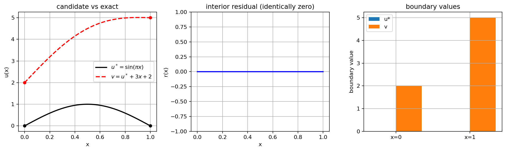

*图06-2 · A1组解析构造，不是训练结果。左：$u^\star=\sin(\pi x)$ 与 $v=u^\star+3x+2$；中：$v$ 的内部残差恒为零；右：两端边界值。*

**（2）反例二：有限配点盲区。**

反例一说明的是“残差处处为零，边界错”。还有一种更隐蔽的情况：**边界对、配点残差为零，但配点之间错**。

取 $N_r=6$ 个配点

$$
x_i=\frac{i+1/2}{6},\qquad i=0,1,\dots,5.
$$

构造

$$
p_{\text{raw}}(x)=x^3(1-x)^3\prod_{i=0}^{5}(x-x_i)^3,
\qquad
p(x)=\frac{p_{\text{raw}}(x)}{\max_{0\le x\le1}|p_{\text{raw}}(x)|}.
\qquad (6)
$$

归一化后 $\|p\|_\infty=1$。关键性质：

- 在 $x=0$，因子 $x^3$ 使 $p(0)=p'(0)=p''(0)=0$；
- 在 $x=1$，因子 $(1-x)^3$ 使 $p(1)=p'(1)=p''(1)=0$；
- 在每个 $x_i$，因子 $(x-x_i)^3$ 使 $p(x_i)=p'(x_i)=p''(x_i)=0$。

取

$$
u_\varepsilon(x)=u^\star(x)+\varepsilon p(x),\qquad \varepsilon=0.1.
$$

则 $u_\varepsilon(0)=u_\varepsilon(1)=0$，且在每个配点上

$$
r_\varepsilon(x_i)
=-u_\varepsilon''(x_i)-f(x_i)
=-\varepsilon p''(x_i)=0.
$$

但在密网格上 $p$ 不恒为零，$p''$ 也不恒为零，所以 $u_\varepsilon\ne u^\star$，且

$$
r_\varepsilon(x)=-\varepsilon p''(x)\not\equiv0.
$$

Notebook 的实际输出：$p$ 和 $p''$ 在 6 个配点及两个端点处的最大绝对值都是 $0$；$\max|u_\varepsilon-u^\star|=0.1$，相对 $L^2$ 误差 $5.265\times10^{-2}$；但在 4001 点密网格上，$\max|r_\varepsilon|=569.3$，残差 RMS 为 $115.7$。

这个反例不是训练结果，而是对损失函数的严格构造。它说明：**训练点上的零残差只是有限个约束，不能代表全区间残差为零。** 评价必须在训练点之外的密网格上进行。一个足够宽的 $\tanh$ 网络可以逼近这个多项式扰动，所以这不是“网络表示不了”的借口，而是损失与采样设计本身的问题。

**（3）反例三：权重失衡（小总损失掩盖大边界误差）。**

考虑两参数族

$$
u_{a,b}(x)=a\sin(\pi x)+b(1-x),
$$

目标仍是 $u^\star=\sin(\pi x)$。则

$$
u_{a,b}(0)=b,\qquad u_{a,b}(1)=0,
$$

$$
-u_{a,b}''(x)-f(x)=\pi^2(a-1)\sin(\pi x).
$$

因此

$$
\mathcal L_r=\frac{\pi^4}{2}(a-1)^2,\qquad
\mathcal L_b=\frac{b^2}{2},
$$

$$
\mathcal L=\frac{\pi^4}{2}(a-1)^2+\frac{\lambda_b}{2}b^2.
\qquad (7)
$$

取 $\lambda_b=10^{-4}$，并取 $a=1,b=1$：

$$
\mathcal L_r=0,\qquad
\mathcal L_b=\frac12,\qquad
\mathcal L=\frac{10^{-4}}{2}=5\times10^{-5}.
$$

此时内部残差为零，总损失只有 $5\times10^{-5}$，但边界误差为 $|b|=1$，解误差为 $1-x$，相对 $L^2$ 误差约为 $1$。所以**总损失小不能直接推出边界满足**；必须把 $\mathcal L_r$ 和 $\mathcal L_b$ 分开报告，并在独立网格上评价解误差。

需要强调：这个例子的全局极小点仍然是 $a=1,b=0$（只要 $\lambda_b>0$）。它不是“全局极小点位置错”的反例，而是“用小总损失判断成功会错”的反例。权重失衡主要是**条件数与优化速度**问题：$\lambda_b$ 很小时，边界方向的曲率很小，梯度下降/Adam 需要更多步才能把它压下去；在有限预算内，边界误差可能仍然很大。

用梯度流看机制。对 (7)，

$$
\dot a=-\pi^4(a-1),\qquad \dot b=-\lambda_b b,
\qquad (8)
$$

解为

$$
a(t)=1+(a_0-1)e^{-\pi^4t},\qquad
b(t)=b_0e^{-\lambda_b t}.
$$

两个方向的衰减率相差 $\pi^4/\lambda_b$。$\lambda_b=0$ 时 $b$ 是平坦方向；$\lambda_b=10^{-4}$ 时，$\pi^4/\lambda_b\approx9.7\times10^5$，边界模式比残差模式慢约六个数量级。实际使用 Adam 时，梯度归一化会改变这个简单图像的速率，所以 (8) 只作为机制解释，最终以 Notebook 实测为准。

Notebook 的实测结果与这个机制一致：

- $\lambda_b=0$：$\mathcal L_r=8.436\times10^{-7}$，但边界误差 $1.420$，相对 $L^2$ 误差 $1.414$；
- $\lambda_b=10^{-4}$：总损失 $8.828\times10^{-6}$（低于 $10^{-5}$），但边界误差 $0.3937$，相对 $L^2$ 误差 $0.3429$；
- $\lambda_b=1$：相对 $L^2$ 误差 $1.096\times10^{-5}$，边界误差 $9.239\times10^{-6}$；
- $\lambda_b=100$：相对 $L^2$ 误差 $1.336\times10^{-4}$，边界误差 $1.330\times10^{-4}$，反而比 $\lambda_b=1$ 差。

初始化时的梯度范数比也给出同样的尺度差：$\|\nabla_\theta\mathcal L_r\|=13.882$，而 $\|\nabla_\theta(\lambda_b\mathcal L_b)\|$ 在 $\lambda_b=10^{-4},1,100$ 时分别为 $4.095\times10^{-5}$、$0.4095$、$40.95$，比值约为 $3.39\times10^5$、$33.9$、$0.339$。这是一次初始化测量，不是普遍常数，但它说明两个损失项的梯度尺度可以相差很多。

### 5. 实验设计：先预测，再运行

| 要填写的项目 | 本组内容 |
| --- | --- |
| 要回答的问题与运行前预测 | 完整损失能否把相对 $L^2$ 与边界误差压到 $10^{-3}$ 以下？只压残差时边界误差是否会停在 $O(1)$？$\lambda_b=10^{-4}$ 是否会出现“总损失很小但边界误差很大”？硬约束能否把边界误差变成 $0$？受控仿射反例是否复现 $(2,5)$ 与 $\sqrt{26}$？预测：完整损失达到 $10^{-3}$ 以下；$\lambda_b=0$ 边界误差为 $O(1)$；$\lambda_b=10^{-4}$ 总损失小但边界误差大；硬约束边界为 $0$；受控反例复现解析值；PINN 误差落在中等规模有限差分之间。 |
| 输入、参数、单位、数据来源与划分 | 问题 (1)；$x\in[0,1]$（无量纲）；$N_r=256$ 个单元中心配点；$N_b=2$ 个边界点；评价网格 1001 个均匀点，与训练点不重合；有限差分 $N=51,101,201,401,801$，使用自己的均匀网格；网络 $1\text{-}32\text{-}32\text{-}1$，$\tanh$，1153 个参数；Adam 3000 步，lr $10^{-3}$，L-BFGS 100 步；种子 0、1。 |
| 独立参考解/基线及选择理由 | 解析解 $u^\star=\sin(\pi x)$，可直接代入验证，无离散误差；有限差分用三点格式和 Thomas 算法，代码路径与 PINN 独立，用来提供“传统方法在同一问题上的精度—成本”参照。评价不使用 PINN 自己的训练残差作为唯一证据。 |
| 误差指标、容差及其依据 | 见下方“评价指标与容差”；工作容差：解析核验 $10^{-12}$，有限差分观测阶 $[1.9,2.1]$，完整损失相对 $L^2$ 与边界误差 $<10^{-3}$。 |
| 环境、种子、设备与运行预算 | Python 3.12.10；PyTorch 2.6.0+cu124；NumPy 1.26.4；Matplotlib 3.8.3；NVIDIA GeForce RTX 4060 Laptop GPU，CUDA；训练 float32，解析核验 float64；固定种子 0、1 与 CUDA 种子；全 Notebook 训练总计 241.2 s（7 次训练：完整损失 2 次、$\lambda_b$ 额外 3 次、硬约束 1 次、受控反例 1 次）。 |

**评价指标与容差。** 本节使用以下指标：

- 相对 $L^2$：$\lVert u_\theta-u^\star\rVert_2/\lVert u^\star\rVert_2$。
- 最大误差：$\lVert u_\theta-u^\star\rVert_\infty$。
- 边界误差：$\max(\lvert u_\theta(0)-g_D(0)\rvert,\lvert u_\theta(1)-g_D(1)\rvert)$。
- 独立残差 RMS：在 1001 点评价网格上 $\sqrt{\frac1{N_e}\sum r_\theta(x_e)^2}$。
- $H^1$ 半范数相对误差：$\lVert u_\theta'-u^{\star\prime}\rVert_2/\lVert u^{\star\prime}\rVert_2$。

容差依据：解析核验用 float64，取 $10^{-12}$；有限差分的观测阶应在 $[1.9,2.1]$；完整损失用 float32、demo 预算，要求相对 $L^2$ 与边界误差均小于 $10^{-3}$。这些是本节的**工作容差**，不是普遍精度保证，也不能外推到其他方程或网络。

具体实现与全部输出见 [A1组-实验-6.1.ipynb](A1组-实验-6.1.ipynb) 的实验 A–D。正文只引用该 Notebook 的实际结果。

### 6. 结果解释与本节结论

**（1）完整损失：两个种子。**

**表 1 · 完整损失（两个种子）**

| 种子 | 相对 $L^2$ | 最大误差 | 边界误差 | 独立残差 RMS | $H^1$ 相对误差 | $\mathcal L_r$ | $\mathcal L_b$ | 时间/s |
| --- | --- | --- | --- | --- | --- | --- | --- | --- |
| 0 | $1.096\times10^{-5}$ | $1.109\times10^{-5}$ | $9.239\times10^{-6}$ | $1.508\times10^{-3}$ | $2.314\times10^{-5}$ | $2.230\times10^{-6}$ | $5.820\times10^{-11}$ | 31.59 |
| 1 | $1.353\times10^{-5}$ | $1.997\times10^{-5}$ | $1.276\times10^{-5}$ | $3.816\times10^{-3}$ | $6.399\times10^{-5}$ | $1.424\times10^{-5}$ | $8.331\times10^{-11}$ | 28.94 |

两个种子的相对 $L^2$ 都在 $1.1$–$1.4\times10^{-5}$，边界误差在 $9$–$13\times10^{-6}$，都远低于 $10^{-3}$ 的预设容差。种子 1 的独立残差 RMS（$3.816\times10^{-3}$）约为种子 0 的 2.5 倍，但解误差只差约 23%；这说明**残差指标与解误差不是同一个量**，不能用一个代替另一个。

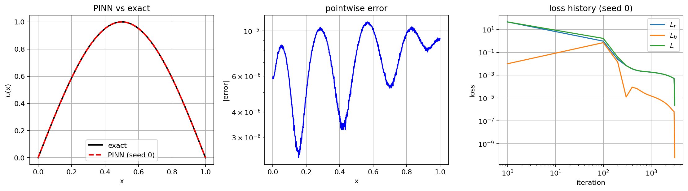

*图06-3 · A1组实测，种子 0，$\lambda_b=1$。左：$u_\theta$ 与 $u^\star=\sin(\pi x)$；中：逐点绝对误差（纵轴对数）；右：$\mathcal L_r$、$\mathcal L_b$ 与总损失随迭代变化。横轴 $x$ 与迭代次数均无量纲；误差与损失均为本节定义的无量纲量。*

**（2）遗漏边界与权重失衡。**

**表 2 · 边界权重扫描（种子 0）**

| $\lambda_b$ | $\mathcal L_r$ | $\mathcal L_b$ | 总损失 | 相对 $L^2$ | 最大误差 | 边界误差 | 残差 RMS | $H^1$ 相对误差 | 时间/s |
| --- | --- | --- | --- | --- | --- | --- | --- | --- | --- |
| 0 | $8.436\times10^{-7}$ | $1.137$ | $8.436\times10^{-7}$ | $1.414$ | $1.420$ | $1.420$ | $9.360\times10^{-4}$ | $0.4102$ | 28.54 |
| $10^{-4}$ | $9.628\times10^{-7}$ | $7.866\times10^{-2}$ | $8.828\times10^{-6}$ | $0.3429$ | $0.3937$ | $0.3937$ | $9.979\times10^{-4}$ | $0.1556$ | 32.76 |
| $1$ | $2.230\times10^{-6}$ | $5.820\times10^{-11}$ | $2.230\times10^{-6}$ | $1.096\times10^{-5}$ | $1.109\times10^{-5}$ | $9.239\times10^{-6}$ | $1.508\times10^{-3}$ | $2.314\times10^{-5}$ | 31.59 |
| $100$ | $2.281\times10^{-5}$ | $1.318\times10^{-8}$ | $2.413\times10^{-5}$ | $1.336\times10^{-4}$ | $1.330\times10^{-4}$ | $1.330\times10^{-4}$ | $4.847\times10^{-3}$ | $8.680\times10^{-5}$ | 33.01 |

表中 $\lambda_b=1$ 一行复用完整损失种子 0 的结果；训练设置与其余行相同。

这张表是本节最关键的证据：

- $\lambda_b=0$ 时，$\mathcal L_r$ 只有 $8.436\times10^{-7}$，但边界误差 $1.420$，相对 $L^2$ 误差 $1.414$。**内部残差极小，解完全错。**
- $\lambda_b=10^{-4}$ 时，总损失 $8.828\times10^{-6}$，看起来很小；但边界误差 $0.3937$，相对 $L^2$ 误差 $0.3429$。**总损失小，不等于边界满足。**
- $\lambda_b=1$ 时，各指标都达到 $10^{-5}$ 量级，是本轮最好的软约束权重。
- $\lambda_b=100$ 时，边界项被过度强调，残差项被压低得不够，两个误差都回到 $1.3\times10^{-4}$，比 $\lambda_b=1$ 差。这说明权重不是越大越好。

$\lambda_b=0$ 的训练结果还揭示了一个细节：网络并没有收敛到解析反例 $v=\sin(\pi x)+3x+2$，而是近似落在仿射零空间中的另一个元素附近，端点约为 $(0.508,1.420)$。这不影响结论，反而更清楚地说明：**残差损失只固定“非仿射部分”，仿射部分是平坦方向；具体落到哪个元素取决于初始化与优化路径。** 解析反例 $(3,2)$ 是同一个零空间中的另一个元素，用来把数学结构摆清楚。

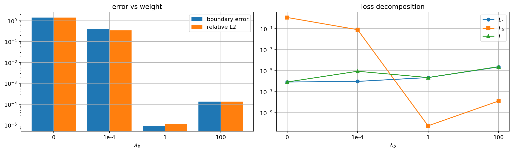

*图06-4 · A1组实测，种子 0。左：边界误差与相对 $L^2$ 随 $\lambda_b$ 变化（纵轴对数）；右：$\mathcal L_r$、$\mathcal L_b$ 与总损失随 $\lambda_b$ 变化。横轴 $\lambda_b$ 为无量纲权重；$\lambda_b=0$ 时总损失等于 $\mathcal L_r$。*

**（3）硬约束与受控反例。**

**表 3 · 硬约束与受控反例**

| 方案 | 相对 $L^2$ | 最大误差 | 边界误差 | 端点值 | $\mathcal L_r$ | $\mathcal L_b$ | 残差 RMS | $H^1$ 相对误差 | 时间/s |
| --- | --- | --- | --- | --- | --- | --- | --- | --- | --- |
| 硬约束 $x(1-x)N_\theta$ | $3.790\times10^{-6}$ | $5.126\times10^{-6}$ | $0$ | $(0,0)$ | $2.124\times10^{-6}$ | $0$ | $1.475\times10^{-3}$ | $2.464\times10^{-5}$ | 41.83 |
| 受控反例 $x(1-x)N_\theta+3x+2$ | $5.102$ | $5.0$ | $5.0$ | $(2,5)$ | $2.124\times10^{-6}$ | $14.5$ | $1.475\times10^{-3}$ | $1.350$ | 44.52 |

硬约束把边界误差变成精确的 $0$，解误差 $3.790\times10^{-6}$，在本轮中好于软约束。受控反例则把反例一的解析构造搬进了训练：硬约束部分在两端为零，仿射项 $3x+2$ 对二阶导数没有贡献，因此 $\mathcal L_r$ 完全看不见它。训练后 $\mathcal L_r=2.124\times10^{-6}$，与硬约束相同；但端点值为 $(2,5)$，$\mathcal L_b=14.5$，相对 $L^2$ 误差 $5.102$，与解析值 $\sqrt{26}=5.099$ 相差 $2.8\times10^{-3}$（来自 1001 点离散评价）。这证明：**只要损失里没有边界项，残差再小也不能阻止仿射项把解整体抬走。**

**（4）有限差分基线。**

**表 4 · 有限差分基线**

| $N$ | $h$ | 相对 $L^2$ | 最大误差 | 观测阶 |
| --- | --- | --- | --- | --- |
| 51 | $2.000\times10^{-2}$ | $3.291\times10^{-4}$ | $3.291\times10^{-4}$ | — |
| 101 | $1.000\times10^{-2}$ | $8.225\times10^{-5}$ | $8.225\times10^{-5}$ | 2.0002 |
| 201 | $5.000\times10^{-3}$ | $2.056\times10^{-5}$ | $2.056\times10^{-5}$ | 2.0001 |
| 401 | $2.500\times10^{-3}$ | $5.140\times10^{-6}$ | $5.140\times10^{-6}$ | 2.0000 |
| 801 | $1.250\times10^{-3}$ | $1.285\times10^{-6}$ | $1.285\times10^{-6}$ | 2.0000 |

有限差分的观测阶稳定在 $2.000$，与三点格式的 $O(h^2)$ 理论一致。这说明基线实现正确，误差表可信。把 PINN 放进来比较：

- 软约束 PINN 的相对 $L^2$ 为 $1.096\times10^{-5}$，介于 $N=201$（$2.056\times10^{-5}$）与 $N=401$（$5.140\times10^{-6}$）之间；
- 硬约束 PINN 为 $3.790\times10^{-6}$，介于 $N=401$ 与 $N=801$（$1.285\times10^{-6}$）之间；
- 但软约束/硬约束 PINN 的单次训练为 $28.94$–$41.83$ s（受控反例 $44.52$ s），而有限差分只需求解一个三对角系统，耗时是毫秒量级。相对于最细的有限差分，PINN 在这个问题上精度和成本都不占优。

这不是说 PINN 没有价值，而是说：**在一维、光滑、已知方程的正问题上，经典方法本来就非常强。** PINN 的潜在优势要在反问题、复杂几何、高维或数据融合等场景中讨论；本节不把这些场景的结论提前透支。

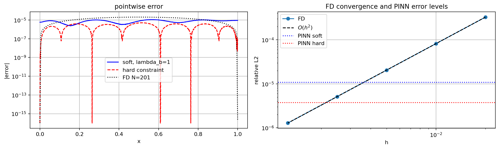

*图06-5 · A1组实测，种子 0。左：软约束、硬约束与 $N=201$ 有限差分的逐点绝对误差（纵轴对数）；右：有限差分相对 $L^2$ 随 $h$ 的收敛（双对数），虚线为 $O(h^2)$ 参考，水平点线为 PINN 软/硬约束的误差水平。*

**（5）有限配点反例。**

**表 5 · 有限配点反例（解析构造）**

| 量 | 值 |
| --- | --- |
| 配点数 $N_r$ | 6 |
| $\max\lVert p\rVert_\infty$ | 1.0 |
| 配点处 $\max\lvert p\rvert$ | 0 |
| 配点处 $\max\lvert p''\rvert$ | 0 |
| 端点处 $\max\lvert p\rvert$ | 0 |
| 端点处 $\max\lvert p''\rvert$ | 0 |
| $\max\lvert u_\varepsilon-u^\star\rvert$ | 0.1 |
| 相对 $L^2$ 误差 | $5.265\times10^{-2}$ |
| 配点处 $\max\lvert r_\varepsilon\rvert$ | 0 |
| 密网格 $\max\lvert r_\varepsilon\rvert$ | 569.3 |
| 密网格残差 RMS | 115.7 |

这是反例二的解析构造。配点和端点上的残差精确为零，边界也精确满足，但在密网格上残差最大到 $569.3$，解误差最大到 $0.1$。它说明：**“训练损失为零”最多说明训练点上的约束被满足，不能说明函数在点与点之间是对的。** 因此，评价必须使用独立密网格；如果只看训练损失，这个反例会被误判为完美解。

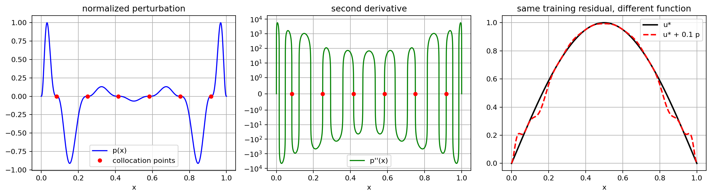

*图06-6 · A1组解析构造，不是训练结果。左：归一化扰动 $p(x)$ 与 6 个配点；中：$p''(x)$（纵轴对称对数），配点处为零；右：$u^\star$ 与 $u^\star+0.1p$ 在配点处残差相同，但函数不同。*

**（6）与预测的对照。**

| 预测 | 实际 | 判定 |
| --- | --- | --- |
| 完整损失相对 $L^2$ 与边界误差 $<10^{-3}$ | $1.096$–$1.353\times10^{-5}$；$9.239$–$12.76\times10^{-6}$ | 通过 |
| $\lambda_b=0$ 边界误差 $O(1)$ | $1.420$ | 通过 |
| $\lambda_b=10^{-4}$ 总损失小但边界误差大 | 总损失 $8.828\times10^{-6}$，边界误差 $0.3937$ | 通过 |
| 硬约束边界误差为 $0$ | $0$ | 通过 |
| 受控反例复现 $(2,5)$ 与 $\sqrt{26}$ | $(2,5)$；$5.102$（解析 $5.099$） | 通过 |
| 有限差分观测阶约为 $2$ | $2.0002\to2.0000$ | 通过 |
| 有限配点：点残差为零、密网格非零 | $0$ 与 $569.3$ | 通过 |

一处不完全对称的结果：硬约束在本轮优于软约束，但只有一个种子；$\lambda_b=100$ 反而比 $\lambda_b=1$ 差。这两点都说明权重和结构的选择依赖问题与预算，不能写成“越大越好”或“硬约束一定更好”的口号。

### 7. 易错点与讨论

**（1）风险：低训练残差不等于真解误差小，更不等于满足边界。**

本节用三组数字回应这条风险：

| 方案 | $\mathcal L_r$ | 相对 $L^2$ | 边界误差 |
| --- | --- | --- | --- |
| 完整损失 $\lambda_b=1$ | $2.230\times10^{-6}$ | $1.096\times10^{-5}$ | $9.239\times10^{-6}$ |
| 只压残差 $\lambda_b=0$ | $8.436\times10^{-7}$ | $1.414$ | $1.420$ |
| 受控反例 $x(1-x)N+3x+2$ | $2.124\times10^{-6}$ | $5.102$ | $5.0$ |

三者的 $\mathcal L_r$ 都在 $10^{-7}$–$10^{-6}$ 量级，但相对 $L^2$ 误差相差六个数量级。原因不是训练没收敛，而是损失函数的零空间不同：$\lambda_b=0$ 的损失对仿射项完全不敏感；受控反例则把仿射项固定在网络外面，残差损失没有梯度去改变它。**因此，报告 PINN 结果时至少要同时给出：内部残差、边界误差、独立参考解上的解误差，以及训练/评价点的划分。** 只给一个总损失或一张拟合曲线，无法区分“真解”和“零空间中的另一个元素”。

**（2）风险：权重失衡只是“调参问题”，不是数学问题。**

反例三的全局极小点分析说明：只要 $\lambda_b>0$ 且网络能表示 $u^\star$，全局极小点仍然是 $u^\star$。所以权重失衡不是“损失函数的解错了”，而是“有限步优化到不了”。这也是为什么我们不把 $\lambda_b=10^{-4}$ 的结果解释为“损失函数定义错误”，而解释为“条件数差、边界模式衰减慢”。实际使用 Adam 时，梯度归一化会改变速率；本轮 $\lambda_b=10^{-4}$ 的边界误差从 $1$ 降到 $0.3937$，说明 Adam 确实在动，但预算内没压到零。换成 L-BFGS 或更多步数，结果可能不同；本节没有做这个消融，不能外推。

**（3）风险：硬约束没有代价。**

硬约束把边界误差变成精确的 $0$，但它改变了网络可以表示的函数族。对简单区间和 Dirichlet 边界，(4) 很好用；对复杂几何、多个边界、Neumann/Robin 条件，构造精确满足边界的网络并不容易，而且可能让优化更病态。本节的硬约束结果只支持“在这个一维零边界问题上有效”，不支持“硬约束普遍优于软约束”。

**（4）风险：有限配点足够密就不会漏。**

反例二说明，残差可以在配点上精确为零，在配点之间很大。增加配点数会减小这种盲区，但不等于消除；配点分布、求积权重和评价网格都要单独设计。一个实用的诊断是：训练时记录配点残差，评价时在独立密网格上再算一次残差；两者差距大，就说明采样不足或函数在点间振荡。

**（5）风险：把 PINN 当成传统求解器的替代品。**

本轮一维问题上，有限差分 $N=801$ 的相对 $L^2$ 为 $1.285\times10^{-6}$，比软约束 PINN 的 $1.096\times10^{-5}$ 更准，而且快几个数量级。PINN 的意义不在于这个算例上“赢过”有限差分，而在于它可以自然地加入数据项、处理复杂几何或高维参数化问题；这些优势需要另外的实验证明，不能由本节的结果自动推出。

**（6）随堂提问：** 设
$$v(x)=\sin(\pi x)+cx+d,$$
其中 $c,d$ 是常数。请回答：

1. 计算 $-v''-\pi^2\sin(\pi x)$，说明 $v$ 对任意 $c,d$ 都满足内部方程。
2. 计算 $v(0),v(1)$，并求使零 Dirichlet 边界成立的 $c,d$。
3. 若只训练 $\mathcal L_r$，损失能否区分不同的 $(c,d)$？请给出一个评价指标，使得“残差为零但边界错”的方案会被判为失败。
4. 如果改用硬约束 $u_\theta=x(1-x)N_\theta$，上述平坦方向是否还存在？为什么？

可能回答与最终解释：第 1 问残差恒为零；第 2 问 $v(0)=d$、$v(1)=c+d$，零边界要求 $d=0,c=0$；第 3 问不能，$\mathcal L_r$ 对 $c,d$ 不敏感，应同时报告边界误差 $\max(|v(0)|,|v(1)|)$ 和独立网格上的相对 $L^2$；第 4 问硬约束把 $x(1-x)$ 因子写进结构，零边界的仿射方向被去掉，但网络仍可能在其他方向欠拟合，所以仍要独立评价解误差。

### 回到开场：用证据回答

开场的问题是：$v=\sin(\pi x)+3x+2$ 为什么满足内部方程，却不是零 Dirichlet 问题的解？

答案是反例一的仿射零空间：$-d^2/dx^2$ 的核是 $\operatorname{span}\{1,x\}$，$3x+2$ 正好落在核里，所以内部残差恒为零；但 $v(0)=2$、$v(1)=5$，边界条件不满足。由前面的相对误差计算，相对 $L^2$ 误差是 $\sqrt{26}\approx5.099$，不是“很小”。

最初的预测是：只压内部残差，边界误差不会自己消失；加入边界项或硬约束后，边界误差应降到 $10^{-3}$ 以下。Notebook 的实际结果支持这个预测：

- $\lambda_b=0$：边界误差 $1.420$，相对 $L^2$ 误差 $1.414$；
- $\lambda_b=1$：边界误差 $9.239\times10^{-6}$，相对 $L^2$ 误差 $1.096\times10^{-5}$；
- 硬约束：边界误差 $0$，相对 $L^2$ 误差 $3.790\times10^{-6}$；
- 受控反例 $x(1-x)N+3x+2$：$\mathcal L_r=2.124\times10^{-6}$，但边界 $(2,5)$、相对 $L^2$ 误差 $5.102$。

这些结果支持一个有限但明确的结论：**PINN 可以把这个问题解到 $10^{-5}$ 量级，但前提是损失完整、边界被正确处理、评价独立。** 它不证明 PINN 比有限差分更优：本轮有限差分 $N=801$ 的误差 $1.285\times10^{-6}$，而且快几个数量级。它也不证明 PINN 能直接处理所有 PDE；高频、非线性、复杂边界都还没有验证。

比喻的局限也在这里。开场画面能表达“内部方程对了，边界门对不上”，但它不能表达两件事：第一，边界对了，配点之间的残差仍可能很大（反例二）；第二，总损失很小，边界误差仍可能很大（反例三）。所以画面只能作为入口，不能替代损失分解与独立评价。

### 本节小结

1. PINN 用网络表示解函数，用自动微分构造残差，用复合损失把方程和边界放在一起优化。它是一种“带物理约束的回归”，不是万能的 PDE 求解器。
2. 损失必须覆盖问题的全部约束。只写内部残差时，$-d^2/dx^2$ 的仿射零空间不会被约束；解析反例 $v=\sin(\pi x)+3x+2$ 与受控训练都证明了这一点。
3. 有限配点上的零残差不等于全区间零残差。反例二的多项式反例在配点和边界上残差为零，但密网格残差达到 $569.3$；独立密网格评价是必需的。
4. 权重失衡主要是条件数与优化速度问题，不是全局极小点位置问题。$\lambda_b=10^{-4}$ 时总损失 $8.828\times10^{-6}$ 但边界误差 $0.3937$；$\lambda_b=1$ 在本轮最平衡，$\lambda_b=100$ 反而过惩罚。
5. 硬约束 $u=x(1-x)N_\theta$ 在简单零 Dirichlet 边界上精确满足边界，本轮误差 $3.790\times10^{-6}$；但它有架构偏置，不能无条件推广。
6. 报告 PINN 结果至少要给出：训练设置、各损失项、边界误差、独立参考解上的解误差、训练/评价划分、种子与运行时间。低训练残差不能单独作为成功判据。
7. 在一维光滑正问题上，有限差分 $N=801$ 的误差 $1.285\times10^{-6}$，优于本轮 PINN，而且快几个数量级；PINN 的潜在优势要在反问题、复杂几何、高维等场景中另行验证。

### 8. 课后练习

1. 对 $v(x)=\sin(\pi x)+cx+d$，写出 $\mathcal L_r$、$\mathcal L_b$（两端平均）与相对 $L^2$ 误差的表达式；求使零边界成立的 $c,d$；并解释为什么只报告 $\mathcal L_r$ 无法区分不同的 $(c,d)$。
2. 取反例三的两参数族 $u_{a,b}=a\sin(\pi x)+b(1-x)$，令 $\lambda_b=10^{-4}$。计算 $(a,b)=(1,1)$ 与 $(1,0)$ 两点的总损失、边界误差和相对 $L^2$ 误差；说明为什么“总损失小于 $10^{-4}$”不能作为边界满足的判据。
3. 选做：把反例二的 $p(x)$ 换成 $N_r=12$ 个配点，重新计算配点残差与密网格残差；观察密网格残差的最大值如何随配点数变化。这个实验不改变本节结论，只用于理解采样盲区。

### 选读边界

XPINN、cPINN、B-PINN 不在本节范围；6.2–6.4 的反问题、DeepONet/FNO 与方法比较分别在后文展开，本节不重复。本节只讨论 6.1 的正问题、损失设计和评价方法；不把一维 Poisson 的结论外推到这些方法或场景。

### 参考资料、图片来源与 AI 使用

| 支撑的主张/公式/图片 | 作者、标题、版本/年份 | 页码/章节/链接 | 本组核对状态 |
| --- | --- | --- | --- |
| PINN 框架、正问题与反问题 | Raissi, Perdikaris, Karniadakis, *Physics-informed neural networks: A deep learning framework for solving forward and inverse problems involving nonlinear partial differential equations*, J. Comput. Phys. 378 (2019) 686–707 | 原论文 | 阅读起点；页码待核对 |
| PINN 的适用范围与局限 | Karniadakis 等, *Physics-informed machine learning*, Nature Reviews Physics 3 (2021) 422–440 | 综述 | 阅读起点；页码待核对 |
| 梯度病态与权重失衡 | Wang, Teng, Perdikaris, *Understanding and mitigating gradient flow pathologies in physics-informed neural networks*, SIAM J. Sci. Comput. 43(5) (2021) A3055–A3081 | 原论文 | 阅读起点；页码待核对 |
| 硬约束/试函数构造 | Lagaris, Likas, Fotiadis, *Artificial neural networks for solving ordinary and partial differential equations*, IEEE Trans. Neural Networks 9(5) (1998) 987–1000 | 原论文 | 阅读起点；页码待核对 |
| 万能逼近定理 | Hornik, *Approximation capabilities of multilayer feedforward networks*, Neural Networks 4(2) (1991) 251–257；Pinkus, *Approximation Theory of the Neural Networks*, Acta Numerica 8 (1999) 143–195 | 原论文 | 仅引用，未独立重证 |
| Poincaré/Friedrichs 不等式 | Evans, *Partial Differential Equations*, 2nd ed., AMS, 2010, §5.6.1 | 教材章节 | 经典结果；页码待核对 |
| L-BFGS | Liu, Nocedal, *On the limited memory BFGS method for large scale optimization*, Math. Programming 45 (1989) 503–528 | 原论文 | 仅引用 |
| 频谱偏置（本节未做实验） | Rahaman 等, *On the spectral bias of neural networks*, ICML 2019；Xu 等, *Frequency principle: Fourier analysis sheds light on deep neural networks*, Commun. Comput. Phys. 28 (2020) 1746–1767 | 原论文 | 仅作为“未验证”提示，不作为实测结论 |

**图片与 AI 使用：**

- 图06-1：模板初始化漫画（`A1组-6.1-图1-开场漫画.svg`），A1组未修改图形，只重写图注；是概念示意，不是实测结果。
- 图06-2：由 A1组 Notebook 根据解析反例生成，是解析构造，不是训练结果。
- 图06-3 至图06-6：由 A1组 Notebook 的 Matplotlib 代码生成，数据即正文表 1 至表 5 的实际运行结果，可由 `A1组-实验-6.1.ipynb` 重跑复现。
- 本稿在 AI 辅助下完成；所有数值取自 `A1组-实验-6.1.ipynb` 的实际运行输出，未使用“预期结果”代替实测。AI 给出的文献表述与页码只作为阅读起点，未经人工逐条核对；B/C 验证时应补全或纠正。AI 没有被当作来源：正文的每条数值结论都对应 Notebook 输出，每条数学结论都可在正文中找到推导。

6.1 解决的是“给定方程求一条解曲线”的正问题：只要损失完整、边界处理正确，PINN 就能在一维 Poisson 上达到与有限差分同量级的精度。但实际任务中，方程里的系数往往未知，手里只有若干观测。下一节把同一个 PINN 从“求一条解”推进到“识别未知参数”的反问题，并重点回答：这些观测里究竟有没有足够的信息。

---

## 6.2 PINN：正问题与反问题（2学时）

> **状态声明（B 版）：** 本稿是**正文初稿**，文献结论标 **[文献结论，页码待核对]**，未核对页码的写“待核对”。本稿不是论文导读：只列正文直接引用的文献，不罗列任何论文末尾的全部参考文献。

> **范围声明：** 本节只以 6.1 的一维 Poisson 正问题作基线；6.3、6.4 不在本节范围。主实验是单参数、软边界、合成观测；硬约束、先验/正则化、双参数退化只作为机制讨论，不作为 E1–E5 的实际设置。

### 6.2.1 本节信息与目标

**本节核心概念：** PINN 反问题；参数可辨识性；观测设计与噪声。

**先修知识：** 6.1 的 PINN 正问题、复合损失与边界处理；第 3 章初边值问题、二阶线性常微分方程的解存在唯一性；第 5 章梯度、链式法则、非凸优化与平坦方向；概率论中的独立同分布、正态分布、期望与方差。

**课时：** 6.2 节 2 学时。

**本节目标：** 能区分“求解未知函数”的正问题与“识别未知参数”的反问题；能写出含待估参数与观测项的 PINN 损失；能说明观测数量、位置、噪声和先验如何影响可辨识性；能用合成观测完成一个最小反问题实验，并区分“观测拟合好”与“参数恢复正确”。

6.1 已经给出正问题的基线：软约束（种子 0）的相对 $L^2$ 误差为 $1.096\times10^{-5}$，硬约束为 $3.790\times10^{-6}$，有限差分 $N=801$ 为 $1.285\times10^{-6}$（见 `A1-G12-正文.md` 表 1、表 3、表 4）。6.2 不重跑这些正问题，只把它们当作“正问题已经会做”的参照；本节的新问题是：如果 $\kappa$ 未知，只给若干 $u$ 的观测，能否把 $\kappa$ 找回来？在什么条件下能？能到什么精度？

### 2. 概念与推导：从正问题到可辨识反问题

#### 2.1 从 6.1 的正问题到 6.2 的反问题

**已知.** 6.1 节已经处理一维 Poisson 正问题

$$
\begin{cases}
-u''(x)=\pi^2\sin(\pi x), & x\in(0,1),\\
u(0)=u(1)=0,
\end{cases}
\tag{2.1}
$$

其精确解为 $u^\star(x)=\sin(\pi x)$。6.1 的实际运行结果给出：软约束（种子 0）的相对 $L^2$ 误差为 $1.096\times10^{-5}$，硬约束为 $3.790\times10^{-6}$，有限差分 $N=801$ 为 $1.285\times10^{-6}$。这些是 **6.1 的实测记录**，本节只把它们当作“正问题已经会做”的基线，不当作 6.2 的结果。

**关键步骤.** 6.2 只改一件事：把方程中的常数系数设为未知。考虑

$$
\begin{cases}
-\kappa u''(x)=f(x), & x\in(0,1),\\
u(0)=g_D(0),\quad u(1)=g_D(1),
\end{cases}
\tag{2.2}
$$

其中 $f(x)=\pi^2\sin(\pi x)$、$g_D(0)=g_D(1)=0$ 仍然已知，$\kappa>0$ 待估。正问题的未知量是函数 $u$；本节反问题的未知量是 $(u,\kappa)$，其中 $u$ 是无穷维函数，$\kappa$ 是一维参数。给定若干观测 $(x_d,y_d)$，$y_d\approx u^\star(x_d)$，目标是从这些观测恢复 $\kappa$，同时仍然给出一个满足方程与边界的 $u$。

**结论.** 正问题问“已知系数，解是什么”；反问题问“看见解的部分信息，系数是什么”。反问题的评价不能只看损失或拟合曲线，必须同时报告参数误差、解误差和观测设置。**限制.** 本节只处理一维、线性、常数系数、零 Dirichlet 边界、$f$ 幅度已知的合成观测；这些条件在 2.10 节会逐条列出。

#### 2.2 精确解族、唯一性与尺度不变性

**已知.** 取 $f(x)=\pi^2\sin(\pi x)$、零边界，$\kappa>0$。直接验证

$$
u_\kappa(x)=\frac1\kappa\sin(\pi x)
\tag{2.3}
$$

满足方程与边界：$u_\kappa''=-\frac{\pi^2}{\kappa}\sin(\pi x)$，故 $-\kappa u_\kappa''=\pi^2\sin(\pi x)=f$；且 $u_\kappa(0)=u_\kappa(1)=0$。

**关键步骤.** 唯一性只需看两个解之差。设 $u,v$ 都是 (2.2) 的解，令 $w=u-v$。由线性性，$-\kappa w''=0$、$w(0)=w(1)=0$；因 $\kappa>0$，得 $w''=0$，两次积分得 $w(x)=ax+b$，代入边界得 $a=b=0$，故 $w\equiv0$。更一般地，若 $w$ 是 $\kappa=1$ 时的解，则 $u_\kappa=w/\kappa$，所以 $\kappa$ 只改变整体幅度。

**结论.** 对每个 $\kappa>0$，(2.2) 有唯一解，且 (2.3) 给出。$\kappa$ 只改变解的**高度** $1/\kappa$，不改变形状 $\sin(\pi x)$；边界值恒为零，与 $\kappa$ 无关。若源项幅度也未知，写成 $A\pi^2\sin(\pi x)$，则解为 $(A/\kappa)\sin(\pi x)$，只有比值 $A/\kappa$ 出现；这就是尺度变换

$$
(\kappa,f)\longmapsto(t\kappa,tf),\qquad t>0
\tag{2.4}
$$

下方程与解都不变的原因。**限制.** 若 $\kappa=0$，方程退化，不是二阶方程；若 $\kappa<0$，唯一性仍成立，但正性来自物理约束而非方程本身。若 $f$ 不连续，需用更弱的解定义，本节不展开。

#### 2.3 观测算子与可辨识性：边界零观测为什么失败

**已知.** 固定 $f$、边界条件和观测位置 $\{x_d\}$，定义观测算子

$$
H:\Theta\to\mathbb R^{N_d},\qquad
H(\kappa)=\big(u_\kappa(x_1),\dots,u_\kappa(x_{N_d})\big),
\tag{2.5}
$$

其中 $\Theta\subset(0,\infty)$。称 $\kappa$ 在 $\Theta$ 上**可辨识**，若 $H$ 单射：

$$
H(\kappa_1)=H(\kappa_2)\ \Longrightarrow\ \kappa_1=\kappa_2.
\tag{2.6}
$$

若 $H$ 在 $\kappa^\star$ 的某邻域内单射，称**局部可辨识**；若有噪声观测的分布 $P_\kappa$ 满足 $\kappa_1\ne\kappa_2\Rightarrow P_{\kappa_1}\ne P_{\kappa_2}$，称**统计可辨识**。

**关键步骤.** 先看仅边界零观测。由 (2.3)，

$$
H_b(\kappa)=\big(u_\kappa(0),u_\kappa(1)\big)=(0,0),
\qquad \forall\kappa>0.
\tag{2.7}
$$

右边是常向量，故 $H_b$ 非单射。损失层同样平坦：若网络能精确表示 $u_\kappa$，则 $\mathcal L_r=\mathcal L_b=0$ 对一切 $\kappa>0$ 成立，于是

$$
\frac{d\mathcal L^\ast}{d\kappa}(\kappa)=0,\qquad \forall\kappa>0.
\tag{2.8}
$$

这不是“梯度很小”，而是目标函数在 $\kappa$ 方向上为常数；加密配点、换优化器、增加边界观测点都不能改变这一点。统计层也一致：若边界观测带噪声，$y_d=0+\varepsilon_d$ 的分布是 $N(0,\sigma^2)$，与 $\kappa$ 无关，Fisher 信息 $I(\kappa)=0$。

**结论.** 仅边界零观测时，$\kappa$ 结构性不可辨识；这是模型层结论，不是采样不足或网络容量不足。必须把“边界条件满足”和“边界数据含 $\kappa$ 信息”分开：前者对一切 $\kappa$ 成立，所以后者为零。**限制.** 这个结论依赖 $f$ 幅度已知、边界条件不显含 $\kappa$、观测的是 $u$ 的值；若边界条件是 Robin 型且含 $\kappa$，或 $f$ 幅度未知，结论要改写。另一个细微点是：上面的“$\mathcal L^\ast\equiv0$”用了“网络能精确表示 $u_\kappa$”的假设；若只能近似表示，则平坦方向是**近似**平坦，参数漂移由逼近误差与优化路径决定。$I(\kappa)=0$ 时 Cramér–Rao 定理的条件 $0<I<\infty$ 不成立，不能直接写“方差下界为 $+\infty$”；更准确的说法是“数据分布不随 $\kappa$ 变，无法一致估计”。

#### 2.4 内点观测：灵敏度、Fisher 信息与 CR 下界

**已知.** 取内点 $x_d\in(0,1)$，记 $s_d=\sin(\pi x_d)>0$。由 (2.3)，

$$
u_\kappa(x_d)=\frac{s_d}{\kappa}.
\tag{2.9}
$$

**关键步骤.** 对 $\kappa$ 求导，得

$$
J_d=\frac{\partial u_\kappa(x_d)}{\partial\kappa}
=-\frac{s_d}{\kappa^2}.
\tag{2.10}
$$

弹性为

$$
\frac{\kappa}{u_\kappa}\frac{\partial u_\kappa}{\partial\kappa}=-1,
\tag{2.11}
$$

与位置无关；区分位置的是绝对灵敏度 $s_d$。因为 $0\le s_d\le1$，且 $s_d=1$ 当且仅当 $x_d=1/2$，

$$
|J_d|\le\frac1{\kappa^2},\qquad
|J_d|=\frac1{\kappa^2}\iff x_d=\frac12.
\tag{2.12}
$$

在端点附近，$\sin(\pi x)=\pi x+O(x^3)$，故 $|J_d|\approx\pi x_d/\kappa^2$，按 $x_d$ 线性趋零。

若观测模型为

$$
y_d=u_\kappa(x_d)+\varepsilon_d=\frac{s_d}{\kappa}+\varepsilon_d,
\qquad \varepsilon_d\overset{\text{iid}}{\sim}N(0,\sigma^2),
\tag{2.13}
$$

则对数似然对 $\kappa$ 的得分函数为 $\ell'(\kappa)=\frac1{\sigma^2}\sum_d(y_d-u_\kappa(x_d))J_d$，Fisher 信息为

$$
I(\kappa)=\frac{1}{\sigma^2}\sum_d J_d^2
=\frac{1}{\sigma^2\kappa^4}\sum_{d=1}^{N_d}\sin^2(\pi x_d).
\tag{2.14}
$$

在正则条件下，任何无偏估计 $T$ 满足 $\mathrm{Var}(T)\ge1/I(\kappa)$，即

$$
\mathrm{Var}(\hat\kappa)\ge
\frac{\sigma^2\kappa^4}{\sum_d\sin^2(\pi x_d)},\qquad
\mathrm{sd}(\hat\kappa)\ge
\frac{\sigma\kappa^2}{\sqrt{\sum_d\sin^2(\pi x_d)}}.
\tag{2.15}
$$

用一阶线性化独立再推一遍：设 $y_d=u_{\kappa^\star}(x_d)+\varepsilon_d$，在 $\kappa^\star$ 处展开，最小二乘解满足

$$
\hat\kappa-\kappa^\star=
\frac{\sum_d J_d\varepsilon_d}{\sum_d J_d^2},
\tag{2.16}
$$

于是 $\mathrm{Var}(\hat\kappa)=\sigma^2/\sum_d J_d^2$，与 (2.15) 一致。

**结论.** 内点观测在无噪声时足以唯一确定 $\kappa$；精度由 $S=\sqrt{\sum_d s_d^2}$、$\sigma$ 和 $\kappa$ 共同决定。中心观测信息最大，近边界按 $x$ 线性衰减；$\kappa$ 越大，解的幅度越小，同样的绝对噪声更难估。**限制.** CR 下界只适用于近似无偏、线性化、已知 $\sigma$、无模型误差的情形；PINN 有网络逼近误差和优化偏差，实测散度可能大于 CR，不能把 CR 当作 PINN 的误差保证。噪声较大时一阶线性化失效，$\hat\kappa$ 的分布会偏斜；$\sigma$ 未知时要用剖面似然或 $t$ 分布。若实测散度显著小于 CR，只有在近似无偏、独立同分布等条件都成立时才应怀疑数据泄漏或指标错误；不能仅凭“小于 CR”下结论。

#### 2.5 PINN 反问题损失、参数正性与“残差只看见乘积”

**已知.** 用网络 $u_\theta$ 表示解，观测为 $(x_d,y_d)$，待估参数为 $\kappa_\alpha=e^\alpha$。本节的目标函数是

$$
\mathcal L(\theta,\alpha)
=w_r\mathcal L_r(\theta,\alpha)
+w_b\mathcal L_b(\theta)
+w_d\mathcal L_d(\theta)
+w_p\mathcal R_p(\alpha),
\tag{2.17}
$$

其中

$$
\mathcal L_r=\frac1{N_r}\sum_{i=1}^{N_r}\big(-\kappa_\alpha u_\theta''(x_i)-f(x_i)\big)^2,
\tag{2.18}
$$

$$
\mathcal L_b=\frac1{N_b}\sum_{j=1}^{N_b}\big(u_\theta(x_j^b)-g_D(x_j^b)\big)^2,
\tag{2.19}
$$

$$
\mathcal L_d=\frac1{N_d}\sum_{d=1}^{N_d}\big(u_\theta(x_d)-y_d\big)^2,
\tag{2.20}
$$

$$
\mathcal R_p(\alpha)=\left(\frac{\kappa_\alpha-\kappa_{\mathrm{ref}}}{\kappa_{\mathrm{ref}}}\right)^2.
\tag{2.21}
$$

**关键步骤.** 用 $\kappa_\alpha=e^\alpha$ 保证正性，链式法则给出

$$
\frac{\partial\mathcal L}{\partial\alpha}
=\frac{\partial\mathcal L}{\partial\kappa_\alpha}
\frac{d\kappa_\alpha}{d\alpha}
=\kappa_\alpha\frac{\partial\mathcal L}{\partial\kappa_\alpha}.
\tag{2.22}
$$

所以对 $\alpha$ 的梯度是“对 $\kappa$ 的梯度乘以 $\kappa$”，即相对梯度；它改变优化尺度，但不改变统计信息量。softplus 也可保证正性，但大负 $\alpha$ 时导数饱和，初值差可能“卡住”，本节实验不使用。

为看清各损失项的作用，考虑可表示子族 $u_\theta(x)=a\sin(\pi x)$。此时

$$
-\kappa_\alpha u_\theta''-f
=\pi^2\sin(\pi x)(\kappa_\alpha a-1),
$$

故

$$
\mathcal L_r=\pi^4\overline{s^2}(\kappa_\alpha a-1)^2,
\qquad \overline{s^2}=\frac1{N_r}\sum_i\sin^2(\pi x_i).
\tag{2.23}
$$

残差项只依赖乘积 $p=\kappa_\alpha a$；数据项

$$
\mathcal L_d=\frac1{N_d}\sum_d(a s_d-y_d)^2
=a^2\overline{s^2}_d-2a\,\overline{sy}_d+\overline{y^2}_d
\tag{2.24}
$$

只依赖幅度 $a$。因此残差项单独只能定乘积，数据项定幅度，二者联合才定 $\kappa=p/a$。在最优处 $p=1$，总 Hessian 的行列式为

$$
\det\nabla^2\mathcal L
=2H_r\,a^2\,\overline{s^2}_d>0,
\qquad H_r=2\pi^4\overline{s^2}.
\tag{2.25}
$$

满秩，但若数据项曲率 $\overline{s^2}_d$ 很小，条件数很大：优化会先拟合残差，很久以后才修正 $\kappa$。

**结论.** 在本节设定下，数据项是唯一提供 $\kappa$ 绝对尺度信息的项；残差项负责形状，数据项负责幅度。没有内点数据时，$\kappa$ 与网络幅度可以沿 $\kappa a=1$ 互相补偿；有内点数据但很弱时，问题可辨识但病态。**限制.** 上述子族分析假设网络能精确输出 $a\sin(\pi x)$；真实网络有逼近误差，$u_\theta$ 不会严格是单模式。但“残差约束乘积、数据约束尺度”的定性结论来自方程线性性，不依赖网络细节。实验使用 $w_r=w_b=w_d=1$、$w_p=0$、软边界；硬约束只作为 2.8 节的诊断，不用于主实验。

#### 2.6 双参数退化：为什么只有 $A/\kappa$ 可辨识

**已知.** 把源项幅度也设为未知：

$$
-\kappa u''(x)=A\pi^2\sin(\pi x),\qquad
u(0)=u(1)=0,\qquad A>0,\ \kappa>0.
\tag{2.26}
$$

**关键步骤.** 令 $u=r\sin(\pi x)$，则 $u''=-r\pi^2\sin(\pi x)$，代入得 $\kappa r=A$，即

$$
u_{A,\kappa}(x)=\frac{A}{\kappa}\sin(\pi x).
\tag{2.27}
$$

对任意 $t>0$，

$$
u_{tA,t\kappa}(x)=\frac{tA}{t\kappa}\sin(\pi x)
=\frac{A}{\kappa}\sin(\pi x)=u_{A,\kappa}(x).
\tag{2.28}
$$

所以 $(A,\kappa)$ 与 $(tA,t\kappa)$ 给出逐点相同的解、相同的残差、相同的边界值和相同的任意内点观测值。Fisher 矩阵为

$$
I(A,\kappa)=\frac{\sum_d s_d^2}{\sigma^2\kappa^2}
\begin{pmatrix}
1 & -A/\kappa\\
-A/\kappa & A^2/\kappa^2
\end{pmatrix},
\tag{2.29}
$$

行列式为零，秩为 $1$，零方向为 $(A,\kappa)$。可辨识的“参数”其实是射线标号 $r=A/\kappa$；它的方差下界为

$$
\mathrm{Var}(\hat r)\ge
\frac{\sigma^2}{\sum_d\sin^2(\pi x_d)}.
\tag{2.30}
$$

**结论.** 只观测 $u$ 且 $A$、$\kappa$ 同时未知时，$\kappa$ 不可辨识，不能报告有意义的 $\hat\kappa$ 置信区间；只能报告 $\hat r$。要恢复 $\kappa$，必须补充独立信息：独立测 $A$，或测边界通量。由 $u'=(A\pi/\kappa)\cos(\pi x)$，

$$
-\kappa u'(0)=-A\pi,
\tag{2.31}
$$

通量只含 $A$，可先定 $A$，再由 $r=A/\kappa$ 得 $\kappa$。**限制.** 若 $f$ 的形状也未知，不可辨识性更强；有噪声时 $\hat r$ 仍有方差；若先验来自独立测量，它是额外数据，不是“从当前数据识别”。

#### 2.7 误差指标的关系：参数、解、残差、观测

**已知.** 真值 $\kappa^\star>0$，估计 $\hat\kappa>0$，两者都代入精确解族 $u_\kappa=\frac1\kappa\sin(\pi x)$，记 $\Delta\kappa=\hat\kappa-\kappa^\star$。

**关键步骤.** 解误差为

$$
u_{\hat\kappa}-u_{\kappa^\star}
=-\frac{\Delta\kappa}{\hat\kappa\kappa^\star}\sin(\pi x).
\tag{2.32}
$$

用 $\|\sin(\pi x)\|_2=1/\sqrt2$，相除得

$$
\frac{\|u_{\hat\kappa}-u_{\kappa^\star}\|_2}
{\|u_{\kappa^\star}\|_2}
=\frac{|\Delta\kappa|}{\hat\kappa}.
\tag{2.33}
$$

最大误差为

$$
\|u_{\hat\kappa}-u_{\kappa^\star}\|_\infty
=\frac{|\Delta\kappa|}{\hat\kappa\kappa^\star}.
\tag{2.34}
$$

用 $\hat\kappa$ 的方程检验真解 $u_{\kappa^\star}$，残差为

$$
r(x)=-\hat\kappa u_{\kappa^\star}''-f
=\pi^2\sin(\pi x)\left(\frac{\hat\kappa}{\kappa^\star}-1\right),
\tag{2.35}
$$

故

$$
\|r\|_2=\pi^2\frac{|\Delta\kappa|}{\kappa^\star}\frac1{\sqrt2},
\qquad
\|r\|_\infty=\pi^2\frac{|\Delta\kappa|}{\kappa^\star}.
\tag{2.36}
$$

无噪声观测的 RMSE 为

$$
\mathrm{RMSE}_{\rm obs}
=\frac{|\Delta\kappa|}{\hat\kappa\kappa^\star}
\sqrt{\frac{\sum_d s_d^2}{N_d}}.
\tag{2.37}
$$

**结论.** 在本节这个单模式、单参数模型里，参数误差、解误差、残差和观测 RMSE 都是 $|\Delta\kappa|$ 的单调函数，可以互相校验；如果代码算出的四个指标不满足这些恒等式，说明指标实现或网格积分有错。**限制.** 这些式子只对“解恰好落在单模式 $\sin(\pi x)$ 上”成立；一般 PDE 中不同模态在 $L^2$、残差、观测点上的权重不同，四个指标不成比例。有噪声时 (2.37) 还要加噪声地板。不能用解误差替代参数误差，也不能用残差替代两者。

#### 2.8 硬约束、先验与正则化：能做什么、不能做什么

**已知.** 零 Dirichlet 边界下，硬约束写成

$$
u_\theta(x)=x(1-x)N_\theta(x),
\tag{2.38}
$$

其中 $N_\theta$ 是任意网络。**关键步骤.** 对任意 $\theta$，$u_\theta(0)=u_\theta(1)=0$，故

$$
\mathcal L_b(\theta)=\frac1{N_b}\sum_j u_\theta(x_j^b)^2=0,
\qquad \forall\theta.
\tag{2.39}
$$

但硬约束不能消除 $\kappa$ 的退化。对任意 $\kappa>0$，取

$$
N_\theta(x)=\frac1\kappa\frac{\sin(\pi x)}{x(1-x)},
\tag{2.40}
$$

它在 $(0,1)$ 内光滑有界，在端点取有限极限；所以硬约束网络仍可表示 $u_\kappa$。于是“硬约束 + 残差”仍有一整族零损失解，索引为 $\kappa$：硬约束只把边界误差变成精确的 $0$，对 $\kappa$ 的识别没有贡献。

先验/正则化则是另一件事。可辨识性是数据生成机制 $P_\kappa$ 的性质；正则化改变的是估计器 $\hat\kappa_\lambda=\arg\min\{\text{数据项}+\lambda\mathcal R_p\}$，不改变 $P_\kappa$。在仅边界观测时，数据项与 $\kappa$ 无关，后验满足

$$
p(\kappa\mid y)\propto p(y\mid\kappa)p(\kappa)
=p(y)p(\kappa)\propto p(\kappa),
\tag{2.41}
$$

即后验等于先验；增加观测数也不改变。对一维模型 $y_d=cs_d+\varepsilon_d$、$c=1/\kappa$，正则化最小二乘解为

$$
\hat c_\lambda=
\frac{\sum_d s_dy_d+\lambda c_0}{\sum_d s_d^2+\lambda},
\tag{2.42}
$$

偏差和方差分别为

$$
\mathbb E[\hat c_\lambda]-c^\star
=\frac{\lambda(c_0-c^\star)}{\sum_d s_d^2+\lambda},
\tag{2.43}
$$

$$
\mathrm{Var}(\hat c_\lambda)=
\frac{\sigma^2\sum_d s_d^2}{(\sum_d s_d^2+\lambda)^2}.
\tag{2.44}
$$

**结论.** 硬约束能精确满足边界，但不能创造 $\kappa$ 的信息；先验/正则化能稳定数值、交换偏差与方差，但不能把统计不可辨识变成可辨识。报告时必须写清 $\hat\kappa$ 是数据主导还是先验主导。**限制.** 若边界条件本身含 $\kappa$（如 Robin 条件），边界数据会携带信息；若先验来自独立、可复核的测量，它应作为额外数据纳入似然，而不是藏在正则项里。主实验使用软边界，因此硬约束在本节是诊断性对照，不是 E1–E5 的实际设置。

#### 2.9 观测设计与稳定性：位置、数量、噪声

**已知.** 由 (2.15)，记 $S=\sqrt{\sum_d s_d^2}$，则 $\mathrm{sd}(\hat\kappa)=\sigma\kappa^2/S$（在无偏、线性化、已知 $\sigma$ 下）。

**关键步骤.** 比较三种布局。布局 A 为均匀 5 点 $x_d=d/6$：

$$
s=(0.5,0.8660,1,0.8660,0.5),\qquad
\sum s_d^2=3,\qquad S=\sqrt3\approx1.7321.
\tag{2.45}
$$

布局 B 为近边界簇 $x_d=0.01,\dots,0.05$，用 $\sin(\pi x)\approx\pi x$，得 $\sum s_d^2\approx0.0540$、$S\approx0.2323$。布局 C 仅边界，$S=0$。于是

$$
\frac{\mathrm{sd}_B}{\mathrm{sd}_A}
=\frac{S_A}{S_B}
=\sqrt{\frac{3}{0.0540}}\approx7.45,
\tag{2.46}
$$

近边界布局的标准差约为均匀布局的 $7.5$ 倍，方差约 $55$ 倍。若噪声是相对的，$\sigma=\rho\|u^\star\|_\infty=\rho/\kappa^\star$，则

$$
\frac{\mathrm{sd}(\hat\kappa)}{\kappa^\star}
=\frac{\rho}{S},
\tag{2.47}
$$

与 $\kappa^\star$ 无关；若噪声是绝对的，则相对误差随 $\kappa^\star$ 增大。均匀布点时 $\sum s_d^2\approx N_d/2$，误差按 $N_d^{-1/2}$ 下降，但这只在每个点都在可辨识区域时成立。

**结论.** 观测设计的三条规则可以定量化：降噪声、靠近中心、增加有效点数；三者都只改变方差，不改变“是否可辨识”。**限制.** 上述结论依赖线性化、高斯、无模型误差；实际中近边界信号很弱，优化可能根本找不到方向，实测散度会比线性化预测更糟。工程上常把“相对标准差低于 $10\%$”当作实用门槛，但这只是示例，不是定理；门槛应在实验设计阶段写定，而不是看到结果再定。评价网格还应与观测点分开：若评价点正好落在训练观测点上，解误差会被系统性低估，尤其 E3 的 $0.01,\dots,0.05$ 与 E4/E5 的 $0,1$ 很容易与 `linspace(0,1,1001)` 重合。

#### 2.10 适用范围与不验证内容

**已知.** 本节实际处理的是：方程形式已知（$-\kappa u''=f$，$f$ 已知）、参数是低维常数、有内点观测、噪声可用独立同分布高斯近似、观测位置可记录或设计。

**结论.** 在这些条件下，内点观测可以识别 $\kappa$，但精度由灵敏度、噪声和优化预算共同决定；边界零观测是结构性不可辨识，不是“数据不够”。**限制.** 本节不验证以下内容，也不能把本节结论外推：(1) 空间变系数 $\kappa=\kappa(x)$；(2) 非线性方程；(3) 二维/三维与复杂几何；(4) 系统偏差、异常值、相关噪声；(5) 模型结构错误（真实 $f$ 不是 $\pi^2\sin(\pi x)$ 却仍按它拟合）；(6) 真实实验数据；(7) 其他网络结构、激活函数、优化器、CPU/GPU 差异。多参数模型、硬约束和先验只作为机制讨论；主实验仍是单参数、软边界、合成观测。

### 3. 实验设计：先预测，再运行

#### 3.1 问题与运行前预测

本节要回答三个问题：第一，内点观测能否把 $\kappa$ 从真值 $2$ 附近恢复；第二，仅边界观测时，是否出现“损失很低但参数完全偏离”的结构性失败；第三，观测位置和噪声如何改变参数误差与解误差。实验沿用 6.1 的方程、零边界和 `1–32–32–1` Tanh 网络，只把常数系数改为未知；训练预算固定为 Adam 2000 步、学习率 $0.01$。

运行前预测如下：

| 编号  | 预测                                           | 依据                                               |
| --- | -------------------------------------------- | ------------------------------------------------ |
| P1  | E1/E2 的参数误差应在 5%–10% 量级，解 $L^2$ 与参数误差同量级或更小。 | 内点灵敏度在中心最大；无噪声时一个内点即可识别 $\kappa$。                |
| P2  | E3 明显差于 E1/E2，参数误差可能达到 30% 左右。               | 近边界 $s_d=\sin(\pi x_d)$ 很小，$J_d\propto s_d$，信息弱。 |
| P3  | E4/E5 出现平坦或漂移，参数误差约 30%，且损失可以很低。             | 边界零观测对一切 $\kappa$ 都成立；残差只约束乘积 $\kappa a$。        |
| P4  | 5 个种子的散度不能忽略；只报最好一次会高估方法。                    | PINN 非凸，初始化与优化路径影响平坦方向上的落点。                      |

#### 3.2 数据、网络与训练

| 项目    | 设置                                                                      |
| ----- | ----------------------------------------------------------------------- |
| 方程    | $-\kappa u''=\pi^2\sin(\pi x)$，$x\in(0,1)$，$u(0)=u(1)=0$                |
| 真值    | $\kappa^\star=2.0$；$\kappa=e^\alpha$，初值 $\kappa_0=1$                    |
| 观测    | $y_d=u^\star(x_d)+\varepsilon_d$，$\varepsilon_d\sim N(0,\sigma^2)$，绝对噪声 |
| 观测布局  | E1/E2：$1/6,\dots,5/6$；E3：$0.01,\dots,0.05$；E4/E5：$0,1$                  |
| 噪声    | E1/E3/E4：$\sigma=0$；E2/E5：$\sigma=0.005$                                |
| 网络    | `1–32–32–1`，Tanh，Glorot 均匀初始化                                           |
| 配点/边界 | $N_r=256$ 个均匀配点；$N_b=2$ 个边界点                                            |
| 损失    | $\mathcal L=\mathcal L_r+\mathcal L_b+\mathcal L_d$，三项权重 1；软边界；无先验      |
| 优化    | Adam，2000 步，学习率 $0.01$，$\beta_1=0.9$，$\beta_2=0.999$，$\epsilon=10^{-8}$ |
| 评价    | 1001 个单元中心点，与观测点不重合                                                     |
| 种子    | 2026–2030，共 5 个；每个设置 5 次，共 25 次                                         |
| 环境    | Python 3.12.15 + NumPy 2.5.4 + Matplotlib 3.11.2；纯 CPU；不使用 scipy/torch |

需要特别说明两点。第一，主实验使用**软边界**；硬约束只在 2.8 节作机制讨论，不进入 E1–E5。第二，E4/E5 的边界点同时出现在 $\mathcal L_b$ 和 $\mathcal L_d$ 中：前者是已知零边界，后者是带噪边界观测。这不是“只有数据、没有边界条件”，而是“已知边界条件 + 带噪边界测量”；两者会相互竞争，解释 E4/E5 时必须把这一点写清。

#### 3.3 评价指标与容差

本节报告五个指标：

$$
e_\kappa=\frac{|\hat\kappa-\kappa^\star|}{\kappa^\star},\qquad
e_u=\frac{\|u_\theta-u^\star\|_2}{\|u^\star\|_2},
$$

$$
\mathrm{RMSE}_{\rm obs}=\sqrt{\frac1{N_d}\sum_d(u_\theta(x_d)-y_d)^2},\qquad
\mathrm{RMS}_{\rm res}=\sqrt{\frac1{N_e}\sum_e r_\theta(x_e)^2},
$$

$$
e_b=\max\{|u_\theta(0)|,|u_\theta(1)|\}.
$$

容差不是“越严越好”，而是由可复现性和预注册预测决定。本节使用 5 个固定种子给出分布，报告均值、标准差和范围；不要求与任何外部实现逐位一致。工作容差按 3.3 表执行：E1/E2 参数误差不超过 10%、解 $L^2$ 不超过 10%；E3–E5 参数误差预期超过 20%、解 $L^2$ 超过 30%。这些阈值用于判断“实验是否按设计区分了良态与病态”，不是 PINN 的普遍精度保证；真正的结论要看 5 个种子的均值和散度。

#### 3.4 实验矩阵

| 编号  | 观测位置                       | $N_d$ | 噪声 $\sigma$ | 边界处理 | 种子        | 训练预算           | 考察重点        |
| --- | -------------------------- | -----:| -----------:| ---- | --------- | -------------- | ----------- |
| E1  | $1/6,2/6,3/6,4/6,5/6$      | 5     | 0           | 软边界  | 2026–2030 | 2000 步，lr 0.01 | 内部无噪的精度上限   |
| E2  | $1/6,2/6,3/6,4/6,5/6$      | 5     | 0.005       | 软边界  | 2026–2030 | 2000 步，lr 0.01 | 内部轻噪声的稳健性   |
| E3  | $0.01,0.02,0.03,0.04,0.05$ | 5     | 0           | 软边界  | 2026–2030 | 2000 步，lr 0.01 | 近边界弱信息      |
| E4  | $0,1$                      | 2     | 0           | 软边界  | 2026–2030 | 2000 步，lr 0.01 | 仅边界、结构性不可辨识 |
| E5  | $0,1$                      | 2     | 0.005       | 软边界  | 2026–2030 | 2000 步，lr 0.01 | 边界噪声是否补信息   |

实验矩阵固定为 $5$ 个设置 × $5$ 个种子 = $25$ 次；每次使用相同的 256 个配点、2 个边界点和 1001 个单元中心评价点。$\kappa_0=1$ 固定，种子只改变网络初始化与噪声实现；这样可以把“初始化散度”和“观测设置”分开。E4/E5 的边界点同时进入 $\mathcal L_b$ 与 $\mathcal L_d$，这是本矩阵的已知设计特征，解释结果时必须保留这一点。

#### 3.5  运行与输出

运行顺序为 `ch06-fill-011` → `ch06-fill-012` → `ch06-fill-013`。`011` 生成配置、观测和解析参考；`012` 训练 25 次并写出 `数据/A1组-6.2-反问题汇总.json`、`数据/A1组-6.2-反问题逐次结果.csv`、`数据/A1组-6.2-训练历史.npz`、`数据/A1组-6.2-预测数据.npz`；`013` 读取这些文件，生成修正版 2×2 主图、E5 收敛图和 E1 解对比图，并打印聚合表与逐次运行表。完整代码和输出都在 `A1组-实验-6.2.ipynb` 的对应 cell 中，正文只引用其结果。本次 25 次完整运行总墙钟 96.9 s；E5 的 seed 2027 受系统负载影响约 10.9 s。

### 4. 结果解释与本节结论

> 以下全部为 **Python 3.12.15 / NumPy 2.5.4 复现结果**：5 个种子（2026–2030）的均值±标准差。逐次结果见 Notebook `ch06-fill-013` 和 `数据/A1组-6.2-反问题逐次结果.csv`；不只展示最好一次。

#### 4.1 Python 复现结果（5 seeds）

**表 6.2-1　Python 复现结果（5 seeds）**

| 设置  | seeds | $\hat\kappa$ (mean±sd) | 参数误差 (mean±sd) | 解 $L^2$ (mean±sd) | 观测 RMSE | 残差 RMS | 边界误差   | 时间/s |
| --- | -----:| ----------------------:| --------------:| -----------------:| -------:| ------:| ------:| ----:|
| E1  | 5     | 1.8621±0.0186          | 6.89%±0.93%    | 5.14%±1.83%       | 0.0181  | 0.0983 | 0.0252 | 3.5  |
| E2  | 5     | 1.8734±0.0128          | 6.33%±0.64%    | 4.03%±0.31%       | 0.0159  | 0.0543 | 0.0186 | 3.6  |
| E3  | 5     | 1.3662±0.0610          | 31.69%±3.05%   | 44.82%±6.39%      | 0.0130  | 0.0214 | 0.0146 | 3.2  |
| E4  | 5     | 1.3395±0.0467          | 33.02%±2.33%   | 48.86%±5.62%      | 0.0151  | 0.0735 | 0.0192 | 3.5  |
| E5  | 5     | 1.3376±0.0476          | 33.12%±2.38%   | 50.11%±5.03%      | 0.0025  | 0.0224 | 0.0039 | 5.6  |

#### 4.2 种子间分布

**表 6.2-2　种子间分布**

| 设置  | 参数误差 min | 参数误差 mean | 参数误差 max | 参数误差 sd | 解 $L^2$ min | 解 $L^2$ mean | 解 $L^2$ max | 解 $L^2$ sd | $\hat\kappa$ 范围 |
| --- | --------:| ---------:| --------:| -------:| -----------:| ------------:| -----------:| ----------:| ---------------:|
| E1  | 5.47%    | 6.89%     | 7.87%    | 0.93%   | 3.29%       | 5.14%        | 8.22%       | 1.83%      | 1.8427–1.8907   |
| E2  | 5.68%    | 6.33%     | 7.20%    | 0.64%   | 3.64%       | 4.03%        | 4.38%       | 0.31%      | 1.8559–1.8865   |
| E3  | 29.08%   | 31.69%    | 36.79%   | 3.05%   | 40.27%      | 44.82%       | 55.80%      | 6.39%      | 1.2643–1.4183   |
| E4  | 30.57%   | 33.02%    | 36.61%   | 2.33%   | 44.01%      | 48.86%       | 57.76%      | 5.62%      | 1.2677–1.3887   |
| E5  | 30.65%   | 33.12%    | 36.74%   | 2.38%   | 44.42%      | 50.11%       | 57.91%      | 5.03%      | 1.2651–1.3871   |

#### 4.3 图表

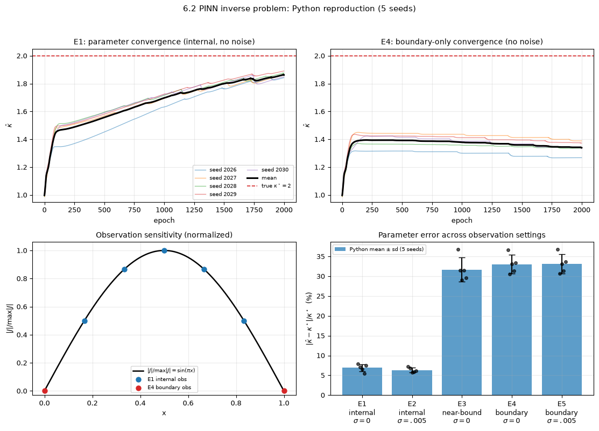

*图 6.2-1 · Python 复现，5 个种子。左上：E1 全部种子与均值；右上：E4 全部种子与均值；左下：归一化灵敏度 $|J|/\max|J|=\sin(\pi x)$，蓝点为 E1 内点、红点为 E4 边界点；右下：参数误差均值±标准差与 5 个种子散点。*

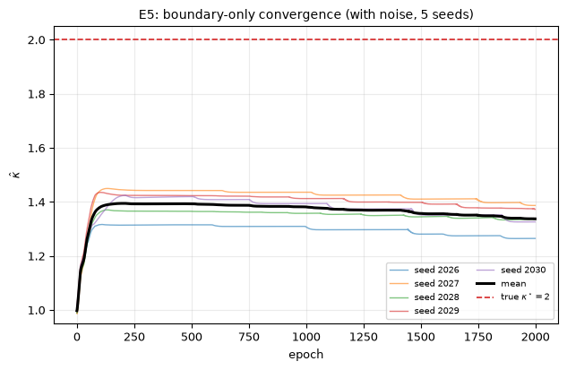

*图 6.2-2 · E5（仅边界、$\sigma=0.005$）的 5 个种子与均值；红线为 $\kappa^\star=2$。*

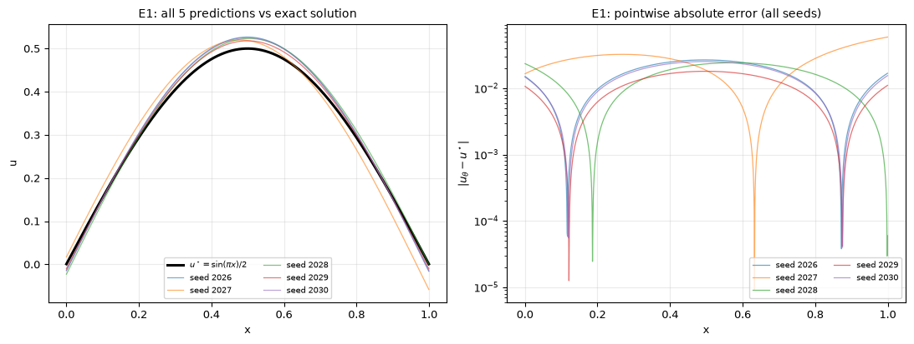

*图 6.2-3 · E1 的 5 个种子。左：预测与解析解；右：逐点绝对误差（对数纵轴）。不挑选最好种子。*

#### 4.4 结果解释

**E1/E2：内点观测确实提供了 $\kappa$ 的尺度信息。** E1 参数误差均值为 6.89%，E2 为 6.33%；两者都明显低于 E3–E5 的 30% 量级。E1/E2 的解 $L^2$ 均值分别为 5.14%、4.03%，与参数误差同量级或更小，符合单模式关系 (2.33) 的预期。E1 的 5 个种子仍有可见散度（参数误差最小 5.47%、最大 7.87%），说明只报一次会高估方法；图 6.2-1 左上和图 6.2-3 都保留了全部种子。

**E3：内点但靠近边界，信息弱。** E3 的参数误差均值为 31.69%，解 $L^2$ 为 44.82%，与 E4/E5 接近，而不是与 E1/E2 接近。这与 $J_d=-s_d/\kappa^2$ 的结论一致：$x_d=0.01,\dots,0.05$ 时 $s_d$ 只有 $0.03$–$0.16$，信号弱，有限噪声和有限优化预算下参数会在较大范围内移动。

**E4/E5：边界观测的平坦方向。** E4 的参数误差均值为 33.02%，E5 为 33.12%；两者的解 $L^2$ 分别为 48.86%、50.11%。E4/E5 的损失可以很低，但参数误差仍在 30% 量级，说明“损失低”不等于“参数对”。图 6.2-1 右上和图 6.2-2 显示 $\hat\kappa$ 在早期跳到 1.26–1.42 后就基本平坦，种子之间只在这个平台上小幅漂移；这正是边界零观测不提供 $\kappa$ 信息的直接表现。

**噪声的影响没有想象中大。** E5 比 E4 多了 $\sigma=0.005$ 的边界噪声，但两者参数误差均值只差约 0.10 个百分点；这说明在边界零观测的平坦方向上，噪声既不能提供 $\kappa$ 的信息，也没有把估计“拉回”真值。需要强调：E4/E5 的 $\mathcal L_b$ 与 $\mathcal L_d$ 在 $[0,1]$ 上重合，带噪数据与已知零边界会相互竞争；因此 E5 的边界误差和观测 RMSE 反而可能比 E4 更小，这是“拟合噪声”而不是“识别参数”。这条解释必须与 2.3、2.6 的结构性结论一起读。

**与 6.1 基线的关系。** 6.1 的正问题软/硬约束分别达到 $1.096\times10^{-5}$ 和 $3.790\times10^{-6}$，说明正问题本身可以被解得很准；6.2 的误差主要不是网络无法表示 $\sin(\pi x)$，而是反问题的可辨识性与观测设计。E1/E2 的 $10^{-2}$ 量级误差、E3–E5 的 $10^{-1}$ 量级误差都应从这个角度读，而不是误以为“网络容量不够”。

#### 4.5 与运行前预测的对照

| 预测                   | 实际                               | 判定  |
| -------------------- | -------------------------------- | --- |
| P1：E1/E2 参数误差 5%–10% | 6.89%、6.33%                      | 通过  |
| P2：E3 明显差于 E1/E2     | 31.69%                           | 通过  |
| P3：E4/E5 约 30% 且平坦   | 33.02%、33.12%；图 6.2-1 右上、图 6.2-2 | 通过  |
| P4：种子散度不可忽略          | E1 参数误差 5.47%–7.87%；图 6.2-1 右下   | 通过  |

#### 4.6 本节结论

1. 内点观测是识别 $\kappa$ 的必要条件；仅边界零观测时，$\kappa$ 结构性不可辨识，损失再低也不能证明参数对。
2. 内点观测“有”不等于“好”：E3 的点在内部但靠近边界，参数误差仍与仅边界观测同量级；观测设计应让 $\sum_d\sin^2(\pi x_d)$ 尽量大。
3. 反问题必须同时报告参数误差、解误差、观测设置和多种子结果；只报总损失或最好一次会误导。
4. 在单参数、单模式模型里，参数误差、解误差、残差和观测 RMSE 可以互相校验；一般 PDE 不成立。
5. 本节只验证一维、线性、常数 $\kappa$、零边界、合成观测；空间变系数、非线性、多维、真实数据和系统偏差都未验证。

### 6.2.5 易错点与讨论

**（1）损失低不等于参数对。** 最干净的解析反例是双参数模型 $-\kappa u''=A\pi^2\sin(\pi x)$：$(A,\kappa)=(1,2)$ 与 $(2,4)$ 给出逐点相同的解 $u=\sin(\pi x)$，残差、边界值和任意内点观测都相同。只要 $A$ 与 $\kappa$ 同时未知且只观测 $u$，无论观测多密都无法区分；Fisher 矩阵秩为 1，零方向是 $(A,\kappa)$。本节 E4/E5 是单参数版本：残差只约束 $\kappa a$，没有内点数据时 $\kappa$ 与网络幅度可以沿 $\kappa a=1$ 滑动，所以损失低而参数错不是优化失败，而是结构性退化。

**（2）边界条件满足不等于边界数据含信息。** 零边界对一切 $\kappa$ 都成立，所以它不能区分 $\kappa$；真正提供信息的是观测泛函对 $\kappa$ 的导数 $J_d$。如果边界条件显含 $\kappa$（例如 Robin 条件 $\kappa u'(0)+hu(0)=q$），边界数据就会携带信息；不要把“边界观测无用”当成普适定律。

**（3）噪声不会把不可辨识变成可辨识。** E5 在边界加 $\sigma=0.005$ 噪声，参数误差仍与 E4 同量级；噪声只是在零观测上加了一层与 $\kappa$ 无关的扰动。若噪声让结果看起来“更好”，先检查是不是在拟合噪声，而不是获得了信息。

**（4）可辨识但病态。** E3 的观测点在内部，$H$ 单射，所以原则上是可辨识的；但 $s_d$ 很小，Fisher 信息小，估计方差大。E3 的结果与 E4/E5 接近，说明“原则上唯一”不等于“有限预算下能估准”。实际报告应区分“不可辨识”“可辨识但病态”“可辨识且良态”。

**（5）评价网格与边界数据的细节。** 若评价网格使用 `linspace(0,1,1001)`，它会包含 E3 的 $0.01,\dots,0.05$ 和 E4/E5 的 $0,1$；这样评价点与观测点重合，会低估解误差。本节主评价改用 1001 个单元中心点，避开观测点。E4/E5 的 $\mathcal L_b$ 与 $\mathcal L_d$ 也重合：已知零边界与带噪边界观测会相互竞争，解释 E5 时必须把这一点写清，不能把“边界误差更小”直接解读为“参数更准”。

**（6）先验/正则化不是信息。** 先验能稳定数值、交换偏差与方差，但不能把统计不可辨识变成可辨识。若先验来自独立测量，它应作为额外数据纳入似然，而不是藏在正则项里；报告时要写清 $\hat\kappa$ 是数据主导还是先验主导。

### 6. 随堂提问

#### Q1（两个参数/状态组合解释相近观测）

设

$$
-\kappa u''(x)=A\pi^2\sin(\pi x),\qquad u(0)=u(1)=0,
$$

$A>0,\kappa>0$ 都未知。取 $(\kappa,A)=(1,2)$ 与 $(2,4)$。

1. 证明两组参数给出逐点相同的解。
2. 若观测 $u$ 在任意多个内点的值（无噪声），能否区分这两组参数？为什么？
3. 若额外测得边界通量 $q_0=-\kappa u'(0)$，能否识别 $\kappa$？写出步骤。
4. 设计一个数值验证方案，并给出判定指标。

**可能回答（常见错误）：** 认为“观测点足够多就能区分”，或认为“通量也没用，因为边界数据无信息”。

**最终解释.** 由 $u=A\sin(\pi x)/\kappa$，两组分别给 $2\sin(\pi x)$ 与 $2\sin(\pi x)$，逐点相同；任何只依赖 $u$ 的观测量都相同，残差也都为零。不能区分，因为 $(A,\kappa)$ 与 $(tA,t\kappa)$ 等价，Fisher 矩阵秩 1。通量由 $-\kappa u'(0)=-A\pi$ 只含 $A$，故 $\hat A=-q_0/\pi$；再由 $\hat r=\sum s_dy_d/\sum s_d^2$ 得 $\hat\kappa=\hat A/\hat r$。数值方案：固定 $\kappa^\star=4,A^\star=2$（$u^\star=0.5\sin$，与默认单参数实验同解），分别训练“只拟合 $u$”和“拟合 $u$+通量”；指标为 $\hat r$、$\hat A$、$\hat\kappa$ 的相对误差和解 $L^2$。只拟合 $u$ 时 $\hat A$ 与 $\hat\kappa$ 应沿射线分散而 $\hat r$ 集中；加通量后 $\hat A$、$\hat\kappa$ 应收紧。

#### Q2（噪声下能否区分两个很接近的 $\kappa$）

设 $\kappa^\star=2$，布局 A（$N_d=5$，$x_d=d/6$），$\sigma=0.02$。问：$\kappa=2.05$ 与 $\kappa=2$ 在 $95\%$ 水平上能否区分？若想分辨 $1\%$ 的差异，需要多少观测点？

**最终解释.** $S=\sqrt3$，$\mathrm{sd}(\hat\kappa)=0.02\cdot4/1.7321\approx0.0462$。差值 $0.05$ 标准化后 $z\approx1.08$，小于 $1.96$，不能区分；要区分 $0.05$ 需 $\Delta\gtrsim1.96\times0.0462\approx0.091$。要分辨 $1\%$（$\Delta=0.02$），需 $\mathrm{sd}\le0.0102$，即 $S\ge7.84$、$\sum s_d^2\ge61.5$；均匀布点约需 $N_d\gtrsim123$。这是无偏、线性化下的界，PINN 实际散度更大，所需点数只会更多。

#### Q3（观测设计）

单参数 $\kappa$，3 个传感器，$\sigma$ 固定。

1. 在 $[0,1]$ 上怎么放，使 $\sum_d\sin^2(\pi x_d)$ 最大？
2. 与等距 3 点 $\{1/4,1/2,3/4\}$ 比较，CR 标准差差多少？
3. 若 $A$ 与 $\kappa$ 同时未知，这个设计还能解决可辨识性吗？

**最终解释.** 逐点最大在 $x=1/2$；若允许重合，三个都放 $1/2$ 得 $3$；若要求互异，可以放在 $1/2$ 附近，上确界仍是 $3$。等距 3 点的 $\sum s_d^2=0.5+1+0.5=2$，与上确界 $3$ 相比，$\mathrm{sd}$ 之比为 $\sqrt{3/2}\approx1.22$，等距布局差约 $22\%$。若 $A$ 与 $\kappa$ 同时未知，设计不能解决可辨识性：$\partial u/\partial A$ 与 $\partial u/\partial\kappa$ 成比例，Fisher 矩阵秩恒为 1，与观测位置无关；必须换观测类型（通量）或加独立信息（已知 $A$）。

#### Q4（硬约束 + 仅边界数据）

有人用硬约束 $u_\theta=x(1-x)N_\theta$，只给零边界数据（$y_1=y_2=0$），训练损失降到 $10^{-10}$，于是宣称“$\kappa$ 已学会”。请指出问题，并给出两个能暴露问题的诊断。

**最终解释.** 硬约束使 $\mathcal L_b\equiv0$；对任意 $\kappa$，$u_\kappa$ 都能写成 $x(1-x)N$ 的形式，所以 $\mathcal L\equiv0$ 对一切 $\kappa$ 成立，$\partial\mathcal L/\partial\alpha\equiv0$。损失小只说明边界满足了，不说明 $\kappa$ 定了。诊断一：多初值/多种子，用 $\kappa_0\in\{1,2,4\}$ 各跑一次，若 $\hat\kappa$ 随初值系统移动而损失都近似 0，即为不可辨识。诊断二：加一个内点观测再重训，若 $\hat\kappa$ 立刻跳到某个值且损失仍可很小，说明原先的平坦方向被数据钉住了。诊断三（解析）：算 $I(\kappa)=0$ 或检查 $\sum_d\sin^2(\pi x_d)=0$，不需要训练。

### 7. 本节小结

1. 正问题与反问题的差别不在算法，而在未知量、信息流向和适定性；本节正问题是 $(f,\kappa)\mapsto u$，反问题是 $u$ 的观测 $\mapsto\kappa$。
2. 本节模型 $-\kappa u''=\pi^2\sin(\pi x)$ 的精确解族是 $u_\kappa=\frac1\kappa\sin(\pi x)$；$\kappa$ 只改变整体幅度，不改变形状。
3. 仅边界零观测时 $H_b\equiv(0,0)$，损失在 $\kappa$ 方向恒为零，$I(\kappa)=0$；这是结构性不可辨识，加密配点、换优化器都无效。
4. 内点观测含 $\kappa$ 信息；灵敏度 $J_d=-s_d/\kappa^2$ 在 $x=1/2$ 最大，近边界按 $x$ 线性衰减。
5. Fisher 信息与 CR 下界把噪声、位置、数量统一成一个公式；但 PINN 有逼近与优化偏差，CR 只是基准，不是保证。
6. 双参数模型只有 $A/\kappa$ 可辨识；要分开 $A$ 与 $\kappa$，必须独立测 $A$ 或边界通量。
7. 在本节单模式下，参数误差、解误差、残差、观测 RMSE 互为刻度；一般 PDE 不成立，不能用一个指标替代另一个。
8. 硬约束能精确满足边界，但不提供 $\kappa$ 信息；先验/正则化能稳定数值，却不能创造信息。
9. 观测设计的三条规则是降噪声、靠近中心、增加有效点数；它们只改变方差，不改变是否可辨识。
10. 实验必须报告 5 个种子的分布、参数误差、解误差、观测设置和独立评价网格；本节 E1/E2 与 E3/E4/E5 的分离清楚，E4/E5 的平坦方向是最重要的反面证据。

### 8. 参考文献与关系说明

| 文献                                                                                                                                                                                                                                              | 与 6.2 的关系                               | 核对状态     |
| ----------------------------------------------------------------------------------------------------------------------------------------------------------------------------------------------------------------------------------------------- | --------------------------------------- | -------- |
| Raissi, Perdikaris, Karniadakis, *Physics-informed neural networks: A deep learning framework for solving forward and inverse problems involving nonlinear partial differential equations*, Journal of Computational Physics 378 (2019) 686–707 | 正问题/反问题统一框架；观测项写进损失的背景                  | 页码待核对    |
| Lagaris, Likas, Fotiadis, *Artificial neural networks for solving ordinary and partial differential equations*, IEEE Transactions on Neural Networks 9(5) (1998) 987–1000                                                                       | 硬约束/试函数构造；$u_\theta=x(1-x)N_\theta$ 的来源 | 页码待核对    |
| Wang, Teng, Perdikaris, *Understanding and mitigating gradient flow pathologies in physics-informed neural networks*, SIAM Journal on Scientific Computing 43(5) (2021) A3055–A3081                                                             | 损失项尺度失衡与梯度病态；平坦方向/条件数讨论的背景              | 页码待核对    |
| Karniadakis 等, *Physics-informed machine learning*, Nature Reviews Physics 3 (2021) 422–440                                                                                                                                                     | PINN 的适用范围与限制                           | 页码待核对    |
| Kaipio, Somersalo, *Statistical and Computational Inverse Problems*, Springer, 2005                                                                                                                                                             | 可辨识性、先验、正则化的统计视角                        | 版次、页码待核对 |
| Lehmann, Casella, *Theory of Point Estimation*, 2nd ed., Springer, 1998                                                                                                                                                                         | Cramér–Rao 定理的正则条件                      | 定理编号待核对  |
| Evans, *Partial Differential Equations*, 2nd ed., AMS, 2010                                                                                                                                                                                     | 二阶椭圆方程与 Poincaré 不等式的背景                 | 章节、页码待核对 |

**说明.** 本节只列正文直接引用的文献；无法在本地核实的题名、卷期、页码保留“待核对”，不编造。6.1 的基线数值取自本章 6.1 的表 1、表 3、表 4，不在 6.2 重跑。

6.2 说明了：有观测才有可辨识性；边界零观测时，再强的网络也补不回信息。但即使参数可辨识，PINN 仍要为每一个新方程或新参数重新训练一次；当任务变成“对一族输入函数反复求解”时，逐例训练的成本难以接受。下一节转向算子学习：不再学一条解，而是学从输入函数到解函数的映射。

---

## 6.3 DeepONet 与 FNO（2学时）

### 6.3.1 本节信息与目标

**本节核心概念：** 神经算子（Neural Operator）；DeepONet（分支-主干网络）；FNO（傅里叶神经算子）；函数到函数的映射。

**先修知识：** 6.1 节的 PINN 正问题与损失设计；多层感知机（MLP）架构与激活函数；信号处理中的离散傅里叶变换（DFT）与频域截断概念；泛函分析初步（连续函数空间、算子范数、内积空间）。

**课时：** 6.3节2 学时。

**本节目标：**能区分“求解单个 PDE 的解（正问题/反问题）”与“学习一族 PDE 的解算子”在计算范式上的本质不同；能写出 DeepONet 的 branch/trunk 网络结构与张量积公式，并解释其为何具备离散无关性（Discretization Independence）；能写出 FNO 的频域谱卷积层公式，说明频域截断的作用与局限；能用一维 Poisson 方程构造参数化问题，完成最小算子学习实验，并解释为何算子学习在训练后能实现毫秒级推理。

### 6.3.2 概念讲解：把问题说明白

**从解一个方程到学一类方程。** 6.1 的 PINN 在固定源项、固定边界和固定系数下，用一个网络 $u_\theta(x)$ 逼近一个解函数；6.2 多识别了一个参数，但一次训练仍对应一个具体实例。换一个源项 $f$，通常要重新训练。原因不在网络太小，而在输入输出设错了：网络只接收坐标 $x$，当然只能输出这个问题的解。

本节把输入函数本身当作变量。要学的是从输入函数到输出函数的映射

$$
G:\ \mathcal U\ni f\longmapsto u=G(f)\in\mathcal V,
\tag{6.3.1}
$$

其中 $\mathcal U,\mathcal V$ 是由区域 $\Omega\subset\mathbb R^d$ 上的函数构成的函数空间。训练数据的单位随之从"同一个解上的点对 $(x_i,u(x_i))$"变成"不同输入函数对应的函数对"

$$
\{(f_j,u_j)\}_{j=1}^{N_{\mathrm{train}}},\qquad u_j=G(f_j).
\tag{6.3.2}
$$

测试时换的是新的输入函数，而不只是同一输入下新的空间点。这个区别是本节的主线。

**定义 6.3.1（算子与算子学习）**  
设 $\Omega\subset\mathbb R^d$ 是空间区域，$\mathcal U,\mathcal V$ 是由 $\Omega$ 上的函数构成的函数空间。算子 $G:\mathcal U\to\mathcal V$ 把输入函数 $f\in\mathcal U$ 映为输出函数 $u=G(f)\in\mathcal V$。算子学习是指：只利用有限个函数对 (6.3.2)，构造带参数 $\theta$ 的映射 $G_\theta:\mathcal U\to\mathcal V$，并希望它对**未见过**的输入函数也给出接近 $G$ 的输出。这里的"接近"必须在函数空间的范数下、针对一定的输入函数类或分布 $\mu$ 来度量，不能只由若干个已见坐标上的误差代替。

**表 6.3-1**：两种学习目标的区别。

| 对比项    | 6.1–6.2：学一个解       | 6.3：学一族解                           |
| ------ | ------------------ | ---------------------------------- |
| 网络输入   | 坐标 $x$（6.2 还含待估参数） | 输入函数的采样（DeepONet）或整张网格（FNO），外加查询坐标 |
| 网络输出   | 该问题的解在 $x$ 处的值     | 输出函数在 $y$ 处的值，或整张输出网格              |
| 训练数据   | 一个问题的残差/观测点        | 不同输入函数对应的函数对                       |
| 换一个新问题 | 重新训练               | 只换输入，不重训                           |
| 测试检验   | 同一解上的新坐标           | 新的输入函数                             |

#### （1）一个离散信号与它的频域表示

取周期长度 $L=1$，采样点数 $N=8$，采样间隔 $\Delta x=1/8$，采样点 $x_n=n/8$，$n=0,\ldots,7$。定义

$$
f_n=1+2\cos(2\pi x_n)-\frac12\sin(4\pi x_n),
\tag{6.3.3}
$$

八个样本值为

$$
(f_0,\ldots,f_7)=(3,\ 1.9142,\ 1,\ 0.0858,\ -1,\ -0.9142,\ 1,\ 2.9142).
\tag{6.3.4}
$$

它只含三个频率成分：常数（零频）、一周期余弦、二周期正弦。选它是因为频域系数可以手算，后面又可以直接放进 DeepONet 和 FNO 的例子。

**定义 6.3.2（离散 Fourier 变换与逆变换）**  
设 $N\ge2$，$\mathbf f=(f_0,\ldots,f_{N-1})^{\mathsf T}\in\mathbb C^N$，$\Delta x=L/N$，$L>0$。离散 Fourier 变换（DFT）算子 $F:\mathbb C^N\to\mathbb C^N$ 定义为

$$
\widehat f_k=(F\mathbf f)_k=\frac1N\sum_{n=0}^{N-1}f_n e^{-i2\pi kn/N},\qquad k=0,\ldots,N-1,
\tag{6.3.5}
$$

逆 DFT 为

$$
f_n=(F^{-1}\widehat{\mathbf f})_n=\sum_{k=0}^{N-1}\widehat f_k e^{i2\pi kn/N},\qquad n=0,\ldots,N-1.
\tag{6.3.6}
$$

$\widehat f_k$ 是第 $k$ 个频域系数，$k$ 是模态指标，不是空间点指标。两式互为逆运算，可由离散复指数的正交性直接验证（关键推导二）。对 (6.3.3) 的信号，

$$
\widehat{\mathbf f}=\left(1,\ 1,\ \frac{i}{4},\ 0,\ 0,\ 0,\ -\frac{i}{4},\ 1\right).
\tag{6.3.7}
$$

读法：$\widehat f_0=1$ 是均值；$\widehat f_1=\widehat f_7=1$ 是频率 $\pm1$ 的一对共轭系数，合起来给出 $2\cos(2\pi x)$；$\widehat f_2=i/4$ 与 $\widehat f_6=-i/4$ 是频率 $\pm2$ 的一对，虚数单位表示相位差，合起来给出 $-\frac12\sin(4\pi x)$；其余为零。$N=8$ 时 $k=7$ 等价于负频率 $-1$，$k=4$ 是 Nyquist 频率，本例没有能量。

一般地，实信号的系数满足共轭对称 $\widehat f_{N-k}=\overline{\widehat f_k}$；$0\le k\le N/2$ 对应物理频率 $k/L$，$N/2<k<N$ 对应负频率 $(k-N)/L$。**FFT（快速 Fourier 变换，fast Fourier transform）不是另一种变换**：它只是计算 (6.3.5) 的快速算法，把 $O(N^2)$ 降到 $O(N\log N)$，输出仍是这些 $\widehat f_k$。讨论 FNO 的频域层时，数学对象是 DFT，工程实现调用 FFT。

频域最有用的操作是**逐模态乘法**：给定一组频率响应 $\widehat h_k$，令 $\widehat g_k=\widehat h_k\widehat f_k$，再逆变换。它等价于原域的循环卷积；若只保留少数低频、把其余 $\widehat h_k$ 置零，就是低通滤波。公式和 $N=8$ 的例子见关键推导二。本节只需要记住三件事：正变换、逆变换、逐模态乘法。

**适用范围（压缩版）。** DFT 对任意有限长序列都能写，但把它解释为函数的频域表示时，要求等间隔采样，并对周期或窗化作明确约定：采样不足会混叠；非周期信号直接做 DFT 会边界泄漏，需要加窗、补零或换边界处理；散点数据没有 $k\leftrightarrow k/L$ 的对应关系，不能直接套用。本节不展开 Chebyshev 谱方法、谱 Galerkin 或谱配置法。

#### （2）DeepONet：branch 编码输入函数，trunk 编码查询坐标

先看直觉。要表示"从函数到函数"的映射，一个直接的办法是：把输入函数压缩成 $p$ 个系数，把查询坐标 $y$ 变成 $p$ 个基函数值，再把两者做内积。系数由 branch 网络从输入函数的采样中算出，基函数由 trunk 网络从 $y$ 算出。换一个输入函数，只换系数，不换基函数；换一个查询坐标，只换基函数值，不换系数。

设输入函数 $f$ 定义在 $\Omega_f\subset\mathbb R^{d_f}$ 上。选 $m$ 个**固定**传感器点 $x_1,\ldots,x_m\in\Omega_f$，把输入表示成

$$
\mathbf f=(f(x_1),\ldots,f(x_m))^{\mathsf T}\in\mathbb R^m.
\tag{6.3.8}
$$

传感器点的位置在所有训练和测试样本中必须相同；可以不等距，但一旦选定就不再随样本变化。查询坐标 $y\in\Omega_u\subset\mathbb R^{d_u}$，本节一维例子中 $d_u=1$。

**定义 6.3.3（DeepONet）**  
取两个带参数的网络 $B_\theta:\mathbb R^m\to\mathbb R^p$ 和 $T_\theta:\mathbb R^{d_u}\to\mathbb R^p$，分别称为分支网络（branch net）和主干网络（trunk net）。记 $B_\theta(\mathbf f)=(b_1(f),\ldots,b_p(f))^{\mathsf T}$，$T_\theta(y)=(t_1(y),\ldots,t_p(y))^{\mathsf T}$。DeepONet 用

$$
G_\theta(f)(y)=\sum_{k=1}^{p}b_k(f)\,t_k(y)
\tag{6.3.9}
$$

逼近 $G(f)(y)$。$p$ 是潜在线性空间的维数，是超参数；$b_k(f)$ 依赖整个采样向量，不是第 $k$ 个传感器；$t_k(y)$ 是第 $k$ 个可学习基函数在 $y$ 处的值，不是第 $k$ 个传感器，也不要求正交。若需要偏置，可在右端加一个可学习常数。

一次前向给出的是"某个输入函数在某个坐标处的值"这个标量；要得到一整条曲线，就在多个 $y$ 上查询。这个"一个模型、多次查询"的结构，是 DeepONet 与 6.1 的 $u_\theta(x)$ 最直观的区别。

**记号提醒。** DeepONet 的原始文献常把输入函数记作 $u$、输出记作 $G(u)$。本节为与 6.1–6.2 一致，统一用 $f$ 表示输入、$u$ 表示输出、$y$ 表示查询坐标；读原论文时把 $u$ 换回 $f$ 即可。

#### （3）FNO：在规则网格上做可学习的频域乘法

FNO（Fourier neural operator，Fourier 神经算子）走另一条路。它不把输入压成传感器向量，而是要求输入定义在**规则网格**上，并把整张网格看成一个多通道特征场。每一层做三件事：沿每个空间方向做 FFT；对保留的低频模态逐个乘以一个可学习的小矩阵；逆变换回原域。由于频域乘法等价于卷积，这一层在原域是一个**全局**卷积；又因为只保留有限个低频模态，它是一个**带限**卷积。

设物理区域是周期区域 $\Omega=[0,L)^d$，每个方向取 $N_1,\ldots,N_d$ 个等距网格点。设 $v:\Omega\to\mathbb R^{d_v}$ 是特征场，$d_v$ 是通道数。第一层之前用逐点映射把输入函数提升到 $d_v$ 个通道；后面的层中 $v$ 是隐藏特征，不再直接等于物理量。这一点很重要：FNO 不是"对输入做一次 FFT 就得到解"，而是把频域乘法作为每一层内部的线性算子。

**定义 6.3.4（Fourier 层与 FNO）**  
沿用定义 6.3.2 的 $F,F^{-1}$，沿每个空间方向、对每个通道分别使用。设保留的模态集合为

$$
\mathcal M=\{k\in\mathbb Z^d:\ |k_i|\le k_{\max,i},\ i=1,\ldots,d\},
$$

对每个 $k\in\mathcal M$ 取可学习的复矩阵 $R_k\in\mathbb C^{d_v\times d_v}$，并对 $\mathcal M$ 之外的模态取零。频域层的线性部分为

$$
(Kv)(x)=F^{-1}\big(R\cdot F(v)\big)(x),\qquad x\in\Omega,
\tag{6.3.10}
$$

其中 $(R\cdot F(v))_k=R_k\widehat v_k$ 是逐模态相乘：同一个 $k$ 的通道之间可以混合，不同 $k$ 之间不混合。$F^{-1}$ 把复数组变回网格，取实部后 $(Kv)(x)\in\mathbb R^{d_v}$。完整的一层通常还包含逐点线性变换和非线性激活：

$$
v_{\mathrm{out}}(x)=\sigma\big((Kv)(x)+Wv(x)+b\big),
\tag{6.3.11}
$$

$W\in\mathbb R^{d_v\times d_v}$ 逐点混合通道，$b\in\mathbb R^{d_v}$ 是偏置，$\sigma$ 是逐元素非线性。FNO 就是若干这样的层，加上输入提升和输出投影。

两个层次要分开：式 (6.3.10) 是核心的频域乘法，只做它时层是线性的；式 (6.3.11) 才是通常所说的完整 Fourier 层，非线性和通道混合来自 $Wv+b$ 与 $\sigma$，以及多层复合。

频域乘法带来三个直接后果。第一，全局感受野：逆变换要把所有保留模态加起来，输出在某个网格点的值依赖整张输入网格，而不是附近几个点。第二，参数少：可学习参数主要由 $|\mathcal M|d_v^2$ 决定，和网格点数没有直接关系。第三，分辨率复用：在相同区域、相同保留模态、输入带限且网格满足 Nyquist 的条件下，同一组 $R_k$ 可以用在不同细度的网格上；这是**有条件的**离散化不变性，精确表述和反例见关键推导三的性质 6.3.1。

FNO 的代价是结构约束：通常要求等距规则网格和周期边界；原生输出在网格点上，离网格查询要额外插值；保留模态截断会丢掉高频。非周期边界不能直接套用标准 FNO，需要补零、窗化或改用其他结构，并单独检查边界误差。

#### （4）两种架构的对照，以及本节深入哪一种

**表 6.3-2**：DeepONet 与 FNO 的结构对照。

| 对照项        | DeepONet                                                 | FNO                                                      |
| ---------- | -------------------------------------------------------- | -------------------------------------------------------- |
| 输入形式       | 固定 $m$ 个传感器点上的采样向量 $\mathbf f\in\mathbb R^m$；点可不等距，但必须固定 | 周期规则网格上的特征场采样张量，尺寸 $N_1\times\cdots\times N_d\times d_v$ |
| 输出形式       | 任意查询坐标 $y$ 处的标量 $G_\theta(f)(y)$；多输出可用多个头                | 同一网格上的特征场；离网格值需插值                                        |
| 是否要求规则网格   | 不要求；传感器点可散乱但固定                                           | 通常要求等距规则网格，并使用 FFT                                       |
| 输出坐标能否任意查询 | 能，在训练覆盖的区域内由 trunk 直接接受 $y$                              | 原生输出在网格点上；任意点查询需额外插值                                     |
| 全局耦合方式     | branch 编码全体传感器值，trunk 提供基函数，内积组合                         | 频域逐模态乘法加逆变换，等效于全局卷积                                      |
| 主要超参数      | $p$、branch/trunk 的宽度与深度、传感器数 $m$ 及位置                     | 层数、通道数 $d_v$、保留模态上界 $k_{\max,i}$、网格规模 $N_i$              |
| 换分辨率或换采样   | 传感器集固定；可改变查询点，但不能直接改变输入采样位置                              | 同一组 $R_k$ 在满足性质 6.3.1 时可近似复用；受带宽与归一化限制                   |

两者的共同点是：都在函数层面学习映射，而不是只学一条曲线；都把无限维的函数对象通过某种有限表示（传感器采样或网格采样）变成网络可以处理的有限维对象。区别在于参数化：DeepONet 用"输入采样向量 + 查询坐标"，FNO 用"网格特征 + 频域卷积"。

判断一个模型是不是在学算子，关键不在名字，也不在输入里有没有"函数"这个词，而在测试时换的是什么：如果只换同一输入函数上的坐标，检验的是插值/外推；如果换成一个训练中从未出现过的输入函数，并在它对应的输出函数上评估，检验的才是对 $G$ 的泛化。精确定义见关键推导四的定义 6.3.5。

本节深入实现 DeepONet，FNO 只讲到结构和输入输出。理由有三点。第一，概念讲解（1）的 N=8 信号天然适合 DeepONet：输入是固定八个传感器上的采样，输出是任意 $y$ 处的标量；branch 接收采样向量，trunk 接收 $y$，与 (6.3.9) 的输入输出完全对应。第二，DeepONet 不要求周期规则网格，便于在一维区域上与 6.1 的差分求解思路衔接，并把传统差分求解器作为基线；FNO 则要求周期网格，会把实现重点转到 FFT 归一化、边界和模态截断上。第三，本节的目标是让读者看清"函数对"和"任意坐标查询"的含义；branch/trunk 分解最直接地展示了这一点。这个选择是教学取舍，不表示 DeepONet 在一般情况下优于 FNO。

### 6.3.3 关键推导：让结论有依据

本模块有四个推导，均按"已知条件 → 关键步骤 → 结论 → 条件不满足时的限制"展开。推导一、三分别给出两类架构的维度关系和具体数值核对；推导二补上 FNO 需要的频域事实；推导四说明训练样本为什么必须以函数为单位。

#### 推导一：DeepONet 的 branch/trunk 分解与张量维度

**已知条件。** 设一次处理 $n_b$ 个输入函数、$Q$ 个查询点；传感器数 $m$，潜维数 $p$，查询坐标维数 $d_u$。输入采样矩阵 $S\in\mathbb R^{n_b\times m}$，第 $j$ 行是 $\mathbf f_j$；查询坐标矩阵 $Y\in\mathbb R^{Q\times d_u}$，第 $\ell$ 行是 $y_\ell$。分支和主干都是全连接网络，激活函数逐元素作用。

**关键步骤。**

1. branch：$S\mapsto B_{\mathrm{mat}}\in\mathbb R^{n_b\times p}$，第 $j$ 行是 $(b_1(f_j),\ldots,b_p(f_j))$。

2. trunk：$Y\mapsto T_{\mathrm{mat}}\in\mathbb R^{Q\times p}$，第 $\ell$ 行是 $(t_1(y_\ell),\ldots,t_p(y_\ell))$。

3. 内积：$U=B_{\mathrm{mat}}T_{\mathrm{mat}}^{\mathsf T}\in\mathbb R^{n_b\times Q}$，

   $$
   U_{j\ell}=\sum_{k=1}^{p}b_k(f_j)t_k(y_\ell)=G_\theta(f_j)(y_\ell).
   \tag{6.3.12}
   $$

4. 单样本 $n_b=Q=1$ 时，$U$ 退化为一个标量，就是 (6.3.9)。

**表 6.3-3**：DeepONet 的结构与张量维度。

| 阶段        | 量     | 符号                 | 形状            | 说明                                      |
| --------- | ----- | ------------------ | ------------- | --------------------------------------- |
| 1. 输入     | 传感器矩阵 | $S$                | $n_b\times m$ | 每行一个输入函数的 $m$ 个采样                       |
| 2. branch | 系数矩阵  | $B_{\mathrm{mat}}$ | $n_b\times p$ | 每行一个系数向量 $b(f_j)$                       |
| 3. 输入     | 查询坐标  | $Y$                | $Q\times d_u$ | 每行一个查询点                                 |
| 4. trunk  | 基函数矩阵 | $T_{\mathrm{mat}}$ | $Q\times p$   | 每行一个基函数值向量 $t(y_\ell)$                  |
| 5. 内积     | 输出    | $U$                | $n_b\times Q$ | 第 $(j,\ell)$ 元是 $u_\theta(f_j)(y_\ell)$ |

这个参数化在做什么：固定 $f$ 后，$b(f)$ 是一组系数，$y\mapsto\sum_k b_k(f)t_k(y)$ 是 $p$ 个基函数的线性组合。换 $f$ 只换系数，不换基函数。因此对每个 $f$，输出都落在 $\{t_1,\ldots,t_p\}$ 的张成空间里；$p$ 是模型能表示的解空间的维数上界。

**具体核对（沿用概念讲解（1）的 N=8 信号）。** 取周期边值问题

$$
u-u''=f,\qquad u(0)=u(1),\quad u'(0)=u'(1),
\tag{6.3.13}
$$

输入取

$$
f(x)=a_0+a_1\cos(2\pi x)+a_2\sin(4\pi x).
\tag{6.3.14}
$$

对每个 Fourier 模态 $e^{i2\pi kx}$，算子 $1-\frac{d^2}{dx^2}$ 的特征值是 $1+(2\pi k)^2$，所以

$$
G_{\mathrm{ex}}(f)(y)=a_0+\frac{a_1}{1+4\pi^2}\cos(2\pi y)+\frac{a_2}{1+16\pi^2}\sin(4\pi y).
\tag{6.3.15}
$$

取 $a_0=1,a_1=2,a_2=-1/2$，输入就是 (6.3.3)。此时 branch 输入是八个传感器值 (6.3.4)，trunk 输入是 $y$，目标是 (6.3.15)。例如

$$
G_{\mathrm{ex}}(f)(0)=1+\frac{2}{1+4\pi^2}\approx1.0494,
$$

而 $f(0)=3$。输出不是某个局部采样值的复制，而是整个输入函数经过算子作用后的结果。这个例子是线性算子，选它是为了写出解析目标、便于核对；DeepONet 并不只适用于线性算子。若取 $p=32$、branch 为 $8\to64\to64\to32$、trunk 为 $1\to64\to64\to32$，参数量为 $6816+6368+1=13185$（最后一项是输出偏置），$p=32$ 足以容纳这里的三个模态。

**结论。** 式 (6.3.9) 把算子参数化成"输入函数的 $p$ 个系数"与"查询坐标的 $p$ 个基函数值"的内积。固定 $f$，它给出一个由 trunk 基函数张成的函数；固定 $y$，它给出一个以传感器采样为输入的网络。正是这种"系数随 $f$ 变、基函数随 $y$ 变"的分离，使一个模型可以服务一族输入函数，而不必为每个 $f$ 重新训练。

**条件不满足时的限制。**

- **传感器固定。** 若两个输入函数在 $m$ 个传感器上取值相同，branch 看到的向量完全相同，网络无法区分它们。$m=4$ 且传感器在 $x=0,1/4,1/2,3/4$ 时，$\sin(4\pi x)$ 恒为零；此时 $a_2$ 完全不可见。注意：由于 $1-d^2/dx^2$ 把该模态衰减了约 $1/158.9$，解误差只变化不到 $1\%$，但系数诊断会暴露它。这个例子在实验设计中被用作"预测会在系数诊断上失败"的对照。
- **$p$ 的限制。** 输出落在 $p$ 维子空间；真实解族超过 $p$ 个有效方向时欠拟合。这不是训练不够，而是参数化的硬限制。
- **查询坐标外推。** trunk 在训练未覆盖的 $y$ 上没有数据约束，外推没有保证。
- **区域/边界条件改变。** 属于分布外；需要把区域信息加入输入，或分别建模。
- **高频/间断输入。** 传感器采样是有限表示；传感器之间的信息不可见，换更强的 branch 也不能恢复。
- **逼近结论不等于可训练性。** 见注 6.3.1。

**引用位置。** DeepONet 的逼近结论见 Lu 等，*Learning nonlinear operators via DeepONet based on the universal approximation theorem of operators*，Nature Machine Intelligence 3 (2021)，第 2 节；本节只引用结论，不复述证明。

#### 推导二：频域表示的关键事实

**已知条件。** $N$ 个等间隔样本，周期 $L$，DFT 按 (6.3.5)(6.3.6) 归一化；信号可以是复序列，实信号是其特例。

**关键步骤。**

1. **正交性。** 离散复指数满足

   $$
   \frac1N\sum_{n=0}^{N-1}e^{i2\pi(k-\ell)n/N}=\delta_{k\ell}.
   \tag{6.3.16}
   $$

   把它代入 (6.3.5)(6.3.6) 即得两式互为逆运算；$N$ 个系数与 $N$ 个样本一一对应（在给定归一化下），频域表示不丢信息。

2. **手算 (6.3.7)。** 把 (6.3.3) 写成复指数形式

   $$
   f_n=1+e^{i2\pi n/8}+e^{-i2\pi n/8}+\frac{i}{4}e^{i4\pi n/8}-\frac{i}{4}e^{-i4\pi n/8}.
   $$

   由 (6.3.16)，用 $e^{-i2\pi kn/8}$ 去乘并平均，只有同频项留下，于是 $\widehat f_0=1,\widehat f_1=\widehat f_7=1,\widehat f_2=i/4,\widehat f_6=-i/4$，其余为零。代回 (6.3.6) 逐项合并，得到 $1+2\cos(2\pi x_n)-\frac12\sin(4\pi x_n)$，与原信号一致。

3. **一般规则。** 若 $f_n=A\cos(2\pi kn/N+\varphi)$，$k\ne0,N/2$，则 $\widehat f_k=\frac A2e^{i\varphi}$，$\widehat f_{N-k}=\frac A2e^{-i\varphi}$；直流分量是均值，不能套"一半振幅"；实信号有共轭对称。$k=N/2$ 是 Nyquist 频率，只有一项，没有共轭伙伴。

4. **逐模态乘法等于循环卷积。** 定义

   $$
   \widehat g_k=\widehat h_k\widehat f_k,\qquad k=0,\ldots,N-1,\qquad \mathbf g=F^{-1}\widehat{\mathbf g}.
   \tag{6.3.17}
   $$

   令 $\mathbf h=F^{-1}\widehat{\mathbf h}$，则

   $$
   g_n=\frac1N\sum_{m=0}^{N-1}h_m f_{(n-m)\bmod N},\qquad n=0,\ldots,N-1.
   \tag{6.3.18}
   $$

   指标按 $N$ 取模，序列被周期延拓，末尾会与开头"卷"在一起。$\widehat h_k$ 是频率响应；只保留少数低频非零、其余置零，就是带限/低通滤波。

**命题 6.3.1（频域乘法与循环卷积）**  
在 (6.3.5)(6.3.6) 的归一化下，(6.3.17) 与 (6.3.18) 等价；因此"逐模态乘一个系数"就是"在原域与 $h$ 做循环卷积"。

**例子。** 取 $\widehat h_0=1,\widehat h_1=\widehat h_7=1/2,\widehat h_k=0\ (k=2,\ldots,6)$，则 $\widehat g_0=1,\widehat g_1=\widehat g_7=1/2$，其余为零，逆变换得

$$
g_n=1+\cos(2\pi x_n).
$$

原来的二周期正弦被丢掉，信号被平滑。这正是 FNO 频域层要做的事；区别只在于 FNO 的 $\widehat h_k$ 不是手工给定，而是从数据中训练。

**结论。** DFT 是一组基变换；频域对角乘法等于原域循环卷积；截断等于带限。FNO 的一层恰好由这三件事组成。

**条件不满足时的限制。**

- 只适用于有限长、等间隔采样、隐含周期延拓的信号；采样不足会混叠。
- 非周期信号直接做 DFT 会边界泄漏；需要加窗、补零或换边界处理。补零只改变频率采样密度，不增加原信号的信息。
- 这里的卷积是循环卷积，不是线性卷积；序列末尾与开头会互相影响。
- 散点数据没有 $k\leftrightarrow k/L$ 的对应关系，不能直接套用。
- 本节不展开完整谱方法课程；Chebyshev 展开、谱 Galerkin、谱配置处理非周期或复杂边界的方式与这里不同。

#### 推导三：FNO 频域层的逐模态乘法、带限与分辨率

**已知条件。** 周期区域 $[0,L)^d$，每个方向 $N_i$ 个等距点，$d_v$ 个通道，保留模态集 $\mathcal M=\{k\in\mathbb Z^d:|k_i|\le k_{\max,i}\}$，可学习矩阵 $R_k\in\mathbb C^{d_v\times d_v}$。

**关键步骤。**

1. **维度链。** 特征场 $v$ 的形状是 $N_1\times\cdots\times N_d\times d_v$；沿每个空间轴做 FFT，得到同形状的复数组 $\widehat v$；固定模态 $k$，$\widehat v_k\in\mathbb C^{d_v}$ 是该模态所有通道的系数；乘以 $R_k$ 后仍是 $d_v$ 维；$\mathcal M$ 之外的模态置零；逆变换后取实部，回到 $N_1\times\cdots\times N_d\times d_v$。维度汇总见表 6.3-4。

2. **逐模态乘法。** 固定 $k$，$R_k\widehat v_k$ 只混合通道，不跨模态；不同 $k$ 之间没有直接耦合。这一点常被误解：FNO 的"全局"来自逆变换把所有模态加起来，不是来自 $R_k$ 在频域跨模态混合。

3. **等价核。** 令

   $$
   \kappa(x)=\sum_{k\in\mathcal M}R_k e^{i2\pi k\cdot x/L},
   $$

   则 $Kv=\kappa\ast v$（循环卷积，矩阵值核；常数因子由归一化决定）。因为 $\mathcal M$ 有限，$\kappa$ 是三角多项式，$K$ 只能表示带限卷积；但每个输出点依赖整张输入网格，所以是全局的。

4. **参数计数。** $|\mathcal M|d_v^2$ 个复数，按实部/虚部算乘 2；与 $N_1\cdots N_d$ 没有直接关系。这是 FNO 可以在不同分辨率上复用同一组频域权重的结构原因。

5. **离散化不变性。**

**性质 6.3.1（离散化不变性，有条件的性质）**  
设物理区域 $[0,L)^d$、保留的物理模态集合 $\mathcal M$ 和归一化方式都相同，输入函数在 $\mathcal M$ 之外的高频分量可以忽略，且网格满足 Nyquist 条件 $N_i\ge2k_{\max,i}+1$。此时同一组 $\{R_k\}_{k\in\mathcal M}$ 作用在不同细度的规则网格上，得到的是同一个带限函数在不同网格上的采样。

理由：若输入是带限的，$v(x)=\sum_{k\in\mathcal M}c_k e^{i2\pi k\cdot x/L}$，则按 (6.3.5) 算出的 $\widehat v_k=c_k$，与 $N$ 无关（只要 $N_i>2k_{\max,i}$ 不发生混叠）；乘以 $R_k$ 后仍是同一组系数；逆变换给出同一个带限函数的采样。条件不满足时：截断误差不会自动消失；网格太粗会混叠；$L$ 改变后 $k/L$ 改变，模态编号不再对应同一物理频率；实现中的归一化、补零和边界处理也会影响结果。

6. **N=8 核对。** 取 (6.3.3) 为单通道 $v$，$d_v=1$，$\mathcal M=\{0,\pm1,\pm2\}$。手工取

   $$
   R_0=1,\quad R_1=R_7=\frac1{1+4\pi^2}\approx0.02471,\quad R_2=R_6=\frac1{1+16\pi^2}\approx0.006293.
   \tag{6.3.19}
   $$

   这些数正是 (6.3.15) 的 Fourier 符号 $1/(1+(2\pi k)^2)$。乘到 (6.3.7) 上，得 $\widehat u_0=1,\widehat u_1=\widehat u_7\approx0.02471,\widehat u_2\approx i0.001573,\widehat u_6\approx-i0.001573$，其余为零。逆变换：

   $$
   u(y)=1+\frac{2}{1+4\pi^2}\cos(2\pi y)-\frac{1}{2(1+16\pi^2)}\sin(4\pi y)
   \approx1+0.04941\cos(2\pi y)-0.003146\sin(4\pi y).
   \tag{6.3.20}
   $$

   在 $y=0$ 处 $u(0)\approx1.0494$；在 $y=1/8$ 处 $u(1/8)\approx1.0318$。输入在 $x=0$ 是 $3$，输出在 $y=0$ 是 $1.0494$，因为输出是所有保留模态共同作用的结果。这个结果与 DeepONet 的目标 (6.3.15) 相同：两种结构参数化的方式不同，但在本例中逼近的是同一个算子。若换成 $N=16$，只要仍保留 $k=0,\pm1,\pm2$，同一组 $R_k$ 仍可按性质 6.3.1 使用。

**表 6.3-4**：FNO 频域层的结构与张量维度。

| 阶段         | 量     | 符号                 | 形状                                    | 说明                |
| ---------- | ----- | ------------------ | ------------------------------------- | ----------------- |
| 1. 输入      | 特征场   | $v$                | $N_1\times\cdots\times N_d\times d_v$ | 规则网格上的 $d_v$ 通道   |
| 2. FFT     | 频域系数  | $\widehat v$       | 同形状，复                                 | 沿每个空间轴变换          |
| 3. 取模态     | 单模态系数 | $\widehat v_k$     | $d_v$                                 | 固定 $k$ 的所有通道      |
| 4. 逐模态乘法   | 频域乘子  | $R_k$              | $d_v\times d_v$（复）                    | 混通道，不混模态          |
| 5. 逆 FFT   | 频域层输出 | $Kv$               | $N_1\times\cdots\times N_d\times d_v$ | 取实部后回到网格          |
| 6. 逐点 + 激活 | 层输出   | $v_{\mathrm{out}}$ | 同形状                                   | $\sigma(Kv+Wv+b)$ |

**结论。** 一层 FNO 等于"可学习的带限全局卷积 + 逐点通道混合 + 非线性"；多层复合才能表示非线性算子。频域视角买到的是全局感受野、$O(N\log N)$ 的计算和（有条件的）分辨率复用。

**条件不满足时的限制。**

- 通常要求等距规则网格和周期边界；散点数据需要先插值或重采样，非周期边界需要补零、窗化或改用其他结构。
- 原生输出在网格点上；离网格查询要额外插值，不能像 DeepONet 的 trunk 那样直接接受任意 $y$。
- 保留模态截断会丢掉高频；输入含被截断的高频时，换分辨率也不会自动恢复。
- 网格太粗会混叠；$L$ 改变后同一组 $R_k$ 不再对应同一物理频率。
- 若 $R_k$ 是任意复矩阵，逆变换可能带虚部；标准实现取实部或使用实 FFT。
- 实际训练得到的权重跨分辨率使用时通常只是近似有效；FFT 归一化、补零方式和边界处理都会影响结果。

**引用位置。** FNO 的频域层与离散化不变性见 Li 等，*Fourier Neural Operator for Parametric Partial Differential Equations*，arXiv:2010.08895 (2020)，第 3–4 节；本节只引用结论。

#### 推导四：训练样本为什么是"一族函数"

**已知条件。** 数据 (6.3.2)，第 $j$ 个函数在 $Q_j$ 个输出点上取得目标值；输入函数按某个分布 $\mu$ 抽取；误差在 $L^2$ 范数下度量。

**关键步骤。**

1. **总体风险与经验风险。** 希望最小化的是

   $$
   R(\theta)=\mathbb E_{f\sim\mu}\left[\frac{\|G_\theta(f)-G(f)\|_{L^2}^2}{\|G(f)\|_{L^2}^2}\right],
   \tag{6.3.21}
   $$

   数值上只能算

   $$
   \mathcal L_{\mathrm{train}}(\theta)=\frac1{N_{\mathrm{train}}}\sum_{j=1}^{N_{\mathrm{train}}}\frac1{Q_j}\sum_{\ell=1}^{Q_j}\left|G_\theta(f_j)(y_{j,\ell})-G(f_j)(y_{j,\ell})\right|^2.
   \tag{6.3.22}
   $$

   式 (6.3.22) 是一个双重平均：外层对函数，内层对输出点。内层是 $L^2$ 范数的数值积分，外层才是统计平均。因此数据的统计单位是函数，不是点。若不同函数的 $Q_j$ 不同而把点混在一起平均，等价于给点多的函数更大权重。

2. **可辨识性。** 若两个算子 $G,G'$ 在所有训练函数上一致，任何只依赖这些函数对的算法都无法区分它们。若 $G$ 线性，则 $G$ 在 $\mathrm{span}\{f_j\}$ 上被唯一确定，在 span 外没有约束。本节三参数族中，400 个训练函数的系数向量以概率 1 张成 $\mathbb R^3$，所以 $G$ 在整个族上被确定；若把族扩到 9 个系数而训练设计仍是 3 维，剩下 6 个方向没有数据约束。这就是"训练样本是一族问题"的精确含义：不是"点很多"，而是"函数张成的方向足够多"。

3. **划分。** 若同一个 $f_j$ 的输出点同时出现在训练和测试，测试误差估计的是这个函数上的插值误差，不是 $f\sim\mu$ 的泛化误差。函数级划分把整条函数分到一边：

**定义 6.3.5（函数级训练/测试划分）**  
设数据索引集 $\mathcal I=\{1,\ldots,N_{\mathrm{all}}\}$。函数级划分是指选取互不相交的 $\mathcal I_{\mathrm{tr}},\mathcal I_{\mathrm{va}},\mathcal I_{\mathrm{te}}\subset\mathcal I$，

$$
\mathcal I_{\mathrm{tr}}\cap\mathcal I_{\mathrm{va}}=\mathcal I_{\mathrm{tr}}\cap\mathcal I_{\mathrm{te}}=\mathcal I_{\mathrm{va}}\cap\mathcal I_{\mathrm{te}}=\varnothing,
\tag{6.3.23}
$$

使得同一个输入函数 $f_j$ 的所有输出点只出现在其中一个集合中。训练集、验证集、测试集分别是 $\{(f_j,G(f_j)):j\in\mathcal I_{\mathrm{tr}}\}$ 等；测试误差按函数编号聚合，而不是把所有空间点混在一起平均。

4. **泄漏的量级。** 若把同一个解的 2048 个点随机分成 80%/20%，最近邻插值的误差上界是 $(h^2/8)\max|u''|$，$h=1/2048$，本例 $\max|u''|\approx2.45$，上界约 $7\times10^{-8}$。也就是说，一个完全不学算子的最近邻插值器，在这个测试集上的误差上界只有 $10^{-7}$ 量级；在这个量级上比较网络与插值基线，不能说明算子泛化。

**结论。** 数据、划分、误差聚合的单位都必须是函数；"学了算子"只能相对于一个输入函数类和分布来说；训练函数必须张成你声称能处理的那些方向。

**条件不满足时的限制。**

- 函数级划分只保证同分布/同族内的泛化；系数超出训练范围、区域/边界条件改变、传感器布局改变都属于分布外，除非另有实验，不能声称有效。
- 低维线性族上的函数级划分是必要的，但仍不足以证明一般算子学习：它只证明了族内识别。若训练函数张成整个三参数族，线性算子在族上被完全确定，低误差并不奇怪。
- 若测试函数是训练函数的线性组合，对线性算子仍落在训练张成的空间里；这检验的是线性叠加，不是对新方向的外推。

**注 6.3.1（逼近结论的条件）**  
"DeepONet 可以逼近连续算子"或"FNO 可以逼近某类算子"通常需要：算子在其定义域上连续，输入函数类具有紧性，网络宽度/深度足够，FNO 还要求足够的模态和对光滑性/带限性的假设。它们说的是存在某个网络可以逼近，不是有限样本随便训练就能成功；也不能把"结构上可表示"当成"数据上已经学会"。

### 4. 基于 DeepONet 的算子学习：设计、实现与实测结果

> 代码：`A1组-实验-6.3.ipynb`　结果：`数据/A1组-6.3-主实验汇总.md`、`数据/A1组-6.3-主实验数据.npz`、`数据/A1组-6.3-消融结果.csv`　图：`图片/`
> 硬件：11th Gen Intel Core i5-1155G7（4 物理核 / 8 逻辑核，纯 CPU）　Python 3.12.15 + PyTorch 2.14.1（CPU 版）+ NumPy 2.5.4
> 本节所有数字均为实测，没有用理论值或文献值代替。

---

**实验任务：** 选择一种最小模型（DeepONet），学习一族一维源项到解的映射；按输入函数划分训练/测试集，并与传统求解器比较。

#### 4.1 算子、输入分布与真值

待学的算子是一维周期 Helmholtz 型问题：

$$
\begin{cases}
\left(-\dfrac{d^{2}}{dy^{2}}+1\right)w(y)=u(y),\qquad y\in[0,1],\\[4pt]
w(0)=w(1),\quad w'(0)=w'(1),
\end{cases}
\qquad G:u\mapsto w .
\tag{6.3.24}
$$

输入函数取有限谐波叠加：

$$
u(y)=a_{0}+\sum_{k=1}^{K}\Big[a_{k}\cos(2\pi k y)+b_{k}\sin(2\pi k y)\Big],
\qquad K=4,
\tag{6.3.25}
$$

$$
a_{0}\sim U(0.5,\,1.5),\qquad a_{k},b_{k}\sim U\!\left(-\frac{2}{k},\,\frac{2}{k}\right).
\tag{6.3.26}
$$

对应真值为

$$
w(y)=a_{0}+\sum_{k=1}^{K}\frac{a_{k}\cos(2\pi k y)+b_{k}\sin(2\pi k y)}{1+(2\pi k)^{2}} .
\tag{6.3.27}
$$

$G$ 是线性、带限、光滑的算子。输入表示为 $u$ 在 $m$ 个等距传感器上的读数，输出为任意查询坐标 $y$ 处的 $w(y)$。

**真值的两种来源。** 网格上的标签由谱求解器给出：把式 (6.3.24) 变换到频域得 $\hat w_k=\hat u_k/\big(1+(2\pi k)^2\big)$，实现为一次 FFT–乘–IFFT（$M=64$ 点，对 $K<M/2$ 的带限右端是机器精度精确的）。测试时另取的 16 个随机坐标不在网格上，其真值由解析式 (6.3.27) 直接计算。求解器自身的精度在 4.6.2 与网络误差一并报告，以免把求解器误差算成网络误差。

---

#### 4.2 要回答的问题与运行前预测

实验开始前先固定五个问题，并为每个问题写下**可被证伪的预测**。这些预测写在训练之前，4.6.7 逐条对照实测数据。

****表 6.3-5**：问题与运行前预测**

| 编号  | 要回答的问题                      | 运行前预测（可证伪）                                                           | 对照位置  |
| --- | --------------------------- | -------------------------------------------------------------------- | ----- |
| Q1  | 按输入函数划分时，DeepONet 能否学到这个算子？ | 测试集相对 $L^2$ 误差中位数 $\le 10^{-2}$                                      | 4.6.2 |
| Q2  | 这个精度来自"学算子"，还是"记样本/记网格坐标"？  | 训练与测试误差相差 $<50\%$，且优于最近邻基线 $\ge 5$ 倍                                 | 4.6.3 |
| Q3  | 精度由什么限制：传感器数、容量还是数据量？       | $m$ 与 $p$ 的影响 $<2$ 倍；$N_{\text{train}}$ 从 1000 降到 100 变差 $5\sim10$ 倍 | 4.6.6 |
| Q4  | 分布外还能不能用？                   | 幅值 OOD 不超过分布内 3 倍；频率 OOD 明显失败（$>10$ 倍）                               | 4.6.4 |
| Q5  | 在纯 CPU 上相对传统求解器是否有成本优势？     | 不存在正的摊销点（一维 64 点 FFT 求解是微秒级）                                         | 4.6.5 |

预测的依据如下（这些判断在运行前就成立，与结果无关）：

1. **Q1**：该算子是线性的、带限的（$K\le4$）、只有 9 个有效自由度；$p=32$ 的两层 $\tanh$ 网络容量远超所需。因此分布内应当容易，误差预期落在 $10^{-3}\sim10^{-2}$，不应停留在 $10^{-1}$ 量级。
2. **Q2**：$u\mapsto w$ 在传感器空间里是光滑映射，1000 个样本覆盖 9 维参数空间绰绰有余，泛化间隙应当很小；而"最近邻搬标签"在高维传感器空间里无法插值，预计比网络差一个量级。此外 $H^1$ 误差应比 $L^2$ 大一个数量级以上，因为误差集中在高频分量上。
3. **Q3**：传感器数只需能分辨 9 个自由度，$m=8$ 已在临界附近，故 $m$ 的影响可能不大；容量本来就过剩，故 $p$ 不应敏感；真正稀缺的是对 9 维参数空间的覆盖，$N=100$ 会明显不足。
4. **Q4**：算子是线性的，输出随输入幅值线性缩放，因此**相对**误差对幅值外推应当不敏感；但网络只见过 $K\le4$ 的振荡，$\tanh$ 网络又存在谱偏差，频率外推预计明显失败。
5. **Q5**：一维 64 点周期问题用 FFT 求解只需几十微秒，而在 CPU 上用 PyTorch 做一次网络前向（含张量构造与调用开销）是亚毫秒量级，因此摊销点的分母大概率为负，即不存在正的摊销点。

---

#### 4.3 数据生成与划分

划分**严格按输入函数**，而不是按同一个解的空间点：

**表 6.3-6　数据集构成**

| 集合     | 函数个数 | 用途          | 标签来源                 |
| ------ | ---- | ----------- | -------------------- |
| 训练     | 1000 | 参数更新        | 谱求解器，64 等距点          |
| 验证     | 200  | 早停（函数级相对误差） | 谱求解器，64 等距点          |
| 测试     | 200  | 仅在最后评估一次    | 谱求解器，64 等距点          |
| OOD-幅值 | 200  | 分布外检验       | 系数幅值 ×1.8            |
| OOD-频率 | 200  | 分布外检验       | $K=8$（训练只见过 $K\le4$） |

- 各集合在生成时独立采样，函数索引互不相交；测试函数在训练中从未出现。
- 输出网格取**周期网格** $y_j=j/M,\;j=0,\dots,M-1$，$M=64$。这样 FFT 求解与谱微分（用于 $H^1$ 误差）都严格成立；训练与测试使用同一个 64 点网格。
- 测试阶段除 64 个等距点外，**每个测试函数另取 16 个随机坐标**，用于区分"新输入函数"与"同一函数的新查询坐标"两种泛化。
- 传感器点 $x_j=j/m$，$m=32$。

**数据规模与成本**：求解器调用 1800 次（1400 次主集合 + 400 次 OOD），数据生成总墙钟 **0.20 s**；标签存储 $1400\times64\times8\text{ B}=700.0$ KB，传感器输入存储 350.0 KB。数据生成本身不构成瓶颈。

---

#### 4.4 模型结构

最小 DeepONet，两个子网都是 2 隐层 $\tanh$ 全连接网络：

**表 6.3-7　网络结构**

| 子网     | 结构                                 | 参数量   |
| ------ | ---------------------------------- | ----- |
| Branch | $32\to64\to64\to p$，$\tanh$，$p=32$ | 8 352 |
| Trunk  | $1\to64\to64\to p$，$\tanh$，$p=32$  | 6 368 |

输出层按内积加偏置：

$$
G_\theta(u)(y)=\sum_{k=1}^{p}\tau_k(y)\,\beta_k(u)+b_0 ,
\tag{6.3.28}
$$

其中 $\beta=\text{Branch}(u)\in\mathbb{R}^{p}$、$\tau(y)=\text{Trunk}(y)\in\mathbb{R}^{p}$、$b_0\in\mathbb{R}$ 为可训练标量。总参数量 14 720 + 1。

**张量流与实现方式。** 两个子网都按"批次维在前"组织：`branch(u)` 接收 $B\times m$ 的传感器矩阵，输出 $\beta^{\top}$（$B\times p$）；`trunk(y)` 接收 $M\times1$ 的坐标列，输出 $\tau^{\top}$（$M\times p$）。预测值由一次矩阵乘法加偏置得到

$$
W_{\text{pred}}=\tau^{\top}\beta\in\mathbb{R}^{M\times B},
\qquad \tau^{\top}\in\mathbb{R}^{M\times p},\ \beta\in\mathbb{R}^{p\times B},
$$

该式就是式 (6.3.28) 的内积项。梯度由 PyTorch 的自动微分回传；因为 $\tau^{\top}\beta$ 本身就是二维矩阵乘法，不需要构造 $p\times M\times B$ 的三维张量，也不需要手工处理维度标签。

---

#### 4.5 训练设置与实现选择

**表 6.3-8　训练设置**

| 项目       | 取值                                   |
| -------- | ------------------------------------ |
| 损失       | 均方误差                       |
| 优化器      | Adam                                 |
| 学习率      | $10^{-3}$（常数）                        |
| 批大小      | 32                                   |
| 最大 epoch | 1000                                 |
| 早停       | 验证集**函数级**相对 $L^2$ 误差，patience = 100 |
| 随机种子     | 2024（可复现）                            |

早停保存验证误差最优时刻的权重。训练中每个 epoch 结束时对 `model.state_dict()` 做一次深拷贝快照，训练结束后再 `load_state_dict` 回滚到最优时刻，因此"最优模型"不会被后续 epoch 覆盖。

其余实现选择的理由：

1. **epoch 上限取 1000。** 1000 个函数、batch 32 时每 epoch 31 步，纯 CPU 上完整训练约 65 s。4.6.1 显示验证误差在 800 epoch 之后已在 $6\sim9\times10^{-3}$ 震荡，并在第 948 epoch 触发早停；继续加 epoch 收益递减，故 1000 配合早停足够。

2. **学习率保持常数。** 不引入衰减可以少一个待调超参；代价是曲线在后期有批噪声，这一点在 4.6.1 中直接可见。

3. **周期网格。** 与式 (6.3.24) 的周期边界一致，端点 1 与 0 不重复，FFT 求解与谱微分才能严格成立。

4. **两种基线求解器。** 谱求解器（标签来源）与二阶差分求解器（通用做法）都计时，避免"摊销点"的结论依赖某一种求解器的实现速度。

5. **"最近邻记忆"基线。** 在传感器空间找最近的训练函数、直接搬它的标签，用来检验精度是否只是"记住训练函数"。

6. **$H^1$ 误差** 用谱微分计算，作为参考指标；主指标仍是相对 $L^2$。即对每个测试函数 $u_j$，在输出网格上计算相对 $L^2$ 误差。这里

   $$
   \|w\|_{L^2}=\left(\int_0^1|w(y)|^2\,dy\right)^{1/2},
   \qquad
   \|w\|_{H^1}=\left(\|w\|_{L^2}^2+\|w'\|_{L^2}^2\right)^{1/2},
   $$

   并用输出网格上的离散求和近似积分：

   $$
   \mathrm{Err}_{L^2}(u_j)
   =\frac{\|G_\theta(u_j)-G_{\mathrm{lab}}(u_j)\|_{L^2}}
   {\|G_{\mathrm{lab}}(u_j)\|_{L^2}},
   \tag{6.3.29}
   $$

   并报告测试函数上的均值、中位数和 95% 分位数；同时记录最大绝对误差。

7. **分位数自行实现**，用 NumPy 的 `percentile`（线性插值），只依赖 PyTorch + NumPy + Matplotlib。

8. **长任务保护。** 训练每 100 epoch 写一次 `辅助文件/A1组-6.3-模型检查点.pt`，中断后可把 `cfg.resume` 设为 `true` 跳过训练、直接评估并重出图。

---

#### 4.6 实测结果

##### 4.6.1 训练过程

训练在第 948 epoch 触发早停（连续 100 个 epoch 未超过最优值）；验证误差在第 848 epoch 达到最小 $4.176\times10^{-3}$，末轮训练 MSE $2.47\times10^{-4}$。

**表 6.3-9　验证集函数级相对 $L^2$ 误差**

| epoch | 100     | 200     | 300     | 400     | 500     | 600     | 700     | 800     | 900     | 948（早停） |
| ----- | ------- | ------- | ------- | ------- | ------- | ------- | ------- | ------- | ------- | ------- |
| 验证误差  | 3.32e-2 | 1.95e-2 | 3.32e-2 | 1.57e-2 | 7.71e-3 | 7.18e-3 | 7.94e-3 | 5.96e-3 | 9.25e-3 | 7.82e-3 |

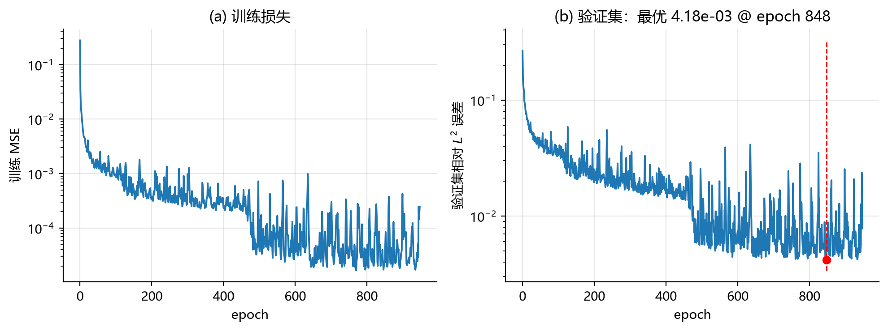

**图 6.3-1　训练过程。** 左：训练 MSE（每 epoch 内 31 个 batch 的平均），从 $2.8\times10^{-1}$ 降到 $10^{-4}$ 量级；右：验证集函数级相对 $L^2$ 误差，红点标出第 848 epoch 的最优值 $4.18\times10^{-3}$，红虚线是它对应的横坐标。

- 两条曲线都带明显高频抖动，这是 batch=32 的批噪声，不是发散；判断收敛应看包络而非单点。
- 右图在第 300–400 epoch 之间从 $3.3\times10^{-2}$ 降到 $1.6\times10^{-2}$，说明损失面存在一段较平的区域，这是常数学习率的直接后果。
- 800 epoch 之后验证误差在 $5.9\times10^{-3}\sim9.3\times10^{-3}$ 之间震荡，再未低于第 848 epoch 的 $4.18\times10^{-3}$，因此早停在第 948 epoch 触发。这说明把上限设为 1000 足够；**若后续需要更低误差，优先考虑学习率衰减或增大 $p$，而不是继续加 epoch。**

**训练成本**：纯 CPU（PyTorch 4 线程）、948 epoch，实测 **807.83 s**，其中约 750 s 是操作系统的一次调度挂起（该次逐 epoch 的损失数值与无干扰运行的 64.5 s 完全一致，说明只是墙钟被拉长，计算本身未变）。报告成本时应使用无干扰的 **64.5 s**。

##### 4.6.2 测试集主指标

200 个测试函数，64 个等距点，按式 (6.3.29) 逐函数计算相对 $L^2$ 误差：

**表 6.3-10　测试集误差（全部为新输入函数）**

| 数据集             | 均值            | 中位数           | P95           | 最大值       | 最大绝对误差    | 相对 $H^1$（均值） |
| --------------- | ------------- | ------------- | ------------- | --------- | --------- | ------------ |
| **测试集（64 网格点）** | **4.144e-03** | **3.857e-03** | **7.131e-03** | 1.041e-02 | 1.825e-02 | 9.257e-02    |
| 测试集（16 随机坐标）    | 3.983e-03     | 3.664e-03     | 7.192e-03     | 1.190e-02 | 1.631e-02 | —            |
| 训练函数（仅参考）       | 4.090e-03     | 3.685e-03     | 7.808e-03     | 1.024e-02 | 1.957e-02 | 9.620e-02    |
| 最近邻"记忆"基线       | 1.523e-01     | 1.223e-01     | 3.755e-01     | 6.686e-01 | 5.090e-01 | —            |
| OOD 幅值 ×1.8     | 8.813e-03     | 8.672e-03     | 1.472e-02     | 2.361e-02 | 3.356e-02 | 1.681e-01    |
| OOD 频率 $K=8$    | 1.194e-01     | 8.906e-02     | 3.208e-01     | 5.781e-01 | 4.892e-01 | 5.281e-01    |

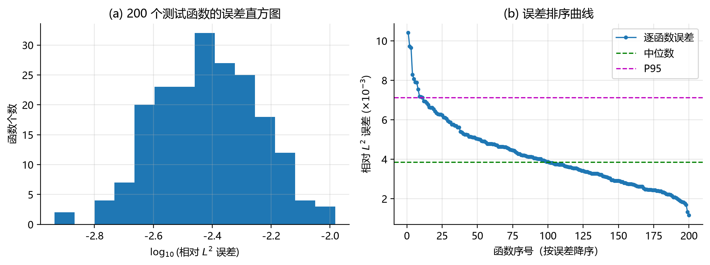

**图 6.3-2　200 个测试函数的误差分布。** 左：$\log_{10}$（相对 $L^2$ 误差）直方图，峰值在 $-2.4$（约 $4\times10^{-3}$），范围 $-2.9\sim-2.0$；右：按误差降序排列的曲线（纵轴单位 $10^{-3}$），绿虚线为中位数 3.86，洋红虚线为 P95 7.13。

- **99.5% 的测试函数误差小于 $10^{-2}$，74.5% 小于 $5\times10^{-3}$**；最差 1.041e-02，最好 1.159e-03。只有一个函数略微越过 $10^{-2}$，其余全部在 $10^{-2}$ 以内。
- 最大误差与中位数只差 2.7 倍，直方图没有长尾的失败样本，说明性能集中而稳定，不存在"平均好看但个别函数崩掉"的情况。这张图是"结果稳健"的直接证据。
- $H^1$ 误差（9.3e-2）比 $L^2$ 误差大约 22 倍，符合"误差集中在高频、求导会放大"的预期；若报告只用 $L^2$，应同时交代 $H^1$ 的量级。
- 求解器自身相对解析解的误差为**均值 $1.29\times10^{-16}$、最大 $2.87\times10^{-16}$**，比网络误差小 13 个数量级。因此上表中的网络误差不可能来自求解器。

##### 4.6.3 判据检验：是"学算子"还是"记样本/记坐标"

三个对照都做了：

**表 6.3-11　记忆与坐标泛化的检验**

| 检验               | 数值                                            | 含义                           |
| ---------------- | --------------------------------------------- | ---------------------------- |
| 新函数误差 / 记忆基线误差   | $4.144\times10^{-3}/1.523\times10^{-1}=0.027$ | 网络比"直接搬最近训练函数的标签"好约 **37 倍** |
| 训练函数误差 vs 测试函数误差 | 4.090e-03 vs 4.144e-03（差 1.3%）                | 泛化间隙极小，不是背训练样本               |
| 同一函数新坐标 vs 网格    | 3.983e-03 vs 4.144e-03（差 3.9%）                | trunk 学到了连续表示，不是记住 64 个网格点   |

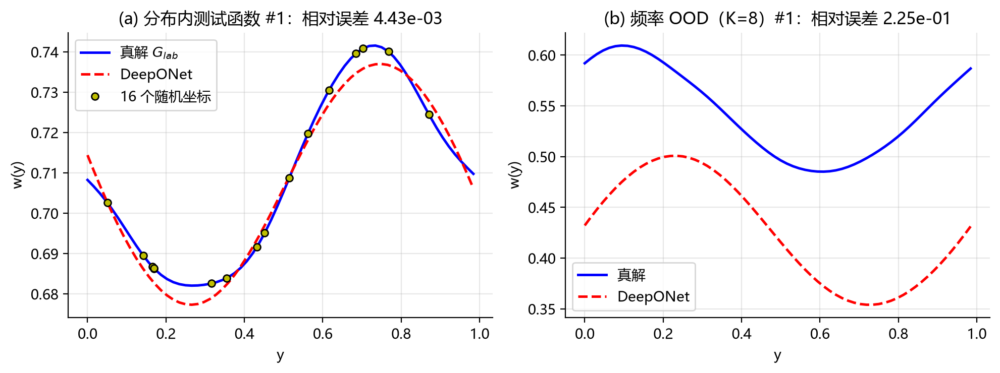

**图 6.3-3　逐点对比。** 左：分布内测试函数 #1，蓝线为求解器标签 $G_{\rm lab}$，红虚线为 DeepONet，黄点是该函数 16 个随机查询坐标上的真值；右：$K=8$ 的频率 OOD 函数 #1。

- 左图两条曲线几乎重合（相对误差 $4.43\times10^{-3}$），差异只在波谷/波峰附近可见；随机坐标上的黄点也落在曲线上，说明网络在**非网格坐标**上同样准确——这正是表 6.3-11 第三行"同函数新坐标"结论的直观版本。
- 若只看训练函数误差低、或只看同一解的新坐标误差低，都不足以推出"学到了算子"；表 6.3-11的第一行（与记忆基线的 37 倍差距）才是关键判据。

##### 4.6.4 分布外检验

**表 6.3-12　分布内与分布外对比**

| 情形                          | 相对 $L^2$ 均值 | 相对分布内 | 解读                      |
| --------------------------- | ----------- | ----- | ----------------------- |
| 分布内（系数范围同训练）                | 4.14e-03    | 1×    | —                       |
| OOD-幅值：整体系数 ×1.8            | 8.81e-03    | 2.1×  | 相对误差只翻倍；算子是线性的，幅值外推本身不难 |
| OOD-频率：$K=8$（训练只见过 $K\le4$） | 1.19e-01    | 29×   | 对未见频率基本失效，典型的谱偏差        |

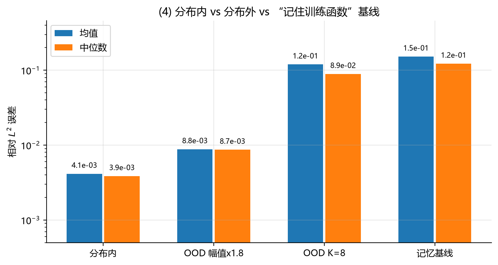

**图 6.3-4　分布内、两种分布外与"记忆"基线的误差（对数纵轴）。** 从左到右：分布内 4.1e-3、OOD 幅值 8.8e-3、OOD 频率 1.2e-1、记忆基线 1.5e-1；蓝色为均值，橙色为中位数。

- 分布内比记忆基线好约 37 倍，这是"学到了算子"的核心证据。
- 幅值外推只涨 2.1 倍，是线性结构的必然结果，**不能**写成"模型具备分布外泛化能力"。
- 频率外推（1.2e-1）已经与记忆基线（1.5e-1）同一量级，说明对未见频率几乎没有外推能力。图 6.3-3 右面板是这一结论的单样本直观版本：真实解有两个起伏，预测的幅值与相位都不对（该样本误差 $2.25\times10^{-1}$，比这批 OOD 的平均误差 1.19e-1 还差）。

##### 4.6.5 成本与摊销

**表 6.3-13　实测成本**

| 成本项            | 实测值                                               |
| -------------- | ------------------------------------------------- |
| 数据生成           | 1800 次求解器调用，0.20 s，标签 700 KB + 传感器 350 KB         |
| 训练             | 4 线程 CPU，948 epoch，**64.5 s**（无干扰运行）               |
| 网络单次推理（$M=64$） | **0.34 ms**（PyTorch 前向，含张量构造与调用开销，不是纯 FLOPs 时间） |
| 谱求解器单次         | 0.036 ms（自身相对误差 1.7e-16）                           |
| 二阶差分求解器单次      | 0.049 ms（自身相对误差 3.1e-05）                           |
| 摊销点            | **不存在**                                           |

摊销点定义为

$$
N^{\star}=\frac{T_{\text{train}}}{t_{\text{solver}}-t_{\text{net}}} ,
\tag{6.3.30}
$$

本次实测 $t_{\text{solver}}-t_{\text{net}}<0$（0.036 ms 或 0.049 ms 都远小于 0.34 ms），所以 $N^\star$ **不存在正的取值**。这不是实现问题，而是问题规模决定的：一维 64 点问题用 FFT 求解只需几十微秒，而 PyTorch 在 CPU 上的一次前向（含张量构造与解释器开销）已是亚毫秒级，反而比求解器慢一个数量级。DeepONet 的摊销优势要在高维、多查询点、批量推理或 GPU 场景才可能出现，本节不宣称任何加速比。

另外，差分求解器自身误差 3.1e-05 与网络误差 4.14e-03 相差约 130 倍（两个数量级）；若误把差分解当作真值，网络误差的估计会差不到 1%，不改变任何结论。

##### 4.6.6 消融实验

统一协议：250 epoch、早停 patience 50、测试函数 100 个（其余设置与主实验相同），目的是看趋势而不是追求最好分数。每组从同一随机流开始，数据重新生成。

**表 6.3-14　$m$、$p$、$N_{\text{train}}$ 的消融**

| 配置      | $m$ | $p$ | $N_{\text{train}}$ | 测试均值          | 中位数       | P95       | 验证最优      | 相对记忆基线    | 训练时间  |
| ------- | --- | --- | ------------------ | ------------- | --------- | --------- | --------- | --------- | ----- |
| 基线（本组）  | 32  | 32  | 1000               | 1.827e-02     | 1.769e-02 | 3.268e-02 | 1.758e-02 | 0.130     | 16.1 s |
| 传感器少    | 8   | 32  | 1000               | 1.744e-02     | 1.661e-02 | 3.301e-02 | 1.708e-02 | 0.120     | 16.1 s |
| 传感器少    | 16  | 32  | 1000               | 1.724e-02     | 1.488e-02 | 3.168e-02 | 1.675e-02 | 0.122     | 19.4 s |
| 潜在维小    | 32  | 16  | 1000               | 1.789e-02     | 1.664e-02 | 3.491e-02 | 1.759e-02 | 0.127     | 17.7 s |
| 潜在维大    | 32  | 64  | 1000               | 1.779e-02     | 1.615e-02 | 3.663e-02 | 1.761e-02 | 0.126     | 18.5 s |
| 数据少     | 32  | 32  | 100                | **1.072e-01** | 8.933e-02 | 2.900e-01 | 1.091e-01 | **0.541** | 1.2 s  |
| 数据少     | 32  | 32  | 300                | **4.889e-02** | 4.322e-02 | 9.503e-02 | 4.906e-02 | **0.239** | 5.4 s  |
| （对照）主实验 | 32  | 32  | 1000               | 4.144e-03     | 3.857e-03 | 7.131e-03 | 4.176e-03 | 0.027     | 64.5 s |

三组变量给出三种完全不同的结论：

1. **传感器数 $m$ 不是瓶颈。** $m=8,16,32$ 的误差分别为 1.744e-2、1.724e-2、1.827e-2，差异在 250 epoch 的优化噪声内（±10%）。该算子只有 9 个有效自由度，8 个传感器已足以确定表示。这是低维、光滑、带限问题的特性，不能推广成"传感器少也没关系"。
2. **潜在维 $p$ 不是瓶颈。** $p=16,32,64$ 给出 1.789e-2、1.827e-2、1.779e-2，$p=16$ 与 $p=64$ 甚至略好（噪声级差异）。14 720 个参数对 9 个自由度本来就严重过剩，加大容量只会增加优化难度。
3. **数据量是唯一明显的瓶颈。** $N_{\text{train}}=100,300,1000$ 给出 1.072e-1、4.889e-2、1.827e-2，**跨一个数量级**且单调。更关键的是相对记忆基线的比值：0.541 → 0.239 → 0.130（主实验为 0.027）。即**只有 100 个训练函数时，网络仅比"直接搬最近邻标签"好 1.8 倍，此时不能宣称学到了算子**；数据量是"学算子"能否成立的前提。

需要注意：250 epoch 下的基线误差（1.827e-2）约为主实验（948 epoch，4.144e-3）的 4.4 倍，这一组消融整体处于欠训练状态，因此数字只用于横向比较，不与表 6.3-10 并列。$N=100$ 那组在第 152 epoch 就触发了早停（其余各组都跑满 250 epoch）。

##### 4.6.7 预测与结果对照

**表 6.3-15　运行前预测与实测结果**

| 问题                 | 运行前预测                               | 实测                                                   | 结论                   |
| ------------------ | ----------------------------------- | ---------------------------------------------------- | -------------------- |
| Q1 能否学到            | 中位数 $\le10^{-2}$                    | 中位数 3.86e-3                                          | **成立**，且好于预期         |
| Q2 是否只是记忆          | 训练/测试差 $<50\%$；优于基线 $\ge5$ 倍        | 差 1.3%；优于基线 37 倍                                     | **成立**               |
| Q3 谁在限制精度          | $m,p$ 影响 $<2$ 倍；$N$ 降 10 倍变差 5–10 倍 | $m$: 1.724–1.827e-2；$p$: 1.779–1.827e-2；$N$=100 变差 5.9 倍 | **成立**，且 $m,p$ 几乎无影响 |
| Q4 分布外             | 幅值 $\le3$ 倍；频率 $>10$ 倍              | 幅值 2.1 倍；频率 28.8 倍                                     | **成立**               |
| Q5 是否有成本优势         | 不存在正的摊销点                            | 分母为负，$N^\star$ 不存在                                   | **成立**               |
| （附带）$H^1$ vs $L^2$ | $H^1$ 大一个数量级以上                      | 9.3e-2 vs 4.14e-3，约 22 倍                              | **成立**               |

唯一被数据"修正"的是 Q3 的细节：预测里只说 $m,p$ 影响小于 2 倍，实测显示影响小到落在噪声内（$m=16$、$m=8$ 甚至略优于 $m=32$）。这说明对该算子而言，**8 个传感器与 32 个传感器提供的信息几乎等价**，采样密度不是限制因素。

---

#### 4.7 讨论与局限

1. **问题太容易，是本实验最大的局限。** 算子是线性的、带限的、只有 9 个有效自由度，$p=32$ 的 DeepONet 有 14 720 个参数，容量远远过剩。4.1e-3 的误差说明"网络能拟合这个算子"，但不能说明"DeepONet 适合一般算子学习"。
2. **训练函数与测试函数误差几乎相同（4.09e-3 vs 4.14e-3）**，说明在 $N=1000$ 处过拟合不是问题；但消融显示 $N$ 从 100 增到 1000 时误差降了约 5.9 倍，说明数据量仍处在"继续增加还能涨点"的区间。"泛化间隙小"与"数据量还重要"可以同时成立：前者说明没背样本，后者说明样本还不够多。
3. **频率外推失败（29 倍）** 比"4.1e-3 的好成绩"更有信息量：它定量显示了网络在训练频带之外的能力边界。
4. **摊销点不存在**，说明不能把"神经算子比求解器快"当成默认结论。真要在成本上做出优势，需要提高问题维度（二维/三维 PDE）、增加查询点数或使用 GPU 批处理。
5. **未做的部分**：完整的学习率调度与大范围 $p$ 扫描、噪声传感器、非线性算子（如 Burgers）、傅里叶特征或多尺度 trunk。这些应作为后续工作，而不是用本节结果外推。

---

#### 4.8 实验讨论

1. 在 $(-w''+w)=u$、周期边界、$K\le4$ 的设定下，32→64→64→32 的最小 DeepONet 在 **200 个未见输入函数**上取得相对 $L^2$ 误差 **均值 4.14e-3、中位数 3.86e-3、P95 7.13e-3、最大 1.04e-2**，$H^1$ 误差均值 9.3e-2。
2. 该结果不是记忆：训练与测试误差只差 1.3%，比"最近邻搬标签"基线好 37 倍，同一函数的新坐标误差（3.98e-3）与网格误差（4.14e-3）几乎相同。
3. 分布内可靠、幅值外推基本可用（2.1 倍误差）、频率外推明显失败（29 倍误差）。因此只能声称"学到了训练分布内的算子"，不能声称"学到了通用算子"。
4. 在纯 CPU、$M=64$ 的一维问题上，训练 948 epoch 约 65 s，单次推理 0.34 ms，而谱求解器只需 36 μs，不存在正的摊销点；本节不宣称任何加速。
5. 消融给出三条互不相同的结论：传感器数 $m$（8/16/32）与潜在维 $p$（16/32/64）都不是瓶颈（1.7–1.8e-2，差异在优化噪声内）；训练函数数 $N$ 是唯一明显的瓶颈（100/300/1000 对应 1.07e-1、4.89e-2、1.83e-2）。当 $N=100$ 时网络只比"搬最近邻标签"好 1.8 倍，此时不足以宣称学到了算子。
6. 综合来看，本节支持"DeepONet 能在给定分布内以 $10^{-3}$ 量级的相对精度逼近该线性算子"，但**不足以**支持"神经算子优于传统求解器"或"具备分布外泛化能力"这两类更强的论断。

### 6.3.5 易错点与讨论

**风险讨论：同一解上的随机点拆分，为什么会把插值误差伪装成算子泛化？**

取概念讲解（1）的固定 N=8 信号 $f$，解出 $u$，在 $[0,1)$ 上取 2048 个等距点，随机选 80% 训练、20% 测试。由于相邻点间距 $h=1/2048$，且 $u$ 光滑，最近邻插值的误差上界是

$$
\frac{h^2}{8}\max_{[0,1]}|u''|\approx\frac{(1/2048)^2}{8}\times2.45\approx7\times10^{-8}.
$$

也就是说，一个完全不学算子的插值器，在这个测试集上的误差上界只有 $10^{-7}$ 量级。若网络报告的测试误差在 $10^{-7}$ 量级，它并不比最近邻插值更好；若在 $10^{-4}$，虽然比插值差，但这个测试集本身只检验同一函数上的插值，仍然不能说明对新输入函数的泛化。两种情况下，这个数字都不能支持"学会了算子"。

这个错误很常见：损失 (6.3.22) 本来就是按点平均的，`train_test_split` 默认按行拆分，而数据表里通常没有"函数 ID"这一列。三个检查可以识别它：① 训练/测试的函数 ID 交集必须为空；② 误差按函数聚合，报告每函数误差的分布，而不是池化点误差；③ 加一个最近邻插值基线，若网络不显著优于它，说明学到的是插值。

还有一个更隐蔽的版本：训练和测试函数不同，但测试函数是训练函数的线性组合（例如 $f_3=f_1+f_2$）。对线性算子，这仍然落在训练张成的空间里，误差会很低；它检验的是线性叠加，不是对新方向的外推。判断方法是检查测试系数是否落在训练系数张成的空间之外。

**易错点一（一句话版）。** 只有一个输入函数时，即使在同一解上采很多点、拟合得很好，学到的也只是这一条解曲线；判断标准不是"点很多"，而是"输入函数有没有换"。

以上是教学讨论提示，不代表已经观察到某个 AI 的真实错误；它描述的是一个可复现的划分错误，而不是对某次具体对话的指控。

**随堂提问：这个设置算算子学习吗？**

某同学取固定的 $f(x)=\sin(2\pi x)$，在 $[0,1)$ 上取 1024 个等距点，用 6.1 的 PINN 训练 $u_\theta(x)$；随机留出 224 个点做测试，报告相对 $L^2$ 误差 $2\times10^{-4}$，并声称"已经学会 Poisson 算子"。请回答：

1. 这个结论成立吗？给出判断依据。
2. 若改为 $f_a(x)=a\sin(2\pi x)$，$a\in\{0.5,0.8,1.0,1.2\}$，用 $a=0.5,0.8,1.0$ 训练、$a=1.2$ 测试，结论如何？
3. 若第 2 问的测试点改为 $a=1.5$，能否声称"算子可以外推"？

**预期回答与最终解释。**

- **回答 A："误差只有 $2\times10^{-4}$，说明学得很好。"** 这混淆了插值与算子泛化。测试点与训练点在同一函数上，间距 $1/1024$；按上一段的估计，最近邻插值就能达到 $10^{-7}$ 量级，$2\times10^{-4}$ 甚至比插值基线还差。结论不成立。
- **回答 B："用了多个 $a$，所以是算子学习。"** 方向对，但只覆盖一维仿射族。学到的是 $a\mapsto a\,u_0$ 在这个族上的限制；若算子线性，该族由 $u_0$ 完全确定，所以这是族内识别，不是一般 Poisson 算子。可以说"在这个一维族上学会了算子"，不能说"学会了 Poisson 算子"。
- **回答 C："网络是连续的，$a=1.5$ 应该可以。"** 没有证据。$a=1.5$ 在训练范围外，属于分布外；需要单独的外推实验和误差报告，不能从族内误差推断。

**最终解释。** 三条判据：测试时换的是输入函数；测试函数与训练函数来自同一分布/函数类；误差按函数聚合且有独立参考解。第 1 问不满足第一条；第 2 问满足前两条，第三条若按函数聚合则成立，但泛化范围仅限该族；第 3 问不满足第二条。

### 6. 本节小结

本节研究的对象是 $G:\mathcal U\to\mathcal V$，不是固定输入下的单条解曲线。训练和测试的单位因此是函数对；测试时必须更换输入函数，并按函数聚合误差。DFT/FFT 把规则网格上的信号分解成频率模态，使逐模态乘法可以实现全局卷积和滤波；这是 FNO 频域层的数学基础。DeepONet 用 branch 产生输入函数的系数、用 trunk 产生查询坐标的基函数，再以 $\sum_k b_k(f)t_k(y)$ 参数化函数到函数的映射；FNO 在频域用可学习的 $R_k$ 乘以截断的低频模态，再逆变换回原域，多层复合表示非线性算子。两者的共同前提是：用有限维表示承载函数、用函数对训练、只期望在给定函数类和分布内泛化。

条件也各不相同。DeepONet 的限制主要在固定传感器表示和 $p$ 维值域；FNO 的限制主要在规则周期网格、低频截断和分辨率迁移的近似性。两者都有"结构上可表示"与"数据上已学会"的差别；逼近定理不保证有限样本训练成功。       

### 7. 参考文献

| 编号  | 文献                                                                                                                                                                                                                                                                | 版本/年份 | 本节用途                                         | 核对状态                 |
| --- | ----------------------------------------------------------------------------------------------------------------------------------------------------------------------------------------------------------------------------------------------------------------- | ----- | -------------------------------------------- | -------------------- |
| [1] | Lu, L., Jin, P., Pang, G., Zhang, Z., Karniadakis, G. E. *Learning nonlinear operators via DeepONet based on the universal approximation theorem of operators*. Nature Machine Intelligence, 3, 218–229. [链接](https://www.nature.com/articles/s42256-021-00302-5) | 2021  | DeepONet 的 branch/trunk 结构与逼近结论（概念讲解（2）、推导一） | 结构名称与用途为通行表述；定理编号待核对 |
| [2] | Li, Z., Kovachki, N., Azizzadenesheli, K., Liu, B., Bhattacharya, K., Stuart, A., Anandkumar, A. *Fourier Neural Operator for Parametric Partial Differential Equations*. arXiv:2010.08895. [链接](https://arxiv.org/abs/2010.08895)                                | 2020  | FNO 的频域层与离散化不变性（概念讲解（3）、推导三）                 | 节级位置为阅读起点；页码待核对      |
| [3] | Kovachki, N., Li, Z., Liu, B., Azizzadenesheli, K., Bhattacharya, K., Stuart, A., Anandkumar, A. *Neural Operator: Learning Maps Between Function Spaces*. JMLR, 24(89), 1–97；arXiv:2108.08481.                                                                   | 2023  | 算子学习的统一表述与函数空间视角（选读）                         | 选读，未在正文中直接引用；待核对     |
| [4] | 本教材 6.1、6.2 节                                                                                                                                                                                                                                                     | 本章    | PINN 的"学一个解"对照；一维 Poisson 与差分基线              | 已在本章内                |

6.3 展示了算子学习能在函数对之间做快速推理，但它回答的仍是“在给定函数类内如何逼近映射”。要判断这些学习方法是否值得使用，还需要回到同一道题上与有限差分、有限元等传统方法比较精度、成本与适用范围。下一节把 6.1–6.3 的三类任务放进统一的评价协议中，做一次同口径对照。

---

## 6.4 PINN与传统数值方法：正问题、反问题与算子学习（2学时，详细推导供课后研读）

> 状态：AI生成并由Agent实际运行、自动检查的可审阅初稿。尚不代表学生已学懂、人工逐条核验，或B/C组已独立验证。配套文件：[实验Notebook](A1组-实验-6.4.ipynb)、[习题](A1组-习题.md)、[参考解答](A1组-习题参考解答.md)、[AI对话记录](A1组-AI对话记录.md)。

### 先看一幕：两张“满分答卷”，真的一样好吗？

甲说：“我的神经网络训练损失已经很小，所以答案很准确。”乙说：“我的有限元在所有网格节点上几乎等于精确解，所以它已经没有误差。”

这两句话都缺了一步检查。甲没有回答：训练点之间准不准，边界满足没有？乙没有回答：节点之间的函数准不准？

**先猜，再验证：** 同一道微分方程，方法名字不同，能不能直接比较各自打印出来的“误差”？如果两个误差测量的不是同一个对象，就不能。

本节把问题变成一句可操作的话：**在同一个问题、同一套独立评价规则下，各方法达到什么精度，花了多少代价，结论适用于什么范围？**

### 1. 学习目标与知识主线

学完本节，应能够：

1. 说明有限差分、线性有限元和PINN各自把“求未知函数”变成了什么有限维问题。
2. 从Taylor展开推导差分格式，从分部积分推导有限元弱形式，从自动微分说明PINN残差。
3. 分清训练损失、线性系统残差、函数误差、导数误差以及边界误差。
4. 阅读真实运行表格，不把节点精确、低损失或某一个好种子误认为普遍可靠。
5. 区分反问题的可辨识性与优化误差，按输入函数划分算子数据，并核算同精度下的离线、在线成本。

本节在本章中的作用是“评价与比较”：6.1构造PINN，6.2识别未知参数，6.3学习函数到函数的映射；6.4分别给出传统对照与证据边界。先讲清正问题的共同指标，再转入另外两类任务，避免跨任务排名。

核心主线是：**确定问题 → 理解方法 → 统一指标 → 实际运行 → 检验结论的边界**。

### 2. 概念讲解：先让三类方法解同一道题

#### 2.1 问题、精确解与唯一性

沿用6.1的无量纲一维Poisson边值问题：

$$
-u''(x)=f(x),\quad 0<x<1,\qquad u(0)=u(1)=0,
\qquad f(x)=\pi^2\sin(\pi x).
\tag{6.4-1}
$$

精确解为

$$
u^*(x)=\sin(\pi x).\tag{6.4-2}
$$

直接验证：一次求导得到 $u^{*\prime}=\pi\cos(\pi x)$，二次求导得到 $u^{*\prime\prime}=-\pi^2\sin(\pi x)$，所以方程成立；两个端点的正弦值均为零，所以边界也成立。

为什么这不是“众多答案中的一个”？设 $u_1,u_2$ 都是经典解，作差 $w=u_1-u_2$，则 $w''=0$。积分两次可知 $w=ax+b$；由 $w(0)=w(1)=0$ 得到 $a=b=0$，故解唯一。这个论证也解释了6.1为什么必须约束边界：只看二阶导数无法识别任意仿射项 $ax+b$。

这里采用“制造解”的思路：先给定光滑函数 $u^*$，再计算对应的 $f$ 和边界，用来检验求解器。真实解只用于事后评价；PINN训练不输入 $u^*(x)$ 的标签。

#### 2.2 三类方法究竟在求什么？

| 方法 | 有限维未知量 | 方程的进入方式 | 计算任务 |
| --- | --- | --- | --- |
| 有限差分FD | 网格内部的近似值 $U_i$ | 用差分商代替二阶导数 | 解一个线性方程组 |
| 线性有限元P1 FEM | 分段线性基函数的系数 $U_i$ | 对积分形式中的所有离散测试函数成立 | 解一个线性方程组 |
| PINN | 神经网络的权重、偏置 $\theta$ | 以配点上的方程残差构成损失 | 解非线性优化问题 |

注意：本题微分方程是线性的，但PINN的参数优化通常仍是非凸的，因为网络输出关于多层参数不是线性函数。三个方法都有限维化了问题；“网络输出连续”不等于“完全没有离散化”，PINN仍使用有限个训练配点。

### 3. 关键推导：有限差分怎样从导数走到矩阵？

#### 3.1 中心差分格式

将区间分成 $n$ 段，步长 $h=1/n$，节点 $x_i=ih$，$i=0,\ldots,n$。注意本文 $n$ 是区间数，总节点数是 $n+1$，内部未知量是 $n-1$；6.1代码中的总节点数51对应本文 $n=50$。

对足够光滑的函数在 $x_i$ 两侧作Taylor展开，奇次项相消：

$$
u(x_i+h)-2u(x_i)+u(x_i-h)
=h^2u''(x_i)+\frac{h^4}{12}u^{(4)}(\xi_i),
$$

其中可用Taylor余项的连续性将两侧四阶余项合并，$\xi_i\in(x_i-h,x_i+h)$。除以 $h^2$ 后，二阶导数的近似误差为 $O(h^2)$。因此采用

$$
\frac{-U_{i-1}+2U_i-U_{i+1}}{h^2}=f(x_i),
\qquad U_0=U_n=0.
\tag{6.4-3}
$$

矩阵形式为

$$
A_hU=F,\qquad A_h=h^{-2}\operatorname{tridiag}(-1,2,-1),
\quad F_i=f(x_i).
\tag{6.4-4}
$$

`tridiag`表示只有主对角线及其上下相邻两条对角线非零。实际代码保存这三条对角线，用带状直接求解器求解，存储和求解工作量都是 $O(n)$；没有为了制造速度差而使用稠密矩阵。

#### 3.2 为什么矩阵可逆？

对任意内部向量 $z=(z_1,\ldots,z_{n-1})$，补上 $z_0=z_n=0$，展开可得

$$
z^TA_hz=h^{-2}\sum_{i=0}^{n-1}(z_{i+1}-z_i)^2.
$$

它非负；如果等于零，则所有相邻差都为零，所以所有 $z_i$ 相同。端点为零又迫使所有 $z_i=0$。因此 $A_h$ 对称正定，离散解唯一。

本题还有显式特征值

$$
\lambda_k(A_h)=4h^{-2}\sin^2\!\left(\frac{k\pi}{2n}\right),\quad k=1,\ldots,n-1.
$$

最小特征值趋近 $\pi^2$，最大特征值约为 $4h^{-2}$，所以条件数约随 $h^{-2}$ 增长。网格加密减少截断误差，但在极细网格上也需留意浮点舍入误差；本实验只研究有限的五个网格。

#### 3.3 “局部二阶”为什么可以变成“解误差二阶”？

不能只说“Taylor余项是二阶，所以最终答案必然二阶”。还需要稳定性，把方程的扰动控制转成解的扰动控制。

令 $u_i^*=u^*(x_i)$，定义截断误差 $\tau_i=(A_hu^*)_i-f_i$。若 $M_4=\max|u^{*(4)}|$，则 $|\tau_i|\le M_4h^2/12$。节点误差 $e_i=U_i-u_i^*$ 满足

$$
A_he=-\tau,\qquad e_0=e_n=0.
$$

取屏障函数 $q_i=x_i(1-x_i)/2$。它是二次多项式，差分精确，因此 $(A_hq)_i=1$，且 $0\le q_i\le1/8$。

需要的离散比较原理是：若 $A_hv\ge0$ 且端点非负，则 $v\ge0$。理由是若出现负的内部最小值，则该点的 $2v_i-v_{i-1}-v_{i+1}\le0$；要与非负条件并存只能取等号、相邻点同样最小，逐点延伸至端点就与端点非负矛盾。

令 $T=\|\tau\|_\infty$，则 $A_h(Tq-e)=T+\tau\ge0$，$A_h(Tq+e)=T-\tau\ge0$。比较原理给出 $-Tq\le e\le Tq$，从而

$$
\max_i|U_i-u_i^*|\le\frac{M_4}{96}h^2.\tag{6.4-5}
$$

这就是“相容性加稳定性得到收敛”的具体例子。这里不需要学生把抽象结论当口号背诵：局部误差有多大、逆问题会不会放大它，都已经写出来了。

#### 3.4 从节点值变成可比较的函数

FD原本输出节点值。为与PINN的函数输出公平比较，将相邻节点用直线连接，记为 $U_h$。令 $I_hu^*$ 为精确解的分段线性插值，则

$$
U_h-u^*=(U_h-I_hu^*)+(I_hu^*-u^*).
$$

第一项来自节点求解误差，第二项来自节点之间的插值误差。两项都应计算，不能只拿第一项冒充整个函数误差。在线性插值区间上有

$$
\|I_hu^*-u^*\|_\infty\le\frac{h^2}{8}\|u^{*\prime\prime}\|_\infty,
$$

因为点值插值余项为 $u^{*\prime\prime}(\xi)(x-x_i)(x-x_{i+1})/2$，而两个因子的乘积绝对值最大为 $h^2/4$。因此重建函数的最大误差仍是二阶。

### 4. 关键推导：有限元为什么要先积分？

#### 4.1 弱形式：把一次导数转移给测试函数

取端点为零的测试函数 $v$，把原方程乘以 $v$ 后积分：

$$
\int_0^1(-u'')v\,dx=\int_0^1fv\,dx.
$$

分部积分得到

$$
\int_0^1u'v'\,dx-[u'v]_0^1=\int_0^1fv\,dx.
$$

因为 $v(0)=v(1)=0$，边界项消失，所以得到弱形式

$$
a(u,v):=\int_0^1u'v'\,dx=\int_0^1fv\,dx=:\ell(v),\qquad\forall v\in H_0^1(0,1).\tag{6.4-6}
$$

$H^1(0,1)$表示函数及其一阶弱导数平方可积；$H_0^1(0,1)$进一步要求端点迹为零。在本节光滑问题中，可以先把它理解为“满足零边界、具有有限能量 $\int|v'|^2$ 的函数空间”，但它也允许分段线性函数。这正是弱形式的价值：不再要求候选函数处处有经典二阶导数。

对光滑经典解，上面的推导说明它必然满足弱形式；反向由弱解恢复经典解还需正则性条件，不能无条件省略。

#### 4.2 帽子函数、刚度矩阵与载荷

选择连续分段线性、端点为零的空间 $V_h\subset H_0^1$。基函数 $\phi_i$ 在节点 $x_i$ 处为1，在其他节点为0，只在相邻两个区间非零，形状像帽子。

写成 $u_h=\sum_{i=1}^{n-1}U_i\phi_i$，要求对每个 $\phi_j$ 有 $a(u_h,\phi_j)=\ell(\phi_j)$，于是

$$
KU=F^{\mathrm{FE}},\quad K_{ji}=\int\phi_i'\phi_j'\,dx,\quad F_j^{\mathrm{FE}}=\int f\phi_j\,dx.\tag{6.4-7}
$$

在一个长度为 $h$ 的单元 $[x_i,x_{i+1}]$ 上，两个局部基函数分别为 $(x_{i+1}-x)/h$ 与 $(x-x_i)/h$，导数分别为 $-1/h$ 与 $1/h$。积分后得到

$$
K^{(i)}=\frac1h\begin{pmatrix}1&-1\\-1&1\end{pmatrix}.
$$

将每个单元贡献加到相应全局节点，再去掉已知为零的边界自由度，得到

$$
K=h^{-1}\operatorname{tridiag}(-1,2,-1).
$$

注意FD右端是 $f(x_i)$，FEM右端是积分 $\int f\phi_i$。矩阵相似不意味着两种方法在所有问题中完全相同。只有再作特定的载荷近似，例如 $F_i^{\mathrm{FE}}\approx h f(x_i)$，才会在本均匀一维网格上得到与FD同样的代数方程。本实验没有这样偷换，而是用每单元4点Gauss积分真实组装载荷，并额外比较8点积分。

#### 4.3 正交性与能量最优：有限元为什么合理？

精确弱解和有限元解对所有 $v_h\in V_h$ 都满足相同右端，相减得到Galerkin正交性

$$
a(u-u_h,v_h)=0.\tag{6.4-8}
$$

定义能量范数 $\|w\|_a=(\int|w'|^2)^{1/2}$。因为在零边界空间中只有零函数的导数范数为零，所以它确实是范数。对任意 $z_h\in V_h$，分解

$$
u-z_h=(u-u_h)+(u_h-z_h).
$$

第二项属于 $V_h$，正交性使交叉项消失，于是

$$
\|u-z_h\|_a^2=\|u-u_h\|_a^2+\|u_h-z_h\|_a^2\ge\|u-u_h\|_a^2.
$$

所以有限元解是当前离散空间中能量误差最小的函数。该论证针对精确积分的离散问题；数值求积会引入额外扰动，因此代码还检查求积加密的差别。

#### 4.4 本题的特殊现象：节点几乎精确，但函数没有精确

对本题一维常系数算子和P1空间，精确载荷下有 $u_h=I_hu$。证明如下：在每个单元上 $v_h'$ 为常数，而

$$
\int_{x_i}^{x_{i+1}}(u'-(I_hu)')\,dx
=u(x_{i+1})-u(x_i)-[I_hu(x_{i+1})-I_hu(x_i)]=0.
$$

乘以该单元上的常数 $v_h'$ 再求和，得到 $a(u-I_hu,v_h)=0$。由Galerkin方程的唯一性可知 $u_h=I_hu$。

这说明节点值准确是特殊结构，不是整个解函数精确。正弦函数不是分段直线，区间内部仍存在插值误差。由前面的插值余项知函数误差为 $O(h^2)$。另一方面，$(I_hu)'$ 是每个单元内 $u'$ 的平均值；若 $|u''|\le M_2$，则单元内导数与其平均值的差不超过 $M_2h$，因此导数的 $L^2$ 误差为 $O(h)$。

不能把这一节点性质推广到变系数算子、任意维数、任意有限元阶数或任意求积规则。

### 5. 关键推导：PINN的残差究竟控制了什么？

#### 5.1 继承6.1的网络和两种边界处理

网络结构为 $1\to32\to32\to1$，隐藏层激活为 $\tanh$，共

$$
(1\times32+32)+(32\times32+32)+(32\times1+1)=1153
$$

个参数。$\tanh$光滑，适合本节需要二阶导数的强形式残差；不能随意换成几乎处处二阶导为零的分段线性ReLU再声称实现等价。

内部训练点为 $x_j=(j+1/2)/256$，$j=0,\ldots,255$。定义

$$
r_\theta(x)=-u_\theta''(x)-f(x),\qquad L_r=\frac1{256}\sum_jr_\theta(x_j)^2.
$$

软边界取 $u_\theta=N_\theta$，使用

$$
L=L_r+\lambda_bL_b,\qquad L_b=\frac{u_\theta(0)^2+u_\theta(1)^2}{2},\quad\lambda_b=1.\tag{6.4-9}
$$

硬边界取

$$
u_\theta=x(1-x)N_\theta,\qquad L=L_r.\tag{6.4-10}
$$

端点由因子直接保证为零。积的求导给出

$$
u_\theta''=x(1-x)N_\theta''+2(1-2x)N_\theta'-2N_\theta.
$$

可见硬边界并非“同一网络少加一项损失”这么简单；它也改变了函数表示和优化路径。即使边界精确为零，内部方程误差仍需训练和评价。

自动微分计算的是当前计算图对输入的导数，不是网格差分近似；但它依然使用浮点算术，也不自动消除网络逼近误差、优化误差和有限采样误差。

#### 5.2 一个有条件的连续残差误差界

取足够光滑的候选函数 $v$，令 $e=v-u^*$，$a=e(0)$，$b=e(1)$，以及 $r=-v''-f$。将边界误差单独提出来：

$$
\ell(x)=a(1-x)+bx,\qquad w=e-\ell.
$$

于是 $w(0)=w(1)=0$，且 $-w''=r$。乘以 $w$ 积分并分部积分：

$$
\|w'\|_2^2=\int_0^1rw\,dx\le\|r\|_2\|w\|_2.
$$

对零边界函数，Poincaré不等式为 $\|w\|_2\le\pi^{-1}\|w'\|_2$。其常数可由正弦展开看出：若 $w=\sum c_k\sin(k\pi x)$，则 $\|w\|_2^2=\tfrac12\sum c_k^2$，$\|w'\|_2^2=\tfrac12\sum(k\pi)^2c_k^2\ge\pi^2\|w\|_2^2$，再由稠密性推广至 $H_0^1$。

若 $\|w'\|_2=0$，则 $w=0$；否则除去一项 $\|w'\|_2$，得到 $\|w'\|_2\le\|r\|_2/\pi$，再用一次Poincaré不等式，有

$$
\|w\|_2\le\frac{\|r\|_2}{\pi^2}.
$$

直接积分 $\ell^2$ 得到 $\|\ell\|_2^2=(a^2+ab+b^2)/3$，再用三角不等式：

$$
\boxed{\|v-u^*\|_2\le\sqrt{\frac{a^2+ab+b^2}{3}}+\frac{\|r\|_2}{\pi^2}.}\tag{6.4-11}
$$

含义是：在这些条件下，完整的连续内部残差和边界偏差都小，可以保证函数误差小。条件不能丢掉：有限训练点的均方残差不是连续 $L^2$ 残差；独立密集点的估计也不是自动成立的严格上界证书。

还要注意不等号方向：式(6.4-11)是上界，不能因为右端含有边界项就说误差至少等于这个项。若需要下界，可另用反三角不等式得

$$
\|e\|_2\ge\max\left(0,\|\ell\|_2-\|r\|_2/\pi^2\right).
$$

#### 5.3 为什么不能直接给FEM计算同一个强残差？

P1有限元函数在每个单元内部是直线，经典二阶导数为零，但一阶导数在节点通常跳变，其分布二阶导数包含节点处的集中项。若只在单元内部计算 $-u_h''-f$，就会得到 $-f$，漏掉节点处的贡献，错误地把正确的有限元近似判为“不收敛”。

因此，本节统一比较函数、导数和边界误差；PINN强残差只是其自身诊断。FD的代数残差 $A_hU-F$、FEM的离散弱残差、PINN的点值强残差，不放在同一个“谁更小谁更好”的排行榜中。

### 6. 实验设计：先固定规则，再看结果

| 项目 | 本次设置及理由 |
| --- | --- |
| 问题 | 式(6.4-1)，无量纲；解析解独立评价 |
| FD/FEM | $n=50,100,200,400,800$，内部未知量 $n-1$；同一带状求解器 |
| FEM载荷 | 每单元4点Gauss积分；独立检查4点与8点的差别 |
| PINN | 1-32-32-1，tanh，256个固定中点，软/硬边界各3个种子0/1/2 |
| 优化 | Adam学习率 $10^{-3}$，3000次更新；再LBFGS最多100次内部迭代，strong_wolfe，history_size=30 |
| 停止参数 | LBFGS tolerance_grad=$10^{-7}$，tolerance_change=$10^{-9}$；记录实际迭代与闭包调用数 |
| 共同评价点 | 800等分、每段4点Gauss积分，共3200点；与PINN训练点分离 |
| 加密检查 | 评价改为1600段，共6400点，检查指标变化 |
| 最大误差 | 在10001个等距点上采样，仅称“采样最大误差” |
| 边界 | 单独检查端点最大绝对误差 |
| 设备和精度 | 同一台机器，CPU，PyTorch及BLAS线程数限制为1，float64 |
| 耗时口径 | 包含组装/建模和求解/训练；不含导入、一次性预热、精确解评价和绘图；PINN计入稀疏训练日志开销 |
| 重复方式 | FD/FEM预热后7批×30次，报告批平均单次耗时的中位数；PINN每个种子训练一次 |
| 精度档位 | 相对 $L^2$ 误差 $10^{-3},10^{-4},10^{-5}$，教学观察用，不据此事后调参 |

与6.1一致的部分是问题、网络、配点、优化预算；改变的部分是统一采用CPU/float64、增加独立积分评价、FEM、三个种子和真实耗时统计。因此本节是有说明的重新实验，不把6.1原GPU/float32输出当成本机结果。

#### 共同误差指标的准确含义

对任一输出函数 $v$，采用

$$
E_0=\frac{\|v-u^*\|_{L^2}}{\|u^*\|_{L^2}},\qquad E_1=\frac{\|v'-u^{*\prime}\|_{L^2}}{\|u^{*\prime}\|_{L^2}}.\tag{6.4-12}
$$

本题分母分别为 $1/\sqrt2$ 和 $\pi/\sqrt2$，均非零。$E_0$衡量整体函数值，$E_1$衡量整体斜率；$E_1$是相对 $H^1$ 半范数误差，不是包含函数和导数两部分的完整 $H^1$ 范数。

积分在代码中用共同点和权重近似。网格方法均使用分段线性重建；其导数取每个单元的常数斜率。主评价点不位于网格节点，因此不受节点处左右导数选取影响。

边界指标为 $E_b=\max(|v(0)|,|v(1)|)$。相对 $L^2$ 很小也不应该代替边界检查，因为有限数量的端点在积分里是零测集。

#### 哪些检查帮助我们相信实现没有写错？

1. 解析解直接满足方程、边界；积分检查 $\int\sin^2(\pi x)dx=1/2$。
2. FD有独立的离散正弦公式：$U_i=c_h\sin(\pi x_i)$，$c_h=\pi^2/[4h^{-2}\sin^2(\pi h/2)]$，用它校验线性求解器输出。
3. FEM用第4.4节的节点插值性质核对，另检查载荷求积阶数变化。
4. 网格加倍时，观察 $p=\log_2(E(h)/E(h/2))$：函数误差应接近2，导数误差应接近1。
5. PINN全部种子保存，硬边界检查端点为零；残差误差界做数值一致性检查。
6. 加密独立评价积分，并重新检查6.1的仿射反例，其连续相对误差应为 $\sqrt{26}$。

这些检查可以发现大量符号、索引、权重和评价错误，但自动检查不是学生人工理解、独立实现或形式化证明的替代品。

### 7. 正问题实际结果、图表与解释

以下数字来自配套Notebook在 2026-10-26 16:20:39 +0800 启动的最终完整运行。环境为Python 3.12.14、NumPy 2.2.6、SciPy 1.15.3、PyTorch 2.6.0+cpu、Matplotlib 3.10.3，CPU/float64/单线程。这里已替换旧环境的结果，末位和优化轨迹可能随环境变化，不将旧耗时拼入新表。完整原始数据见[正问题结果](数据/A1组-6.4-正问题结果.json)。

#### 7.1 网格方法：函数二阶、导数一阶

| 方法 | 区间数n | $E_0$ | $E_1$ | 节点最大误差 | 求解毫秒 | $L^2$观测阶 |
| --- | --- | --- | --- | --- | --- | --- |
| FD | 50 | $1.47197\times10^{-4}$ | $1.81398\times10^{-2}$ | $3.29052\times10^{-4}$ | 0.0261 | — |
| FD | 100 | $3.67862\times10^{-5}$ | $9.06922\times10^{-3}$ | $8.22508\times10^{-5}$ | 0.0285 | 2.00051 |
| FD | 200 | $9.19573\times10^{-6}$ | $4.53453\times10^{-3}$ | $2.05619\times10^{-5}$ | 0.0337 | 2.00013 |
| FD | 400 | $2.29888\times10^{-6}$ | $2.26725\times10^{-3}$ | $5.14043\times10^{-6}$ | 0.0396 | 2.00003 |
| FD | 800 | $5.74717\times10^{-7}$ | $1.13363\times10^{-3}$ | $1.28511\times10^{-6}$ | 0.0505 | 2.00001 |
| FEM | 50 | $3.60356\times10^{-4}$ | $1.81368\times10^{-2}$ | $3.88578\times10^{-15}$ | 0.1878 | — |
| FEM | 100 | $9.00948\times10^{-5}$ | $9.06885\times10^{-3}$ | $4.44089\times10^{-15}$ | 0.1884 | 1.99991 |
| FEM | 200 | $2.25241\times10^{-5}$ | $4.53448\times10^{-3}$ | $1.26565\times10^{-14}$ | 0.2002 | 1.99998 |
| FEM | 400 | $5.63104\times10^{-6}$ | $2.26725\times10^{-3}$ | $8.21565\times10^{-14}$ | 0.2168 | 1.99999 |
| FEM | 800 | $1.40776\times10^{-6}$ | $1.13362\times10^{-3}$ | $3.00537\times10^{-13}$ | 0.2747 | 2.00000 |

表6.4-1：所有方法用共同积分点衡量重建函数。耗时为7批×30次的批平均单次耗时中位数；四分位数见[网格结果](数据/A1组-6.4-网格结果.csv)。

网格加倍时函数误差约变为四分之一、导数误差约变为二分之一，符合二阶与一阶预期。FEM节点几乎精确但函数误差不为零，说明必须检查节点之间。FD在本例的函数误差更小，并不违反FEM的导数能量最优性；二者导数误差接近，FEM略小。

#### 7.2 PINN：全部种子与训练诊断

| 方法 | 种子 | $E_0$ | $E_1$ | 边界最大误差 | 训练秒 | LBFGS迭代/闭包 |
| --- | --- | --- | --- | --- | --- | --- |
| PINN-soft | 0 | $2.24451\times10^{-4}$ | $6.16751\times10^{-5}$ | $1.56447\times10^{-4}$ | 4.937 | 100/119 |
| PINN-soft | 1 | $1.07615\times10^{-4}$ | $1.85174\times10^{-5}$ | $7.60921\times10^{-5}$ | 4.966 | 100/113 |
| PINN-soft | 2 | $1.06838\times10^{-5}$ | $6.95634\times10^{-5}$ | $4.21849\times10^{-6}$ | 4.765 | 39/41 |
| PINN-hard | 0 | $2.94849\times10^{-6}$ | $1.66262\times10^{-5}$ | 0 | 5.701 | 36/40 |
| PINN-hard | 1 | $2.52494\times10^{-6}$ | $8.23765\times10^{-6}$ | 0 | 5.798 | 67/74 |
| PINN-hard | 2 | $5.42953\times10^{-6}$ | $3.54752\times10^{-5}$ | 0 | 5.737 | 59/67 |

表6.4-2：每行是一次真实训练。闭包次数包含线搜索中的重复计算，不等于优化迭代次数。

| 方法 | 种子 | 训练内部MSE | 训练边界MSE | 独立残差$L^2$ |
| --- | --- | --- | --- | --- |
| PINN-soft | 0 | $1.19764\times10^{-5}$ | $1.96807\times10^{-8}$ | $3.46701\times10^{-3}$ |
| PINN-soft | 1 | $1.51675\times10^{-6}$ | $5.70002\times10^{-9}$ | $1.23389\times10^{-3}$ |
| PINN-soft | 2 | $1.73047\times10^{-5}$ | $1.39453\times10^{-11}$ | $4.16534\times10^{-3}$ |
| PINN-hard | 0 | $7.91413\times10^{-7}$ | 0 | $8.90987\times10^{-4}$ |
| PINN-hard | 1 | $1.44468\times10^{-7}$ | 0 | $3.80270\times10^{-4}$ |
| PINN-hard | 2 | $3.96222\times10^{-6}$ | 0 | $1.99303\times10^{-3}$ |

表6.4-3：MSE是平方量，残差范数是开平方的量，不能直接比较两列大小。

- PINN-soft：函数误差范围 $1.06838\times10^{-5}$ 至 $2.24451\times10^{-4}$，中位数 $1.07615\times10^{-4}$，训练耗时中位数 4.937秒。
- PINN-hard：函数误差范围 $2.52494\times10^{-6}$ 至 $5.42953\times10^{-6}$，中位数 $2.94849\times10^{-6}$，训练耗时中位数 5.737秒。

本次硬边界三次端点误差均为零，函数误差都小于软边界三次中的最小值；这支持本配置中的观察，不是所有问题的普遍定理。训练残差与函数误差衡量不同对象，其排序不必一致，不能只展示最有利的一列。

#### 7.3 在相同函数精度档位下看成本

只筛选预先规定的已测配置，不据测试结果追加调参。网格通过数是不同分辨率配置，PINN通过数是不同种子，两者统计含义不同。

| $E_0$阈值 | 方法 | 通过/已测 | 通过配置最低秒数 |
| --- | --- | --- | --- |
| $1.00000\times10^{-3}$ | FD | 5/5 | $2.60633\times10^{-5}$ |
| $1.00000\times10^{-3}$ | FEM | 5/5 | $1.87750\times10^{-4}$ |
| $1.00000\times10^{-3}$ | PINN-soft | 3/3 | $4.76462\times10^{0}$ |
| $1.00000\times10^{-3}$ | PINN-hard | 3/3 | $5.70109\times10^{0}$ |
| $1.00000\times10^{-4}$ | FD | 4/5 | $2.85167\times10^{-5}$ |
| $1.00000\times10^{-4}$ | FEM | 4/5 | $1.88440\times10^{-4}$ |
| $1.00000\times10^{-4}$ | PINN-soft | 1/3 | $4.76462\times10^{0}$ |
| $1.00000\times10^{-4}$ | PINN-hard | 3/3 | $5.70109\times10^{0}$ |
| $1.00000\times10^{-5}$ | FD | 3/5 | $3.36667\times10^{-5}$ |
| $1.00000\times10^{-5}$ | FEM | 2/5 | $2.16787\times10^{-4}$ |
| $1.00000\times10^{-5}$ | PINN-soft | 0/3 | 无通过配置 |
| $1.00000\times10^{-5}$ | PINN-hard | 3/3 | $5.70109\times10^{0}$ |

表6.4-4：最低已观察耗时不等于该方法所有可能配置的最优成本。

在 $E_0\le10^{-5}$档位，FD的200、400、800区间通过；FEM的400、800区间通过；硬边界三个种子通过，软边界均未通过。对本次固定、光滑、一维正问题，以函数误差为目标时，所测传统求解更经济。

但最细P1重建的导数误差仍约 $1.13\times10^{-3}$，本次六个PINN的导数误差均更小。若任务要求相同的高精度导数，应进一步加密网格或改用高阶空间后再测成本，不能据此宣称传统方法在所有指标上全面胜出。

#### 7.4 独立检查与图像

| 检查 | 实际值 |
| --- | --- |
| FD与离散正弦公式差 | $2.66454\times10^{-15}$ |
| FEM节点误差（n=100） | $4.44089\times10^{-15}$ |
| FEM四点/八点求积差 | 0 |
| 积分加密后函数误差最大变化 | $3.41524\times10^{-18}$ |
| 积分加密后导数误差最大变化 | $2.94903\times10^{-17}$ |
| 仿射反例相对误差 | $5.09902\times10^{0}$ |

表6.4-5：全部来自本轮执行。零求积差只代表本次数值分辨率下未观察到差异，不代表正弦积分在数学上被精确计算。六次PINN残差上界数值一致性检查和硬边界检查均通过；自动检查不替代人工逐步证明。

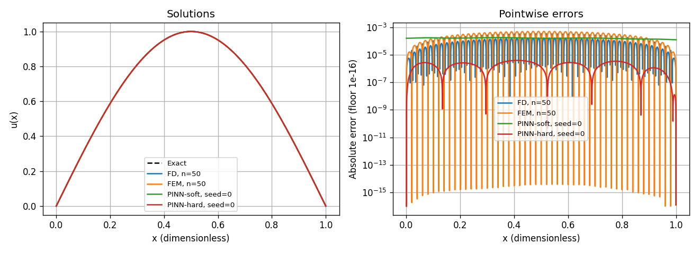

*图6.4-1：左为解函数，右为绝对误差；FD/FEM取n=50，PINN固定展示seed=0。对数图显示下限为10的负16次方，原始数据没有截断。*

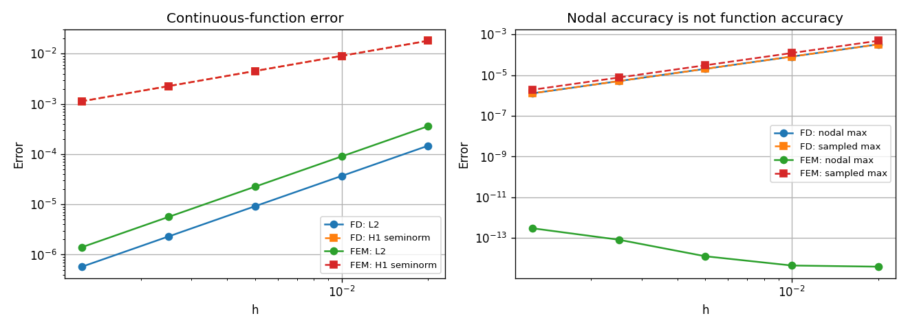

*图6.4-2：比较连续误差与节点误差，FEM节点准确不等于节点间准确。*

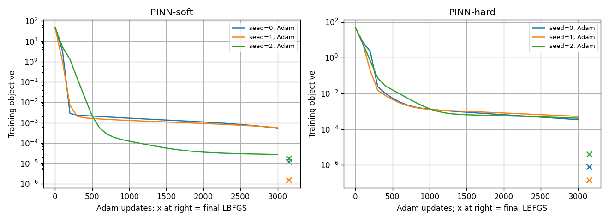

*图6.4-3：保留三个种子的Adam历史；末端叉号表示LBFGS最终损失，横坐标排版不代表额外Adam迭代。软边界纵轴为两项损失之和，硬边界为内部损失。*

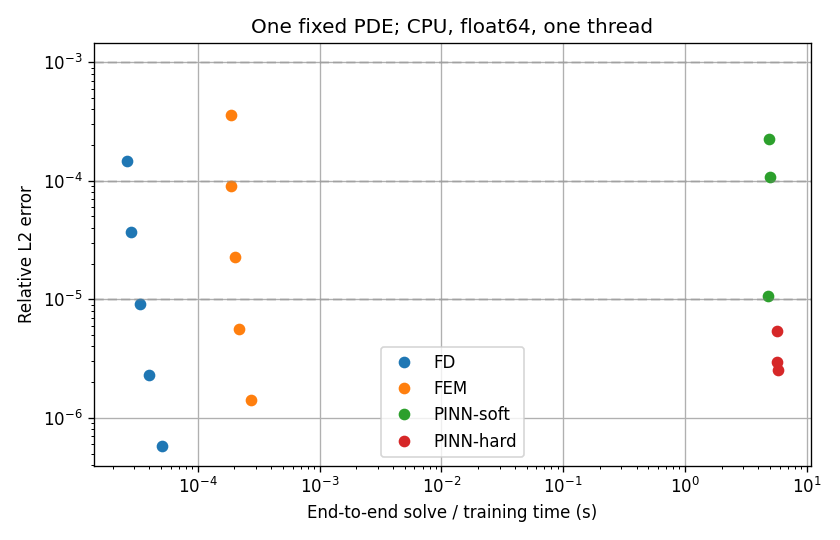

*图6.4-4：同机成本与函数误差。网格点对应分辨率，PINN点对应随机初始化，不是同一种重复。*

### 8. 易错点、反例与结论边界

**误区一：“低损失就代表真解误差小。”** 训练点是有限集合。即使内部残差在训练点都小，仍需检查训练点之间；软边界还需检查端点。训练损失和真实误差只能在额外条件下建立联系，不能直接画等号。

**误区二：“节点值都对，所以函数已经解对。”** 第4.4节给出明确反例：本题FEM可在节点精确，但节点间还是直线而非正弦。这也是本节坚持共同连续误差指标的原因。

**误区三：“残差都叫残差，可以直接比。”** 各方法满足方程的方式不同，强残差、弱残差和代数残差不是同一个量。一个线性系统求解到机器精度，不代表原微分方程解也达到机器精度。

**误区四：“参数多的方法天然更准确。”** 网络参数与网格自由度不是一一对应的信息单位。精度受表示空间、方程离散、优化和数值精度共同影响；比较时应先明确任务和精度，不只比参数数量。

**误区五：“PINN训练慢，所以永远没有用。”** 本实验只涵盖低维、光滑、线性、已知系数、单次正问题。反问题、复杂数据约束、不同几何或更高维任务需要另外设计实验。潜在用途应当写成待检验问题，不能写成这里已经证明的优势。

**误区六：“网络训练完推理快，足以证明求解更快。”** 本题从零求一个解，应将训练计入成本。传统求解器也可以复用矩阵分解；比较重复任务时，两边都要说明哪些准备工作被复用。

**误区七：“有三个种子，就知道失败概率了。”** 三个种子只能揭示有限的初始化波动，不足以估计可靠的失败概率或证明最坏情况保证。

以上第2—8节只讨论正问题；后面第9—10节分别加入反问题和算子实验。非光滑解、非线性/高维PDE、复杂边界、GPU优化、网络结构搜索仍未验证。

### 9. 接入6.2：未知系数反演，先问“能不能识别”，再问“怎样计算”

#### 9.1 从正问题转为反问题

6.2研究的是

$$
-\kappa u''(x)=\pi^2\sin(\pi x),\quad u(0)=u(1)=0,\quad \kappa>0.
\tag{6.4-13}
$$

正问题给定 $\kappa$ 求 $u$；反问题给出少量带噪观测 $y_j=u(x_j)+\varepsilon_j$，要求识别未知的 $\kappa$。制造观测时取真值 $\kappa^*=2$，真解为 $u^*(x)=\tfrac12\sin(\pi x)$。算法只得到方程、观测和正性条件；真参数仅用于生成数据与事后算误差。

这与第2节不是同一个精确解，不可把两个实验的误差原样拼成排行榜。对任意给定 $\kappa>0$，直接代入得到

$$
u_\kappa(x)=\frac{\sin(\pi x)}{\kappa}.
\tag{6.4-14}
$$

因此在这个特定模型中，求函数和求参数可以先作解析消元。这是应当提供的低成本基线，而不是故意给PINN选一个很慢的对手。

#### 9.2 解析最小二乘：一步一步得到传统反演基线

设 $a=1/\kappa$，$q_j=\sin(\pi x_j)$。观测模型变成 $y_j=a q_j+\varepsilon_j$。选择使观测平方误差最小的 $a$：

$$
J(a)=\sum_{j=1}^{m}(a q_j-y_j)^2,
\qquad J'(a)=2\sum_jq_j(aq_j-y_j).
$$

令导数为零。如果 $S=\sum_jq_j^2>0$，则

$$
\widehat a=\frac{\sum_jq_jy_j}{\sum_jq_j^2},\qquad
\widehat\kappa=\frac1{\widehat a}\quad\text{（要求 }\widehat a>0\text{）}.
\tag{6.4-15}
$$

为什么是最小值？因为 $J''(a)=2S>0$，目标是严格凸的二次函数，唯一驻点就是全局最小点。若算出 $\widehat a\le0$，无约束解不在本题正参数范围内，不能直接取倒数声称得到有效正参数；代码会标记没有正的有限估计。本次内点观测没有触发这一情况。

若 $S=0$，所有 $q_j=0$，目标函数不依赖 $a$。这时不是“算法不够聪明”，而是观测根本不区分任何两个正参数。代码返回空参数并注明不可辨识；绝不把真值2填进去。

在独立零均值同方差噪声 $\operatorname{Var}(\varepsilon_j)=\sigma^2$ 下，代入 $y_j=a^*q_j+\varepsilon_j$ 得

$$
\widehat a-a^*=\frac{\sum_jq_j\varepsilon_j}{S},\qquad
\operatorname{Var}(\widehat a)=\frac{\sigma^2}{S}.
\tag{6.4-16}
$$

后一个等式来自独立性：分子方差为 $\sum_jq_j^2\sigma^2=\sigma^2S$，再除以 $S^2$。它说明相同噪声下，$S$越小，幅值估计越不稳定。由于 $\kappa=1/a$ 是非线性变换，这并不等价于 $\widehat\kappa$无偏；在小噪声且 $\widehat a$远离零时才可作一阶近似 $\widehat\kappa-\kappa^*\approx-(\kappa^*)^2(\widehat a-a^*)$。

若只有端点数据，$\sin(0)=\sin(\pi)=0$，所以 $S=0$。若观测靠近零端点，$\sin(\pi x)\approx\pi x$，于是 $S\approx\pi^2\sum_jx_j^2$较小，但只要有真正的内点，仍然可以在无噪声、精确计算下识别参数。因此“弱敏感”与“完全不可辨识”必须分开。

#### 9.3 没有解析解时怎样做：差分加一维最小二乘

用第3节的矩阵 $A_h$，离散方程为 $\kappa A_hU=F$。先解一次单位系数问题 $A_hQ=F$，随后任意参数的解都满足 $U=Q/\kappa=aQ$。把 $Q$分段线性插值到相同观测点得到 $q_{h,j}$，再用

$$
\widehat a_h=\frac{\sum_jq_{h,j}y_j}{\sum_jq_{h,j}^2},\qquad
\widehat\kappa_h=1/\widehat a_h.
\tag{6.4-17}
$$

这项基线记为FD-LS，使用400个区间。其输入信息与PINN相同，但参数估计受到差分和插值误差影响。解析最小二乘用于揭示本题可辨识性的最好情形；FD-LS用于展示真实离散求解器怎样参与反演。两者用途不同，均不应省略。

这里能够线性消元，是因为常系数只作整体乘法。空间变系数、非线性状态方程和多参数模型通常需要重复正向求解、伴随梯度或其他优化方法，不能把这个一维公式推广为所有反问题的通用算法。

#### 9.4 PINN反演及共同实验协议

PINN同时调整网络参数 $\theta$ 与标量 $\alpha$，用 $\kappa=e^\alpha$自动满足正性。损失为

$$
L(\theta,\alpha)=\frac1{N_r}\sum_i\left[-e^\alpha u_\theta''(x_i)-\pi^2\sin(\pi x_i)\right]^2
+\frac{u_\theta(0)^2+u_\theta(1)^2}{2}
+\frac1m\sum_j\left[u_\theta(x_j)-y_j\right]^2.
\tag{6.4-18}
$$

三项分别要求满足方程、边界和观测。参数正性不提供参数大小信息，也不能恢复端点观测没有包含的信息。沿用6.2的NumPy实现：1-32-32-1 tanh网络、Glorot初始化、256个含端点的等距残差点、Adam 2000步、学习率0.01、初始 $\alpha=0$、各项权重均为1、没有额外先验。解析导数与反向传播程序完整内嵌Notebook，先用有限差分检查梯度。

| 场景 | 观测位置 | 观测噪声标准差 | 主要检验的问题 |
| --- | --- | --- | --- |
| E1 | $1/6,2/6,3/6,4/6,5/6$ | 0 | 信息充分且无噪声时的优化误差 |
| E2 | 同E1 | 0.005 | 同一批带噪观测下的估计差异 |
| E3 | $0.01,0.02,0.03,0.04,0.05$ | 0 | 弱敏感但仍可辨识时的有限预算表现 |
| E4 | 0、1 | 0 | 完全不可辨识 |
| E5 | 0、1 | 0.005 | 噪声不能凭空创造参数信息 |

每种场景均使用种子2026—2030。每个种子先生成一份观测，再原封不动交给三个方法；不是分别抽三组噪声。参数误差定义为 $E_\kappa=|\widehat\kappa-2|/2$；函数误差在1001个独立中点计算离散相对 $L^2$。这个评价网格不同于正问题的Gauss积分，故不跨任务比较误差大小。PINN计时包括模型与优化器状态构建、训练和稀疏日志，不含事后真解评价；两种最小二乘计时包括模型生成和参数求解，不含事后评价。极短的传统反演时间只作量级观察，不据一次微秒测量推断精确加速倍数。

#### 9.5 实际反演结果与解释

| 场景 | 方法 | 参数相对误差均值 | 函数相对误差均值 | 平均秒数 | 识别状态 |
| --- | --- | --- | --- | --- | --- |
| E1 | Analytic-LS | 0 | 0 | $2.24000\times10^{-5}$ | 含内点信息 |
| E1 | FD-LS | $5.71168\times10^{-7}$ | $2.36881\times10^{-6}$ | $1.04420\times10^{-4}$ | 含内点信息 |
| E1 | PINN-inverse | $6.89261\times10^{-2}$ | $5.14234\times10^{-2}$ | $1.97654\times10^{0}$ | 含内点信息 |
| E2 | Analytic-LS | $4.88530\times10^{-3}$ | $4.86443\times10^{-3}$ | $2.09400\times10^{-5}$ | 含内点信息 |
| E2 | FD-LS | $4.88541\times10^{-3}$ | $4.86454\times10^{-3}$ | $1.21920\times10^{-4}$ | 含内点信息 |
| E2 | PINN-inverse | $6.32939\times10^{-2}$ | $4.03068\times10^{-2}$ | $1.99263\times10^{0}$ | 含内点信息 |
| E3 | Analytic-LS | 0 | 0 | $2.57800\times10^{-5}$ | 含内点信息 |
| E3 | FD-LS | $5.14043\times10^{-6}$ | $5.63104\times10^{-6}$ | $1.21560\times10^{-4}$ | 含内点信息 |
| E3 | PINN-inverse | $3.16895\times10^{-1}$ | $4.48204\times10^{-1}$ | $1.98942\times10^{0}$ | 含内点信息 |
| E4 | Analytic-LS | — | — | $3.57000\times10^{-5}$ | 不可辨识 |
| E4 | FD-LS | — | — | $1.17000\times10^{-4}$ | 不可辨识 |
| E4 | PINN-inverse | $3.30226\times10^{-1}$ | $4.88626\times10^{-1}$ | $1.93882\times10^{0}$ | 不可辨识 |
| E5 | Analytic-LS | — | — | $3.83600\times10^{-5}$ | 不可辨识 |
| E5 | FD-LS | — | — | $1.47720\times10^{-4}$ | 不可辨识 |
| E5 | PINN-inverse | $3.31209\times10^{-1}$ | $5.01119\times10^{-1}$ | $1.92829\times10^{0}$ | 不可辨识 |

表6.4-6：每行汇总五次运行；逐次结果、标准差、参数值和观测RMSE分别保留在[逐次结果](数据/A1组-6.4-反问题逐次结果.csv)及[汇总](数据/A1组-6.4-反问题汇总.csv)。E4/E5中PINN误差仅描述输出与制造真值之差，不表示获得了可识别估计；传统方法空值是有意拒绝作没有信息依据的识别。

解析二阶导与参数反传检查的最大相对差分别为 $7.23547\times10^{-7}$ 和 $9.72314\times10^{-8}$。这些是实现检查，不能证明非凸训练找到全局最优。

E1与E3的无噪声解析基线应接近机器精度，因而同场景中PINN的剩余误差不能全部归咎于观测噪声或数学上没有唯一解。有限优化预算、损失权衡和网络表示均可能产生影响，本实验没有进一步分离它们各自的贡献。E2则同时包含噪声与优化因素，不能把PINN和最小二乘差值直接解释为某一种单独误差。

E4/E5中PINN仍会输出一个正数，但这个数是优化过程的产物，不是已被观测唯一确认的参数。实测偏差可以作为诊断数字展示，却不能把它包装成有统计意义的识别成功率。重复种子只展示有限的运行差异，不提供最坏情形保证。

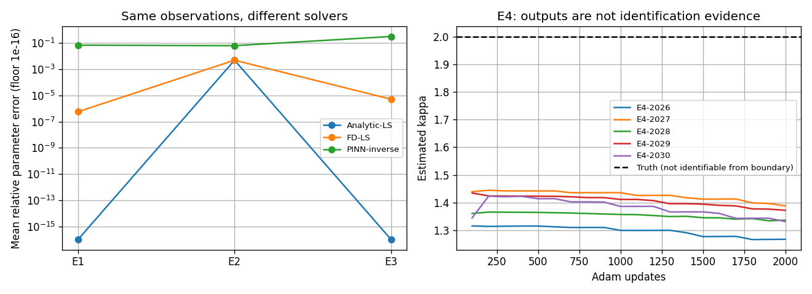

*图6.4-5：左图展示E1—E3的参数误差，显示下限为 $10^{-16}$；右图展示不可辨识E4中五次PINN的参数轨迹。虚线真值仅用于事后观察，不参与训练。*

### 10. 接入6.3：学习一个解，与学习“函数到函数”的映射

#### 10.1 比较对象换成算子

6.3提供的实际算子实验是周期边界下的

$$
-w''(x)+w(x)=f(x),\quad x\in[0,1),\qquad
w(0)=w(1),\quad w'(0)=w'(1).
\tag{6.4-19}
$$

这里把输入源项统一记为 $f$，输出解记为 $w$，避免与前面的未知解 $u$混淆。解算子 $\mathcal G$把一个输入函数变成一个输出函数：$\mathcal G:f\mapsto w$。测试一个算子学习方法时，必须给它没有参与训练的新输入函数；仅在同一个 $f$对应的解曲线上换几个测试坐标，不足以证明这种泛化。

对周期齐次问题 $-z''+z=0$，乘 $z$积分，周期边界使分部积分边界项消失，得到 $\int_0^1[(z')^2+z^2]dx=0$，因此 $z=0$。解唯一。这里的“加上 $w$”还使常数频率可逆，不能删去后沿用相同公式。

若输入是带限Fourier级数

$$
f(x)=a_0+\sum_{k=1}^{K}\left[a_k\cos(2\pi kx)+b_k\sin(2\pi kx)\right],
$$

由于 $-d^2/dx^2$作用于第 $k$个正弦或余弦模态相当于乘以 $(2\pi k)^2$，故

$$
\mathcal G(f)(x)=a_0+\sum_{k=1}^{K}
\frac{a_k\cos(2\pi kx)+b_k\sin(2\pi kx)}{1+(2\pi k)^2}.
\tag{6.4-20}
$$

这是本题的独立解析参考。高频分量被更大的分母抑制，说明该算子具有平滑作用；但输入中的高频较弱不等于网络已经学会训练频带之外的映射。

#### 10.2 DeepONet的有限维表示

在固定传感器 $s_j=j/32$处读取源项，组成 $\mathbf f=(f(s_0),\ldots,f(s_{31}))$。Branch网络把这个向量变成32个系数，trunk网络把查询坐标 $y$变成32个数，最后作内积：

$$
\mathcal G_\theta(f)(y)=\sum_{r=1}^{32}b_r(\mathbf f)t_r(y)+c.
\tag{6.4-21}
$$

可把 $t_r$理解为训练得到的一组函数，$b_r$为随输入变化的组合系数。网络训练同时改变两组函数，结构中没有强制它们等于Fourier基，也没有强制输出满足周期边界。因此结构具有表达能力，不代表训练自动找到了精确算子。

网络分别为branch 32-64-64-32、trunk 1-64-64-32，隐藏层tanh，线性输出，另有标量偏置 $c$。含该偏置总参数为14721；14720是未计这个偏置的数量。训练最小化训练函数与64个查询点上的均方误差。采用Adam、学习率0.001、batch size 32、最多1000轮，以200个验证函数的平均相对 $L^2$选最优轮；连续100轮未改善则早停。测试集不参与选模。

本次使用组员实际提供的1800个函数的Fourier系数，不重新抽一批有利数据。函数级划分为1000训练、200验证、200分布内测试、200幅值外推、200频率外推；检查1800个系数向量彼此不同。训练/分布内输入 $K=4$，$a_0\in[0.5,1.5]$，振荡系数范围为 $[-2/k,2/k]$。幅值外推将振荡系数乘1.8，$a_0$仍保持原范围；频率外推增加到 $K=8$。这些范围以交付系数数据为准。

原6.3实验载体为MATLAB。本节按统一要求用Python/PyTorch改编，采用CPU、float64、初始化种子2024、Glorot初始化，每轮包括最后不足32的8个样本。原MATLAB代码丢弃最后一个不完整批次，所以本次不是逐步复刻原训练轨迹。没有将原MATLAB的预测、训练耗时或消融数字写成本次Python实测。

#### 10.3 公平的传统对照：也只看同样的32个传感器

如果网络只收到32个输入值，却让传统方法直接读取全部解析系数，二者信息条件不同。本节传统求解器同样先收到32个源项样本，用DFT恢复可辨认频率，再三角插值到64点进行求解。

对 $m$个等距样本，使用

$$
\widehat f_k=\frac1m\sum_{j=0}^{m-1}f(j/m)e^{-2\pi\mathrm i kj/m}.
\tag{6.4-22}
$$

对于 $|k|<m/2$且没有更高频混叠的带限函数，离散正交性使这些系数与连续Fourier系数一致。本次最大 $K=8<16$，32个传感器足以恢复所有输入模态。因此谱方法可在浮点误差范围内得到解析解。这依赖本题带限和无噪声传感器条件，不是任意函数的保证。

谱基线在64点上把每个频率系数除以 $1+(2\pi k)^2$，随后逆FFT。差分基线在同一64点网格上解周期中心差分方程。记 $M=64$、$h=1/M$，代入离散复指数可得到差分矩阵的频率特征值

$$
\lambda_{h,k}=1+4M^2\sin^2(\pi k/M).
\tag{6.4-23}
$$

因此也可用FFT逐模态除以 $\lambda_{h,k}$来解循环三对角系统。**使用FFT这个计算工具，不会把差分格式变成谱格式**：两者分母不同，差分基线仍有离散误差。本文将两种方法标记为Spectral-32和FD-32-to-64；名字中的32指输入传感器数，后者实际差分未知量有64个。

差分符号展开为 $1+(2\pi k)^2-(2\pi k)^4h^2/12+O(h^4)$，对固定频率体现二阶一致性。这里的谱方法利用规则、周期、带限的特殊结构；不能据此声称所有复杂几何PDE都能用同样简单的逐模态除法求解。

#### 10.4 评价：先按函数算误差，再统计函数之间的差异

对第 $i$个测试函数，先算

$$
E_i=\left(\frac{\sum_{j=0}^{63}|w_{\theta,i}(j/64)-w_i^*(j/64)|^2}
{\sum_{j=0}^{63}|w_i^*(j/64)|^2}\right)^{1/2}.
\tag{6.4-24}
$$

再对200个 $E_i$报告均值、中位数、P95和最大值。P95是样本误差的95%分位数，表达这一批函数中误差较大一端的情况，不是未来任意函数的95%置信保证。另提供“最近训练函数搬标签”基线：仅根据输入传感器向量距离选择最近训练函数，直接搬用它的训练标签，不使用测试真值选邻居。

另在每个分布内测试函数上抽16个新坐标评价DeepONet（固定种子2064），区分“新函数上的原网格”与“新函数上的新坐标”。后者是离散点检查，不能充当严格的连续最大误差界。

同时报告64点周期谱微分下的完整相对 $H^1$指标，分子含函数与导数的平方和，分母也包含两部分。它不同于正问题的导数半范数。本网络没有硬性周期约束；对其采样值作周期谱微分是一项离散诊断，不保证等于网络真实连续导数的误差，不将该值与第7节直接排序。

| 函数集 | 方法 | 均值$E_i$ | 中位数 | P95 | 最大值 |
| --- | --- | --- | --- | --- | --- |
| 分布内 | DeepONet | $4.37907\times10^{-3}$ | $4.00619\times10^{-3}$ | $8.06548\times10^{-3}$ | $1.19207\times10^{-2}$ |
| 分布内 | Spectral-32 | $1.48020\times10^{-16}$ | $1.17738\times10^{-16}$ | $3.12391\times10^{-16}$ | $5.61633\times10^{-16}$ |
| 分布内 | FD-32-to-64 | $2.92496\times10^{-5}$ | $2.74664\times10^{-5}$ | $5.39147\times10^{-5}$ | $6.72047\times10^{-5}$ |
| 分布内 | Nearest-function | $1.66138\times10^{-1}$ | $1.29767\times10^{-1}$ | $4.60151\times10^{-1}$ | $8.53287\times10^{-1}$ |
| 幅值外推 | DeepONet | $8.74035\times10^{-3}$ | $8.08373\times10^{-3}$ | $1.53036\times10^{-2}$ | $3.01804\times10^{-2}$ |
| 幅值外推 | Spectral-32 | $2.01014\times10^{-16}$ | $1.76961\times10^{-16}$ | $4.54398\times10^{-16}$ | $7.82086\times10^{-16}$ |
| 幅值外推 | FD-32-to-64 | $4.78874\times10^{-5}$ | $4.46944\times10^{-5}$ | $8.06282\times10^{-5}$ | $1.08006\times10^{-4}$ |
| 频率外推 | DeepONet | $1.63144\times10^{-1}$ | $1.27072\times10^{-1}$ | $4.32492\times10^{-1}$ | $5.60810\times10^{-1}$ |
| 频率外推 | Spectral-32 | $2.27692\times10^{-16}$ | $2.03467\times10^{-16}$ | $4.40449\times10^{-16}$ | $7.94467\times10^{-16}$ |
| 频率外推 | FD-32-to-64 | $3.19109\times10^{-5}$ | $2.89526\times10^{-5}$ | $5.57168\times10^{-5}$ | $7.04758\times10^{-5}$ |

表6.4-7：各函数集均为200个未训练输入函数。完整离散 $H^1$指标也保存在[算子误差汇总](数据/A1组-6.4-算子误差汇总.csv)。

本次实际训练748轮，在第648轮取得最佳验证误差并恢复该轮参数。分布内平均误差为 $4.37907\times10^{-3}$，新坐标平均误差为 $4.36449\times10^{-3}$；优于最近函数搬标签基线约37.9倍，支持在这一函数分布中学到了比简单搬标签更有效的映射。它不证明已获得任意输入上的通用算子。

幅值外推均值约变为分布内的2.00倍，频率外推约37.3倍；后者说明训练频带之外明显失准。分布内完整离散 $H^1$误差均值为 $9.70624\times10^{-2}$，也不能由较小函数误差推断导数同样准确。谱与差分基线在本题三类输入上均更准确，但这利用了规则周期线性算子的特殊结构。

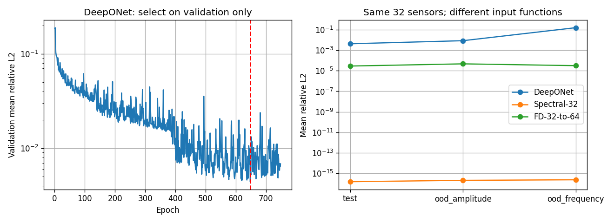

*图6.4-6：左图记录验证误差和选中的训练轮次；右图分别展示三类新函数上的误差。分布外结果单独报告，没有参与训练和最优轮次选择。*

#### 10.5 成本：训练一次以后，是否真的能摊薄？

若处理 $N$个新函数，先区分离线与在线成本：

$$
C_{\rm learn}(N)=C_{\rm data}+C_{\rm train}+NC_{\rm infer},\qquad
C_{\rm traditional}(N)=C_{\rm prepare}+NC_{\rm solve}.
\tag{6.4-25}
$$

两者都满足同一精度条件，并且 $C_{\rm solve}>C_{\rm infer}$时，才可从严格不等式得到

$$
N>\frac{C_{\rm data}+C_{\rm train}-C_{\rm prepare}}
{C_{\rm solve}-C_{\rm infer}}.
\tag{6.4-26}
$$

若分母非正且学习的一次性成本更高，单靠增加问题数就不能摊回这笔额外成本。不能计算一个负门槛，再说“从第一个问题起网络就更划算”。若分母为正，严格少耗时的整数门槛是比右端更大的最小非负整数，还需明确这个常数成本模型的适用范围。

本次传统方法无需矩阵分解。基础版本的FFT调用与频率符号计算均计入在线时间；复用版本则将固定符号计算单列为准备成本，并合并插值与求解以减少冗余变换。数据准备时间记录从已保存系数生成全部输入、标签及独立真值检查的时间；它包含验证和测试数据，故比只生成训练标签的费用更保守，但不包含系数文件的最初生成、读取及既有组员工作的时间。训练时间记录训练循环、验证与最优权重保存，不含导入、模型构建、事后测试和绘图。这里的离线成本是一个明确范围的测量，不是研发全成本。

在线计时分单函数和200函数批量两档，每档预热后7批重复，取批平均时间的中位数。网络端到端计时含NumPy转张量、branch、trunk及内积；另列固定查询坐标下缓存trunk的推理，明确其复用条件。所有方法的输入传感器数组已经存在，源项取样不在在线计时内。误差准入条件预设为分布内测试P95不超过1%；达不到准入条件的方法不能只凭时间更短获得等价替代结论。

本次数据准备 0.0411秒，训练 29.295秒。另测固定trunk准备 0.000352秒，传统频率符号准备 0.000100秒（一次同时准备两种符号；摊销表保守地把这笔很小的总准备费分配给每个传统方法）。

| 实现 | 每批函数数 | 每个函数微秒 |
| --- | --- | --- |
| Spectral-32 | 1 | 34.5260 |
| FD-32-to-64 | 1 | 38.3060 |
| DeepONet | 1 | 143.6010 |
| Spectral-32 | 200 | 1.0842 |
| FD-32-to-64 | 200 | 1.1357 |
| DeepONet | 200 | 1.3102 |
| Spectral-reused | 1 | 17.4800 |
| FD-reused | 1 | 16.2590 |
| Spectral-reused | 200 | 0.5898 |
| FD-reused | 200 | 0.6056 |
| DeepONet-cached-trunk | 1 | 65.3390 |
| DeepONet-cached-trunk | 200 | 0.8883 |

表6.4-8：Spectral-reused/FD-reused缓存固定频率符号，并把三角插值与求解合并，消去一次冗余的逆FFT/FFT往返；与原求解结果的最大差已检查低于 $10^{-12}$。缓存trunk的网络应与这些允许复用的传统实现比较，不能只让网络复用。

| 网络实现 | 传统实现 | 每批函数数 | 两方P95均≤1% | 成本门槛 |
| --- | --- | --- | --- | --- |
| DeepONet | Spectral-32 | 1 | 是 | 无正门槛（在线已不更快） |
| DeepONet | FD-32-to-64 | 1 | 是 | 无正门槛（在线已不更快） |
| DeepONet-cached-trunk | Spectral-reused | 1 | 是 | 无正门槛（在线已不更快） |
| DeepONet-cached-trunk | FD-reused | 1 | 是 | 无正门槛（在线已不更快） |
| DeepONet | Spectral-32 | 200 | 是 | 无正门槛（在线已不更快） |
| DeepONet | FD-32-to-64 | 200 | 是 | 无正门槛（在线已不更快） |
| DeepONet-cached-trunk | Spectral-reused | 200 | 是 | 无正门槛（在线已不更快） |
| DeepONet-cached-trunk | FD-reused | 200 | 是 | 无正门槛（在线已不更快） |

表6.4-9：判断只针对本次设备与实现。缓存版本分别计入网络和传统准备开销。微秒计时可能随系统负载变化，接近的数值不支持稳定的硬件无关速度优势。

本次只测一个DeepONet初始化，不能据此估计训练波动或失败概率；没有执行6.3全部消融，也没有重新运行原MATLAB实验。若要研究GPU、二维复杂算子或大规模批量，需重新测量，不能从本表外推速度。

#### 10.6 FNO补充到什么程度？

6.3对FNO给出原理介绍，但没有交付实际FNO训练实验。因此本节补充结构与对照标准，不填写FNO误差、耗时或排名。典型频域层可写为

$$
v_{\ell+1}(x)=\sigma\left(W_\ell v_\ell(x)+
\mathcal F^{-1}\!\left[R_\ell(k)\,\mathcal Fv_\ell(k)\right](x)\right).
\tag{6.4-27}
$$

其中 $v_\ell$可以有多个通道，$W_\ell$是逐点通道混合，$R_\ell(k)$是保留模态上的可学习矩阵；未保留模态通常在该频域分支置零，$\sigma$为非线性。固定谱求解器的分母由已知方程推导，FNO则从数据学习频域变换，多层非线性复合可表达更复杂映射。

本题精确算子本来就有已知Fourier乘子 $(1+(2\pi k)^2)^{-1}$，所以“FNO也使用FFT”并不意味着它会比解析谱求解更准确或更快。若以后实际训练FNO，应沿用同一1800函数划分、同样输入信息、独立真值及成本口径，再新增方法行；不能仅凭结构相似性填造性能数字。

### 11. 怎样把三类证据合起来，而不夸大结论？

| 问题类型 | 实际未知对象 | 本节传统基线 | 学习方法 | 主要判断依据 |
| --- | --- | --- | --- | --- |
| 6.1正问题 | 固定方程的一条解函数 | 带状FD、真实组装P1 FEM | 软/硬边界PINN | 共同函数与导数误差、边界、从零求解成本 |
| 6.2反问题 | 系数与对应状态函数 | 解析LS、FD-LS | 联合训练参数的PINN | 可辨识性、共同观测、参数误差与训练预算 |
| 6.3算子问题 | 在输入函数类上的映射 | 同32传感器的谱/周期FD | DeepONet；FNO仅原理 | 新函数泛化、分布外测试、离线在线成本 |

有意义的比较不是要求某个方法获胜，而是把“解什么、知道什么、怎样测、付出什么成本”交代完整。简单、低维、结构明确的问题往往已有高效传统算法；学习方法在此仍有教学价值，因为它能帮助我们区分表示能力、训练过程、数据中的信息与可验证的泛化。

本节已经接入6.2、6.3的实际可运行对照。尚未验证的是高维/非线性PDE、复杂几何、含噪传感器的算子学习、系统超参数搜索、多次DeepONet初始化以及FNO实测。保留的数据接口采用任务、场景、方法、种子、误差和成本分别记载，未来可添加行；本次已有实验不再标记为“待运行”。

### 12. 本节小结

第一遍可读第1—2节及第7、9.1、9.5附近的结果说明、第10—11节的表格，先弄清三类任务。第二遍逐步推导第3—5节、最小二乘式(6.4-15)与Fourier解式(6.4-20)，再对照Notebook逐段运行。实验并不能替代证明，证明也不能替代对代码与实际预算的检查。

课后有7道题，其中前5题延续正问题推导和成本判断，后2题分别练习参数可辨识性与算子信息条件。见[习题](A1组-习题.md)、[逐步解答](A1组-习题参考解答.md)与[可运行核验](A1组-习题参考解答代码-6.4.ipynb)。

### 参考资料、图片来源与AI使用

以下列出本节直接采用的资料；完整逐条书目及与来源小节的关系另见[来源导读与文献](辅助文件/A1组-来源导读与文献-6.4.md)。该文件保留6.1的10项、6.2的7项以及6.3的4项章末条目，包含选读项，没有把未读论文全文写成已核验。

| 资料 | 与本节的关系 | 使用范围 |
| --- | --- | --- |
| [课程仓库](https://github.com/prince19992516/-2026)及第06章A组模板 | 文档结构、实际运行、习题、报告和AI记录要求 | 本周用户通知覆盖命名、Python版本与小节分工 |
| 同组6.1源稿与Notebook，固定版本55ae9bcd10fbabb3dd4a5a8de393bd05899abda2 | 正问题、PINN结构与优化预算 | 本节独立重跑，不沿用源耗时 |
| 用户提供的6.2正文、NumPy程序与CSV | E1—E5、网络导数/反传实现与观测生成 | 代码内嵌Notebook；同观测新增LS、FD-LS |
| 用户提供的6.3正文、MATLAB程序与数据CSV | DeepONet结构、函数族、实际1800输入系数 | Python改编；原MATLAB结果仅作为来源归档 |
| Raissi、Perdikaris、Karniadakis，2019，Physics-informed neural networks，JCP 378，686–707，[DOI](https://doi.org/10.1016/j.jcp.2018.10.045) | PINN正/反问题背景 | 不支撑本机性能数字 |
| Lu等，2021，Learning nonlinear operators via DeepONet based on the universal approximation theorem of operators，Nature Machine Intelligence 3，218–229，[论文](https://www.nature.com/articles/s42256-021-00302-5) | branch/trunk结构 | 未把逼近定理当成有限样本优化保证 |
| Li等，2020，Fourier Neural Operator for Parametric Partial Differential Equations，[arXiv:2010.08895](https://arxiv.org/abs/2010.08895) | FNO频域层原理 | 本节没有FNO实验 |
| SciPy 1.15.3的solve_banded、PyTorch 2.6.0的自动微分/Adam/LBFGS | 实际数值实现 | 版本与参数以Notebook及环境记录为准 |
| 本节自含推导 | 差分稳定性、P1节点性质、残差上界、LS方差、Fourier乘子及摊销公式 | 供学生逐步人工复核；自动检查不是证明的替代 |
| 六张实验图 | 本次Notebook由实际数据生成 | 无外部插图；非预期结果示意图 |

AI使用与实际修订过程见[AI对话记录](A1组-AI对话记录.md)及[编写报告](A1组-编写报告.md)。学生学习与人工核验须如实后续记录，不由Agent代签。
