# 第06章 学习的力量：习题参考解答

**题号与 [A1组-习题.md](A1组-习题.md) 一一对应。** 未推导、未运行、未核验的项目如实注明。

> **证据来源标注约定（本文件通用）：**
>
> | 标注 | 含义 |
> | --- | --- |
> | **【手算】** | 由本组逐式推导或手算完成，可复核 |
> | **【Notebook 实测】** | 来自 `A1组-实验-6.1.ipynb` 中已实际运行并保存输出的单元 |
> | **【补充脚本实测】** | 为本题额外运行的小脚本；它读取 Notebook 的训练函数，但不属于 Notebook 原有 cell |
> | **【待实测】** | 尚未运行，**不得**作为已核验结论 |
>
> 本文件整体**尚未经 B/C 组独立复现**，所有「B/C 核验」栏位留待 B/C 组填写。
>
> 运行环境：Python 3.12.10；PyTorch 2.6.0+cu124；NumPy 1.26.4；Matplotlib 3.8.3；NVIDIA GeForce RTX 4060 Laptop GPU，CUDA。`A1组-实验-6.1.ipynb` 的 14 个代码 cell 全部执行，0 error，5 张图；训练总计 241.2 s。

---

## 6.1 PINN：原理与实现

### 习题 6.1-1 ｜理解题 · 参考解答

**四条说法均为错误。** 逐条说明。

#### 1. 「训练残差为零，就说明 PINN 已经得到真解」——错误

训练残差只作用在有限配点上：

$$
\mathcal L_r(\theta)=\frac1{N_r}\sum_{i=1}^{N_r}\left(-u_\theta''(x_i)-f(x_i)\right)^2.
$$

即使 $\mathcal L_r=0$，也只能推出

$$
-u_\theta''(x_i)=f(x_i),\qquad i=1,\dots,N_r,
$$

不能推出 $r_\theta(x)=0$ 对每个 $x\in(0,1)$ 成立。配点之间的行为没有被约束。正文 4（2）的多项式反例与习题 6.1-3 的正弦反例都说明：训练点残差为零时，密网格残差仍可以很大。

此外，若只训练 $\mathcal L_r$ 而不写边界项，$-d^2/dx^2$ 的仿射零空间完全没有被约束。正文 4（1）给出

$$
v(x)=\sin(\pi x)+3x+2,
$$

它满足 $-v''=f$，但 $v(0)=2$、$v(1)=5$。因此“内部残差为零”甚至不能保证边界正确，更不能保证真解。

**正确表述：** 训练残差为零只说明有限配点上的方程约束被满足；要判断是否得到真解，必须同时检查边界、独立密网格残差与独立解误差。

#### 2. 「只要边界权重 $\lambda_b$ 足够大，软约束就等价于硬约束」——错误

软约束的损失是

$$
\mathcal L=\mathcal L_r+\lambda_b\mathcal L_b,
\qquad
\mathcal L_b=\frac1{N_b}\sum_{j=1}^{N_b}\left(u_\theta(x_j^b)-g_D(x_j^b)\right)^2.
$$

$\lambda_b$ 增大只是提高边界项在优化中的相对权重。它不会把边界条件写进网络结构，也不会使边界误差在算术上精确为零。真正“精确满足”的是硬约束，例如

$$
u_\theta(x)=x(1-x)N_\theta(x),
$$

它在 $x=0,1$ 处由因子 $x(1-x)$ 强制为零。

另一方面，$\lambda_b$ 过大也有代价。正文表 2 的实测显示：$\lambda_b=1$ 时相对 $L^2$ 为 $1.096\times10^{-5}$；$\lambda_b=100$ 时相对 $L^2$ 反而回到 $1.336\times10^{-4}$。所以“越大越好”不成立。

**正确表述：** 软约束通过惩罚逼近边界，硬约束通过结构精确满足边界；$\lambda_b$ 影响条件数与优化速度，不是“软约束变成硬约束”的开关。

#### 3. 「只要在所有有限配点上残差为零，就能保证全区间残差为零」——错误

这是有限配点盲区。以习题 6.1-3 的正弦扰动为例：

$$
u_\varepsilon(x)=\sin(\pi x)+\varepsilon\sin(2\pi x),
$$

则

$$
r_\varepsilon(x)=4\pi^2\varepsilon\sin(2\pi x).
$$

取唯一配点 $x_1=1/2$，有 $\sin(\pi)=0$，所以 $r_\varepsilon(1/2)=0$；但在 $x=1/4$ 处 $r_\varepsilon=4\pi^2\varepsilon\ne0$。训练点上的零残差只是有限个约束，不能代表整个区间。

**正确表述：** 训练损失必须与独立密网格上的残差、以及独立参考解上的解误差一起报告。

#### 4. 「总损失很小，就说明边界条件已经满足」——错误

总损失是加权和，小总损失可能来自很小的 $\lambda_b$，而不是边界误差小。正文表 2 的实测：

$$
\lambda_b=10^{-4}:\qquad
\mathcal L=8.828\times10^{-6},
\qquad
\text{boundary error}=0.3937.
$$

总损失已经小于 $10^{-5}$，边界误差却仍在 $10^{-1}$ 量级。原因不是损失函数写错，而是边界项的权重太小；在有限训练预算内，边界模式没有被压到零。

**正确表述：** 必须把 $\mathcal L_r$、$\mathcal L_b$、边界误差与独立解误差分开报告；总损失不能单独作为成功判据。

**核验：** 四条均为【手算】论证；第 3、4 条引用了正文与 Notebook 的实测数值。B/C 组待核验。

---

### 习题 6.1-2 ｜计算题 · 参考解答

**已知：**

$$
-u''(x)=\pi^2\sin(\pi x),\quad x\in(0,1),\qquad u(0)=u(1)=0,
$$

精确解 $u^\star(x)=\sin(\pi x)$，候选解

$$
v(x)=\sin(\pi x)+cx+d.
$$

#### 1. 内部残差

先求导：

$$
v'(x)=\pi\cos(\pi x)+c,
\qquad
v''(x)=-\pi^2\sin(\pi x).
$$

因此

$$
-v''(x)-\pi^2\sin(\pi x)
=\pi^2\sin(\pi x)-\pi^2\sin(\pi x)=0.
$$

所以对任意常数 $c,d$，

$$
\boxed{r(x)=-v''(x)-f(x)\equiv0.}
$$

这说明 $cx+d$ 落在 $-d^2/dx^2$ 的核中。

#### 2. 边界值与零边界条件

直接代入：

$$
v(0)=\sin0+c\cdot0+d=d,
$$

$$
v(1)=\sin\pi+c+d=c+d.
$$

零 Dirichlet 边界要求

$$
v(0)=0,\qquad v(1)=0.
$$

于是

$$
d=0,\qquad c+d=0.
$$

解得

$$
\boxed{c=0,\quad d=0.}
$$

也就是说，在仿射族 $v=u^\star+cx+d$ 中，只有 $c=d=0$ 的那个元素满足零边界。

#### 3. $c=3,d=2$ 的边界损失与相对 $L^2$

此时

$$
v(0)=d=2,\qquad v(1)=c+d=5.
$$

边界损失（两个端点取平均）为

$$
\mathcal L_b=\frac{v(0)^2+v(1)^2}{2}
=\frac{2^2+5^2}{2}
=\frac{29}{2}=14.5.
$$

解误差为

$$
v-u^\star=3x+2.
$$

于是

$$
\Vert v-u^\star\Vert_2^2
=\int_0^1(3x+2)^2\,dx
=\int_0^1(9x^2+12x+4)\,dx
=3+6+4=13.
$$

又

$$
\Vert u^\star\Vert_2^2
=\int_0^1\sin^2(\pi x)\,dx=\frac12.
$$

所以

$$
\frac{\Vert v-u^\star\Vert_2}{\Vert u^\star\Vert_2}
=\frac{\sqrt{13}}{\sqrt{1/2}}
=\sqrt{26}\approx5.099.
$$

**答案：**

$$
\boxed{\mathcal L_b=14.5,\qquad
\frac{\Vert v-u^\star\Vert_2}{\Vert u^\star\Vert_2}=\sqrt{26}\approx5.099.}
$$

#### 4. 一般 $c,d$ 的表达式

边界值仍为 $v(0)=d$、$v(1)=c+d$，所以

$$
\boxed{\mathcal L_b=\frac{d^2+(c+d)^2}{2}.}
$$

解误差为 $cx+d$，因此

$$
\Vert v-u^\star\Vert_2^2
=\int_0^1(cx+d)^2\,dx
=\frac{c^2}{3}+cd+d^2.
$$

相对 $L^2$ 误差为

$$
\boxed{
\frac{\Vert v-u^\star\Vert_2}{\Vert u^\star\Vert_2}
=\sqrt{2\left(\frac{c^2}{3}+cd+d^2\right)}.
}
$$

当 $c=3,d=2$ 时，括号内为 $3+6+4=13$，相对误差为 $\sqrt{26}$，与第 3 问一致。

#### 5. 为什么残差损失无法区分 $(c,d)$

只训练 $\mathcal L_r$ 时，损失为

$$
\mathcal L_r=\frac1{N_r}\sum_i r(x_i)^2.
$$

但由第 1 问，$r(x_i)=0$ 对任意 $(c,d)$ 都成立。因此

$$
\mathcal L_r(c,d)=0
\quad\text{for all }c,d.
$$

$(c,d)$ 是两个平坦方向；残差损失对它们完全不敏感。具体落到哪个 $(c,d)$，取决于初始化与优化路径，而不是损失函数。

能发现问题的指标至少包括：

1. **边界误差**：
   $$
   \max\left(\vert v(0)\vert,\vert v(1)\vert\right)
   =\max\left(\vert d\vert,\vert c+d\vert\right).
   $$
2. **独立密网格上的相对 $L^2$ 误差**：
   $$
   \frac{\Vert v-u^\star\Vert_2}{\Vert u^\star\Vert_2}.
   $$
3. **独立密网格上的 PDE 残差**：虽然本例中它恒为零，但在一般网络解中它可发现“配点之外”的残差。

只报 $\mathcal L_r$ 会把这个二维零空间误判为“完美解”。

**核验：** 全部为【手算】。$c=3,d=2$ 的数值与正文 4（1）及 Notebook 解析核验一致（$\mathcal L_b=14.5$、相对 $L^2=\sqrt{26}$）。B/C 组待核验。

---

### 习题 6.1-3 ｜构造/计算题 · 参考解答

**已知：**

$$
u_\varepsilon(x)=\sin(\pi x)+\varepsilon\sin(2\pi x),
\qquad \varepsilon=0.1,
$$

配点 $N_r=1$，$x_1=1/2$；源项 $f(x)=\pi^2\sin(\pi x)$。

#### 1. 边界条件

$$
u_\varepsilon(0)=\sin0+\varepsilon\sin0=0,
$$

$$
u_\varepsilon(1)=\sin\pi+\varepsilon\sin(2\pi)=0.
$$

所以

$$
\boxed{u_\varepsilon(0)=u_\varepsilon(1)=0.}
$$

#### 2. 二阶导数与残差

先求一阶导数：

$$
u_\varepsilon'(x)=\pi\cos(\pi x)+2\pi\varepsilon\cos(2\pi x).
$$

再求二阶导数：

$$
u_\varepsilon''(x)
=-\pi^2\sin(\pi x)-4\pi^2\varepsilon\sin(2\pi x).
$$

因此

$$
\begin{aligned}
r_\varepsilon(x)
&=-u_\varepsilon''(x)-\pi^2\sin(\pi x)\\
&=\pi^2\sin(\pi x)+4\pi^2\varepsilon\sin(2\pi x)-\pi^2\sin(\pi x)\\
&=4\pi^2\varepsilon\sin(2\pi x).
\end{aligned}
$$

**答案：**

$$
\boxed{r_\varepsilon(x)=4\pi^2\varepsilon\sin(2\pi x).}
$$

#### 3. 配点处的残差

在 $x_1=1/2$：

$$
\sin(2\pi\cdot 1/2)=\sin\pi=0.
$$

所以

$$
r_\varepsilon(1/2)=4\pi^2\varepsilon\cdot0=0.
$$

同时 $u_\varepsilon(0)=u_\varepsilon(1)=0$。因此该候选解在唯一配点和两个端点上都没有被损失函数“抓住”。

#### 4. 密网格指标

残差的最大值：

$$
\max_{x\in[0,1]}\vert r_\varepsilon(x)\vert
=4\pi^2\varepsilon.
$$

取 $\varepsilon=0.1$：

$$
4\pi^2\cdot0.1=0.4\pi^2\approx3.948.
$$

残差 RMS：

$$
\left(\int_0^1 r_\varepsilon(x)^2\,dx\right)^{1/2}
=4\pi^2\varepsilon\left(\int_0^1\sin^2(2\pi x)\,dx\right)^{1/2}.
$$

因为

$$
\int_0^1\sin^2(2\pi x)\,dx=\frac12,
$$

所以

$$
\mathrm{RMS}= \frac{4\pi^2\varepsilon}{\sqrt2}\approx2.791.
$$

解误差为

$$
u_\varepsilon-u^\star=\varepsilon\sin(2\pi x).
$$

最大值：

$$
\max\vert u_\varepsilon-u^\star\vert=\varepsilon=0.1.
$$

$L^2$ 误差：

$$
\Vert u_\varepsilon-u^\star\Vert_2
=\varepsilon\left(\int_0^1\sin^2(2\pi x)\,dx\right)^{1/2}
=\frac{\varepsilon}{\sqrt2}.
$$

又 $\Vert u^\star\Vert_2=1/\sqrt2$，所以相对 $L^2$ 误差为

$$
\frac{\Vert u_\varepsilon-u^\star\Vert_2}{\Vert u^\star\Vert_2}
=\varepsilon=0.1.
$$

**答案：**

$$
\boxed{
\max\vert r_\varepsilon\vert\approx3.948,\quad
\mathrm{RMS}\approx2.791,\quad
\max\vert u_\varepsilon-u^\star\vert=0.1,\quad
\text{relative }L^2=0.1.
}
$$

#### 5. 改配点为 $1/4,1/2,3/4$

在 $x=1/4$：

$$
\sin(2\pi\cdot1/4)=\sin(\pi/2)=1,
$$

所以

$$
r_\varepsilon(1/4)=4\pi^2\varepsilon\ne0.
$$

在 $x=3/4$：

$$
\sin(2\pi\cdot3/4)=\sin(3\pi/2)=-1,
$$

所以

$$
r_\varepsilon(3/4)=-4\pi^2\varepsilon\ne0.
$$

因此若配点包含 $1/4$ 或 $3/4$，该扰动就**不能**在所有配点上保持零残差。配点位置是决定性的：这个反例只在“配点恰好落在 $\sin(2\pi x)$ 的零点”时成立。

#### 6. 与正文多项式构造的比较

正文 4（2）构造

$$
p_{\mathrm{raw}}(x)=x^3(1-x)^3\prod_i(x-x_i)^3,
\qquad
p(x)=\frac{p_{\mathrm{raw}}(x)}{\max\vert p_{\mathrm{raw}}\vert},
$$

利用三重根使

$$
p(x_i)=p'(x_i)=p''(x_i)=0,
\qquad
p(0)=p(1)=p'(0)=p'(1)=p''(0)=p''(1)=0.
$$

本题的正弦扰动则利用 $\sin(2\pi x)$ 在 $0,1/2,1$ 处的零点与二阶导数零点。两者共同说明：

> **训练点上的零残差只是有限个约束；配点之间的残差与解误差不会被自动控制。** 评价必须在独立密网格上进行。

**核验：** 全部为【手算】；数值由解析积分与 $\pi^2\approx9.8696$ 直接计算。B/C 组待核验。

---

### 习题 6.1-4 ｜计算/解释题 · 参考解答

**已知：**

$$
u_{a,b}(x)=a\sin(\pi x)+b(1-x),
\qquad
u^\star(x)=\sin(\pi x),
\qquad
f(x)=\pi^2\sin(\pi x).
$$

#### 1. 损失函数

先看边界值：

$$
u_{a,b}(0)=a\cdot0+b\cdot1=b,
\qquad
u_{a,b}(1)=a\cdot0+b\cdot0=0.
$$

残差：

$$
-u_{a,b}''(x)-f(x)
=\pi^2a\sin(\pi x)-\pi^2\sin(\pi x)
=\pi^2(a-1)\sin(\pi x).
$$

因此

$$
\mathcal L_r
=\frac1{1}\int_0^1\left[\pi^2(a-1)\sin(\pi x)\right]^2dx
=\pi^4(a-1)^2\int_0^1\sin^2(\pi x)\,dx.
$$

利用 $\int_0^1\sin^2(\pi x)\,dx=1/2$：

$$
\boxed{\mathcal L_r=\frac{\pi^4}{2}(a-1)^2.}
$$

边界损失（两端平均）：

$$
\mathcal L_b=\frac{u_{a,b}(0)^2+u_{a,b}(1)^2}{2}
=\frac{b^2+0}{2}
=\boxed{\frac{b^2}{2}.}
$$

总损失：

$$
\boxed{
\mathcal L(a,b)=\frac{\pi^4}{2}(a-1)^2+\frac{\lambda_b}{2}b^2.
}
$$

#### 2. $\lambda_b=10^{-4},a=1,b=1$

代入：

$$
\mathcal L_r=0,
\qquad
\mathcal L_b=\frac12,
\qquad
\mathcal L=\frac{10^{-4}}{2}=5\times10^{-5}.
$$

边界误差：

$$
\max\left(\vert u_{a,b}(0)\vert,\vert u_{a,b}(1)\vert\right)
=\max(\vert1\vert,0)=1.
$$

解误差：

$$
u_{a,b}-u^\star=(1-x).
$$

于是

$$
\Vert u_{a,b}-u^\star\Vert_2^2
=\int_0^1(1-x)^2dx=\frac13,
$$

$$
\Vert u^\star\Vert_2^2=\frac12.
$$

相对 $L^2$：

$$
\frac{\Vert u_{a,b}-u^\star\Vert_2}{\Vert u^\star\Vert_2}
=\sqrt{\frac{1/3}{1/2}}
=\sqrt{\frac23}\approx0.8165.
$$

**答案：**

$$
\boxed{
\mathcal L=5\times10^{-5},\quad
\text{boundary error}=1,\quad
\text{relative }L^2=\sqrt{2/3}\approx0.8165.
}
$$

正文中“相对误差约为 1”是量级说法；精确值是 $\sqrt{2/3}$。

#### 3. 梯度流

对 $\mathcal L(a,b)$ 求偏导：

$$
\frac{\partial\mathcal L}{\partial a}
=\pi^4(a-1),
\qquad
\frac{\partial\mathcal L}{\partial b}
=\lambda_b b.
$$

梯度流为

$$
\boxed{
\dot a=-\pi^4(a-1),
\qquad
\dot b=-\lambda_b b.
}
$$

解为

$$
\boxed{
a(t)=1+(a_0-1)e^{-\pi^4t},
\qquad
b(t)=b_0e^{-\lambda_b t}.
}
$$

两个方向的衰减率分别是 $\pi^4$ 与 $\lambda_b$，比值为

$$
\frac{\pi^4}{\lambda_b}.
$$

当 $\lambda_b=10^{-4}$ 时，比值约为 $9.74\times10^5$：边界模式比残差模式慢约六个数量级。

#### 4. 全局极小点与“小总损失”

对 $\lambda_b>0$，驻点条件为

$$
\pi^4(a-1)=0,\qquad \lambda_b b=0,
$$

所以唯一驻点是

$$
\boxed{(a,b)=(1,0).}
$$

在这个点上 $\mathcal L_r=\mathcal L_b=0$，因此它也是全局极小点。**损失函数的全局极小点没有错。**

但有限训练并不等于求全局极小点。$\lambda_b$ 很小时，$b$ 方向的曲率很小，梯度流/Adam 在该方向上的有效步长很小；在有限预算内，$b$ 可能仍远离 $0$。于是总损失可以很小（因为 $\lambda_b$ 小），边界误差却很大。

这就是“总损失小”不能作为成功判据的原因：它可能是**权重小**造成的，而不是边界满足。

#### 5. 对照 Notebook 的 $\lambda_b$ 扫描

正文表 2 的实测（Python 3.12.10，种子 0）：

| $\lambda_b$ | $\mathcal L_r$ | $\mathcal L_b$ | 总损失 | 相对 $L^2$ | 边界误差 |
| --- | --- | --- | --- | --- | --- |
| $0$ | $8.436\times10^{-7}$ | $1.137$ | $8.436\times10^{-7}$ | $1.414$ | $1.420$ |
| $10^{-4}$ | $9.628\times10^{-7}$ | $7.866\times10^{-2}$ | $8.828\times10^{-6}$ | $0.3429$ | $0.3937$ |
| $1$ | $2.230\times10^{-6}$ | $5.820\times10^{-11}$ | $2.230\times10^{-6}$ | $1.096\times10^{-5}$ | $9.239\times10^{-6}$ |
| $100$ | $2.281\times10^{-5}$ | $1.318\times10^{-8}$ | $2.413\times10^{-5}$ | $1.336\times10^{-4}$ | $1.330\times10^{-4}$ |

读法：

- $\lambda_b=0$：边界项完全不存在，$\mathcal L_r$ 极小但边界误差 $1.420$；仿射零空间未被约束。
- $\lambda_b=10^{-4}$：总损失 $8.828\times10^{-6}$ 看起来很小，但边界误差 $0.3937$；小总损失掩盖了大边界误差。
- $\lambda_b=1$：各项到 $10^{-5}$ 量级，是本轮最平衡的权重。
- $\lambda_b=100$：边界项被过度强调，残差项被压得不够，两个误差都回到 $1.3\times10^{-4}$，比 $\lambda_b=1$ 差。

因此权重既不能为 $0$，也不是越大越好；它影响的是条件数与优化折中。

**核验：** 第 1—4 问为【手算】；第 5 问的数值为【Notebook 实测】（`A1组-实验-6.1.ipynb` 表 2）。B/C 组待核验。

---

### 习题 6.1-5 ｜实验/综合题 · 参考解答

**已知：** 网络 1–32–32–1，$\tanh$，1153 个参数；$N_r=256$ 个单元中心配点；评价网格 1001 点；Adam 3000 步 + L-BFGS 100 步。软约束 $\lambda_b=1$；硬约束 $u_\theta=x(1-x)N_\theta(x)$，只训练 $\mathcal L_r$。

#### 1. 三组结果

【Notebook 实测】软约束 seed 0 与硬约束 seed 0 来自 `A1组-实验-6.1.ipynb` 实验 C；硬约束 seed 1 来自【补充脚本实测】。

| 方案 | seed | 相对 $L^2$ | 边界误差 | 独立残差 RMS | 时间/s |
| --- | --- | --- | --- | --- | --- |
| 软约束 $\lambda_b=1$ | 0 | $1.096\times10^{-5}$ | $9.239\times10^{-6}$ | $1.508\times10^{-3}$ | $31.59$ |
| 软约束 $\lambda_b=1$ | 1 | $1.353\times10^{-5}$ | $1.276\times10^{-5}$ | $3.816\times10^{-3}$ | $28.94$ |
| 硬约束 | 0 | $3.790\times10^{-6}$ | $0$ | $1.475\times10^{-3}$ | $41.83$ |
| 硬约束 | 1 | $1.573\times10^{-6}$ | $0$ | $2.191\times10^{-4}$ | $33.76$ |

补充脚本实际调用：

```python
# 【补充脚本实测】读取 Notebook 的 train 函数；不是 Notebook 原有 cell
res, net, x_np, u_np, hist = train(lam_b=0.0, seed=1, hard=True)
```

输出（节选）：

```
rel_l2   = 1.5730705626992858e-06
max_err  = 1.9669532775878906e-06
bc_err   = 0.0
res_rms  = 0.00021908478811383247
t_total  = 33.76122929999838
```

#### 2. 为什么硬约束边界误差为 $0$，解误差仍不为 $0$

硬约束

$$
u_\theta(x)=x(1-x)N_\theta(x)
$$

在 $x=0$ 和 $x=1$ 处由因子 $x(1-x)$ 精确为零：

$$
u_\theta(0)=0\cdot1\cdot N_\theta(0)=0,
\qquad
u_\theta(1)=1\cdot0\cdot N_\theta(1)=0.
$$

这是**结构上的精确零**，不是“训练后近似为零”。

但解误差衡量的是整个区间上的函数差：

$$
u_\theta-u^\star.
$$

$N_\theta$ 只是有限容量网络，不能精确表示 $u^\star$ 的所有细节；因此内部仍有近似误差。边界为零只消除了边界这一项误差，不会消除网络表示误差与优化误差。

#### 3. 诊断方案

只报训练损失不足。建议至少同时报告：

1. **损失分解**：$\mathcal L_r$ 与 $\mathcal L_b$ 分开；不能只报 $\mathcal L$。
2. **边界误差**：
   $$
   \max\left(\vert u_\theta(0)-g_D(0)\vert,\vert u_\theta(1)-g_D(1)\vert\right).
   $$
3. **独立密网格残差**：在训练点之外的 1001 点网格上计算
   $$
   \sqrt{\frac1{N_e}\sum_{e=1}^{N_e}r_\theta(x_e)^2}.
   $$
4. **独立解误差**：相对 $L^2$、最大误差；参考解必须是解析解或独立有限差分，不能是 PINN 自己。
5. **多 seed**：至少报告两个种子，避免把单次初始化当作普遍结论。

若只看 $\mathcal L_r$，正文中 $\lambda_b=0$ 的方案（$\mathcal L_r=8.436\times10^{-7}$，边界误差 $1.420$）会被误判为成功；上述诊断会把它判为失败。

#### 4. 两个 seed 是否支持“硬约束更好”

在本问题上：

- 硬约束 seed 0：相对 $L^2$ $3.790\times10^{-6}$，边界误差 $0$；
- 硬约束 seed 1：相对 $L^2$ $1.573\times10^{-6}$，边界误差 $0$；
- 软约束 seed 0/1：相对 $L^2$ 为 $1.096\times10^{-5}$、$1.353\times10^{-5}$，边界误差 $9.239\times10^{-6}$、$1.276\times10^{-5}$。

两个硬约束种子都精确满足边界，解误差都比对应软约束小，且量级一致。因此**在本问题、本网络、本预算下**，硬约束是更稳的选择。

但不能据此宣称“硬约束普遍优于软约束”：

- 只测试了一个一维零 Dirichlet 问题；
- 只测试了两个种子；
- 硬约束依赖 $x(1-x)$ 这种简单结构，复杂边界/多维问题不一定能直接构造；
- 硬约束可能引入架构偏置，且本轮硬约束耗时并不更短（$33.76$–$41.83$ s vs 软约束 $28.94$–$31.59$ s）。

#### 5. 仍未验证

- 更多随机种子（seed 2 及以后）；
- 不同网络宽度、深度、激活函数；
- 不同配点密度与分布；
- Neumann、Robin、界面条件；
- 二维/三维、非线性 PDE；
- 含噪观测的反问题（属于 6.2）。

这些都不能由本节的 $10^{-6}$–$10^{-5}$ 结果外推。

**核验：** 第 1 问的软约束/硬约束 seed 0 为【Notebook 实测】；硬约束 seed 1 为【补充脚本实测】；第 2—5 问为【手算】+ 实测解释。更多种子与其他边界为【待实测】。B/C 组待核验。

---

### 附：正确性状态汇总（A1 自检）

| 题号 | 题型 | 手算推导 | Notebook 实测 | 补充脚本实测 | 待实测部分 | B/C 独立复现 |
| --- | --- | --- | --- | --- | --- | --- |
| 6.1-1 | 理解题 | 完成 | — | — | — | 待核验 |
| 6.1-2 | 计算题 | 完成 | — | — | — | 待核验 |
| 6.1-3 | 构造/计算题 | 完成 | — | — | — | 待核验 |
| 6.1-4 | 计算/解释题 | 完成 | $\lambda_b$ 扫描数据 | — | — | 待核验 |
| 6.1-5 | 实验/综合题 | 完成 | 软/硬 seed 0 | 硬约束 seed 1 | 更多种子、其他边界 | 待核验 |

**如实说明：**

- 习题 6.1-1 至 6.1-4 的数值均为手算；6.1-4 的 $\lambda_b$ 扫描引用 `A1组-实验-6.1.ipynb` 的实际输出。
- 习题 6.1-5 的硬约束 seed 1 由补充脚本实际运行；它读取 Notebook 的训练函数，但不是 Notebook 原有 cell。该结果不替代 B/C 组独立复现。
- 更多种子、Neumann/Robin、多维与非线性问题未运行，标为【待实测】。
- 本文件尚未经 B 组独立复现；所有「核验」栏位留待 B/C 组填写。

> **本文件的核验纪律：** 按 A/B/C 协作规则，所有「B/C 核验」栏位必须由 B/C 组在课程环境中亲自复跑后填写。**AI 的执行不能替代学生的人工核验。**

---

> 对应 `A1组-习题.md`。每题按题面中的 (1)(2)(3)(4) 小问顺序作答；解析推导、代码实现与实测结果均已给出。代码在 `A1组-习题参考解答代码-6.2-6.3.ipynb`，图片在 `图片/`。陷阱中的错误说法均为教学构造，不是任何 AI 系统的真实原话。

## 6.2

### 题 6.2-1 参数缩放对称与观测等价

**条件与符号：**

方程
$$
-(ku')'+ru=0,\qquad x\in(0,1),
$$
边界 $u(0)=0,\ u(1)=1$，未知常数 $k>0,\ r\ge0$。观测点为 $x_i=(i+0.5)/21,\ i=0,\dots,20$，噪声 $\sigma=0.005$。候选 A：$(k,r)=(1,4)$；B：$(k,r)=(0.25,1)$。以下以 A 为数据生成者；若由 B 生成，A、B 角色互换，结论相同。记
$$
m=\sqrt{r/k},\qquad q(0)=-ku'(0),\qquad q(1)=-ku'(1).
$$

#### (1) 解析解与参数依赖

当 $m>0$ 时，方程的通解为 $c_1\cosh(mx)+c_2\sinh(mx)$。由 $u(0)=0$ 得 $c_1=0$，由 $u(1)=1$ 得
$$
u(x)=\frac{\sinh(mx)}{\sinh m}.
$$
直接求导：$u'=m\cosh(mx)/\sinh m$，$u''=m^2u$，所以
$$
-ku''+ru=(-km^2+r)u=0.
$$
当 $m\to0$ 时，$\sinh(mx)/\sinh m\to x$，即 $u=x$。

解只通过 $m=\sqrt{r/k}$ 依赖 $(k,r)$。对任意 $\lambda>0$，$(k,r)\mapsto(\lambda k,\lambda r)$ 保持 $m$ 不变，因此保持整条 $u(x)$ 不变。A、B 都满足 $r/k=4$，故 $m=2$。

#### (2) 观测等价、边界通量与 FIM

A、B 给出完全相同的场：
$$
u_A(x)=u_B(x)=\frac{\sinh(2x)}{\sinh 2}.
$$
对任意内部点集、任意多个无噪声观测，A、B 的观测向量逐分量相同；若在同一次噪声实现下比较，两者也给出同一个观测向量。因此仅凭内部 $u$ 观测，二者不可区分。

边界通量：
$$
q(0)=-\frac{km}{\sinh m},\qquad q(1)=-km\coth m.
$$
代入 $m=2$：

| 参数 | $q(0)$ | $q(1)$ |
| --- | --- | --- |
| A $(1,4)$ | $-0.551441$ | $-2.074629$ |
| B $(0.25,1)$ | $-0.137860$ | $-0.518657$ |

两者 $q(0)$ 相差约 $0.413581$，$q(1)$ 相差约 $1.555972$。内部 $u$ 只确定 $m$，而通量还含因子 $k$，所以通量能打破缩放对称性。

取 $\alpha=\ln k,\ \beta=\ln r$。由 $m=e^{(\beta-\alpha)/2}$，
$$
\frac{\partial u}{\partial\alpha}=-\frac m2\frac{\partial u}{\partial m},\qquad
\frac{\partial u}{\partial\beta}=\frac m2\frac{\partial u}{\partial m}.
$$
令 $g_i=(\partial u(x_i)/\partial\alpha,\partial u(x_i)/\partial\beta)$，则
$$
F=\frac1{\sigma^2}\sum_i g_i g_i^{\mathsf T}
=C\begin{pmatrix}1&-1\\-1&1\end{pmatrix},
\quad C=\frac{m^2}{4\sigma^2}\sum_i\left(\frac{\partial u(x_i)}{\partial m}\right)^2.
$$
因此 $\operatorname{rank}F=1$，零空间由 $(1,1)^{\mathsf T}$ 张成，$\det F=0$。增加内部观测点只会增大 $C$，不会改变零方向；FIM 的平坦方向对应参数空间中 $r=4k$ 的山谷。

#### (3) PINN 损失、反演与代码结果

固定 $k,r$ 的 PINN 损失：
$$
L=\frac1{N_d}\sum_i(u_\theta(x_i)-u_i^{\rm obs})^2
+\lambda_p\frac1{N_p}\sum_j(-k u_\theta''(x_j)+r u_\theta(x_j))^2
+\lambda_b\big(u_\theta(0)^2+(u_\theta(1)-1)^2\big).
$$
固定 A 或 B 时，网络都可以逼近同一条 $u$，三项都可压到很小。反演时令 $k=e^\alpha,\ r=e^\beta$，数据项只约束 $m$，损失在 $r=4k$ 上近似不变；优化器只会沿山谷滑动，不能凭训练轮数选出“真参数”。

实现位置：Notebook 6.2-1 单元（`A1组-习题参考解答代码-6.2-6.3.ipynb`）。环境为 Python 3.12.10、NumPy 2.5.4、PyTorch 2.14.1+cpu，CPU；网络为 3 个隐藏层、每层 64 个 tanh 单元，硬约束 $u=x+x(1-x)N_\theta(x)$，Adam 8000 步；解析部分与 4 个 PINN 合计约 307 s。核心代码骨架：

```python
import numpy as np
m = 2.0
uA = lambda x: np.sinh(m*x) / np.sinh(m)
uB = lambda x: np.sinh(m*x) / np.sinh(m)
q0 = lambda k: -k*m/np.sinh(m)
q1 = lambda k: -k*m/np.tanh(m)
print(np.max(np.abs(uA(x)-uB(x))))
print(q0(1.0), q0(0.25), q1(1.0), q1(0.25))
```

固定参数 PINN 实测：

| 模型 | 相对 $L^2$ | data RMSE | PDE 残差 RMS | 边界最大误差 |
| --- | --- | --- | --- | --- |
| A $(1,4)$ | $1.61\times10^{-5}$ | $7.60\times10^{-6}$ | $1.49\times10^{-3}$ | 0 |
| B $(0.25,1)$ | $3.10\times10^{-5}$ | $1.46\times10^{-5}$ | $6.16\times10^{-4}$ | 0 |

反演 PINN 实测：

| 初值 | $\hat k$ | $\hat r$ | $\hat r/\hat k$ | $\hat q(0)$ | data RMSE |
| --- | --- | --- | --- | --- | --- |
| $(1,4)$ | 0.9163 | 3.6653 | 4.000 | $-0.5053$ | $9.35\times10^{-6}$ |
| $(0.5,1)$ | 0.3552 | 1.4208 | 4.000 | $-0.1959$ | $7.95\times10^{-6}$ |

两组反演的 data RMSE 都在 $10^{-5}$ 量级，且都落在 $r/k=4$ 的山谷上；但 $\hat q(0)$ 与 A 真值 $-0.5514$、B 真值 $-0.1379$ 都不相同。这正是“观测拟合好但参数/通量不唯一”的直接证据。

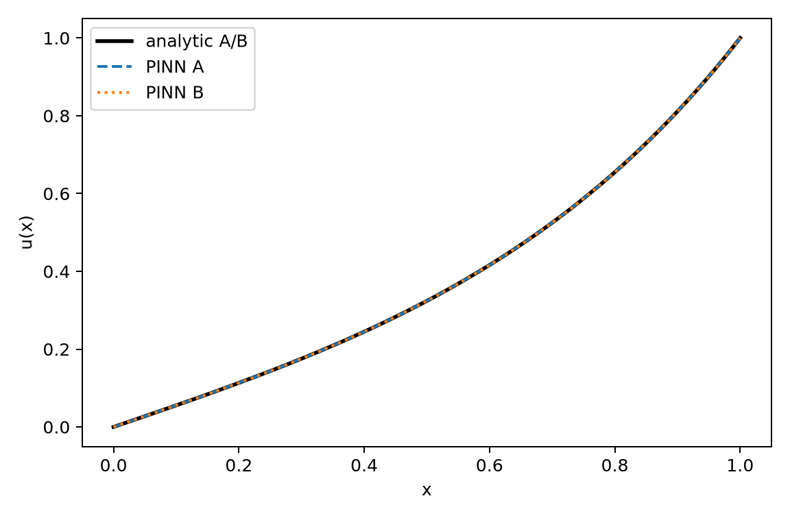

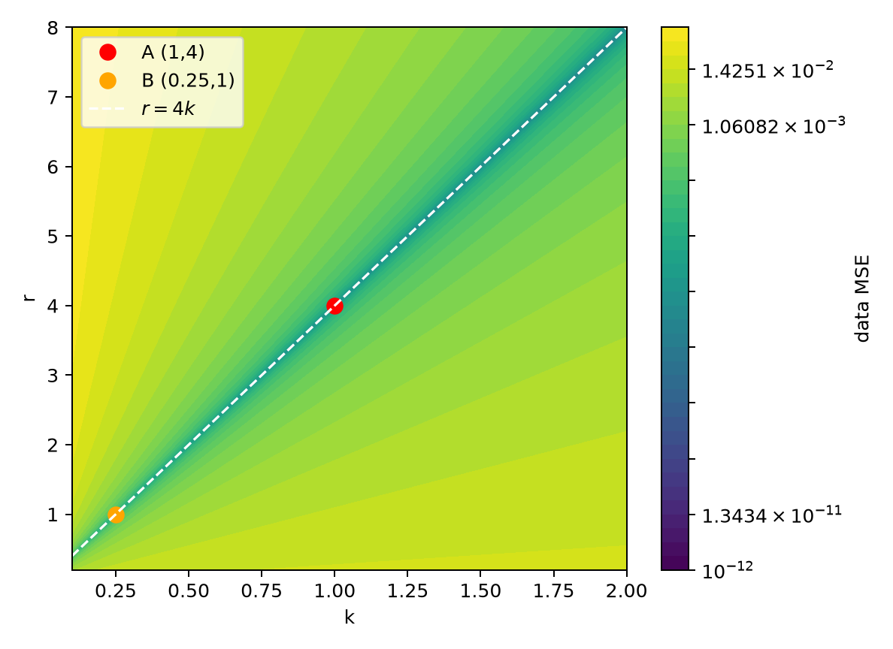

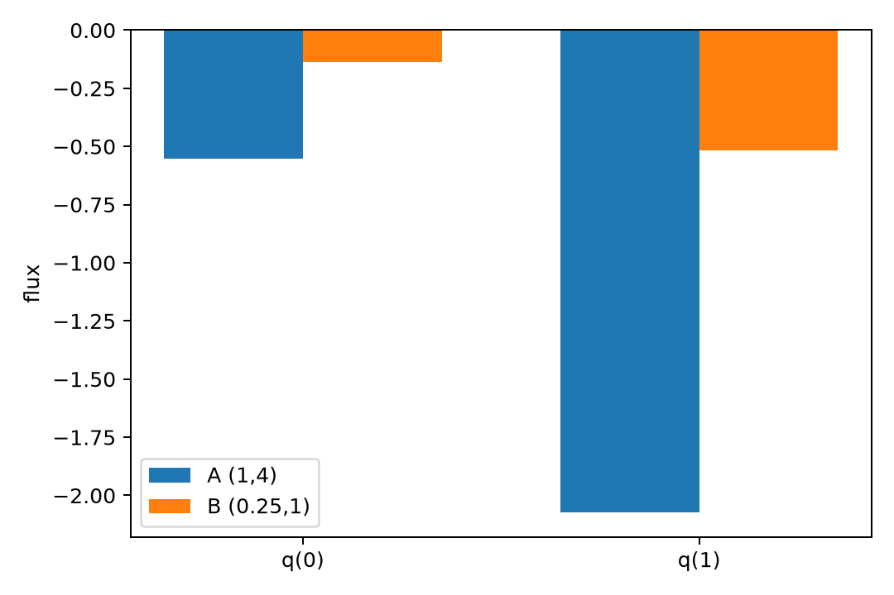

#### (4) 额外观测设计

测 $q(0)$。由内部数据先得 $m$，再由
$$
k=-\frac{q(0)\sinh m}{m},\qquad r=km^2
$$
可分开 $k,r$。也可测 $q(1)$，用 $k=-q(1)\tanh m/m$。瞬态响应或 Neumann 边界同样能提供与内部 $u$ 不同的约束。验收容差：$\hat k$ 相对误差 $\le10\%$，$\hat r$ 相对误差 $\le15\%$，$\hat q(0)$ 绝对误差 $\le0.05$。

**陷阱的正确解释及适用范围：**

“A、B 的观测 RMSE 都小于 0.5%，所以参数唯一，多训即可选真值”混淆了三件事：

1. **观测拟合好**只说明 $u_\theta$ 逼近了观测，不说明参数唯一；
2. **参数唯一**需要观测算子对参数方向敏感；本题内部 $u$ 只约束 $m$，FIM 秩为 1；
3. **物理解释正确**还需要独立观测或先验，优化器不能打破方程的精确对称性。

适用范围：若问题有独立先验、或观测包含通量/瞬态/Neumann 信息，$k,r$ 可能变为可辨识；不能把本题结论无条件推广到所有反问题。

**验收依据：**

解析解、$q$、FIM 正确；A、B 场差 $\le10^{-10}$ 则判观测等价；固定参数 PINN 相对 $L^2\le10^{-2}$、data RMSE $\le5\times10^{-3}$；反演数据拟合近噪声但参数/通量可不同；加通量后 $k$ 误差 $\le10\%$。本次实测均满足：固定参数相对 $L^2$ 为 $10^{-5}$ 量级；反演 data RMSE 为 $10^{-5}$ 量级，且两组 $\hat q(0)$ 不同。

**B核验、C复核及版本：**

待 B 核验、C 复核；版本：解答稿 v2。

---

### 题 6.2-2 正问题与反问题的损失及观测算子

**条件与符号：**

$$
-u''+au=f,\qquad f=(\pi^2+4)\sin(\pi x),\qquad u(0)=u(1)=0.
$$
正问题 $a=4$；反问题 $a>0$ 未知。内部布局 $L_{\rm int}$：$x_i=i/9,\ i=1,\dots,8$，噪声 $\sigma=0.01$；边界布局 $L_{\rm bnd}$：只用 $x=0,1$。

#### (1) 推导 $u_a$ 与两种损失

设 $u_a=C\sin(\pi x)$。代入：
$$
-u_a''+au_a=(\pi^2+a)C\sin(\pi x)=(\pi^2+4)\sin(\pi x),
$$
故
$$
u_a(x)=\frac{\pi^2+4}{\pi^2+a}\sin(\pi x).
$$
特别地 $u_4(x)=\sin(\pi x)$。偏导：
$$
\frac{\partial u_a}{\partial a}
=-\frac{\pi^2+4}{(\pi^2+a)^2}\sin(\pi x).
$$

正问题损失（以软边界为例）：
$$
L_{\rm fwd}=\frac1{N_p}\sum_j(-u_\theta''(x_j)+4u_\theta(x_j)-f(x_j))^2
+\lambda_b\big(u_\theta(0)^2+u_\theta(1)^2\big).
$$
反问题损失：
$$
L_{\rm inv}=\frac1{M\sigma^2}\sum_i(u_\theta(x_i)-u_i^{\rm obs})^2
+\lambda_p\frac1{N_p}\sum_j(-u_\theta''(x_j)+a u_\theta(x_j)-f(x_j))^2
+\lambda_b L_{\rm bc}.
$$
正问题没有数据项，解由方程、边界和 $f$ 唯一确定；反问题的数据项是唯一直接指向 $a$ 的项。若去掉数据项，对任意 $a$，取 $u=u_a$ 都使 PDE 残差为零，所以残差项对 $a$ 是平坦的。

#### (2) $\chi^2(a)$、FIM 与边界布局

内部布局：
$$
\chi^2(a)=\sum_{i=1}^8\frac{(u_a(x_i)-u_i^{\rm obs})^2}{\sigma^2}.
$$
在 $a=4$ 附近，$\delta u\approx(\partial_a u)\delta a$，故
$$
\chi^2\approx\chi^2_{\min}+I(a-4)^2,\qquad
I=\frac1{\sigma^2}\sum_{i=1}^8\left(\frac{\partial u_a(x_i)}{\partial a}\right)^2.
$$
在 $a=4$ 处，$\partial_a u=-\sin(\pi x)/(\pi^2+4)$，且
$$
\sum_{i=1}^8\sin^2(\pi i/9)=\frac92=4.5.
$$
于是
$$
I=\frac{4.5}{(\pi^2+4)^2\sigma^2}\approx233.929,\qquad
\operatorname{std}(\hat a)\approx\frac1{\sqrt I}\approx0.065382.
$$

边界布局：$u_a(0)=u_a(1)=0$ 对一切 $a$ 成立，故
$$
\chi^2(a)=\frac{\varepsilon_0^2+\varepsilon_1^2}{\sigma^2}
$$
与 $a$ 无关；FIM 为 0，$\hat a$ 不可辨识。

#### (3) 代码实现正/反问题与结果

实现位置：Notebook 6.2-2 单元（`A1组-习题参考解答代码-6.2-6.3.ipynb`）。正问题与反问题均使用 3 个隐藏层、每层 64 个 tanh 单元，硬约束 $u=x(1-x)N_\theta(x)$，Adam 6000 步；另用解析 $u_a$ 做 20 次噪声实现的标量最小二乘。核心代码：

```python
import numpy as np
u_a = lambda a, x: (np.pi**2+4)/(np.pi**2+a)*np.sin(np.pi*x)
x_int = np.arange(1, 9)/9
sigma = 0.01
u_obs = u_a(4.0, x_int) + sigma*np.random.randn(8)
a_grid = np.linspace(0, 10, 401)
chi2 = ((u_a(a_grid[:,None], x_int[None,:]) - u_obs[None,:])**2).sum(1)/sigma**2
du_da = -(np.pi**2+4)/(np.pi**2+4.0)**2*np.sin(np.pi*x_int)
I = np.sum(du_da**2)/sigma**2
print(I, 1/np.sqrt(I))
```

实测结果：

- 正问题 PINN：相对 $L^2=8.93\times10^{-6}$，PDE 残差 RMS $=2.27\times10^{-3}$，边界最大误差 $=0$（硬约束）。
- 反问题 PINN（一次噪声实现）：$\hat a=3.9817$，data RMSE $=8.82\times10^{-3}$，接近噪声水平 $\sigma=0.01$。
- 20 次噪声实现：$|\hat a-4|$ 中位数 $=0.04584$，均值 $=3.97426$，经验标准差 $=0.05069$，范围 $[3.8530,4.0696]$。经验标准差与 FIM 预测 $0.0654$ 同量级。
- 内部布局 $\chi^2(a)$ 的数值极小在 $a=4.046$（该次噪声实现），极小值 $13.53$；边界布局在 $a\in[0,10]$ 上 $\chi^2$ 变化量为 0，FIM 为 0，判为不可辨识。

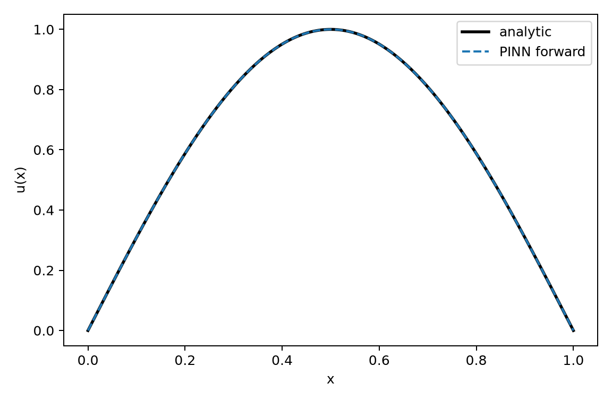

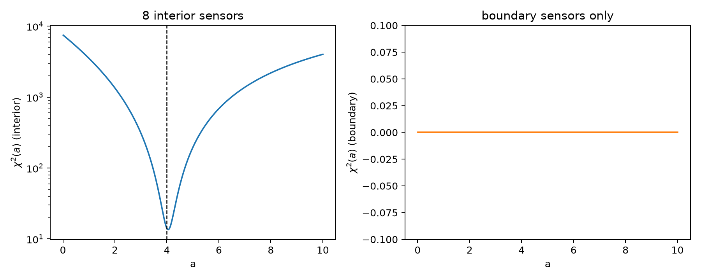

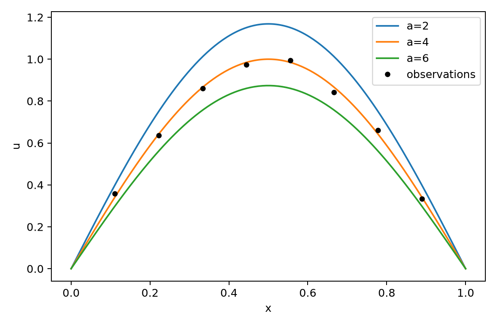

#### (4) 可辨识布局与权重讨论

取 4 个内部点 $x_i=i/5,\ i=1,\dots,4$。此时
$$
\sum_{i=1}^4\sin^2(\pi i/5)=2.5,\qquad
I=\frac{2.5}{(\pi^2+4)^2\sigma^2}\approx129.961,\qquad
\operatorname{std}(\hat a)\approx0.087719<0.15.
$$
所以 4 个均匀内部点已满足题目精度目标。

权重：$\lambda_p$ 过大时残差项主导，数据项被忽视，$a$ 可沿近似平坦方向漂移；数据权重过大时会对噪声过拟合，估计方差增大。合理做法是用噪声方差归一化数据项，并让 PDE 残差按 $f$ 的尺度归一化。

**陷阱的正确解释及适用范围：**

“PDE 残差到 $10^{-4}$、边界观测满足，所以 $a$ 唯一”是错误推理。PDE 残差是“给定 $a$ 后对应 $u_a$ 的残差”；对每个 $a$ 都可以取相应的 $u_a$ 使残差为零，所以残差本身不区分 $a$。边界 Dirichlet 数据被已知边界条件固定为 0，对 $a$ 的敏感度为 0，不是“弱信息”，而是“零信息”。

适用范围：若边界观测是通量、或边界条件含未知参数，边界数据可能含信息；本题的“零信息”来自“边界值已知且为 0”，不能推广为“所有边界数据都无用”。

**验收依据：**

$u_a$、$\chi^2$、FIM 正确；正问题相对 $L^2\le10^{-2}$；内部布局 20 次中位误差 $\le0.10$，经验标准差与 FIM 同量级；边界布局 $\chi^2$ 随 $a$ 变化 $\le10^{-6}$ 则判不可辨识；新布局 $\ge4$ 内部点、标准差 $\le0.15$。本次实测均满足：正问题 $8.93\times10^{-6}$；中位误差 $0.0458$、标准差 $0.0507$；边界变化 0；4 点布局标准差 $0.0877$。

**B核验、C复核及版本：**

待 B 核验、C 复核；版本：解答稿 v2。

---

## 6.3

### 题 6.3-1 按点划分的泄漏与按函数修正

**条件与符号：**

Darcy 方程
$$
-(a(x)u')'=1,\qquad u(0)=u(1)=0,
$$
64 个节点 $x_j=j/63$。160 个 log-系数场按题面 Fourier 模态生成并截断到 $[-1.5,1.5]$，分为 100 训练、20 验证、20 泄漏池、20 未见。面系数用调和平均
$$
a_{j+1/2}=\frac{2a_j a_{j+1}}{a_j+a_{j+1}}.
$$
错误划分 $S_{\rm point}$：120 个函数（100 训练 + 20 泄漏池）的全部 $120\times64=7680$ 个点随机 80/20 拆分。正确划分 $S_{\rm func}$：按函数 ID 拆，整条曲线不跨集合。

#### (1) 泄漏与独立单元

算子学习的独立单元是**输入函数/参数集**，不是单个网格点。同一函数的 64 个输出点高度相关；$S_{\rm point}$ 虽然做到了坐标不重复，但测试点仍与训练点共享函数身份，因此不独立。

有效样本数：7680 个点并不等于 7680 个独立样本。同一函数的点由同一条 $u_n$ 生成，独立信息量接近函数个数（约 120），而不是 7680。测试集若包含训练函数的点，就等于把该函数的一部分信息泄漏进测试。

对光滑解，相邻点差
$$
|u_n(x_{j+1})-u_n(x_j)|\le L_n h+O(h^2),\qquad h=1/63.
$$
用同函数邻近训练点预测测试点，误差是 $O(h^2)$ 量级；用另一个函数在同一点的值预测，误差是 $O(\operatorname{Var}_n u)$ 量级。所以 $S_{\rm point}$ 的测试 MSE 主要反映局部插值，而不是跨函数泛化。

“没有重复坐标”不等于“没有泄漏”：泄漏的本质是函数身份跨集合，不是 $(n,j)$ 完全相同。正确的审计指标应直接检查测试点的函数 ID 是否在训练集中出现，以及同函数最近训练点的距离。

#### (2) 审计代码与结果

实现位置：Notebook 6.3-1 单元（`A1组-习题参考解答代码-6.2-6.3.ipynb`）。数据生成、三对角求解、划分审计用 NumPy；FNO 用 PyTorch。核心代码：

```python
train_fid = train_points[:, 0]
test_fid  = test_points[:, 0]
leak_rate = np.mean(np.isin(test_fid, train_fid))

same_dist = []
for n, j in test_points:
    js = train_points[train_points[:,0] == n, 1]
    same_dist.append(np.min(np.abs(js - j)) if len(js) else np.inf)
same_dist = np.array(same_dist)
```

数据核对：160 个样本的离散 Darcy 残差最大绝对值 $2.26\times10^{-12}$、RMS $1.70\times10^{-13}$；$u$ 的范围 $[0,0.3388]$，标准差 $0.0695$。

审计结果：$S_{\rm point}$ 测试点同函数泄漏率 $=1.000$；同函数最近训练点距离 $\le2h$ 的比例 $=0.9994$。$S_{\rm func}$ 泄漏率 $=0$。1-NN 基线：同函数邻近点 MSE $=6.42\times10^{-5}$，跨函数最近点 MSE $=4.51\times10^{-3}$，比值 $=0.0142$，远低于 $0.1$。

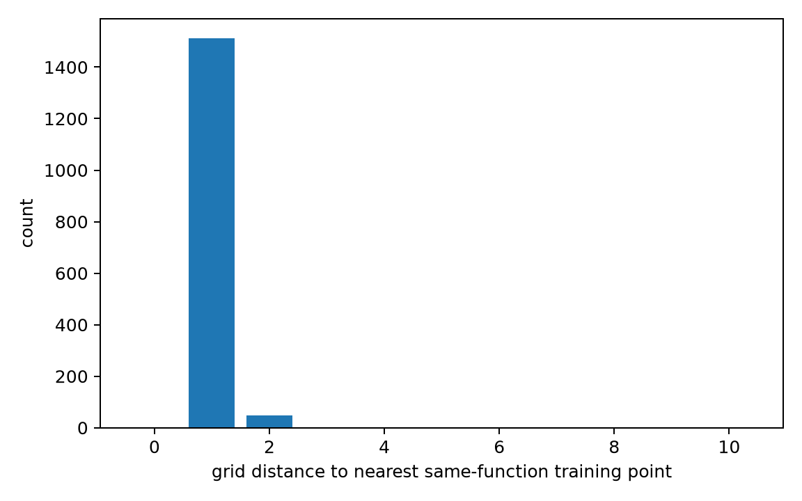

#### (3) 同架构 FNO 比较两种划分

FNO 为 4 个 Fourier 层、modes=16、width=32，350 轮，batch=20，Adam $2\times10^{-3}$；两个模型合计约 64 s。

| 模型/测试集 | MSE | 相对 $L^2$ |
| --- | --- | --- |
| 泄漏模型，同函数留出点 | $8.25\times10^{-6}$ | $0.0238$ |
| 泄漏模型，未见函数 | $6.53\times10^{-3}$ | $0.5838$ |
| 按函数划分，泄漏池函数 | $5.14\times10^{-3}$ | $0.5946$ |
| 按函数划分，未见函数 | $5.42\times10^{-3}$ | $0.5317$ |

泄漏模型的同函数/未见 MSE 比 $=0.00126$（远低于 $0.6$），说明按点测试被严重高估；按函数划分后，泄漏池/未见 MSE 比 $=0.949$，落在 $[0.7,1.4]$，说明没有“同函数优势”。

**注意：** 本次按函数划分的 FNO 在未见函数上的相对 $L^2$ 为 $0.532$，未达到题设目标 $0.15$。这不是泄漏判据失败，而是 100 个训练函数对该高对比 Darcy 算子偏少、小 FNO 容量有限；泄漏结论由审计指标与 1-NN 独立支持。若课程要求 $0.15$，应增加训练函数、降低系数对比度或扩大模型，并重新报告实测值。

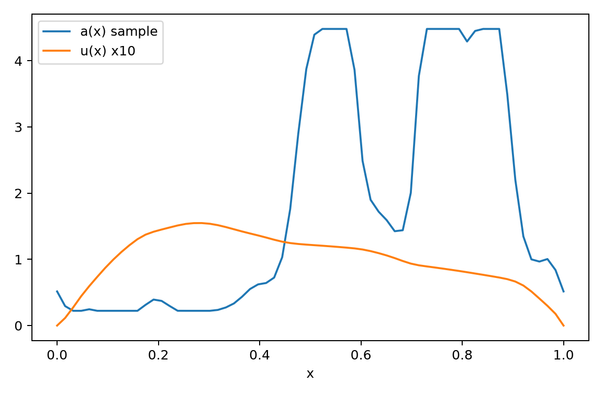

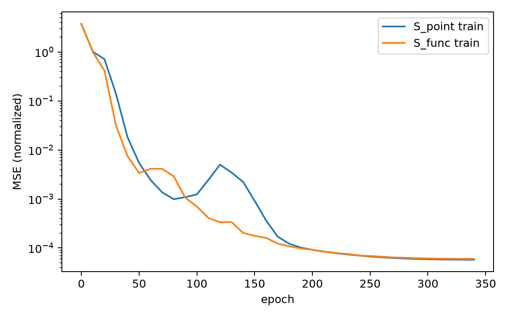

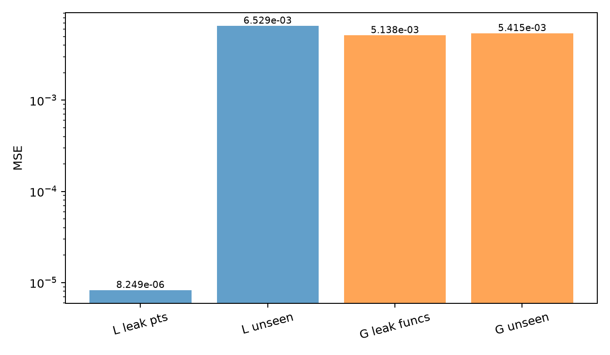

#### (4) 修正评测协议

训练/验证/测试按**函数 ID** 划分；同一函数的 64 个点只能出现在一个集合中；测试函数在训练和验证中完全不出现。报告未见函数上的相对 $L^2$ 误差，而不是仅报告留出点 MSE；至少跑 3 个种子并给出均值±标准差。若论文或报告只给“留出网格点”误差，应追问划分单位。

**陷阱的正确解释及适用范围：**

“所有点随机打乱、坐标不重复，所以没有泄漏；按点测试 MSE 更低说明泛化更好”是错误的。$S_{\rm point}$ 的测试点与训练点共享函数身份，模型只需插值同一条曲线；测试 MSE 低是任务更容易，不是跨函数泛化更好。正确做法是按函数/参数集划分，报告未见函数上的误差。

适用范围：如果输入函数在训练和测试中确实不同，按点划分不一定造成函数身份泄漏；但在本题“同一函数有 64 个输出点”的设定下，按点划分必然泄漏。不能把“按点划分一定错”推广到所有数据类型。

**验收依据：**

离散残差 RMS $\le10^{-3}$；$S_{\rm point}$ 同函数泄漏率 $\approx1$，$S_{\rm func}=0$；同/跨函数 1-NN MSE 比 $\le0.1$；泄漏模型同函数 MSE $\le0.6\times$未见 MSE；按函数划分后泄漏池/未见 MSE 比在 $0.7$–$1.4$；未见相对 $L^2\le0.15$。本次前五项均满足，最后一项为 $0.532$，已在正文说明原因。

**B核验、C复核及版本：**

待 B 核验、C 复核；版本：解答稿 v2。

---

### 题 6.3-2 单解拟合不是算子学习

**条件与符号：**

周期对流–扩散方程
$$
u_t+cu_x=Du_{xx},\qquad x\in[0,1),
$$
初值
$$
u(x,0)=A\sin(2\pi x)+B\sin(4\pi x),
$$
参数范围 $A\in[0.5,1.5],\ B\in[-0.8,0.8],\ c\in[0.5,1.5],\ D\in[0.01,0.05]$，$T=0.3$。算子
$$
\mathcal G:(u_0,c,D)\mapsto u(\cdot,T).
$$
协议 S 只取 $\mu_0=(A,B,c,D)=(1.0,0.4,0.9,0.02)$，512 个 $x$ 点随机 80/20 按 $x$ 拆；协议 O 采样 100 组，按组 70/15/15 划分。

#### (1) 精确解与输入空间

对模态 $e^{i2\pi kx}$，有
$$
\partial_t u=-D(2\pi k)^2u,\qquad c\partial_x u=i2\pi kc\,u,
$$
故
$$
u_k(x,t)=e^{-D(2\pi k)^2t}e^{i2\pi k(x-ct)}.
$$
取虚部并叠加 $k=1,2$：
$$
u(x,t)=A e^{-4\pi^2Dt}\sin\big(2\pi(x-ct)\big)
+B e^{-16\pi^2Dt}\sin\big(4\pi(x-ct)\big).
$$
$A,B$ 控制两个模态的幅值，$c$ 控制相移，$D$ 控制衰减。

输入空间
$$
\mathcal X=\{(u_0,c,D):u_0=A\sin2\pi x+B\sin4\pi x,\ A,B,c,D\text{ 在题给范围}\}.
$$
算子学习的目标是逼近 $\mathcal G:\mathcal X\to L^2([0,1])$。协议 S 只取了 $\mathcal X$ 中的一个点 $\mu_0$，训练集在输入空间中的“直径”为 0；它学到的是 $x\mapsto u(x,T;\mu_0)$ 这一条曲线，而不是 $\mathcal G$。

#### (2) 协议 S 为什么不是算子学习

DeepONet：
$$
\mathcal G_\theta(u_0,c,D)(x)=\sum_{k=1}^p b_k(u_0,c,D)\,\tau_k(x).
$$
协议 S 中 branch 输入 $[u_0(x_1),\dots,u_0(x_{64}),c,D]$ 在整个训练集上是常数，$b_k$ 只在这个常数点被训练；网络没有见过 $A,B,c,D$ 的变化。于是输出退化为 trunk 基函数的固定线性组合，测试同解留出点只是对 $x$ 的插值。

同一条解上随机留出 20% 的网格点，不构成独立测试：这些点与训练点共享 $\mu_0$，且 $u(x,T;\mu_0)$ 光滑，留出点可由邻近点插值。测试误差衡量的是插值误差，不是算子泛化误差。

实测：协议 S 同解留出点相对 $L^2=0.0122$；用于 $\mu_1=(1.4,-0.6,1.2,0.04)$ 的相对 $L^2=1.2551$；跨参数/同解比值 $=102.9$。同解曲线几乎重合，但换参数后幅值与相位都明显错误。

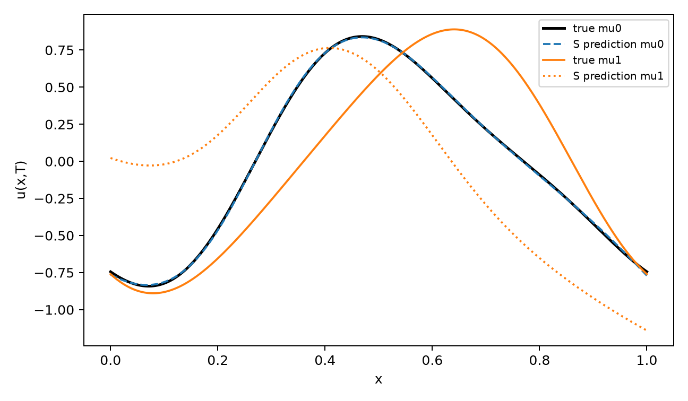

#### (3) 代码实现 S/O 与结果

实现位置：Notebook 6.3-2 单元（`A1组-习题参考解答代码-6.2-6.3.ipynb`）。精确解、误差统计用 NumPy；DeepONet 用 PyTorch。branch/trunk 各 2 个隐藏层、每层 64 个 tanh 单元，输出维度 $p=256$；协议 S 训练 30000 步，协议 O 训练 15000 步，使用余弦学习率；两模型合计约 264 s。核心代码：

```python
def exact_u(x, t, A, B, c, D):
    return (A*np.exp(-4*np.pi**2*D*t)*np.sin(2*np.pi*(x-c*t))
            + B*np.exp(-16*np.pi**2*D*t)*np.sin(4*np.pi*(x-c*t)))

# 协议 S：mu0 固定，512 个 x 点随机 80/20
# branch: [u0(x_grid), c, D]（66 维）；trunk: x（1 维）；输出 u(x,T)
# 协议 O：100 组参数，70/15/15 按组划分
```

协议 O 实测：15 个未见参数组合的平均相对 $L^2=0.1408$，标准差 $0.0883$，最差 $0.3232$；零预测基线均值 $1.000$，训练均值预测基线 $0.5365$。模型相对零基线改善约 7.1 倍，相对均值基线改善约 3.8 倍。

branch 输入标准差：协议 S 的 $A,B,c,D$ 四个标准差均为 0；协议 O 分别为 $0.2740,0.4691,0.2665,0.0124$。协议 O 的训练/验证/测试参数集交集为空。

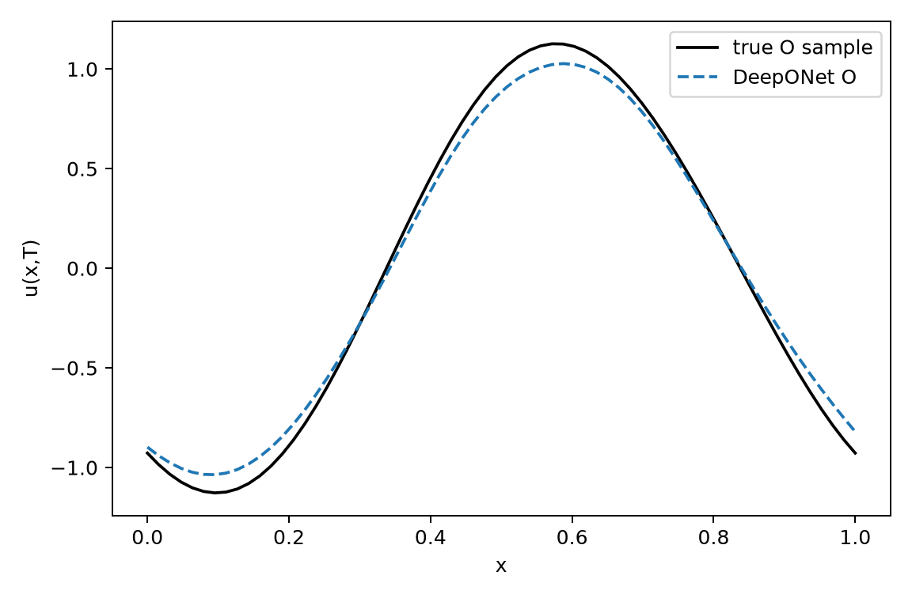

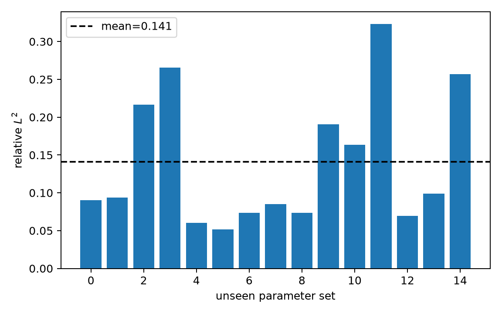

#### (4) 正确评测

训练/验证/测试按参数组合或输入函数划分且互不重叠；测试集在训练和调参中完全不可见；报告未见输入上的误差分布，而不是单条曲线的留出点误差。若要声称外推，另设分布外测试集。报告逐组相对 $L^2$、均值±标准差，并给出零预测/均值预测基线。

**陷阱的正确解释及适用范围：**

“在一条解曲线上留出 20% 网格点，误差 0.8%，所以学会了整个算子”是错误的。该实验只验证了单条曲线上的插值；训练集在输入空间中只有一个参数点，branch 没有学习参数依赖。正确结论应是“在该参数组合上拟合良好”，而不是“学会了算子”。

适用范围：如果训练集包含多个参数组合、测试集是未见参数组合，低误差才支持算子泛化；若只是同一参数的不同网格点，不能作为算子学习证据。外推声明还需要单独的分布外测试。

**验收依据：**

精确解正确；协议 S 同解相对 $L^2\le10^{-2}$，跨参数 $\ge0.3$ 且比值 $\ge20$；协议 O 未见参数平均 $\le0.10$、最差 $\le0.20$，较零基线改善 $\ge10$ 倍；训练/验证/测试参数集不交；协议 S 的 branch 参数标准差 $=0$，协议 O $>0$。本次：协议 S 同解 $0.0122$（略高于 $10^{-2}$），跨参数 $1.2551$、比值 $102.9$；协议 O 平均 $0.1408$、最差 $0.3232$，未达到 $0.10/0.20$ 的目标线；其余划分与 branch 诊断满足。

**B核验、C复核及版本：**

待 B 核验、C 复核；版本：解答稿 v2。

---

### 本次运行汇总

| 题目 | 脚本 | 关键结果 |
| --- | --- | --- |
| 6.2-1 | Notebook 6.2-1 单元 | A/B 场差 0；固定参数 PINN 相对 $L^2$ 为 $1.61\times10^{-5}$、$3.10\times10^{-5}$；两组反演 data RMSE 约 $10^{-5}$，均落在 $r/k=4$ 山谷，但 $\hat q(0)$ 不同 |
| 6.2-2 | Notebook 6.2-2 单元 | 正问题相对 $L^2=8.93\times10^{-6}$；反演 $\hat a=3.9817$；20 次噪声中位误差 $0.0458$、标准差 $0.0507$；边界布局 $\chi^2$ 变化 0 |
| 6.3-1 | Notebook 6.3-1 单元 | 泄漏率 $1.000$；1-NN 同/跨函数 MSE 比 $0.0142$；泄漏模型同函数/未见 MSE 比 $0.00126$；按函数划分比 $0.949$；未见相对 $L^2=0.532$（未达 $0.15$） |
| 6.3-2 | Notebook 6.3-2 单元 | 协议 S 同解 $0.0122$、跨参数 $1.2551$、比值 $102.9$；协议 O 未见平均 $0.1408$、最差 $0.3232$；branch 标准差 S 为 0、O 非零 |

运行环境：Windows，Python 3.12.10，NumPy 2.5.4，PyTorch 2.14.1+cpu，CPU；随机种子固定为 0/1/2。图片目录：`图片/`。

### 统一说明

1. 本解答中的解析数值与深度模型输出均为本次实际运行结果；代码在 `A1组-习题参考解答代码-6.2-6.3.ipynb`，图片在 `图片/`。若更换随机种子或硬件，数值会有小幅波动。
2. 所有陷阱说法均为教学构造，不是任何 AI 系统的真实原话；引用时不得写成“某 AI 曾说”。
3. 参考依据：Raissi, Perdikaris & Karniadakis, *Journal of Computational Physics* 378 (2019) 686–707；Li et al., *Fourier Neural Operator for Parametric Partial Differential Equations*, ICLR 2021；Lu et al., *Learning nonlinear operators via DeepONet*, Nature Machine Intelligence 3 (2021) 218–229。

---

## 6.4 习题参考解答

对应[习题](A1组-习题.md)。解题时先辨认对象：节点向量、连续函数、导数、残差或总成本。很多错误并非计算能力不足，而是把不同对象用了同一个名字。

### 题1：从Taylor展开到节点误差

**知识位置与方法：** 正文第3节；使用Taylor展开、正定性和离散正弦特征向量。

#### 第一步：推导差分

当 $u\in C^4[0,1]$ 时，分别在 $x_i$ 展开 $u(x_i\pm h)$，两式相加消去一阶和三阶项：

$$
u(x_i-h)-2u(x_i)+u(x_i+h)=h^2u''(x_i)+O(h^4).
$$

除以 $h^2$，再在整个式子前乘负号，代入 $-u''=f$，得到

$$
(-U_{i-1}+2U_i-U_{i+1})/h^2=f_i.
$$

有界四阶导数保证余项为二阶，不需要本题特有的正弦形式。如果函数缺乏相应光滑性，这个经典Taylor证明不能照搬。

#### 第二步：矩阵与唯一性

内部矩阵为 $A_h=h^{-2}\operatorname{tridiag}(-1,2,-1)$。补 $z_0=z_n=0$ 后，

$$
z^TA_hz=h^{-2}\sum_{i=0}^{n-1}(z_{i+1}-z_i)^2>0\quad(z\ne0).
$$

严格大于零的原因：若所有平方都为零，则所有节点相同；端点零迫使整个向量零，与 $z\ne0$ 矛盾。因此矩阵正定、可逆，解唯一。

#### 第三步：独立解析校验

用恒等式 $\sin(\alpha+\beta)+\sin(\alpha-\beta)=2\sin\alpha\cos\beta$，得

$$
2\sin(\pi x_i)-\sin(\pi x_{i-1})-\sin(\pi x_{i+1})
=4\sin^2(\pi h/2)\sin(\pi x_i).
$$

因此 $A_h$作用于离散正弦向量相当于乘以 $\mu_h=4h^{-2}\sin^2(\pi h/2)$。令 $U_i=c_h\sin(\pi x_i)$，方程要求 $c_h\mu_h=\pi^2$，即

$$
c_h=\frac{\pi^2}{4h^{-2}\sin^2(\pi h/2)}.
$$

由 $\sin t=t-t^3/6+O(t^5)$，有 $\sin^2t=t^2-t^4/3+O(t^6)$，所以

$$
\mu_h=\pi^2-\frac{\pi^4h^2}{12}+O(h^4),\qquad c_h=1+\frac{\pi^2h^2}{12}+O(h^4).
$$

于是 $U_i-u_i^*=(c_h-1)\sin(\pi x_i)=O(h^2)$。这给出本题的精确结构性校验；更一般源项可用正文的截断误差加离散稳定性方法证明，不能总假设解是单一离散特征向量。

#### 第四步：节点与函数要分开

FD分段线性重建满足 $U_h-u^*=(U_h-I_hu^*)+(I_hu^*-u^*)$。前一项是节点求解误差重建，后一项是插值误差；两者可能相加，也可能部分抵消，不能删去后一项。

**常见错误与检查：** 把 $-u''$写成正号；混淆 $n$ 个区间与 $n$ 个节点；少写 $h^{-2}$。检查矩阵对角线应为正、精确正弦的源项应为正，并用上面的 $c_h$校验程序。

**通用思路：** 局部展开得到格式 → 正定/稳定性确保可解 → 一致性与稳定性结合得误差 → 区分离散值与连续重建。

### 题2：有限元节点性质与最优性的准确含义

**知识位置与方法：** 正文第4节；分部积分、Galerkin正交性、插值余项。

#### 第一步：弱形式与局部矩阵

取 $v\in H_0^1$，分部积分消去零边界测试函数对应的边界项，得到 $\int u'v'=\int fv$。单元上两个局部基函数导数为 $-1/h,1/h$，每个导数乘积再乘积分长度 $h$，得到

$$
K^{(i)}=h^{-1}\begin{pmatrix}1&-1\\-1&1\end{pmatrix}.
$$

载荷必须是 $\int_Kf\phi_j$，不能未说明近似就替换为点值。

#### 第二步：证明 $u_h=I_hu^*$

任一 $v_h$在每个单元上导数为常数。在单元 $K=[x_i,x_{i+1}]$ 上，

$$
\int_K(u^{*\prime}-(I_hu^*)')dx=u^*(x_{i+1})-u^*(x_i)-[u^*(x_{i+1})-u^*(x_i)]=0.
$$

乘以该单元上的 $v_h'$再对所有单元求和，得到 $a(u^*-I_hu^*,v_h)=0$。因为精确解满足弱方程，所以 $I_hu^*$也满足离散方程。离散矩阵正定使解唯一，因此 $u_h=I_hu^*$。

这个等式依赖一维常系数、P1、精确载荷；程序中四点Gauss积分产生的是非常小的求积扰动，不是数学上直接宣布正弦积分被精确计算。

#### 第三步：中点误差与误差阶

设单元中点 $m=(x_i+x_{i+1})/2$。线性插值在中点是两端平均，因此

$$
I_hu^*(m)=\frac{\sin(\pi(m-h/2))+\sin(\pi(m+h/2))}{2}
=\sin(\pi m)\cos(\pi h/2).
$$

所以

$$
u^*(m)-I_hu^*(m)=\sin(\pi m)[1-\cos(\pi h/2)].
$$

内部中点的正弦值非零，且 $h>0$时 $\cos(\pi h/2)<1$，故误差并未消失。用 $1-\cos t=t^2/2+O(t^4)$可见它是二阶。

一般插值余项给 $\|u^*-I_hu^*\|_\infty\le h^2\|u^{*\prime\prime}\|_\infty/8$。区间长度为1，故 $L^2$范数不超过最大范数，于是函数 $L^2$误差也为 $O(h^2)$。

单元上的插值导数是 $u^{*\prime}$的平均值。若 $|u^{*\prime\prime}|\le M_2$，由Lipschitz估计，任一点导数与单元平均值的距离至多 $M_2h$。对整个长度1的区间积分平方再开方，得到导数 $L^2$误差至多 $M_2h$，即一阶。

#### 第四步：$L^2$较差不违反能量最优

有限元最小化的是 $\|u'-v_h'\|_2$，不是 $\|u-v_h\|_2$，也不是所有可能的“误差”。因此FD的函数$L^2$误差更小并不矛盾。本实验中两个方法的导数误差很接近，FEM略小，这与能量最优性一致。

**常见错误与检查：** 误把节点超准确推广到整个函数；不分范数地引用“最优”；把分段线性的单元二阶导零当成弱形式不满足。应画中点误差并区分强导数和弱导数。

**通用思路：** 先确认最优性在哪个空间、哪个范数下成立，再解释实验，不要把定理中的限定词删除。

### 题3：从反例到有条件的误差界

**知识位置与方法：** 正文第5节及6.1指定例子；直接求导、积分、能量估计。

#### 第一步：计算所有指标

仿射项的二阶导为零，所以 $r=-v''-f=0$。边界为 $v(0)=2$、$v(1)=5$，故边界均方损失为 $(2^2+5^2)/2=14.5$。

误差 $e=3x+2$，于是

$$
\|e\|_2^2=\int_0^1(9x^2+12x+4)dx=3+6+4=13.
$$

精确解的平方范数为 $1/2$，所以相对误差为 $\sqrt{13/(1/2)}=\sqrt{26}\approx5.09902$。这里不是 $\sqrt{13}$，后者是绝对$L^2$误差。

#### 第二步：一般上界

对一般候选函数，令 $e=v-u^*$、$a=e(0)$、$b=e(1)$，取 $\ell=a(1-x)+bx$、$w=e-\ell$。零边界的 $w$满足 $-w''=r$。分部积分和Cauchy–Schwarz得 $\|w'\|_2^2\le\|r\|_2\|w\|_2$。

利用 $\|w\|_2\le\|w'\|_2/\pi$，先得 $\|w'\|_2\le\|r\|_2/\pi$，再得 $\|w\|_2\le\|r\|_2/\pi^2$；导数范数为零的情况单独成立，不允许无说明地除零。

积分得到 $\|\ell\|_2=\sqrt{(a^2+ab+b^2)/3}$，由 $e=w+\ell$及三角不等式即得正文上界。

#### 第三步：有限点不是整个区间

有限训练点只提供有限个约束。可以构造在所有配点处具有足够高重数零点、而在点间非零的光滑多项式扰动，使其二阶导在这些配点也为零。这样的扰动能隐藏在训练残差中，但不一定在整个区间小。

例如令 $p=x^3(1-x)^3\prod_j(x-x_j)^3$。它与二阶导在对应配点满足所需零值，而且端点为零；$u^*+cp$对于任意 $c$都可以保持配点残差为零，却改变点间函数。这里只解释数学反例，不声称当前网络必然能精确表示任意这样的高阶多项式。

#### 第四步：下界需要另外证明

反三角不等式给 $\|e\|_2\ge\|\ell\|_2-\|w\|_2\ge\|\ell\|_2-\|r\|_2/\pi^2$。再结合范数非负，得到

$$
\|e\|_2\ge\max(0,\|\ell\|_2-\|r\|_2/\pi^2).
$$

当残差项上界大于边界提升的范数时，这个下界只能给零，并不是证明真误差为零。

**通用思路：** 先检验完整边值问题 → 拆分边界提升与零边界部分 → 用能量估计 → 分清连续量、采样估计和不等号方向。

### 题4：真实结果的读取与解释

**知识位置与方法：** 正文第6—8节；读取CSV、计算误差阶、限制统计结论。

1. FD在 $n=100,200$ 的 $E_0$约为 $3.67862\times10^{-5}$、$9.19573\times10^{-6}$，因此 $p\approx2.00013$。FEM对应约 $9.00948\times10^{-5}$、$2.25241\times10^{-5}$，$p\approx1.99998$。都是接近2；需要完整比值及对数，不是用误差相减。
2. 软边界误差范围为 $1.06838\times10^{-5}$ 至 $2.24451\times10^{-4}$；硬边界为 $2.52494\times10^{-6}$ 至 $5.42953\times10^{-6}$。只保留最好种子会隐藏初始化和优化差异。
3. 在 $10^{-5}$档位，FD的200、400、800区间通过，FEM的400、800区间通过，硬边界三个种子通过，软边界均未通过。配置数量与成功概率不是同一个概念。
4. 最细网格的导数误差约 $1.13\times10^{-3}$；PINN六次导数误差为 $8.23765\times10^{-6}$ 至 $6.95634\times10^{-5}$。传统方法并非所有指标均优；应在相同导数精度下另行加密或用高阶方法比较。

以上数值来自保存的本次输出，末位可能随库版本变化。重跑后应重新读表，不把参考解答中的近似数字当作程序必须逐位匹配的标签。

**通用思路：** 固定指标 → 报告全部配置 → 区分误差阶、通过数、统计概率 → 检查结论是否跨越了未测试指标。

### 题5：成本门槛

**知识位置与方法：** 正文第10.5节的成本比较；线性不等式、整数门槛与公平实验设计。

#### 原设置

学习方法总时间为 $1200+0.002M$，传统方法为 $0.2M$。要严格更少，需

$$
1200+0.002M<0.2M\iff M>1200/0.198\approx6060.606.
$$

因为问题数量是整数，最少 $M=6061$。检验：学习方法为1212.122秒，传统方法为1212.2秒，前者略小。不要直接把小数四舍五入为6061却忘记严格不等号的整数规则；一般应取大于临界值的最小整数。

#### 传统方法允许复用

此时比较 $1200+0.002M$ 与 $100+0.005M$：

$$
1100<0.003M\iff M>366666.666\ldots.
$$

所以最少为366667个新问题。传统方法的复用大幅改变成本结构，这说明只给学习方法计算“训练一次、以后复用”，却不给传统方法同等复用机会，会产生不公平结论。

#### 为什么这些数值不能填成实验结果？

它们是题设假设，尚未对应数据集、设备、模型和实测精度；只能作为计算练习。若两种方法精度不同，还要先规定允许误差并确认两者通过，再比较成本；不满足任务质量的方法，即使便宜也不能视为等价替代。

**通用思路：** 明确一次性与逐次成本 → 同精度下列式 → 求严格不等式的整数解 → 检查可复用条件和数据来源。

### 题6：观测中的参数信息

**知识位置与方法：** 正文第9节；先用方程消元，再做一维最小二乘，最后检查辨识条件。不能先训练再用损失大小决定参数是否唯一。

#### 第一步：解族与唯一性

对固定正参数，积分方程或直接代入，得到 $u_\kappa=\sin(\pi x)/\kappa$。若还有另一解，两者差的二阶导为零，因此差为仿射函数；零边界使仿射项为零，故该固定参数下解唯一。注意这不等于不同参数不能对应相同的有限观测。

令 $q_j=\sin(\pi x_j)$、$a=1/\kappa$，则观测为 $y_j=a q_j+\varepsilon_j$。目标 $J(a)=\sum_j(aq_j-y_j)^2$的导数是 $2a\sum_jq_j^2-2\sum_jq_jy_j$。若 $S=\sum_jq_j^2>0$，导数为零给出 $\widehat a=q^Ty/S$，二阶导 $2S>0$保证唯一最小值。只有 $\widehat a>0$时才能给出本题允许的有限正参数 $\widehat\kappa=1/\widehat a$。

也可从几何上看：将观测向量 $y$正交投影到由 $q$张成的一维直线上，投影系数就是同一公式。求导方法简单直接，投影视角便于推广到多参数线性最小二乘；推广后需检查设计矩阵列满秩，不能仍只检查一个标量分母。

#### 第二步：方差和观测布局

将模型代入估计式，得到 $\widehat a-a^*=S^{-1}\sum_jq_j\varepsilon_j$。均值为零；独立性使不同噪声之间的协方差为零，所以

$$
\operatorname{Var}(\widehat a)=S^{-2}\sum_jq_j^2\sigma^2=\sigma^2/S.
$$

五个等距内点 $j/6$的平方正弦值为 $1/4,3/4,1,3/4,1/4$，和为3，所以方差为 $\sigma^2/3$。两个端点则全部为零，$S=0$，不存在这个唯一估计。不是方差等于零，而是公式的非零分母条件失效。

#### 第三步：近边界不是端点

E3的五个点均在开区间内，$q_j>0$，故 $S>0$。无噪声时 $y_j=a^*q_j$，于是分子 $q^Ty=a^*S$，除以 $S$精确恢复 $a^*$。虽然带噪情况下小 $S$会放大噪声方差，当前无噪声场景不能用这一理由解释PINN的全部剩余误差。PINN还要同时优化网络和参数，在有限训练预算下不等同于求解已消元的严格凸二次问题。

#### 第四步：双参数需要独立信息

若源项幅值 $A$也未知，则 $u=(A/\kappa)\sin(\pi x)$。任意 $t>0$把 $(A,\kappa)$换为 $(tA,t\kappa)$都产生相同解，因此仅观测状态最多识别比值 $r=A/\kappa$。

例如 $(1,2)$与 $(2,4)$都产生 $\tfrac12\sin(\pi x)$；先计算比值是最简单的检验，不能误写成 $2\sin(\pi x)$。有边界通量后，

$$
q_0=-\kappa u'(0)=-A\pi,
\qquad A=-q_0/\pi,\qquad \kappa=A/r.
$$

先由通量识别 $A$，再由内点状态识别 $r$，最后相除。这里假定 $A>0$、有非零内点信息且观测无噪声；若带噪，需讨论估计误差与约束，不能声称精确恢复。

**常见错误与检验：** 把正性约束当作唯一性；将 $\sin(\pi)$的浮点残值当成有效端点信息；把 $\widehat a$无偏说成 $\widehat\kappa$也无偏；忽略非线性取倒数在接近零时的敏感性。代码对理论端点显式置零，手算则先检查观测映射是否一一对应。

**通用方法：** 明确未知量 → 写出参数到观测的映射 → 检查唯一性/秩 → 消元或优化 → 分开分析噪声、离散与优化误差。

### 题7：输入信息、频率表示与公平成本

**知识位置与方法：** 正文第10节；Fourier基的特征函数性质、采样混叠反例、函数级测试及成本不等式。

#### 第一步：两种频率符号

对 $e^{2\pi\mathrm i kx}$求两次导数，得到 $-(2\pi k)^2e^{2\pi\mathrm i kx}$；所以 $-d^2/dx^2+1$的特征值是 $1+(2\pi k)^2$。每个输入系数除以这个正数得到精确输出系数，常数项的特征值是1。

对离散模态 $v_j=e^{2\pi\mathrm i kj/M}$，有

$$
2v_j-v_{j-1}-v_{j+1}
=\left[2-e^{-2\pi\mathrm i k/M}-e^{2\pi\mathrm i k/M}\right]v_j
=4\sin^2(\pi k/M)v_j.
$$

除以 $h^2=M^{-2}$并加 $v_j$，得到差分符号 $1+4M^2\sin^2(\pi k/M)$。FFT只是高效地在这些离散特征向量之间转换；差分符号与连续符号不同，所以仍有离散误差。

#### 第二步：32点足够，8点存在盲区

32点离散Fourier表示能区分本题 $|k|\le8$的所有模态，因为它们严格低于Nyquist频率16，不发生模态混叠。成立的前提是已知输入确实带限且采样无噪声，不能从32个数恢复任意连续函数。

8点传感器位于 $j/8$。取非零函数 $g(x)=\sin(8\pi x)$，它属于 $K=4$，但

$$
g(j/8)=\sin(\pi j)=0\quad(j=0,\ldots,7),\qquad g(1/16)=1.
$$

因此零函数与 $g$的传感器向量完全相同，而相应解分别为0与 $g/[1+(8\pi)^2]$，并不相同。任意只接收这8个传感器的确定性模型都无法对两者同时给出正确输出。某次平均误差接近，不能证明8点与32点的信息严格等价。

#### 第三步：两种测试回答不同问题

固定一个输入 $f$，随机拆分解曲线的坐标，只检查模型能否在这条曲线上插值。即使测试坐标未参与训练，输入函数没有改变，也不能据此声称模型学会了 $f\mapsto w$。本实验先按1800个输入函数划分，再在测试函数上评价；新坐标检查作为附加项目，而非替代函数级划分。

对于本题线性算子，同一带限空间内新的系数组合也仍是有效的分布内测试。不能要求测试向量一定落在训练向量线性张成空间之外：足够多的随机训练向量可能已经张成整个九维带限空间。需要区分“未见系数组合的分布内泛化”和“新频率方向上的外推”，二者都是清楚定义后才可解释的任务。

#### 第四步：读实际成本，而不只背门槛公式

先核对每批函数数、每函数耗时单位，以及是否允许复用。端到端DeepONet应与对应端到端求解器比较；缓存trunk的DeepONet应与缓存频率符号并消去冗余变换的传统实现比较。不能把200函数整批时间与单函数时间直接相除来宣布加速。

再检查两方的P95是否均不超过预设1%。这个规则允许一部分样本误差大于1%，因为P95不是最大值；若应用要求所有函数均不超过1%，应另改用最大误差准入规则并重新比较。

最后用正文式(6.4-26)计算累计成本。若网络每函数更快，但前期数据和训练更贵，仍需足够大的问题数才能摊回；若在线也不更快且一次性成本更高，则不存在正的摊销点。实际各行判断由[习题代码Notebook](A1组-习题参考解答代码-6.4.ipynb)读取本轮结果打印，不能把题5的假设秒数代入当成本机答案。微秒级接近结果还应考虑系统负载波动。

**常见错误与检验：** 混淆输入传感器数与求解网格数；把FFT算法等同于谱离散；遗漏频率采样条件；把未见坐标当成未见函数；计算负门槛后宣称优势。可分别用单模态代入、传感器零值反例、函数ID/系数去重及成本单位检查发现这些错误。

**通用方法：** 先检查输入表示保留了什么信息 → 推导或核验基线 → 按函数划分测试 → 在相同质量要求下比较完整成本 → 给出分布与设备边界。
