# PINN：原理、正问题与反问题

# 6.1 PINN：原理与实现

一根两端固定的细弦，在分布载荷作用下会形成怎样的形状？如果已经知道载荷、弦的张力以及两个端点的位置，就可以建立微分方程，再求出弦的位移。前面的数值方法通常把求解区域离散成网格，用一组节点上的数值近似未知函数。本节介绍另一条思路：先用神经网络表示未知函数，再利用方程和边界条件调整网络参数。

这种方法称为**物理信息神经网络**（physics-informed neural network，PINN）。这里的“物理信息”指方程及其约束所提供的知识。神经网络不只根据已有的输入—输出样本拟合曲线，还要使输出函数尽可能满足已知的数学规律。[1]

但满足方程的一部分，是否就找到了正确答案？先观察图6.1-1中的情形。


*图6.1-1 内部方程与边界条件必须同时满足。图为概念示意，具体反例将在6.1.2中推导。*

带着这个问题，本节将以一维Poisson方程为贯穿实例，依次讨论如何表示解函数、如何构造训练目标，以及如何实现并检验一个最小PINN。

## 6.1.1 用神经网络表示方程的解

### 从求一个数到求一个函数

解代数方程时，未知量往往是一个数或有限维向量；解微分方程时，未知量则是函数。例如，考虑边值问题

$$
\begin{cases}
-u''(x)=\pi^2\sin(\pi x), & 0<x<1,\\
u(0)=0,\quad u(1)=0.
\end{cases}
\tag{6.1-1}
$$

其中，$x$表示位置，$u(x)$表示待求的状态，右端函数$f(x)=\pi^2\sin(\pi x)$称为源项。方程规定了函数在区间内部的弯曲规律，边界条件规定了它在两个端点的取值。对于张力为常数的小变形弦模型，无量纲化后可以用这类方程描述载荷与位移的关系；同一数学结构也出现在其他稳态问题中。

求解式（6.1-1），并不是只求出某一个位置的值，而是确定整个区间上的函数。作为一个便于检验的例子，本节选取了具有已知解析解的问题。令

$$u_*(x)=\sin(\pi x),$$

则

$$u_*'(x)=\pi\cos(\pi x),\qquad u_*''(x)=-\pi^2\sin(\pi x).$$

因此，$-u_*''(x)$恰好等于方程右端；同时，$u_*(0)=u_*(1)=0$。这就验证了$u_*$满足完整边值问题。

已知解析解在这里有两个用途：帮助理解方程，以及在训练结束后检验数值结果。**训练过程不使用区间内部的解析解标签**，只使用源项和边界值。否则，实验就会混入直接拟合答案的监督信号，难以辨认方程约束所起的作用。

### 网络为什么能够充当未知函数

设一个前馈神经网络接受位置$x$，输出一个标量，记为

$$x\longmapsto u_\theta(x),$$

其中$\theta$表示全部权重和偏置。对于具有两个隐藏层的网络，可以写成

$$
\begin{aligned}
\boldsymbol h_1&=\tanh(W_1x+\boldsymbol b_1),\\
\boldsymbol h_2&=\tanh(W_2\boldsymbol h_1+\boldsymbol b_2),\\
u_\theta(x)&=W_3\boldsymbol h_2+b_3.
\end{aligned}
\tag{6.1-2}
$$

本节采用的网络结构为$1\to32\to32\to1$。这表示一个输入坐标、两个各有32个神经元的隐藏层，以及一个输出函数值。式中$tanh$逐分量作用于向量，输出层采用线性变换。

只要给定一组参数$\theta$，式（6.1-2）就确定了一条曲线。改变参数，曲线的形状也随之改变。由此，求解微分方程可以转化为：在网络能够表示的一族函数中，寻找尽可能符合方程和边界条件的那一个。

这种表示与网格方法有所不同。有限差分首先求节点值，再通过插值获得其他位置的近似值；训练后的网络本身就定义了一个可在域内查询的函数。不过，“能在任意位置计算”只说明表示方式连续，并不保证任意位置都足够准确，仍须独立检验。

### 为什么选择光滑激活函数

式（6.1-1）含有二阶导数，因此网络输出需要具备相应的可微性。$tanh$是光滑函数，用它组成的网络可以进行二阶空间求导。

常见的ReLU则是分段线性的。在一维输入下，由ReLU组成的前馈网络也是分段线性函数，其经典二阶导数在各线性区间内为零，在折点处不光滑。因此，将这样的网络直接代入本节的强形式二阶残差，会遇到结构上的困难。这里选择$tanh$，是由方程所需的导数阶数决定的，而不只是沿用一般神经网络的习惯。

**想一想：** 如果未知量变成随时间变化的$u(x,t)$，网络应当有几个输入？除了空间边界，还需要给出什么条件？

## 6.1.2 方程残差、边界条件与损失函数

### 用残差衡量“离方程还有多远”

对于任意一组初始参数，网络一般不会自动满足微分方程。将网络输出代入方程，定义

$$
r_\theta(x)=-u_\theta''(x)-\pi^2\sin(\pi x).
\tag{6.1-3}
$$

$r_\theta(x)$称为**方程残差**。如果它在某个位置为零，说明网络在该位置满足内部方程；绝对值越大，说明偏离越明显。注意，残差由网络输出的导数与已知源项共同决定，而不是网络与解析解之间的差。

计算机不能在连续区间的无穷多个位置逐点训练。为此，在$(0,1)$内选取$N_f$个位置$x_1,\ldots,x_{N_f}$，称为**配置点**，用这些点上的残差平方均值构造方程损失：

$$
L_f(\theta)=\frac{1}{N_f}\sum_{i=1}^{N_f}|r_\theta(x_i)|^2.
\tag{6.1-4}
$$

平方使正负残差不会相互抵消，取平均则便于比较不同配置点数量下的数值尺度。配置点可以采用规则网格，也可以随机采样；本节每次训练固定使用64个均匀随机内部点。

### 为什么内部方程不能代替边界条件

**例6.1-1：残差为零，却不是所求的解。** 考虑函数

$$v(x)=\sin(\pi x)+3x+2.$$

由于一次函数$3x+2$的二阶导数为零，

$$-v''(x)=\pi^2\sin(\pi x).$$

因此，$v$在整个内部区间的残差都为零。但两个端点分别为

$$v(0)=2,\qquad v(1)=5,$$

与规定的零边界不符。它虽然满足内部微分方程，却不满足式（6.1-1）所定义的完整问题。

这并非偶然。若$u$与$u_*$满足相同的内部方程，令$w=u-u_*$，便有

$$w''=0\quad\Longrightarrow\quad w(x)=ax+b.$$

也就是说，所有形如$\sin(\pi x)+ax+b$的函数都满足内部方程。再加入$w(0)=0$与$w(1)=0$，依次得到$b=0$和$a=0$，才能唯一确定解。边界条件正是通过排除这些额外自由度，补全了问题。

### 把完整问题写成训练目标

对于本例，边界损失可定义为

$$
L_b(\theta)=\frac{|u_\theta(0)|^2+|u_\theta(1)|^2}{2}.
\tag{6.1-5}
$$

将两类要求合并，得到

$$
L(\theta)=L_f(\theta)+\lambda_bL_b(\theta),\qquad\lambda_b>0.
\tag{6.1-6}
$$

训练就是寻找使$L$较小的参数。第一项促使网络遵守内部方程，第二项促使它满足端点约束。对于例6.1-1，虽然$L_f=0$，但

$$L_b=\frac{2^2+5^2}{2}=14.5,$$

因而它不可能再凭借“内部残差为零”获得很小的完整损失。

权重$\lambda_b$调节两项要求在优化过程中的相对影响。如果边界项的梯度影响过弱，网络可能主要改善内部方程，而端点仍有明显偏差。本节取$\lambda_b=10$，这是针对当前无量纲问题固定的实验设置，不是适用于所有方程的最优选择。更换变量尺度或方程后，需要重新分析各项的数量级。

式（6.1-6）采用的是**软约束**：通过惩罚误差接近边界，但不保证端点严格为零。若改用

$$u_\theta(x)=x(1-x)N_\theta(x),$$

则无论网络$N_\theta$的参数如何，两个端点都会严格为零，这称为硬约束的一种构造。两种方式都可以使用；本节采用软约束，以便直接观察边界损失的作用。

本例没有时间变量，因此没有初值项。对于随时间演化的问题，通常还要添加初始时刻的误差项。损失函数应当来自问题本身，不能机械地把所有可能的项都加进去。[1]

## 6.1.3 自动微分与最小PINN训练实验

### 空间求导与参数求导是两件事

构造式（6.1-3）需要计算$u_\theta''(x)$，训练网络又需要计算$\nabla_\theta L$。前者对输入坐标求导，用于检查方程；后者对网络参数求导，用于更新函数形状。二者作用不同，但都可借助自动微分实现。

自动微分把网络计算分解为基本运算，再沿计算图应用链式法则。它不是用相邻点的差商近似导数，也不是先把整个网络化简成一个符号表达式。本节使用PyTorch计算一阶与二阶空间导数：[2]

```python
def residual(model, x):
    u = model(x)
    ux = torch.autograd.grad(
        u, x, torch.ones_like(u), create_graph=True
    )[0]
    uxx = torch.autograd.grad(
        ux, x, torch.ones_like(ux), create_graph=True
    )[0]
    return -uxx - torch.pi**2 * torch.sin(torch.pi * x)
```

这里的输入张量`x`需要设置`requires_grad=True`。第一次调用计算$u_x$，第二次计算$u_{xx}$。`create_graph=True`保留导数计算之间的依赖关系，使二阶残差仍能参与后续的参数反向传播。

本例网络逐点处理输入，没有使不同样本相互耦合的层。因此，用全1向量计算向量—雅可比积，可以得到每个样本对应的空间导数；对包含跨样本耦合运算的模型，不能未经分析就照搬这一写法。

### 从损失函数到参数更新

训练开始前，先固定随机种子，生成内部配置点，并初始化网络。以本节的结构为例：

```python
model = nn.Sequential(
    nn.Linear(1, 32), nn.Tanh(),
    nn.Linear(32, 32), nn.Tanh(),
    nn.Linear(32, 1)
)
```

给定配置点`x`与两个端点`b`，式（6.1-4）至式（6.1-6）对应的计算为

```python
lf = torch.mean(residual(model, x)**2)
lb = torch.mean(model(b)**2)
loss = lf + 10.0 * lb
```

接下来，对损失反向传播并更新网络参数。一次Adam更新的核心步骤为

```python
optimizer.zero_grad(set_to_none=True)
x.grad = None
loss = losses()[0]
loss.backward()
optimizer.step()
```

参数梯度必须在每次更新前清空，避免与前一步累加；配置点坐标需要求导，但本例不把它作为待优化参数。重复上述过程，网络便逐渐从任意初始曲线向符合约束的函数移动。

实际实现先执行1500步Adam，学习率为$10^{-3}$，再采用L-BFGS进一步减小损失。L-BFGS的最大迭代数设为300，并使用strong-Wolfe线搜索。由于一次迭代可能多次重新计算目标及梯度，实现中通过闭包提供这一计算，并单独记录闭包调用次数。完整代码及可顺序执行的实验见配套Notebook；这里展示的是理解训练过程所需的关键片段。

### 训练结束后，应该检查什么

训练损失反映网络在已用配置点上的表现，但这些点已经参与参数更新。若只检查它们，就可能忽略点间区域的误差。因此，本节另外在$[0,1]$上取1001个等距评价点，形成独立密集网格。内部评价点不参与训练，两个端点则专门用于检查边界误差。

记评价点为$\hat x_j$，$j=1,\ldots,M$，用两个指标衡量解误差：

$$
E_{\mathrm{rel}}=
\frac{\left(\sum_{j=1}^{M}|u_\theta(\hat x_j)-u_*(\hat x_j)|^2\right)^{1/2}}
{\left(\sum_{j=1}^{M}|u_*(\hat x_j)|^2\right)^{1/2}},
\tag{6.1-7}
$$

$$
E_\infty=\max_{1\leq j\leq M}|u_\theta(\hat x_j)-u_*(\hat x_j)|.
\tag{6.1-8}
$$

前者是离散相对$L^2$误差，反映整体偏差；后者反映当前网格上最大的局部偏差。二者都是网格指标，不直接等于连续区间上的严格误差界。

还应分别计算端点最大误差

$$E_b=\max\{|u_\theta(0)|,|u_\theta(1)|\},$$

以及内部评价点的残差均方根

$$R_{\mathrm{rms}}=\left(\frac{1}{M-2}\sum_{j=2}^{M-1}|r_\theta(\hat x_j)|^2\right)^{1/2}.$$

这些指标回答不同问题：解是否接近真值、边界是否满足、内部方程是否满足，不能用一个总损失将它们全部代替。

### 用有限差分建立独立对照

除了与解析解比较，还可以回到前面学过的中心差分法。令$x_i=ih$，$h=1/(n+1)$，用$U_i$近似$u(x_i)$，则内部节点满足

$$
\frac{-U_{i-1}+2U_i-U_{i+1}}{h^2}
=\pi^2\sin(\pi x_i),\qquad i=1,\ldots,n,
\tag{6.1-9}
$$

并取$U_0=U_{n+1}=0$。这给出一个三对角线性系统，可以直接求解，无需训练网络。

对光滑函数作Taylor展开可得

$$
\frac{-u(x-h)+2u(x)-u(x+h)}{h^2}
=-u''(x)-\frac{h^2}{12}u^{(4)}(x)+O(h^4).
$$

因此，中心差分的局部截断误差为$O(h^2)$；对本节的光滑一维Dirichlet问题，网格解也表现出二阶收敛。若$E_h$为网格最大节点误差，网格间距减半后的观测阶可写为

$$p=\log_2\frac{E_h}{E_{h/2}}.$$

二阶收敛意味着$p$应接近2，即间距减半时误差约减为原来的四分之一。这一对照使我们能够同时观察两类方法：PINN通过优化确定函数，有限差分通过离散方程确定节点值。

### 实验结果与分析

实验采用CPU、双精度计算，分别使用种子2026、2027和2028。每次均重新初始化网络并生成64个配置点，训练设置保持一致。表6.1-1列出了三次实际运行的结果。

*表6.1-1 一维Poisson PINN在独立评价网格上的误差*

| 随机种子 | 相对$L^2$误差 | 最大解误差 | 边界最大误差 | 内部残差RMS |
| --- | ---: | ---: | ---: | ---: |
| 2026 | $5.874\times10^{-6}$ | $6.112\times10^{-6}$ | $1.241\times10^{-7}$ | $1.621\times10^{-3}$ |
| 2027 | $1.591\times10^{-5}$ | $2.033\times10^{-5}$ | $1.601\times10^{-7}$ | $1.086\times10^{-3}$ |
| 2028 | $4.330\times10^{-6}$ | $5.823\times10^{-6}$ | $1.675\times10^{-7}$ | $7.474\times10^{-4}$ |

三次训练的相对解误差都较小，但数值并不完全相同。这说明即使求解同一方程，初始化和配置点的变化也会影响优化结果。多个种子能够帮助观察这种变化，却不能据此证明所有初始化都能成功。

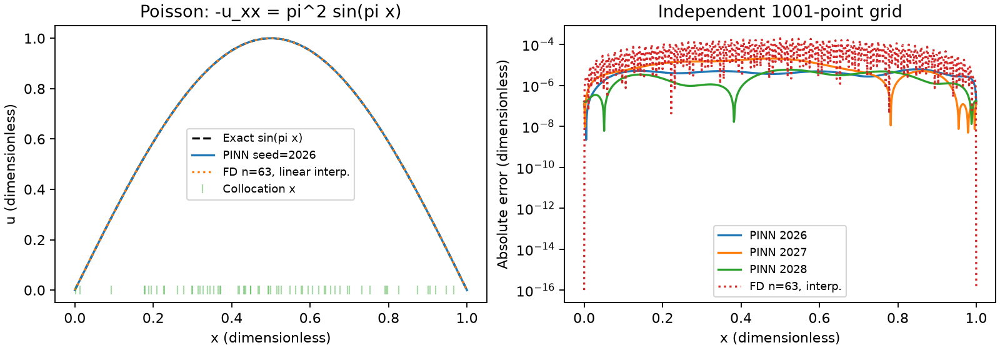

*图6.1-2 左图为种子2026的解曲线，底部短线表示配置点位置；右图为全部三个种子的绝对误差。有限差分使用63个内部节点，并线性插值到评价网格。各变量均无量纲。*

图6.1-2左侧的曲线几乎重合，说明肉眼已经难以分辨它们的差别。然而，“看起来重合”不能替代误差计算。右侧采用对数纵轴，可以看出不同位置的误差分布，以及不同种子的差异。

值得注意的是，种子2027的残差RMS小于种子2026，但相对解误差反而更大。两种误差并不按同一比例变化：残差经过微分算子定义，解误差还受到边界偏差及误差空间分布等因素影响，因此不应仅按残差大小给模型排序。

*表6.1-2 有限差分网格加密结果*

| 内部节点数$n$ | 间距$h$ | 最大节点误差$E_h$ | 观测阶$p$ |
| --- | ---: | ---: | ---: |
| 15 | $1/16$ | $3.219\times10^{-3}$ | — |
| 31 | $1/32$ | $8.036\times10^{-4}$ | 2.002 |
| 63 | $1/64$ | $2.008\times10^{-4}$ | 2.001 |
| 127 | $1/128$ | $5.020\times10^{-5}$ | 2.000 |

表6.1-2中的误差按各自网格节点计算，观测阶接近2，与中心差分的理论预期一致。图6.1-2中的差分误差还包含线性插值的影响，因此不能把图上的每一点与表中的最大节点误差混为同一口径。

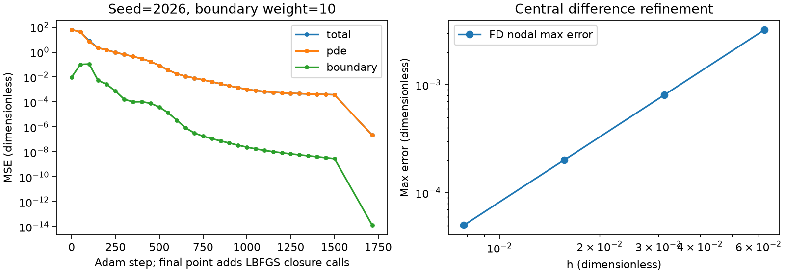

*图6.1-3 左图为种子2026的训练损失，分别展示总损失、方程项和未加权的边界项；末点记录L-BFGS完成后的值。右图为有限差分网格加密结果。*

从图6.1-3可以看到，两类约束在优化中都得到改善。种子2026最终的方程损失约为$2.17\times10^{-7}$，边界损失约为$1.34\times10^{-14}$。训练点上的方程损失与独立网格残差RMS采用不同采样位置，且前者为均方值、后者为均方根，比较时应同时注意采样与开方的区别。

本次三次网络训练各耗时约2.47—2.92秒，有限差分求解则为更短的亚毫秒量级。这些只是当前机器上的单次计时，不是严格的性能基准。对于这样简单的一维线性问题，有限差分本来就高效；本实验的目的是理解PINN如何把方程转化为训练约束，不能据此声称网络求解更快，或对所有问题更准确。

### 回到开场：什么才算解对了

图6.1-1中的候选函数通过了内部方程检查，却在边界处失败。现在可以明确指出，错误不在二阶导数的计算，而在把完整边值问题缩减成了内部方程。把边界条件纳入损失后，还需要通过独立网格、参考解和边界误差检查，判断训练是否真正达到了预期。

PINN由此形成一条完整求解链：用可微网络表示未知函数，把方程及初边值条件写成损失，通过参数优化寻找近似解，最后用独立证据评价结果。需要同时记住，有限配置点上的小损失并不是全域正确性的证明。本节的良好结果依赖于一个光滑、低维、条件明确的例子；复杂问题还可能遇到采样不足、损失不平衡和优化困难。

本节求解时，方程系数与源项都已知，未知的是函数$u$。如果某个方程参数也未知，只有少量观测数据可以利用，训练目标又应如何改变？这将引出下一节的正问题与反问题。

## 本节小结

神经网络可以被看作一族由参数控制的函数。PINN将微分方程残差和边界约束转化为可优化的损失，使网络学习一个符合完整问题的近似解。自动微分连接了函数表示、空间导数与参数优化，使这一过程能够直接实现。

判断PINN是否求解成功，需要把训练损失与独立评价分开。解析解、传统数值方法、边界误差及独立网格残差各自提供不同证据；只观察一条拟合曲线或一个很小的总损失，都不足以替代这些检查。

## 思考与练习

1. 对函数$\sin(\pi x)+ax+b$，说明为什么任意$a,b$都不改变式（6.1-1）的内部残差。若只保留左端边界条件，解是否唯一？
2. 将边界损失权重从10改为0，运行网络并检查两个端点。实际训练是否必然产生例6.1-1中的那条曲线？解释“损失缺少约束”与“某次优化恰好得到某个结果”的区别。
3. 采用$u_\theta=x(1-x)N_\theta$重新构造网络输出。推导其二阶导数，说明为什么不能只对$N_\theta$求二阶导数后直接代入原方程。
4. 保持训练预算不变，将配置点数改为16、32和64，用相同的独立网格比较误差。点数增加后，误差是否一定单调减小？请结合采样与优化两方面分析。

## 参考文献

[1] Raissi M., Perdikaris P., Karniadakis G. E. Physics-informed neural networks: A deep learning framework for solving forward and inverse problems involving nonlinear partial differential equations. *Journal of Computational Physics*, 2019, 378: 686–707. DOI: 10.1016/j.jcp.2018.10.045. [作者项目页](https://maziarraissi.github.io/PINNs/)，参见Continuous Time Models中残差构造与约束损失的介绍。本节Poisson代码为配套教学实现。

[2] PyTorch. [torch.autograd.grad](https://docs.pytorch.org/docs/stable/generated/torch.autograd.grad.html). 参见`create_graph`参数及向量—雅可比积说明。


---

# 6.2 PINN：正问题与反问题

上一节从已知方程出发，用神经网络求出了未知解函数。现在把问题稍作改变：仍然知道外部载荷和边界条件，也测得了若干位置的位移，却不知道控制变形程度的材料或模型参数。能否根据这些观测反推出参数？

两类问题使用的物理规律可能完全相同，信息流向却不同。**正问题**从模型参数走向系统响应，**反问题**从观测到的响应推断未知参数。PINN将方程和数据放在同一个训练目标中，为同时恢复状态与参数提供了一种实现方式。但训练收敛只是第一步：数据是否足以区分不同参数，噪声又会带来多大影响，同样需要分析。

本节沿用一维Poisson问题，只增加一个未知正系数，使正反问题能够在同一数学框架下比较。

## 6.2.1 已知方程参数的正问题

### 同一个方程，不同的已知与未知

考虑

$$
\begin{cases}
-k u''(x)=\pi^2\sin(\pi x), &0<x<1,\\
u(0)=u(1)=0,\qquad k>0.
\end{cases}
\tag{6.2-1}
$$

其中$k$为常数。与上一节相比，源项和区间均保持不变；当$k=1$时，式（6.2-1）退化为6.1中的问题。本节各变量均采用无量纲形式。

如果$k$已知，那么待求量只有$u(x)$。由6.1的解可以直接猜测

$$u(x;k)=\frac{\sin(\pi x)}{k}.$$

求两次导数后，有

$$u''(x;k)=-\frac{\pi^2\sin(\pi x)}{k},$$

故$-ku''=\pi^2\sin(\pi x)$，且两个端点为零。由此得到解析解族

$$
u(x;k)=\frac{1}{k}\sin(\pi x),\qquad k>0.
\tag{6.2-2}
$$

式（6.2-2）不仅给出答案，也解释了参数的作用：在当前源项固定时，$k$越大，响应幅值越小。例如，$k=0.75,1.5,3$对应的中点值分别为$4/3,2/3,1/3$。因此，恢复参数本质上需要从观测中辨认幅值变化，而不是单纯寻找一条外观相似的曲线。

正问题与反问题可以概括为表6.2-1。

*表6.2-1 同一边值问题中的两种信息方向*

| 问题 | 已知信息 | 待求量 | 训练时使用的约束 |
| --- | --- | --- | --- |
| 正问题 | 方程形式、源项、边界、系数$k$ | 解函数$u(x)$ | 方程残差与边界条件 |
| 反问题 | 方程形式、源项、边界、部分状态观测 | 系数$k$和解函数$u(x)$ | 方程残差、边界条件与观测数据 |

这里的“未知参数”是常数$k$；网络权重$\theta$也需要训练，但它们主要用于表示解函数。不要把所有网络权重都解释为具有独立物理含义的参数。

### 先建立已知系数的求解基线

本节取真实系数$k_*=1.5$。先把这个值作为已知条件，采用与6.1相同的光滑网络求解正问题。残差改为

$$r_\theta(x;k_*)=-k_*u_\theta''(x)-\pi^2\sin(\pi x),$$

训练时固定$k_*$，只更新网络参数。随后在1001个等距点上，与$u_*(x)=\sin(\pi x)/1.5$比较。

这一基线回答的是：当参数完全正确时，网络和优化过程能否求出对应状态？它使后续分析有了参照。如果正问题本身都不能可靠求解，就很难把反问题中的偏差简单归因于观测噪声或参数不可辨识。

本次已知系数正问题的独立网格相对$L^2$误差为$3.32e-05$，边界最大误差为$1.42e-06$，内部评价残差RMS为$0.00614$。训练没有使用内部状态观测，这些误差来自对方程和边界的约束。

## 6.2.2 利用观测数据识别未知参数

### 观测为未知系数增加了什么信息

现在不再把$k_*$提供给优化器，只在若干位置$x_j^{\mathrm{obs}}$给出观测

$$
y_j=u(x_j^{\mathrm{obs}};k_*)+\varepsilon_j,
\qquad j=1,\ldots,N_d.
\tag{6.2-3}
$$

其中$\varepsilon_j$表示测量误差。实际应用中通常不知道真实状态和噪声；本节采用合成数据，是为了在训练结束后能够检验恢复结果。生成数据时知道真值，不意味着反演时可以使用真值。

式（6.2-2）表明，若在一个内部位置$x_0$获得精确的非零观测$y_0$，则

$$k=\frac{\sin(\pi x_0)}{y_0}.$$

因此，在这个特定的单参数、已知源项问题中，一个合适位置的精确观测就能确定$k$。这一结论依赖于当前解族的结构，不能推广为“任意PDE只需要一个观测”。有噪声时，使用多个位置通常更稳妥；对于更多未知量，也必须重新分析信息是否充分。

### 让网络状态和物理参数一起训练

用$u_\theta$表示状态，并将$k$也设为待训练量。定义联合残差

$$r_{\theta,k}(x)=-k u_\theta''(x)-\pi^2\sin(\pi x).$$

除方程与边界损失外，加入观测误差

$$
L_d(\theta)=\frac{1}{N_d}\sum_{j=1}^{N_d}
|u_\theta(x_j^{\mathrm{obs}})-y_j|^2.
\tag{6.2-4}
$$

完整训练目标为

$$
\min_{\theta,\,k>0}\left[
L_f(\theta,k)+\lambda_b L_b(\theta)+\lambda_d L_d(\theta)
\right].
\tag{6.2-5}
$$

式（6.2-5）中的三项分别要求网络符合内部方程、端点约束和实测状态。观测不需要覆盖每个配置点：配置点用于检查方程，观测点提供状态信息，二者可以采用不同位置。

一个重要细节是，$k$并未直接出现在$L_d$中。如果暂时固定网络，改变$k$不会立即改变网络的观测预测值；它首先改变的是方程残差。联合优化通过“数据约束状态、方程联系状态与参数”的耦合关系，逐渐调整二者。

在固定$\theta$时，对内部方程损失求偏导可得

$$
\frac{\partial L_f}{\partial k}
=-\frac{2}{N_f}\sum_{i=1}^{N_f}
r_{\theta,k}(x_i)u_\theta''(x_i).
\tag{6.2-6}
$$

这说明参数更新也来自残差，而不是把拟合曲线“看一眼”后另行估算系数。实际程序让自动微分完成这一计算，并同时对$\theta$求梯度。[3]

### 如何保证系数为正

直接把一个任意实数设为$k$，可能在更新时得到非正值。本节引入无约束标量$\rho$，令

$$k=\operatorname{softplus}(\rho)=\log(1+e^\rho).$$

对于有限实数$\rho$，该表达式始终为正，从而把正性先验编码进参数化方式。它没有给出$k$的真实值，也不等于已经解决可辨识性问题。实现时，网络参数和$\rho$都必须加入优化器：

```python
rho = nn.Parameter(torch.tensor(rho_initial))

def coefficient():
    return torch.nn.functional.softplus(rho)

parameters = list(model.parameters()) + [rho]
optimizer = torch.optim.Adam(parameters, lr=0.001)
```

若只更新网络、忘记加入`rho`，程序仍可能顺利运行，曲线也可能改善，但系数会停留在初始值。这是实现反问题时必须检查的细节。

### 用解析最小二乘建立独立参照

本例有显式解族，因此可以构造一个完全不依赖神经网络的参数估计器。令$a=1/k$，$s_j=\sin(\pi x_j^{\mathrm{obs}})$，则观测模型变为

$$y_j=a s_j+\varepsilon_j.$$

最小化$\sum_j(a s_j-y_j)^2$，对$a$求导并令其为零，得到

$$
\hat a=\frac{\sum_j s_jy_j}{\sum_j s_j^2},
\qquad \hat k_{\mathrm{LS}}=\frac{1}{\hat a}.
\tag{6.2-7}
$$

式（6.2-7）要求分母非零；若要将结果解释为正系数，还需要$\hat a>0$。本次数据满足这些条件。这个简单估计器可以帮助区分：参数误差是数据本身造成的，还是网络求解与优化额外引入的。

解析最小二乘严格使用式（6.2-2）的解族；软约束PINN允许有限的方程和边界偏差。因此，两者即使用同一组观测，也不必给出完全相同的估计。

## 6.2.3 数据噪声、参数可辨识性与结果验证

### 观测位置比“有多少数据”更基本

**例6.2-1：只有端点观测，能否识别$k$？** 假设记录了$u(0)=u(1)=0$，且这两个值完全精确。对于任意$k>0$，式（6.2-2）都满足这组观测。于是，$k=0.75,1.5,3$都能解释边界数据，尽管它们在区间内部的状态明显不同。

这种不同参数产生相同可观测响应的现象称为**不可辨识**。它是信息结构的问题，不是单纯多训练几步就能消除的优化误差。

从参数灵敏度也能看出原因：

$$
\frac{\partial u(x;k)}{\partial k}
=-\frac{\sin(\pi x)}{k^2}.
\tag{6.2-8}
$$

端点处该导数为零，响应对$k$的变化不敏感。在本例同方差噪声假设下，靠近中点的观测对幅值更敏感；但这只是当前单参数解族的结论，复杂问题仍需结合具体灵敏度分析设计观测。

### 噪声怎样传递到参数估计

若噪声独立、均值为零、方差为$\sigma^2$，由式（6.2-7）可推得

$$
\hat a-a_*=
\frac{\sum_j s_j\varepsilon_j}{\sum_j s_j^2},
\qquad
\operatorname{Var}(\hat a)=\frac{\sigma^2}{\sum_j s_j^2}.
\tag{6.2-9}
$$

因此，增加有信息的观测可降低幅值估计的方差，而大量重复的零灵敏度端点观测仍无法提供所需信息。

再利用$k=1/a$在真实幅值$a_*$附近作一阶展开，有

$$\hat k-k_*\approx-k_*^2(\hat a-a_*).$$

这说明即使幅值估计是线性的，转换后的系数误差也会受到非线性映射影响。观测拟合误差小，并不保证参数误差同样小；也不能将一次含噪实验的偏差当成统计置信区间。

本节还假设源项完全已知。若将源项改为未知幅值$c\pi^2\sin(\pi x)$，则解变为$(c/k)\sin(\pi x)$，状态观测只能确定比值$c/k$。同时把$c$和$k$都作为自由参数时，需要额外信息；仅使用更多相同类型的状态观测，不能自动消除这一尺度歧义。

### 实验设计：把数据变化与优化变化分开

本节在12个内部位置$x_j^{\mathrm{obs}}=j/13$生成观测，真实系数为1.5。比较两种设置：无噪声$\sigma=0$，以及绝对标准差为0.01的高斯噪声。真实解峰值为$2/3$，因此0.01约为峰值的1.5%，这里不能称为“1%相对噪声”。

固定噪声生成种子6102，使同一观测设置中的各次训练使用完全相同的数据。再分别采用种子2026、2027、2028初始化网络，系数初值对应为0.7、1.0、2.0。三次运行同时改变网络初始化、配置点与系数初值，用于检查这三种综合启动条件下的结果，不能据此单独量化某一个因素的影响。

网络保持$1\to32\to32\to1$结构和$tanh$激活，使用64个内部配置点。每次执行2000步Adam和最多400次L-BFGS迭代。最终采用$\lambda_b=1000$、$\lambda_d=100$；与6.1相比，加强边界权重是为减小含噪数据对已知精确边界的牵动，下文保留先导设置的实际对照。

评价时分别检查系数相对误差$|\hat k-k_*|/k_*$、解的离散相对$L^2$误差、边界最大误差、独立网格残差RMS，以及观测拟合RMSE。前四项检验参数、状态与物理约束，最后一项说明拟合数据的程度；含噪时并不要求把观测RMSE压到零。

### 参数恢复与状态重建结果

*表6.2-2 两种噪声设置、三种启动条件下的反演结果*

| 噪声标准差 | 种子／系数初值 | 系数估计 | 系数相对误差 | 解相对$L^2$误差 |
| --- | --- | ---: | ---: | ---: |
| 0.00 | 2026／0.7 | 1.500108 | 0.007188% | 5.682e-05 |
| 0.00 | 2027／1.0 | 1.500308 | 0.02051% | 5.539e-05 |
| 0.00 | 2028／2.0 | 1.500028 | 0.001893% | 2.635e-05 |
| 0.01 | 2026／0.7 | 1.526402 | 1.76% | 0.01689 |
| 0.01 | 2027／1.0 | 1.526516 | 1.768% | 0.0169 |
| 0.01 | 2028／2.0 | 1.526164 | 1.744% | 0.0169 |

*表6.2-3 反演结果的边界、方程与数据检查*

| 噪声标准差 | 种子 | 边界最大误差 | 残差RMS | 观测RMSE |
| --- | --- | ---: | ---: | ---: |
| 0.00 | 2026 | 1.272e-05 | 0.01149 | 2.757e-05 |
| 0.00 | 2027 | 8.516e-06 | 0.004855 | 2.715e-05 |
| 0.00 | 2028 | 3.559e-06 | 0.005607 | 1.303e-05 |
| 0.01 | 2026 | 0.0002219 | 0.01718 | 0.01039 |
| 0.01 | 2027 | 0.0002309 | 0.006855 | 0.01042 |
| 0.01 | 2028 | 0.0002315 | 0.007003 | 0.01041 |

同一数据的解析最小二乘估计在无噪声时为1.500000，含噪时为1.525781。后者相对真值的误差约为1.719%。PINN含噪估计与它接近，说明本次偏差主要与给定观测中的噪声有关，但软物理约束与数值优化也使两者存在差异。

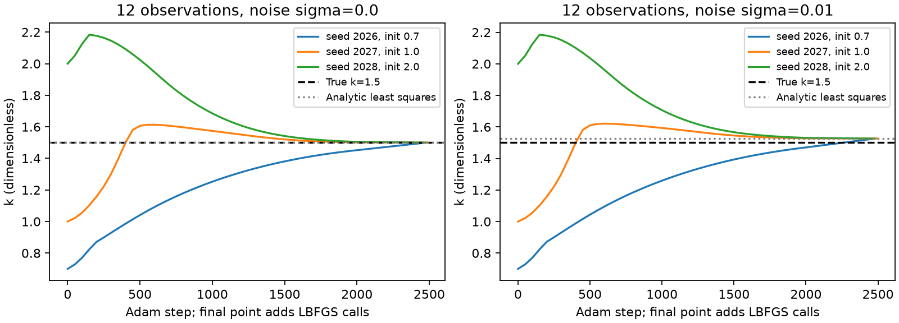

*图6.2-1 两种噪声设置下的系数训练轨迹。虚线表示真实系数，点线表示同一观测的解析最小二乘估计。横轴末点为L-BFGS完成后的记录，并非全部中间轨迹。*

无噪声时，观测与方程完全相容，三种启动条件下都能接近真实系数。含噪时，三次结果彼此接近却偏离真值，说明“不同初始化给出一致答案”并不等于“答案没有数据误差”：它们使用的恰好是同一份含噪观测。

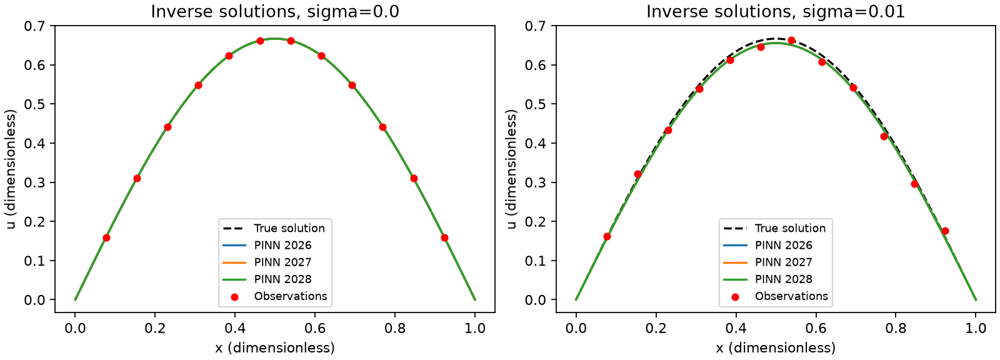

*图6.2-2 三次反演得到的状态与观测。各曲线使用同一物理模型；右图红点包含固定噪声。坐标均无量纲。*

图6.2-2中，含噪曲线不必经过每个红点。为了满足方程与边界，训练目标会在观测偏差和物理约束之间折中。只要噪声模型合理，这种偏离本身不能直接解释为训练失败；反过来，穿过所有观测点也不能证明恢复了正确参数。

### 一个应当保留的失败对照

先导实验沿用较弱的边界权重$\lambda_b=10$，观测权重仍为100。三个含噪启动条件的边界最大误差约为0.0084—0.0085，均超过预先设定的0.001检查线；其系数估计约为1.543。虽然观测RMSE约为0.00973，数据拟合更贴近红点，但已知的零边界被牺牲了。保持其他设置和误差阈值不变，将边界权重增至1000后，边界误差降至0.000222—0.000231，系数估计也更接近严格解族的最小二乘估计。先导结果全部保留，并在配套Notebook中复现这组三次边界诊断，不隐藏未达标结果。

这个对照提示：既要检查总损失，也要检查每一类约束。加强边界权重并不是发现了可推广到所有反问题的最优配方；对于更复杂的问题，还可以考虑硬边界构造、尺度归一化或适当的正则化。本例只运行并比较了上述两档软边界设置，不将未运行的方法写成实验结论。

### 能够得出什么，仍不能得出什么

本节实验表明，在已知源项、正的常系数、内部状态观测和当前网络规模下，可以通过联合训练恢复系数与状态，并用独立解析估计检验其合理性。正问题基线说明网络能够求解给定系数的状态；端点反例则说明，并非任意一组观测都能反推出系数。

本次含噪实验只有一个固定噪声实现。三个初始化不是三个独立噪声样本，不能据此估计参数的统计分布，也未验证不同噪声水平、观测数量和位置下的一般规律。若要讨论不确定性，还需要增加独立噪声重复、明确概率模型并检查估计过程。

## 本节小结

正问题是在已知模型参数时求状态，反问题则要利用观测识别未知参数。PINN反演通过观测损失约束状态，再通过方程将状态与参数联系起来。正性等先验可以限制搜索范围，但不能代替必要的数据。

理解反问题，需要区分三个层面：数据是否在数学上足够区分参数，噪声是否使估计敏感，以及数值优化是否找到了合适的解。只有同时检查参数误差、状态误差、物理约束和数据拟合，才能合理评价结果。

## 思考与练习

1. 对式（6.2-1），分别说明正问题与反问题已知什么、求什么。若把真实系数固定在残差中，却仍声称完成了参数反演，错误在哪里？
2. 推导式（6.2-7）和式（6.2-9），解释为什么只有端点状态观测时无法使用该估计器识别参数。
3. 将正性参数化$k=\log(1+e^\rho)$代入式（6.2-6），写出对$\rho$的梯度。说明正性约束为什么不能解决端点观测的不可辨识性。
4. 复现两种噪声设置与三个启动条件，分别报告参数误差、状态误差、边界误差和观测RMSE。比较$\lambda_b=10$与1000，不能仅按观测RMSE排序。
5. 若源项幅值$c$和系数$k$同时未知，构造两个不同参数对，使它们产生完全相同的状态。还需要哪类额外信息才能区分它们？

## 参考文献

[3] Raissi M., Perdikaris P., Karniadakis G. E. Physics-informed neural networks: A deep learning framework for solving forward and inverse problems involving nonlinear partial differential equations. *Journal of Computational Physics*, 2019, 378: 686–707. DOI: 10.1016/j.jcp.2018.10.045. [作者项目页](https://maziarraissi.github.io/PINNs/)，参见Data-driven Discovery of Nonlinear Partial Differential Equations部分。本文的单系数Poisson问题及解析对照为配套教学设计。


# 6.3 DeepONet 与 FNO（2 学时）

在前面的数值方法中，给定一个右端项，我们求解一次方程，得到一个解函数。如果右端项发生变化，例如给出一个新的源项、初值或系数场，就需要重新建立并求解离散方程。在控制、反问题和不确定性量化等场合，这样的求解往往需要重复成千上万次。是否可以构造一个模型，使其在训练完成后，能够根据右端项的形式直接给出近似解，而不必每次都重新求解？

这正是**算子学习**（operator learning）所要解决的问题。它要学习的不是某一个具体的解，而是 PDE 的**解算子**（solution operator），即从右端项函数到解函数的整条映射。本节先辨析"学单个解"与"学算子"的区别，再回顾必要的先修概念，随后介绍两类典型神经算子——DeepONet 与 FNO，并通过一个一维 Poisson 方程实验进行验证。

## 6.3.1 从学一个函数到学一个算子

### 从解一个方程到学一个映射

传统神经网络做的是函数近似：给定样本学习 $u=f(x)$，其隐含假设是"环境固定"，我们只关心该条件下解的取值。但在算子学习中，变化的条件本身是一个函数。为统一记号，先给出符号定义。

设 PDE 的空间求解区域为 $D\subset\mathbb{R}^d$。右端项 $f$ 与解 $u$ 都是定义在 $D$ 上的函数：

$$
f:D\to\mathbb{R},\qquad u:D\to\mathbb{R}.
$$

所有可能的右端项构成**输入函数空间** $\mathcal{A}$，所有可能的解构成**输出函数空间**（解空间）$\mathcal{U}$。PDE 良定义了解算子

$$
G:\mathcal{A}\to\mathcal{U},\qquad f\mapsto u,
\tag{6.3-1}
$$

即 $G(f)=u$；在任意点 $y\in D$ 处取值记为 $G(f)(y)=u(y)$。需要注意，$y$ 是输出函数的评价点，而不是算子 $G$ 的输入；$G$ 的输入是整个函数 $f$，输出是整个函数 $u$。

> **打个比方**：
> - **学单个解** = 老师给出一道具体方程 $-\Delta u=\sin(\pi x)$，你算出一条曲线 $u(x)$；换一个右端项，就得重新算一遍。
> - **学算子** = 你学会了"右端项 $\to$ 解"这条映射规则本身。以后随便给一个新的 $f$，立刻报出对应的 $u$，不必重新解方程。
>
> 二者的差别不在网络大小，而在输入输出是什么：单个解的输入是一个点坐标，输出是一个数；算子学习的输入是一整个函数，输出也是一整个函数。一行样本 $(f_n,u_n)$ 是"一个完整问题及其解"，而不是同一个解上的若干个点。

为便于后续描述，再引入两类点。**传感器点** $x_1,\dots,x_S$ 是固定的、全程保存的采样位置，分支网络只读取 $f$ 在这 $S$ 个点上的值；**查询点** $y$ 是计算区域内任意的位置，可以与传感器点不重合，主干网络读取它的坐标。模型的训练与评价采用函数范数，最常用的是相对 $L^2$ 误差。

### 必要的先修概念

DeepONet 与 FNO 的结构推导建立在以下基础概念之上。为保持叙述连贯，先简要回顾。

**函数空间。** 回顾线性代数，向量空间 $\mathbb{R}^n$ 以 $n$ 维向量为基本对象，配备加法、数乘以及由范数或内积诱导的几何结构。这一框架可以自然推广：将定义域上每一点的函数值视为一个"分量"，函数便成为无穷维向量；将所有满足特定条件的函数汇集在一起，并赋予相应的代数与拓扑结构，便得到函数空间。它构成了从有限维线性代数到无穷维泛函分析的桥梁，典型例子包括连续函数空间 $C(K)$、勒贝格空间 $L^p$、索伯列夫空间 $W^{k,p}$ 等。

**范数。** 平面上从原点到点 $(3,4)$ 的距离，由勾股定理得到为 $5$。范数把"长度"这一概念从几何直观中提炼出来，使其在无法直接观察的空间中也能度量对象的大小。本节最常用的是 $L^2$ 范数。函数 $u$ 在区域 $D$ 上的 $L^2$ 范数为

$$
\|u\|_{L^2(D)}=\sqrt{\int_D |u(x)|^2\,dx},
\tag{6.3-2}
$$

它可理解为函数在 $L^2$ 意义下的长度，即函数与其自身内积的平方根，用于衡量函数在整体区域上的能量或幅值。两个函数 $u$ 与 $\hat{u}$ 之间的 $L^2$ 距离为

$$
\|u-\hat{u}\|_{L^2}=\sqrt{\int_D |u(x)-\hat{u}(x)|^2\,dx},
\tag{6.3-3}
$$

用于衡量两条曲线在整体区域上的偏离程度。为消除函数本身尺度的影响，本节采用**相对 $L^2$ 误差**

$$
E_{\mathrm{rel}}=\frac{\|u-\hat{u}\|_{L^2}}{\|u\|_{L^2}}.
\tag{6.3-4}
$$

例如，真值为 $100$ 时误差为 $1$ 与真值为 $1$ 时误差为 $1$，其严重程度截然不同；归一化后，不同尺度下的误差才具有可比性。

**PDE 解的适定性。** 随手写出一个方程并加上初边界条件，并不天然构成一个有意义的问题。一个 PDE 问题若要支撑科学计算、驱动算子学习，前提是它是适定的（well-posed）。按照 Hadamard 的表述，适定性包含三个条件：

1. **存在性**：至少存在一个解满足方程和条件；
2. **唯一性**：有且只有一个解；
3. **连续依赖性（稳定性）**：输入作微小变化时，解的变化也是微小的，误差不会被无限放大。

本节选取 Poisson 方程 $-\Delta u=f$ 并配以齐次 Dirichlet 边界作为模型问题。该问题在经典意义下适定，解的存在性、唯一性和稳定性均有严格保证，因而可以作为算子学习的基准问题。

**算子通用逼近定理。** 普通神经网络的通用逼近定理指出，一个带隐藏层的 MLP 只要神经元足够多，就能以任意精度逼近任意连续函数。但它处理的是"数到数"的映射。1995 年，Tianping Chen 与 Hong Chen 证明了算子版本的通用逼近定理：任意连续的非线性算子 $G:\mathcal{A}\to\mathcal{U}$，都可以被如下形式以任意精度逼近：

$$
G(f)(y)\approx\sum_{k=1}^{p} b_k(f)\,t_k(y),
\tag{6.3-5}
$$

其中 $b_k(f)$ 只依赖于输入函数 $f$，与位置 $y$ 无关；$t_k(y)$ 只依赖于位置 $y$，与输入函数 $f$ 无关。

需要强调，这一定理只保证**逼近误差**可以任意小，并不保证优化误差小（梯度下降能否找到最优参数）、泛化误差小（在未见过的函数上是否准确），也不保证用很少的神经元即可逼近。因此，不能仅凭该定理断言模型一定准确；实际效果取决于数据、网络容量与训练策略。

**傅里叶级数与 DFT。** 周期函数可以作频域分解：任何一条光滑的周期曲线，都可以拆成许多不同频率正弦波的叠加，低频对应整体形状，高频对应细节。对于周期为 $T$ 的函数 $f$，其傅里叶级数展开为

$$
f(x)=\sum_{k=-\infty}^{+\infty}\hat{f}_k\,e^{i\,2\pi kx/T},
\tag{6.3-6}
$$

其中 $\hat{f}_k$ 是第 $k$ 个频率的复系数，模长 $|\hat{f}_k|$ 表示该频率所占的份量。函数越光滑，高频系数衰减越快；对于无限光滑函数，高频系数呈指数衰减，因此只保留前若干个低频项即可良好近似。

将连续函数换成 $N$ 个离散网格点上的采样值 $x=(x_0,\dots,x_{N-1})$，得到离散傅里叶变换（DFT）及其逆变换（IDFT）：

$$
X[k]=\sum_{n=0}^{N-1}x_n\,e^{-i\,2\pi kn/N},
\tag{6.3-7}
$$

$$
x_n=\frac{1}{N}\sum_{k=0}^{N-1}X[k]\,e^{i\,2\pi kn/N}.
\tag{6.3-8}
$$

快速傅里叶变换（FFT）是计算 DFT 的高效算法，把复杂度从 $O(N^2)$ 降到 $O(N\log N)$。

**卷积定理。** 空间域的卷积 $(K*v)(x)$，是在每个点处用核 $K$ 对周围的 $v$ 作加权平均；若核是全局的，直接计算代价很高。卷积定理指出，空间域的卷积等于频域的逐点相乘：

$$
\mathcal{F}\{K*v\}=\mathcal{F}\{K\}\odot\mathcal{F}\{v\},
\tag{6.3-9}
$$

其中 $\odot$ 表示逐位相乘。也就是说，全局卷积在空间域需要遍历所有点求和，在频域则只需对应位置相乘。这一结论正是 FNO 把全局作用放到频域、从而降低计算代价的根据。

### DeepONet：branch 与 trunk

DeepONet 的结构直接对应式（6.3-5），由两个网络组成。

- **Branch 网络（分支）**：输入 $f$ 在 $S$ 个固定传感器点上的取值 $[f(x_1),\dots,f(x_S)]$，输出 $p$ 个系数 $[b_1,\dots,b_p]$，对应 $b_k(f)$。它把一个函数编码成有限维特征向量。
- **Trunk 网络（主干）**：输入查询点坐标 $y$，输出 $p$ 个基值 $[t_1,\dots,t_p]$，对应 $t_k(y)$。它提供一组随位置变化的基函数。
- **输出**：两者内积

$$
G(f)(y)\approx\sum_{k=1}^{p} b_k(f)\,t_k(y).
\tag{6.3-10}
$$

其直觉是把解写成一组基的加权和：$t_k(y)$ 是只与位置有关的固定形状基，$b_k(f)$ 是只与输入函数有关的组合权重。同一个 trunk 配上不同的 $b$，便输出不同的解。需要注意，branch 的 $S$ 个采样点固定且要保存，trunk 的坐标任意，两者不必重合；当 branch 输入维数很大时，可在进入 MLP 前先做一维卷积降维。

### FNO：频域卷积层

FNO 不在空间域逐点查询，而是直接在规则网格上整场更新，并把全局作用放到频域实现。一个 Fourier 层写为

$$
v_{\ell+1}(x)=\sigma\big(W\,v_\ell(x)+(K v_\ell)(x)\big),
\tag{6.3-11}
$$

其中谱卷积为

$$
(K v)(x)=\mathcal{F}^{-1}\big(R_\varphi\odot\mathcal{F}v\big)(x).
\tag{6.3-12}
$$

具体而言，一个 Fourier 层包含四步：

1. **FFT**：把网格上的特征场 $v$ 变到频域系数 $\hat v$；
2. **截断**：只保留前 `modes` 个低频系数，高频置零；
3. **逐频乘学习权重**：$\hat v'_k=R_\varphi(k)\,\hat v_k$，其中 $R_\varphi(k)$ 是学出来的复数矩阵；
4. **IFFT**：把结果变回空间域。

其中 $W$ 是逐点线性（$1\times1$ 卷积），$\sigma$ 是逐点非线性（如 GELU）。FFT 与 IFFT 负责全局作用，$W$ 负责局部修正，$R_\varphi$ 是学出来的频域核。由于 $R_\varphi$ 存的是"每个频率如何混合"，而不是"每个网格点如何连接"，参数在频域共享，换更密的网格仍可使用，这就是网格无关性。

以常见的一维输入为例，张量按如下流程变化：输入 $[N,S,3]$（函数值与坐标）经全连接提升到 $[N,S,\text{width}]$，转置为 $[N,\text{width},S]$；`rfft` 后得到 $[N,\text{width},S/2+1]$，只对前 `modes` 个模做复数矩阵乘（$R_\varphi\in\mathbb{C}^{w\times w\times\text{modes}}$，对应 einsum `bix,iox->box`），其余置零；`irfft` 回到空间域，再经 $W$ 与 $\sigma$，最后投影回 $[N,S,1]$。

> **关键工程事实**：训练标签由高精度求解器给出，标签的离散误差（如 $O(h^2)$）会成为模型精度的上限。模型误差可写为
>
> $$
> G(f)-\hat u=\big(G(f)-u\big)+\big(u-u_{\mathrm{acc}}\big),
> \tag{6.3-13}
> $$
>
> 即逼近与泛化误差加上标签离散误差。一句话记住：**标签多准，模型最多就多准**；标签不好，训练再久也无意义。

## 6.3.2 关键推导：两类架构与张量维度

### 已知条件

考虑一族参数化的一维椭圆问题（两点边值问题）：

$$
-u''(x)=f(x),\qquad x\in(0,1),\qquad u(0)=u(1)=0.
$$

其中右端项 $f$ 不是固定一个，而是来自无限维函数空间 $\mathcal{A}$。对每一个具体的 $f$，方程存在唯一解 $u\in\mathcal{U}$，从而良定义了解算子 $G$。我们的目标不是给一个 $f$ 算一次 $u$，而是一次性学出整条映射，使 $G(f)(x)\approx u(x)$ 对任意未见过的 $f$ 成立。

手头的训练数据为 $N$ 个右端项 $f_1,\dots,f_N$ 及其高精度解 $u_1,\dots,u_N$，后者由细网格有限差分给出，离散误差为 $O(h^2)$。关键在于：第 $n$ 组样本 $(f_n,u_n)$ 是一个完整的"右端项及其解"，即一族问题中的一个问题。

### DeepONet 的张量维度推导

引入四个整数：$N$ 为样本数（右端项个数），$S$ 为传感器点数，$Q$ 为查询点（网格点）数，$p$ 为 branch 与 trunk 共享的隐维（基的个数）。

**第一步：输入函数离散化。** 网络无法读取整个连续函数，只能读取其在传感器点上的采样，于是输入函数变成矩阵

$$
a=[f_n(x_s)]_{n=1..N,\,s=1..S}\in\mathbb{R}^{N\times S}.
$$

**第二步：branch 编码。** branch 逐行作用，把 $N\times S$ 映射为 $N\times p$：

$$
b=\mathrm{Branch}(a)\in\mathbb{R}^{N\times p},\qquad b_{n,k}\approx b_k(f_n).
$$

**第三步：trunk 编码。** 把 $Q$ 个查询点坐标排成 $Q\times1$，trunk 逐点作用输出 $Q\times p$：

$$
t=\mathrm{Trunk}(y)\in\mathbb{R}^{Q\times p},\qquad t_{q,k}\approx t_k(y_q).
$$

$t$ 不依赖 $f$，因而对所有 $N$ 个样本共享。

**第四步：内积输出解场。** 对第 $n$ 个输入函数，在 $Q$ 个查询点上的解为 $b$ 的第 $n$ 行与 $t$ 的各列做内积，即矩阵乘积 $b\,t^\top$，其第 $n,q$ 个元素为

$$
\hat u_{n,q}=\sum_{k=1}^{p} b_{n,k}\,t_{q,k}=\hat u(f_n)(y_q).
$$

因此

$$
\hat u=b\,t^\top\in\mathbb{R}^{N\times Q}.
$$

*表6.3-1 DeepONet 的张量维度*

| 对象 | 张量 | 维度 | 每维含义 |
| --- | --- | --- | --- |
| 输入函数 | $a$ | $N\times S$ | 样本 × 传感器点 |
| branch 输出 | $b$ | $N\times p$ | 样本 × 基系数 |
| trunk 输出 | $t$ | $Q\times p$ | 查询点 × 基值 |
| 输出解场 | $\hat u$ | $N\times Q$ | 样本 × 查询点 |

整条链路可概括为：函数经传感器点采样得到 $N\times S$，经 branch 得到 $N\times p$；位置经 trunk 得到 $Q\times p$；两者内积得到 $N\times Q$ 的解场。三个自由度 $N,S,Q$ 分别对应"多少个问题、每个问题如何采样、在哪儿读解"。

### FNO 的张量维度推导

FNO 直接在规则网格上整场更新。设 $N$ 为样本数，$Q$ 为网格点数（要求均匀以做 FFT），$c_{\mathrm{in}},c_{\mathrm{out}}$ 为输入、输出通道数，$w$ 为提升后的特征宽度，$K_{\max}$（即 `modes`）为保留的频域模数。

**第一步：输入张量化。** 把每个右端项放在 $Q$ 个网格点上，连同坐标合成输入通道：

$$
a\in\mathbb{R}^{N\times Q\times c_{\mathrm{in}}},\qquad c_{\mathrm{in}}=d+1.
$$

**第二步：提升。** 用逐点全连接（$1\times1$ 卷积）把每点通道由 $c_{\mathrm{in}}$ 升到 $w$：

$$
v_0=P(a)\in\mathbb{R}^{N\times Q\times w}.
$$

**第三步：Fourier 层。** 对每个样本、每个通道沿空间维做 FFT：

$$
\mathcal{F}v_\ell\in\mathbb{C}^{N\times w\times(Q/2+1)}.
$$

只保留前 $K_{\max}$ 个模，对每个被保留的模 $k$ 用复数矩阵 $R_\varphi(k)\in\mathbb{C}^{w\times w}$ 做跨通道混合，再把高频模置零，最后 IFFT 回空间域，加上逐点线性项与非线性：

$$
v_{\ell+1}=\sigma\big(W v_\ell+\mathcal{F}^{-1}(R_\varphi\odot\mathcal{F}v_\ell)\big)\in\mathbb{R}^{N\times Q\times w}.
$$

**第四步：投影。** 逐点全连接把 $w$ 通道映射回输出通道：

$$
\hat u=Q_p(v_L)\in\mathbb{R}^{N\times Q\times c_{\mathrm{out}}}.
$$

*表6.3-2 FNO 的张量维度*

| 对象 | 张量 | 维度 | 每维含义 |
| --- | --- | --- | --- |
| 输入 | $a$ | $N\times Q\times c_{\mathrm{in}}$ | 样本 × 网格点 × 通道 |
| 提升后 | $v_0$ | $N\times Q\times w$ | 样本 × 网格点 × 特征宽 |
| 频域 | $\mathcal{F}v$ | $\mathbb{C}^{N\times w\times(Q/2+1)}$ | 样本 × 通道 × 模数 |
| 谱卷积核 | $R_\varphi$ | $\mathbb{C}^{w\times w\times K_{\max}}$ | 输入通道 × 输出通道 × 保留模数 |
| 输出解场 | $\hat u$ | $N\times Q\times c_{\mathrm{out}}$ | 样本 × 网格点 × 解通道 |

与 DeepONet 相比，FNO 的 $Q$ 是网格点数（要求均匀以做 FFT），输出是整场解而非逐点查询；参数 $R_\varphi$ 存在频域、与网格点数无关，因而具有网格无关性。

### 推导结论

两类架构可纳入同一逻辑框架：训练样本是一"族问题"，每一行 $(f_n,u_n)$ 是一个完整的右端项及其解，$N$ 个样本对应 $N$ 个不同问题。DeepONet 用 branch 把函数压成系数、trunk 提供位置基，内积得到逐点解；FNO 用频域谱卷积整场更新，参数在频域共享而网格无关。两者学的都是"函数到函数"的算子，都以函数范数（相对 $L^2$）监督，都依赖"一族问题"的数据形态。

## 6.3.3 实验设计、实现与运行

### 实验设计：先预测，再运行

*表6.3-3 一维 Poisson 算子学习实验设置*

| 项目 | 内容 |
| --- | --- |
| 要回答的问题与运行前预测 | 学习一族 $f\to u$。预测：DeepONet 能在未见过的 $f$ 上给出形状正确的 $u$，但精度低于 FD 求解器；推理远快于现场求解；误差主要来自逼近与泛化，而非标签离散误差 |
| 输入、参数、单位与数据划分 | 右端项 $f(x)=\sum_{k=1}^{8}(a_k\cos 2\pi kx+b_k\sin 2\pi kx)$，$a_k,b_k\sim\mathcal{N}(0,k^{-1.5})$，无量纲。训练 $800$ 个函数、测试 $200$ 个全新函数；按系数（函数）整体划分，不按网格点拆分 |
| 独立参考解与基线 | 细网格 FD（$M=1024$）作为真值，粗网格 FD（$M=256$）作为传统求解器基线。二阶中心差分的截断误差为 $O(h^2)$，可信且可复算 |
| 误差指标、容差与依据 | 逐函数相对 $L^2$ 误差，函数范数度量整条曲线，与算子学习口径一致；容差由 FD 离散误差量级决定，DeepONet 误差应明显高于 $10^{-3}$，并随训练下降 |
| 环境、种子、设备与预算 | seed=0；CPU；纯 numpy；训练 $15000$ 步约数十秒，推理约毫秒量级 |

### 方法实现与运行

下面给出最小 DeepONet 实现。数据端先抽取一次系数，再在同一套系数上于不同网格求值，以保证输入函数与标签严格对应；网络端 branch 读取传感器采样值，trunk 读取查询坐标，二者内积输出解；训练采用相对 $L^2$ 损失。

```python
import time, numpy as np
np.random.seed(0)
import matplotlib; matplotlib.use("Agg")
import matplotlib.pyplot as plt

# --- 数据生成计时 ---
t_gen = time.time()
# 传统求解器：二阶中心差分
M_FINE, M_COARSE = 1024, 256
x_f = (np.arange(1, M_FINE + 1)) / (M_FINE + 1)
x_c = (np.arange(1, M_COARSE + 1)) / (M_COARSE + 1)
def fd_inv(M):
    h = 1 / (M + 1)
    A = (2 * np.diag(np.ones(M))
         - np.diag(np.ones(M - 1), 1)
         - np.diag(np.ones(M - 1), -1)) / h**2
    return np.linalg.inv(A)
Ainv_f, Ainv_c = fd_inv(M_FINE), fd_inv(M_COARSE)

# 一族右端项：先抽一次系数，再在任意网格求值
KMAX, SENSOR = 8, 51
sensor_x = np.linspace(0, 1, SENSOR)
_k = np.arange(1, KMAX + 1).astype(float)
_dec = _k**-1.5
def gen_coef(n):
    return np.random.randn(n, KMAX) * _dec, np.random.randn(n, KMAX) * _dec
def eval_f(a, b, x):
    X = x[None, :]; KK = _k[:, None]
    return (a[:, :, None] * np.cos(2 * np.pi * KK * X)[None]
            + b[:, :, None] * np.sin(2 * np.pi * KK * X)[None]).sum(1)

N_TR, N_TE = 800, 200
ar, br = gen_coef(N_TR)
U_tr = (Ainv_c @ eval_f(ar, br, x_c).T).T
fs_tr = eval_f(ar, br, sensor_x)
ae, be = gen_coef(N_TE)
U_te = (Ainv_f @ eval_f(ae, be, x_f).T).T
fs_te = eval_f(ae, be, sensor_x)
U_ct = (Ainv_c @ eval_f(ae, be, x_c).T).T
t_gen = time.time() - t_gen
```

```python
# --- DeepONet：两层 tanh MLP + 手写 Adam ---
P, H = 32, 64
def init(i, o):
    return np.random.randn(i, o) * np.sqrt(2 / i), np.zeros(o)
W1b, b1b = init(SENSOR, H); W2b, b2b = init(H, P)
W1t, b1t = init(1, H); W2t, b2t = init(H, P)
pr = [W1b, b1b, W2b, b2b, W1t, b1t, W2t, b2t]
m = [np.zeros_like(p) for p in pr]
v = [np.zeros_like(p) for p in pr]
def fwd(fs, xq):
    hb = np.tanh(fs @ pr[0] + pr[1]); B = hb @ pr[2] + pr[3]
    ht = np.tanh(xq @ pr[4] + pr[5]); T = ht @ pr[6] + pr[7]
    return B, hb, T, ht, B @ T.T

x_tr = x_c[:, None]; U = U_tr; Xb = fs_tr
t0 = time.time()
for ep in range(1, 15001):
    B, hb, T, ht, Y = fwd(Xb, x_tr)
    D = (Y - U) / (U.shape[0] * U.shape[1])
    dT = D.T @ B; dht = dT @ pr[6].T * (1 - ht**2)
    gW2t, gB2t = ht.T @ dT, dT.sum(0)
    gW1t, gB1t = x_tr.T @ dht, dht.sum(0)
    dB = D @ T; dhb = dB @ pr[2].T * (1 - hb**2)
    gW2b, gB2b = hb.T @ dB, dB.sum(0)
    gW1b, gB1b = Xb.T @ dhb, dhb.sum(0)
    gs = [gW1b, gB1b, gW2b, gB2b, gW1t, gB1t, gW2t, gB2t]
    for i in range(8):
        m[i] = .9 * m[i] + .1 * gs[i]
        v[i] = .999 * v[i] + .001 * gs[i]**2
        pr[i] -= 1e-3 * (m[i] / (1 - .9**ep)) / (
            np.sqrt(v[i] / (1 - .999**ep)) + 1e-8)
t_train = time.time() - t0

# --- 推理计时 ---
t0 = time.time()
_, _, _, _, U_pred = fwd(fs_te, x_f[:, None])
t_infer = time.time() - t0
print("train relL2 = %.3e" % (np.linalg.norm(Y - U) / np.linalg.norm(U)))
print("time: data-gen = %.3e s/%d func | train = %.3e s | infer = %.3e ms/%d func"
      % (t_gen, N_TR + N_TE, t_train, t_infer * 1000, N_TE))
```

### 误差图表与比较

在测试集上计算逐函数相对 $L^2$ 误差，并把粗网格 FD 解插值到细网格后计算其离散误差；同时绘制解曲线对比图、误差箱线图和成本柱状图。

```python
# --- 误差统计 ---
err_d = np.linalg.norm(U_pred - U_te, axis=1) / np.linalg.norm(U_te, axis=1)
U_cti = np.stack([np.interp(x_f, x_c, r) for r in U_ct])
err_fd = np.linalg.norm(U_cti - U_te, axis=1) / np.linalg.norm(U_te, axis=1)
print("DeepONet 测试 relL2 均值 = %.3e 中位 = %.3e"
      % (err_d.mean(), np.median(err_d)))
print("FD 粗网格 relL2 均值 = %.3e" % err_fd.mean())

# --- fig1：解曲线对比 + 误差箱线 ---
fig, ax = plt.subplots(1, 2, figsize=(11, 4))
ax[0].plot(x_f, U_te[0], "k-", lw=2, label="truth (FD1024)")
ax[0].plot(x_f, U_pred[0], "r--", label="DeepONet")
ax[0].plot(x_f, U_cti[0], "b:", label="FD256")
ax[0].set_xlabel("x"); ax[0].set_ylabel("u(x)")
ax[0].legend(fontsize=8)
ax[1].boxplot([err_d, err_fd], tick_labels=["DeepONet", "FD coarse"])
ax[1].set_yscale("log"); ax[1].set_ylabel("relative L2 (log)")
plt.tight_layout(); plt.savefig("fig1.png", dpi=130)

# --- fig2：成本柱状图 ---
data_ms = t_gen / (N_TR + N_TE) * 1000
train_s = t_train
infer_ms = t_infer * 1000 / N_TE
labels = ["data gen (per func)", "train (once, s)", "DeepONet infer (per func)"]
vals = [data_ms, train_s, infer_ms]
colors = ["#9ca3af", "#f59e0b", "#14b8a6"]
fig, ax = plt.subplots(figsize=(7, 5))
bars = ax.bar(labels, vals, color=colors, width=0.55)
ax.set_yscale("log")
ax.set_title("cost: generate data vs train vs infer")
ax.set_ylabel("time (ms, train in s)")
for b, val in zip(bars, vals):
    ax.text(b.get_x() + b.get_width() / 2, val, f"{val:.2g}",
            ha="center", va="bottom", fontsize=9)
ax.set_ylim(1e-3, 1e3)
plt.tight_layout(); plt.savefig("fig2_cost.png", dpi=130)
print("saved: fig1.png, fig2_cost.png")
```

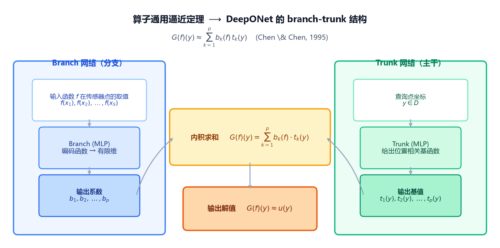

*图6.3-1 DeepONet 的 branch-trunk 结构与数据流。分支网络编码输入函数，主干网络给出位置基，内积得到解。*

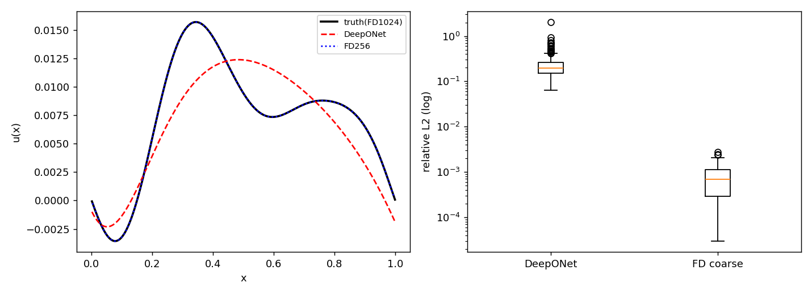

*图6.3-2 左图为一个测试函数的解曲线对比，右图为全部测试函数的相对 $L^2$ 误差箱线图。各变量均无量纲。*

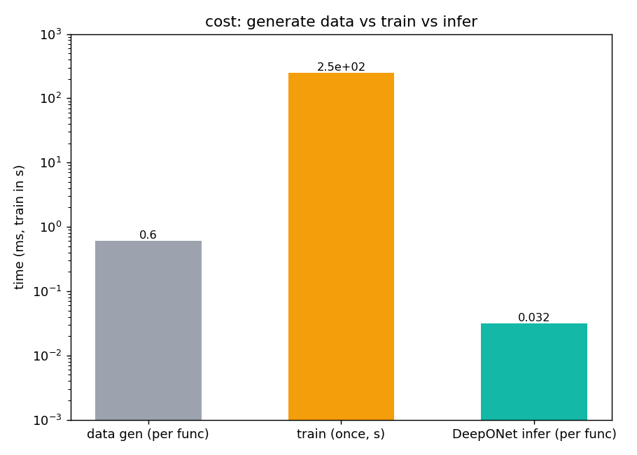

*图6.3-3 数据生成、训练与推理的成本对比，采用对数纵轴。数据生成与推理以毫秒计，训练以秒计。*

### 结果解释与本节结论

实验在 seed=0、CPU、纯 numpy 下完成。精度与成本结果如下。

*表6.3-4 一维 Poisson 算子学习的误差结果*

| 模型 / 基线 | 相对 $L^2$ 均值 | 相对 $L^2$ 中位 | 相对 $L^2$ 最大 |
| --- | ---: | ---: | ---: |
| DeepONet（训练集，已收敛） | — | — | 9.36e-2 |
| DeepONet（200 个未见函数） | 1.60e-1 | 1.19e-1 | 1.20e+0 |
| FD 粗网格（256） | 7.42e-4 | 6.96e-4 | 2.71e-3 |

*表6.3-5 数据生成、训练与推理成本*

| 环节 | 实测耗时 | 折算每函数 |
| --- | ---: | ---: |
| 数据生成（1000 个函数） | 3.47e-1 s | ≈ 0.35 ms |
| 训练（15000 步） | 7.38e1 s | 一次性 |
| 推理（200 个函数） | 2.05 ms | ≈ 0.010 ms（≈ 10 µs） |

实测结果与运行前预测一致。其一，DeepONet 抓住了解的形状，峰谷位置正确，但整体略低于真值、峰值被削平（图6.3-2 左图红色虚线）；这与网络用有限基（$p=32$）组合解的机制相符，基的个数有限，不足以完全刻画峰值，表现为系统性幅值偏低。其二，DeepONet 测试误差（中位 1.19e-1）比 FD 离散误差（中位 6.96e-4）高约两个数量级，而训练标签的离散误差仅约 $10^{-3}$，说明瓶颈是网络的逼近与泛化能力，而非标签精度，这与式（6.3-13）的误差分解一致。其三，单次推理约 10 µs，远快于现场求解，体现了"训练一次、使用无数次"的价值。

以下问题尚未验证：训练函数数从 800 增大时误差是否下降；传感器点数 $S$ 对精度的影响；改用 FNO 后频域建模是否更准（本组仅作结构对照，未训练 FNO，故不比较其精度）。

### 易错点与讨论

本节要核验的风险是：把一条解曲线的拟合称为算子学习，或把同一解上的随机网格点拆分当作独立函数测试。

**同一解拆点属于数据泄漏。** 设右端项 $f_1$ 对应解 $u_1$。若把 $(f_1(x_i),u_1(x_i))$ 的网格点随机按 80/20 分成训练集与测试集，则训练集与测试集共享同一个右端项 $f_1$。网络只需背下 $f_1$ 对应的那一条曲线，就能让测试点"很准"，但这种准确对 $f_2,f_3$ 毫无意义。算子学习评价的是 $G$ 在新输入函数上的表现；把同一函数的不同网格点拆开，测的是插值或记忆，而非算子泛化。本实验按系数（函数）整体划分，测试用全新函数，因此 1.19e-1 的中位误差是真正的未见函数泛化误差。

**输入与标签必须对应同一函数。** 调试中曾出现一个相关错误：采样函数每次调用都重新抽取系数，导致 branch 读到的 $f$ 与标签 $u$ 来自不同函数，训练相对 $L^2$ 卡在 0.94 附近。改为先抽一次系数、再在同一套系数上于不同网格求值后，才正常收敛。这说明输入函数与标签必须严格来自同一个右端项。

*表6.3-6 算子学习与函数回归的划分区别*

| 场景 | 划分单位 | 评价对象 |
| --- | --- | --- |
| 算子学习（本实验） | 函数（系数）整体 | 跨输入函数泛化 $G$ |
| 函数回归（固定问题） | 网格点 | 单条解曲线拟合 |

结论是：划分单位必须是函数，而不是网格点。只要目标是学习 $f\mapsto u$ 的算子，就必须保证测试集中的每个函数在训练时都未出现；否则任何"好结果"都可能是数据泄漏的假象。

> **随堂提问**：某同学学习算子 $f\mapsto u$，取一个 $f_1$，把它在 200 个网格点上的 $(f_1(x_i),u_1(x_i))$ 随机按 80/20 分成训练/测试，测得测试误差约 $10^{-3}$。这能否说明学到了好的算子？
>
> 可能的回答：（能，误差很小）／（不能，测的是插值）。
>
> 本组结论：**不能**。测试点与训练点来自同一个 $f_1$，网络只需记住该曲线即可，并未学习 $G$。正确做法是把函数作为划分单位，训练用 $\{f_1,\dots,f_{800}\}$，测试用全新的 $\{f_{801},\dots,f_{1000}\}$，误差才反映算子泛化。

## 本节小结

算子学习学习的是 PDE 的解算子 $G:\mathcal{A}\to\mathcal{U}$，其输入和输出都是函数，这与拟合单个解函数有本质区别。DeepONet 依据算子通用逼近定理，用 branch 编码输入函数、trunk 给出位置基，内积得到逐点解；FNO 依据卷积定理，用频域谱卷积整场更新，参数在频域共享而具有网格无关性。

判断算子学习是否成功，需要把训练与独立评价分开，并按函数整体划分数据。独立参考解、传统求解器对照、相对 $L^2$ 误差与成本计时各自提供不同证据；只观察一条拟合曲线或一个很小的测试误差，都可能掩盖数据泄漏或标签误差。

## 思考与练习

1. 说明算子 $G$ 的输入、输出分别是什么；为什么 $G(f)(y)$ 中的 $y$ 不是算子 $G$ 的输入，而 $G(f)$ 才是一个函数？
2. 对一维 Poisson 问题，写出 DeepONet 中 $a,b,t,\hat u$ 的张量维度，并说明 $N,S,Q,p$ 各自的含义。
3. 用 $N=4$ 的信号 $x=(1,0,-1,0)$ 验证 DFT 与 IDFT，并说明为什么该信号的能量集中在 $k=1,3$。
4. 说明卷积定理如何使 FNO 的全局作用变得便宜；若解含有强高频成分，只保留很少的 `modes` 会出现什么问题？
5. 某同学把同一个解的网格点随机拆成训练集和测试集，报告了很小的测试误差。请指出错误，并给出按函数划分的正确方案。

## 参考文献

[1] Chen T., Chen H. Universal approximation to nonlinear operators by neural networks with arbitrary activation functions and its application to dynamical systems. *IEEE Transactions on Neural Networks*, 1995, 6(4): 911–917.

[2] Lu L., Jin P., Pang G., Zhang Z., Karniadakis G. E. Learning nonlinear operators via DeepONet based on the universal approximation theorem of operators. *Machine Learning: Science and Technology*, 2021, 2(3): 035002.

[3] Li Z., Kovachki N., Azizzadenesheli K., Liu B., Bhatt K., Stuart A., Anandkumar A. Fourier neural operator for parametric partial differential equations. *International Conference on Learning Representations (ICLR)*, 2021.

## 6.4 AI关联：科学基础模型（2学时）

**本节目标：** 能审视预训练模型用于科学任务时的适用证据。

前面三节逐步扩展了神经网络在科学计算中的作用：6.1节介绍用神经网络近似边值问题的解，6.2节讨论正问题求解与未知系数识别，6.3节通过DeepONet与FNO，把学习对象扩展到一族输入函数与解函数之间的映射。随着问题范围扩大，模型训练也面临新的要求：已经在一批问题上获得的表示，能否成为另一批问题的学习起点，减少重新获取数据和训练模型的代价。

这种表示的复用构成了预训练与迁移学习的基本思路。在科学计算中，它还受到方程结构、参数范围、初边值条件和离散方式的共同影响。相近的训练任务并不必然带来有效迁移，一个目标任务上的改善也不足以说明模型能够处理更广泛的物理情形。因此，预训练模型的讨论需要同时联系其训练来源、适配方式与独立评价，才能确定所得结果的适用范围。

### 6.4.1 预训练与科学基础模型

**预训练模型**是在当前任务开始之前，已经通过一段训练过程获得参数的模型。这段过程称为预训练阶段，所使用的数据或任务称为源数据或源任务。科学计算中的源数据可以是数值模拟得到的场、随时间演化的轨迹，也可以是实验观测。预训练并不等于无监督训练：给定输入场和数值参考解，模型完全可以通过监督误差学习它们之间的对应关系。

预训练结束后需要解决的具体问题称为**下游任务**，也就是目标任务。这里的“任务”不能只写成“求解PDE”，还应说明方程、区域、参数、初边值条件和输出物理量。原来预测未来速度场，现在改为由源项预测稳态解，是任务类型的变化；方程不变而系数范围改变，则是同类问题中数据分布的变化。两者都可能需要适配，但它们对模型提出的要求并不相同。

**迁移学习**研究已有学习结果如何帮助目标任务。能够迁移的可以是网络参数，也可以是中间表示或部分计算模块。迁移效果体现为模型在明确条件下，相对于合理对照获得更好的目标学习结果。若目标任务与源任务差异过大，旧表示可能没有帮助，甚至妨碍目标学习，这时就可能出现负迁移。

普通任务模型通常针对一个明确任务训练。科学基础模型则希望通过具有一定规模和多样性的科学数据预训练，使所得表示能够适配多个下游任务。这种训练方式强调能够在后续任务中复用的表示。它处理的对象也未必是文字：输入可能是函数、网格场、时间序列、方程参数、边界条件或观测数据，输出则可能是一个场或一段演化过程。这些科学对象及其相互关系共同决定了模型需要学习的表示。

PINN通常把方程残差、初始条件和边界条件写进损失，在本章入门例子中学习一个具体问题的解函数。DeepONet和FNO学习一族输入函数到输出函数的映射。科学基础模型更关注先学习较丰富的源任务，再将所得能力用于其他任务。它们分别强调约束方式、映射对象和训练使用方式，因而可以组合，而不是彼此排斥。

*表6.4-1 PINN、神经算子与科学基础模型*

| 视角 | 本章中的重点 | 需独立检验的能力 |
| --- | --- | --- |
| PINN | 用方程与初边值约束学习解；也可加入观测识别参数 | 低训练残差是否对应准确解，是否适应新的问题条件 |
| DeepONet、FNO | 学习一族输入函数到输出函数的算子 | 是否覆盖独立输入，是否适应参数、网格或任务变化 |
| 科学基础模型 | 预训练表示能否复用于多个下游科学任务 | 迁移是否有效，适配需要多少数据，适用边界在哪里 |

预训练所形成的表示及其复用能力需要在独立任务中检验。较大的参数量或数据规模可以改变学习条件，但本身不等于迁移能力的证据。

**例6.4-1（参数范围的变化）** 设一个模型已经学习过 $k\in[0.8,1.2]$ 时不同源项对应的Poisson解，现在将目标系数范围改为 $k\in[1.6,2.0]$。源任务与目标任务共享方程形式，变化的是输入条件的分布。原有模型可能已经形成表示光滑函数和响应源项变化的能力，但这些表示还需要随系数变化作出调整。直接使用旧参数与利用少量目标数据微调，因而形成了两种不同的处理方式。这是为说明概念构造的教学情境，后文将给出对应的数值演示。

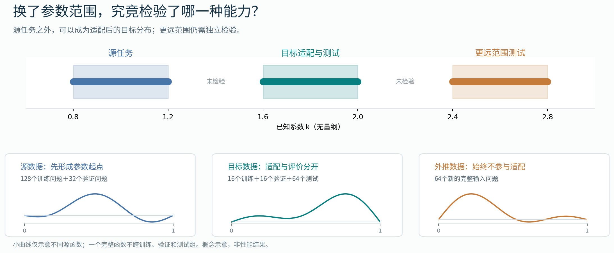

*图6.4-1 源任务、目标任务与参数外推。上方给出各任务的系数范围，下方示意完整输入函数的划分。同一目标范围内，训练、验证和测试使用不同源函数。图为概念示意，非实测性能结果。*

这一区分把表示的复用与具体任务条件联系起来。对一个已训练模型进行适配，需要确定哪些参数可以沿用、哪些部分需要更新，以及哪些物理条件必须在更新过程中继续满足。

### 6.4.2 任务适配与物理约束

任务适配是使已有模型符合目标任务要求的具体过程。若目标输入输出与源模型一致，可以先直接使用预训练参数而不更新模型；当已有表示尚不能满足目标精度时，再通过目标数据进行微调。全量微调更新全部或大部分参数，参数高效微调则冻结大部分已有参数，只训练少量参数或新增模块。输入通道、输出物理量或网格表示发生变化时，还需要相应调整模型接口。从随机初始化重新训练不继承预训练参数，常作为衡量适配收益的比较基线。

物理约束提供了独立于数据拟合的要求。方程、初始条件、边界条件和守恒关系限定了允许出现的响应，即使目标数据有限，这些结构仍然可以参与约束预测。参数更新范围与物理约束属于不同层面：全量微调、参数高效微调和从头训练都可以引入物理项，也可以通过输出结构直接满足某些条件。

把源任务数据记为 $\mathcal D_{\mathrm s}=\{(q_i,y_i)\}_{i=1}^{N_{\mathrm s}}$。其中，$q_i$ 是输入条件，可能包括源函数、初值及物理参数，$y_i$ 是参考输出场。模型记为 $\mathcal G_\theta$，$\theta$ 是网络权重，$\widehat u_\theta(q;x)$ 表示预测场在坐标 $x$ 处的取值。物理系数 $k$ 与网络权重 $\theta$ 必须区分：前者描述问题，后者描述近似模型。

预训练用源数据确定初始参数，可写成

$$
\theta_0\approx\arg\min_\theta\mathcal L_{\mathrm{pre}}(\theta),\qquad
\mathcal L_{\mathrm{pre}}(\theta)=\frac{1}{N_{\mathrm s}}\sum_{i=1}^{N_{\mathrm s}}
\ell\bigl(\mathcal G_\theta(q_i),y_i\bigr).
\tag{6.4-1}
$$

这里 $\ell$ 是所选误差度量，$\mathcal L_{\mathrm{pre}}$ 是预训练损失。采用近似号，是因为实际优化只有有限步，通常不保证全局最优。得到 $\theta_0$ 后，模型已经在源任务上形成某种输入到输出的关系，但这还不是对目标任务能力的证明。

目标科学任务记为 $\mathcal T$，它规定方程、区域、初边值条件和输入分布。目标数据分为训练集 $\mathcal D_{\mathrm t}^{\mathrm{tr}}$、验证集 $\mathcal D_{\mathrm t}^{\mathrm{val}}$ 和测试集 $\mathcal D_{\mathrm t}^{\mathrm{test}}$。适配方法 $\mathcal A$ 决定从哪里初始化、更新哪些参数及如何训练。以全量微调为例，先令 $\theta^{(0)}=\theta_0$，再近似求解

$$
\theta^*\approx\arg\min_\theta\left[
\mathcal L_{\mathrm{data}}(\theta)
+\lambda_{\mathrm{phys}}\mathcal L_{\mathrm{phys}}(\theta)
+\lambda_{\mathrm{bc}}\mathcal L_{\mathrm{bc}}(\theta)\right].
\tag{6.4-2}
$$

$\mathcal L_{\mathrm{data}}$ 衡量目标训练输出与参考解的差异；$\mathcal L_{\mathrm{phys}}$ 衡量方程或物理残差；$\mathcal L_{\mathrm{bc}}$ 衡量边界或初始条件误差。非负权重 $\lambda_{\mathrm{phys}}$、$\lambda_{\mathrm{bc}}$ 调整不同要求的作用，各项需要先说明量纲和尺度。对于教学Poisson问题，内部残差就是 $r_\theta(q;x)=-k\partial_{xx}\widehat u_\theta(q;x)-f(x)$，物理损失可以取配置点上 $r_\theta^2$ 的平均。

式（6.4-2）是统一的抽象表达，不是所有科学基础模型共有的固定训练配方，也不是Poseidon原文损失的逐项转写。直接使用时不优化目标参数；参数高效微调只优化少量变量 $\phi$，其余参数冻结；从头训练则把初值换为随机参数 $\theta_{\mathrm{rand}}$。若初边值条件已经通过输出结构精确满足，相应惩罚项可以省略；具体实现中的边界误差仍需单独检查。

### 6.4.3 迁移证据与泛化评价

预训练得到的参数首先反映源数据中的关系。将其用于目标任务时，需要区分输入分布的变化与方程结构的变化。参数范围改变可能保留相同的解算子形式，而从演化问题转向稳态问题，还可能改变输入、输出及边界条件的含义。预训练是否有效，应在这些变化被明确说明之后，通过目标问题上的独立评价加以判断。

独立性首先体现在问题的划分上。若模型需要处理新的源函数、初值或边界数据，测试集就应包含没有参与训练的完整输入条件。把同一条解曲线上的网格点随机拆分，只能检验已接触问题上的补点能力。数据归一化、模型选择和超参数调整也应限于相应训练或验证资料，以避免将测试信息提前用于学习。

参数外推的范围需要相对于适配数据确定。在例6.4-1中，$[1.6,2.0]$ 虽然位于源系数范围之外，但模型一旦在该范围内微调，来自相同分布的新问题便属于目标分布内测试。只有进一步保留未参与适配的系数范围，才能检验相应的外推能力。跨方程或跨边界的主张还需要另设对应任务，不能由一次参数变化推断。

设第 $j$ 个独立测试问题的参考解为 $u_j$，预测为 $\widehat u_j$，可用相对误差 $E_j=\|\widehat u_j-u_j\|_{2,h}/\|u_j\|_{2,h}$ 衡量整体偏差，其中 $\|\cdot\|_{2,h}$ 为按网格积分权重计算的离散 $L^2$ 范数。参考解可能接近零时，还需要绝对误差尺度或稳定分母。测试均值概括整体表现，中位数和最大值补充误差分布，残差、边界及相应守恒诊断则检验物理一致性。

合理对照是解释这些指标的另一项条件。同样的目标数据与训练预算下，从随机初始化训练的同类模型有助于衡量预训练起点的贡献；传统数值解或解析解提供独立准确性参照。若比较对象的结构、规模或优化条件同时改变，性能差异就不能完全归因于预训练。计算成本也应区分源训练、目标适配和预测阶段，使精度与资源比较具有明确口径。

较具体的研究证据可以从Poseidon的算子迁移中观察。Maximilian Herde、Bogdan Raonić、Tobias Rohner、Roger Käppeli、Roberto Molinaro、Emmanuel de Bézenac和Siddhartha Mishra于2024年发表《Poseidon: Efficient Foundation Models for PDEs》。以下以[arXiv第2版](https://arxiv.org/abs/2405.19101v2)为依据，相关材料还包括[官方项目页](https://camlab-ethz.github.io/poseidon/)及[公开代码](https://github.com/camlab-ethz/poseidon)。[1—3]

Poseidon以二维可压缩Euler与不可压缩Navier–Stokes方程的数值解进行预训练，输入包括状态场与预测时间间隔，输出为相应状态场。其Poisson-Gauss下游任务则由高斯源项预测零Dirichlet边界下的Poisson解，并使用目标数据进行微调。输入输出仍然是场，但算子的含义与边界设置已经发生变化，因而该任务提供了比同一曲线补点更强的迁移检验。[1，§2、§3、附录B.2.14]

原文在Poisson-Gauss任务中比较了冻结内部表示、全量微调与FNO等配置。附录D.4.3报告，在512个任务样本的设置下，仅训练输入输出相关模块的冻结表示模型误差为0.11，相应全量微调为0.022，FNO为0.282。上述数值引自原论文，采用相对 $L^1$ 误差评价；后文教学实验采用相对 $L^2$ 误差，两种指标应分别解读。[1，§3、附录D.4.3]

冻结内部表示后仍能完成目标学习，为已有表示的复用提供了证据；全量微调得到更低误差，则说明目标学习仍然具有作用。与FNO的差异还包含结构和规模因素。原文另有从头训练的scOT对照，但各模型规模并不完全相同，因此在量化预训练贡献时仍需同时核对训练预算与调参条件。[1，附录C]

*表6.4-2 Poseidon迁移实验的证据范围*

| 研究材料 | 支持的判断 | 尚未得到的结论 |
| --- | --- | --- |
| 流体预训练后适配Poisson-Gauss | 在所检验算子任务之间，已有表示具有复用价值 | 不经适配求解任意PDE |
| 冻结表示与全量微调的对照 | 目标适配方式影响预测误差 | 预训练表示已完整编码全部物理规律 |
| 与FNO及其他对照的比较 | 所列模型在规定设置中具有不同的精度和样本需求 | 预训练在所有任务中降低总计算成本 |

这些证据具有特定的数据与评价边界。场误差不能代替方程、边界和守恒检查，数据集外的一次成功也不能覆盖其他几何、参数或物理情形。科学模型的迁移能力应由一组明确任务逐步建立，而不由模型名称或单一规模指标决定。

### 6.4.4 Poisson方程的迁移实验

例6.4-1中的系数变化可以用一个普通CPU上的小模型进行研究。采用具有解析解的一维Poisson问题，并把源函数限制在有限维空间，便能在明确的参考解下观察预训练起点、目标数据与物理约束的作用。以下有限基教学实验将这些因素放在同一组对照中比较，实现和保存输出见[配套Notebook](A2组-实验.ipynb)。

#### 参数化方程与有限基表示

考察 $-ku''(x)=f(x)$（$0<x<1$），并取 $u(0)=u(1)=0$、$k>0$。源项写为 $f(x)=\sum_{m=1}^{3}c_m\sin(m\pi x)$，其中 $c_1\in[0.5,1]$、$c_2,c_3\in[-1,1]$，均独立均匀抽样。所有变量采用无量纲形式。系数 $k$ 是模型已知输入，因而这里研究的是解算子的学习，不进行系数反演。

将预测解限制为前三个正弦基的组合，得到有限基表示：

$$
\widehat u_\theta(f,k;x)=U_0\sum_{m=1}^{3}b_{\theta,m}(f,k)\sin(m\pi x),
\qquad U_0=\frac{1}{\pi^2}.
\tag{6.4-3}
$$

其中，$b_{\theta,m}$ 由小型网络根据源项采样值和 $k$ 输出；坐标一侧的正弦基固定，不参与训练。这一结构沿用6.3节DeepONet中分支网络（branch）与主干网络（trunk）相结合的思路，将可学习的主干表示替换为固定正弦基，得到有限基教学模型。因为每个正弦基在两端为零，模型无论如何训练都满足零边界。

若源项为 $f(x)=\sum_{m=1}^{3}c_m\sin(m\pi x)$，对式（6.4-3）求两次导数，得到

$$
r_\theta(f,k;x)=\sum_{m=1}^{3}
\bigl(km^2b_{\theta,m}(f,k)-c_m\bigr)\sin(m\pi x).
\tag{6.4-4}
$$

这一表达把约束变得具体：在本例有限基空间内，模型需要使每个系数满足 $km^2b_{\theta,m}\approx c_m$。源任务学到的系数关系如果能够随 $k$ 正确调整，就可能迁移；如果主要停留在原范围的数值模式，目标误差就会增大。数据项通过参考解约束系数，物理项则通过方程约束系数，两者关注的误差权重并不完全相同。

对 $k>0$，满足零边界的解析解为 $u(x)=\sum_{m=1}^{3}c_m\sin(m\pi x)/(km^2\pi^2)$。预测解与解析解都处于同一个有限维函数空间，这使残差与解误差之间的关系可以直接写出。

**命题6.4-1（有限基误差估计）** 设源项与预测解分别采用上述三个正弦基，且 $k>0$，则

$$
\|\widehat u_\theta-u\|_{L^2(0,1)}
\leq\frac{1}{k\pi^2}\|r_\theta\|_{L^2(0,1)}.
\tag{6.4-5}
$$

**证明** 记 $d_m=km^2b_{\theta,m}-c_m$，则误差 $e=\widehat u_\theta-u$ 的第 $m$ 个正弦系数为 $d_m/[k(m\pi)^2]$。由正交性，$\|r_\theta\|_{L^2}^2=\frac12\sum_m d_m^2$，而 $\|e\|_{L^2}^2=\frac12\sum_m d_m^2/[k^2(m\pi)^4]$。利用 $m\geq1$ 即得式（6.4-5）。证毕。

这一估计联系了本例的残差与解误差，却不保证残差更小的模型一定具有更小的实际解误差，因为不同频率的误差分布可以不同。该估计还依赖正确方程、正系数和零边界；若遗漏边界，6.1节中的仿射偏差仍会破坏结论。有限点上的残差也只是连续范数的近似，仍需独立网格检查。

#### 数据划分与比较设置

源任务、目标任务及外推测试分别使用不同的完整源函数，解析表达式独立生成参考标签。比较同时保留直接使用、目标微调和从头训练，以区分参数起点与物理约束的作用。由于该问题具有简单解析解，实验侧重可控的迁移关系，不据此主张神经网络求解比直接计算更有必要。

*表6.4-3 Poisson迁移实验的设置*

| 项目 | 实验设定 |
| --- | --- |
| 迁移假设与预期现象 | 比较预训练初始化、目标数据与物理残差对学习结果的影响。运行前预期直接使用可能偏离，目标微调可能改善；物理项可能降低残差但未必改善所有误差；预训练不保证优于从头训练，更远范围可能更困难。这些预期在计算前写入配置，结果解释保留与预期不一致的情况。 |
| 输入与数据划分 | 无量纲一维Poisson问题。源范围 $k\in[0.8,1.2]$：128个训练问题、32个验证问题；目标范围 $[1.6,2.0]$：16个训练、16个验证、64个测试问题；外推范围 $[2.4,2.8]$：64个测试问题。输入是33点源项值及已知 $k$，输出为解函数。按完整源函数划分，不按同一曲线的网格点拆分。 |
| 参考解与比较基线 | 直接解析解检验预测正确性；相同网络从相同随机初值、以与物理微调相同目标数据和预算训练，检验预训练收益。解析参考与随机初始化对照分别回答准确性和迁移贡献，不能相互替代。 |
| 误差指标与容差 | 在257点均匀网格用梯形权重计算相对 $L^2$ 误差；内部255点计算残差RMS，另检验端点最大误差。预设解误差不超过5%、残差RMS不超过0.1；端点误差不超过 $10^{-10}$，用于检查硬边界的浮点实现。前两项是区分课堂上明显失配的教学容差，并非通用工程标准。 |
| 运行配置与计算预算 | Python 3.12，NumPy与Matplotlib；数据种子6104，模型种子2026、2027、2028；CPU、float64。源训练1200次更新，目标各600次，课堂预算5分钟，超时如实记录。实际软件版本、设备和耗时随运行记录保存。 |

四种方案共用同一实验设计。A直接使用源模型；B由源参数进行数据微调；C由相同源参数进行数据加物理残差微调；D从源训练前相同的随机参数出发，采用与C相同的目标损失。C与D用于比较预训练起点，B与C用于比较物理项，A与B用于观察适配作用。四种方案共有相同的零边界结构，因而端点精度属于共同的表示条件。

分支网络结构为 $34\to32\to32\to3$，隐藏层使用tanh，输出层线性。数据项使用31个内部点，物理项使用64个单元中点；数据损失取解偏差除以 $U_0=1/\pi^2$ 后的均方，物理损失取残差除以 $F_0=1$ 后的均方，C/D物理权重取1。源训练采用批量32、学习率0.003，目标采用全部16个训练问题、学习率0.001，均使用Adam。每25步在验证集检查，保存验证平均相对解误差最小的检查点；不依据测试结果更改设置。

固定正弦基的空间导数可以解析计算，branch参数梯度由NumPy实现。运行前用方向导数差分检查反向传播，并用解析恒等式检查参考解；这些检查检验实现，不代替独立测试。运行后保存逐种子指标、逐问题指标、权重和完整数据划分，误差最大的案例自动保留，而不是只展示一条好看的曲线。

#### 解误差与物理残差

以下数值由配套代码在Linux x86_64、CPU、float64条件下计算，Python为3.12.14，NumPy为2.3.5，Matplotlib为3.10.8。三个随机种子共用固定的数据划分，各方案按相同的目标训练预算比较。

*表6.4-4 三种随机初始化下的独立测试结果*

| 测试范围 | 方案 | 平均相对解误差 | 种子均值范围 | 平均残差RMS | 通过数/预测次数 |
| --- | --- | ---: | ---: | ---: | ---: |
| 目标 | A | 54.41% | 45.20%—59.79% | 0.5662 | 0/192 |
| 目标 | B | 6.77% | 6.13%—7.63% | 0.1019 | 84/192 |
| 目标 | C | 5.83% | 5.26%—6.86% | 0.0855 | 100/192 |
| 目标 | D | 14.27% | 11.70%—16.95% | 0.3130 | 27/192 |
| 外推 | A | 210.87% | 183.71%—229.97% | 1.6278 | 0/192 |
| 外推 | B | 57.34% | 49.02%—65.96% | 0.5268 | 0/192 |
| 外推 | C | 55.12% | 50.19%—64.31% | 0.4944 | 0/192 |
| 外推 | D | 40.88% | 31.20%—55.10% | 0.7807 | 0/192 |

表中误差和残差均值先在每个种子的64个完整问题上计算，再对三个种子取平均；“种子均值范围”保留三次运行的变化。“通过数”统计三次各64次预测同时满足三项容差的次数；三个种子重复评价的是同一组64个测试函数。全部逐问题误差、中位数与最大值保存在[指标CSV](数据/A2组-6.4-逐问题指标.csv)，逐种子汇总见[运行指标](数据/A2组-6.4-逐种子指标.csv)。

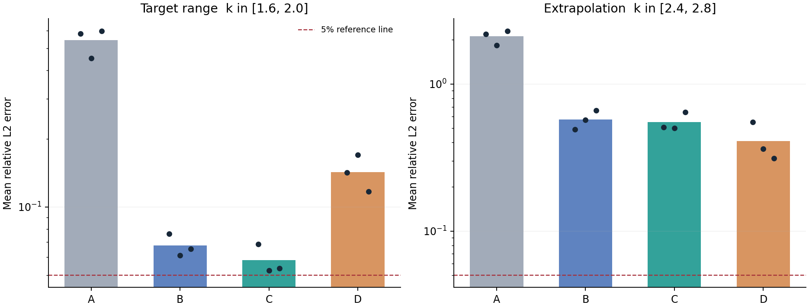

*图6.4-2 两种测试范围的相对解误差。柱为三个种子测试均值的平均，黑点为各种子均值，红虚线为5%解误差参考线；左右纵轴均为对数尺度，但数值范围不同，跨图比较须读取刻度。A直接使用，B数据微调，C物理微调，D从头物理训练。图中数据来自随稿代码实际运行，变量无量纲。*

目标范围内，C的平均相对误差约为5.83%，低于D的14.27%，B也明显优于A。这支持一个有限结论：在本轮小模型、16个目标训练问题和600步目标更新的设置下，源任务参数帮助了目标学习。它不意味着模型已经整体达标；C仍有92次预测没有同时满足预设容差，最大解误差约为34.59%。较好的平均值与可靠地处理每个问题，是两个不同要求。

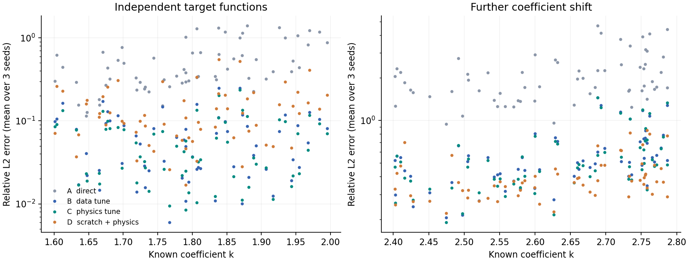

*图6.4-3 误差随系数与源函数共同变化。每个点表示同一测试问题在三个种子下的平均误差；横轴只画出 $k$，源函数系数也在变化，故不能把散点变化全部归因于 $k$。左右分别是目标范围与外推范围，不以连线暗示已检验中间区间。*

进入更远范围后，C的平均误差约为55.12%，反而高于D的40.88%，所有方案的外推预测均未同时通过三项容差。目标范围内的学习收益并未延续为更远参数范围中的可靠优势，说明适配效果与外推能力需要分别评价。当前只改变参数范围，仍未检验任何新方程或新边界。

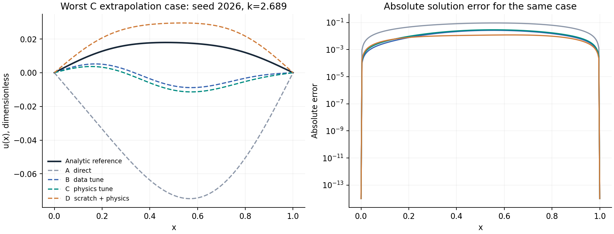

*图6.4-4 失败案例。按预先规定规则，自动选取种子2026下C在外推集上相对解误差最大的完整问题，$k\approx2.689$。左图比较相同问题的预测，右图给出绝对误差，避免曲线接近时只凭肉眼判断；对数图低于 $10^{-14}$ 的值按显示下限绘制，指标仍按原值计算。C在该例中的相对误差约为138.63%，并未删去这个结果。*

物理项也不能只看解误差。C在目标集的平均残差RMS低于B，但外推集上D虽然解误差更低，残差却更高。式（6.4-5）给的是上界，不是两种误差严格同序的关系；不同模态的偏差可以改变二者的排序。全部方案的端点误差均低于$2\times10^{-17}$，原因是共同的正弦基硬约束，而不是它们都自动学会了边界规律。

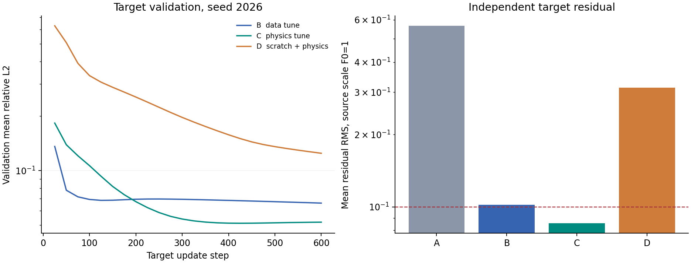

*图6.4-5 左图为种子2026的目标验证误差轨迹；右图为独立目标集上三个种子平均的残差RMS。验证集用于选检查点，测试集不参与选择。图中的残差尺度为 $F_0=1$。*

本轮训练与独立测试合计约1.36秒，不含Notebook启动、制图与HTML生成。这一计时对应上述运行环境，不构成跨机器的性能基准，也不能直接与Poseidon训练成本比较。源任务训练和目标适配时间已分开保存；若讨论预训练方案的总成本，应同时计入源训练，而不能只计算600步目标更新。

### 6.4.5 科学模型的适用范围

实验显示，源任务中得到的表示可以帮助目标范围内的学习，但这种收益受到数据分布与模型表示能力的共同限制。本轮C在目标范围内优于D，却在更远参数范围内具有更大的平均解误差。因而对某类任务的适用性，既应包括与基线比较的改善，也应包括所需精度是否达到、哪些输入仍会失败，以及这些判断依赖的条件。

**例6.4-2（表示空间的限制）** 将源项增加为 $f(x)=\sum_{m=1}^{4}c_m\sin(m\pi x)$，并令 $c_4\ne0$，而预测结构仍只使用前三个正弦基。精确解的第四项为 $c_4\sin(4\pi x)/(16k\pi^2)$，它与整个预测空间正交，因此无论如何调整已有参数，都有

$$
\|\widehat u-u\|_{L^2(0,1)}\geq
\frac{|c_4|}{16\sqrt{2}\,k\pi^2}.
\tag{6.4-6}
$$

这个下界来自预测空间缺少相应模态，增加训练步数并不能消除它。该例是解析讨论，未进行新增模态的数值运行。它说明迁移失败有时源于表示限制，有时源于分布变化、目标数据不足或优化困难；不同原因需要不同证据，不能统一解释为训练次数不够。

物理约束同样具有适用条件。已知方程和正确的初边值信息可以限制预测，但错误方程、遗漏边界或不充分的观测不会因加入损失项而自动修复。对于具有守恒要求的问题，还应将源项与边界通量纳入收支关系。即使内部残差较小，也应结合解误差与其他物理量评价，避免只按单一指标给模型排序。

PINN、神经算子与预训练模型提供的是可以结合的建模选择。方程已知而解标签有限时，物理约束能够提供训练信息；需要反复处理一族函数到解的映射时，算子学习具有相应表达形式；已有预训练模型与目标任务存在可利用联系时，则可以进一步考察适配。每一种选择都需要独立参考和与任务相称的精度、成本证据。

因此，能够支持科学任务适用性的证据，应同时说明数据来源与重叠情况、完整问题级的独立测试、可比基线、物理诊断、误差分布和失败案例。仅有训练精度、参数规模或一张相近曲线，仍不足以确定模型在新任务中的可靠程度。对新方程、初值、参数和边界的能力，必须在对应条件下分别检验；尚未检验的部分应保留为开放范围。

有关完整函数划分、表示限制及迁移证据的练习，见[本组习题](A2组-习题.md)的6.4-3、6.4-5和6.4-7；推导与参考分析另列于[习题参考解答](A2组-习题参考解答.md)。

**参考文献**

[1] Herde M., Raonić B., Rohner T., Käppeli R., Molinaro R., de Bézenac E., Mishra S. *Poseidon: Efficient Foundation Models for PDEs*. 2024. arXiv:2405.19101v2（2024-11-05）. [论文](https://arxiv.org/abs/2405.19101v2)，[HTML全文](https://arxiv.org/html/2405.19101v2)。相关内容见§2训练与微调、§3任务与评价指标、附录B.2.14 Poisson-Gauss、附录C基线、附录D.4.3冻结表示对照及附录E计算资源。

[2] Poseidon作者团队. [官方代码仓库](https://github.com/camlab-ethz/poseidon)。模型加载、训练微调与推理接口见README及配套代码。

[3] Poseidon作者团队. [官方项目页面](https://camlab-ethz.github.io/poseidon/)。提供研究介绍、数据与任务展示及使用说明。
