# 第7章 机器学习的可信度

## 开场：小绘的四道关卡

在进入正题之前，先认识一下本章的主角——**小绘**，一台圆头圆脑、眼睛会发光的教学机器人。它最近接了一个新任务：帮科学计算里的机器学习模型"把关"。

把关这个词听起来严肃，其实小绘心里只装着一个朴素的问题：

> **一个机器学习模型给出的答案，到底有多可信？**

为了回答它，小绘要依次闯四道关卡。每一关，都对应着"可信"这件事的一个侧面。

- **第一关：能画多像？** 一个模型能不能把要学的规律"画"得足够像？（7.1 逼近理论与泛化界）
- **第二关：在哪里学？** 换一批数据、换一个生成规则，它学的规律还成立吗？（7.2 分布内与分布外泛化）
- **第三关：和谁同源？** 机器学习和工程师用了两百年的降阶模型，是不是同一枚硬币的两面？（7.3 机器学习与降阶模型）
- **第四关：有多可信？** 模型给出预测时，能不能顺便告诉我们这个预测有多可信？（7.4 不确定性量化）

四关连起来，回答的是同一句话，也是贯穿本章的那把尺子：**可信度**。

好，故事开始。小绘站在第一关门口，手里拿着一支笔。

---

## 7.1 逼近理论与泛化界

小绘一开始的任务很简单：看着一条曲线，把它描下来。后来老师收走了原图，只丢给它几个带标记的点，要它自己找出规律，再判断新来的点。

这两个任务长得像，骨子里却不一样：前者问"能不能画出来"，后者问"只看几个例子，能不能学会"。本节就跟着小绘，依次认识三件事——模型**能表示什么**、**学得怎么样**，以及评价背后的**概率保证**。

*图7.1-1　从"画得出"到"学得会"。漫画用于引入问题，不代表数学证明或实验结果。 本版为AI生成教学示意，非实测图。*

### 7.1.1 逼近能力与实际学习效果

#### 一条曲线，能用许多"小零件"画出来吗？

老师在纸上画了一条平滑曲线，小绘拿直线去描，有些地方怎么也贴不紧。于是它换了套工具：把若干条简单曲线调好位置和形状，再加在一起。

神经网络就可以这样理解。先看一个最简单的计算单元：输入一个数，经过一次函数变换，再输出一个数。这个单元叫**神经元**。这里介绍一种常见的激活函数，图像像一条平滑的字母 S：

$$
\sigma(t)=\frac{1}{1+e^{-t}}.
$$

把输入换成 $wx+b$，就得到神经元的输出 $\sigma(wx+b)$。其中 $w$ 和 $b$ 可以改变曲线的位置、方向和横向尺度——你可以把它俩理解成"旋钮"。

把许多这样的输出加权相加，就得到本节使用的**单隐层神经网络**：

$$
g_m(x)=\sum_{j=1}^{m}a_j\sigma(w_jx+b_j).
$$

这里 $m$ 是隐藏层神经元数，$a_j$ 是输出端的权重，可正可负。"单隐层"是说输入与输出之间只有一层这样的计算单元；输出端在这里只做线性加权，不再套一层 sigmoid。

一句话概括：**每个神经元提供一个小形状，输出权重决定这个形状参与多少。** 把它想成一个小小绘图工作室，就对了——当然，真实计算是函数值相加，不是把曲线碎片首尾拼起来。

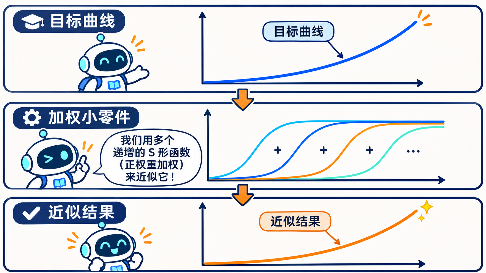

*图7.1-2　加权S形函数组合的概念示意；曲线不对应一组已运行参数。 本版为AI生成教学示意。*

#### 通用逼近定理：表示能力的一张"资格证"

小绘问："如果零件足够多，我是不是能把每一条连续曲线都画得足够像？"

在明确的条件下，答案是肯定的。这里采用 Cybenko 的连续 sigmoidal 版本。所谓 **sigmoidal**，指满足两个端点极限的函数：

$$
\lim_{t\to-\infty}\sigma(t)=0,
\qquad
\lim_{t\to+\infty}\sigma(t)=1.
$$

前面给的 logistic 函数就是一个连续 sigmoidal 函数；定理并不额外要求它单调。

> **通用逼近定理（Cybenko，1989，连续 sigmoidal 版本）**
>
> 设 $\sigma:\mathbb R\to\mathbb R$ 连续且具有上述两端极限。对任意连续函数 $f:[0,1]^d\to\mathbb R$ 和任意 $\varepsilon>0$，都存在有限的神经元数 $m$ 以及参数 $a_j,b_j\in\mathbb R$、$w_j\in\mathbb R^d$，使得
>
> $$
> g_m(x)=\sum_{j=1}^{m}a_j\sigma(w_j^\top x+b_j),
> \qquad
> \sup_{x\in[0,1]^d}|g_m(x)-f(x)|<\varepsilon.
> $$

最后一个不等式说的是：在整个单位立方体上，**任意位置**的误差都小于 $\varepsilon$，而不只是几个给定点。这叫**一致逼近**。本节只讲结论，不作证明。

读这个定理，要抓住那个顺序——**"对每个目标函数、每个精度，都存在合适网络"**。神经元数和参数可以随目标与精度而变；定理既没有预先固定一个"包打天下"的网络规模，也没有限制权重大小。

但是，这张"资格证"只证明这样的表示**存在**。它没告诉小绘：看多少样本才够、怎么训练才能找到这些参数，也没保证训练后的网络在原区域外仍然准确。另外，ReLU 不是连续 sigmoidal 函数，不能直接把本定理里的激活函数换成 ReLU 而不另引定理。

#### 画得过已知点，是否就找到了规律？

老师只给两个点 $(0,0)$ 和 $(1,1)$。小绘画了 $g_1(x)=x$，另一个同学画了 $g_2(x)=x^2$。两条曲线都精确穿过这两个点，但在 $x=1/2$ 处，一个给 $1/2$，另一个给 $1/4$。

仅凭两个点，无法判断谁更符合真实规律。**模型能拟合已知数据，和模型能预测新数据，是两个需要分别回答的问题。** 于是，老师给小绘准备了一份"新题"。

### 7.1.2 训练误差与泛化误差

*图7.1-3　练习成绩、新题成绩与真实水平。漫画中的"满分"是情境设定，不是下文实验的结果。 本版为AI生成教学示意，非实测图。*

#### 三张成绩单，分别在说什么？

先约定记号：一个样本由输入 $X$ 和标签 $Y$ 组成，$(X,Y)$ 的分布记作 $P$；模型 $h$ 根据输入给出预测 $h(X)$。**损失函数** $\ell(h(X),Y)$ 用一个数表示这次预测错得有多严重。

分类时常用 0—1 损失：预测正确记 0，错误记 1。回归时常用平方损失 $(h(X)-Y)^2$。本节后面的小游戏用 0—1 损失，所以"平均损失"就是错误率。

模型训练完成后，我们要分清三张成绩单。它们的精确数学定义放在附录 A，这里先用一张表讲清各自在问什么：

| 成绩单 | 怎样计算 | 回答什么问题 |
|---|---|---|
| 训练误差 | 在参与训练的样本上算平均损失 | 练过的题做得如何？ |
| 独立测试误差 | 在独立于训练和选模的新样本上算平均损失 | 这批新题做得如何？ |
| 总体风险 | 按任务分布对损失取期望 | 长期遇到同分布新题，平均表现如何？ |

三张成绩单对应三个问题：练过的题、这批新题、长期同分布的新题。其中，训练误差与总体风险之间的差，叫**泛化间隙**。讨论"间隙小"时，指这个差的绝对值小；泛化间隙不必为正——某一批训练样本也可能恰好偏难。

#### 一个数字小，另外两个就一定小吗？

下面三种情形里的数字都是概念示例，不是实验记录。

| 训练错误率 | 总体风险 | 应怎样理解 |
|---:|---:|---|
| 1% | 30% | 练习题做得好，但真实表现差，间隙大。 |
| 40% | 41% | 间隙只有 1 个百分点，但整体错误率仍高。 |
| 3% | 4% | 训练误差、间隙和总体风险都较小。 |

第一行提醒我们：训练误差小，不能单独保证新样本预测好。第二行提醒我们：间隙小，只表示训练成绩与真实水平接近，并不表示真实水平已经足够好。

#### 给小绘出一道能算出"真实答案"的任务

为了同时看见这三张成绩单，老师设计了一个简单的"画分界线"游戏。它不训练神经网络，而是让小绘从有限几条候选规则里挑一条——这样，评价和概率保证都能看得清清楚楚。

每次在 $[0,1]$ 中均匀随机取一个位置 $X$。按照隐藏规则，$X<0.53$ 标为 0，$X\ge0.53$ 标为 1。但负责贴标签的小助手偶尔手滑：每个标签会独立地以 10% 的概率翻转，且翻转与位置无关。

小绘不知道隐藏分界线，只允许从事先准备好的 21 条规则里选一条。它们的分界点是

$$
t\in\{0,0.05,0.10,\ldots,1\},
\qquad
h_t(x)=\mathbf 1\{x\ge t\}.
$$

其中 $\mathbf 1\cdot$ 表示条件成立时取 1，否则取 0。训练时，小绘选训练错误率最低的规则；并列时选较小的分界点。

因为数据生成规则是我们设计的，可以直接算出每条候选规则的总体风险：

$$
R(h_t)=0.10+0.80\,|t-0.53|.
$$

这个公式不难理解：在候选分界线与真实分界线之间，两条规则意见相反，这段区间的长度是 $|t-0.53|$。区间外出错概率为 0.1，区间内为 0.9，二者相差 0.8。这里预测的是实际带噪声的标签。

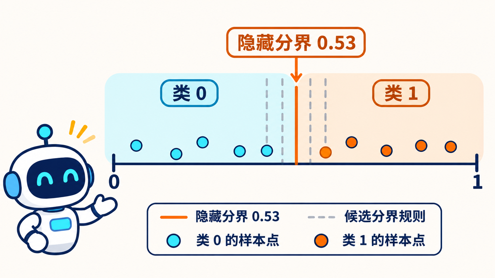

*图7.1-4　分界线游戏：隐藏规则藏在中间，候选规则只能从固定集合里挑。概念示意，非实验结果。 本版为AI生成教学示意，非实测图。*

> **为什么换成分界线游戏？** 神经网络让我们认识表示能力；有限的分界规则则让我们看清评价和概率保证。这个小游戏是可计算的学习案例，不是对通用逼近定理的验证。

不过，小绘还有个疑问："每次都要准备很多新题，才能知道训练成绩靠不靠谱吗？能不能在明确的假设下，直接给出一个误差保证？"这就引出了泛化界。

### 7.1.3 简单泛化界及其假设条件

*图7.1-5　给训练成绩配上一段"误差余量"。示意概念，非实验数据。 本版为AI生成教学示意，非实测图。*

#### 给训练成绩配上一段"误差余量"

我们希望得到这样的判断：总体风险虽然看不见，但它与训练误差之间的距离，在大多数随机训练样本上不会超过一个可计算的数。

先把条件说清楚。本节考虑一个**抽样前确定、非空且有限的候选模型集合** $\mathcal H$，其中有 $M$ 个模型；训练样本独立同分布，来自所要评价的分布 $P$；对每个候选模型，损失都可测且取值在 $[0,1]$ 内。再选定一个数 $\delta\in(0,1)$，表示允许的失败概率。

在这些条件下，有一个结论（正式公式与推导见附录 B）：**以至少 $1-\delta$ 的概率，全部候选模型的训练误差与总体风险之间的距离，同时不超过一个可计算的余量。** 这个余量记为 $b(n,M,\delta)$，它只取决于三个量——样本量 $n$、候选模型数 $M$、允许的失败概率 $\delta$。

"一致"在这里指**同时覆盖全部候选模型**。所以，看过训练数据后从这些模型中选出一个，仍然可以用同一保证。它不是说每个输入位置的预测都准确，也不是说误差恰好等于这个余量。

例如，允许失败概率 $\delta=0.05$ 时，"至少 95% 的概率"指：如果按规定机制反复抽训练集，至少 95% 的概率会抽到使全部候选模型同时满足不等式的训练集。它不是说每次预测有 95% 的概率正确，也不是说每 20 次实验必有一次失败。

#### 看懂余量怎么变，比记住公式更重要

余量 $b(n,M,\delta)$ 可以看成训练成绩旁的"误差余量"。固定其他条件后，它随三个量这样变化：

| 改变什么 | 余量怎样变化 | 怎样理解 |
|---|---|---|
| 增加样本量 $n$ | 余量变小 | 更多独立数据支持更紧的保证。 |
| 增加候选模型数 $M$ | 余量变大 | 要同时照顾更多候选，保证更宽。 |
| 减小失败概率 $\delta$ | 余量变大 | 要求更可靠，就得付出更宽余量的代价。 |

这里的"模型数"是候选集合的元素个数，不能直接换成神经元数或参数数。具有连续实数参数的神经网络通常组成无限集合，本节这条有限类公式不能直接套用。

#### 保证离不开条件

离开本节的假设，原来的保证就未必适用。记住三个具体提醒：

- **复制数据不等于增加独立信息。** 把同一个样本复制 1000 次，并不能当作 1000 个独立样本代入公式。
- **换了任务分布，须重新判断。** 在熟悉区域抽样得到的保证，不自动覆盖来自另一分布的新数据。
- **平方损失未必有界。** 0—1 损失天然在 $[0,1]$ 内；平方损失若没有预测值和标签范围的限制，不能直接套用本节公式。若两者都在 $[0,1]$ 内，平方损失才也在 $[0,1]$ 内。

故事走到这里，小绘终于能分清三件事：通用逼近定理说明工具箱有怎样的表示能力；独立测试帮助估计已训练出的模型表现；泛化界则在明确条件下，为训练表现与总体风险的差距提供高概率保证。

---

小绘松了口气，正想收工，却突然想到一个问题："我刚才所有的保证，都默认新题和练习题是从**同一个池子**里抽的。要是哪天老师换了个池子抽题，我的成绩单还作数吗？"

这个问题，把它推进了第二关。

---

## 7.2 分布内与分布外泛化

### 引入：同一个模型，为什么要交两张成绩单？

一位同学教小绘认识 $y=\sin x$：在 $[-1,1]$ 上取 41 个等距点，让它用三次多项式拟合。

换一批区间内的新点，误差很小。小绘很得意："这条曲线，我学会了。"

"那把计算范围换成 $[2,3]$ 呢？"

小绘没有罢工，仍按学到的多项式认真计算，只是答案开始明显偏离正弦曲线。它学到了一段好近似，却没有因此学会正弦函数的全部变化规律。

*图7.2-1　用地图比喻已知区域与外推区域，图中路线不是正弦或多项式的坐标图。 本版为AI生成教学示意。*

读图时先找原点：正弦曲线经过 $(0,0)$，在 $[-1,0)$ 上为负，在 $x=\pi/2$ 处达到 1。第一格只画了一小段，并非完整周期。

这个开场给了我们一个直观问题：计算范围变了，原来的成绩还能不能代表新任务？但本节不止讲"出了区间怎么办"。更一般的问题是：**新数据与训练数据，是不是按同一套规则产生的？**

### 7.2.1 什么是分布内与分布外泛化？

#### 先分清：新样本，还是新分布？

在科学计算中，我们常用已有数据近似一个函数，再计算未见输入对应的输出。模型处理未参与学习的新样本的能力，叫作**泛化**。仅在训练点上算得准，还不能说明它有这种能力。

继续近似 $y=\sin x$。现在不固定网格，而是在 $[-1,1]$ 内均匀抽取训练点：相同长度的小区间，被抽中的机会相同。记作 $x\sim U[-1,1]$，其中 $U$ 表示均匀分布；每抽到一个 $x$，答案就取 $y=\sin x$。

这就是一套数据产生规则。分布不仅管"哪些输入可能出现"，也管"不同输入出现得有多频繁"，以及"输入怎样对应答案"。这里的参考公式固定不变，只改变输入的抽取规则。

- **分布内泛化（ID）**：模型处理与训练数据来自同一分布的新样本的能力。仍按 $U[-1,1]$ 独立抽一批新点，即使这些点一个也没见过，考查的仍是分布内泛化。
- **分布外泛化（OOD）**：模型处理与训练数据来自不同分布的新样本的能力。改按 $U[2,3]$ 抽新点，即使答案仍是 $\sin x$，输入分布已经改变，考查的是分布外泛化。

用 $P_{\mathrm{train}}$ 表示训练样本的生成分布，用 $P_{\mathrm{eval}}$ 表示评价样本的生成分布，可以简写为：

| 判断 | 分布关系 | 真正在问什么？ |
| --- | --- | --- |
| 分布内（ID） | $P_{\mathrm{eval}}=P_{\mathrm{train}}$ | 同一规则产生的新样本，能否算准？ |
| 分布外（OOD） | $P_{\mathrm{eval}}\ne P_{\mathrm{train}}$ | 规则改变后产生的新样本，能否算准？ |

这里比较的是生成规律，不是两份有限数据的数值是否一模一样。两批独立抽样的点通常不同，但仍可来自同一分布。反过来，是否 OOD 也不由误差大小决定：**OOD 是在描述任务变了，不是在宣布模型一定失败。**

#### 范围没变，为什么也可能是分布外？

仍然计算同一个正弦函数，不必换一个陌生场景。

训练时均匀抽 $[-1,1]$，左右半区各有 50% 的机会。假设实际计算更常查询正半轴：新输入以 25% 的概率落在 $[-1,0]$，以 75% 的概率落在 $[0,1]$，选好半区后再在其中均匀抽。

输入仍在 $[-1,1]$，答案仍是 $\sin x$，但不同位置出现的频率变了，所以仍是分布外评价。这些比例是我们事先指定的规则，不是某批样本必须恰好达到的比例。

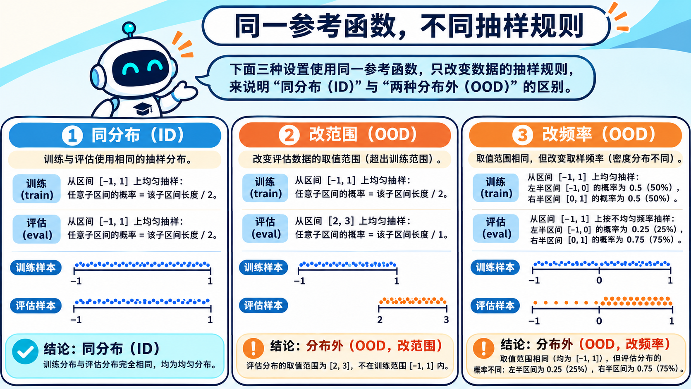

*图7.2-2　相同参考函数下，同分布、改变输入范围和改变区间内抽样概率三种安排；点位仅示意抽样规则。 本版为AI生成教学示意。*

因此，外推和分布外泛化不是同一个概念：外推看是否走出了已有数据的范围，分布外看生成规律是否改变。开场"地图"的比喻适合说明范围变化，却画不全频率变化；新抽到的同分布样本，也可能略超出有限训练样本的最小值或最大值。

#### 训练、验证、测试，又是另一种分工

ID/OOD 回答"数据从哪里来"，训练、验证、测试回答"数据拿来做什么"。

*图7.2-3　三份数据的职责。比较多项式次数只是验证集用途的一个例子，不是通用定义。 本版为AI生成教学示意，非实测图。*

- 训练集：学习参数。例如给定三次多项式后，拟合各项系数。
- 验证集：比较候选模型和设置。例如比较三次与五次拟合，再决定用哪一个。
- 测试集：评价已确定的方案，不再帮忙挑选或调整模型。

一份测试集可以来自训练分布，另一份可以专门来自目标 OOD 分布；两份都不应参与选模型。"我没用测试集拟合系数，只用它挑了次数"，仍然让测试信息影响了建模，这就是一种**数据泄漏**。是否用优化器读过测试标签，不是唯一判断标准。

### 7.2.2 用函数逼近检验分布内与分布外表现

#### 实验一：按分布抽样，独立比较 ID 与 OOD

先写下规则，再看成绩：从 $U[-1,1]$ 抽 41 个训练点，拟合预先确定的三次多项式；另外独立抽 1000 个 ID 测试点和 1000 个 OOD 测试点，分别来自 $U[-1,1]$ 与 $U[2,3]$。所有答案均按 $\sin x$ 计算。这里没有待选的模型设置，因此不额外安排验证集。

运行前先猜：同一个模型，在这两种测试分布上的误差会一样吗？

用均方根误差（RMSE）比较：把每个误差平方，取平均，再开平方。

$$
\mathrm{RMSE}=\sqrt{\frac{1}{m}\sum_{i=1}^{m}\bigl(p(x_i)-\sin x_i\bigr)^2}.
$$

其中 $p$ 是拟合多项式，$m$ 是评价点数。RMSE 反映这一组点的整体误差，不保证每个点的误差都小。

| 数据用途 | 输入的生成分布 | 点数 | RMSE |
| --- | --- | ---: | ---: |
| 训练 | $U[-1,1]$ | 41 | 0.000289 |
| ID 测试 | $U[-1,1]$，重新独立抽样 | 1000 | 0.000319 |
| OOD 测试 | $U[2,3]$，独立抽样 | 1000 | 0.739198 |

这次模型能很好地处理同分布的新点，却没有同样准确地处理另一分布的新点。分布内成绩不能代替分布外成绩，这正是分开测试的意义。

但这只是一组固定种子下的结果，不是所有随机抽样的保证，更不是所有模型的命运。本实验只运行了范围改变的 OOD 测试；图 7.2-2 中的频率改变情形仍是概念示意，不能替它报成绩。

#### 实验二：回到固定网格，看清近似怎样偏离

科学计算也常在规则网格上检查函数近似。回到漫画：用 $[-1,1]$ 上 41 个等距点拟合三次多项式，再分别在原区间和新区间取点。与实验一相比，这次连训练点也改成了固定网格，所以是重新拟合的模型，不应混用两张表的数字。

| 检查位置 | 点的安排 | RMSE |
| --- | --- | ---: |
| 训练点 | $[-1,1]$ 内 41 个等距点 | 0.000341 |
| 区间内新点 | $[-0.975,0.975]$ 内 40 个等距点，不与训练点重合 | 0.000312 |
| 区间外新点 | $[2,3]$ 内 101 个等距点 | 0.727300 |

这张表是确定性网格检查，用来观察输入范围变化的影响，不是一次独立随机抽样的 ID/OOD 实验；两种检查都重要，但证据类型不同。后两行都是未参与拟合的评价点，也不是一行叫验证集、另一行叫测试集。

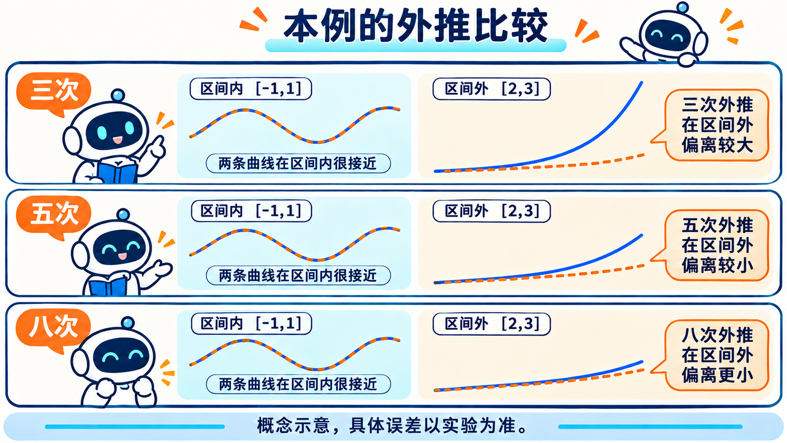

*图7.2-4　正文特定无噪声案例中三种次数的外推差距概念比较；装饰曲线不是实际函数图，不能据此读取误差。 本版为AI生成教学示意。*

三次多项式在短区间内模仿得很好，但它并没有学会正弦函数的周期结构，离开区间后仍按多项式公式计算。

#### 实验三：区间外，就一定算不好吗？

保留实验二的训练网格与评价点，改用预先指定的三次、五次、八次多项式。

| 多项式次数 | 区间内新点 RMSE | 区间外新点 RMSE |
| --- | ---: | ---: |
| 3 | $3.12\times10^{-4}$ | 0.727300 |
| 5 | $1.94\times10^{-6}$ | 0.136527 |
| 8 | $7.05\times10^{-9}$ | 0.014932 |

本例提高次数后，外推反而改善了。因此不能仅凭"输入变了"就预判失败；同样，也不能由这个无噪声例子推出"次数越高永远越好"。

若据此选定八次模型，这些结果便参与了选择，最终评价还需要未用于选择的数据。

#### 一个短解释：旧数据为什么不能自动保证新分布？

现在把参考函数的名字遮住，只给预测者看 $[-1,1]$ 上的函数值，不告诉它区间外公式。它面对两种可能：

- $f_1(x)=\sin x$。
- $f_2$ 在 $x\le 1$ 时也等于 $\sin x$，在 $x>1$ 时变成 $\sin x+(x-1)^3$。

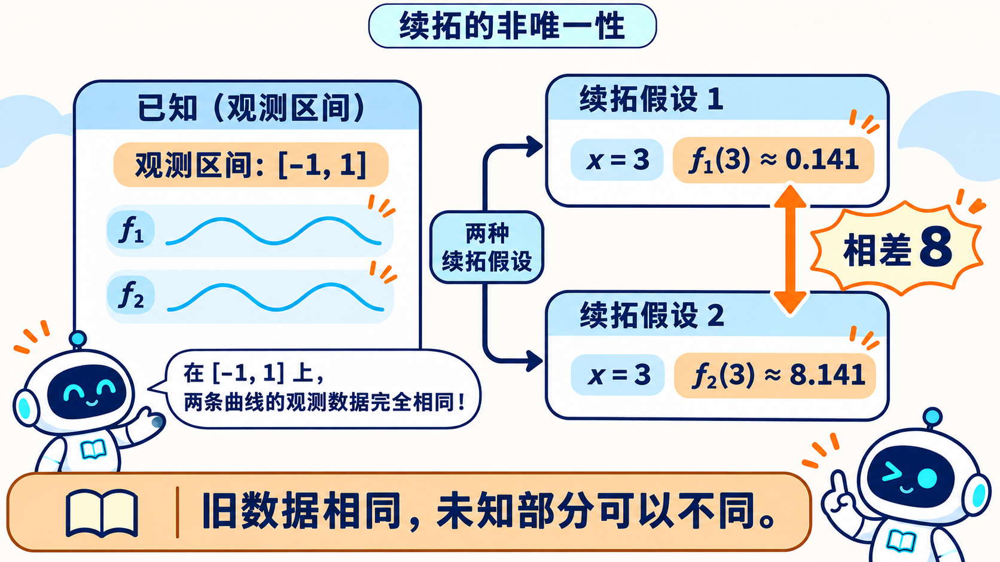

*图7.2-5　观测区间相同、新位置答案不同的两种延续；端点数值来自正文公式，示意线不按坐标比例绘制。 本版为AI生成教学示意。*

两个可能的真实函数都符合旧数据，却在 $x=3$ 处分别约为 0.141 和 8.141。同一个预测办法只能根据相同信息给出同一个答案 $a$，于是两个误差至少有一个不小（推导见附录 C）。这说明：只凭旧区域的观测，不能保证对所有与观测相符的函数都在新区域准确。它不是说每次外推都失败，也不是完整的分布误差界；额外知道真实公式或有唯一解的方程，会改变信息条件。

### 7.2.3 从近似一个函数，到预测一族方程的解

#### 这次改变的，是方程的参数

前面的模型近似一条固定曲线。在求解微分方程时，我们常遇到另一种需求：材料参数不同，需要计算的解也不同。若想用一个模型快速预测这些解，就必须测试它能否处理未见的参数工况，而不只是补上同一条曲线的几个点。

以一维热传导为例：一根细棒两端温度固定为 0，初始时中间较热。模型输入位置 $x$、时间 $t$ 和热扩散参数 $\nu$，输出温度 $u(x,t;\nu)$。在其他条件不变的这个理想模型里，$\nu$ 越大，热量扩散越快。

固定一个 $\nu$，就对应整套位置、时间上的温度解；我们把它称为一个**工况**。换一个 $\nu$，相当于换了要近似的解函数。这与前面的任务一脉相承：先是计算新位置，现在还要计算新参数下的解。

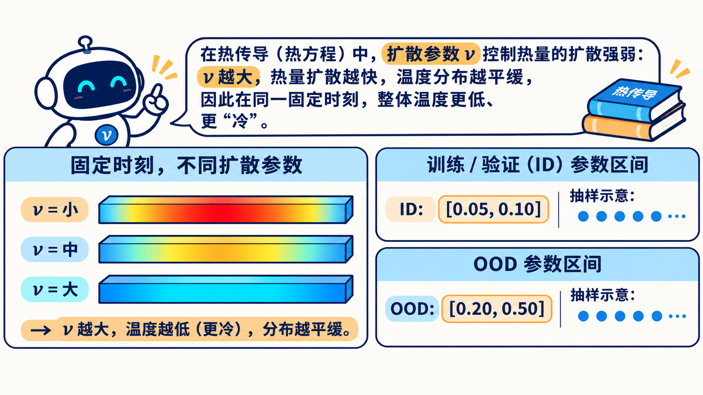

*图7.2-6　用温度色条示意正文冷却问题中扩散参数的影响，右侧列出ID与OOD参数区间；不是解析曲线或实际抽样图。 本版为AI生成教学示意。*

#### 把"同分布"落实到参数怎样产生

不能只写"范围内测试"。先把规则写清楚：训练参数从 $U[0.05,0.10]$ 抽取；验证与 ID 测试分别按同一规则重新独立抽取；OOD 测试改从 $U[0.20,0.50]$ 抽取。初始条件、边界条件和每个工况的坐标网格全部保持相同。

| 用途 | 参数 $\nu$ 的生成规则 | 一次抽样得到的参数（四位小数） |
| --- | --- | --- |
| 训练 | $U[0.05,0.10]$ | 0.0613、0.0762、0.0785 |
| 验证 | $U[0.05,0.10]$，独立抽样 | 0.0710、0.0889 |
| ID 测试 | $U[0.05,0.10]$，独立抽样 | 0.0853、0.0997 |
| OOD 测试 | $U[0.20,0.50]$，独立抽样 | 0.3757、0.4679 |

每个工况使用相同的 51×51 位置—时间网格，覆盖 $x,t\in[0,1]$。同一参数的整套数据只进入一个集合，不拆散到训练和测试两边。此时独立留出的是完整工况；同一工况的 2601 个网格点不能算成 2601 个独立材料样本。

这里的 ID 测试参数甚至高于本次三个训练参数的最大值，却仍是 ID：我们判断的是它们来自同一个 $U[0.05,0.10]$，不是要求落在三个训练数值围成的区间里。

#### 两种留出方法，回答不同问题

如果只用 $\nu=0.10$ 的一套解，再随机留出 20% 的网格点，测试回答的是："这个工况下没用过的位置和时刻，能否算准？"这种检查可以有用，却没有检验新的参数工况。

如果目标是跨参数预测，就应像上表那样留出完整工况；是否 ID 或 OOD，再由参数及其他条件的生成规律判断。想检验新的初始条件，道理相同：留出完整初始条件对应的解，而不是只留几个网格点。

**本节已计算解析参考、抽取参数并检查分组，但没有训练温度预测模型，所以没有它的 ID/OOD 误差。** 正式实验还需用训练集拟合、验证集决定设置，最后分别报告两类独立测试结果，不能根据测试分数继续调模型。

### 拓展：从求解一道方程，到学习一族解

传统数值计算通常从给定参数、初值与边界条件出发，求出相应的解。大量工况需要反复计算时，一个自然的问题是：能否利用已有求解数据，学习输入条件到解的映射，再预测新工况？

2021 年，Lu 等在 *Nature Machine Intelligence* 发表了 DeepONet 工作，研究用神经网络学习输入函数到输出函数的映射。可以把它理解为：目标不再只是记住一条曲线，而是学习不同输入条件对应怎样的解。这一方向把本节"从新点到新工况"的问题放到了更大的科学计算背景中；这里不展开网络结构。

方法的表达能力与它在未见分布上的实际表现，仍是两件事。即使能够学习一族解，也不能因此跳过独立工况测试，更不能仅凭同一工况内的留点结果宣称适用于任意新参数或初值。

### 收束：先说分布，再报成绩

*图7.2-7　明确任务、划分完整样本、分别报告ID与OOD的流程示意；成绩单不含实验结果。 本版为AI生成教学示意。*

现在可以给小绘一句更准确的总结：

> 分布内泛化，是处理同一生成规律下的新样本；分布外泛化，是处理生成规律改变后的新样本。训练误差不能代替 ID 测试，ID 成绩也不能代替目标 OOD 测试。

本节从 $\sin x$ 的新输入，走到热方程的新参数，没有更换评价原则：先问"准备把模型用在哪里、数据怎样产生"，再决定怎样留出测试。7.1 节的同分布结论并未被推翻，只是不能脱离原有假设，自动搬到另一分布上。

---

第二关过后，小绘心里踏实多了，但一个新的、更深的疑问冒了出来："我一直在用'神经网络'这个新名词，可它和工程师们用了两百年的数值分析，到底是什么关系？一个像凭空冒出来的黑箱，另一个却有一整套成熟的语言来谈'近似有多好'。如果能对上号，我是不是就能借来那套语言？"

带着这个疑问，小绘走进了第三关。

---

## 7.3 机器学习与降阶模型：同一条低维之路

### 7.3.1 从一袋弹珠说起

设想地板上散落着几百颗弹珠，乍看乱作一团。可若你蹲下来眯起眼睛，会隐约发现它们并非随机分布，而是大致排成一条弯弯的细线。这时你会意识到：要"几乎完整"地描述这堆弹珠，也许根本不需要记下每颗弹珠的横纵坐标——那是几百个数字；只要记住"那条弯线的形状"，再加上每颗弹珠沿线滑到了哪个位置——每颗一个数字——就够了。信息几乎没有损失，描述量却减少了一大半。

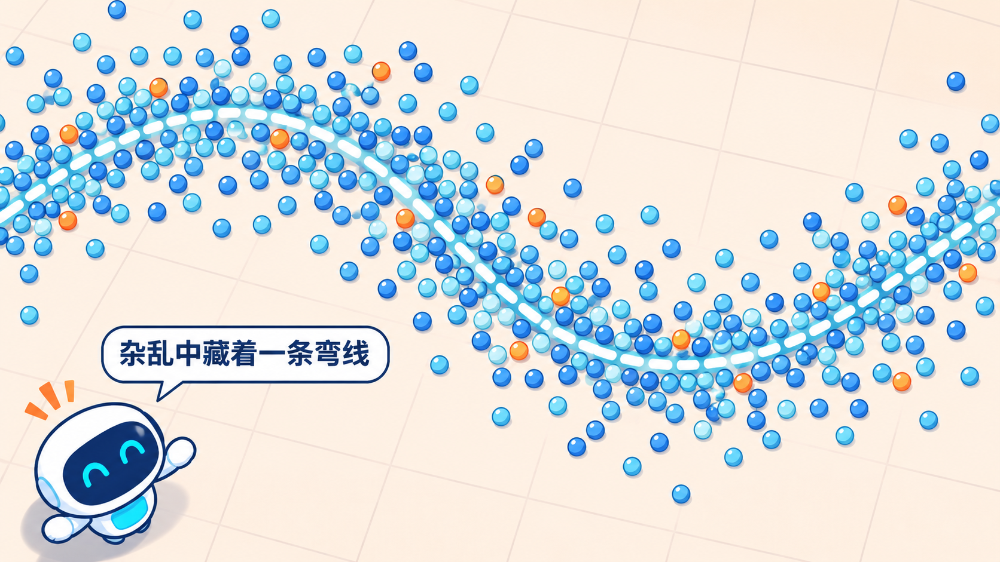

*图7.3-1　散落在地板上的弹珠，乍看杂乱，实则大致排成一条弯线。 本版为AI生成教学示意，非实测图。*

同样的体验，你其实每天都在经历。用手机拍下一张几百万像素的照片，发出去前，软件会把它压缩成一个体积小得多的文件；对方打开时，照片看起来和原来几乎一样。压缩的本质，就是"发现这张照片并没有几百万个真正独立的信息，它背后其实只藏着很少几个关键结构——把冗余丢掉，把结构留下"。你每天无意识做的这件事，和数学家做降阶、做机器学习时想的，是同一件事。

这一节要讲的，正是这种"用很少的坐标抓住一团高维对象本质"的想法。奇妙的是，它同时是两门学问的核心：一门叫**降阶模型**（Reduced-Order Model，简称 ROM），一门叫**机器学习**（Machine Learning，简称 ML）。前者常出现在科学与工程计算里，后者几乎无处不在。它们乍看风马牛不相及，实则是**同一枚硬币的两面**。我们先把两面分别看清，再一起翻过来，看它们共用的是怎样一条边。

### 7.3.2 降阶模型：主动去"找"那个低维世界

**先看"直线"的情形。** 回到弹珠。如果它们大致排在一条直线上，数学家会说这些点"近似生活在一个一维子空间里"。找这条直线的办法非常朴素：先看数据"最散开"的那个方向，把它当作第一条轴；再看剩余方向里、与它垂直且"最散开"的那条，当作第二条轴；如此下去。这个"按重要性挑方向"的过程，就是**主成分分析**（Principal Component Analysis，PCA）；在科学与工程里，它还有一个更"物理"的名字——**本征正交分解**（Proper Orthogonal Decomposition，POD）。

为了让你真切感受到"少数几个方向就够用"，想象一个更具体的场景：一所学校收集了一万张证件照，每张都由上百万个像素点构成，信息量似乎大得惊人。但仔细一想，这些照片长得其实很像——大致就是那么几种"基本脸型"按不同比例混出来的：有人眼睛大一点，有人下巴尖一点，有人肤色亮一点。所谓主成分分析，就是自动找出这些"基本脸型"，以及每一张脸里它们各自占多大比重。于是，原本需要上百万个数才能描述的一张脸，现在只需要"几个基本脸型的混合比例"就够了。

一旦选定少数几条轴，任何一个高维向量就可以近似写成"它在这几条轴上的坐标"的组合：

$$
x \approx a_1\phi_1 + a_2\phi_2 + \cdots + a_k\phi_k .
$$

原来可能要几百个数才能描述的 $x$，现在只需 $k$ 个坐标 $a_1,\dots,a_k$。这就是"降阶"：把一个高维问题，投射进一个低维的子空间里。

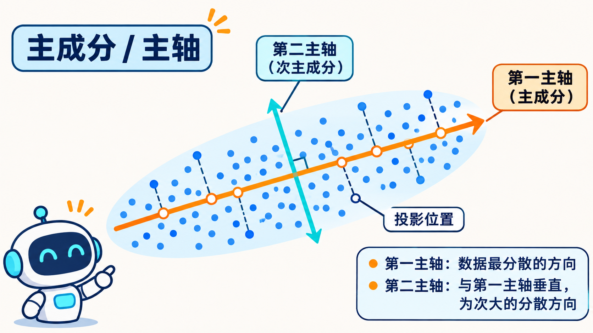

*图7.3-2　主成分分析 / 本征正交分解的几何直觉。 本版为AI生成教学示意，非实测图。*

> **案例 1｜身高—体重与"第一主轴"**
>
> 测了五个人，记录（身高 cm，体重 kg）：$(160,52)$、$(170,62)$、$(180,72)$、$(190,82)$、$(175,65)$。把五个点画在"身高—体重"平面上，它们大致排成一条从左下到右上的斜线；PCA 找到的"第一主轴"，正是这条斜线的方向——"个子越大、体重越重"。
>
> 本来，描述一个人要两个数（身高、体重）；可一旦沿这条主轴投影，只要一个数——"这人有多'大个儿'"——就抓住了大部分差异。**从两个数到一个数，信息损失很小**，这就是降阶最朴素的姿态。

**它在数值计算里到底省了什么。** 在求解偏微分方程的仿真中，那个高维的 $x$ 往往就是某个时刻的整个解场——比如一块金属板在某个瞬间每个格点上的温度，或者一条河流里每个位置的水流速度。这样的仿真要一次一次地做，每一次都很昂贵。降阶模型的做法是：先老老实实做几次完整的、昂贵的仿真，把得到的若干张"解场照片"收集起来——这些照片就叫**快照**（snapshot）；然后从这些快照里挑出少数几个反复出现的"基本形态"（模态），把 $\phi_1,\dots,\phi_k$ 固定下来。往后要预测新的时刻，就不再需要重做全场仿真，只要解出那几个权重 $a_1,\dots,a_k$ 的变化就够了。

这带来一个巧妙的"贵一次、便宜很多次"的分工：把昂贵的那部分——找出主方向、固定模态——放在前面一次性做完，这叫**离线阶段**（offline）；把便宜的那部分——每次只算少数几个系数——留给后面反复使用，这叫**在线阶段**（online）。降阶模型之所以能"加速"数值计算，秘密正在这里：它把"每次都扛着整个高维世界"改成了"先花一次力气看清世界的骨架，之后每次只沿着骨架走"。

> **案例 2｜一块金属板的温度场，三个模态**
>
> 一块 $100\times100$ 网格的金属板，某一刻有 $10000$ 个温度值。POD 从许多张"温度场照片"（快照）里挑出三个反复出现的"基本形态"：
>
> - 模式 1"整体升温"：整块板均匀偏暖；
> - 模式 2"左热右冷"：左边比右边热；
> - 模式 3"中间鼓起来"：中心温度凸起。
>
> 于是，某一个时刻的温度场可以近似写成 $T \approx 0.8\phi_1 + 0.3\phi_2 - 0.2\phi_3$。**$10000$ 个数，被压缩成 3 个权重 $(0.8,0.3,-0.2)$。** 昂贵的全场仿真只做几次（离线），以后每次只需解这三个权重的变化（在线）——这就是"贵一次、便宜很多次"。

**当直线不够用。** 但现实往往不这么友善：弹珠排成的不是直线，而是一条弯弯的曲线，甚至一张曲面。这时"挑几条直线轴"就力不从心了——无论你怎么选轴，总有一大块数据落在轴之外。

怎么办？一条思路（仍是降阶）：把"直线子空间"放宽成"弯曲的流形"——找一个可以弯曲的曲面去贴合数据，再在曲面上用少数几个参数定位。这就像从"用尺子量"升级到"用软尺贴着曲面量"。

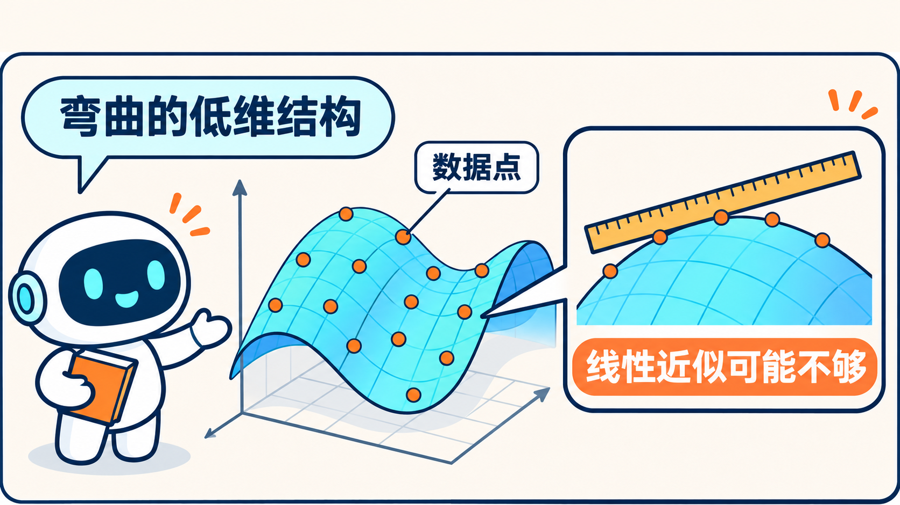

*图7.3-3　数据可能接近弯曲的低维结构；线性近似可能不足，并非所有数据都满足低维假设。 本版为AI生成教学示意。*

这一派最典型的工具叫**自编码器**（autoencoder）。它的形象可以用一个"窄门"来记：信息要从一扇很窄的门挤过去——输入是高维的原始数据，经过一道窄得可怜的"瓶颈"（bottleneck），再重新展开成高维的输出。为了挤过这扇窄门，系统被迫学会"用极少的几个数去概括整段信息"；训练它，就是逼它在一次次"挤过窄门"中，把这几个数挑得越来越好。门越窄，概括得越狠；概括得越准，信息损失就越小。这个"窄门"里藏着的，正是那张弯曲的低维流形。

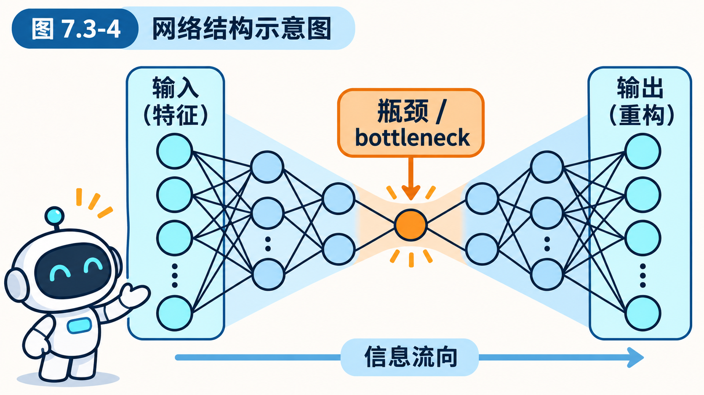

*图7.3-4　自编码器的"瓶颈"结构。 本版为AI生成教学示意，非实测图。*

再往前走一步，还有更现代的工具，比如**神经算子**（neural operator）。它们不满足于只在几个点上贴合数据，而是试图直接学会"从一个场到另一个场"的映射——这已经和机器学习几乎不分彼此了。事实上，到这里，"降阶模型"和"机器学习"的边界已经开始模糊，这本身就是本节主旨的一个伏笔。

> **案例 3｜特征脸（Eigenfaces）：人脸识别里的"降阶"**
>
> 上世纪 90 年代，Turk 与 Pentland 提出"特征脸"：把数据库里成千上万张人脸（每张上万个像素）收集起来做 PCA，得到少数几张"特征脸"——它们其实就是人脸的主成分。任何一张新脸，都可以近似写成几张特征脸的加权组合：$x \approx a_1\phi_1+\cdots+a_r\phi_r$。
>
> 于是，**上万个像素 → 几十个权重**。这正是上文"基本脸型"比喻的真实版本：降阶不只是工程师的数值技巧，也是机器学习最早、最著名的应用之一。它提醒我们——"降阶模型"和"机器学习"的边界，从这里就开始模糊了。

### 7.3.3 机器学习：让数据自己"学"出那个低维世界

**拟合：机器学习的朴素起点。** 机器学习走的是另一条路：它不预先断定答案是直线还是曲面，而是准备一个"足够灵活"的函数族，然后让数据通过反复调整——这就是"训练"——自动学出那个低维规律。

最朴素的机器学习，其实就是我们熟悉的**拟合**：给一堆点，找一个函数穿过它们。中学物理课上，你可能做过这样的事：测了一串"电压—电流"的数据点，然后用一把尺子在图上比划出一条尽量靠近所有点的直线。机器学习做的事，本质上和这把尺子一样——只是把"直线"换成了"一个极其灵活、能弯成各种形状的函数"，把"用眼睛目测"换成了"让计算机反复调整，直到误差足够小"。

**"学习"到底是什么。** 可以想象一个"找谷底"的游戏：把"误差"看成一张起伏的地形图，横轴纵轴是函数的参数，高度代表"预测得有多差"。学习的每一步，就是站在地形图上的某一点，朝"下坡"的方向迈一小步；走一步，看一眼坡度，再迈一步。所谓训练，就是让这个旅人从山顶一路走到谷底；所谓"学好的函数"，就是谷底那一点所对应的函数。

在这个过程里，**误差**（error）衡量"预测值与真实值差多少"，**损失**（loss）是把它整理成一个方便计算的形式，而**泛化**（generalization）则问一个更挑剔的问题：这个函数在训练见过的数据上表现好，换一批从没见过的新数据，还灵不灵？

**会总结，还是死记硬背。** "泛化"这一点值得多说几句，因为它正是"可信度"的源头。设想两个学生背乘法表：一个真的理解了规律，能算出从没背过的 $13\times17$；另一个只是把老师给的题目和答案原样背了下来，换一道新题就抓瞎。两者在"背过的题"上得分可能一样高，可一旦换了新题，高下立判。机器学习里也有一个对应的危险，叫**过拟合**（overfitting）：一个函数可能在训练数据上误差极小，却因为"死记硬背"了噪声，换到新数据上就一塌糊涂。可见，"训练时的表现"和"真正可信"之间，隔着一条必须小心度量的鸿沟——这正是数值分析里"误差界"与"泛化误差"要联手回答的问题。

**为什么它能学非线性。** 机器学习为什么能学会那些弯弯曲曲的规律？因为它所用的函数族足够灵活——比如由一层层神经元堆起来的神经网络，可以看作一块"能朝任意方向、任意程度弯曲的软膜"。数学上有一个保证，叫**万能逼近**（universal approximation）：只要层数够多、宽度够大，这样一块"软膜"就能以任意精度去贴合任何连续函数——这正是 7.1 节通用逼近定理的核心。所以，当数据背后藏着低维结构时（就像弹珠沿弯线排），机器学习学出来的，往往正是那条弯线本身——只不过它不是靠人"看"出来的，而是靠成千上万次参数微调"磨"出来的。

### 7.3.4 共性：同一枚硬币的两面

现在把两面并排放，会惊讶于它们的相似。至少有四条，可以把它们牢牢绑在一起。

**第一，都假设"复杂背后藏着简单"。** 降阶模型假设高维数据落在低维子空间（或低维流形）上；机器学习假设数据背后存在一个可学的规律。两句话说的是同一件事——在机器学习里，它甚至有一个专门的名字，叫**流形假设**（manifold hypothesis）：现实世界里那些看似高维的数据，其实都蜷缩在一个低维的流形上。弹珠沿着弯线排，就是这种假设最朴素的写照。

**第二，都在"压缩"。** 降阶用少数坐标 $a_1,\dots,a_k$ 代替整段高维向量；机器学习用一个函数（及其少量参数）概括整片数据。压缩掉的，是冗余；保留下来的，是结构。自编码器的那道"窄门"，和 POD 挑出的那几条"主轴"，在做的是同一件事：把冗余挤出去，把结构留下来。

**第三，都在权衡"保真"与"省力"。** 坐标取少了、函数取简单了，省力但失真；取多了，精确但昂贵。这条"精度—成本"的折中，是两边共同的主线。降阶模型问"用 $k$ 个模态够不够"，机器学习问"这个网络够不够深、参数量够不够"——问的都是同一个天平的两端。

**第四，都是"从样本中找规律，再外推"。** 降阶模型从已有数据的快照里挑出主方向，再用它预测新状态；机器学习从训练数据里学出规律，再对新输入做预测。一个管这叫"投影与重构"，一个叫"泛化与推断"，其实是同一件事：先看几个例子，再对没见过的情况下判断。

**同一个问题，两种做法。** 这四条共性，不如放到一个具体的例子里一起体会。设想我们要预测一块金属板上的温度场如何随时间变化。

降阶模型的做法是：先做几次完整仿真，收集若干时刻的"温度场照片"作为快照；从这些快照里用 POD 挑出少数几个反复出现的基本形态，比如"整体升温""左热右冷""中间鼓起来"这样几个模式；往后任何一个时刻的温度场，就近似写成这几个模式的组合。问题一下子从"上万个格点的温度"变成了"三四个模式的权重"。

机器学习的做法是：把"当前时刻的温度场"和"下一时刻的温度场"当作成对的数据喂给网络，让它反复训练，自己学出一个"从现在的场到下一时刻的场"的映射。它不被告知什么"模式"，也不被告知什么物理定律，只靠自己一次次调整参数，把这个映射磨出来。

两条路，一个从物理直觉出发、一个从数据出发，一个用线性代数、一个用神经网络，但最后会不约而同地发现：真正决定这场温度变化的，只是极少几个自由度。换句话说，它们学出来的是同一个低维结构——降阶模型把它写成了几个模态的组合，机器学习把它藏在了网络内部。这正是"同一枚硬币的两面"最实在的含义。

*图7.3-5　低维表示视角下两类方法联系的比喻，不表示方法等价或必然发现同一结构。 本版为AI生成教学示意。*

**一条谱。** 更进一步，可以把两者放在同一条谱上看：线性降阶模型，相当于一个"由物理直觉引导、只学线性方向"的极简机器学习；而机器学习，相当于一个"完全交给数据、能学任意非线性规律"的通用降阶器。夹在中间的过渡地带，正是非线性降阶——自编码器、神经算子。所以它们不是两个学科，而是**同一种思想的两端**。

> **案例 4｜Netflix 推荐系统的低秩分解**
>
> Netflix 曾悬赏百万美元改进电影推荐（Netflix Prize，2006–2009）。它的"用户×电影评分表"极其巨大（几十万用户 × 几万电影），又非常稀疏——绝大多数格子是空的。
>
> 获胜者们发现，这张大表背后藏着**低秩结构**：每个用户可以用少数几个"口味因子"描述，每部电影可以用少数几个"特质因子"描述，而评分 ≈ 口味因子与特质因子的内积。海量评分于是被压缩成两个窄小的矩阵。
>
> **一张看似毫无规律的大表，其实蜷缩在一个低维结构上**——这正是"流形假设"和"压缩"在真实商业世界里的样子。降阶的"少即多"与机器学习的"数据里藏着简单"，在这里是同一件事。

### 7.3.5 为什么这一章要讲它：一把"可信度"的翻译钥匙

这个共性绝非空谈，它直接关系到本章的主题——**可信度**。数值分析这门学科，几百年来积累了一整套语言来描述"近似有多好"：**误差界**（error bound）、**稳定性**（stability）、**收敛性**（convergence）、**验证与确认**（verification and validation）。这套语言最初是为传统的数值近似——插值、求积、迭代——量身定做的，早已成熟而可靠。

既然机器学习和降阶模型本质上都是"近似"，那么这套语言就应当、也必须能搬过来，用来追问一个更尖锐的问题：**一个神经网络给出的预测，到底有多可信？误差界在哪里？换了数据还稳不稳？**

而且，这种迁移不是生搬硬套，而是一一对得上：降阶模型丢掉少数模态所带来的误差，叫**截断误差**（truncation error），它和机器学习里"用一个有限灵活度的函数去逼近真实规律"所产生的逼近误差，是同一个概念；降阶里"模态取得太少导致失真"，对应着机器学习里"网络太浅、欠拟合（underfitting）"；而降阶里"为了追平每一个快照而引入噪声"的过犹不及，对应着机器学习里我们刚说过的过拟合。一旦看清这层对应，就会明白：数值分析里那些防过拟合、给误差界的办法，同样是一台机器学习模型能否"可信"的命门。

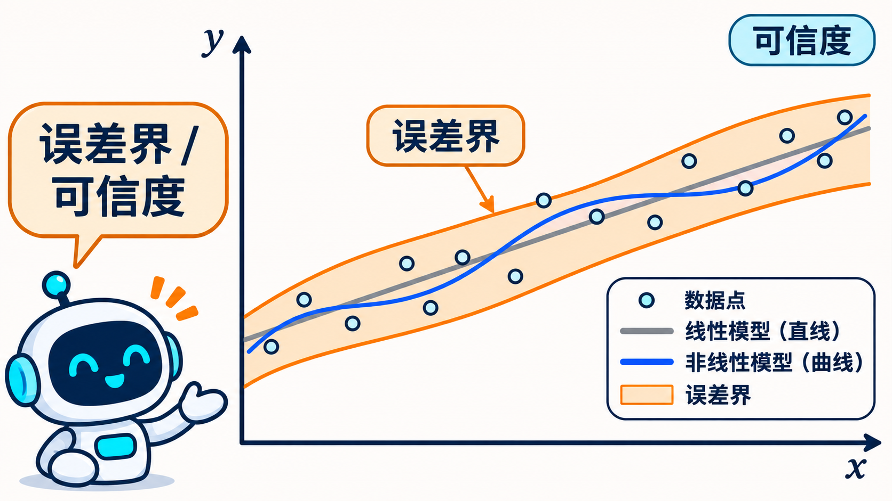

*图7.3-6　两类模型都需要误差分析的比喻；图中误差带不是经过证明的公共误差界。 本版为AI生成教学示意。*

在现实的科学计算里，这种共性已经结出了果实。人们把机器学习训练出来的、能飞速给出近似解的模型，叫作**代理模型**（surrogate model）或降阶代理；它本质上就是一个"用数据学出来的降阶模型"。工程师用它来反复试验设计方案、做不确定性分析——这些场景需要成千上万次求解，只有"贵一次、便宜很多次"的降阶/学习思路才承担得起。

所以，读懂了机器学习与降阶模型的共性，你就拿到了一把翻译的钥匙：它让你能把数值分析里那些关于误差与可信度的成熟工具，原样用在一个看似全新、数据驱动的世界之上。前面小节里我们反复锤炼的"误差界""可信度"这些词，从这一节起，开始正式作用于机器学习身上。

---

第三关过后，小绘手里多了一把"翻译钥匙"，它终于能把机器学习说成数值分析听得懂的话。可马上又卡住了："审视归审视，落到一个具体的预测上，模型怎么回答'这个数有多可信'？它给出的往往只是一个孤零零的点——比如风险 0.82。用户真正需要的，是给这个点配上一把尺子和一张可信标签。"

于是，小绘闯进了最后一关。

---

## 7.4 不确定性量化：评判 AI 的自信与局限

### 7.4.1 从"一个点"到"一把尺子"

在 7.1 至 7.3 节中，我们跟着小绘认识了模型的泛化能力、分布偏移以及核验方法。我们学会了看模型在测试集上的平均误差，但故事到这里还没有结束。

当小绘走出实验室，走进真实的医院、工厂或外卖平台时，它发现：**用户往往不满足于一个孤零零的预测值，他们更想知道的，是这个预测到底有多可信。** 本节，我们将学习如何量化 AI 的"不确定性（Uncertainty Quantification, UQ）"，重点掌握必修的 Split-Conformal 共形预测，并学会根据实际场景，在算法工具箱中挑选最合适的工具。

*图7.4-1　虚构的ICU教学情境，0.82为正文示例，不是实际病例或临床证据。 本版为AI生成教学示意。*

> 先不急着背定义，先去看一个真实的夜班场景。

某三甲医院的重症监护室（ICU）上线了小绘参与开发的"脓毒症预警系统"。在开发医院的内部验证中，模型的 AUC 达到了 0.86，校准看起来也不错。但公开研究和外部验证提示，这类模型换到社区医院、老年患者、慢性肾病患者身上时，性能可能会明显下降。

某夜，系统对一位 72 岁男性患者弹出一行字：

> **脓毒症风险：0.82。**

医生看了看病历：患者发热 38.9℃、白细胞 15.2、乳酸 2.8，确实极像感染。但他盯着 0.82 这个数字，问了三句话：

1. **这个 0.82 是"很确定"，还是模型在蒙？** 模型平时对类似病人是"说 0.8 就真有八成"，还是"说 0.8 实际只有五成"？如果模型过度自信，0.82 可能只是它"看起来像 0.82"。
2. **真实风险大概在哪个范围？** 如果区间是 $[0.78, 0.86]$，医生敢按高风险处理；如果区间是 $[0.35, 0.99]$，医生根本不敢只凭模型做决定。
3. **换到我们医院、这位老年肾病患者，还准吗？** 开发医院整体准，不代表我们医院准；整体覆盖达标，不代表老年患者子群体也达标。

**痛点一句话：点预测只告诉医生"靶心在哪"，却没告诉医生"箭会散多大、这枪靠不靠谱、换块场地还灵不灵"。** 医生要的不是一个数，而是用这个数做决策。

这就像我们在网上查快递：

- 只报"预计明天到"，你没法安排收货；
- 如果报"明天 9—11 点到，80% 概率；暴雨天这个承诺可能失效"，你才敢放心安排。

**不确定性量化（UQ）**，就是给 AI 的预测配上一把**误差尺**和一个**可信标签**。它要回答三个问题：

1. **可能错多少**：给区间，不只给点；
2. **这个说法多可信**：覆盖率和校准靠不靠谱；
3. **换场景还灵不灵**：子群体、域外、分布漂移下是否仍然可靠。

既然 UQ 要回答"范围、可信、场景"三件事，可工具箱里方法很多：有的擅长给区间，有的擅长校准置信度，有的擅长找域外样本，有的适合物理仿真。**所以第一步不是背算法，而是学会选算法。**

### 7.4.2 UQ 算法选择地图：什么时候用什么工具

面对一个实际问题，怎么在五花八门的 UQ 算法中挑出趁手的兵器？伸手拿工具前，先摸一下口袋里的四个问题：

1. **你要什么输出？** 只要置信度校准？要预测区间？要参数不确定性？还是只要发现输入是不是域外（OOD）？
2. **有没有独立校准集？模型能不能冻结？** 有历史校准记录、模型不再改，才适合 Conformal 这类"拿历史误差定尺子"的方法。
3. **样本可交换吗？会不会漂移？** 普通回归/分类且同分布，基础 Conformal 好用；时序、强漂移、域外要换变体或加检测。
4. **算力和部署允不允许？** 能不能多次前向？能不能训练多个模型？有没有物理方程？这决定 MC Dropout、Deep Ensemble、gPC 是否现实。

*图7.4-2　UQ 算法选择工具箱。 本版为AI生成教学示意，非实测图。*

我们可以用一个通俗的故事把它们串起来：

- **Split-Conformal（保险公司的"保底保单"）**：有独立校准集、模型冻结，想要"至少 80% 概率包住真实值"的预测区间。不挑模型，黑箱也能用。**短板**：只保证整体边际覆盖，阈值 $q$ 固定，域外和时序容易失效。
- **自适应共形 / 时序共形（保单的"定制版"和"时间版"）**：噪声随输入变化用前者；数据有时序相关用后者。
- **MC Dropout（让同一个学生开小差多考几次）**：已有 dropout 网络，测试时保留 dropout 多次前向，看答案散不散。改代码少、便宜，但无严格有限样本覆盖保证。
- **Deep Ensemble（请多位专家会诊）**：独立训练多个网络，看专家意见散不散。效果通常强，但贵，要训一整套网络。
- **gPC 多项式混沌展开（有物理公式时的"数学传声筒"）**：已知控制方程、物理仿真场景专用。深度学习黑箱少用。
- **温度缩放（给过度自信的秤调零）**：把过度自信的置信度拉回。但只校准置信，不生成预测区间。
- **OOD 检测（门口保安）**：只识别漂移，不自动给可靠区间。

**记忆口诀**：要保底覆盖找 Conformal；要低成本近似找 MC Dropout；要高精度离线找 Deep Ensemble；有物理方程找 gPC；只要置信校准找温度缩放；只要发现漂移找 OOD。

在众多工具中，**Conformal 是唯一能给出"有限样本保底覆盖率"的方法**。但要用好这张"保底保单"，先得会算区间，还得弄明白：这个区间是什么区间？多宽才有用？为什么有保底？什么时候会失效？下一节，我们回到开篇 ICU 的例子，把 Split-Conformal 拆开。

### 7.4.3 重点精讲：Split-Conformal——从算出一个区间到知道它准不准

回到开篇：假设小绘的模型已经训练好并冻结。医院翻出 9 次历史预测记录，每次记录"预测值和真实值差多少"的绝对值：

$$
[0.1,\;0.3,\;0.4,\;0.5,\;0.7,\;0.9,\;1.1,\;1.5,\;2.0]
$$

目标覆盖率 $1-\alpha=0.8$。现在的问题是：阈值 $q$ 定多少，才能让未来新样本至少有 80% 的概率落在 $[\hat f(X)-q,\hat f(X)+q]$ 内？

#### 盲盒互动：这个 $q$ 是怎么抽出来的？

1. 拆分数据：模型 $\hat f$ 在训练集上训练，校准集绝不参与调参。
2. 计算残差：在校准集上计算绝对残差 $s_i=|y_i-\hat f(x_i)|$，并从小到大排序（本例已排好）。
3. 计算阈值：计算 $k=\lceil (n+1)(1-\alpha) \rceil$。这里 $n=9$，所以 $k=\lceil 10 \times 0.8 \rceil=8$。取排序后第 8 小的残差作为阈值，即 $\boldsymbol{q=1.5}$。
4. 构造区间：对于新样本 $X_{\text{test}}$，预测区间为 $[\hat f(X_{\text{test}})-1.5,\hat f(X_{\text{test}})+1.5]$。

先直观感受一下：这个 $q$ 不是拍脑袋定出来的，而是从历史残差里"抽"出来的。

#### 马上辨析：这个区间是什么区间？

算出区间后，先别急着说"完成了"。医生会问：你给我的这个区间，是"下一个病人的真实风险范围"，还是"模型参数的范围"？

- **预测区间（Prediction Interval）**：新观测 $y$ 的取值范围，包含数据本身的噪声，通常更宽。
- **参数置信区间（Confidence Interval）**：模型参数或期望输出的范围，不包含新观测噪声。

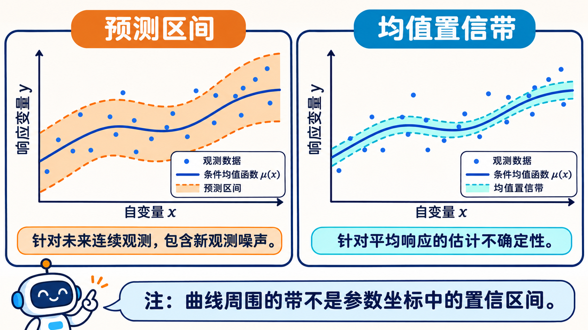

*图7.4-3　未来连续观测的预测区间与条件均值函数的置信带示意；曲线周围的置信带不等同于参数坐标中的置信区间，也不是个人患病概率的区间。 本版为AI生成教学示意。*

一句话：**预测区间是给"下一个病人"的，参数置信区间是给"模型参数"的。** 随堂问：Split-Conformal 算出来的属于哪一种？**答：预测区间，且是边际覆盖意义下的预测区间。**

#### 找茬悖论：只看覆盖率会闹笑话

还是 ICU 场景。现在有两个模型，都标称 80% 覆盖率：

- **模型 A**：$q=0.15$。若预测风险 $\hat y=0.82$，区间约 $[0.67,\ 0.97]$，医生敢用。
- **模型 B**：$q=0.5$。若预测风险 $\hat y=0.82$，区间约 $[0.32,\ 1.0]$，宽到几乎"永远正确、没有信息量"。

模型 B 覆盖率可能接近 80% 甚至 100%，但医生没法据此决策。**结论：只看覆盖率（PICP）不够，必须同时看 MPIW（平均区间宽度）。** 覆盖率回答"包住没有"，MPIW 回答"包得多勉强"。只看覆盖率，就像说"我保证你中奖"，但彩票范围覆盖了整张地球。

#### 为什么第 8 小的残差能有 80% 保底？

现在知道区间不能太宽，但为什么第 8 小残差就能保底 80%？靠的是**可交换性**。

把 $n+1=10$ 个残差（9 个校准残差 + 1 个测试残差）随便打乱，它们的概率分布是不变的。这意味着，测试残差在 10 个残差中排名第几，是完全等概率的，每个名次概率都是 $1/10$。

- 排名 $\le 8$：$s_{\text{test}} \le 1.5$，覆盖（8 种情况）；
- 排名 $(9,10)$：$s_{\text{test}} > 1.5$，不覆盖（2 种情况）。

因此覆盖概率是 $8/10=0.8\ge1-\alpha$（严格的排列论证见附录 D）。

要让这个保证成立，必须满足**三条核心假设**（任一破坏，保证失效）：

1. **样本可交换性**；
2. **模型 $\hat f$ 固定**，校准集不微调模型；
3. **校准集、测试集同分布**。

#### 算出来了，但准不准？

现在你手上有一个区间，也知道三条假设下它有 80% 保底。但医生还会问：

- 这个 $q$ 在我们医院老年患者身上还保底吗？（条件覆盖）
- 换一家社区医院呢？（域外失效）
- 模型说 0.82，它的置信度本身可信吗？（置信度 $\neq$ 正确率）
- 误差到底来自数据噪声，还是模型没见过这类病人？（两类不确定性）

**收口**：Split-Conformal 只负责"在假设成立时给保底"，不负责"假设失效时自动救场"。算出来了，只是不知道准不准；下一节可信性评估就是回答"准不准"。

### 7.4.4 可信性评估：给预测区间做一次"体检"

拿到预测区间后，我们需要一份"体检报告"来盘问它靠不靠谱。体检第一步，先问误差从哪来。

#### 体检第一步：两类不确定性

- **偶然不确定性（Aleatoric Uncertainty）**：数据固有噪声，增加数据无法消除。*比喻*：同一病人反复测血糖，仪器和生理波动带来的散布，换更多训练数据也消不掉。
- **认知不确定性（Epistemic Uncertainty）**：模型/参数无知，增加数据可降低。*比喻*：模型在数据稀疏的老年患者区域"没见过世面"，多给这类数据，波动会变小。

一句话：**噪声消不掉；认知不确定性可以靠加训练数据降低。** 呼应前文：预测区间包含偶然噪声，所以通常比参数置信区间宽。

#### 体检四项核心指标

把区间想成一份"送达承诺"，体检看四项：

1. **PICP（实测覆盖率）**：承诺兑现率。说好 80% 包住，实测是不是接近 80%？
2. **MPIW（平均区间宽度）**：承诺有多含糊。同等 PICP 下，区间越窄越好。
3. **条件覆盖**：是不是只对"大多数人"好。整体 90% 覆盖，不代表老年患者子群体也 90%。*比喻*：全班平均分及格，不代表每个小组都及格。
4. **域外表现**：换块场地还灵不灵。域内校准的 $q$ 直接用于域外，覆盖率会塌陷。
5. **补充 ECE/校准**：模型输出置信度要匹配真实准确率；深度网络普遍过度自信。

**教材话术**：PICP 看"包住没有"，MPIW 看"包得多勉强"，条件覆盖看"是不是只对大多数人好"，域外看"换场地还灵不灵"。

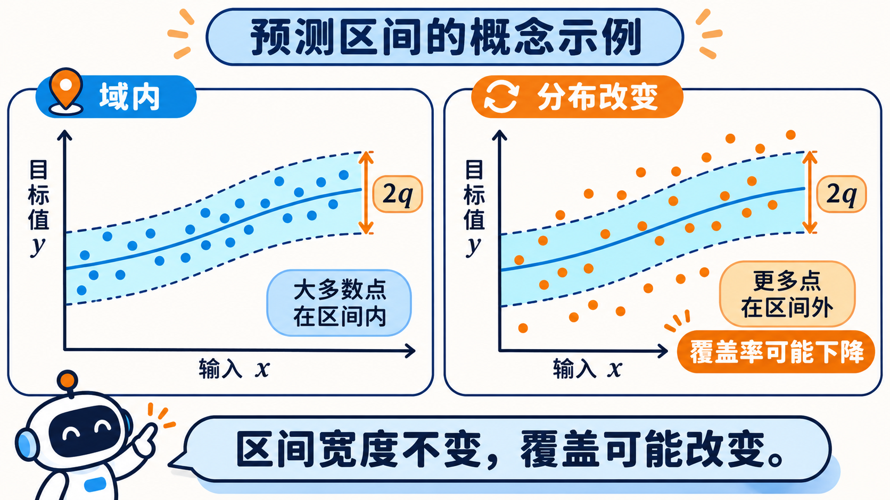

*图7.4-4　分布变化后同宽预测区间的覆盖率可能下降的概念示例，总宽度为2q；不表示所有域外任务必然失效。 本版为AI生成教学示意。*

#### 体检报告上的三个红灯（陷阱）

1. **红灯一：边际覆盖 $\neq$ 条件覆盖**。整体达标，老年组掉队。报告不能只写"全班及格"，要写"哪个小组不及格"。
2. **红灯二：域外失效**。$q$ 是固定尺子，分布偏移后尺子没变，但世界变了。MPIW 可能不变，PICP 却塌了。这不是算法 bug，是假设失效。
3. **红灯三：置信度 $\neq$ 正确率**。模型说 0.82，不等于 82% 正确；深度网络普遍过度自信。

#### 真实病例复盘：Epic 脓毒症预警

Epic 脓毒症预警模型内部表现自信，外部验证性能暴跌。用它收束三件事：

- **置信度 $\neq$ 正确率**：内部自信不等于外部正确；
- **域外覆盖率会塌陷**：换医院/人群，$q$ 固定，同分布假设破坏；
- **UQ 不是算出一个 $q$ 就完事**：必须看假设是否成立、条件覆盖和域外表现。

**本部分收口**：评估 UQ 不能只看一个数，要看 **PICP + MPIW + 条件覆盖 + 域外表现**；Split-Conformal 的"保底"只在三条假设成立时保底。

### 7.4.5 本节小结

故事走到这里，小绘终于明白：UQ 不是"多输出一个数"，而是回答三件事：**可能错多少、这个说法多可信、换场景还灵不灵**。

- **算法选择先问场景**：要覆盖保证选 Conformal；快速近似选 MC Dropout；高精度离线选 Deep Ensemble；物理仿真选 gPC；置信度校准选温度缩放；漂移识别选 OOD；
- **本课唯一必修**：Split-Conformal 四步 + 可交换覆盖率简证 + 三条假设 + 域外失效机理；
- **评估口诀**：**PICP 看覆盖，MPIW 看宽度，条件覆盖看群体，域外看塌陷，置信度不等于正确率。**

### 7.4.6 拓展内容（名词级选读，不计入必修）

1. **MC Dropout**：测试时保留 dropout 多次前向，用方差当不确定性；优点改代码少，缺点无严格有限样本覆盖保证。
2. **Deep Ensemble**：独立训练多个网络，用输出离散度当不确定性；优点效果强，缺点算力贵。
3. **gPC**：正交多项式展开随机变量，适合已知控制方程、物理仿真；深度学习少用。
4. **共形变体**：自适应共形、时序共形，解决基础 Split 不能处理时序、不能自适应调 $q$ 的短板。
5. **温度缩放**：校准分类置信度，不生成预测区间。
6. **OOD 漂移检测**：识别域外样本，不自动给可靠预测区间。

**对比记忆**：MC Dropout、Deep Ensemble、gPC 都没有 Split-Conformal 那种有限样本保底覆盖率保证，所以本课必修 Split-Conformal。

---

四关走完，小绘回头望了一眼来时的路。这一路，它其实一直在用同一把尺子丈量四样东西。

## 收束：同一把尺子的四个刻度

本章的四节，其实是同一把尺子的四个刻度。

7.1 说：一个模型能表示什么、学得怎么样，可以在明确假设下给出误差保证——但这一切都默认"新数据与训练数据同分布"。
7.2 说：一旦生成规律改变，旧保证就不自动成立，必须先问"数据按什么规则产生"，再决定怎样留出测试。
7.3 说：机器学习与降阶模型是同一枚硬币的两面；看清这层亲缘，数值分析里那套误差与可信度的成熟语言就能原样搬过来。
7.4 说：搬来之后，落到一个个具体预测上，就是不确定性量化——给预测配一把误差尺和一张可信标签。

小绘这一路，从"能不能画出来"，走到"只看有限例子能不能学会"，再走到"换了数据还灵不灵"，最后走到"这个预测有多可信"。它始终在回答同一句话：**一个机器学习模型，在科学计算里到底有多可信？** 而答案，从来不是一个孤零零的数字，而是一套先声明假设、再给出边界、最后诚实标注不确定性的习惯。

---

## 参考资料

[1] George Cybenko. “Approximation by superpositions of a sigmoidal function.” *Mathematics of Control, Signals, and Systems*, 2(4): 303–314, 1989. 本节采用第 3 节定理 2（印刷页 308）的连续 sigmoidal 版本。 [DOI](https://doi.org/10.1007/BF02551274)

[2] Shai Shalev-Shwartz and Shai Ben-David. *Understanding Machine Learning: From Theory to Algorithms*. Cambridge University Press, 2014. 第 4 章§4.1—4.2 支持一致收敛与有限类泛化界。 [DOI](https://doi.org/10.1017/CBO9781107298019)

[3] James 等，*An Introduction to Statistical Learning: with Applications in Python*，2023。第 2 章§2.2.1、第 5 章§5.1.1、第 7 章§7.1。

[4] Zhang 等，*Dive into Deep Learning*，第 4 章§4.7：Environment and Distribution Shift。

[5] Lu Lu 等，*Learning nonlinear operators via DeepONet based on the universal approximation theorem of operators*，*Nature Machine Intelligence*，2021，3: 218–229。DOI：10.1038/s42256-021-00302-5。

[6] Angelopoulos, A. N., & Bates, S. (2021). A gentle introduction to conformal prediction and distribution-free uncertainty quantification. *arXiv preprint arXiv:2107.07511*.（本节采用的 Split-Conformal 算法与覆盖率定理来源，本文使用其简化版本）

[7] Wong, A., et al. (2021). External validation of a widely implemented proprietary sepsis prediction model in hospitalized patients. *JAMA Internal Medicine*, 181(8), 1065-1070.（Epic 脓毒症模型外部验证性能暴跌的案例来源。）

---

## 附录　公式与推导、思考题（进阶）

以下内容供有兴趣的读者深入学习；正文只保留结论与直觉，不要求记忆这些推导。

### 附 A　三张成绩单的形式化定义

设训练集为 $S=(X_i,Y_i)_{i=1}^{n}$，独立测试集为 $T=(X'_j,Y'_j)_{j=1}^{m}$。三个量分别写成

$$
\widehat R_S(h)=\frac1n\sum_{i=1}^{n}\ell(h(X_i),Y_i),
\qquad
\widehat R_T(h)=\frac1m\sum_{j=1}^{m}\ell(h(X'_j),Y'_j),
$$

$$
R(h)=\mathbb E_{(X,Y)\sim P}[\ell(h(X),Y)].
$$

前两个是有限样本的平均值，第三个是分布意义下的平均值。真实任务中通常不知道完整的 $P$，因此总体风险往往无法直接计算。训练后的模型也取决于训练数据；需要强调这一点时，把它写成 $\widehat h$。训练误差与总体风险的差称为泛化间隙：

$$
G_S(h)=R(h)-\widehat R_S(h).
$$

### 附 B　有限假设类的一致泛化界

在正文 7.1.3 的条件下（抽样前确定、非空且有限的候选模型集合 $\mathcal H$，$|\mathcal H|=M$；训练样本独立同分布；损失取值在 $[0,1]$ 内；$\delta\in(0,1)$），有：

> **有限假设类的一致泛化界**
>
> 以至少 $1-\delta$ 的概率，下式对所有 $h\in\mathcal H$ 同时成立：
>
> $$
> |R(h)-\widehat R_S(h)|
> \le
> \underbrace{\sqrt{\frac{\ln(2M/\delta)}{2n}}}_{\displaystyle b(n,M,\delta)}.
> $$
>
> 其中 $n$ 是训练样本量，$\ln$ 表示自然对数。本节介绍并使用这个结论，不作证明。

"一致"指同时覆盖全部候选模型。例如在分界线游戏中 $M=21$；取 $n=1000$、$\delta=0.05$，理论余量约为 0.0580，即 5.80 个百分点。若某候选模型的训练错误率是 10%，那么在定理保证的事件上，其总体风险不超过约 15.80%。这只是上限，总体风险完全可能更低。

### 附 C　两个延续函数的误差下界

正文 7.2 提到两个函数：$f_1(x)=\sin x$；$f_2$ 在 $x\le1$ 时等于 $\sin x$，在 $x>1$ 时等于 $\sin x+(x-1)^3$。它们在观测区间上相同，却在 $x=3$ 处分别约为 0.141 和 8.141。同一个预测办法只能根据相同信息给出同一个答案 $a$，于是

$$
8=|f_2(3)-f_1(3)|\le|f_2(3)-a|+|a-f_1(3)|.
$$

由三角不等式可知，两个误差 $|f_2(3)-a|$ 与 $|a-f_1(3)|$ 至少有一个不小于 4。这说明只凭旧区域的观测，无法保证对所有与观测相符的函数都在新区域准确。

### 附 D　Split-Conformal 可交换性覆盖简证

设 $n$ 个校准残差与 1 个测试残差共 $n+1$ 个。若它们可交换，则这 $n+1$ 个残差的所有排列等概率，测试残差落在第 $k$ 名的概率都是 $1/(n+1)$。取 $k=\lceil(n+1)(1-\alpha)\rceil$，则

$$
P\bigl(s_{\text{test}}\le s_{(k)}\bigr)=\frac{k}{n+1}\ge1-\alpha.
$$

即 $P\bigl(Y_{n+1}\in C(X_{n+1})\bigr)\ge1-\alpha$，其中 $C(X)=[\hat f(X)-s_{(k)},\hat f(X)+s_{(k)}]$。这就是覆盖率定理的直观；严格表述见参考文献 [6]。三条核心假设（样本可交换、模型固定、校准集与测试集同分布）任一破坏，上述等概率的排列论证便不再成立。

### 附 E　7.3 细节补充

下面展开 7.3 涉及的几处数学细节，供有兴趣的读者细读。

#### E1. PCA / POD 的数学原理

把 $n$ 个样本（每个是 $d$ 维向量，先减去均值中心化）排成数据矩阵 $X\in\mathbb R^{n\times d}$，协方差矩阵为

$$
C=\frac1n X^\top X .
$$

$C$ 是 $d\times d$ 的对称矩阵，对它做特征值分解：

$$
C\varphi_i=\lambda_i\varphi_i,
$$

其中 $\lambda_i\ge0$，特征向量 $\varphi_i$ 两两正交。**特征值 $\lambda_i$ 的几何意义，正是数据沿方向 $\varphi_i$ 的方差（"散开程度"）。** 于是 PCA 的做法水到渠成：把特征值从大到小排列，取前 $k$ 大特征值对应的特征向量作"主轴"，就保留了数据最"散开"、信息量最大的 $k$ 个方向。这也解释了正文为什么"先看最散开的方向"——方差最大的方向，信息损失最小。

#### E2. 投影系数与截断误差

选定 $k$ 个主轴后，向量 $x$ 在这几条轴上的坐标就是它与轴的内积：

$$
a_i=\varphi_i^\top x .
$$

于是 $k$ 阶近似为

$$
x\approx\sum_{i=1}^{k}a_i\varphi_i .
$$

若主轴取前 $k$ 大特征值，可证明**均方意义下的平均重构误差等于被丢弃特征值之和**：

$$
\mathbb E\|x-\hat x_k\|^2=\sum_{i=k+1}^{d}\lambda_i .
$$

这正是正文"截断误差"的精确含义：模态取得越少，被丢弃的特征值越多，误差越大。降阶里"用 $k$ 个模态够不够"，翻译成数学就是"被丢弃的特征值之和小不小"。

#### E3. 梯度下降的更新公式

训练的核心是反复调参让损失变小。设参数向量为 $\theta$、损失为 $L(\theta)$，梯度 $\nabla L(\theta)$ 指向损失**上升最快**的方向；"往谷底走"就是沿它的反方向迈一小步：

$$
\theta\leftarrow\theta-\eta\,\nabla L(\theta).
$$

其中 $\eta$ 是**学习率**（步长）。$\eta$ 太小收敛慢；$\eta$ 太大可能一步跨过谷底、来回震荡甚至发散。这一行公式，就是 7.3.3 里那个"找谷底旅人"每一步的动作。

#### E4. 自编码器的形式化

自编码器由两部分组成：**编码器** $E$ 把高维输入 $x$ 压成低维表示 $z=E(x)$；**解码器** $D$ 再把 $z$ 展开回重建 $\hat x=D(z)$。训练目标是最小化重构误差：

$$
\mathcal L=\|x-D(E(x))\|^2 .
$$

"瓶颈"维度 $k=\dim(z)$ 越小，$z$ 能承载的信息越少，编码器就被迫用更少的数概括 $x$——这正对应正文"门越窄，概括得越狠"。当 $k$ 小到极致，自编码器学到的低维表示 $z$，就近似于数据所在弯曲流形的坐标。

## 本版插图说明
本版images目录中的22幅插图为AI生成的统一漫画风教学示意；图中曲线、点和误差带不是程序绘制的实测证据。原图注涉及真实实验曲线或数值来源时，应以配套代码及原始实验图核验，不用生成示意图替代实验验证。
