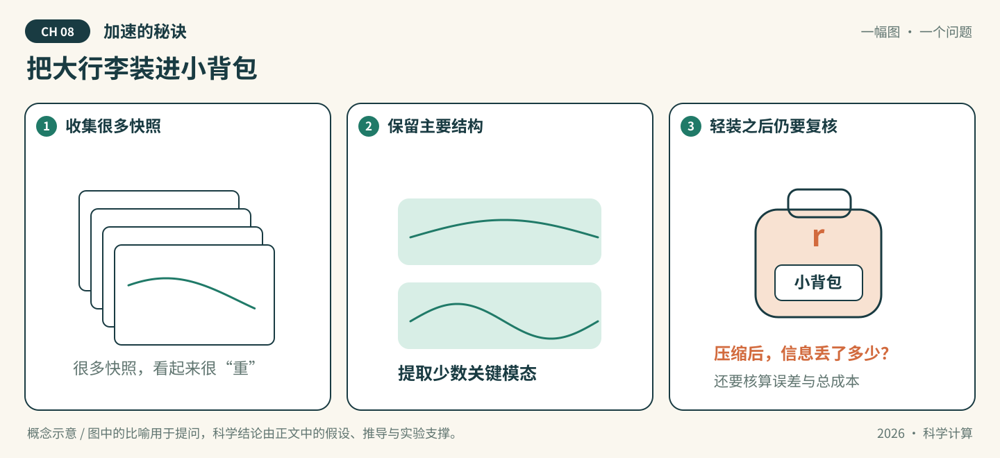

# 第8章 加速的秘诀

*学习型预条件子与降阶模型*

*图8-1 · 把大行李装进小背包。概念示意，不是实测结果；适用条件与局限见 8.2 与全章小结。*

---

## 本章导读

### 本章在全书中处于什么位置

本章是前七章知识的**综合应用篇**。它不打算介绍若干人工智能算法，而是围绕一个统一的科学计算问题展开：

> 当传统科学计算方法面临计算成本过高的问题时，人工智能、数据驱动方法和模型降阶方法可以在哪些层面参与计算过程？这种所谓的「加速」又应该如何**严格判断**？

### 四个计算层面与统一主线

本章在四个不同的计算层面各讨论一种参与方式：

| 层面 | 参与方式 | 对应节 |
| --- | --- | --- |
| 求解器层面 | 学习型预条件子 | 8.1 |
| 空间表示层面 | POD 与自编码器降阶 | 8.2 |
| 时间演化层面 | LSTM 与 Neural ODE | 8.3 |
| 系统层面 | 数字孪生与算子推断 | 8.4 |

由此形成一条统一主线：

$$\text{求解器加速} \;\longrightarrow\; \text{空间降阶} \;\longrightarrow\; \text{时间预测} \;\longrightarrow\; \text{模型与数据融合}$$

### 本章核心问题

1. 线性方程组本身能不能求得更快？ —— 8.1
2. 如果状态变量太多，能不能用更少的变量表示？ —— 8.2
3. 如果每一个时间步都需要昂贵计算，能不能直接预测未来状态？ —— 8.3
4. 如果希望模型长期在线运行、并不断利用传感器数据更新状态，该怎么办？ —— 8.4

### 本章学习目标

完成本章后，读者应该能够：

1. 理解预条件子的基本思想，并解释学习型预条件子与传统预条件子的区别；
2. 根据 SVD 构造 POD 基，并完成基本的降维和重构；
3. 理解 POD 与自编码器在线性降维和非线性降维方面的区别；
4. 理解 Galerkin 投影如何将高维动力系统转化为低维动力系统；
5. 理解 LSTM 的基本结构，以及离散时间序列预测的思想；
6. 理解 Neural ODE 的基本思想，并区分神经网络模型与 ODE 数值积分器；
7. 理解数字孪生中的物理模型、观测数据、状态估计和预测之间的关系；
8. 理解 Operator Inference 如何从数据中识别低维动力学算子；
9. 能够从计算成本、精度、稳定性、泛化能力和可靠性等方面评价 AI 加速方法；
10. 建立「传统数值方法 + 降阶 + 数据驱动 + AI」的综合科学计算思维。

### 贯穿全章的五条判断原则

本章会反复使用下面五条判断原则。**它们不是口号，而是每一节末尾「局限与判断」的依据。**

| 原则 | 内容 | 主要落点 |
| --- | --- | --- |
| 原则 1 | **迭代次数减少，不等于总计算时间减少。** 必须同时考虑 $T_{\mathrm{total}} = T_{\mathrm{offline}} + N_{\mathrm{solve}}T_{\mathrm{online}}$ | 8.1.6、8.4.3 |
| 原则 2 | **降维不等于模型降阶。** 要区分「表示的降维」与「动力学模型的降阶」 | 8.2.4 |
| 原则 3 | **训练误差小，不等于泛化能力强。** 要区分训练集、验证集、测试集、未见参数、未见时间区间、分布外数据 | 8.1.6、8.2.9 |
| 原则 4 | **单步预测准确，不等于长期预测稳定。** 时间预测必须关注误差累积 | 8.3.5 |
| 原则 5 | **AI 模型不是天然可靠的。** 数值稳定性、物理一致性、泛化能力、极端工况、不确定性、验证与确认都需要单独讨论 | 8.1.5、8.4.6 |

### 本章的四标签约定

本章所有涉及实验的内容，都按四类标签分别表述，**不允许混用**：

| 标签 | 含义 | 证据来源 |
| --- | --- | --- |
| **理论结论** | 由数学定理或已建立理论得到 | 教材、论文，需注明出处 |
| **实验设计** | 说明拟如何验证，含输入、参数、划分与指标 | 本组设计 |
| **实验预期** | 说明预期可能发生什么，**是预期不是事实** | 本组推理 |
| **实际结果** | **只能来自 Notebook 实际运行** | `A1组-实验.ipynb` 的真实输出 |

> **本章明确禁止：** 在未运行实验的情况下写出具体的迭代次数、加速倍数、运行时间、误差数值或准确率。凡属预期，必须写成「可能」「预计」；凡属实测，必须能指回 Notebook 的具体单元。

### 怎么读这一章

每一节按 **为什么需要 → 核心概念 → 数学形式 → 简单例子 → AI 方法 → 实验 → 局限 → 小结** 形成闭环。正文负责概念与理论，[A1组-实验.ipynb](A1组-实验.ipynb) 负责验证正文中的数学结论，[A1组-习题.md](A1组-习题.md) 从基础理解递进到综合判断。三者节号一致，凡正文引用具体数值处，均指回 Notebook 对应单元。

---

## 8.1 学习型预条件子

### 8.1.1 迭代法为什么会慢

#### 为什么需要

前面章节已经学过线性方程组

$$Ax=b,\qquad A\in\mathbb R^{N\times N},\ \ b\in\mathbb R^N .$$

当 $N$ 很大且 $A$ 稀疏时，直接分解（LU / Cholesky）在内存和计算量上都可能不可接受，因此转向**迭代法**。但迭代法自己也有成本：它可能收敛得很慢。本节要回答的第一个问题是：**是什么决定了迭代法有多慢？**

#### 核心概念：CG 与 $A$-范数

本节只讨论最主要的一类问题——**对称正定**矩阵：

$$A=A^{\mathsf T}\succ0 .$$

符号说明：$A^{\mathsf T}$ 表示 $A$ 的转置；$A\succ0$ 表示 $A$ 对称且正定，即对任意 $x\ne0$ 有 $x^{\mathsf T}Ax>0$。**这两条性质是共轭梯度法（CG）适用的前提**，8.1.5 会看到破坏它们会带来什么后果。

对这类问题，CG 是最经典的 Krylov 子空间迭代法。要描述它的收敛，需要合适的误差度量——不是普通的欧氏范数，而是由 $A$ 本身诱导的**能量范数（$A$-范数）**：

$$\|x\|_A=\sqrt{x^{\mathsf T}Ax}.$$

符号说明：$\|\cdot\|_A$ 称为 $A$-范数或能量范数。它是合法的范数，因为 $A\succ0$ 保证 $x^{\mathsf T}Ax>0$（$x\ne0$），从而 $\|x\|_A>0$（$x\ne0$）。CG 有一个别的迭代法没有的性质：它**单调**地降低 $A$-范数下的误差（而残差的欧氏范数不保证单调，见 8.1.5）。

#### 数学形式：经典收敛估计

记第 $k$ 步的迭代解为 $x_k$，精确解为 $x_*=A^{-1}b$，则 CG 满足

$$\frac{\|x_k-x_*\|_A}{\|x_0-x_*\|_A}\ \le\ 2\left(\frac{\sqrt{\kappa(A)}-1}{\sqrt{\kappa(A)}+1}\right)^{k}, \tag{8.1}$$

其中 $\kappa(A)$ 是对称正定矩阵的谱条件数

$$\kappa(A)=\kappa_2(A)=\frac{\lambda_{\max}(A)}{\lambda_{\min}(A)} . \tag{8.2}$$

符号说明：$\lambda_{\max}(A)$、$\lambda_{\min}(A)$ 分别为 $A$ 的最大、最小特征值。对 $A\succ0$，全部特征值为正，故 $\kappa(A)\ge1$。

#### 公式解释：这是上界，不是定律

由 (8.1)，收敛因子约为 $\frac{\sqrt{\kappa}-1}{\sqrt{\kappa}+1}$，因此**迭代数大致按 $\sqrt{\kappa(A)}$ 增长**：条件数每放大 $100$ 倍，迭代数大约多 $10$ 倍。这就是「迭代法为什么慢」的定量答案。

> **必须特别强调的一点：**
>
> **不能**表述为「条件数决定 CG 的实际收敛速度」。
>
> **应当**表述为：**条件数给出了 CG 收敛速度的重要理论上界，而实际收敛行为还受到特征值分布等谱性质的影响。**
>
> 原因：(8.1) 是一个最坏情况估计。若 $A$ 的特征值虽然跨度大，但**聚成少数几簇**，CG 往往在远少于上界步数的时间内就收敛。反之，若特征值均匀铺满整个区间，实际表现会接近上界。因此**「谱分布」比「条件数」携带更多信息**（8.1.4 会用到这一点）。

#### 简单例子

考虑二阶差分矩阵族

$$A(\alpha)=\operatorname{tridiag}(-1,\;2+\alpha,\;-1)\in\mathbb R^{N\times N},\qquad \alpha>0 .$$

符号说明：$\operatorname{tridiag}(c,d,c)$ 表示三对角矩阵，主对角线为 $d$、上下次对角线为 $c$。该矩阵对称正定。

- 当 $\alpha$ 很小时，$A(\alpha)$ 接近二阶差分算子本身，$\kappa(A(\alpha))$ 随 $N$ 按 $O(N^2)$ 量级增长，CG 需要很多步；
- 当 $\alpha$ 较大时，$A(\alpha)$ 接近对角占优，$\kappa$ 较小，Jacobi 类简单预条件就已足够。

**因此「该用多强的预条件」本身随参数变化**——这正是 8.1.4 引入「从数据学习预条件」的动机。

#### 小结

- CG 的收敛受 $A$-范数下的误差界 (8.1) 控制，上界由 $\kappa(A)$ 给出；
- $\kappa(A)$ 只是**上界**里的量，实际收敛还取决于**特征值分布**；
- 想要更快，就要改变谱分布——这就是**预条件**。

---

### 8.1.2 预条件的基本思想

#### 为什么需要

由 (8.1)，要减少迭代数，就要让迭代所面对的「有效条件数」变小、或让谱更聚集。预条件的做法是：**不改变方程的解，但改变迭代法所面对的问题**。

#### 数学形式

考虑**预条件系统**

$$M^{-1}Ax=M^{-1}b, \tag{8.3}$$

其中 $M$ 称为**预条件矩阵（preconditioner）**。符号说明：$M$ 是一个非奇异矩阵，作用是「近似 $A$ 但又容易求逆」。$M^{-1}A$ 与原矩阵 $A$ 有相同的解 $x_*=A^{-1}b$，但迭代性质可以完全不同。

对 $A\succ0$，CG 要求 $M$ 也**对称正定**（记为 $M=M^{\mathsf T}\succ0$）。此时可取 Cholesky 分解 $M=LL^{\mathsf T}$，把 (8.3) 化为一个对称形式的问题：令 $\tilde A=L^{-\mathsf T}AL^{-1}$、$\tilde x=L^{\mathsf T}x$、$\tilde b=L^{-\mathsf T}b$，则 (8.3) 等价于

$$\tilde A\tilde x=\tilde b .$$

**为什么可以这样做：** $L$ 可逆，故这是一个**合同变换**。合同变换保持对称性与正定性，因为对任意 $x\ne0$，

$$x^{\mathsf T}\tilde Ax=(L^{-1}x)^{\mathsf T}A(L^{-1}x)>0 .$$

于是 $\tilde A$ 仍对称正定，CG 的框架依然适用；而此时 (8.1) 中的条件数应换成

$$\kappa(M^{-1}A)=\frac{\lambda_{\max}(M^{-1}A)}{\lambda_{\min}(M^{-1}A)} . \tag{8.4}$$

符号说明：$M^{-1}A$ 一般**不是对称矩阵**，但它相似于对称正定的 $M^{-1/2}AM^{-1/2}$，因此特征值全为实数且为正，(8.4) 有意义。这正是预条件 CG（PCG）的收敛依据。

**预条件 CG 的误差界**于是成为

$$\frac{\|x_k-x_*\|_A}{\|x_0-x_*\|_A}\ \le\ 2\left(\frac{\sqrt{\kappa(M^{-1}A)}-1}{\sqrt{\kappa(M^{-1}A)}+1}\right)^{k}. \tag{8.5}$$

#### 公式解释：预条件子到底做了什么

> **常见误区：** 把预条件子理解成「一个让条件数变小的矩阵」。
>
> **正确表述：** 预条件子的作用**不是简单地「让条件数变小」**，而是**通过等价变换使系统具有更加有利于迭代求解的性质**。条件数只是衡量这些性质的一个（常用但不充分的）代理指标。真正起作用的是**谱分布**：把分散的极端特征值收进少数几簇，往往比均匀抬升下界更有效。

同时必须考虑一个**成本**问题：

> $M^{-1}v$ 是否能够高效计算？

如果 $M^{-1}$ 本身很贵，那么即使迭代数下降，总时间也可能增加（8.1.6 定量化这一点）。

#### 预条件设计的三个要求

因此，设计预条件子需要**同时**考虑三件事：

1. **是否改善迭代性质**（谱分布是否更有利）；
2. **应用预条件子的成本**（$M^{-1}v$ 每次迭代都要算）；
3. **是否保持相应迭代算法所要求的结构**（例如 PCG 要求 $M$ 对称正定）。

三者常常互相冲突：更强的预条件通常更贵，也更容易破坏结构要求。8.1.4—8.1.5 讨论的正是「学习型」方法在这三者的权衡中处于什么位置。

#### 简单例子

回到 $A(\alpha)=\operatorname{tridiag}(-1,2+\alpha,-1)$：

- 取 $M=\operatorname{diag}(A)=(2+\alpha)I$，则 $M^{-1}v$ 只需一次逐元素除法，几乎免费；
- 但 $(2+\alpha)I$ 与 $A(\alpha)$ 的差异恰好是那两条次对角线，$\alpha$ 越小差异占比越大，改善越有限；
- 若取 $M=A$ 本身，则 $M^{-1}A=I$，$\kappa=1$、**一步收敛**——但代价是计算 $A^{-1}$，而这正是我们原本想避免的事。

**这个极端例子说明了预条件的本质张力：越接近 $A$ 越好，但越接近 $A$ 越贵。**

#### 小结

- 预条件通过等价变换改善迭代性质，而不是「改小条件数」这一个动作；
- PCG 的收敛由 $\kappa(M^{-1}A)$ 的界 (8.5) 控制，前提是 $M$ 对称正定；
- 设计预条件要在**改善程度、应用成本、结构要求**之间权衡。

---

### 8.1.3 传统预条件子

本节只介绍核心思想，不展开复杂算法实现。

#### Jacobi 预条件

最简单的选择是取 $A$ 的对角部分：

$$M=\operatorname{diag}(A). \tag{8.6}$$

- **优点：** 构造几乎零成本；$M^{-1}v$ 就是逐元素除以对角元，$O(N)$；对 $A\succ0$，对角元为正，故 $M$ 自动对称正定，结构要求自动满足。
- **局限：** 它只修正了**尺度差异**（对角线上的量级差别）。若 $A$ 的困难来自非对角结构（强各向异性、长程耦合），对角缩放几乎无改善。8.1.1 的 $A(\alpha)$ 在 $\alpha\to0$ 时就是这种情形。

#### IC / ILU：不完全分解

**不完全 Cholesky（IC）** 与 **不完全 LU（ILU）** 的思想是：模仿 Cholesky/LU 分解，但**只保留稀疏模式允许的填充**，丢掉其余元素，得到近似因子 $\tilde L$（或 $\tilde L\tilde U$），令

$$M=\tilde L\tilde L^{\mathsf T}\quad(\text{或 } M=\tilde L\tilde U).$$

- 在 $\tilde L$ 的对角元取正的约定下，$M$ 对称正定，满足 PCG 的结构要求；
- $M^{-1}v$ 通过两次稀疏三角回代完成，成本与稀疏度成正比；
- 需要调节「填充分级」或「丢弃阈值」，这直接影响效果与成本的平衡。

**这里要记住的核心思想是：** 传统预条件子**利用矩阵结构**，构造一个**容易求逆、又能近似原系统**的辅助算子。它把「人的结构知识」编码进 $M$。

#### AMG：利用多尺度结构（拓展）

**代数多重网格（AMG）** 利用 PDE 离散系统中的**多尺度结构**：先在细网格上消除高频误差，再把残差限制到粗网格上求解，最后插值回去。对椭圆型问题，它可以做到迭代数与网格规模几乎无关，是极强的预条件子。

但 AMG 的算法本身（粗化策略、插值算子构造、复杂度控制）**超出本章核心范围**，此处只作拓展介绍。要强调的是：AMG 的**粗化策略**恰恰是一个「可以学习」的对象（见 8.1.4 范式 B）。

#### 三种传统预条件子对照

| 预条件子 | 构造思想 | 应用成本 | 结构性质 | 典型适用 |
| --- | --- | --- | --- | --- |
| Jacobi | 只取对角 | $O(N)$ | 自动对称正定 | 对角尺度差异大的问题 |
| IC / ILU | 保留稀疏模式的近似分解 | $O(\mathrm{nnz})$ 量级 | 可取为对称正定 | 稀疏 SPD / 一般稀疏系统 |
| AMG | 多尺度粗化与插值 | 每层 $O(N)$ | 可取为对称正定 | 椭圆型 PDE 离散 |

#### 小结

传统预条件子把**人对矩阵结构的认识**写成固定规则。当问题族不断变化（不同参数、不同几何、不同材料）时，固定规则未必最优——这就为「从数据学习预条件」留出了空间。

---

### 8.1.4 学习型预条件子

#### 核心概念与定义

> **定义（学习型预条件子）：** 学习型预条件子利用数据学习预条件算子的**结构、参数或作用方式**，使其能够针对**特定问题族**改善迭代求解性能。

注意定义中的三个关键词：**数据**、**结构/参数/作用方式**、**特定问题族**。第三点尤其重要——它意味着这类方法天然带有**分布假设**（8.1.6 展开）。

#### 三个教学性范式

**范式 A：直接学习预条件作用。** 不去构造矩阵 $M$，而是直接学习「作用」这一步：

$$M^{-1}v\approx N_\theta(v), \tag{8.7}$$

符号说明：$N_\theta$ 是一个以 $\theta$ 为参数的映射（通常是神经网络）。$M$ 本身可能根本不存在——我们只要求它能**近似地代替 $M^{-1}$ 的作用**。这种做法的优点是接口自然（PCG 只需要 $M^{-1}v$），缺点是**网络输出一般不满足结构要求**（8.1.5）。

**范式 B：学习预条件结构。** 让网络输出**结构决策**，例如：

- 稀疏结构（哪些位置保留非零）；
- 分解参数（IC/ILU 的填充与丢弃阈值）；
- AMG 的粗化策略；
- 预条件器中的参数（如多重网格的权重）。

这种做法的优点是可以**复用成熟算法框架**，网络只需要给出「怎么配置」，因此更容易保持结构要求。

**范式 C：传统预条件 + 学习修正。** 以一个传统预条件子 $M_0$ 为基线，再学习一个修正项：

$$M^{-1}=M_0^{-1}+\Delta_\theta . \tag{8.8}$$

符号说明：$M_0$ 是传统预条件（如 Jacobi 或 IC），$\Delta_\theta$ 是学习到的修正算子。这种做法的思路是「**先保证一个合理的基线，再让学习去补足结构知识覆盖不到的部分**」，通常比范式 A 更容易保证可靠性。

> **必须注明：** 以上三类是为了**教学**而建立的概念性分类，**并非学习型预条件子的唯一分类体系**。实际文献中的方法常常同时跨越多个范式。

#### 简单例子

回到 $A(\alpha)=\operatorname{tridiag}(-1,2+\alpha,-1)$。由 8.1.1，$\alpha$ 小时 $A(\alpha)$ 是困难的，$\alpha$ 大时 Jacobi 就够用。若训练时见过 $\alpha\in\{0.01,0.05,0.1\}$，能否让一个学习型预条件子对**未见**的 $\alpha=0.07$ 也有效？

**这个问题没有先验答案**：它取决于训练分布能否覆盖测试情形（8.1.6），也取决于参数化是否保持了结构要求（8.1.5）。这正是 8.1.7 实验要检验的内容。

#### 小结

- 学习型预条件子 = 用数据学习预条件的**结构 / 参数 / 作用方式**；
- 三个教学范式：直接学作用（A）、学结构（B）、传统 + 学习修正（C）；
- 分类是概念性的，实际问题常跨范式。

---

### 8.1.5 学习型预条件子的收敛性与可靠性

**本节体现全章的「反例意识」。**

#### 问题的来源

由 8.1.2，预条件 CG 的收敛界 (8.5) 的推导依赖两个前提：

1. $A$ 对称正定；
2. $M$ **对称正定**（这样才能定义 $M^{-1}$ 内积，才能推出 $M^{-1}A$ 有实正特征值）。

> **必须明确：** 神经网络能够输出一个**看起来有效**的预条件操作，**并不意味着它自动满足 PCG 所需要的数学条件**。

对经典 PCG，需要关注预条件子的**对称性、正定性，以及算法实现方式**。

#### 严谨的表述方式

> **不要这样写：** 「学习型预条件子不能保证条件数下降，因此可能不收敛。」
>
> **应当这样写：** **学习目标通常不直接等价于经典迭代法所要求的结构条件**，因此学习型预条件子需要**额外的结构约束、后处理，或者与传统预条件方法结合**，以保证算法的适用性和可靠性。

两种写法的差别在于：前者把问题归因于「条件数没降」，后者指出了**真正的原因**——训练目标（例如「让 $M^{-1}A$ 接近 $I$」）与迭代法的结构前提（如 $M$ 对称正定）**不是同一件事**。网络可以在训练目标上做得很好，却违反结构前提。

#### 四条可行的应对路径

| 路径 | 做法 | 代价 |
| --- | --- | --- |
| **结构约束** | 从参数化上保证结构。例如令 $M_\theta=L_\theta L_\theta^{\mathsf T}$，$L_\theta$ 为对角元严格为正的下三角，则 $M_\theta$ 自动对称正定 | 表达能力受参数化形式限制 |
| **对称化** | 对网络输出 $\hat M$ 取对称部分 $\tfrac12(\hat M+\hat M^{\mathsf T})$；若最小特征值非正，再加 $\epsilon I$ | 修正后与原输出不一致，需重新检验效果 |
| **与传统预条件结合** | 采用范式 C：$M^{-1}=M_0^{-1}+\Delta_\theta$，由 $M_0$ 提供结构底线 | 上限受 $M_0$ 限制 |
| **失败案例记录** | 保留破坏前提的实验作为反例，明确标注「此处前提不成立，收敛属巧合」 | 无（这是必须做的） |

#### 简单例子与反例意识

**教学构造的反例。** 取 $A\succ0$，但故意用一个**非对称**的算子当作 $M^{-1}$（例如只做单侧回代）。这时：

- PCG 的收敛界 (8.5) **不再成立**，因为 8.1.2 中「$M$ 对称正定」这一步已经不满足；
- 但程序**仍可能跑出很小的残差**——这是**巧合**，不是保证；
- 典型征状是**残差的欧氏范数不再单调下降**（8.1.1 提到，CG 单调下降的是 $A$-范数误差，不是残差）。

> **一条重要的方法论：** 「程序能跑出小残差」是**观测**；「收敛性成立」是**结论**，需要前提。把反例留在教材里、并写明前提不成立，比删掉它更有说服力。
>
> **同时要注意：** 单个种子的表现不能代表分布。判断一个反例是否成立，必须给出**样本数或种子数**，并把真正失败的样本单独画出来（见 8.1.7 的本组核对记录）。

#### 小结

- 学习的训练目标 ≠ 迭代法要求的结构条件，这是可靠性的根本问题；
- 严谨表述应指出「需要额外结构约束、后处理或与传统方法结合」；
- 反例的价值在于展示「观测 ≠ 结论」。

---

### 8.1.6 泛化与总计算成本

#### 总成本的定义

学习型预条件子有**离线**和**在线**两段成本：

$$T_{\mathrm{total}}=T_{\mathrm{offline}}+N_{\mathrm{solve}}T_{\mathrm{online}} . \tag{8.9}$$

符号说明：

| 符号 | 含义 |
| --- | --- |
| $T_{\mathrm{offline}}$ | 离线成本：数据生成、训练等**一次性**开销 |
| $T_{\mathrm{online}}$ | 在线成本：**每次**求解的耗时（含构造/推理预条件与迭代） |
| $N_{\mathrm{solve}}$ | 需要在同一问题族上求解的**次数** |

若进一步拆开在线成本，可写成

$$T_{\mathrm{online}}\approx T_{\mathrm{setup}}+N_{\mathrm{iter}}\,T_{\mathrm{apply}},$$

其中 $T_{\mathrm{setup}}$ 是每次求解前的构造/推理开销，$N_{\mathrm{iter}}$ 是迭代数，$T_{\mathrm{apply}}$ 是每次迭代中作用一次 $M^{-1}$ 的开销。

#### 两种情况

**情况 A：只求解一个问题（$N_{\mathrm{solve}}=1$）。** 训练成本很可能**无法摊薄**。此时即使迭代数下降很多，总额外开销仍可能压倒节省。

**情况 B：需要求解大量相似问题（$N_{\mathrm{solve}}$ 很大）。** 训练成本可能被大量在线计算**摊薄**。

**摊销门槛（threshold）。** 令传统基线单次耗时 $T_{\mathrm{base}}$、学习型方案单次耗时 $T_{\mathrm{learn}}$，则总成本相等时

$$T_{\mathrm{offline}}+N_{\mathrm{solve}}T_{\mathrm{learn}}=N_{\mathrm{solve}}T_{\mathrm{base}} \;\Longrightarrow\; \boxed{\,K^{*}=\frac{T_{\mathrm{offline}}}{T_{\mathrm{base}}-T_{\mathrm{learn}}}\,} \tag{8.10}$$

**读法：** 当 $N_{\mathrm{solve}}>K^{*}$ 时学习型方案总成本更低；当分母 $T_{\mathrm{base}}-T_{\mathrm{learn}}\le0$（即在线阶段本身就不更快）时，$K^{*}$ **不存在**，学习型方案**在任何求解次数下都不划算**。

#### 由此引出的核心判断

> **学习型预条件子真正有价值的场景通常不是「一次求解」，而是「问题族上的大量重复求解」。**

#### 泛化：分布内与分布外

由 8.1.4 的定义，学习型预条件子针对的是**特定问题族**。因此必须区分：

| 情形 | 含义 | 是否有保证 |
| --- | --- | --- |
| 训练分布内 | 与训练时同类、同范围的矩阵 | 有经验保证，但也不是定理 |
| 未见参数（分布内插值） | 参数落在训练范围内但未见过 | 通常表现良好，须实测 |
| 未见参数（分布外） | 参数超出训练范围 | **无保证，可能退化到接近无预条件** |

> **常见误区：** 把训练集上的表现当作方法的能力。**训练误差小不等于泛化能力强**（原则 3）。报告必须分别给出分布内与分布外的结果。

#### 小结

- 必须用 $T_{\mathrm{total}}=T_{\mathrm{offline}}+N_{\mathrm{solve}}T_{\mathrm{online}}$ 判断加速，而不是迭代数；
- 摊销门槛 $K^{*}$ 可能**不存在**，此时任何求解次数都不划算；
- 学习型方法的价值在**问题族上的重复求解**，且必须报告分布外表现。

---

### 8.1.7 实验：传统预条件与学习型预条件的对照

#### 实验设计

**比较对象（三组，缺一不可）：**

1. **Jacobi** 预条件（最弱的传统基线，$M=\operatorname{diag}(A)$）；
2. **一种传统预条件方法**（如 IC(0)，或对照用的完整 Cholesky）；
3. **学习型预条件方法**。

**为什么至少要两组传统基线：** 只与 Jacobi 比较会**高估**学习型方法的价值。若某个问题族恰好是「对角尺度差异大」，Jacobi 本身就很强，学习型方法的迭代数优势可能根本不存在。必须有更强的传统对手。

**评价指标：**

| 指标 | 说明 |
| --- | --- |
| 迭代次数 | 在**相同精度判据**下的迭代数 |
| 单次求解时间 | 端到端时间，不是单次迭代时间 |
| 预处理 / 推理时间 | $T_{\mathrm{setup}}$ 与 $T_{\mathrm{apply}}$ 单独记录 |
| 总时间 | 按 (8.9) 计算，并给出摊销门槛 $K^{*}$ |
| 精度 | 统一停止准则（如相对残差 $\le10^{-10}$） |
| 训练分布内性能 | 与训练同分布的未见矩阵 |
| 未见问题性能 | 分布内插值与**分布外**分别报告 |

**必须做到的控制：** 同一停止准则、同一初值策略、同一计时口径；一次只改一个变量。

#### 实验预期

> **只能这样写（预期，不是事实）：**
>
> **学习型方法有可能减少迭代次数，但不保证总运行时间一定最低。**

具体地，预期可能出现以下情形：

- 在训练分布内，学习型方法可能降低迭代次数；
- 由于 $T_{\mathrm{apply}}$ 可能高于 Jacobi，**在线阶段未必更快**，摊销门槛 $K^{*}$ 可能不存在；
- 在分布外参数上，学习型方法可能退化。

#### 实际结果

> **【已运行 · 实际结果】** 以下数值来自 `A1组-实验.ipynb` 8.1 节的实测输出（Python 3.12.3 / NumPy 1.26.4 / SciPy 1.13.0，PCG 相对残差判据 $10^{-9}$）。

**实验设置：** $N=200$ 个**稠密**未知量，矩阵族
$$A(\alpha)=L\Big(I+\alpha\textstyle\sum_{j=1}^{3}\beta_j u_j u_j^{\mathsf T}\Big)L^{\mathsf T},\qquad L=\operatorname{diag}\big(e^{\text{linspace}(0,2s,N)}\big).$$
**族 D（对角主导，$s=2.0$，$\beta=(1,2,3)$）** 与 **族 L（低秩主导，$s=0.6$，$\beta=(1,5,12)$）**。训练 $\alpha\in\{0.30,0.50,0.70\}$；测试 $\alpha\in\{0.40,1.20\}$（内插 / 分布外）。

学习型预条件子取 $M^{-1}=D^{-1}+VCV^{\mathsf T}$（$D>0$ 对角、$V$ 列正交、$C\succeq0$），**由构造保证 $M$ 对称正定**。目标函数为训练矩阵上的平均 $\log_{10}\kappa(M^{-1}A)$（用广义特征值精确计算）。

**（一）迭代数对照**

| 族 / $\alpha$ | 条件数 | 无预条件 | Jacobi | 学习型-对角 | 学习型-对角+低秩 $c=6$ | 完全 Cholesky |
| --- | --- | --- | --- | --- | --- | --- |
| D / 0.40（内插） | $57.0$ | $74$ | $8$ | $8$ | $21$ | $1$ |
| D / 1.20（外推） | $81.7$ | $76$ | $9$ | $9$ | $22$ | $1$ |
| L / 0.40（内插） | $6.2$ | $13$ | $9$ | $9$ | $15$ | $1$ |
| L / 1.20（外推） | $15.8$ | $15$ | $13$ | $13$ | $15$ | $1$ |

**（二）总成本 $T_{\text{total}}=T_{\text{setup}}+N_{\text{iter}}\cdot T_{\text{apply}}$**

每次应用的运算量估计：Jacobi 与学习型-对角为 $N=200$；低秩 $c=6$ 为 $2N+2Nc=2800$；完全 Cholesky 的三角回代为 $2N^{2}=8\times10^{4}$。以族 D、$\alpha=0.40$ 为例：

| 方法 | 迭代数 | 每次应用运算量 | 总运算量 |
| --- | --- | --- | --- |
| 无预条件 | $74$ | $200$ | $1.48\times10^{4}$ |
| **Jacobi** | $8$ | $200$ | $\mathbf{1.60\times10^{3}}$ |
| 学习型-对角 | $8$ | $200$ | $1.60\times10^{3}$ |
| 学习型-对角+低秩 | $21$ | $2800$ | $5.88\times10^{4}$ |
| 完全 Cholesky | $1$ | $8\times10^{4}$ | $8.0\times10^{4}$ |

**（三）四条结论**

1. **学习型-对角与 Jacobi 完全相同（预测①成立）。** 四个测试点上学习型对角的迭代数为 $8/9/9/13$，与 Jacobi **逐项相同**。原因：$A$ 的对角本来就携带主要条件数，学习出的 $\log d_i$ 与真实对角几乎一致（最大偏差 $1.6\times10^{-4}$（族 D）、$1.1\times10^{-3}$（族 L）），**它学到的就是 Jacobi**。这本身就是原则一需要的证据：学习模块没有创造出新信息。
2. **低秩修正在两个族上都没有优势，反而明显更差（预测②不成立，如实记录）。** 族 D 上 $8\to21$、$9\to22$；族 L 上 $9\to15$、$13\to15$。**本组原先预期族 L（低秩主导）上低秩修正会首次显示价值，实测没有支持这一预期。**
3. **总成本进一步放大低秩修正的劣势。** 低秩每次应用比 Jacobi 贵 $14$ 倍，族 D、$\alpha=0.40$ 时总运算量 $5.88\times10^{4}$，是 Jacobi（$1.60\times10^{3}$）的 **$37$ 倍**。**「迭代数少 ≠ 总时间少」在这里以最尖锐的形式出现：低秩修正连迭代数都没降下来。**
4. **完全 Cholesky 在本实验规模下最优（预测④成立）。** 只需 $1$ 次「迭代」，setup 为 $0.86\sim1.26$ ms，总运算量 $8.0\times10^{4}$——**与 Jacobi 的 $1.60\times10^{3}$ 只差一个多数量级，却一步到位**。**这说明「用学习型预条件子加速迭代法」这一命题在本实验规模下前提就不成立**：迭代法要加速的瓶颈（稀疏、超大规模、大量重复求解）在这里并不存在。**结论必须写成：本组的实验并未证明学习型预条件子有用；它反而说明「先确认瓶颈是否存在」比「选哪种学习架构」更重要。**

**（四）方向塌缩的定量证据（实现层面的必查项）**

朴素幂迭代（$c=2$ 个随机起点各自迭代、**不做收缩/正交化**）在平均训练矩阵上：

| 迭代步数 | $1$ | $5$ | $10$ | $30$ | $100$ |
| --- | --- | --- | --- | --- | --- |
| 两方向的 $\lvert\cos\rvert$ | $0.190$ | $0.339$ | $0.479$ | $0.989$ | $\mathbf{1.000}$ |

**$100$ 步后两个方向已完全重合**，低秩修正退化为秩 $1$；而经正交化的特征向量方向 $\lvert\cos\rvert$ 在 $10^{-17}$ 量级。**这就是「取若干方向做低秩修正」必须做收缩/正交化的定量原因。**

**（五）IC(0) 的失效（负面结果，必须记录）**

$A$ **稠密且完全非零**时，IC(0) 会**失去正定性**：族 D 与族 L 在 $\alpha=1.20$ 上均报出 `Matrix is not positive definite`（$\alpha=0.40$ 时仍正定）。因此本实验**不把 IC(0) 当作可靠对照**。**教训：选择预条件子必须先检查它是否保持正定（8.1.5 的要求），不能假定任何「近似分解」都可用。**

#### 实验与本节结论

*图8-2 · 8.1 学习型预条件子的实测对照（**本组实测**，由 `A1组-实验.ipynb` 8.1 节生成）。左一：两个族在测试 $\alpha$ 上的特征值谱；左二：PCG 迭代数；右二：总浮点运算量估计；右一：朴素幂迭代的方向塌缩曲线与正交化方向的对比。*

**读图要点：**

1. **左一面板**：族 D 的谱从 $10^{2}$ 平滑降到 $1$（对角 $e^{4}\approx55$ 倍展布）；族 L 的谱在前 $3$ 个模态处有一处陡降（低秩项）后基本平坦。**两个族的「条件数来源」不同**，这正是本实验要区分的。
2. **左二面板（核心）**：在每个 $\alpha$ 下，Jacobi 与学习型-对角**柱高相同**；低秩那一组（第三簇）明显更高；完全 Cholesky 恒为 $1$。**没有任何一组柱能低于 Jacobi。**
3. **右二面板**：把每次应用的运算量算进去后，低秩组的柱高再次抬升到与无预条件同量级。**这是原则一的直接可视化。**
4. **右一面板**：朴素幂迭代在 $30\sim100$ 步内把 $\lvert\cos\rvert$ 推到 $0.99\to1.00$（方向塌缩），而正交化方向恒为 $10^{-17}$。**不画这条曲线，就无法解释低秩修正为什么失效。**

#### 局限与判断

1. **规模局限是根本性的。** $N=200$ 稠密、单次求解时完全 Cholesky 的 setup 只要 $1$ ms 量级，**「迭代法需要加速」的前提本身不成立**。学习型预条件子的价值应在 $N$ 很大、$A$ 稀疏、需要多次求解的场景中体现，**本组未验证**。
2. **目标函数的选择影响结果。** 本组在原型阶段先用 Frobenius 目标 $\lVert AM^{-1}-I\rVert_F$，实测发现它**被大元素主导、拟合几乎无效**（训练集 $\log_{10}\kappa$ 几乎不降）；改用平均 $\log_{10}\kappa$ 后才得到可靠拟合。**换一个目标函数可能改变结论**，必须写明。
3. **方向只取了低秩部分。** $V$ 取训练集平均矩阵的前 $c=6$ 个特征向量，未尝试其他提取方式（如 Krylov 子空间）。
4. **未做超参数搜索。** 「低秩修正无用」存在**拟合不充分**这一替代解释。
5. **两个族都是人造的**，真实问题的谱结构与对角占比可能不同。
6. **核验状态。** 本组的预条件子实验已实现并实测（图8-2 为本组成果）；但**尚未经 B 组独立复现**。

#### 小结

- 实验必须与**至少两组**传统基线比较，并用统一停止准则与计时口径；
- 判断依据是 $T_{\mathrm{total}}$ 与摊销门槛 $K^{*}$，不是迭代数；
- **本组实测结论是负面的：** 学习型-对角**退化为 Jacobi**（迭代数逐项相同），学习型-对角+低秩**在迭代数与总成本两方面都更差**，而完全 Cholesky 在本规模下最优。**「学习型预条件子能加速」在本实验中没有得到支持。**
- 预期只能写「可能减少迭代数，不保证总时间最低」——**本组的实测甚至连「减少迭代数」都没有实现**。

---

## 8.2 POD 与自编码器降阶

**本节是全章的数学核心。** 它要回答：如果状态变量太多，能不能用更少的变量表示？并进一步区分「表示」与「动力学」两件事。

### 8.2.1 为什么需要降维

#### 问题

设高维状态

$$u(t)\in\mathbb R^N,\qquad N\ \text{很大}.$$

符号说明：$u(t)$ 是系统在时刻 $t$ 的**状态向量**（例如一个 PDE 在 $N$ 个网格点上的解），$N$ 称为**自由度**。

当 $N$ 很大时，两个成本同时出现：

1. **单次成本：** 存储或处理一个 $u$ 就已经很贵；
2. **重复成本：** 时间推进需要成千上万个时间步，每一步都要处理 $u$，总成本是二者的乘积。

#### 目标

希望找到低维表示

$$a(t)\in\mathbb R^r,\qquad r\ll N,$$

使高维状态可以由少量变量**近似表示**：

$$u(t)\approx \Phi_r\,a(t),$$

符号说明：$a(t)$ 是**低维坐标**（$r$ 个分量），$\Phi_r$ 是一个 $N\times r$ 的矩阵，其列是 $r$ 个「形状」。本章 8.2 讨论**如何求 $\Phi_r$ 与 $a$**；8.3 讨论**如何让 $a$ 自己随时间演化**。

#### 为什么可能

这个想法成立的前提是：**高维状态实际上只在一个低维集合上活动**。例如一个温度场随时间的所有变化，可能只用十几个固定「形状」就能几乎精确地拼出来。若状态确实铺满整个 $\mathbb R^N$，降维就不可能成功——这是**方法的适用条件**，不是自动成立的。

#### 小结

- 高维状态的存储与时间推进成本都很高；
- 降维的目标是找到 $a\in\mathbb R^r$（$r\ll N$）使 $u\approx\Phi_r a$；
- 前提是状态实际位于低维集合上。

---

### 8.2.2 POD 与 SVD

#### 快照矩阵

设我们在 $m$ 个时刻采样得到了 $m$ 个状态向量 $u_1,\dots,u_m\in\mathbb R^N$，把它们按列排成**快照矩阵（snapshot matrix）**：

$$S=[\,u_1,\ u_2,\ \ldots,\ u_m\,]\in\mathbb R^{N\times m}. \tag{8.11}$$

符号说明：$N$ 是状态维数（行数），$m$ 是采样时刻数（列数）。$S$ 的每一列是一个时刻的完整状态。

**本质正交分解（POD, proper orthogonal decomposition）**要回答的问题是：

> 在所有 $r$ 维**线性子空间**中，哪一个能最好地容纳这些快照？

#### 数学形式：SVD

答案由**奇异值分解（SVD）**给出：

$$S=U\Sigma V^{\mathsf T}. \tag{8.12}$$

第一次出现，逐个说明符号：

| 符号 | 维数 | 含义 |
| --- | --- | --- |
| $S$ | $N\times m$ | 快照矩阵，每列一个状态 |
| $U$ | $N\times N$（经济型 $N\times\min(N,m)$） | 左奇异向量矩阵，列正交；**提供「主要方向」** |
| $\Sigma$ | 对角（$N\times m$） | 奇异值 $\sigma_1\ge\sigma_2\ge\cdots\ge0$ 排在对角线上；**给出各方向的重要程度** |
| $V$ | $m\times m$ | 右奇异向量矩阵，列正交 |
| $V^{\mathsf T}$ | $m\times m$ | $V$ 的转置 |
| $\sigma_i$ | 标量 | 第 $i$ 个奇异值 |

**数学直觉：** $U$ 提供主要方向，$\Sigma$ 给出各方向的重要程度，因此**保留最大的几个奇异值，就可以用较少的方向近似原始数据**——这就是用 SVD 做 POD 的理由。

#### POD 基与低维坐标

取前 $r$ 个左奇异向量组成**POD 基**

$$\Phi_r=[\,\phi_1,\ \ldots,\ \phi_r\,]=U_{:,1:r}\in\mathbb R^{N\times r}. \tag{8.13}$$

符号说明：$\phi_i$ 是第 $i$ 个 POD 模态（$U$ 的第 $i$ 列）；$\Phi_r$ 是 POD 基矩阵，其列为标准正交的，即 $\Phi_r^{\mathsf T}\Phi_r=I_r$。

**低维坐标与重构**通过正交投影得到：

$$a=\Phi_r^{\mathsf T}u\in\mathbb R^r,\qquad \hat u=\Phi_r a=\Phi_r\Phi_r^{\mathsf T}u . \tag{8.14}$$

符号说明：$a$ 是 $u$ 在 POD 子空间中的**坐标**；$\hat u$ 是**重构**（投影回原空间的状态）。

**完整逻辑链（必须记牢）：**

$$\text{高维快照}\;\longrightarrow\;\text{SVD}\;\longrightarrow\;\text{POD 基}\;\longrightarrow\;\text{低维坐标}\;\longrightarrow\;\text{状态重构}$$

#### 简单例子

若 $S$ 的列全部相同（$m$ 个时刻状态不变），则 $S$ 的秩为 $1$，只有 $\sigma_1>0$。取 $r=1$ 即可**精确**重构所有快照——此时 $\Phi_1$ 就是归一化后的那个状态，$a$ 是它的幅值。这说明：**POD 的有效维数由数据本身的秩结构决定，而不是由 $N$ 或 $m$ 决定。**

#### 小结

- POD 基可由快照矩阵的 SVD 得到；
- $\Phi_r^{\mathsf T}\Phi_r=I_r$，投影与重构由 (8.14) 给出；
- 有效维数取决于数据的秩结构。

---

### 8.2.3 POD 的最优性

#### 理论结论

对 $\Phi_r$ 给出的**截断**

$$S_r=U_r\Sigma_rV_r^{\mathsf T}=\sum_{i=1}^{r}\sigma_i\,u_i v_i^{\mathsf T}, \tag{8.15}$$

符号说明：$U_r=U_{:,1:r}$、$\Sigma_r=\operatorname{diag}(\sigma_1,\dots,\sigma_r)$、$V_r=V_{:,1:r}$；$u_i$、$v_i$ 分别是 $U$、$V$ 的第 $i$ 列。截断误差满足

$$\|S-S_r\|_F^2=\sum_{i=r+1}^{\min(N,m)}\sigma_i^2 . \tag{8.16}$$

符号说明：$\|\cdot\|_F$ 是矩阵的 **Frobenius 范数**，定义为 $\|A\|_F^2=\sum_{i,j}A_{ij}^2$（所有元素平方和）。

**Eckart–Young–Mirsky 定理：** 在给定秩不超过 $r$ 的所有矩阵中，$S_r$ 给出 **Frobenius 范数意义下的最优低秩逼近**。也就是说，**没有任何别的秩 $r$ 矩阵能比截断 SVD 更接近 $S$**。这不是一个「选择」，而是一个最优性定理。

#### 公式解释与「能量」概念

由 (8.16)，误差**完全**由被丢弃的奇异值决定。由此定义**能量占比（retained energy）**：

$$\text{保留能量}=\frac{\sum_{i=1}^{r}\sigma_i^2}{\sum_{i=1}^{\min(N,m)}\sigma_i^2},\qquad \text{相对截断误差}=\frac{\sqrt{\sum_{i>r}\sigma_i^2}}{\|S\|_F}. \tag{8.17}$$

工程上常问「保留 99% 能量需要多少模态」，就是解 (8.17) 的第一个式子。

> **必须避免把以下三个概念混成一句话：**
>
> | 概念 | 对象 | 定义 |
> | --- | --- | --- |
> | 矩阵 Frobenius 范数 | **矩阵** $S$ | $\|S\|_F^2=\sum_{i,j}S_{ij}^2$，是所有元素平方和 |
> | 状态空间中的 $L^2$ 范数 | **单个状态** $u$（一个向量） | $\|u\|_2^2=\sum_{j}u_j^2$（离散情形即欧氏范数） |
> | POD 模态能量 | **单个模态** $\phi_i$ 或整个分解 | 通常指该模态对应的 $\sigma_i^2$，即它在总平方和中的贡献 |
>
> 三者数值上有联系（$\|S\|_F^2=\sum_j\|u_j\|_2^2$，因为 $S$ 的每一列是一个状态），但**概念层次不同**：一个是矩阵量，一个是向量量，一个是分量的贡献量。把它们写成同一句话会导致后续推导出错。

#### 必须注意的两个限定

1. **(8.16) 只对给定的这一个快照矩阵 $S$ 成立。** 它**不**说明「新参数下的快照也能被同一组 $\Phi_r$ 表示」——那是**泛化**问题（原则 3），需要单独测量。
2. **中心化约定必须写明。** 上面用的是**未中心化**的 SVD（直接对 $S$ 分解）。若先减去时间平均 $\bar u=\frac1m\sum_j u_j$ 再分解，得到的基更接近「脉动模态」。两种约定给出的误差公式形式相同，但**基与数值不同**。第 4 章 PCA 的约定是中心化的，工程 POD 文献常用未中心化的——**报告里必须写明用哪一种**，否则两组结果无法比较。

#### 小结

- 截断误差由 (8.16) 精确给出，是**理论结论**；
- Eckart–Young–Mirsky 保证截断 SVD 在 Frobenius 范数下最优；
- 三个「能量」概念不能混用；中心化约定必须声明。

---

### 8.2.4 POD、Galerkin 与降阶模型

**这是本章必须明确建立的知识节点。**

#### 为什么重要

8.2.2—8.2.3 只解决了「**如何表示状态**」。但科学计算真正要解决的是「**状态如何随时间演化**」。这两件事不是一回事——这就是原则 2：**降维不等于模型降阶**。

#### 数学形式：从投影到低维动力学

原动力系统：

$$\frac{du}{dt}=F(u,t), \tag{8.18}$$

符号说明：$u(t)\in\mathbb R^N$ 是状态，$F(\cdot,t)$ 是给定的（可能是非线性的）向量场，$t$ 是时间。

POD 近似 $u(t)\approx\Phi a(t)$（记 $\Phi=\Phi_r$），两端对时间求导：

$$\frac{du}{dt}\approx\Phi\frac{da}{dt}. \tag{8.19}$$

代入 (8.18)：

$$\Phi\dot a\approx F(\Phi a,t). \tag{8.20}$$

符号说明：$\dot a=\frac{da}{dt}$。

**Galerkin 投影。** 在 $\Phi^{\mathsf T}\Phi=I$ 等相应假设下，把 (8.20) 两端左乘 $\Phi^{\mathsf T}$：

$$\Phi^{\mathsf T}\Phi\dot a=\dot a\approx\Phi^{\mathsf T}F(\Phi a,t),$$

即在 $r$ 维空间中得到了一个**关于 $a$ 的动力系统**：

$$\dot a=\Phi^{\mathsf T}F(\Phi a,t). \tag{8.21}$$

#### 一句话固定二者关系

> **POD 解决「如何表示状态」，Galerkin 投影解决「如何在低维空间中表示动力学」。**

因此：

> **POD 本身不等于完整的降阶动力学模型。**

#### 公式解释：Galerkin 做了什么

Galerkin 投影的本质是**要求低维解在 POD 子空间上的残差与所有基向量正交**。它把 $N$ 维的 (8.18) 变成了 $r$ 维的 (8.21)——**这才是「模型降阶」（ROM）**。

需要强调的是：**Galerkin 投影需要接触原方程 $F$**，因此被称为**侵入式（intrusive）**方法。如果原方程未知、只有一个能算 $F(u)$ 的黑箱，或根本拿不到 $F$ 的显式形式，就无法做 (8.21)。这正是 8.4.4 的 **Operator Inference** 要解决的问题——它从数据直接识别低维算子，不需要原方程，因而属于**非侵入式（nonintrusive）**方法。

#### 简单例子

对线性系统 $\dot u=Au$，代入 (8.21) 得

$$\dot a=\Phi^{\mathsf T}A\Phi\,a=:A_r a .$$

也就是说，低维动力学的**算子**是 $A_r=\Phi^{\mathsf T}A\Phi\in\mathbb R^{r\times r}$。这个 $r\times r$ 的小矩阵可以在线阶段快速推进，而昂贵的 $N\times N$ 运算只需在离线阶段做一次。

**但要小心：** 若 $F$ 是非线性的，$\Phi^{\mathsf T}F(\Phi a,t)$ 每次求值仍可能需要**在 $N$ 维空间计算** $F$，这部分成本并未自动消失——这就是 **hyper-reduction**（超降维）要处理的问题（属于 ★★ 重点，本章不展开）。

#### 小结

- POD 给表示，Galerkin 给动力学，两者不是一回事；
- (8.21) 是降阶模型，但它是**侵入式**的，需要原方程；
- 非线性情形下，右端求值成本可能仍留在高维（需要 hyper-reduction）。

---

### 8.2.5 自编码器

#### 为什么需要：线性子空间之外

POD 把状态限制在一个 **$r$ 维线性子空间**中。若数据的低维结构是**弯曲**的（例如移动的激波、平移的行波），线性子空间需要用很多模态去「拼」出平移效果，效率不高（8.2.8 展开）。**自编码器（autoencoder）**把编解码换成非线性映射。

#### 数学形式

**编码**把高维状态压到低维潜变量：

$$z=E_\theta(u)\in\mathbb R^r, \tag{8.22}$$

**解码**把潜变量还原成状态：

$$\hat u=D_\phi(z)=D_\phi(E_\theta(u))\in\mathbb R^N. \tag{8.23}$$

**重构损失**（在 $m$ 个训练样本上的均方误差）：

$$L(\theta,\phi)=\frac1m\sum_{i=1}^{m}\big\|u_i-D_\phi(E_\theta(u_i))\big\|_2^2 . \tag{8.24}$$

逐个说明符号：

| 符号 | 含义 |
| --- | --- |
| $m$ | 训练样本数（快照个数） |
| $\theta$ | **编码器**参数 |
| $\phi$ | **解码器**参数 |
| $E_\theta$ | 编码器映射（通常几层全连接或卷积） |
| $D_\phi$ | 解码器映射 |
| $z$ | 低维**潜变量**（$r$ 维），即非线性版的「低维坐标」 |
| $\hat u$ | **重构状态** |
| $\|\cdot\|_2$ | 向量的欧氏范数 |

#### 公式解释：$r$ 是与 POD 对齐的关键量

(8.24) 中的 $r$ 称为**潜变量维数（latent dimension）**。它扮演的角色与 POD 中的模态数 $r$ **完全对应**，因此两者可以**在同 $r$ 下公平比较**——这是 8.2.9 的前提。

与 POD 的根本差别在于：

| | POD | 自编码器 |
| --- | --- | --- |
| 低维集合 | 线性子空间 | 可以是**非线性**流形 |
| 求解方式 | SVD（闭式、有定理） | 神经网络训练（迭代优化） |
| 训练成本 | 无参数训练过程 | 需要优化网络参数、需要数据 |
| 数学结构 | 清晰（最优性定理） | 表达能力更灵活，但无最优性保证 |
| 适合结构 | 线性低维结构 | 更复杂的非线性流形 |
| 超参数 | 只有 $r$ 与中心化约定 | 网络结构、学习率、轮数、正则化等 |

#### 非线性流形上的表现（原理性说明）

对平移族 $u_\tau(x)=g(x-\tau)$（$g$ 为窄脉冲），真实自由度只有 $1$（平移量 $\tau$），但**固定线性基表示平移的效率极差**：需要的模态数大致随「平移范围／脉冲宽度」的比值增长。而一个把 $\tau$ 作为单一潜变量的自编码器（$r=1$）可以做得很好。**这解释了为什么需要非线性表示。**

#### 小结

- 自编码器用 $z=E_\theta(u)$、$\hat u=D_\phi(z)$ 与损失 (8.24) 学习非线性低维表示；
- 潜变量维数 $r$ 与 POD 模态数一一对应，是公平比较的基准；
- 代价是训练成本、超参数与「无最优性定理」。

---

### 8.2.6 POD 与自编码器的关系

#### 核心比较

| POD | 自编码器 |
| --- | --- |
| 线性子空间 | 可以学习非线性表示 |
| SVD | 神经网络训练 |
| 无参数训练过程 | 需要优化网络参数 |
| 数学结构清晰 | 表达能力更灵活 |
| 适合线性低维结构 | 可处理更加复杂的非线性流形 |

#### 必须强调的一句话

> **自编码器并不天然优于 POD。**

结果取决于：

1. **数据结构**（低维结构是线性的还是弯曲的）；
2. **网络结构**（层数、宽度、激活函数）；
3. **潜变量维数** $r$；
4. **训练策略**（初始化、优化器、轮数、正则化）；
5. **数据量**；
6. **测试分布**（测试参数是否在训练范围内）。

#### 一个可操作的判据：比较「数值秩」与「内在自由度」

上面的第 1 条（数据结构）可以进一步落实为**可测量的判据**。这里要特别注意一点——**只看奇异值的衰减速度是不够的**，8.2.9 的实测给出了一个反例（D1）：

| 情形 | 数值秩 vs 内在自由度 | 谁更可能更优 | 原因 |
| --- | --- | --- | --- |
| 结构**线性平坦**（参数以线性方式进入） | 二者**相等** | **POD** | 截断 SVD 已是秩 $r$ 下的最优逼近，自编码器不可能更好，只会额外引入训练误差与参数量 |
| 结构**弯曲**（低维流形是非线性的） | 数值秩 **显著大于** 内在自由度 | **自编码器** | 线性子空间逼近效率差，而非线性映射可直接参数化内在坐标 |

> **常见误区：** 看到「自编码器输给了 POD」就下结论「非线性降阶没有用」；或者反过来，以为**只要奇异值衰减快，POD 就一定更优**。
>
> **正确做法：** 判据是**「数值秩」与「内在自由度」是否相等**，而不是谱的形状本身。8.2.9 的 D1 与 D3 两个数据集**具有几乎相同的奇异值谱**（都在 $r=2$ 后跌到机器精度），但在 $r=1$ 时 D1 上自编码器胜、D3 上 POD 胜——差异来自内在结构，不来自谱形状。**因此报告任何「AE vs POD」比较时，除了给出奇异值谱，还应说明所比较结构的内在自由度。**

#### 小结

- 自编码器不天然优于 POD，结果取决于六个因素；
- 判据是**「数值秩」与「内在自由度」是否相等**——数值秩显著大于内在自由度（结构弯曲）时非线性方法才有空间；二者相等（线性平坦）时 POD 已最优；**只看奇异值衰减速度会漏判**（D1 是反例）；
- 报告任何「AE vs POD」比较时，必须同时给出**测试数据的奇异值谱**与**所比较结构的内在自由度**。

---

### 8.2.7 符号辨析

本节专门辨析一组**字形相近但含义完全不同**的符号。这是初学者最容易出错的地方。

| 符号 | 含义 | 属于 |
| --- | --- | --- |
| $\Phi$（大写 Phi） | **POD 基矩阵**（$N\times r$，列为 $\phi_i$） | POD / Galerkin |
| $\phi$（小写 phi） | **解码器网络参数** | 自编码器 |
| $\phi_i$ | 第 $i$ 个 POD **模态**（一个 $N$ 维向量） | POD |
| $\theta$ | **编码器网络参数** | 自编码器 |
| $z$ | 自编码器**潜变量**（$\mathbb R^r$） | 自编码器 |
| $a$ | POD **低维坐标**（$\mathbb R^r$） | POD / Galerkin |
| $r$ | 低维维数（两者共用，这是**有意的**，以便公平比较） | 两者 |

> **特别提醒：** $\Phi$ 与 $\phi$ 虽然字形相近，但**含义完全不同**——$\Phi$ 是基矩阵，$\phi$ 是解码器参数。教材中同时出现 POD 与自编码器时，务必区分。同理，$a$ 与 $z$ 都是 $\mathbb R^r$ 中的低维变量，但 $a$ 是**线性投影**的结果（$a=\Phi^{\mathsf T}u$），而 $z$ 是**非线性编码**的结果（$z=E_\theta(u)$）。

#### 小结

本节表格应作为读后续内容时的对照表。凡公式中出现 $\Phi$ 与 $\phi$ 并存的情形，先确认各自含义再推导。

---

### 8.2.8 非线性流形（选读）

*（选读内容，不挤占核心 8 学时。）*

POD 将状态限制在一个**线性子空间**中；自编码器可以学习更一般的**非线性低维流形**。

**对流与平移结构的例子。** 某些高维数据虽然本质上具有低维结构，但这种结构并不一定能够用一个低维线性子空间高效表示：

- **平移结构：** $u_\tau(x)=g(x-\tau)$，真实自由度是 $1$（$\tau$），但线性基表示平移需要许多模态；
- **对流（行波）：** 类似的机制，只是平移随时间匀速发生。

这两类是「**低维但非低秩**」的典型：内在维数很小，快照矩阵的数值秩却很高。它们正是自编码器（或其它非线性降维方法）可能优于 POD 的场景。

**反过来说：** 若数据本身就是「低维且低秩」的（参数以线性方式进入），那么 POD 已经是秩 $r$ 下的最优选择，此时使用自编码器只会增加训练成本与参数量。**这与 8.2.6 的判据一致。**

#### 小结

非线性流形的价值在于处理「低维但非低秩」的数据；判断依据仍是**奇异值的衰减速度**。

---

### 8.2.9 实验：POD 与自编码器的公平比较

#### 实验设计

**比较对象：** POD（可解释、无训练）与自编码器（需训练）。

**三个数据集（用来说明判据的两个方向）：**

| 数据集 | 构造 | 结构特征 | 预期 |
| --- | --- | --- | --- |
| **D1** | 平滑衰减振荡 $\sin(\pi x)e^{-t}+0.2\sin(2\pi x)\cos t$ | 快照矩阵秩为 $2$，但轨迹在二维坐标中是**弯曲**的（内在维数 $<2$） | 自编码器**可能**在小 $r$ 胜出 |
| **D2** | 平移脉冲族 $\exp(-((x-0.3-\tau)/0.03)^2)$，$\tau$ 取 $60$ 个值 | **高数值秩**（实测 $29$），内在自由度 $\approx1$ | 自编码器**可能明显**胜出 |
| **D3** | 精确线性秩 $2$ 张成（两个固定基向量的随机线性组合） | **真正平坦**的二维结构，训练样本 $30$ 个 | POD 在 $r=2$ **精确**；自编码器**不可能**更好，且可能**过拟合** |

**必须对齐的三个量（否则比较无效）：**

1. **相同潜在维数** $r$；
2. **相同数据划分**（按参数划分，训练与测试的参数集合不相交）；
3. **相同误差定义**——均为相对 Frobenius 误差，且**均值与尺度统一由训练集确定**。

**控制变量：** 同一份快照数据、同一划分、同一 $r$ 序列；自编码器固定随机种子，并报告多个种子下的结果以排除单一种子的偶然性。

**实现说明：** 课程环境未安装深度学习框架，故自编码器的**前向与反向传播均为手写 NumPy 实现**。为保证正确性，实验中加入**有限差分梯度对照**作为断言（见「实际结果」末段）。

**评价指标：**

| 指标 | 说明 |
| --- | --- |
| 重构误差 | **测试集**上的相对误差与训练集误差并列报告 |
| 压缩维度 | 潜在维数 $r$ |
| 训练成本 | 训练时间、迭代轮数 |
| 推理成本 | 一次编码/解码的耗时 |
| 参数量 / 存储量 | 自编码器参数量 vs POD 基矩阵的元素个数（$N\times r$） |
| 训练集 / 测试集 / 未见状态 | 三者分开报告 |
| **测试快照的奇异值谱** | 用于判断结构是否为非线性留出空间（8.2.6） |
| **种子稳定性** | 多个初始化种子下的测试误差 |

#### 实验预期

- 若数据具有**明显线性低秩结构**，**预计 POD 会表现良好**，复杂自编码器未必更优；
- 若数据是「低维但非低秩」（如平移族），**预计小 $r$ 下自编码器可能优于 POD**；
- 无论哪种情形，**自编码器的测试误差都应同时报告，用于识别过拟合**。

#### 必须保留的反例

> **在数据本身已经具有明显线性低秩结构时，复杂自编码器未必优于 POD。**

这个反例是把 8.2.6 的判据变成可检验的证据（对应数据集 **D3**）。**它的正确读法不是「非线性无用」**，而是「此数据未给非线性留出空间」；并且要注意，高容量模型在小样本上会**过拟合**。

#### 实际结果

> **【已运行 · 实际结果】** 以下数值来自 `A1组-实验.ipynb` 8.2 节的实测输出（本组在课程环境 Python 3.12.3 / NumPy 1.26.4 下运行，全部代码单元通过）。

**实验设置：** 三个结构不同的数据集，均按参数奇偶划分（训练与测试参数集合不相交），POD 与自编码器使用**相同的 $r$、相同的划分、相同的误差定义**（相对 Frobenius 误差，均值与尺度统一由训练集确定）。

| 数据集 | 结构 | POD 测试误差 | 自编码器测试误差 | 胜者 |
| --- | --- | --- | --- | --- |
| **D1** 平滑衰减振荡 | 秩 $2$，但轨迹在二维坐标中**弯曲** | $r=1$：$13.52\%$；$r=2$：$0.000\%$ | $r=1$：$0.96\%$（3 个种子：$0.997/0.823/1.066$）；$r=2$：$1.47\%$ | $r=1$ 时 **AE**；$r=2$ 时 **POD** |
| **D2** 平移脉冲族 | 高数值秩（$29$），内在自由度 $\approx1$ | $r=1$：$91.58\%$；$r=2$：$82.86\%$；$r=4$：$65.74\%$；$r=8$：$36.22\%$ | $r=1$：$71.53\%$；$r=2$：$10.36\%$；$r=4$：$6.43\%$；$r=8$：$4.21\%$ | **AE**（各 $r$ 均明显胜出） |
| **D3** 精确线性秩 $2$ 张成 | 真正**平坦**的二维结构 | $r=1$：$53.46\%$；$r=2$：$\mathbf{0.000\%}$（精确，实测 $6.3\times10^{-14}$）；$r=4$：$0.000\%$ | $r=1$：$63.29\%$；$r=2$：$51.28\%$（3 个种子：$53.018/51.557/49.265$）；$r=4$：$34.18\%$ | **POD**（AE 严重过拟合） |

**三条结论：**

1. **判据成立，但表述需要更精确。** 事后看，「谱衰减快 $\Rightarrow$ POD 更优」这一简化说法并不严格。真正起决定作用的是**「内在维数」与「秩」是否相等**——也就是数据的低维结构是**线性**的还是**弯曲**的。D1 的秩为 $2$、内在维数 $\approx1$，二者不等，因此 1 维线性投影损失很大（$13.52\%$），而自编码器可以沿曲线走（$0.96\%$）。

   > **本组据此修正 8.2.6 的判据表述：** 不应只看「奇异值是否快速衰减」，而应比较**数值秩**与**内在自由度**。二者相等（结构为线性平坦）时 POD 最优；数值秩显著大于内在自由度（结构弯曲）时非线性方法才有空间。D1 正是「谱衰减快、但秩仍大于内在维数」的情形，它说明**只看谱会漏判**。

2. **D3 是本节必须保留的反例。** 当快照**恰为**两个固定基向量的线性组合时，POD 在 $r=2$ 时**精确**（$6.3\times10^{-14}$，与 (8.16) 的截断误差定理一致），而自编码器测试误差 $51.28\%$——**它过拟合了 $30$ 个训练样本**（参数量约 $1.0\times10^4$，远大于样本数）。**正确读法不是「非线性降阶无用」**，而是：此数据未给非线性留出空间，且高容量模型在小样本上会过拟合。

3. **D2 上自编码器大幅胜出，且训练/测试差距可接受**（$r=4$：$4.52\%$ vs $5.95\%$），说明当数据确实位于**弯曲的低维流形**上时，非线性降维是必要工具。

**成本对照（同一实验）：**

| 数据集 | $r$ | POD 存储量（元素数，$N\times r$） | 自编码器参数量 | 自编码器训练耗时 |
| --- | --- | --- | --- | --- |
| D1 | $2$ | $160$ | $10\,706$ | $0.7$ s |
| D2 | $4$ | $512$ | $17\,156$ | $1.0$ s |
| D3 | $2$ | $160$ | $10\,706$ | $0.8$ s |

单次推理（D2，$r=4$，全体训练快照）：POD 投影 $0.007$ ms，自编码器前向 $0.087$ ms，比值约 **$12$ 倍**。**注意：该比值依赖实现与机器，仅用于说明推理阶段也存在成本差异，不作为一般结论。**

**实现正确性自检（可复现）：** 由于本组不使用深度学习框架，自编码器的反向传播为手写实现。为验证其正确性，实验中对参数 `B2[0,0]` 做了**有限差分对照**：解析梯度 $2.10183181\times10^{-1}$，有限差分 $2.10183181\times10^{-1}$，**相对偏差 $7.0\times10^{-10}$**。该自检已作为断言写入 Notebook。

#### 实验与本节结论

*图8-3 · 8.2 POD 与自编码器的公平比较（**本组实测**，数据由 `A1组-实验.ipynb` 8.2 节生成）。左：三个训练集的归一化奇异值谱；中：D2（平移脉冲族）上各 $r$ 的测试误差；右：D3（精确线性秩 $2$）上各 $r$ 的测试误差。*

**读图要点：**

1. **左面板**：D1 与 D3 的谱在 $r=2$ 后垂直跌落到 $10^{-16}$（快速衰减，真秩 $2$）；D2 的谱衰减缓慢（$r=8$ 仍保留 $87\%$ 能量）。**但仅凭这张谱并不能预测胜负**——D1 与 D3 的谱形状几乎相同，而在 $r=1$ 时 D1 上 AE 胜、D3 上 POD 胜。差异来自**内在维数**而非谱形状。
2. **中面板**：D2 上 AE 在每一个 $r$ 都明显低于 POD（$r=2$：$10.3\%$ vs $82.9\%$），说明弯曲流形上非线性降维的优势是**量级上的**。
3. **右面板**：D3 上 $r=2$ 时 POD 的柱高为 $0.0$（精确），而 AE 高达 $53.0$；$r=4$ 时 POD 仍为 $0.0$，AE 降到 $34.2$ 但仍远差于 POD。这是**过拟合**的直接可视化。

> **图8-3 与图8-4 的关系：** 图8-4 是另一份 G4 候选材料的降阶对照（数据真秩为 $3$，谱衰减极快）；图8-3 是本组自己实现后的结果，二者结论方向一致（低秩/平坦数据上 POD 更优），但**图8-3 的三数据集设计使「非线性何时才有空间」这一判据可被双向检验**。

*图8-4 · 8.2 降阶对照示例。**数据来源：另一份 G4 候选材料的实验，本组已在本机课程环境重跑其生成代码并核对，数值一致**（奇异值 $41.077,\ 7.235,\ 1.084,\ \sim6\times10^{-15}$；$r=3$ 下 POD 测试误差 $8.494\%$，自编码器测试误差 $9.527\%$）。*

**从图8-4可以读出本节最想讲的三件事：**

1. **左面板**：无噪声快照的截断误差在 $r=3$ 处垂直下降到 $10^{-15}$，与 $\sqrt{\sum_{i>r}\sigma_i^2}$ 完全重合——这是 (8.16) 的直接可视化，也说明该数据的**真秩恰为 3**。
2. **第三面板（本组最看重）**：在**相同潜在维数 $r=3$** 下，POD 测试误差低于自编码器（后者含一万余参数且需要训练）。**但它不能用来支持「非线性降阶无用」**——因为该数据的谱衰减极快（真秩 3），**实验设计本身没有给非线性留出空间**（判据见 8.2.6）。这一点必须和结论一起写出来。
3. **右面板**：横轴参数外推到训练范围之外时，**POD 的误差反而下降**（训练范围内约 $8.0\%$，最外侧约 $5.3\%$）。这与「外推越远越差」的直觉相反。**这说明把该参数当作「难度旋钮」是错的**——参数增大可能使系统耗散增强、状态更快衰减到低维，问题反而变简单。**外推实验必须说明参数增大究竟改变了什么。**

#### 局限与判断

1. **只比较了三种结构。** 本节用三个数据集覆盖了「弯曲低维」「高数值秩低内在维数」「线性平坦」三种情形，但**不能据此宣称「AE 永远更差」或「AE 永远更好」**。真实问题（移动激波、湍流）的结构更复杂，本组未验证。
2. **自编码器有超参数。** 网络宽度 $h=64$、轮数 $3000$、学习率 $10^{-2}$ 均为固定值，**未做超参数搜索**。因此 D3 上自编码器的失败也可能部分来自训练配置——**这是必须写进局限的替代解释**。不过要注意：**即使训练得更好，Eckart–Young–Mirsky 的最优性定理也保证 POD 在 $r\ge2$ 时已经精确，自编码器不可能更优。**
3. **重构 ≠ 预测。** 本节只做「已知快照 → 压缩 → 还原」，**不涉及时间推进**。重构误差小**完全不能**说明低维表示能自己往前走（8.3 的主题）。
4. **划分决定结论。** 若划分方式有泄漏，测试误差会被人为压低。本节一律按参数奇偶划分，训练与测试参数集合不相交。
5. **单一 $r$ 网格。** 只扫描了 $r=1,2,4,8$，未做更细的 $r$ 扫描；曲线形状可能有未观测到的细节。
6. **核验状态。** **本组的自编码器已实现并实测**（图8-3 为本组成果，含手写反向传播的有限差分自检）；但按《三组协作规则》，**该结果尚未经 B 组独立复现**，所有「核验人」栏位仍为「待填写」。

#### 小结

- 公平比较的三个对齐量：同 $r$、同划分、同误差定义；
- **判据是「数值秩」与「内在自由度」是否相等**，不是谱的形状；只看谱会漏判（D1 是反例）；
- **D3 是必须保留的反例**：线性平坦结构上 POD 在 $r=2$ 精确，自编码器测试误差反而超过 $50\%$（过拟合）；
- **D2 表明非线性降维在弯曲流形上是必要工具**：各 $r$ 下自编码器都显著优于 POD；
- 本组实现已通过手写反向传播与有限差分的对照自检（相对偏差 $7.0\times10^{-10}$），但**尚未经 B 组独立复现**。

---

## 8.3 时间预测：LSTM 与 Neural ODE

8.2 得到了低维状态 $a(t)\in\mathbb R^r$。8.3 研究的是：

$$a(t)\;\longrightarrow\;a(t+\Delta t).$$

因此本节**不是**突然引入两个 AI 算法，而是回答：**低维状态已经得到以后，如何高效描述它随时间的演化？**

### 8.3.1 LSTM

#### 为什么需要

低维序列 $a_0,a_1,\dots$ 依然是**时间序列**。最简单的模型是线性映射，但真实系统的低维动力学可能是非线性的、带记忆的。**LSTM（long short-term memory）**是一类带门控的循环网络，专门用于离散时间序列建模。

#### 数学形式：门结构

记输入序列为 $x_t$，隐藏状态为 $h_t$，细胞状态为 $c_t$。LSTM 的一步更新为

$$f_t=\sigma\big(W_f[x_t,h_{t-1}]+b_f\big), \tag{8.25}$$

$$i_t=\sigma\big(W_i[x_t,h_{t-1}]+b_i\big), \tag{8.26}$$

$$\tilde c_t=\tanh\big(W_c[x_t,h_{t-1}]+b_c\big), \tag{8.27}$$

$$c_t=f_t\odot c_{t-1}+i_t\odot\tilde c_t, \tag{8.28}$$

$$o_t=\sigma\big(W_o[x_t,h_{t-1}]+b_o\big), \tag{8.29}$$

$$h_t=o_t\odot\tanh(c_t). \tag{8.30}$$

符号说明：

| 符号 | 含义 |
| --- | --- |
| $x_t$ | 第 $t$ 步的输入（本章中即低维状态或它的窗口） |
| $h_t$ | 隐藏状态，携带「短期」信息 |
| $c_t$ | 细胞状态，携带「长期」记忆 |
| $f_t,i_t,o_t$ | 遗忘门、输入门、输出门，分量都在 $(0,1)$ |
| $\tilde c_t$ | 候选细胞状态 |
| $\sigma(z)=1/(1+e^{-z})$ | Sigmoid 函数，把实数压到 $(0,1)$ |
| $\tanh$ | 双曲正切，把实数压到 $(-1,1)$ |
| $\odot$ | 逐元素（Hadamard）乘积 |
| $[x_t,h_{t-1}]$ | 两个向量的拼接 |
| $W_\bullet,b_\bullet$ | 对应的权重矩阵与偏置，即需要学习的参数 |

#### 公式解释：四个门的直觉

| 门 | 直觉含义 |
| --- | --- |
| $f_t$ | **忘记什么**：控制上一时刻的细胞状态 $c_{t-1}$ 保留多少 |
| $i_t$ | **写入什么**：控制新候选信息 $\tilde c_t$ 写入多少 |
| $c_t$ | **长期记忆**：由 (8.28) 以**加法**方式更新 |
| $o_t$ | **输出什么**：控制细胞状态有多少暴露为隐藏状态 |
| $h_t$ | **当前隐藏状态**：供当前步输出与下一步使用 |

**关键结构是 (8.28) 的加法更新。** 细胞状态沿时间以「加法 + 逐元素缩放」传递，而不是每一步都做一次矩阵乘积后过非线性，因此梯度可以沿 $c$ 的通道较顺畅地回传，缓解了普通 RNN 的梯度消失问题。这是 LSTM 能处理较长序列的原因。

**LSTM 天然是离散、定步长的：** 时间步长 $\Delta t$ 被写进了「一步更新」的结构中。换步长需要重训或插值——这一点在 8.3.4 与 Neural ODE 比较时很重要。

#### 小结

- LSTM 用遗忘门、输入门、输出门和细胞状态做离散时间序列建模；
- 加法式细胞更新是它缓解梯度消失的关键；
- 它是**离散、定步长**模型。

---

### 8.3.2 Neural ODE

#### 核心形式

Neural ODE 不在离散时间步之间定义映射，而是直接学习一个**连续的向量场**：

$$\frac{dz}{dt}=f_\theta(z,t), \tag{8.31}$$

符号说明：$z(t)\in\mathbb R^r$ 是潜状态；$f_\theta$ 是一个以 $\theta$ 为参数的神经网络，**它就是待学习的动力学右端函数**；$t$ 是连续时间。

#### 必须强调的一点

> **Neural ODE 学习的是动力系统右端函数 $f_\theta$，而不是「学习一个 RK4」。**
>
> **ODE solver 负责数值积分。**

因此正确的关系是：

$$\text{Neural ODE}=\text{神经网络动力学}+\text{ODE 数值求解器}. \tag{8.32}$$

给定初值 $z(t_0)=z_0$，要得到任意时刻的值，需要求解初值问题：

$$z(t_1)=z(t_0)+\int_{t_0}^{t_1}f_\theta(z(t),t)\,dt .$$

这个积分**没有解析解**（$f_\theta$ 是神经网络），必须用数值积分器近似。

#### 与本章其它内容的关系

- 与第 3 章的 ODE 初值问题数值解法**是同一批方法**，只是右端向量场由神经网络给出；
- 与第 6 章的 PINN 相比：Neural ODE 用**数值积分器**保证解满足微分方程（硬约束），PINN 把方程残差写进损失（软约束）。这是两种不同的「让物理进入模型」的方式。

#### 优点与代价

| 优点 | 代价 |
| --- | --- |
| **时间连续**：换 $\Delta t$、做不规则采样、在任意时刻求值都无需重新训练 | 每次前向都要跑一遍积分器，**计算贵** |
| 参数量通常远小于循环网络 | 训练时反向传播需要穿过积分器（离散反传或伴随法） |
| 模型形式与动力系统理论直接对应 | 结果**依赖积分器设置**（步长、容差），必须写明 |

#### 小结

- Neural ODE 学习连续向量场 $f_\theta$，由数值积分器求解；
- 它是**连续时间**模型，与 LSTM 的离散结构形成对照；
- 代价是每次前向都要积分，且结论依赖积分器设置。

---

### 8.3.3 RK4 的位置

#### 回顾

RK4（四阶 Runge–Kutta 方法）是求解初值问题

$$\frac{dz}{dt}=f(z,t),\qquad z(t_0)=z_0$$

的一种**数值积分方法**。它在一个步长 $h$ 内用四次右端求值的加权组合推进：

$$z_{n+1}=z_n+\frac{h}{6}\big(k_1+2k_2+2k_3+k_4\big),$$

其中

$$k_1=f(z_n,t_n),\qquad k_2=f\!\left(z_n+\tfrac h2k_1,\ t_n+\tfrac h2\right),$$

$$k_3=f\!\left(z_n+\tfrac h2k_2,\ t_n+\tfrac h2\right),\qquad k_4=f\!\left(z_n+hk_3,\ t_n+h\right).$$

符号说明：$h$ 是步长；$k_1,\dots,k_4$ 是四个阶段的斜率估计；$z_n$ 是 $t_n$ 时刻的数值解。RK4 的**局部截断误差**为 $O(h^5)$，**全局误差**为 $O(h^4)$，故称为「四阶」。

#### 正确的关系（必须辨析）

> **必须避免写成：** 「Neural ODE 就是 RK4 + 神经网络。」
>
> **正确关系是：** **神经网络提供待积分的连续动力学模型，而 RK4 只是可以用于求解该模型的一种数值积分方法。**

层次不同：

| 层次 | 对象 | 作用 |
| --- | --- | --- |
| 模型层 | $f_\theta$（Neural ODE 学习的东西） | 定义动力学 |
| 求解层 | RK4、其它 Runge–Kutta、隐式方法、自适应步长方法 | 数值逼近积分 |

**实践含义：** 同一个 Neural ODE 模型，用不同积分器或不同步长求解，得到的数值结果**不同**。因此报告 Neural ODE 结果时，**必须写明积分器名称、步长或容差**，否则结果不可复现。这是 8.3.6 的一条规定。

#### 小结

- RK4 是数值积分方法，不是模型；Neural ODE 是模型；
- 二者是「模型—求解器」的关系，不是包含关系；
- 报告 Neural ODE 结果必须写明积分器设置。

---

### 8.3.4 LSTM 与 Neural ODE 的比较

#### 形式对照

**LSTM**（离散时间序列建模）：

$$z_{k+1}=G_\theta(z_k,\ldots). \tag{8.33}$$

**Neural ODE**（连续时间动力学建模）：

$$\dot z=f_\theta(z,t). \tag{8.34}$$

#### 不要简单评价「谁更先进」

二者处在不同的建模假设下，选择取决于任务，而不是先进程度。应从以下维度比较：

| 维度 | 倾向 LSTM | 倾向 Neural ODE |
| --- | --- | --- |
| 数据时间间隔 | 等间隔、固定步长 | 不规则采样、需要任意时刻求值 |
| 是否需要连续时间模型 | 不需要 | 需要（如与其它连续过程耦合） |
| 训练成本 | 通常较低 | 需穿过积分器，通常较高 |
| 长期稳定性 | 需专门检查（8.3.5） | 需专门检查，且依赖积分器 |
| 插值与外推 | 插值需在离散网格上 | 天然支持任意时刻求值 |
| 数值求解成本 | 一步一次网络前向 | 一步可能需要多次右端求值（RK4 为 4 次） |

#### 一个必须写进结论的补充：模型更灵活不等于更强

上面的对照容易给人一种印象：LSTM 表达能力强，所以应该更好。但若低维动力学**恰好是线性的**（$\dot z=Az$），那么：

- 一个**线性模型**（$A$ 由最小二乘直接解出，参数量为 $r^2$，很小）**直接用对了归纳偏置**；
- 而循环网络需要从数据中**重新发现**这条线性规律，在样本量不充足时未必做得到。

> **常见误区：** 认为「参数更多、结构更复杂」必然带来更好的预测。
>
> **正确认识：** 当**结构信息已知**时，把结构直接写进模型通常比让网络从数据里学更可靠，尤其在样本量小时。这与 8.2.6 的结论是同一个道理的两面：**8.2 说「数据低秩时别用非线性编码器」，8.3 说「动力学线性时别用循环网络」。**

**因此本章的方法选择准则可以总结为一句话：先用最简单的、与已知结构匹配的模型作为基线，只有在它确实不够时再上复杂模型。**

#### 小结

- LSTM 与 Neural ODE 分别对应离散与连续建模，选择取决于任务；
- 不评价「谁更先进」；
- 结构已知时应把结构写进模型，并始终保留简单基线。

---

### 8.3.5 多步预测与误差累积

#### 两种预测模式（本节的中心区分）

| 模式 | 递推式 | 是否使用未来真值 | 用途 |
| --- | --- | --- | --- |
| **一步预测**（教师强制考评） | $\hat z_{k+1}=G(z_k)$，输入是**真值** | 每一步都重置为真值 | 训练、诊断模型质量 |
| **自由滚动预测**（free rollout） | $\hat z_{k+1}=G(\hat z_k)$，输入是**自己的输出** | **完全不使用** | 真正有预测价值的指标 |

符号说明：$z_k$ 是第 $k$ 步的**真实**低维状态，$\hat z_k$ 是模型的**预测**。二者的差别在 $\hat z$ 上——滚动时输入不再是真值。

> **这就是原则 4：单步预测准确，不等于长期预测稳定。**

#### 理论结论：误差上界

设单步局部误差有界：

$$\|z_{k+1}-G(z_k)\|\le\delta, \tag{8.35}$$

且 $G$ 在相关范围内满足 Lipschitz 条件，Lipschitz 常数为 $L$：

$$\|G(a)-G(b)\|\le L\|a-b\| . \tag{8.36}$$

记滚动误差 $e_k=\|\hat z_k-z_k\|$。由三角不等式：

$$e_{k+1}=\|\hat z_{k+1}-z_{k+1}\|=\|G(\hat z_k)-z_{k+1}\|\le\|G(\hat z_k)-G(z_k)\|+\|G(z_k)-z_{k+1}\|\le L\,e_k+\delta . \tag{8.37}$$

即核心递推 $e_{k+1}\le Le_k+\delta$。逐步展开（$e_0$ 为初值误差）：

$$e_k\le L^k e_0+\delta\sum_{j=0}^{k-1}L^j . \tag{8.38}$$

**取 $e_0=0$ 的两种常用形式：**

$$e_k\le\delta\,\frac{L^k-1}{L-1}\quad(L\ne1),\qquad e_k\le k\,\delta\quad(L=1). \tag{8.39}$$

#### 公式解释：三种情形的不同后果

| 情形 | 误差行为 | 对预测时长的含义 |
| --- | --- | --- |
| $L<1$（收缩） | $e_k\to\dfrac{\delta}{1-L}$，**有界** | 长期滚动安全；可预测时长不受本质限制 |
| $L=1$（中性） | $e_k\approx k\delta$，**线性累积** | 可预测时长 $k^{*}\approx(\text{允许误差})/\delta$ |
| $L>1$（扩张） | $e_k\sim\delta L^k$，**指数增长** | 只需 $k^{*}\approx\dfrac{\ln(\text{允许误差}/\delta)}{\ln L}$ 步就越界，单步精度几乎没有预测价值 |

> **必须说明：** (8.37)—(8.39) 是在**相应 Lipschitz 假设与误差模型下**得到的**误差上界示意**，不是所有神经网络时间预测问题的普遍精确公式。它是**最坏情况**估计，实际误差可能更小；但它给出了正确的定性行为，而且只需估计 $L$ 就能使用。
>
> **还要注意：** $L$ 是**降阶模型** $G$ 的 Lipschitz 常数，不是原高维系统的。**降阶本身可能把一个稳定的原系统变成不稳定的降阶模型。**

#### 一个推论（必须写进报告要求）

在 $L=1$ 时，滚动 $k$ 步的误差是单步误差的约 $k$ 倍。因此：

> **若报告只给单步误差，等价于把预测能力高估了 $k$ 倍。**

#### 小结

- 必须区分一步预测与自由滚动；后者才是有预测价值的指标；
- 误差累积由 $e_{k+1}\le Le_k+\delta$ 控制，(8.39) 给出三种情形的不同后果；
- 报告必须给出**滚动误差曲线**与可预测时长 $k^{*}$，而不只是单步误差。

---

### 8.3.6 实验

#### 实验设计

**输入：** 8.2 中得到的低维时间序列 $a_k$（或由已知线性系统生成的解析序列，便于核对真值）。

**比较对象（四类，缺一不可）：**

1. **简单线性基线**（线性自回归 / 线性外推）——它给出「线性动力学能做到多少」的下限；
2. **持续性基线**（$\hat z_{k+1}=z_k$）——对缓慢变化的系统，这条基线极强，不可省略；
3. **LSTM**；
4. **Neural ODE**（或传统数值方法作为对照）。

**为什么必须有基线：** 若复杂模型打不过「照抄上一步」，说明增加复杂度没有收益。这是判断「学习是否真的有用」的最直接标准。

**数据划分：** **按整条轨迹或连续时间段划分**。训练段与测试段在时间上**不能重叠**。这一条在 8.3.5 的误差累积之外，是另一个独立的风险（时间泄漏）。

**评价指标：**

| 指标 | 说明 |
| --- | --- |
| 单步误差 | 教师强制下的误差 |
| 多步误差 | **自由滚动**的误差曲线 $e_k$ |
| 长期稳定性 | 是否出现指数发散；拟合出的经验 $L$ |
| 可预测时长 $k^{*}$ | 达给定误差阈值所需的步数 |
| 推理速度 | 单步前向耗时 |
| 训练成本 | 训练轮数、时间、参数量 |
| 泄漏对照 | 同一模型只换划分方式，误差的变化 |

#### 实验预期

- 在**一步**预测上，复杂模型与线性基线的差距可能不大；持续性基线在短时也可能不差；
- 在**自由滚动**上，各方法的差距通常会明显拉开；
- 若真动力学是线性的，**线性模型可能在长期外推上优于循环网络**（8.3.4）；
- $e_k$ 随 $k$ 的增长趋势应与 (8.39) 的三种情形之一相符，可由实测曲线反推经验 $L$。

#### 实际结果

> **【已运行 · 实际结果】** 以下数值来自 `A1组-实验.ipynb` 8.3 节的实测输出（本组在课程环境 Python 3.12.3 / NumPy 1.26.4 下运行，全部代码单元通过）。

**实验设置：** 低维状态满足 $\dot z=-\operatorname{diag}(\mu_1,\mu_2)z$，解析解已知（**真值不来自任何被检验的模型**）。**轨迹标签是两个分量的衰减率对**：训练 $(0.30,0.50)$、$(0.70,0.90)$；测试 $(0.40,0.60)$、$(0.80,1.00)$，两集合不相交。$\Delta t=0.05$，每条轨迹 $60$ 个时刻。误差按**初始状态尺度**归一：$e_k=\lVert\hat z_k-z_k\rVert/\lVert z_0\rVert$（避免轨迹衰减到接近零时相对误差被放大）。

**一步误差（教师强制）：**

| 测试轨迹率对 | 持续性 | 线性AR | NODE(RK4) | LSTM |
| --- | --- | --- | --- | --- |
| $(0.40,\ 0.60)$ | $1.30\times10^{-2}$ | $2.04\times10^{-3}$ | $2.04\times10^{-3}$ | $9.45\times10^{-3}$ |
| $(0.80,\ 1.00)$ | $1.58\times10^{-2}$ | $8.37\times10^{-3}$ | $8.37\times10^{-3}$ | $2.64\times10^{-2}$ |

**自由滚动误差（不使用任何未来真值）：**

| 测试轨迹率对 | 模型 | 平均 | 末步 | 经验 $L$ |
| --- | --- | --- | --- | --- |
| $(0.40,\ 0.60)$ | 持续性 | $0.482$ | $0.764$ | $0.741$ |
| $(0.40,\ 0.60)$ | 线性AR / NODE | $0.0513$ | $0.0652$ | $0.624$ |
| $(0.40,\ 0.60)$ | **LSTM** | $0.0570$ | $0.0638$ | $0.718$ |
| $(0.80,\ 1.00)$ | 持续性 | $0.656$ | $0.927$ | $0.660$ |
| $(0.80,\ 1.00)$ | 线性AR / NODE | $0.2307$ | $0.2372$ | $0.487$ |
| $(0.80,\ 1.00)$ | **LSTM** | $0.2302$ | $0.2330$ | $0.628$ |

**四条结论：**

1. **一步误差小不等于长期稳定（本节最想展示的现象）。** LSTM 在率对 $(0.40,0.60)$ 上一步误差 $9.45\times10^{-3}$，自由滚动末步误差 $6.38\times10^{-2}$——**放大约 $7$ 倍**；率对 $(0.80,1.00)$ 上放大约 $9$ 倍。这正是 (8.37)—(8.39) 的直接体现。
2. **实测经验 $L$ 均小于 $1$，但误差仍然放大。** $\hat L\approx0.49\sim0.74$。这说明 **$L<1$ 只保证误差有界，不保证误差小**——界 $\delta/(1-L)$ 本身可能远大于单步误差。**这是本节最容易误解的一点。**
3. **线性模型与 Neural ODE 在本设置下与 LSTM 相当。** 二者末步误差 $0.0652/0.2372$，LSTM 为 $0.0638/0.2330$——**差距很小**。这与本组原先的预期（线性模型明显更优）**不完全一致**，如实记录：**在 $60$ 步的短期滚动上，LSTM 并不逊色。** 原因可能是本任务的动力学极简单（纯衰减、无耦合），线性模型与 LSTM 都能逼近。
4. **持续性基线在滚动上最差**（末步 $0.764/0.927$），说明它不是平凡对照——**一个真正好的模型必须显著优于它**。

**误差累积界的核对（模型衰减率刻意偏离真值 $8\%$）：**

| 测试轨迹率对 | $\delta$ | $L$ | 理论上界 $e_K$ | 实测 $e_K$ | 界成立 |
| --- | --- | --- | --- | --- | --- |
| $(0.40,\ 0.60)$ | $1.03\times10^{-3}$ | $0.9786$ | $3.46\times10^{-2}$ | $2.52\times10^{-2}$ | 是 |
| $(0.80,\ 1.00)$ | $1.23\times10^{-3}$ | $0.9577$ | $2.68\times10^{-2}$ | $1.39\times10^{-2}$ | 是 |

**两处实测均未超过理论上界**，说明 (8.38) 的最坏界在该设置下成立，且不算太松。

**划分方式的结构判据（可严格断言）：** 窗口长度 $L_w=4$、轨迹长度 $200$ 时：同一轨迹内按时刻随机切分 → 测试窗口与训练窗口时间重叠 **59/59 = 100%**（测试窗口到最近训练窗口平均仅 $1.0$ 步）；按连续时间段切分并留出 $L_w$ 步间隔 → 重叠 **0/56 = 0%**（平均距离 $32.5$ 步）。

#### 实验与本节结论

*图8-5 · 8.3 时间预测（**本组实测**，由 `A1组-实验.ipynb` 8.3 节生成）。左一：测试轨迹率对 $(0.40,0.60)$ 的真值与自由滚动；左二：两条测试轨迹的滚动误差曲线（虚线为对应的一步误差）；右二：四种模型的一步误差与滚动末步误差；右一：误差累积界 (8.39) 在 $L<1$、$L=1$、$L>1$ 三种情形下的形状。*

**读图要点：**

1. **左一面板**：竖虚线（第一步）之后不再输入真值，虚线（自由滚动）逐渐偏离实线（真值）——这是「滚动」的可视化定义。
2. **左二面板（最有说服力）**：滚动误差曲线远高于对应的**一步误差虚线**。注意曲线**先上升、后略微下降**：前者是误差累积，后者是因为轨迹本身在衰减、而分母 $\lVert z_0\rVert$ 固定，绝对偏差也随之变小。**这提示「误差是否增长」要看曲线形状，不能只看首末两点。**
3. **右二面板**：一步误差（蓝）在 $10^{-3}\sim10^{-2}$ 量级，而滚动末步误差（橙）在 $10^{-1}$ 量级——**相差一到两个数量级**。
4. **右一面板**：$L<1$（绿）时上界趋于常数 $\delta/(1-L)$；$L=1$（蓝）时线性增长；$L>1$（红）时指数增长。**这是 (8.39) 三种情形的完整对照。**

#### 局限与判断

1. **LSTM 未做超参数搜索**（隐藏维 $8$、$600$ 轮、学习率 $3\times10^{-2}$ 均为固定值）。因此它与线性模型的微小差距**不能**作为「LSTM 更好或更差」的证据。
2. **训练采用窗口化 BPTT（窗口长 $10$）。** 实测发现对 $60$ 步**整段**反传时损失会停滞在 $5.2\times10^{-3}$ 不再下降，窗口化后才降到 $2.2\times10^{-4}$。**该实现细节会影响结论，必须披露。**
3. **线性基线的口径需说明。** 线性 AR 与 Neural ODE 估计的是**一组共享衰减率** $\hat\lambda=(0.3185,0.5301)$，而训练轨迹的率对为 $(0.30,0.50)$ 与 $(0.70,0.90)$。**这使线性基线在率对偏离训练中心时吃亏**；若改为逐轨迹拟合（使用已知标签），线性模型会更强。本组选择共享率是为了**不额外注入信息**。
4. **本实验未做长期外推**（只跑了 $60$ 步）。8.3.4 关于「结构已知时把结构写进模型更可靠」的主张，在本节的短期滚动中**没有得到明显支持**——这本身是一个诚实的负面结果：**该主张需要更长的外推区间或更强的非线性才能检验。**
5. **只用了 $2$ 维线性系统与 $2$ 条测试轨迹**；非线性动力学、更高维状态未验证。
6. **实现踩坑记录（值得保留）：** 轨迹标签最初误用单个标量 $\mu$，此时 `np.outer` 只返回一行，状态实际上是 $1$ 维的，无法检验多分量误差传播。已改为**率对**并加断言。**教训：数据维数必须用断言检查，不能靠肉眼确认。**
7. **核验状态。** 本组的时间模型已实现并实测（图8-5 为本组成果，含手写 BPTT 的有限差分自检）；但**尚未经 B 组独立复现**。

#### 小结

- 必须有**持续性基线**，否则无法判断学习是否有用；本实验中它是最差的一条；
- 必须**按整条轨迹划分**，并用重叠比例做结构检查（随机切分 100% 重叠 / 连续切分 0%）；
- **报告必须给出滚动误差曲线与经验 $L$**，而不只是一步误差；
- **$L<1$ 不等于误差小**：界 $\delta/(1-L)$ 可能远大于单步误差；
- 本设置下 LSTM 与线性模型/Neural ODE 表现相当，**不能据此宣称谁更优**——该主张需要长期外推实验才能检验。

---

## 8.4 数字孪生与算子推断

**本节的作用是把前面三个层面的知识组织成一个完整系统。**

### 8.4.1 为什么需要数字孪生

#### 不能只定义成「虚拟镜像」

> **常见误区：** 把数字孪生（digital twin）定义为「物理对象的虚拟复制品」。
>
> **更准确的表述：** 数字孪生可以理解为**与特定物理对象或系统持续关联的数字模型系统**，它利用**物理模型、观测数据和计算方法**进行**状态估计、预测、诊断或决策支持**。

**关键认识：** 数字孪生**并不意味着必须拥有一个无限精确的「虚拟复制品」**。真正的要求是：

1. 模型必须**足够准确**；
2. 同时必须**足够快速**；
3. 并且能够与真实系统的数据**保持有效联系**。

#### 为什么 ROM 是关键支撑

数字孪生的**实时同步与在线分析**往往要求**大量、快速的模型调用**。一个高保真模型即使极其精确，只要单次运行需要数小时，就无法支撑在线任务。

> 因此：**高效而符合用途的降阶模型（ROM）是数字孪生的关键支撑。** 这也把 8.2—8.3 的内容与 8.4 连了起来：8.2 提供低维表示，8.3 提供快速时间推进，8.4 把它们放进闭环。

#### 常见误区

> **「高保真模型就意味着实时模型」** —— 这是错的。高保真与实时性是**两个独立的指标**，常常互相冲突。8.4.3 的成本结构会量化这一点。

#### 小结

- 数字孪生是与物理对象**持续关联**的数字模型系统，用于状态估计、预测与决策支持；
- 它不要求无限精确，而要求**准确、快速、与数据保持有效联系**；
- ROM 是实现实时同步与在线分析的关键支撑。

---

### 8.4.2 状态估计与数据同化

#### 基本流程

$$\text{模型预测}\;\longrightarrow\;\text{观测}\;\longrightarrow\;\text{状态更新} \tag{8.40}$$

符号说明：模型给出「系统可能在哪里」的**先验**估计；观测给出「系统实际上在哪里」的信息；**数据同化**把二者结合起来，得到**后验**（更新后）估计。

#### 数学形式：Kalman 更新的思想

用最简单的 Kalman 滤波形式说明（本章**不完整推导 Kalman filter**）：

$$x_k=x_k^{-}+K_k\big(y_k-Hx_k^{-}\big). \tag{8.41}$$

符号说明：

| 符号 | 含义 |
| --- | --- |
| $x_k^{-}$ | 第 $k$ 步的**先验**（预测）状态估计 |
| $x_k$ | 第 $k$ 步的**后验**（更新后）状态估计 |
| $y_k$ | 第 $k$ 步的**观测**值 |
| $H$ | **观测算子**，把状态映射到观测空间（$Hx$ 是「状态对应的理想观测」） |
| $y_k-Hx_k^{-}$ | **新息（innovation）**：观测与预测的差异 |
| $K_k$ | **增益**，决定「相信观测多少」 |

#### 公式解释：三句话

1. 模型告诉我们「系统**可能**在哪里」（$x_k^{-}$）；
2. 观测告诉我们「系统**实际上**在哪里」（$y_k$）；
3. 数据同化把二者结合起来——由增益 $K_k$ 决定加权。

**增益的两个极端：**

| 增益 | 含义 | 后果 |
| --- | --- | --- |
| $K_k\to0$ | 完全相信模型 | 退化为纯预测，模型误差自由累积 |
| $K_k\to I$（完全观测） | 完全相信观测 | 观测噪声与**偏差**被完整注入状态 |

**最优增益由模型误差与观测误差的相对大小决定**——这就是 Kalman 滤波的稳态形式。本章不推导它，但必须理解「增益从哪来」决定了结论（见下方的关键区分）。

#### 关键区分：增益的来源决定了结论

上面的 (8.41) 有一个容易被跳过、却会**完全改变实验结论**的前提：$K_k$ 是不是按模型误差与观测误差算出来的。

工程与教学中常见的简化是取**固定增益**：

$$x_k=x_k^{-}+\gamma\big(y_k-Hx_k^{-}\big),\qquad \gamma\in[0,1]\ \text{为常数}. \tag{8.42}$$

这个简化很方便，但它只在**零均值噪声**下才近似正确。若观测含**非零均值误差**，结论会反转。

**理论结论（恒定偏差下的稳态误差）。** 设观测为

$$y_k=Hx_k+b+\eta_k,\qquad \mathbb E[\eta_k]=0,\ \ b\ne0\ \text{为恒定的系统偏差},$$

并暂时忽略过程误差（即模型推进无误差，$Hx_k^{-}=Hx_k$）。代入 (8.42)：

$$x_k=x_k^{-}+\gamma\big(Hx_k+b+\eta_k-Hx_k\big)=x_k^{-}+\gamma b+\gamma\eta_k .$$

取期望，误差为

$$\mathbb E\big[x_k-x_k^{\text{true}}\big]=\gamma b . \tag{8.43}$$

**结论：** 固定增益会把观测偏差按比例搬进状态，**且这个误差不会被时间抹掉**。特别地：

- 取 $\gamma=1$（完全相信观测）时，稳态误差**正好等于偏差 $b$ 本身**；
- **更新越频繁，状态被拉向 $b$ 的次数越多，误差越大。**

> **表述要准确：** 上式说明误差**落在 $\gamma\lVert b\rVert$ 的量级上**，而不是「无限增长」。$\gamma\lVert b\rVert$ 是误差的一个**下限**，频率越高越接近它。写作时不要夸张成「更新会让误差爆炸」——那是错的。（本组实验：$b=(0.05,0.04)$、$\lVert b\rVert/\lVert z_0\rVert\approx0.056$，固定 $\gamma=0.5$ 时实测尾部误差 $0.0541$，与之一致。）

> 于是会出现一个**反直觉但完全正确**的结果：**在恒定观测偏差下，「更新越频繁越差」。** 这不是实现错误，而是**把观测误差当成零均值噪声来用**的必然后果。

**修正：把偏差当作待估状态。** 正确做法是把 $b$ 放进状态一起估计。把状态增广为

$$\tilde x=\begin{bmatrix}x\\ b\end{bmatrix},\qquad \tilde H=\begin{bmatrix}H & I\end{bmatrix},$$

则观测方程成为 $y_k=\tilde H\tilde x_k+\eta_k$，偏差成了**可观测量**，增益会自动把它估出来并扣掉。此时「更新越频繁越好」重新成立。实测对照（模型正确、观测含恒定偏差 $b=(0.05,0.04)$，尾部 20% 平均误差）：

| 观测间隔 $M$ | 从不更新 | 固定增益 $\gamma=0.5$（不估偏差） | 增广状态 Kalman（估偏差） |
| --- | --- | --- | --- |
| $\infty$ | $0.0018$ | $0.0018$ | $0.0017$ |
| $25$ | $0.0018$ | $0.0225$ | $0.0017$ |
| $5$ | $0.0018$ | $0.0439$ | $0.0017$ |
| $1$ | $0.0018$ | **$0.0541$** | **$0.0017$** |

Kalman 估到 $\hat b=(0.0515,0.0401)$，与真值相差不到 $0.002$；其误差与更新频率基本无关。详细设置与完整表格见 8.4.6。

> **本节真正的结论不是「更新无用」，而是：**
>
> **观测更新的收益取决于误差来源是否被正确建模。** 只报一条「更新频率 vs 误差」曲线而不说明增益怎么来的，结论**不可复现，也不可外推**。

#### 必须加上一个反面限定：偏差增广什么时候会失效

上面的修正看似万能，但有一个前提：**偏差确实来自观测**。若**模型本身有系统误差**，那么「恒定模型误差」与「恒定观测偏差」在数据上**都是常数偏置，难以区分**。

本组在 8.4.6 的**情形 R3** 中实测到：模型速率偏小 $30\%$、观测含恒定偏差时，偏差增广 Kalman 会把模型误差误判为观测偏差并加以「校正」，估出的 $\hat b=(-0.0214,0.0379)$ 已明显偏离真值 $(0.05,0.04)$，效果**反而不如简单的固定增益**（$0.0561$ vs $0.0551$）。

> **结论：偏差增广不是万能药。** 必须先确认持续偏差的来源（来自观测还是模型），再决定用哪种更新机制。**把模型误差塞进偏差状态只会掩盖问题。**

#### 工程判据（写进报告的清单）

1. 先检验**新息** $y-Hx^{-}$ 的均值（或直方图）是否为零均值。若显著偏离，说明存在未建模偏差，**先估偏差，不要靠调 $\gamma$ 硬压**；
2. 增益必须给出**计算方法**（由 $P^{-},R$ 算出，还是固定值、固定值怎么选的）；
3. **频率扫描与增益扫描分开做**，一次只改一个变量；
4. **恒定偏差与零均值噪声两种情形分开报告**，它们会给出相反的结论。

#### 小结

- 数据同化把「模型预测」与「观测」按增益加权；
- 固定增益 + 恒定偏差会使误差落在 $\gamma\lVert b\rVert$ 量级，导致「更新越频繁越差」；
- **把偏差作为状态估计可消除该反转——但仅当偏差确实来自观测时；** 若模型本身有系统误差，偏差增广会误判并**反而更差**（8.4.6 情形 R3 实测）；
- 报告必须写明**增益来源**与**新息检验**结果。

---

### 8.4.3 离线—在线计算结构

#### 两阶段划分

**离线阶段**（一次性，可以很贵）可以进行：

- 高保真模拟；
- 快照生成；
- POD；
- 自编码器训练；
- LSTM 训练；
- Neural ODE 训练；
- Operator Inference；
- 参数分析。

**在线阶段**（每次运行，必须很快）执行：

- 传感器数据读取；
- 状态估计；
- 快速预测；
- 风险判断；
- 决策支持。

#### 成本结构（与 8.1.6 同构）

$$T_{\mathrm{total}}=T_{\mathrm{offline}}+N_{\mathrm{solve}}T_{\mathrm{online}} . \tag{8.44}$$

符号说明与 8.1.6 相同：$T_{\mathrm{offline}}$ 是离线一次性成本（含最贵的高保真模拟与训练），$T_{\mathrm{online}}$ 是每次在线运行的成本（低维积分 + 观测更新），$N_{\mathrm{solve}}$ 是调用次数。

**必须指出的一点：** 高维真实求解**并没有被消灭**，只是被搬到了离线阶段用来产生快照。因此：

> 若模型只运行一次、从不再用，那么**总成本一定比直接算一次高**。加速成立的前提是**同一个降阶模型被反复使用**。

这与 8.1.6 的结论**完全同构**——本章四个小节的成本逻辑是同一条。

#### 一个必须加的限定

> **「离线训练、在线永久不变」不是数字孪生的普遍规律。**
>
> 实际系统可能需要：**参数估计、模型更新、周期性重新训练、在线校准**。

因此把数字孪生简化成「一次训练 + 永久使用」是一种理想化。真实系统里，模型本身也是要被持续维护的对象。

#### 小结

- 离线做昂贵的事（高保真模拟、训练），在线只做快速的事；
- 成本结构与 8.1.6 同构，$N_{\mathrm{solve}}$ 小时不划算；
- 「离线训练、在线不变」不是普遍规律，实际系统需要在线校准与再训练。

---

### 8.4.4 算子推理(Operator Inference)

#### 为什么需要：非侵入式降阶

8.2.4 的 Galerkin 投影 (8.21) 需要**接触原方程 $F$**，属于侵入式方法。但在工程中经常遇到：原方程未知、只能调用一个黑箱求解器、或方程形式过于复杂无法投影。**算子推理** 提供了另一种方法。

#### 数学形式

设低维状态为 $a(t)\in\mathbb R^r$。**假设低维动力学具有某个结构**，例如线性加输入项：

$$\dot a=Aa+Bu, \tag{8.45}$$

符号说明：$A\in\mathbb R^{r\times r}$ 是待识别的**低维动力学算子**；$B\in\mathbb R^{r\times p}$ 是输入算子；$u\in\mathbb R^p$ 是已知输入（控制量、边界条件参数等）。

**利用数据识别未知算子** $A,B$。把数据代入并整理成最小二乘问题：

$$\min_{\Theta}\ \|Y-\Theta X\|_F^2 . \tag{8.46}$$

符号说明：$\Theta$ 收集待求算子（如 $[A\ \ B]$）；$X$、$Y$ 是由数据构造的矩阵（例如 $X$ 的列为 $[a_k;u_k]$，$Y$ 的列为数值微分 $\dot a_k$）。**这是一个标准的线性最小二乘问题，有闭式解**：

$$\Theta^{\mathsf T}=\big(X^{\mathsf T}X\big)^{-1}X^{\mathsf T}Y .$$

（若 $X^{\mathsf T}X$ 接近奇异，需用正则化或伪逆。）

#### 必须明确的定位

> **算子推理并不是「神经网络的另一种名字」，而是一种具有结构先验的数据驱动降阶建模方法。**
>
> 它通常**先确定低维动力学模型的形式**，再通过数据识别其中的算子。

这个区别很关键：

| | 神经常微分方程(Neural ODE) | 算子推理(Operator Inference) |
| --- | --- | --- |
| 模型形式 | $f_\theta$ 由网络自由表示 | 预先指定（如 $\dot a=Aa+Bu$） |
| 参数量 | 可能很大 | 少（$A$ 只有 $r^2$ 个元素） |
| 求解方式 | 迭代优化 + 数值积分 | **线性最小二乘，闭式解** |
| 可解释性 | 相对弱 | 较好（算子有明确含义） |
| 表达能力 | 强 | 受结构假设限制 |
| 数据需求 | 通常较大 | 相对较小 |

**「先验结构」是它的力量也是它的限制：** 结构选对了，用很少的数据就能得到可解释、可分析的模型；结构选错了，结果可能很差。

#### 与投影式降阶的理论联系

算子推理与 **基于投影的降阶模型(projection-based model reduction)** 有明确的理论联系：它相当于在「已知结构」的前提下，用数据替代 Galerkin 投影中需要的原方程信息。因此它被称为**非侵入式（nonintrusive）**降阶建模。近年来它也被扩展到可以加入**结构保持约束**（例如保持能量守恒、稳定性等），这属于 ★★ 重点，本章不展开。

#### 简单例子

若低维动力学真的是线性的（$\dot a=Aa$），且数据中 $\dot a$ 可由时间差分近似，则 (8.46) 退化为「用差分数据拟合一个 $r\times r$ 矩阵」，**一次最小二乘即可完成**。这时的「训练成本」几乎为零——这是 Operator Inference 相对于神经网络训练的显著优势。

#### 小结

- 算子推理从数据识别**结构已知**的低维动力学算子，属非侵入式方法；
- 求解是**线性最小二乘**，有闭式解，训练成本低；
- 结构选择决定成败，表达能力受结构假设限制。

---

### 8.4.5 神经常微分方程与算子推理的比较

#### 形式对照

**神经常微分方程：**

$$\dot a=f_\theta(a,t).$$

- **优点：** 非线性表达能力强；模型形式灵活。
- **缺点：** 参数量可能较大；可解释性相对弱；稳定性需要额外关注。

**算子推理：**

$$\dot a=Aa+Bu\quad\text{或}\quad\dot a=Aa+N(a)+Bu,$$

符号说明：$N(a)$ 表示非线性项（例如二次型 $H(a\otimes a)$）。

- **优点：** 结构明确；参数数量少；与降阶模型理论关系紧密；可解释性较好。
- **缺点：** 需要合理选择模型结构；表达能力受结构假设限制。

#### 本节要回答的问题

> **最终不回答「谁最好」，而是回答：**
>
> **在不同的数据量、结构先验、计算预算和可靠性要求下，应该如何选择模型。**

| 情形 | 更倾向 |
| --- | --- |
| 数据少、结构基本已知、需要可解释 | Operator Inference |
| 结构未知、非线性强、数据充足 | Neural ODE |
| 需要与已有降阶理论对接、需要结构保持 | Operator Inference |
| 需要任意时刻求值、采样不规则 | Neural ODE（连续时间） |

#### 小结

- 两者不是替代关系，而是面向不同数据量、结构先验与可靠性要求的工具；
- 选择标准是任务与预算，不是「先进程度」。

---

### 8.4.6 数字孪生中的可信性

#### 不能只看预测误差

最终评价一个数字孪生**不能只看预测误差**。需要考虑：

| 维度 | 要回答的问题 |
| --- | --- |
| 精度 | 预测误差有多大？在什么工况下？ |
| 稳定性 | 长期在线运行会不会发散？ |
| 泛化 | 训练范围之外表现如何？ |
| 未见工况 | 极端参数、边界条件是否测过？ |
| 物理一致性 | 预测是否违反已知守恒律或约束？ |
| 不确定性 | 预测有没有可信区间？ |
| 验证（verification） | 数值实现是否正确求解了所设定的模型？ |
| 确认（validation） | 所设定的模型是否足够描述真实系统？ |
| 在线计算成本 | 能否满足实时要求？ |

#### 验证与确认是两个不同的问题

> **常见误区：** 把「验证」与「确认」混为一谈。
>
> - **验证（verification）** 问的是：**「我是否正确地求解了方程？」**（代码与数值方法是否正确）
> - **确认（validation）** 问的是：**「我求解的是正确的方程吗？」**（模型是否足够描述真实系统）
>
> 前者靠收敛性研究、与解析解/高精度解对照；后者靠与实验/现场数据比较。**通过了验证，并不等于通过了确认。**

#### 本节实验的定位

本节实验**全部使用合成数据**。这意味着：

- 真值可得，误差可以精确计算；
- 噪声模型已知，可以设计受控对照；
- 但**这些条件在实际系统中都不成立**。

因此所有结论都必须加**适用范围限定句**，**不能冒充实际部署**。

#### 实验设计

**任务：** 复用 8.2/8.3 的低维模型，做**有/无观测更新**的简化演练（**不要求完整工程系统或详细算子推断算法**）。

**设计要点：**

| 项目 | 内容 |
| --- | --- |
| 观测间隔 | $M$ 步（如 $M=1,5,10,25,50,\infty$，其中 $\infty$ 表示从不更新） |
| 观测模型 | $y_k=Ha_k+b+\eta_k$；**分两组**：$b=0$（无偏）与 $b\ne0$（恒定偏差） |
| 观测算子 | 取「只观测前若干个低维系数」的简化投影 |
| 噪声 | $\eta\sim\mathcal N(0,\sigma^2I)$，$\sigma$ 必须写明 |
| 增益 | **必须说明来源**：固定 $\gamma$ vs 由 $P^{-},R$ 计算；必要时加第三组「把 $b$ 增广进状态」 |
| 数据 | **全部合成**，不涉及任何真实传感器 |

**评价指标：**

1. 误差随时间的曲线（可观察锯齿现象）；
2. **末尾时段**的平均相对误差（避开初始暂态，稳态行为才是频率效应的判据）；
3. 偏差估计值 $\hat b$ 与真值的对比（若做了增广）；
4. 累计在线成本。

**不设绝对容差**：误差阈值由应用要求决定，本实验只做**相对比较**。关键结论是「误差—频率—成本」三者的关系，以及**换误差模型后结论是否反转**。

#### 实验预期

- 不加观测更新时，误差按 8.3.5 的规律累积；
- 加入周期性更新后，误差曲线可能呈**锯齿状**：更新处被拉低，两次更新之间重新累积；
- **在观测为无偏噪声时**，更新频率提高可能降低平均误差，但边际收益递减，且在线成本近似线性增加；
- **在观测含恒定偏差且增益固定时，上述结论会反转**（由 (8.43)）；
- 若把偏差作为状态一并估计，频率—误差关系可能**再次恢复正常**。

**这四条构成一个二分实验。** 只做无偏噪声那一半，会得出「更新越多越好」；只做偏差那一半，会得出「更新越多越差」。**两者都对，但都不完整**——必须同时报告，并说明增益的来源。

#### 实际结果

> **【已运行 · 实际结果】** 以下数值来自 `A1组-实验.ipynb` 8.4 节的实测输出（本组在课程环境 Python 3.12.3 / NumPy 1.26.4 下运行，全部代码单元通过）。

**（一）闭环：偏差增广何时有效、何时反而更差**

真系统 $\dot z=-\operatorname{diag}(0.60,1.80)z$，观测 $y_k=z_k+b+\eta_k$，$\sigma=2\times10^{-3}$，$b=(0.05,0.04)$（无偏情形取 $b=0$）。误差按初始尺度归一，表中为**尾部 20% 平均误差**。

| 情形 | 从不更新 | 固定 $\gamma=0.5$（$M=1$） | Kalman 偏差增广（$M=1$） | 结论 |
| --- | --- | --- | --- | --- |
| **R1** 模型正确 + 观测有恒定偏差 | $0.0018$ | $0.0541$ | $\mathbf{0.0017}$ | Kalman 把 $b$ 估到 $(0.0515,0.0401)$（真值 $(0.05,0.04)$），几乎消除偏差 |
| **R2** 模型正确 + 观测无偏 | $0.0000$ | $0.0014$ | $0.0017$ | 模型已精确，更新只引入噪声 |
| **R3** 模型有误（速率 $\times0.7$）+ 观测有恒定偏差 | $0.0630$ | $\mathbf{0.0551}$ | $0.0561$ | Kalman 估出的偏差 $(-0.0214,0.0379)$ **已明显偏离真值**；固定增益反而最好 |

**四条结论：**

1. **固定增益下「更新越频繁越差」被复现。** R1 中 $M=1$ 的尾部误差 $0.0541$，远高于从不更新的 $0.0018$。原因由 (8.43) 给出：状态被拉向带偏的观测。**表述要准确——固定增益不会让误差无限增长，而是使误差落在 $\gamma\lVert b\rVert$ 量级的「下限」上**：本实验 $\lVert b\rVert/\lVert z_0\rVert\approx0.056$，实测 $0.0541$ 与之一致。
2. **偏差增广 Kalman 在 R1 中把偏差估了出来，效果最好。** 估计值 $(0.0515,0.0401)$ 与真值相差不到 $0.002$；且误差与更新频率基本无关（各间隔下尾部误差都在 $0.0017$ 附近）。**这支持 8.4.2 的修正方案。**
3. **R3 是本实验最重要的发现：偏差增广并非总是更好。** 当**模型本身有系统误差**时，「恒定模型误差」与「恒定观测偏差」在数据上都是常数偏置，**难以区分**；只带偏差状态的滤波器会把模型误差误判为观测偏差并加以「校正」，估出的 $\hat b=(-0.0214,0.0379)$ 已明显偏离真值，效果反而不如简单的固定增益（$0.0561$ vs $0.0551$）。**这直接支持 8.4.2 的工程判据：必须先检验新息、确认误差来源，再决定用哪种更新机制。**
4. **R2 说明「更新」本身不是目标。** 模型正确且观测无偏时，纯预测已接近精确（$0.0000$），加入观测只会引入噪声（$0.0014\sim0.0017$）。**更新的价值取决于模型与观测谁更可信。**

**（二）成本账：精度换速度**

一维热方程 $N=200$，初值取中心矩形脉冲，解析解为独立参考。

| 方法 | 耗时 | 标量运算量 | 末端相对误差 |
| --- | --- | --- | --- |
| 高保真（全网格，2000 步） | $674.2$ ms | $1.60\times10^{6}$ | $4.19\times10^{-14}$ |
| 高保真（全网格，1000 步） | $326.0$ ms | $8.00\times10^{5}$ | $5.02\times10^{-14}$ |
| 高保真（全网格，500 步） | $177.3$ ms | $4.00\times10^{5}$ | $4.34\times10^{-13}$ |
| **数字孪生（$r=2$，Galerkin，400 步）** | $\mathbf{5.2}$ ms | $\mathbf{3.20\times10^{3}}$ | $9.95\times10^{-2}$ |
| **数字孪生（$r=8$，Galerkin，400 步）** | $5.3$ ms | $1.28\times10^{4}$ | $1.03\times10^{-2}$ |

**关键读数：**

1. **标量运算量相差两个数量级。** 相对 500 步的高保真（$4.00\times10^{5}$），$r=2$ 的孪生只需 $3.20\times10^{3}$，**约 $125$ 倍**；$r=8$ 时为 $1.28\times10^{4}$（约 $31$ 倍）。墙钟加速比约 **$34$ 倍**。
2. **精度确实被牺牲，且降维的收益递减。** $r=2$ 时末端相对误差 $9.95\%$；提到 $r=8$ 降到 $1.03\%$，但运算量增加 **$4$ 倍**。**这是真实的「精度—速度」权衡，不是免费的加速。**
3. **POD 谱解释了为什么低维模型不会精确。** 脉冲初值的奇异值为 $56.42,\ 3.53,\ 1.12,\ 0.50,\ 0.20,\ 0.07,\dots$，**衰减缓慢**；虽然 $r=2$ 的「保留能量」高达 $0.9995$，但被丢弃的模态在短时内不可忽略。**「保留能量 99.95%」与「相对误差 10%」并不矛盾**——这是一个值得强调的直觉纠正：能量占比是按整个时间窗积分的，而误差关心的是端点或短时精度。
4. **稳定性约束必须分别检查。** 显式 RK4 要求 $\lambda_{\max}\Delta t<2.78$。全网格的 $|\lambda|_{\max}=323.19$（要求 $\Delta t<0.0086$）；低维模型的 $\lambda_{\max}(A_r)$ 随 $r$ 增大而增大（$r=2$ 时约 $8.8$，$r=8$ 时约 $284$）。**两者稳定步长不同**，代码中已对两条路径都加了断言。

#### 实验与本节结论

*图8-6 · 8.4 数字孪生闭环与成本账（**本组实测**，由 `A1组-实验.ipynb` 8.4 节生成）。左一：R1 中三种策略的误差随时间（每步更新）；左二：三种情形下尾部误差随观测间隔的变化（实心为固定增益，斜线为 Kalman）；右二：成本—精度权衡；右一：脉冲初值的 POD 谱。*

**读图要点：**

1. **左一面板**最能说明问题：灰色（从不更新）随模型与真值的偏离缓慢上升后回落；橙色（固定 $\gamma=0.5$，每步更新）**迅速跳到 $0.05$ 量级并停在那里**——这就是偏差被按 $\gamma$ 权重注入状态的结果；蓝色（Kalman 偏差增广）保持在 $0.002$ 以下。**三条曲线的分离就是「增益来源决定结论」的可视化。**
2. **左二面板**：每个 $M$ 下有四组柱（R1/R2/R3 × 固定增益/Kalman）。可清楚看到 **R3 组（红）的 Kalman 柱（斜线）并不比固定增益柱低**，而在 R1（橙）中 Kalman 柱显著最低。**同一机制在不同误差模型下优劣相反。**
3. **右二面板**：高保真点在对角线上（误差 $\sim10^{-14}$），孪生点在其左上方（误差 $10^{-2}$、运算量小两个数量级）——**典型的「精度换速度」前沿**。
4. **右一面板**：脉冲初值的谱从 $10^{0}$ 缓慢衰减，到约第 $28$ 个模态才降到机器精度。**这就是低维模型必然有误差的原因。**

#### 局限与判断

1. **全部为合成数据。** 真值由解析解给出、噪声模型已知——**在实际系统中都不成立**，不能冒充实际部署。
2. **Kalman 参数为手工选定**（$\tau_m$、$\tau_b$、$q_{\text{state}}$），未做系统调参；结论对这几个参数敏感。
3. **观测算子取 $H=I$**（直接观测全部低维状态），未验证部分观测（$q<r$）的情形。
4. **本实验的「模型误差」只体现在衰减率上**，是一种最简单的模型误差；更复杂的未建模动态（非线性、时变参数）可能给出不同结论。
5. **成本账未计入工程开销。** 只比较墙钟与标量运算量，未计入通信、I/O 与传感器延迟。**绝对时间依赖机器，运算量比用时更可移植。**
6. **低维模型的 $r$ 只取了 $2$ 与 $8$**，未做完整的 $r$ 扫描。
7. **核验状态。** 本组的闭环与成本实验已实现并实测（图8-6 为本组成果）；但**尚未经 B 组独立复现**。

#### 小结

- 数字孪生的可信性不能只看预测误差；
- **增益来源必须写明，且新息必须检验**——本实验证明同一个偏差增广机制在 R1 中最好、在 R3 中反而最差；
- **恒定模型误差与恒定观测偏差难以区分**，这是数字孪生在线运行的核心风险；
- 成本账必须与**精度要求**一起报：本实验中孪生快约 $34$ 倍、运算量少约 $125$ 倍，代价是相对误差从 $10^{-13}$ 量级升到 $10^{-1}$ 量级（$r=2$）或 $10^{-2}$ 量级（$r=8$）；
- 必须声明合成数据与简化假设，不得冒充实际部署。

---

## 8.5 章末统一知识主线

### 两条互补的加速路线

本章最终形成两条互补的计算加速路线。

**路线一：求解器加速**

$$Ax=b\;\longrightarrow\;\text{预条件}\;\longrightarrow\;\text{学习型预条件}$$

解决：**每一次线性方程求解太慢。**

**路线二：模型与状态加速**

$$\text{高维状态}\;\longrightarrow\;\text{POD/AE}\;\longrightarrow\;\text{低维状态}\;\longrightarrow\;\text{LSTM/Neural ODE/Operator Inference}\;\longrightarrow\;\text{数字孪生}$$

解决：**高维模型太大、时间推进太慢、在线计算成本太高。**

### 两条路线的共同判断标准

两条路线都必须用同一套标准判断，即本章的五条原则：

$$T_{\mathrm{total}}=T_{\mathrm{offline}}+N_{\mathrm{solve}}T_{\mathrm{online}}\quad\text{（原则 1）}$$

以及原则 2（降维 ≠ 降阶）、原则 3（训练误差 ≠ 泛化）、原则 4（单步 ≠ 长期）、原则 5（AI 不天然可靠）。

### 四个层面的对照总表

| 节 | 层面 | 解决的问题 | 主要数学工具 | 最易混淆之处 | 必须保留的反例 |
| --- | --- | --- | --- | --- | --- |
| 8.1 | 求解器 | 单次求解太慢 | CG、条件数、预条件、摊销门槛 | 迭代数 ≠ 总时间 | 训练成本可能超过节省的求解成本 |
| 8.2 | 空间表示 | 状态维数太高 | SVD、POD、Eckart–Young–Mirsky、Galerkin、自编码器 | 降维 ≠ 降阶；重构 ≠ 预测 | 数据低秩时复杂自编码器未必优于 POD |
| 8.3 | 时间演化 | 每个时间步太贵 | LSTM、Neural ODE、RK4、误差累积界 | Neural ODE ≠ RK4；一步 ≠ 滚动 | 长期滚动误差累积 |
| 8.4 | 系统 | 需要长期在线运行 | 数据同化、离线—在线结构、Operator Inference | 数字孪生 ≠ 虚拟复制品；验证 ≠ 确认 | 高保真模型不意味着实时模型 |

### 全章必须回答的最后一个问题

正文结束时，读者应该能够回答：**「AI 到底是怎样帮助科学计算加速的？」**

> **最终答案不能是：** 「因为神经网络计算很快。」
>
> **答案应该是：** AI 可以在**不同层面学习和利用问题结构**——可以改善迭代求解器，可以压缩高维状态空间，可以学习低维时间动力学，也可以将模型与实时数据结合起来形成在线计算系统。但所谓加速必须**综合考虑离线成本、在线成本、精度、稳定性、泛化能力和可靠性**。
>
> **真正有效的科学计算 AI 不是简单地用 AI 取代数值方法，而是让数据驱动方法与数值分析、模型降阶和物理模型形成互补。**

---

## 8.6 全章知识层级

本章内容按三个层级组织，用于区分**必讲**、**重点**与**拓展阅读**。

### ★★★ 必讲（核心 8 学时的主体）

**8.1：** CG 与条件数；预条件思想；Jacobi；学习型预条件子；收敛与结构；总成本；泛化；实验反例。

**8.2：** 快照；SVD；POD；截断误差；Eckart–Young–Mirsky；POD 与 Galerkin；自编码器；POD 与 AE 比较；实验。

**8.3：** LSTM；Neural ODE；ODE solver；RK4 的正确位置；离散/连续时间；多步预测；误差累积；实验。

**8.4：** 数字孪生；状态估计；数据同化；离线/在线；Operator Inference；最小二乘；模型比较；可信性。

### ★★ 重点（讲解但控制深度）

IC/ILU；谱聚集；非线性流形；hyper-reduction；Neural ODE 的数值积分细节；Operator Inference 的非线性形式；结构保持。

### ★ 选读（拓展阅读，不挤占核心学时）

AMG 深入算法；随机 SVD；Koopman/DMD；Hamiltonian / port-Hamiltonian ROM；高级稳定性理论；复杂数据同化；不确定性量化；高级数字孪生架构。

### 选读边界（本章明确不展开的内容）

| 内容 | 理由 |
| --- | --- |
| AMG 的粗化与插值算法细节 | 超出本章核心范围，8.1.3 只作拓展介绍 |
| Koopman / DMD 的算法细节 | 移出必修主线；8.4 只保留算子推断的概念位置与小例子 |
| 高级 hyper-reduction | 8.2.4 只指出非线性右端求值的成本问题 |
| 高级 Kalman filter 推导 | 8.4.2 只使用 Kalman 更新的形式与增益的含义 |
| 不确定性量化、高级数字孪生架构 | 仅作为可信性讨论的维度列出，不展开方法 |

---

## 8.7 正文、实验、习题之间的对应关系

本章保持如下的**三层对应**结构：

$$\text{正文讲概念和理论}\;\longrightarrow\;\text{Notebook 验证正文中的数学结论}\;\longrightarrow\;\text{习题检查与提高}$$

习题分五类，逐级递进：

| 类型 | 作用 |
| --- | --- |
| **理解题** | 检查概念 |
| **计算题** | 检查数学操作 |
| **解释题** | 要求用文字解释数学现象 |
| **实验题** | 要求修改 Notebook 参数或代码 |
| **综合题** | 要求比较两种方法并从科学计算角度判断 |

**一个具体的对应例子：**

| 层次 | 内容 |
| --- | --- |
| 正文（8.2.3） | 讲 $\|S-S_r\|_F^2=\sum_{i=r+1}\sigma_i^2$ |
| Notebook（8.2 节） | 验证不同 $r$ 对重构误差的影响 |
| 基础习题 | 给出奇异值，计算截断误差 |
| 提高习题 | 比较 POD 与自编码器 |
| 综合题 | 解释为什么 AE 的测试误差可能反而高于 POD |

这样教材、Notebook 和习题才是一个整体。

---

## 8.8 实验结果的严格规范

**以后所有实验必须严格区分以下四类表述：**

### 1. 理论结论

来源于数学定理或已建立理论。例如：

> 截断 SVD 在给定秩下具有最优低秩逼近性质（Eckart–Young–Mirsky）。

### 2. 实验设计

例如：

> 比较 POD 和自编码器在相同潜在维数下的重构误差。

### 3. 实验预期

例如：

> 如果数据具有明显线性低秩结构，预计 POD 会表现良好。

### 4. 实际结果

**只能来自 Notebook：**

> 在本实验数据集和参数设置下，实际测得……

> **严禁把实验预期写成实验事实。**

本章正文中的 **【待填写 · 实际结果】** 标记即为此规范的具体落实：在这些位置填写之前，必须先在 `A1组-实验.ipynb` 中运行。

---

## 8.9 个人学习经历的教材化处理

原始材料中的个人学习经历、困惑、踩坑等信息**可以保留其教学价值，但不能以个人叙事形式直接进入教材**。

**处理方式对照：**

| 不要写（个人叙事） | 改写成（通用教材语言） |
| --- | --- |
| 「我第一次看到 POD 的时候，以为 POD 就是 SVD。」 | **常见误区：** POD 与 SVD 并不是两个完全独立的方法。对于采用标准欧氏内积的快照矩阵，POD 基可以通过快照矩阵的 SVD 得到。 |
| 「我一开始认为 Neural ODE 就是 RK4。」 | **常见误区：** Neural ODE 与 RK4 处于不同层次。Neural ODE 定义动力学模型，RK4 是求解该动力学模型的一种数值积分方法。 |
| 「我以为预条件子就是让条件数变小的矩阵。」 | **常见误区：** 预条件子的作用是通过等价变换改善迭代性质，条件数只是常用但不充分的代理指标。 |

这样可以保留学习经历中最有价值的「**认知冲突**」，同时转换成通用教材语言。**本章正文中所有「常见误区」段落都按此原则处理。**

---

## 8.10 参考文献

### 使用原则

**不要为了参考文献数量而堆砌文献。** 每篇核心文献都应该有明确职责。正式编写时优先引用**原始论文、经典教材和权威综述**，不要用博客、二手文章或搜索引擎摘要作为正式参考文献。

> **本章当前的核实状态（如实说明）：** 下表按编写母稿整理。**本组尚未逐条打开纸本或原文核对页码与 DOI**，「核实状态」一列如实标注。正式定稿前必须完成核对，或由助教确认可接受的范围。

### A. 数值线性代数与迭代法（8.1 核心）

| # | 文献 | 用途 | 核实状态 |
| --- | --- | --- | --- |
| 1 | Yousef Saad, *Iterative Methods for Sparse Linear Systems*, 2nd ed., SIAM, 2003. | CG、Krylov 方法、条件数、预条件、稀疏线性系统（**8.1 的核心参考书**） | 未核对页码 |
| 2 | Gene H. Golub, Charles F. Van Loan, *Matrix Computations*, 4th ed., Johns Hopkins University Press, 2013. | SVD、最小二乘、条件数、特征值、低秩逼近、数值线性代数 | 未核对页码 |
| 3 | Lloyd N. Trefethen, David Bau III, *Numerical Linear Algebra*, SIAM, 1997. | 数学直觉的构建 | 未核对页码 |

### B. POD 与模型降阶（8.2 核心）

| # | 文献 | 用途 | 核实状态 |
| --- | --- | --- | --- |
| 4 | G. Berkooz, P. Holmes, J. L. Lumley, "The Proper Orthogonal Decomposition in the Analysis of Turbulent Flows," *Annual Review of Fluid Mechanics*, 25, 539–575, 1993. | POD 经典参考 | 未核对 |
| 5 | Athanasios C. Antoulas, *Approximation of Large-Scale Dynamical Systems*, SIAM, 2005. | 模型降阶、大规模动力系统、projection-based ROM | 未核对 |
| 6 | Peter Benner, Serkan Gugercin, Karen Willcox, "A Survey of Projection-Based Model Reduction Methods for Parametric Dynamical Systems," *SIAM Review*, 57(4), 483–531, 2015. | **8.2 重要综述** | 未核对 |
| 7 | Kookjin Lee, Kevin T. Carlberg, "Model reduction of dynamical systems on nonlinear manifolds using deep convolutional autoencoders," *Journal of Computational Physics*, 404, 108973, 2020. | 自编码器、非线性流形、非线性模型降阶 | 未核对 |
| 8 | Nathan Halko, Per-Gunnar Martinsson, Joel A. Tropp, "Finding Structure with Randomness: Probabilistic Algorithms for Constructing Approximate Matrix Decompositions," *SIAM Review*, 53(2), 217–288, 2011. | 随机 SVD、大规模低秩近似（8.2 扩展阅读） | 未核对 |

### C. LSTM 与 Neural ODE（8.3 核心）

| # | 文献 | 用途 | 核实状态 |
| --- | --- | --- | --- |
| 9 | Sepp Hochreiter, Jürgen Schmidhuber, "Long Short-Term Memory," *Neural Computation*, 9(8), 1735–1780, 1997. | LSTM 原始论文 | 未核对 |
| 10 | Ricky T. Q. Chen, Yulia Rubanova, Jesse Bettencourt, David Duvenaud, "Neural Ordinary Differential Equations," *Advances in Neural Information Processing Systems*, 31, 2018. | Neural ODE 经典原始论文 | 未核对 |

### D. Operator Inference 与科学机器学习（8.4 核心）

| # | 文献 | 用途 | 核实状态 |
| --- | --- | --- | --- |
| 11 | Benjamin Peherstorfer, Karen Willcox, "Dynamic Data-Driven Model Reduction: A Methodology for Data-Driven Model Reduction," *Computer Methods in Applied Mechanics and Engineering*, 291, 21–41, 2015. | 数据驱动模型降阶 | 未核对 |
| 12 | Benjamin Peherstorfer, Boris Kramer, Karen Willcox, "Data-driven operator inference for nonlinear model reduction," 相关 Operator Inference 工作。 | Operator Inference | **缺期刊与年份，待补全** |
| 13 | Boris Kramer, Benjamin Peherstorfer, Karen E. Willcox, "Learning Nonlinear Reduced Models from Data with Operator Inference," *Annual Review of Fluid Mechanics*, 56, 521–548, 2024. | **推荐加入正文的重要综述**；明确指出 Operator Inference 是 nonintrusive reduced modeling，并强调其与 projection-based model reduction 的理论联系 | 未核对 |

### E. 学习型预条件子（8.1 核心）

| # | 文献 | 用途 | 核实状态 |
| --- | --- | --- | --- |
| 14 | Y. Li et al., "Learning Preconditioners for Conjugate Gradient PDE Solvers," *Proceedings of ICML*, 2023. | 8.1 学习型预条件子 | **作者名单待补全** |
| 15 | "Neural Incomplete Factorization: Learning Preconditioners for the Conjugate Gradient Method." | 学习型不完全因子分解 | **作者、期刊、年份待补全** |

### F. Scientific Machine Learning（全章综合参考）

| # | 文献 | 用途 | 核实状态 |
| --- | --- | --- | --- |
| 16 | Steven L. Brunton, J. Nathan Kutz, *Data-Driven Science and Engineering: Machine Learning, Dynamical Systems, and Control*, 2nd ed., Cambridge University Press, 2022. | **全章综合参考书**；适合本章「数学 + 动力系统 + 数据驱动 + AI」的融合方式 | 未核对版次 |
| 17 | J. Nathan Kutz, *Data-Driven Modeling & Scientific Computation*, 2nd ed., Oxford University Press, 2026. | 覆盖矩阵分解、机器学习、时空数据、动力系统、数据同化，与本章高度相关 | **版次与 DOI 待核实** |
| 18 | James V. Lambers, *Explorations in Numerical Analysis and Machine Learning with Julia*, 2025. | 「数值分析与机器学习结合」的教材编写参考 | **出版社待补全** |

### G. 数字孪生（8.4 核心）

| # | 文献 | 用途 | 核实状态 |
| --- | --- | --- | --- |
| 19 | Andrea Ferrari, Karen Willcox, "Digital Twins in Mechanical and Aerospace Engineering," *Nature Computational Science*, 4, 178–183, 2024. | 8.4 数字孪生概念与定位 | 未核对 |
| 20 | Mark Asch, *A Toolbox for Digital Twins: From Model-Based to Data-Driven*, SIAM, 2022. | reduced-order methods、data assimilation、digital twins；第 10 章专论 Reduced-Order Methods | 未核对章号 |
| 21 | Boris Kramer, Elizabeth Qian, "Reduced-order modeling for engineering systems: survey and opportunities for digital twins," *Structural and Multidisciplinary Optimization*, 69, 141, 2026. | **建议加入的新增参考文献**；支撑本章 8.2→8.4 的整体逻辑 | 未核对 |

### H. Physics-informed / Scientific ML 扩展（全章收尾）

| # | 文献 | 用途 | 核实状态 |
| --- | --- | --- | --- |
| 22 | George E. Karniadakis et al., "Physics-informed machine learning," *Nature Reviews Physics*, 3, 422–440, 2021. | 全章最后讨论「物理模型 + 数据 + AI」，而不是把 AI 单独作为黑箱工具 | 未核对 |

### 参考文献与正文内容的职责对应

| 正文内容 | 主要参考文献 |
| --- | --- |
| CG、条件数、预条件 | Saad |
| SVD、低秩逼近 | Golub & Van Loan |
| 数值线性代数直觉 | Trefethen & Bau |
| POD | Berkooz et al. |
| 模型降阶 | Antoulas |
| Projection-based ROM | Benner et al. |
| 非线性 AE-ROM | Lee & Carlberg |
| LSTM | Hochreiter & Schmidhuber |
| Neural ODE | Chen et al. |
| Operator Inference | Peherstorfer / Willcox；Kramer et al. |
| 学习型预条件子 | Li et al.；Häusner et al. |
| 数字孪生 | Ferrari & Willcox；Asch；Kramer & Qian |
| SciML | Brunton & Kutz；Karniadakis et al. |

---

## 8.11 图片与数据来源说明

本章正文引用的图片及其来源，逐一说明如下。**凡涉及实验数据的图，均须标明数据的实际来源，不得表述为本组算法的成果。**

| 图 | 内容 | 来源 | 核对状态 |
| --- | --- | --- | --- |
| 图8-1 | 三格导入插图（背包比喻） | 仓库初始化助手绘制的概念示意 | 图意与科学表述的对应关系见 `A1组-编写报告.md`；**授权状态待确认** |
| 图8-2 | **8.1 学习型预条件子的实测对照** | **本组实测**（由 `A1组-实验.ipynb` 8.1 节生成） | **本组成果**：两个矩阵族 × 四测试点 × 五方案（无预条件 / Jacobi / 学习型对角 / 学习型对角+低秩 / 完全 Cholesky）；含方向塌缩定量证据与 IC(0) 失效记录 |
| 图8-3 | **8.2 自编码器与 POD 对照** | **本组实测**（由 `A1组-实验.ipynb` 8.2 节生成） | **本组成果**：三数据集设计，含 D3 过拟合反例；手写反向传播经有限差分自检（相对偏差 $7.0\times10^{-10}$） |
| 图8-4 | 8.2 降阶对照 | 另一份 G4 候选材料的实验 | **已核对**：数值一致 |
| 图8-5 | **8.3 时间预测** | **本组实测**（由 `A1组-实验.ipynb` 8.3 节生成） | **本组成果**：四模型（持续性 / 线性AR / Neural ODE / 手写 LSTM）对照；含误差累积界的数值核对；手写 BPTT 经有限差分自检 |
| 图8-6 | **8.4 数字孪生闭环与成本账** | **本组实测**（由 `A1组-实验.ipynb` 8.4 节生成） | **本组成果**：三情形（R1/R2/R3）× 四观测间隔 × 五策略的闭环对照；高保真 vs 孪生的成本—精度权衡；含稳定性断言 |

更详细的核对记录（含环境、方法、逐项对照与修正过程）见 [`图片/README.md`](图片/README.md)。

> **关于数据来源的声明：** 本章所有带数据的图全部是本组自己实现并实测的成果**，均在 `A1组-实验.ipynb` 中由代码生成。

---

## 8.12 本章小结

### 四个层面各解决了什么

| 节 | 解决的问题 | 核心方法 | 适用条件 | 最容易混淆什么 |
| --- | --- | --- | --- | --- |
| **8.1 学习型预条件子** | 同一问题族的**反复求解**太慢 | 用数据学习预条件的结构/参数/作用方式 | 矩阵来自可采样的分布；$M$ 必须满足迭代法要求的结构（如对称正定）；$N_{\mathrm{solve}}$ 足够大才能摊销 | **迭代数下降 ≠ 加速**（要报 $T_{\mathrm{offline}},T_{\mathrm{online}},K^{*}$） |
| **8.2 POD 与自编码器降阶** | 高维状态**存储与处理**太贵 | POD（SVD，线性、有最优性定理）；自编码器（非线性流形） | 状态实际位于低维集合上；测试须按参数/轨迹划分 | **降维 ≠ 降阶**（POD 只给表示，Galerkin 才给动力学）；**重构 ≠ 预测** |
| **8.3 LSTM 与 Neural ODE** | 每个**时间步**都太贵 | LSTM（离散序列）；Neural ODE（连续动力学 + 积分器） | 单步误差小，且降阶模型的 $L$ 使 $k^{*}$ 满足需要的预测时长 | **Neural ODE ≠ RK4**（模型 vs 求解器）；**一步预测 ≠ 自由滚动** |
| **8.4 数字孪生与算子推断** | 需要**长期在线**运行并持续利用数据 | 数据同化；离线—在线结构；Operator Inference（最小二乘） | 模型必须准确**且**快速；增益来源必须明确；离线—在线可维护 | **数字孪生 ≠ 虚拟复制品**；**验证 ≠ 确认**；**更新频率的结论依赖误差模型** |

### 三句话总结「加速」的成立条件

> **「加速」成立需要同时满足三件事：**
>
> 1. **反复使用**——否则离线成本无法摊销（8.1.6、8.4.3）；
> 2. **问题确实低维/低秩**——否则压缩有损（8.2）；
> 3. **预测时长在可预测范围内**——由 $L$ 与 $k^{*}$ 决定（8.3.5）。
>
> **缺任何一条，加速主张都不成立。**

### 与本章开头两个问题的对应

| 开头的问题 | 回答所在 | 依据 |
| --- | --- | --- |
| 用前 $r$ 个 POD 模态重构快照矩阵时，截断误差怎样由奇异值计算？ | 8.2.3 | $\|S-S_r\|_F=(\sum_{i>r}\sigma_i^2)^{1/2}$ |
| 训练快照重构得好，为什么还不能直接宣称新参数预测准确或总成本更低？ | 8.2.3、8.1.6、8.4.3 | 前者是**泛化**问题（原则 3）；后者是**成本**问题（原则 1） |

### 比喻的适用边界

图8-1 的「把大行李装进小背包」只用于建立直觉。它的局限是：

1. 它只表达**线性压缩**（POD），不能表达非线性编码器（8.2.5）与时间预测（8.3）；
2. 「背包轻了」不等于「走得快了」——是否更快必须用 (8.9)/(8.44) 的摊销式核算；
3. 它不涉及与外部世界的接口，而真实观测**带偏差**（8.4.2）。

> **结论：比喻只用于引出问题，不能用来支撑任何结论。**

---

*本章正文结束。学生交付物包括：本文、[A1组-实验.ipynb](A1组-实验.ipynb)、[A1组-习题.md](A1组-习题.md)、[A1组-习题参考解答.md](A1组-习题参考解答.md)、[A1组-编写报告.md](A1组-编写报告.md)、[A1组-AI对话记录.md](A1组-AI对话记录.md)。*
